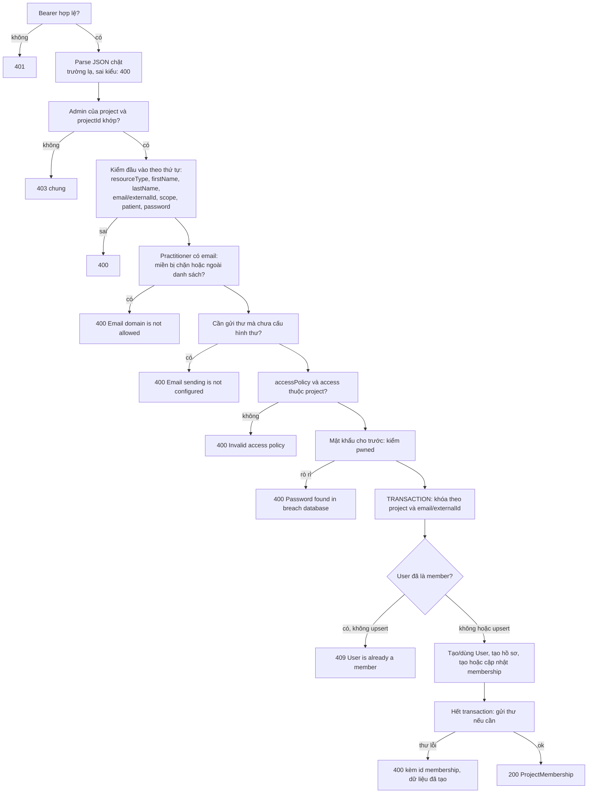

# auth: các trường hợp phản hồi của nhóm `admin`

Nhóm `/admin/projects/*` (12 route, thêm xoay secret client) cho **admin của một project** quản trị chính project đó: đọc project, đặt setting và site, tạo client, mời user, quản lý membership, đặt/gửi lại mật khẩu, gỡ MFA. Header, envelope OperationOutcome, hạn mức và mã HTTP dùng chung: [../common.md](../common.md). Bảng trường từng route: [../reference/admin.md](../reference/admin.md). Tệp này chỉ ghi **điều kiện nào ra phản hồi nào**.

**Cờ bật nhóm:** `AUTH_ADMIN_ENABLED=true` (mặc định tắt). Tắt thì mọi route `404` (OperationOutcome `Not Found`, không phân biệt với route không tồn tại). Không có `bot`, `secrets`. `/admin/super/projects` (mục cuối) có cờ riêng `AUTH_SUPER_ADMIN_ENABLED` và chỉ dành cho super-admin.

## Ai được gọi gì

| Người gọi | Kết quả |
|---|---|
| Không có `Authorization: Bearer`, token sai/hết hạn, login đã thu hồi, **membership của người gọi bị xóa hoặc `active=false`**, project `active=false` | `401` `Unauthorized`, `WWW-Authenticate` (xem từng mục) |
| `Authorization: Basic ...` của client | `401` (admin chỉ nhận Bearer) |
| Bearer hợp lệ, membership **không** `admin=true` (kể cả client `client_credentials` chưa được nâng admin) | `403` `Forbidden` |
| Bearer hợp lệ, `admin=true`, `:projectId` **trùng** project của người gọi | được phép |
| Bearer hợp lệ, `admin=true`, `:projectId` **khác** project của người gọi (kể cả project có thật) | `403` `Forbidden` |
| Membership trong `:membershipId` không tồn tại **hoặc** thuộc project khác | `403` `Forbidden` (**403 chung**, không cho dò id) |
| Admin muốn đụng tới user ở phạm vi server hoặc project khác (resetpassword, mfa/reset) | `403` `Forbidden` |

Các route `/admin/projects/*` không có đường nào xuyên project (super-admin chỉ có ở `POST /admin/super/projects`). Client (ClientApplication) gọi được nếu membership của nó được nâng `admin=true` (ví dụ qua `POST .../members/{membershipId}`), xác thực bằng Bearer `client_credentials`.

**403 chung** là OperationOutcome `code=forbidden`, `details.text` = `Forbidden`, không có `expression` (ví dụ ở mục GET project). Mọi mục dưới đây dùng lại khái niệm này.

## Thứ tự chung của mọi route admin

1. Route có hay không (`AUTH_ADMIN_ENABLED`): `404`.
2. Middleware toàn cục: body tối đa 1 MiB (`413`, thông điệp `Request body too large`), hạn mức IP `AUTH_RATE_LIMIT` (`429`).
3. Bearer (`401`). Sau bước này mới tới hạn mức bước đăng nhập `AUTH_LOGIN_RATE_LIMIT` (`429`) ở **năm route**: `setpassword`, `invite`, `resetpassword`, `mfa/reset`, `client/{clientId}/rotate-secret` (các route admin khác không có hạn mức này).
4. **Handler đọc/parse body và validator của route** (`400`): xảy ra **trước** kiểm quyền admin ở bước 5. Nghĩa là người không phải admin gửi body hỏng vẫn nhận `400`, không phải `403`.
5. Use case: kiểm admin hoạt động của project và `:projectId` (`403`), rồi nghiệp vụ, rồi ghi.

## Quy tắc bảo vệ (đối chiếu giữa các route)

| Quy tắc | `POST members/{id}` | `DELETE members/{id}` | SCIM `PUT/PATCH active=false` | SCIM `DELETE` |
|---|---|---|---|---|
| Không bỏ admin hoạt động cuối cùng (hạ `admin`, tắt `active`, xóa) | có: `Cannot remove the last administrator of the project` | có | có | có |
| Không xóa chủ project | không áp dụng | có: `Cannot delete the owner of the project` | có: `Cannot deactivate the owner of the project` | có (qua use case xóa) |
| Không tác động lên membership của chính người gọi | **không có** (hạ quyền/tắt chính mình được nếu còn admin hoạt động khác) | **không có** (xóa chính mình được nếu không phải chủ và còn admin khác) | có: `Cannot deactivate the membership of the caller` | có: `Cannot delete the membership of the caller` |
| Hạ quyền/tắt chủ project | **không chặn** nếu còn admin hoạt động khác | không áp dụng | chặn tắt | không áp dụng |

## Allowlist setting (`POST .../settings`)

| Tên | Kiểu | Quy tắc | Thông điệp lỗi (400, `expression` `setting`) |
|---|---|---|---|
| `mfaRequired` | `valueBoolean` | phải là boolean | `mfaRequired must be a boolean` |
| `allowedMfaMethods` | `valueString` | danh sách `totp` và/hoặc `email`, phân cách dấu phẩy | `allowedMfaMethods must be a string`; `allowedMfaMethods must list "totp" and/or "email"` |
| `allowedPractitionerEmailDomain` | `valueString` | tên miền (không `@`, `/`, khoảng trắng, phải có `.`, tối đa 253); **được nhiều mục** | `allowedPractitionerEmailDomain must be a domain name such as example.org` |
| `appName` | `valueString` | 1 đến 100 ký tự | `appName must be a string of 1 to 100 characters` |
| tên khác | | bị từ chối | `Setting is not allowed: <tên>` |
| trùng tên (trừ `allowedPractitionerEmailDomain`) | | | `Duplicate setting: <tên>` |

Setting ngoài allowlist **đang có** trong project (ví dụ do vận hành đặt) được giữ nguyên. Setting thuộc allowlist là **thay toàn bộ**: tên nào không có trong body thì bị xóa khỏi project (gửi `[]` xóa cả bốn).

## Che bí mật và quy tắc gửi lại

| Dữ liệu | Khi đọc (GET project, phản hồi settings/sites) | Gửi lại |
|---|---|---|
| `project.secret[]` | mỗi mục chỉ còn `name`; nếu mục có giá trị thì `valueString` = `********` (các loại giá trị khác bị bỏ) | không có route ghi `secret` ở auth |
| `site[].googleClientSecret`, `site[].recaptchaSecretKey` | `********` khi có giá trị | gửi đúng `********` trong `POST .../sites` nghĩa là **giữ secret hiện có của site cùng tên**; không có giá trị cũ thì `400` |
| `project.setting[]` | **không che** (trả như đã lưu; allowlist không chứa bí mật) | |
| `ClientApplication.secret` | trả **một lần** ở phản hồi tạo client | không đọc lại được |

## Mời user: các nhánh



| Yếu tố | Quy tắc (theo mã) |
|---|---|
| `resourceType` | `Patient`, `Practitioner`, `RelatedPerson`; khác hoặc vắng: `Resource type is required` |
| Định danh | cần `email` **hoặc** `externalId`. Có `externalId` thì user **luôn phạm vi project** và không có thư |
| `scope` | bỏ trống: `Patient` là `project`, loại khác là `server`; `externalId` ép `project`; giá trị khác `project`/`server` là `scope must be "project" or "server"` |
| Tìm User | theo email trong phạm vi đã chọn. Nếu user **ở phạm vi kia** đã là member của project: `409 User is already a member of this project` (trừ `forceNewMembership=true`) |
| Đã có membership trong project | không `upsert`: `409 User is already a member of this project`. Có `upsert=true`: **giữ id, profile, user** và ghi đè `admin`, `active`, `externalId`, `accessPolicy`, `access` bằng giá trị yêu cầu (vắng nghĩa là xóa; policy vắng thì áp policy mặc định nếu có). `membership.profile` khác profile hiện có: `409 User is already a member of this project with a different profile` |
| `forceNewMembership=true` | bỏ qua hai kiểm trùng ở trên, tạo hồ sơ và membership mới |
| `membership.profile` | phải là `<resourceType>/<id>` cùng loại với `resourceType` và thuộc project; không thì dùng hồ sơ có sẵn thay vì tạo mới |
| RelatedPerson mới | cần `patient` = `Patient/<id>` thuộc project; membership nhận `access[0]` = policy mặc định kèm tham số `patient` |
| User có sẵn (không tạo mới) | **không đổi mật khẩu, tên**; chỉ tạo hồ sơ và membership |
| `password` | vắng: server sinh ngẫu nhiên, user đặt qua link trong thư (nếu gửi thư). Có: qua `ValidatePassword` rồi kiểm pwned |
| `sendEmail` | gửi khi có email và `sendEmail` khác `false`. User mới không có `password`: thư "Welcome to ..." kèm link đặt mật khẩu; ngược lại: thư thông báo kèm link đăng nhập |
| Miền email | chỉ áp cho `Practitioner` có email. Danh sách chặn của máy chủ `AUTH_BLOCKED_EMAIL_DOMAINS` thắng; rồi các setting `allowedPractitionerEmailDomain` (rỗng: không hạn chế). Lỗi chung: `Email domain is not allowed for this project` |
| Chính sách mặc định | không chỉ định `membership.accessPolicy`/`access`: `Patient` dùng `Project.defaultPatientAccessPolicy` rồi `defaultAccessPolicies[Patient]`; `Practitioner` dùng `Admin` nếu `membership.admin=true`, không thì `Practitioner`; `RelatedPerson` dùng bản ghi `RelatedPerson` (đặt vào `access`). Không có cấu hình thì membership không có policy |
| `membership.externalId` hoặc `externalId` | trùng trong project (membership khác): `409 externalId already exists in this project` |
| `invitedBy` | luôn là user của người gọi |
| `mfaRequired` | chỉ đặt cho **User mới** |

## Sửa membership: trường được sửa / bị chặn (`POST .../members/{id}`)

| Trường trong body | Xử lý |
|---|---|
| `resourceType` ≠ `ProjectMembership` hoặc `id` ≠ đường dẫn | `403 Forbidden` |
| `user`, `profile`, `project` khác bản hiện có (hoặc vắng) | `400 Cannot change user, profile or project of a membership` |
| `admin`, `active`, `externalId`, `accessPolicy`, `access` | **được ghi, thay nguyên** theo body (vắng nghĩa là xóa/để mặc định: `admin` vắng là hạ quyền, `externalId` vắng là xóa) |
| mọi trường khác (`meta`, `userName`, `invitedBy`...) | bị bỏ qua |

Vì vậy nên **GET rồi sửa và gửi lại cả đối tượng**.

---

<a id="get-admin-projects-projectid"></a>
## `GET /admin/projects/{projectId}`

Đọc project của chính mình: `id`, `name`, `setting`, `secret` (che), `site` (che). [Tham chiếu trường](../reference/admin.md#get-admin-projects-projectid)

**Cờ bật:** `AUTH_ADMIN_ENABLED`.

**Thứ tự kiểm tra:** route bật → Bearer (401) → admin hoạt động và `projectId` khớp (403) → đọc lại project từ kho (không dùng bản trong token) → che bí mật. Không ghi dữ liệu.

| # | Trường hợp | Điều kiện | HTTP | Header phản hồi riêng | Body | Tác dụng phụ |
|---|---|---|---|---|---|---|
| C1 | Thành công | admin của project, `projectId` khớp | 200 | `Content-Type: application/json` | `{"project":{id,name,setting?,secret?,site?}}`, bí mật đã che | không |
| C2 | Chưa xác thực | thiếu Bearer, token sai, login thu hồi, membership xóa/tắt | 401 | `WWW-Authenticate: Bearer realm="auth"` (thiếu token) hoặc `Bearer realm="auth", error="invalid_token"` (token sai) | `Unauthorized` | không |
| C3 | Không phải admin | membership không `admin=true` | 403 | - | `Forbidden` | không |
| C4 | Project khác | `projectId` ≠ project của người gọi | 403 | - | `Forbidden` | không |
| C5 | Quá hạn mức IP | vượt `AUTH_RATE_LIMIT` | 429 | `Retry-After: 1` | `Too many requests` (OperationOutcome `throttled`) | không |
| C6 | Nhóm tắt | `AUTH_ADMIN_ENABLED` không bật | 404 | - | `Not Found` | không |

**Ví dụ**

```http
GET /admin/projects/0192f3a4-7b1c-7d2e-9a10-3c5e8f1b2a44 HTTP/1.1
Authorization: Bearer eyJhbGciOi...
```

```http
HTTP/1.1 200 OK
Content-Type: application/json

{
  "project": {
    "id": "0192f3a4-7b1c-7d2e-9a10-3c5e8f1b2a44",
    "name": "Bệnh viện A",
    "setting": [ { "name": "appName", "valueString": "Phòng khám" } ],
    "secret": [ { "name": "smtpPassword", "valueString": "********" } ],
    "site": [ { "name": "web", "domain": ["app.example.org"], "googleClientId": "g1", "googleClientSecret": "********" } ]
  }
}
```

403 chung (cấu trúc dùng cho mọi lỗi 403 của nhóm):

```http
HTTP/1.1 403 Forbidden
Content-Type: application/fhir+json; charset=utf-8

{ "resourceType": "OperationOutcome", "issue": [ { "severity": "error", "code": "forbidden", "details": { "text": "Forbidden" }, "diagnostics": "Forbidden" } ] }
```

**Lưu ý tích hợp:** `setting`, `secret`, `site` vắng khỏi JSON khi rỗng. Token của admin bị xóa membership hoặc tắt `active` bị từ chối ngay (401), không đợi hết hạn token.

---

<a id="post-admin-projects-projectid-settings"></a>
## `POST /admin/projects/{projectId}/settings`

Thay các setting thuộc allowlist, giữ setting ngoài allowlist. [Tham chiếu trường](../reference/admin.md#post-admin-projects-projectid-settings)

**Cờ bật:** `AUTH_ADMIN_ENABLED`.

**Thứ tự kiểm tra:** Bearer (401) → parse body thành mảng (400) → admin và `projectId` (403) → duyệt từng phần tử theo thứ tự mảng: allowlist, trùng tên, luật giá trị (lỗi đầu tiên dừng, 400) → **ghi**: `Projects.Mutate` thay các setting thuộc allowlist (một lần ghi project) → trả project.

| # | Trường hợp | Điều kiện | HTTP | Header phản hồi riêng | Body | Tác dụng phụ |
|---|---|---|---|---|---|---|
| C1 | Thành công | mảng hợp lệ | 200 | - | `{"project":...}` đã cập nhật | thay setting allowlist; setting ngoài allowlist giữ nguyên |
| C2 | Body không đọc được | JSON hỏng, không phải mảng, `null`, kiểu giá trị sai (ví dụ `valueBoolean` là chuỗi) | 400 | - | `Content could not be parsed` | không |
| C3 | Tên ngoài allowlist | ví dụ `allow-dangerous-redirect` | 400 | - | `Setting is not allowed: <tên>`, `expression` `setting` | không |
| C4 | Trùng tên | hai mục cùng tên (trừ `allowedPractitionerEmailDomain`) | 400 | - | `Duplicate setting: <tên>` | không |
| C5 | Sai giá trị | xem bảng allowlist | 400 | - | thông điệp ở bảng allowlist | không |
| C6 | Chưa xác thực | | 401 | `WWW-Authenticate` | `Unauthorized` | không |
| C7 | Không phải admin / project khác | | 403 | - | `Forbidden` | không |
| C8 | Quá hạn mức IP | | 429 | `Retry-After: 1` | `Too many requests` | không |

**Ví dụ**

```http
POST /admin/projects/0192f3a4-7b1c-7d2e-9a10-3c5e8f1b2a44/settings HTTP/1.1
Authorization: Bearer eyJhbGciOi...
Content-Type: application/json

[ { "name": "mfaRequired", "valueBoolean": true }, { "name": "allowedPractitionerEmailDomain", "valueString": "example.org" } ]
```

```http
HTTP/1.1 200 OK
Content-Type: application/json

{ "project": { "id": "0192f3a4-7b1c-7d2e-9a10-3c5e8f1b2a44", "name": "Bệnh viện A", "setting": [ { "name": "mfaRequired", "valueBoolean": true }, { "name": "allowedPractitionerEmailDomain", "valueString": "example.org" } ] } }
```

```http
HTTP/1.1 400 Bad Request
Content-Type: application/fhir+json; charset=utf-8

{ "resourceType": "OperationOutcome", "issue": [ { "severity": "error", "code": "invalid", "details": { "text": "Setting is not allowed: allow-dangerous-redirect" }, "diagnostics": "Setting is not allowed: allow-dangerous-redirect", "expression": ["setting"] } ] }
```

**Lưu ý tích hợp:** gửi **đủ** danh sách mong muốn của bốn tên trong allowlist (gửi thiếu là xóa). Chỉ báo lỗi đầu tiên (không gom). Không có tên hợp lệ nào để ghi `secret`.

---

<a id="post-admin-projects-projectid-client"></a>
## `POST /admin/projects/{projectId}/client`

Tạo `ClientApplication` và membership của nó trong project. [Tham chiếu trường](../reference/admin.md#post-admin-projects-projectid-client)

**Cờ bật:** `AUTH_ADMIN_ENABLED`.

**Thứ tự kiểm tra:** Bearer (401) → parse JSON object (400) → trường lạ (400, liệt kê theo thứ tự chữ cái, `expression` là tên đầu) → ép kiểu vào DTO (400 `Invalid client body`) → admin và `projectId` (403) → `name` không rỗng → độ dài `secret` → từng `grantType` → từng `redirectUris` → `accessPolicy` thuộc project → **một transaction**: tạo ClientApplication rồi ProjectMembership (user = profile = client; policy = `accessPolicy` hoặc policy mặc định `ClientApplication` của project). Phản hồi `201`.

| # | Trường hợp | Điều kiện | HTTP | Header phản hồi riêng | Body | Tác dụng phụ |
|---|---|---|---|---|---|---|
| C1 | Thành công | body hợp lệ | 201 | `Cache-Control: no-store` | ClientApplication kèm `secret` (do người gọi đặt hoặc server sinh 64 ký tự hex) | tạo client + membership (một transaction) |
| C2 | Body không đọc được | JSON hỏng hoặc không phải object | 400 | - | `Content could not be parsed` | không |
| C3 | Trường lạ | khác `name`, `description`, `redirectUris`, `pkceOptional`, `grantType`, `secret`, `accessPolicy` (ví dụ `identityProvider`, `meta`, `status`) | 400 | - | `Unsupported field: <các tên>` | không |
| C4 | Sai kiểu | ví dụ `redirectUris` là chuỗi | 400 | - | `Invalid client body` | không |
| C5 | Thiếu tên | `name` vắng, rỗng, chỉ khoảng trắng | 400 | - | `Client name is required`, `expression` `name` | không |
| C6 | Secret sai độ dài | có `secret` ngoài 32 đến 256 ký tự | 400 | - | `secret must be between 32 and 256 characters` | không |
| C7 | Grant lạ | ngoài `authorization_code`, `client_credentials`, `refresh_token`, token-exchange, `pre-authorized_code` | 400 | - | `Unsupported grantType: <giá trị>` | không |
| C8 | Redirect URI sai | không tuyệt đối, thiếu host, có fragment, scheme khác http/https | 400 | - | `Invalid redirect URI` | không |
| C9 | AccessPolicy sai | không tồn tại hoặc thuộc project khác | 400 | - | `Invalid access policy`, `expression` `accessPolicy` | không |
| C10 | Chưa xác thực | | 401 | `WWW-Authenticate` | `Unauthorized` | không |
| C11 | Không phải admin / project khác | | 403 | - | `Forbidden` | không |
| C12 | Quá hạn mức IP | | 429 | `Retry-After: 1` | `Too many requests` | không |

**Ví dụ**

```http
POST /admin/projects/0192f3a4-7b1c-7d2e-9a10-3c5e8f1b2a44/client HTTP/1.1
Authorization: Bearer eyJhbGciOi...
Content-Type: application/json

{ "name": "Máy đồng bộ", "grantType": ["client_credentials"] }
```

```http
HTTP/1.1 201 Created
Content-Type: application/json
Cache-Control: no-store

{ "resourceType": "ClientApplication", "id": "0192f3b0-1111-7000-8000-00000000c1ie", "name": "Máy đồng bộ", "secret": "0f3c9a1e7b5d4c2a8e6f1b3d5a7c9e0f2b4d6f8a1c3e5b7d9f0a2c4e6b8d0f1a", "grantType": ["client_credentials"] }
```

(Rút gọn: phản hồi thật còn `meta` và các trường khác của ClientApplication.)

**Lưu ý tích hợp:** lưu `secret` ngay, không đọc lại được. Trường lạ bị báo **trước** kiểm quyền. Để client gọi được `/admin` hay SCIM, nâng membership của nó lên `admin=true` bằng `POST .../members/{id}` (tìm id membership qua `GET /auth/me` của token client).

---

<a id="post-admin-projects-projectid-client-clientid-rotate-secret"></a>

## `POST /admin/projects/{projectId}/client/{clientId}/rotate-secret`

Xoay secret của một client (ClientApplication/$rotate-secret): secret hiện tại thành `retiringSecret` (vẫn dùng được để các nơi triển khai kịp đổi), secret mới là `secret`. [Tham chiếu trường](../reference/admin.md#post-admin-projects-projectid-client-clientid-rotate-secret)

**Cờ bật:** `AUTH_ADMIN_ENABLED`. **Hạn mức:** thêm hạn mức bước đăng nhập `AUTH_LOGIN_RATE_LIMIT` (route thứ năm có hạn mức này).

**Thứ tự kiểm tra:** Bearer (401) → hạn mức bước đăng nhập (429) → body (tùy chọn: không body hoặc `Content-Length: 0` là `{}`; JSON hỏng 400; trường lạ 400, liệt kê theo thứ tự chữ cái; sai kiểu 400 `Invalid rotate-secret body`) → admin và `projectId` (403) → `secret` và `retireOnly` loại trừ nhau (400) → độ dài `secret` (400) → client thuộc project (403 chung, kể cả không tồn tại) → client có secret (400) → secret mới khác secret hiện tại (400) → ghi (IfMatch, thử lại khi xung đột).

| # | Trường hợp | Điều kiện | HTTP | Header phản hồi riêng | Body | Tác dụng phụ |
|---|---|---|---|---|---|---|
| R1 | Xoay | không `retireOnly` | 200 | `Cache-Control: no-store` | `clientId`, `clientSecret` (secret MỚI, 64 ký tự hex nếu server sinh; **chỉ hiện một lần**), `retiring: true` | `retiringSecret` := secret cũ (retiringSecret cũ hơn bị bỏ), `secret` := mới; log WARN `audit=true` (không có giá trị secret); KHÔNG thu hồi token đã cấp |
| R2 | Retire | `retireOnly: true` | 200 | `Cache-Control: no-store` | `clientId`, `retiring: false` (không có `clientSecret`) | xóa `retiringSecret`; gọi lại khi không còn gì để bỏ vẫn 200 |
| R3 | Body không đọc được | JSON hỏng hoặc không phải object | 400 | - | `Content could not be parsed` | không |
| R4 | Trường lạ | khác `secret`, `retireOnly` (ví dụ `retiringSecret`) | 400 | - | `Unsupported field: <các tên>` | không |
| R5 | Sai kiểu | ví dụ `retireOnly` là chuỗi | 400 | - | `Invalid rotate-secret body` | không |
| R6 | Loại trừ | cả `secret` và `retireOnly: true` | 400 | - | `secret and retireOnly are mutually exclusive`, `expression` `retireOnly` | không |
| R7 | Secret sai độ dài | ngoài 32 đến 256 ký tự | 400 | - | `secret must be between 32 and 256 characters`, `expression` `secret` | không |
| R8 | Secret trùng | bằng secret hiện tại | 400 | - | `New secret must differ from the current secret`, `expression` `secret` | không |
| R9 | Client không có secret | client công khai | 400 | - | `Client has no secret to rotate`, `expression` `clientId` | không (không tạo secret) |
| R10 | Chưa xác thực | | 401 | `WWW-Authenticate` | `Unauthorized` | không |
| R11 | Không được phép | không phải admin; `projectId` khác project của người gọi; client không tồn tại, thuộc project khác hoặc là client dựng sẵn | 403 | - | `Forbidden` (**403 chung**, không cho dò id) | không |
| R12 | Quá hạn mức | IP hoặc bước đăng nhập | 429 | `Retry-After` | `Too many requests` | không |

**Ví dụ**

```http
POST /admin/projects/0192f3a4-7b1c-7d2e-9a10-3c5e8f1b2a44/client/0192f3b0-1111-7000-8000-00000000c1ie/rotate-secret HTTP/1.1
Authorization: Bearer eyJhbGciOi...
```

```http
HTTP/1.1 200 OK
Content-Type: application/json
Cache-Control: no-store

{ "clientId": "0192f3b0-1111-7000-8000-00000000c1ie", "clientSecret": "7d1e5b9a3c6f2e4a8b0d9c1f3e5a7b2d4c6e8f0a1b3d5f7e9c2a4b6d8e0f1a3c", "retiring": true }
```

**Quy trình xoay không gián đoạn:** gọi route (R1) → cập nhật nơi dùng sang secret mới (secret cũ vẫn dùng được) → gọi `{"retireOnly": true}` (R2) để vô hiệu secret cũ. Xoay lần nữa trước khi retire thì secret cũ nhất mất hiệu lực ngay. Khác Medplum: đường dẫn là `/admin/projects/{projectId}/client/{clientId}/rotate-secret`, không phải `/fhir/R4/ClientApplication/{id}/$rotate-secret`; tên tham số `secret` và `retireOnly` là thiết kế của port này (chưa đối chiếu với `$rotate-secret` của Medplum).

---

<a id="post-admin-projects-projectid-sites"></a>
## `POST /admin/projects/{projectId}/sites`

Thay **toàn bộ** `Project.site` (Google, reCAPTCHA). [Tham chiếu trường](../reference/admin.md#post-admin-projects-projectid-sites)

**Cờ bật:** `AUTH_ADMIN_ENABLED`.

**Thứ tự kiểm tra:** Bearer (401) → parse mảng (400) → admin và `projectId` (403) → với từng site theo thứ tự mảng: số site tối đa 20, tên, trùng tên, số miền, định dạng miền, cặp Google, cặp reCAPTCHA, độ dài giá trị, `googleClientId` trùng client chính của máy chủ (409, **kiểm ngay trong vòng lặp nên có thể ra trước lỗi 400 của site sau**), trùng trong body → **transaction**: khóa theo giá trị (`site-google:<id>`, `site-recaptcha:<khóa>`, thứ tự cố định) → kiểm duy nhất giữa các project (409) → ghi `Project.site`, giải `********` thành secret cũ (400 nếu không có) → trả project (che bí mật).

| # | Trường hợp | Điều kiện | HTTP | Header phản hồi riêng | Body | Tác dụng phụ |
|---|---|---|---|---|---|---|
| C1 | Thành công | mảng hợp lệ (có thể rỗng để xóa hết) | 200 | - | `{"project":...}` secret đã che | thay toàn bộ `site` |
| C2 | Body không đọc được | JSON hỏng, không phải mảng, `null` | 400 | - | `Content could not be parsed` | không |
| C3 | Quá nhiều site | hơn 20 | 400 | - | `Too many sites`, `expression` `site` | không |
| C4 | Tên site sai | rỗng hoặc hơn 100 ký tự | 400 | - | `Site name is required (1 to 100 characters)` | không |
| C5 | Trùng tên | | 400 | - | `Duplicate site name: <tên>` | không |
| C6 | Quá nhiều miền | hơn 20 | 400 | - | `Too many domains` | không |
| C7 | Miền sai | rỗng, chứa `@`, `/`, khoảng trắng, `:`, thiếu `.`, hơn 253 | 400 | - | `Invalid site domain: <miền>` | không |
| C8 | Cặp thiếu | id không kèm secret hoặc ngược lại | 400 | - | `googleClientId and googleClientSecret must be set together` / `recaptchaSiteKey and recaptchaSecretKey must be set together` | không |
| C9 | Giá trị quá dài | hơn 512 ký tự | 400 | - | `Site value too long` | không |
| C10 | Trùng trong body | cùng id/khóa ở hai site | 400 | - | `Duplicate googleClientId: <id>` / `Duplicate recaptchaSiteKey: <khóa>` | không |
| C11 | Trùng Google client của máy chủ | `googleClientId` = `AUTH_GOOGLE_CLIENT_ID` | 409 | - | `googleClientId is reserved by the server` | không |
| C12 | Trùng project khác | id/khóa đang dùng ở project khác | 409 | - | `googleClientId is already used by another project` / `recaptchaSiteKey is already used by another project` | không (transaction hoàn tác) |
| C13 | Giữ secret không có gì để giữ | gửi `********` nhưng site cùng tên không có giá trị cũ | 400 | - | `googleClientSecret has no existing value to keep` / `recaptchaSecretKey has no existing value to keep` | không (hoàn tác) |
| C14 | Chưa xác thực | | 401 | `WWW-Authenticate` | `Unauthorized` | không |
| C15 | Không phải admin / project khác | | 403 | - | `Forbidden` | không |
| C16 | Quá hạn mức IP | | 429 | `Retry-After: 1` | `Too many requests` | không |

**Ví dụ**

```http
POST /admin/projects/0192f3a4-7b1c-7d2e-9a10-3c5e8f1b2a44/sites HTTP/1.1
Authorization: Bearer eyJhbGciOi...
Content-Type: application/json

[ { "name": "web", "domain": ["app.example.org"], "googleClientId": "g1", "googleClientSecret": "********" } ]
```

```http
HTTP/1.1 409 Conflict
Content-Type: application/fhir+json; charset=utf-8

{ "resourceType": "OperationOutcome", "issue": [ { "severity": "error", "code": "conflict", "details": { "text": "googleClientId is already used by another project" }, "diagnostics": "googleClientId is already used by another project" } ] }
```

Thành công trả cùng cấu trúc với `GET /admin/projects/{projectId}` (secret `********`).

**Lưu ý tích hợp:** quy trình sửa an toàn: `GET project`, sửa mảng `site`, gửi lại (secret `********` được giữ). Đổi tên một site mà gửi `********` sẽ lỗi vì khóa tra cứu là tên. Miền được kiểm định dạng nhưng **lưu nguyên văn** (không hạ chữ thường; suy ra từ mã, chưa kiểm bằng test).

---

<a id="post-admin-projects-projectid-invite"></a>
## `POST /admin/projects/{projectId}/invite`

Mời Patient/Practitioner/RelatedPerson vào project: tạo hoặc dùng lại User, tạo hồ sơ, tạo (hoặc upsert) membership, gửi thư. [Tham chiếu trường](../reference/admin.md#post-admin-projects-projectid-invite)

**Cờ bật:** `AUTH_ADMIN_ENABLED`; gửi thư cần cấu hình thư (`AUTH_MAIL_PROVIDER`, `AUTH_APP_BASE_URL`) trừ khi `sendEmail=false`; Practitioner chịu `AUTH_BLOCKED_EMAIL_DOMAINS` và setting `allowedPractitionerEmailDomain`.

**Thứ tự kiểm tra** (sơ đồ ở mục "Mời user: các nhánh"):
1. Bearer (401), hạn mức bước đăng nhập (429).
2. Parse JSON **chặt**: trường lạ ở mọi cấp (kể cả `accessPolicy`, `access`, `admin` ở mức gốc) hoặc kiểu sai là 400.
3. Admin và `projectId` (403); đọc project.
4. Đầu vào theo thứ tự: `resourceType`, `firstName`, `lastName`, có email hoặc externalId, email hợp lệ, `externalId` không rỗng, `scope`, `patient` (RelatedPerson không có `membership.profile`), `password` (`ValidatePassword`).
5. Miền email (Practitioner có email); cần gửi thư mà chưa cấu hình thư (trước khi ghi).
6. `membership.accessPolicy` và từng `membership.access[].policy` thuộc project.
7. Mật khẩu cho trước: kiểm pwned (ngoài transaction, gọi mạng).
8. **Transaction** (khóa `invite:<project>:<email>` hoặc `invite:<project>:ext:<externalId>`): tìm user/kiểm trùng, tạo User nếu cần, tạo hồ sơ (kiểm `patient`, `membership.profile`), kiểm `externalId`, chọn policy, tạo hoặc cập nhật membership.
9. **Sau transaction**: gửi thư. Lỗi thư không hoàn tác dữ liệu.

| # | Trường hợp | Điều kiện | HTTP | Header phản hồi riêng | Body | Tác dụng phụ |
|---|---|---|---|---|---|---|
| C1 | Thành công, user mới | chưa có user ở phạm vi chọn | 200 | - | ProjectMembership (`invitedBy` = người gọi) | tạo User, hồ sơ, membership (một transaction); gửi thư nếu có email và `sendEmail` khác `false` |
| C2 | Thành công, dùng user có sẵn | user đã có (project khác hoặc server) | 200 | - | ProjectMembership | tạo hồ sơ + membership; không đổi mật khẩu; thư thông báo (không link đặt mật khẩu) |
| C3 | Thành công, upsert | đã là member, `upsert=true` | 200 | - | ProjectMembership cùng `id` | ghi đè admin/active/externalId/policy/access; không tạo hồ sơ mới |
| C4 | Thành công, forceNewMembership | `forceNewMembership=true` | 200 | - | membership mới | tạo hồ sơ + membership mới |
| C5 | Parse lỗi | JSON hỏng | 400 | - | `Content could not be parsed` | không |
| C6 | Trường lạ | ví dụ `accessPolicy` ở gốc, `membership.project` | 400 | - | `Unsupported field: <tên>` (chỉ trường đầu tiên) | không |
| C7 | Sai kiểu | ví dụ `firstName: 5` | 400 | - | `Invalid <đường dẫn trường>` (chưa kiểm nguyên văn đường dẫn lồng nhau) | không |
| C8 | Thiếu/sai đầu vào | | 400 | - | `Resource type is required` (`resourceType`); `First name is required` (`firstName`); `Last name is required` (`lastName`); `Either email or externalId is required`; `Valid email address is required` (`email`); `External ID cannot be empty` (`externalId`); `scope must be "project" or "server"` (`scope`); `Patient is required to create a RelatedPerson` / `Patient must be a reference to a Patient resource` (`patient`); `Password must be at least 8 characters` / `Password must be no more than 72 characters` (`password`) | không |
| C9 | Miền email bị chặn | Practitioner, miền trong blocklist hoặc ngoài `allowedPractitionerEmailDomain` | 400 | - | `Email domain is not allowed for this project`, `expression` `email` | không |
| C10 | Chưa cấu hình thư | cần gửi thư mà không có mailer/`AUTH_APP_BASE_URL` | 400 | - | `Email sending is not configured; set sendEmail to false` | không (trước khi ghi) |
| C11 | Policy sai | không tồn tại hoặc ngoài project | 400 | - | `Invalid access policy`, `expression` `membership.accessPolicy` hoặc `membership.access` | không |
| C12 | Mật khẩu rò rỉ | `password` có trong cơ sở dữ liệu rò rỉ | 400 | - | `Password found in breach database` | không |
| C13 | Hồ sơ/Patient sai | `Profile resourceType does not match request`; `Profile does not belong to project` (`membership.profile`); `Patient <ref> does not exist`; `Patient <ref> does not belong to project` (`patient`) | 400 | - | thông điệp tương ứng | transaction hoàn tác (không để lại User mới) |
| C14 | Đã là member | không `upsert`; hoặc user ở phạm vi kia đã là member (không `forceNewMembership`) | 409 | - | `User is already a member of this project` | không |
| C15 | Upsert khác hồ sơ | `membership.profile` khác hồ sơ hiện có | 409 | - | `User is already a member of this project with a different profile` | không |
| C16 | externalId trùng | membership khác trong project đã dùng | 409 | - | `externalId already exists in this project` | không |
| C17 | Thư lỗi | gửi thư thất bại sau khi ghi | 400 | - | `Invitation created (membership <id>) but the email could not be sent; use resetpassword to send it again` | **dữ liệu đã tạo**; ghi log lỗi |
| C18 | Dịch vụ kiểm pwned lỗi | | 500 | - | `Internal server error` (fail đóng, không ghi) | không |
| C19 | Chưa xác thực | | 401 | `WWW-Authenticate` | `Unauthorized` | không |
| C20 | Không phải admin / project khác | | 403 | - | `Forbidden` | không |
| C21 | Quá hạn mức | IP hoặc bước đăng nhập | 429 | `Retry-After: 1` | `Too many requests` | không |

**Ví dụ**

```http
POST /admin/projects/0192f3a4-7b1c-7d2e-9a10-3c5e8f1b2a44/invite HTTP/1.1
Authorization: Bearer eyJhbGciOi...
Content-Type: application/json

{
  "resourceType": "Practitioner", "firstName": "Lan", "lastName": "Trần", "email": "lan@example.org",
  "membership": { "admin": false }, "sendEmail": true
}
```

```http
HTTP/1.1 200 OK
Content-Type: application/json

{ "resourceType": "ProjectMembership", "id": "0192f3c0-2222-7000-8000-0000000000aa", "project": { "reference": "Project/0192f3a4-7b1c-7d2e-9a10-3c5e8f1b2a44" }, "user": { "reference": "User/0192f3c0-3333-7000-8000-0000000000bb" }, "profile": { "reference": "Practitioner/0192f3c0-4444-7000-8000-0000000000cc" }, "invitedBy": { "reference": "User/0192f3a4-0000-7000-8000-000000000001" }, "accessPolicy": { "reference": "AccessPolicy/0192f3a4-5555-7000-8000-0000000000dd" } }
```

(Rút gọn: còn `meta`, `admin`, `active`... tùy yêu cầu.) Lỗi thư (400 mang id membership):

```http
HTTP/1.1 400 Bad Request
Content-Type: application/fhir+json; charset=utf-8

{ "resourceType": "OperationOutcome", "issue": [ { "severity": "error", "code": "invalid", "details": { "text": "Invitation created (membership 0192f3c0-2222-7000-8000-0000000000aa) but the email could not be sent; use resetpassword to send it again" }, "diagnostics": "Invitation created (membership 0192f3c0-2222-7000-8000-0000000000aa) but the email could not be sent; use resetpassword to send it again" } ] }
```

409:

```http
HTTP/1.1 409 Conflict
Content-Type: application/fhir+json; charset=utf-8

{ "resourceType": "OperationOutcome", "issue": [ { "severity": "error", "code": "conflict", "details": { "text": "User is already a member of this project" }, "diagnostics": "User is already a member of this project" } ] }
```

**Lưu ý tích hợp:** thành công trả `200` (không phải `201`). Mời lại sau lỗi thư là `409`: dùng `POST .../members/{id}/resetpassword` để gửi lại, không mời lại. Không có `conditionalCreate` hồ sơ theo email. User có sẵn không được cập nhật tên hay mật khẩu. SCIM `POST /Users` đi qua cùng đường này (không gửi thư).

---

<a id="get-admin-projects-projectid-members-membershipid"></a>
## `GET /admin/projects/{projectId}/members/{membershipId}`

Đọc một ProjectMembership của project. [Tham chiếu trường](../reference/admin.md#get-admin-projects-projectid-members-membershipid)

**Thứ tự kiểm tra:** Bearer (401) → admin và `projectId` (403) → đọc membership: không tồn tại hoặc `project` ≠ project của người gọi là **403 chung** → trả. Không ghi.

| # | Trường hợp | Điều kiện | HTTP | Header phản hồi riêng | Body | Tác dụng phụ |
|---|---|---|---|---|---|---|
| C1 | Thành công | membership thuộc project | 200 | - | ProjectMembership | không |
| C2 | Chưa xác thực | | 401 | `WWW-Authenticate` | `Unauthorized` | không |
| C3 | Không phải admin / project khác / membership không có / membership project khác / đã xóa | | 403 | - | `Forbidden` | không |
| C4 | Quá hạn mức IP | | 429 | `Retry-After: 1` | `Too many requests` | không |

**Ví dụ**

```http
GET /admin/projects/0192f3a4-7b1c-7d2e-9a10-3c5e8f1b2a44/members/0192f3c0-2222-7000-8000-0000000000aa HTTP/1.1
Authorization: Bearer eyJhbGciOi...
```

```http
HTTP/1.1 200 OK
Content-Type: application/json

{ "resourceType": "ProjectMembership", "id": "0192f3c0-2222-7000-8000-0000000000aa", "project": { "reference": "Project/0192f3a4-7b1c-7d2e-9a10-3c5e8f1b2a44" }, "user": { "reference": "User/0192f3c0-3333-7000-8000-0000000000bb" }, "profile": { "reference": "Practitioner/0192f3c0-4444-7000-8000-0000000000cc" }, "admin": false, "active": true }
```

**Lưu ý tích hợp:** không phân biệt "không có" và "của project khác": đừng dùng route này để dò id. Kết quả dùng làm nền cho `POST` sửa membership.

---

<a id="post-admin-projects-projectid-members-membershipid"></a>
## `POST /admin/projects/{projectId}/members/{membershipId}`

Sửa membership (chỉ `admin`, `active`, `externalId`, `accessPolicy`, `access`). [Tham chiếu trường](../reference/admin.md#post-admin-projects-projectid-members-membershipid)

**Thứ tự kiểm tra:** Bearer (401) → parse body (400) → admin, `projectId`, membership thuộc project (403 chung) → `resourceType`/`id` khớp đường dẫn (403) → `user`/`profile`/`project` không đổi (400) → `accessPolicy` và `access[].policy` thuộc project (400) → nếu đang là admin hoạt động và body hạ `admin` hoặc tắt `active`: bảo vệ admin cuối cùng (400) → `externalId` mới không trùng (409) → **ghi** `Memberships.Mutate` (một lần ghi).

| # | Trường hợp | Điều kiện | HTTP | Header phản hồi riêng | Body | Tác dụng phụ |
|---|---|---|---|---|---|---|
| C1 | Thành công | body hợp lệ | 200 | - | ProjectMembership đã sửa | thay `admin`, `active`, `externalId`, `accessPolicy`, `access`. `active=false` làm token của member bị từ chối ngay (401) |
| C2 | Body không đọc được | JSON hỏng | 400 | - | `Content could not be parsed` | không |
| C3 | Đổi user/profile/project | khác bản hiện có hoặc vắng | 400 | - | `Cannot change user, profile or project of a membership` | không |
| C4 | Policy sai | không tồn tại hoặc ngoài project | 400 | - | `Invalid access policy`, `expression` `accessPolicy` hoặc `access` | không |
| C5 | Admin cuối cùng | hạ `admin` hoặc tắt `active` của admin hoạt động duy nhất | 400 | - | `Cannot remove the last administrator of the project` | không |
| C6 | `resourceType`/`id` lệch | | 403 | - | `Forbidden` | không |
| C7 | externalId trùng | membership khác trong project đã dùng | 409 | - | `externalId already exists in this project` | không |
| C8 | Chưa xác thực | | 401 | `WWW-Authenticate` | `Unauthorized` | không |
| C9 | Không phải admin / project khác / membership không có hoặc của project khác | | 403 | - | `Forbidden` | không |
| C10 | Quá hạn mức IP | | 429 | `Retry-After: 1` | `Too many requests` | không |

**Ví dụ**

```http
POST /admin/projects/0192f3a4-7b1c-7d2e-9a10-3c5e8f1b2a44/members/0192f3c0-2222-7000-8000-0000000000aa HTTP/1.1
Authorization: Bearer eyJhbGciOi...
Content-Type: application/json

{ "resourceType": "ProjectMembership", "id": "0192f3c0-2222-7000-8000-0000000000aa", "project": { "reference": "Project/0192f3a4-7b1c-7d2e-9a10-3c5e8f1b2a44" }, "user": { "reference": "User/0192f3c0-3333-7000-8000-0000000000bb" }, "profile": { "reference": "Practitioner/0192f3c0-4444-7000-8000-0000000000cc" }, "admin": true, "active": true, "externalId": "hr-10234" }
```

```http
HTTP/1.1 200 OK
Content-Type: application/json

{ "resourceType": "ProjectMembership", "id": "0192f3c0-2222-7000-8000-0000000000aa", "admin": true, "active": true, "externalId": "hr-10234" }
```

(Rút gọn: phản hồi thật đủ các trường của membership.)

**Lưu ý tích hợp:** trường vắng trong body bị **xóa** (`admin` vắng là hạ quyền, `externalId` vắng là bỏ mã ngoài): luôn GET rồi gửi lại cả đối tượng. Không có chặn "hạ quyền chủ project" hay "hạ quyền chính mình" nếu còn admin hoạt động khác.

---

<a id="delete-admin-projects-projectid-members-membershipid"></a>
## `DELETE /admin/projects/{projectId}/members/{membershipId}`

Xóa membership; user thuộc project mà hết membership thì bị xóa cùng. [Tham chiếu trường](../reference/admin.md#delete-admin-projects-projectid-members-membershipid)

**Thứ tự kiểm tra:** Bearer (401) → admin, `projectId`, membership thuộc project (403 chung) → đọc project → không xóa chủ project (400) → nếu là admin hoạt động: bảo vệ admin cuối cùng (400) → **một transaction**: xóa membership; nếu user có `project` = project này và không còn membership nào khác thì xóa User.

| # | Trường hợp | Điều kiện | HTTP | Header phản hồi riêng | Body | Tác dụng phụ |
|---|---|---|---|---|---|---|
| C1 | Thành công | | 200 | `Content-Type: application/fhir+json` | OperationOutcome `All OK` | xóa membership; xóa User nếu thuộc project và hết membership. Hồ sơ (Practitioner...) **không** bị xóa. Token của member bị từ chối ngay |
| C2 | Chủ project | `project.owner` = user của membership | 400 | - | `Cannot delete the owner of the project` | không |
| C3 | Admin cuối cùng | admin hoạt động duy nhất | 400 | - | `Cannot remove the last administrator of the project` | không |
| C4 | Chưa xác thực | | 401 | `WWW-Authenticate` | `Unauthorized` | không |
| C5 | Không phải admin / project khác / membership không có hoặc của project khác (kể cả đã xóa trước đó) | | 403 | - | `Forbidden` | không |
| C6 | Quá hạn mức IP | | 429 | `Retry-After: 1` | `Too many requests` | không |

**Ví dụ**

```http
DELETE /admin/projects/0192f3a4-7b1c-7d2e-9a10-3c5e8f1b2a44/members/0192f3c0-2222-7000-8000-0000000000aa HTTP/1.1
Authorization: Bearer eyJhbGciOi...
```

```http
HTTP/1.1 200 OK
Content-Type: application/fhir+json; charset=utf-8

{ "resourceType": "OperationOutcome", "issue": [ { "severity": "information", "code": "informational", "details": { "text": "All OK" }, "diagnostics": "All OK" } ] }
```

**Lưu ý tích hợp:** gọi lại lần hai nhận `403` (membership không còn), không phải `404`. User phạm vi server hoặc dùng chung nhiều project được giữ. Chủ project và admin cuối cùng không xóa được, nhưng người gọi xóa được chính mình nếu không phải chủ và còn admin khác.

---

<a id="post-admin-projects-setpassword"></a>
## `POST /admin/projects/setpassword`

Admin đặt mật khẩu cho user **thuộc project của mình** (theo email). [Tham chiếu trường](../reference/admin.md#post-admin-projects-setpassword)

**Thứ tự kiểm tra:** Bearer (401) → hạn mức bước đăng nhập (429) → parse object (400) → validator gom lỗi (400: email, mật khẩu) → admin (403) → tìm user **trong project của người gọi** (không có, ở phạm vi server, ở project khác: 400 `User not found`) → độ mạnh mật khẩu → kiểm pwned → **transaction**: vô hiệu các yêu cầu bảo mật loại đặt mật khẩu, ghi băm mật khẩu → sau transaction: **thu hồi mọi login** của user.

| # | Trường hợp | Điều kiện | HTTP | Header phản hồi riêng | Body | Tác dụng phụ |
|---|---|---|---|---|---|---|
| C1 | Thành công | | 200 | `Content-Type: application/fhir+json` | OperationOutcome `All OK` | đổi mật khẩu; thu hồi mọi login của user (nếu là chính người gọi thì token của họ cũng hết hiệu lực) |
| C2 | Body không đọc được | | 400 | - | `Content could not be parsed` | không |
| C3 | Validator | gom nhiều issue | 400 | - | `Valid email address is required` (`email`); `Password must be at least 8 characters` hoặc `Password must be no more than 72 characters` (`password`) | không |
| C4 | Không có user | email không có, user phạm vi server, user project khác | 400 | - | `User not found` | không |
| C5 | Mật khẩu rò rỉ | | 400 | - | `Password found in breach database` | không |
| C6 | Dịch vụ pwned lỗi | fail đóng | 500 | - | `Internal server error` | không |
| C7 | Chưa xác thực | | 401 | `WWW-Authenticate` | `Unauthorized` | không |
| C8 | Không phải admin | | 403 | - | `Forbidden` | không |
| C9 | Quá hạn mức | IP hoặc bước đăng nhập | 429 | `Retry-After: 1` | `Too many requests` | không |

**Ví dụ**

```http
POST /admin/projects/setpassword HTTP/1.1
Authorization: Bearer eyJhbGciOi...
Content-Type: application/json

{ "email": "an@example.org", "password": "Matkhau-Moi-2026!" }
```

```http
HTTP/1.1 200 OK
Content-Type: application/fhir+json; charset=utf-8

{ "resourceType": "OperationOutcome", "issue": [ { "severity": "information", "code": "informational", "details": { "text": "All OK" }, "diagnostics": "All OK" } ] }
```

```http
HTTP/1.1 400 Bad Request
Content-Type: application/fhir+json; charset=utf-8

{ "resourceType": "OperationOutcome", "issue": [
  { "severity": "error", "code": "invalid", "details": { "text": "Valid email address is required" }, "diagnostics": "Valid email address is required", "expression": ["email"] },
  { "severity": "error", "code": "invalid", "details": { "text": "Password must be at least 8 characters" }, "diagnostics": "Password must be at least 8 characters", "expression": ["password"] } ] }
```

**Lưu ý tích hợp:** user được tạo ở phạm vi server (ví dụ qua `invite` Practitioner mặc định, hoặc admin seed) **không** đặt được bằng route này. Email không phân biệt hoa thường. Route không đặt `emailVerified`.

---

<a id="post-admin-projects-projectid-members-membershipid-resetpassword"></a>
## `POST /admin/projects/{projectId}/members/{membershipId}/resetpassword`

Gửi thư đặt lại mật khẩu cho user của một member. [Tham chiếu trường](../reference/admin.md#post-admin-projects-projectid-members-membershipid-resetpassword)

**Cờ bật:** `AUTH_ADMIN_ENABLED`; cần cấu hình thư.

**Thứ tự kiểm tra:** Bearer (401) → hạn mức bước đăng nhập (429) → admin, `projectId`, membership thuộc project (403 chung) → membership phải trỏ tới `User/...` thuộc **đúng project này** (user phạm vi server, project khác, hoặc membership của client: 403) → user có email (400) → email thuộc miền đăng nhập ngoài (400) → có cấu hình thư (400) → phát yêu cầu bảo mật mới (**vô hiệu hóa link đặt lại cũ cùng loại**, ghi UserSecurityRequest) → gửi thư (lỗi: 500).

| # | Trường hợp | Điều kiện | HTTP | Header phản hồi riêng | Body | Tác dụng phụ |
|---|---|---|---|---|---|---|
| C1 | Thành công | | 200 | `Content-Type: application/fhir+json` | OperationOutcome `All OK` | tạo UserSecurityRequest (link cũ hết hiệu lực); gửi thư kèm link đặt mật khẩu. Mật khẩu và login hiện tại **không đổi** |
| C2 | User không có email | | 400 | - | `User does not have an email address` | không |
| C3 | Miền đăng nhập ngoài | email thuộc IdP ngoài | 400 | - | `Cannot reset password for external auth. Contact your system administrator.` | không |
| C4 | Chưa cấu hình thư | | 400 | - | `Email sending is not configured` | không |
| C5 | Gửi thư lỗi | | 500 | - | `Internal server error` (thông điệp nội bộ `Could not send email` không lộ) | yêu cầu bảo mật mới **đã ghi** và link cũ đã bị vô hiệu |
| C6 | Chưa xác thực | | 401 | `WWW-Authenticate` | `Unauthorized` | không |
| C7 | Không phải admin / project khác / membership không có hoặc của project khác / user ngoài project (server, project khác) / membership của client | | 403 | - | `Forbidden` | không |
| C8 | Quá hạn mức | IP hoặc bước đăng nhập | 429 | `Retry-After: 1` | `Too many requests` | không |

**Ví dụ**

```http
POST /admin/projects/0192f3a4-7b1c-7d2e-9a10-3c5e8f1b2a44/members/0192f3c0-2222-7000-8000-0000000000aa/resetpassword HTTP/1.1
Authorization: Bearer eyJhbGciOi...
```

```http
HTTP/1.1 200 OK
Content-Type: application/fhir+json; charset=utf-8

{ "resourceType": "OperationOutcome", "issue": [ { "severity": "information", "code": "informational", "details": { "text": "All OK" }, "diagnostics": "All OK" } ] }
```

**Lưu ý tích hợp:** khác `/auth/resetpassword` công khai (luôn 200 để không lộ tài khoản), route này báo lỗi rõ. Không cần body. Dùng để gửi lại thư sau khi `invite` báo lỗi thư.

---

<a id="post-admin-projects-projectid-members-membershipid-mfa-reset"></a>
## `POST /admin/projects/{projectId}/members/{membershipId}/mfa/reset`

Gỡ một yếu tố MFA (`totp` mặc định, hoặc `email`) của user trong project. [Tham chiếu trường](../reference/admin.md#post-admin-projects-projectid-members-membershipid-mfa-reset)

**Cờ bật:** `AUTH_ADMIN_ENABLED`; MFA phải được cấu hình (khóa `AUTH_MFA_SECRET_KEYS` và phụ thuộc MFA).

**Thứ tự kiểm tra:** Bearer (401) → hạn mức bước đăng nhập (429) → nếu có body (`Content-Length` ≠ 0) parse object (400) → **MFA đã cấu hình?** (500, kiểm **trước cả quyền admin**) → `method` hợp lệ (400) → admin, `projectId`, membership, user thuộc project (403 chung) → user đang có yếu tố đó (400) → sinh secret TOTP mới nếu gỡ `totp` → **ghi** User (bỏ yếu tố khỏi `mfaMethod`, đặt `mfaEnrolled` = còn yếu tố nào; `totp`: thay `mfaSecret`).

| # | Trường hợp | Điều kiện | HTTP | Header phản hồi riêng | Body | Tác dụng phụ |
|---|---|---|---|---|---|---|
| C1 | Thành công | | 200 | `Content-Type: application/fhir+json` | OperationOutcome `All OK` | gỡ yếu tố; `totp` thì đổi secret. Không thu hồi login. Lần đăng nhập sau user bị buộc đăng ký lại nếu project bắt buộc MFA |
| C2 | Body không đọc được | có body nhưng không phải object | 400 | - | `Content could not be parsed` | không |
| C3 | Phương thức sai | `method` không phải chuỗi `totp`/`email` (`null` là mặc định `totp`) | 400 | - | `Method must be "totp" or "email"`, `expression` `method` | không |
| C4 | Chưa đăng ký yếu tố | user không có yếu tố đó | 400 | - | `User is not enrolled in MFA method: <method>` | không |
| C5 | MFA chưa cấu hình | fail đóng | 500 | - | `Internal server error` | không (xảy ra cả với người không phải admin) |
| C6 | Chưa xác thực | | 401 | `WWW-Authenticate` | `Unauthorized` | không |
| C7 | Không phải admin / project khác / membership không có hoặc của project khác / user ngoài project / membership của client | | 403 | - | `Forbidden` | không |
| C8 | Quá hạn mức | IP hoặc bước đăng nhập | 429 | `Retry-After: 1` | `Too many requests` | không |

**Ví dụ**

```http
POST /admin/projects/0192f3a4-7b1c-7d2e-9a10-3c5e8f1b2a44/members/0192f3c0-2222-7000-8000-0000000000aa/mfa/reset HTTP/1.1
Authorization: Bearer eyJhbGciOi...
Content-Type: application/json

{ "method": "email" }
```

```http
HTTP/1.1 200 OK
Content-Type: application/fhir+json; charset=utf-8

{ "resourceType": "OperationOutcome", "issue": [ { "severity": "information", "code": "informational", "details": { "text": "All OK" }, "diagnostics": "All OK" } ] }
```

```http
HTTP/1.1 400 Bad Request
Content-Type: application/fhir+json; charset=utf-8

{ "resourceType": "OperationOutcome", "issue": [ { "severity": "error", "code": "invalid", "details": { "text": "User is not enrolled in MFA method: email" }, "diagnostics": "User is not enrolled in MFA method: email" } ] }
```

**Lưu ý tích hợp:** có thể không gửi body. Route không chặn gỡ yếu tố cuối khi project bắt buộc MFA (đường khôi phục). Phiên đang đăng nhập không bị thu hồi.

---

<a id="post-admin-super-projects"></a>

## `POST /admin/super/projects`

Tạo project mới (Project/$init): AccessPolicy mặc định, client mặc định và membership admin cho chủ sở hữu trong một transaction. [Tham chiếu trường](../reference/admin.md#post-admin-super-projects)

**Cờ bật:** `AUTH_SUPER_ADMIN_ENABLED=true` (mặc định tắt, độc lập với `AUTH_ADMIN_ENABLED`). Tắt thì `404`. Người gọi phải là **admin hoạt động của một project được đánh dấu `superAdmin`** (`auth project super -project <id>`), qua login không giới hạn bằng scope SMART theo loại resource; cờ đọc lại từ kho mỗi yêu cầu nên bỏ cờ có hiệu lực ngay với token đang dùng. Project tạo ra KHÔNG thừa kế `superAdmin`.

**Thứ tự kiểm tra:** Bearer (401) → hạn mức bước đăng nhập `AUTH_LOGIN_RATE_LIMIT` (429) → parse JSON object (400) → trường lạ (400, liệt kê theo thứ tự chữ cái) → ép kiểu (400 `Invalid project body`) → super-admin (403, `Forbidden`) → tên tính năng (400) → chủ sở hữu (400) → tên project (400) → ghi.

| # | Trường hợp | Điều kiện | HTTP | Header phản hồi riêng | Body | Tác dụng phụ |
|---|---|---|---|---|---|---|
| S1 | Thành công | body hợp lệ, người gọi là admin của project super | 201 | `Cache-Control: no-store` | `projectId`, `name`, `owner` (`User/<id>`), `membershipId`, `clientId`, `clientSecret` (**chỉ hiện một lần**) | tạo Project, 6 AccessPolicy mặc định, client mặc định và membership của nó, Practitioner và membership admin của chủ sở hữu (một transaction); log WARN `audit=true` |
| S2 | Body không đọc được | JSON hỏng hoặc không phải object | 400 | - | `Content could not be parsed` | không |
| S3 | Trường lạ | khác `name`, `ownerEmail`, `features` (ví dụ `superAdmin`, `owner`) | 400 | - | `Unsupported field: <các tên>` | không |
| S4 | Sai kiểu | ví dụ `features` là chuỗi | 400 | - | `Invalid project body` | không |
| S5 | Tên tính năng sai | không khớp `^[a-z][a-z0-9-]{0,63}$` | 400 | - | `Invalid feature name`, `expression` `features` | không |
| S6 | Quá nhiều tính năng | hơn 20 tên khác nhau (trùng được bỏ) | 400 | - | `Too many features`, `expression` `features` | không |
| S7 | Chủ sở hữu không có | `ownerEmail` không phải user toàn cục nào | 400 | - | `Owner not found`, `expression` `ownerEmail` | không |
| S8 | Chủ sở hữu thuộc project | chủ mặc định (người gọi) là user gắn một project | 400 | - | `Owner must be a global user (not scoped to a project)`, `expression` `ownerEmail` | không |
| S9 | Tên project sai | thiếu, rỗng hoặc hơn 72 ký tự (đếm ký tự) | 400 | - | `Project name must be between 1 and 72 characters`, `expression` `projectName` | không |
| S10 | Chưa xác thực | | 401 | `WWW-Authenticate` | `Unauthorized` | không |
| S11 | Không phải super-admin | project không `superAdmin`, membership không `admin`, hoặc login có scope SMART theo loại | 403 | - | `Forbidden` | không |
| S12 | Quá hạn mức | IP hoặc bước đăng nhập | 429 | `Retry-After` | `Too many requests` | không |

**Ví dụ**

```http
POST /admin/super/projects HTTP/1.1
Authorization: Bearer eyJhbGciOi...
Content-Type: application/json

{ "name": "Bệnh viện B", "ownerEmail": "owner@example.org", "features": ["scim"] }
```

```http
HTTP/1.1 201 Created
Content-Type: application/json
Cache-Control: no-store

{ "projectId": "0192f3a4-7b1c-7d2e-9a10-3c5e8f1b2a44", "name": "Bệnh viện B", "owner": "User/0192f3a4-7b1c-7d2e-9a10-3c5e8f1b2a45",
  "membershipId": "0192f3a4-7b1c-7d2e-9a10-3c5e8f1b2a46", "clientId": "0192f3a4-7b1c-7d2e-9a10-3c5e8f1b2a47", "clientSecret": "0f3c9a1e7b5d4c2a8e6f1b3d5a7c9e0f2b4d6f8a1c3e5b7d9f0a2c4e6b8d0f1a" }
```

**Lưu ý tích hợp:** chủ sở hữu phải là user toàn cục đã có (tạo bằng đăng ký hoặc `auth seed project`); route không tạo user và không đặt mật khẩu. Lưu `clientSecret` ngay. Khác Medplum: đường dẫn là `/admin/super/projects`, không phải `/fhir/R4/Project/$init`, và đặt cờ `superAdmin` bằng CLI (`auth project super`), không có route HTTP để đặt cờ này.

---

## Phát hiện lệch với common.md

Đối chiếu `common.md` với mã (`httpapi.go`, `errors.go`, `scim.go`, `email.go`, `application/email.go`). Không sửa `common.md`.

| Vị trí trong common.md | Điều đúng theo mã |
|---|---|
| Mục 7, cột "Phạm vi" của hạn mức toàn cục `AUTH_RATE_LIMIT` (`/auth/`, `/oauth2/`, `/.well-known/`, `/admin/`) | Bộ lọc dùng danh sách tiền tố CORS nên **cũng áp cho `/scim/` và `/email/`** |
| Mục 7, hạn mức bước đăng nhập liệt kê "admin ghi" | Chỉ bốn route admin có hạn mức này: `setpassword`, `invite`, `resetpassword`, `mfa/reset`. `settings`, `client`, `sites`, `members` (POST/DELETE) chỉ chịu hạn mức IP chung |
| Mục 3 và 5: `/email/*` luôn OperationOutcome, `/scim/*` luôn SCIM Error | Chỉ lỗi do handler sinh. Lỗi do khung (`404` route tắt, `413` vượt 1 MiB toàn cục, `429`, `403 cannot identify caller`) ở `/scim/*` và `/email/*` có dạng JSON `{"error":"..."}` vì `fhirPath` chỉ gồm `/auth` và `/admin` (suy ra từ `errorHandler`, test chỉ kiểm mã HTTP) |
| Mục 3: "500, 502 → thông điệp chung `Internal server error`" | `502` của email giữ thông điệp riêng: `Failed to send email`, `Failed to read attachment` (test `TestHTTPEmailSMTPFailureIs502WithoutDetails`). Chỉ `500` là chung |
| Mục 3, "Thành công không nội dung" (`id` `ok`, không `diagnostics`) | Các route admin và email trả OperationOutcome thành công **không có `id`** và **có** `diagnostics` `All OK` (dùng `outcome(...)`, không dùng `allOK()`) |
| Mục 2: `WWW-Authenticate` của SCIM kèm Bearer | Mã trả hai dòng: `Basic realm="scim", charset="UTF-8"` và `Bearer realm="scim"` (không phải `realm="auth"`) |

Ngoài `common.md`: chú thích Go của `application.AdminProjectView.Setting` ("giá trị bí mật bị che") không đúng với mã, `setting` được trả **nguyên văn**, chỉ `secret` và khóa bí mật trong `site` bị che (swagger kế thừa chú thích này).
