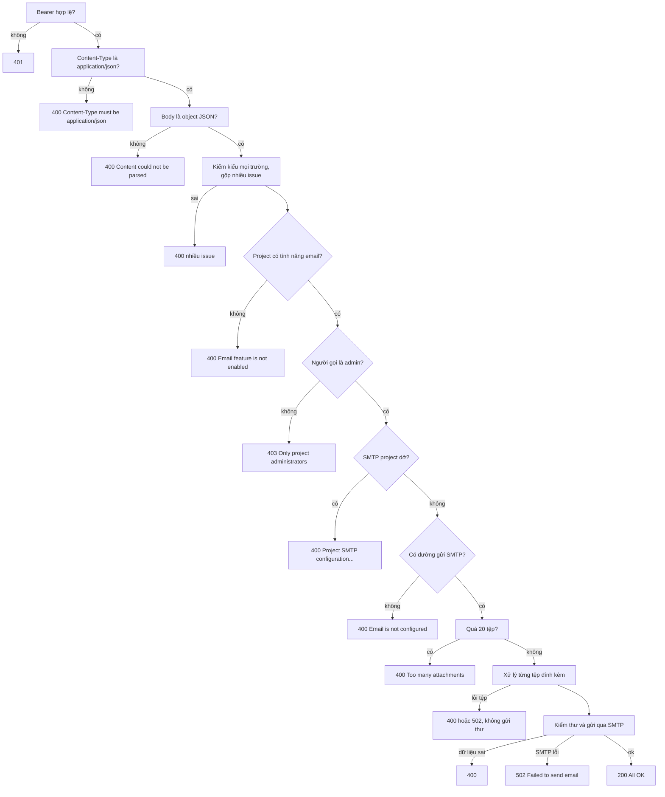

# auth: các trường hợp phản hồi của nhóm `email`

Một route: `POST /email/v1/send`, cho **admin của project** gửi thư qua SMTP của máy chủ (hoặc SMTP riêng của project nếu được phép). Header, envelope OperationOutcome, hạn mức, mã HTTP chung: [../common.md](../common.md). Bảng trường: [../reference/email.md](../reference/email.md). Mục "Phát hiện lệch" của [admin.md](admin.md) ghi các chỗ `common.md` lệch mã (đặc biệt `502` và lỗi do khung của `/email/*`).

---

<a id="post-email-v1-send"></a>
## `POST /email/v1/send`

Gửi một thư (văn bản, HTML, iCal, tệp đính kèm nhúng/URL/`Binary/<id>`) tới tối đa 50 người nhận. [Tham chiếu trường](../reference/email.md#post-email-v1-send)

**Cờ bật:**

| Cờ | Ý nghĩa | Khi thiếu |
|---|---|---|
| `AUTH_EMAIL_ENABLED=true` | bật route (mặc định tắt) | `404` (JSON `{"error":"Not Found"}`, suy ra từ `errorHandler`, chưa kiểm body) |
| `email` trong `Project.features` (`auth project feature -project <id> -feature email`, hoặc `AUTH_DEFAULT_PROJECT_FEATURES=email` lúc seed) | bật cho project | `400` `Email feature is not enabled for this project` |
| Người gọi `membership.admin=true` | | `403` `Only project administrators can send emails` |
| SMTP máy chủ (`AUTH_SMTP_*`, `AUTH_MAIL_PROVIDER=smtp`) hoặc SMTP project | có đường gửi | `400` `Email is not configured on this server. Set up SMTP.` |
| `AUTH_EMAIL_ALLOW_PROJECT_SMTP=true` | dùng `Project.secret` (`smtpHost`, `smtpPort`, `smtpUsername`, `smtpPassword`, `smtpFromAddress`, tùy chọn `smtpSecure`, `smtpApprovedSenders`); mặc định tắt (mật khẩu lưu dạng rõ) | SMTP project bị bỏ qua, dùng SMTP máy chủ |
| `AUTH_EMAIL_FHIR_URL` | gốc API FHIR để đọc `Binary/<id>` (timeout `AUTH_EMAIL_FHIR_TIMEOUT`, mặc định 30 s) | `400` `Binary attachments are not supported` |
| `AUTH_EMAIL_MAX_RECIPIENTS` (50), `AUTH_EMAIL_MAX_BYTES` (10 MiB) | giới hạn người nhận và cỡ (thư và mỗi tệp) | xem bảng |
| `AUTH_EMAIL_ALLOW_UNSAFE_OUTBOUND` | tắt chặn địa chỉ nội bộ cho SMTP project và tệp URL (chỉ dev, cấm ở production) | |

**Thứ tự kiểm tra** (thông điệp lộ thứ tự; sơ đồ bên dưới):
1. Route bật (404); body toàn cục tối đa **1 MiB** (413 do khung, JSON `{"error":"Request body too large"}`); hạn mức IP `AUTH_RATE_LIMIT` (429).
2. Bearer (401); rồi hạn mức bước đăng nhập `AUTH_LOGIN_RATE_LIMIT` (429).
3. `Content-Type` phải là `application/json` (400; tham số `charset` được chấp nhận).
4. Parse object JSON (400 `Content could not be parsed`).
5. Kiểm kiểu mọi trường, **gộp mọi lỗi** thành OperationOutcome nhiều issue (400).
6. Tính năng `email` của project (400).
7. Người gọi là admin (403). Lưu ý: tính năng được kiểm **trước** quyền, nên người không phải admin của project chưa bật `email` nhận 400, không phải 403.
8. Cấu hình SMTP của project dở (400) rồi có đường gửi (400).
9. Số tệp đính kèm > 20 (400).
10. Từng tệp đính kèm theo thứ tự mảng: tệp lỗi đầu tiên dừng cả yêu cầu (400/502), **không gửi thư**.
11. Gửi: kiểm thư (người nhận, địa chỉ, header, kích thước) rồi nối SMTP: lỗi dữ liệu 400, lỗi SMTP 502. Không có ghi dữ liệu nào trong kho; chỉ log kiểm toán (id project, số người nhận, **không** subject).



## Các thông điệp kiểm kiểu (bước 5, gộp)

Thứ tự issue theo thứ tự kiểm: `to`, `cc`, `bcc`, `replyTo`, `from`, `subject`, `text`, `html`, `attachments` (từng phần tử), `icalEvent`. Trường ngoài danh sách (`envelope`, `raw`, `headers`, `dkim`, `auth`, `sender`, `disableFileAccess`, `__proto__`...) **bị bỏ qua**, không vào thư. `null` coi như vắng.

| Điều kiện | `details.text` | `expression` |
|---|---|---|
| `to` vắng, `null`, `""`, `[]` | `To is required` | `to` |
| `to`, `cc`, `bcc`, `replyTo` sai (không phải chuỗi địa chỉ/danh sách phân cách dấu phẩy, đối tượng `{name?, address}` với `address` trần, hoặc mảng của chúng; có phần tử `null`, rỗng, sai kiểu; chuỗi có CR/LF/NUL) | `To must be an email address, an object with an address, or an array of them` (nhãn `To`, `Cc`, `Bcc`, `ReplyTo`) | tên trường |
| `from` không phải đúng một địa chỉ | `From must be a single email address` | `from` |
| `subject` vắng, `null`, `""` | `Subject is required` | `subject` |
| `subject` không phải chuỗi | `Subject must be a string` | `subject` |
| `text` / `html` không phải chuỗi | `Text must be a string` / `HTML must be a string` | `text` / `html` |
| `attachments` không phải mảng | `Attachments must be an array` | `attachments` |
| phần tử không phải object | `Attachment must be an object` | `attachments` |
| `content`, `path`, `contentType`, `contentDisposition`, `cid`, `encoding` không phải chuỗi | `Attachment properties must be strings` (một issue mỗi tệp) | `attachments` |
| `filename` không phải chuỗi (chỉ `false` hợp lệ; `true`, số: lỗi) | `Attachment filename must be a string` | `attachments` |
| `icalEvent` không phải chuỗi hay object có `content` chuỗi | `icalEvent must be a string or an object with string content` | `icalEvent` |
| `icalEvent.method` hoặc `.filename` không phải chuỗi | `icalEvent properties must be strings` | `icalEvent` |

## Quy tắc `from` (danh sách duyệt)

| Tình huống | Người gửi dùng cho header và phong bì |
|---|---|
| Không gửi `from` | mặc định: `AUTH_SMTP_FROM` (SMTP máy chủ) hoặc `smtpFromAddress` (SMTP project) |
| `from` có phần **địa chỉ trần** thuộc danh sách duyệt (`AUTH_SMTP_APPROVED_SENDERS` cho SMTP máy chủ; `smtpApprovedSenders` cho SMTP project; so không phân biệt hoa thường, cắt khoảng trắng; hai danh sách **không trộn**) | chuỗi người gọi đặt (giữ cả tên hiển thị và chữ hoa thường) |
| `from` không thuộc danh sách (kể cả cố lách bằng tên hiển thị `"<approved@...>" <evil@...>` hay hậu tố miền) | **im lặng** dùng mặc định, vẫn `200` (không báo lỗi) |
| Phong bì (`MAIL FROM`) | luôn là địa chỉ trần |
| `appName` của project | gắn làm tên hiển thị **chỉ** khi dùng SMTP riêng của project và người gửi chưa có tên |
| `bcc` | không xuất hiện trong header, nhưng nằm trong phong bì |

## Tệp đính kèm

Tối đa **20 tệp** (`Too many attachments`, trước khi xử lý tệp nào), mỗi tệp tối đa `AUTH_EMAIL_MAX_BYTES`; có `path` thì `path` thắng `content`. Mọi lỗi dưới đây là `400` (trừ dòng ghi `502`), `expression` `attachments`, và **không gửi thư** dù các tệp khác tốt.

| Loại | Điều kiện | HTTP | `details.text` | Ghi chú |
|---|---|---|---|---|
| Nhúng | không có `path`; `encoding` rỗng/`utf8`/`utf-8` hoặc `base64` | - | - | nội dung = `content` |
| Nhúng sai | base64 hỏng | 400 | `Invalid attachment content: not valid base64` | |
| Nhúng sai | `encoding` khác | 400 | `Unsupported attachment encoding` | |
| Nhúng/URL/Binary quá lớn | vượt `AUTH_EMAIL_MAX_BYTES` | 400 | `Attachment is too large` | |
| URL | `path` bắt đầu `https://` hoặc `http://` (không phân biệt hoa thường), tải qua client chặn SSRF (`safehttp`): không theo redirect, timeout 30 s, giới hạn byte | 200 nếu ok | - | `http://` chỉ qua khi `AUTH_EMAIL_ALLOW_UNSAFE_OUTBOUND` |
| URL lỗi | không phải https (hoặc URL sai, có userinfo) | 400 | `Failed to fetch attachment: invalid URL (https is required)` | |
| URL lỗi | host nội bộ (`localhost`, IP riêng, metadata `169.254.x.x`...) | 400 | `Failed to fetch attachment: Outbound request to unsafe hostname <host> is blocked` (lúc nối: `... unsafe address <host> is blocked`) | |
| URL lỗi | quá hạn / lỗi mạng | 400 | `Failed to fetch attachment: request timed out` / `request failed` | |
| URL lỗi | không phải 2xx (kể cả 3xx vì không theo redirect) | 400 | `Failed to fetch attachment: HTTP <mã>` | |
| URL lỗi | vượt giới hạn byte | 400 | `Failed to fetch attachment: body too large` | |
| URL tắt | không có fetcher | 400 | `Failed to fetch attachment: URL attachments are not enabled` | |
| `Binary/<id>` | đúng dạng `Binary/<id>` (phân biệt hoa thường), `id` khớp `[A-Za-z0-9.-]{1,64}` và khác `.`, `..`; đọc từ fhir-server bằng **chính Bearer của người gọi** (theo quyền, project, `securityContext` của họ); `contentType` lấy từ Binary nếu yêu cầu không nêu | 200 nếu ok | - | cần `AUTH_EMAIL_FHIR_URL` |
| Binary chưa cấu hình | không có `AUTH_EMAIL_FHIR_URL` | 400 | `Binary attachments are not supported` | |
| Binary id xấu | có version, query, `..`... | 400 | `Invalid email options: File access rejected for <path>` | không bao giờ tới fhir-server |
| Binary không có | fhir-server trả 404 hoặc 410 (không có, đã xóa, project khác) | 400 | `Attachment not found: Binary/<id>` | |
| Binary không quyền | fhir-server trả 401 hoặc 403 | 400 | `Not authorized to read attachment: Binary/<id>` | **400, không phải 401/403** |
| Binary quá lớn | `Content-Length` hoặc thân vượt giới hạn | 400 | `Attachment is too large` | |
| Binary lỗi hạ tầng | fhir-server 5xx, 3xx, timeout, không nối được | **502** | `Failed to read attachment` | không lộ địa chỉ hay token |
| Path khác | đường dẫn cục bộ, `ftp://`, `file:` | 400 | `Invalid email options: File access rejected for <path>` | không bao giờ đọc tệp cục bộ; `<path>` cắt 100 ký tự, ký tự điều khiển đổi thành `?` |

## Bảng trường hợp

| # | Trường hợp | Điều kiện | HTTP | Header phản hồi riêng | Body | Tác dụng phụ |
|---|---|---|---|---|---|---|
| C1 | Thành công | mọi kiểm tra qua, SMTP nhận | 200 | `Content-Type: application/fhir+json; charset=utf-8` | OperationOutcome `All OK` | gửi thư tới To+Cc+Bcc (bỏ trùng); log kiểm toán (project, số người nhận) |
| C2 | Chưa xác thực | thiếu/sai Bearer, login thu hồi, membership tắt/xóa | 401 | `WWW-Authenticate: Bearer realm="auth"` hoặc `Bearer realm="auth", error="invalid_token"` | `Unauthorized` | không |
| C3 | Content-Type sai | không phải `application/json` (kể cả `application/fhir+json`, `text/plain`, thiếu) | 400 | - | `Content-Type must be application/json` | không |
| C4 | Body không đọc được | JSON hỏng, `null`, mảng | 400 | - | `Content could not be parsed` | không |
| C5 | Kiểm kiểu | xem bảng "thông điệp kiểm kiểu"; một hoặc nhiều issue | 400 | - | `issue[]` theo thứ tự kiểm | không |
| C6 | Thiếu tính năng | project không có `email` | 400 | - | `Email feature is not enabled for this project` | không |
| C7 | Không phải admin | membership không `admin=true` (đã qua kiểm tính năng) | 403 | - | `Only project administrators can send emails` | không |
| C8 | SMTP project dở | `AUTH_EMAIL_ALLOW_PROJECT_SMTP` bật, có `smtpHost` nhưng thiếu/sai `smtpPort`, `smtpUsername`, `smtpPassword`, `smtpFromAddress` (log chỉ ghi tên trường thiếu) | 400 | - | `Project SMTP configuration is incomplete or invalid` | không |
| C9 | SMTP project trỏ địa chỉ nội bộ | không bật `AUTH_EMAIL_ALLOW_UNSAFE_OUTBOUND`; bị chặn lúc nối | 400 | - | `Project SMTP configuration is incomplete or invalid` (chung, không nối) | không |
| C10 | Chưa có đường gửi | không SMTP máy chủ và không SMTP project | 400 | - | `Email is not configured on this server. Set up SMTP.` | không |
| C11 | Quá nhiều tệp | hơn 20 | 400 | - | `Too many attachments` | không |
| C12 | Lỗi tệp đính kèm | xem bảng tệp đính kèm | 400 | - | thông điệp ở bảng | không gửi thư |
| C13 | Lỗi hạ tầng đọc Binary | | 502 | - | `Failed to read attachment` | không gửi thư; log cảnh báo |
| C14 | Quá nhiều người nhận | To+Cc+Bcc vượt `AUTH_EMAIL_MAX_RECIPIENTS` (50) | 400 | - | `Too many recipients (max 50)` | không |
| C15 | Địa chỉ/header sai khi kiểm thư | địa chỉ không hợp lệ; CR/LF/NUL trong tên, subject, filename, contentType, cid, method | 400 | - | `Invalid email address` / `Header values must not contain line breaks` | không |
| C16 | Subject toàn khoảng trắng | qua bước kiểm kiểu nhưng bị bỏ khi kiểm thư | 400 | - | `Subject is required` | không |
| C17 | Thư quá lớn | thư đã dựng vượt `AUTH_EMAIL_MAX_BYTES` | 400 | - | `Message is too large` | không |
| C18 | Tệp/disposition sai khi dựng | `contentType` không hợp lệ; `contentDisposition` khác `attachment`/`inline` | 400 | - | `Invalid attachment content type` / `Invalid attachment disposition` | không |
| C19 | SMTP lỗi | SMTP từ chối người nhận, mất kết nối, TLS lỗi | 502 | - | `Failed to send email` (không lộ phản hồi SMTP, địa chỉ, mã) | log lỗi (mã SMTP, host, cổng; không subject, không địa chỉ) |
| C20 | Quá hạn mức | IP hoặc bước đăng nhập | 429 | `Retry-After: 1` | JSON `{"error":"Too many requests"}` (chưa kiểm body) | không |
| C21 | Body quá lớn | hơn 1 MiB | 413 | - | JSON `{"error":"Request body too large"}` (chưa kiểm test) | không |
| C22 | Route tắt | `AUTH_EMAIL_ENABLED` không bật | 404 | - | JSON `{"error":"Not Found"}` (chưa kiểm body) | không |

**Ví dụ**

Thành công:

```http
POST /email/v1/send HTTP/1.1
Authorization: Bearer eyJhbGciOi...
Content-Type: application/json

{
  "to": ["an@example.org", { "name": "Bob Trần", "address": "bob@example.org" }],
  "cc": "c@example.org, d@example.org",
  "bcc": ["audit@example.org"],
  "replyTo": { "address": "hotro@example.org" },
  "from": "Trivita <approved@trivita.example.org>",
  "subject": "Kết quả xét nghiệm",
  "text": "Xin chào, kết quả đã sẵn sàng.",
  "html": "<p>Xin chào</p>",
  "attachments": [
    { "filename": "ketqua.pdf", "path": "Binary/doc-1" },
    { "filename": "logo.png", "content": "aGVsbG8=", "encoding": "base64", "contentType": "image/png", "cid": "logo" },
    { "filename": "huongdan.pdf", "path": "https://files.example.org/huongdan.pdf" }
  ],
  "icalEvent": { "method": "request", "filename": "lich.ics", "content": "BEGIN:VCALENDAR\r\nEND:VCALENDAR" }
}
```

```http
HTTP/1.1 200 OK
Content-Type: application/fhir+json; charset=utf-8

{ "resourceType": "OperationOutcome", "issue": [ { "severity": "information", "code": "informational", "details": { "text": "All OK" }, "diagnostics": "All OK" } ] }
```

400 nhiều issue (kiểm kiểu gộp):

```http
HTTP/1.1 400 Bad Request
Content-Type: application/fhir+json; charset=utf-8

{ "resourceType": "OperationOutcome", "issue": [
  { "severity": "error", "code": "invalid", "details": { "text": "To is required" }, "diagnostics": "To is required", "expression": ["to"] },
  { "severity": "error", "code": "invalid", "details": { "text": "Subject must be a string" }, "diagnostics": "Subject must be a string", "expression": ["subject"] },
  { "severity": "error", "code": "invalid", "details": { "text": "Attachments must be an array" }, "diagnostics": "Attachments must be an array", "expression": ["attachments"] } ] }
```

400 một lỗi (tệp đính kèm):

```http
HTTP/1.1 400 Bad Request
Content-Type: application/fhir+json; charset=utf-8

{ "resourceType": "OperationOutcome", "issue": [ { "severity": "error", "code": "invalid", "details": { "text": "Attachment not found: Binary/missing" }, "diagnostics": "Attachment not found: Binary/missing", "expression": ["attachments"] } ] }
```

403:

```http
HTTP/1.1 403 Forbidden
Content-Type: application/fhir+json; charset=utf-8

{ "resourceType": "OperationOutcome", "issue": [ { "severity": "error", "code": "forbidden", "details": { "text": "Only project administrators can send emails" }, "diagnostics": "Only project administrators can send emails" } ] }
```

502:

```http
HTTP/1.1 502 Bad Gateway
Content-Type: application/fhir+json; charset=utf-8

{ "resourceType": "OperationOutcome", "issue": [ { "severity": "error", "code": "exception", "details": { "text": "Failed to send email" }, "diagnostics": "Failed to send email" } ] }
```

**Lưu ý tích hợp:**
- Thứ tự kiểm tra lộ thông tin: người không phải admin của project chưa bật `email` nhận `400` (tính năng), người không phải admin của project đã bật nhận `403`.
- `from` không được duyệt **không** báo lỗi (dùng người gửi mặc định); kiểm người gửi thực tế qua thư nhận được.
- `Binary/<id>` đọc bằng Bearer của người gọi: token phải được fhir-server chấp nhận (cùng issuer/khóa) và người gọi phải đọc được Binary đó; không quyền là `400`, không phải `401`/`403`.
- Một tệp lỗi làm hỏng cả yêu cầu và không có thư nào được gửi: an toàn để thử lại sau khi sửa. Ngược lại lỗi `502 Failed to send email` có thể đã gửi cho một phần người nhận (SMTP nhận từng phần), chưa kiểm hành vi này bằng test; nên kiểm hộp thư trước khi gửi lại.
- Kích thước: body request 1 MiB (gồm cả tệp nhúng base64), mỗi tệp và cả thư 10 MiB mặc định. Tệp lớn nên đưa lên fhir-server (`Binary/<id>`) hoặc URL https thay vì nhúng.
- Không có `id`/job: thư gửi đồng bộ trong request, không idempotency; gửi lặp là gửi lặp.
- `subject` và nội dung không bao giờ được ghi vào log.
