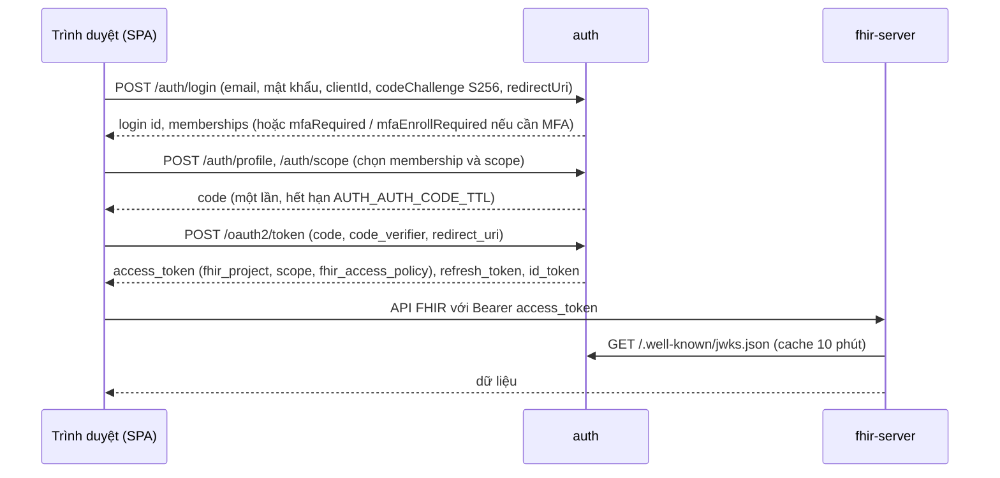

# auth: kiến trúc

Cập nhật 2026-11-23. Mô tả `auth` làm gì, không làm gì, vì sao là một service riêng, các thành phần, luồng chính và hành vi khi lỗi. Cấu hình ở [config.md](config.md), cách kiểm ở [testing.md](testing.md), route và lệnh quản trị ở [../README.md](../README.md), hợp đồng API ở [api-contract.md](api-contract.md) (chi tiết: [api-contract/](api-contract/)).

## 1. Làm gì, không làm gì

**Làm:** xác thực người dùng và cấp token cho hệ thống (port từ Medplum).

- Đăng nhập bằng mật khẩu (`/auth/login`, `/auth/profile`, `/auth/scope`, `/auth/method`), đăng ký (`newuser`, `newproject`, `newpatient`), đặt lại và đổi mật khẩu, xác minh email.
- MFA: TOTP và mã email, đăng ký khi đăng nhập hoặc khi đã đăng nhập.
- OAuth2/OIDC: `authorization_code` + PKCE, `refresh_token` (xoay secret), `client_credentials`, `private_key_jwt`, `pre-authorized_code`, `userinfo`, `introspect`, `logout`, `register`, JWKS và các tài liệu `.well-known`.
- Đăng nhập ngoài (IdP OIDC, Google), `exchange`, `preauthorize`.
- Quản trị: lệnh `auth ...` (seed project, client, domain, khóa) và `/admin/projects/*` (tắt mặc định), SCIM 2.0 `/scim/v2/Users` (tắt mặc định), `POST /email/v1/send` (tắt mặc định).

**Không làm:**

- **Không có giao diện đăng nhập.** `/oauth2/authorize` kiểm tham số rồi chuyển người dùng sang ứng dụng đăng nhập (`AUTH_APP_BASE_URL`), như Medplum.
- **Không lưu dữ liệu lâm sàng** và không đọc schema `fhir`. Hồ sơ Patient/Practitioner nằm ở `fhir-server`; vì vậy `userinfo` không có điện thoại, địa chỉ, ngày sinh.
- **Không phân quyền từng yêu cầu FHIR.** `auth` chỉ nhúng `fhir_project`, `scope` và `fhir_access_policy` vào token; `fhir-server` tự xác minh bằng JWKS và thi hành.
- **Scope do client khai không bao giờ thành quyền:** mọi term `fhir.*` bị từ chối (`invalid_scope`); `fhir.admin/write/read` do auth tự thêm theo membership.
- Không giữ khái niệm super admin cho dữ liệu FHIR (D-22): không phát `fhir.super`. Ngoại lệ hẹp (đã duyệt 2026-11-24): cờ `Project.superAdmin` chỉ mở `POST /admin/super/projects` (tạo project, Project/$init), tắt mặc định bằng `AUTH_SUPER_ADMIN_ENABLED`; đặt cờ chỉ bằng CLI `auth project super`.

## 2. Vì sao tách (điều kiện theo [service-principles.md](../../../docs/service-principles.md) mục 1)

| Điều kiện | Bằng chứng |
|---|---|
| **B. Ranh giới bí mật** | `User` (hash mật khẩu, secret MFA), `Login` (secret refresh, hash code), `UserSecurityRequest` (secret đặt lại mật khẩu) và khóa ký nằm ở schema `identity`. Role `fhir_app` không đọc được schema này (kiểm bằng `make test-db`). |
| **C. Miền lỗi và vòng đời deploy** | Deploy hoặc sự cố của `fhir-server` không làm mất đăng nhập; ngược lại `auth` sập thì token còn hạn vẫn dùng được tới hết TTL vì `fhir-server` chỉ kiểm JWKS (xem mục 6). |
| A. Hồ sơ tải khác | Chưa đo. Không viện dẫn. |
| D. Đội sở hữu khác | Chưa có. |

`scim` và `email` **ở lại trong `auth`**, không tách: SCIM vô hiệu hóa user phải thu hồi mọi `Login` trong cùng giao dịch, và gửi thư dùng chung cấu hình SMTP và quyền của project.

## 3. Các tầng

```
cmd/auth                 điểm vào: serve (mặc định) | migrate | healthcheck | seed | client | user | domain | project | purge-logins | keys
internal/domain          luật thuần, chỉ stdlib và pkg/fhir
internal/application     use case (Service) và cổng (ports.go, mfa_ports.go, external_ports.go)
internal/infrastructure  adapter: store, password, secretbox, keys, jwks, totp, mfastate, mailer, oidc, ...
internal/presentation/httpapi   Echo, DTO, validator, ánh xạ lỗi, swagger
internal/bootstrap       composition root (container.go), CLI (cli.go), khóa (keys.go)
internal/config          cấu hình từ biến môi trường, kiểm hợp lệ
```

Quy tắc phụ thuộc giữa các tầng **được ép** bởi `architecture_test.go` ở gốc repo: `domain` và `application` thuần (stdlib và `pkg/fhir`); `infrastructure` là nơi duy nhất dùng thư viện bên thứ ba tùy ý; `presentation` chỉ gọi `application` và `domain`; `bootstrap` lắp ráp tất cả.

Adapter ở `internal/infrastructure`:

| Gói | Vai trò |
|---|---|
| `store` | Kho dữ liệu trên `pkg/fhirstore`; `Mutate` ghi có điều kiện phiên bản và thử lại (thay cho `patchResource` của Medplum) |
| `password` | bcrypt, đọc được hash `$2b$` do Node (Medplum) tạo |
| `pwned` | Kiểm mật khẩu rò rỉ (HIBP, k-anonymity), **fail đóng** |
| `secretbox` | Mã hóa `User.mfaSecret` khi lưu, nhiều khóa `kid` để xoay (`AUTH_MFA_SECRET_KEYS`) |
| `keys`, `jwks` | Khóa ký (PEM), JWKS công khai, chọn khóa đang ký (`AUTH_ACTIVE_KID`) |
| `totp`, `mfastate` | TOTP; trạng thái MFA (secret được mời, hạn mức thử, mã đã dùng) trong Redis hoặc bộ nhớ |
| `jti`, `clientassertion` | Chống dùng lại `client_assertion`; tải JWKS của client qua `pkg/safehttp` (https, không dải nội bộ) |
| `oidc`, `googleid` | Xác minh `id_token` của IdP ngoài và Google bằng JWKS |
| `mailer` | Kênh gửi thư: `log`, `none`, `smtp` (qua `pkg/mailer`) |
| `recaptcha` | reCAPTCHA mức máy chủ, **fail đóng** |
| `hubtopic` | Topic FHIRcast ổn định theo chủ thể token (cần Redis dùng chung) |
| `attachfetch`, `binaryfetch` | Tải tệp đính kèm cho `/email/v1/send` (URL qua `safehttp`; `Binary/<id>` từ `fhir-server` bằng chính Bearer của người gọi) |
| `useragent` | Tách tên trình duyệt và hệ điều hành từ User-Agent cho danh sách phiên của `/auth/me` |

## 4. Dữ liệu

- **Một schema riêng `identity`** trong database dùng chung (role `identity_app` chỉ DML; role `identity_migrate` sở hữu schema và chạy DDL). Hoặc một database riêng. SQLite chỉ để dev (`./auth.db`). Chi tiết role, init script và xử lý lỗi: [runbook.md mục 3](runbook.md); kế hoạch: [microservices-shared-db.md](../../../docs/plans/microservices-shared-db.md).
- `DATABASE_REQUIRE_SCHEMA=true` làm service từ chối khởi động (và từ chối `migrate`) nếu `search_path` không phải đúng một schema riêng đã tồn tại.
- Tên schema và role (`identity`, `identity_app`, `identity_migrate`) **không đổi** khi service đổi tên từ `authen` sang `auth`: đó là tên miền nghiệp vụ, đổi sẽ cần di chuyển dữ liệu.
- Resource lưu qua `pkg/fhirstore`: `User`, `Login`, `UserSecurityRequest`, `Project`, `ProjectMembership`, `ClientApplication`, `AccessPolicy`, `DomainConfiguration`, `UserConfiguration`, `SmartAppLaunch`. Không có FK chéo sang schema `fhir`.
- Redis (tùy chọn ở dev, **bắt buộc ở staging/production**): `jti` của client assertion, topic FHIRcast, trạng thái MFA (tiền tố khóa `auth:mfa:`).

## 5. Bí mật và nguyên tắc an toàn

| Thứ | Cách xử lý |
|---|---|
| Mật khẩu | bcrypt (cost tối thiểu 10 ở staging/production), tối đa 72 byte, kiểm rò rỉ HIBP |
| Secret refresh, authorization code, cookie đăng nhập, secret đặt lại mật khẩu/xác minh email | Kho chỉ giữ **băm**; đọc được kho cũng không dùng lại được |
| Secret TOTP | Mã hóa bằng `secretbox` khi lưu (khóa bắt buộc ở staging/production) |
| Khóa ký | PEM quyền `0600` trong `AUTH_SIGNING_KEY_PATH`; dev để trống thì dùng khóa tạm trong bộ nhớ (token mất hiệu lực khi khởi động lại, chỉ một instance) |
| Secret client | Chỉ hiện MỘT lần khi tạo |
| Mật khẩu CLI | Chỉ qua biến môi trường hoặc stdin, không qua tham số dòng lệnh |
| SMTP password, `AUTH_RECAPTCHA_SECRET_KEY` | Chỉ qua biến môi trường, không vào log |
| `state` đăng nhập ngoài | Do auth ký (HMAC) kèm cookie, chỉ nhận từ đúng trình duyệt |

Mọi phản hồi có header bảo mật (`Cache-Control: no-store`, CSP `default-src 'none'`, `X-Frame-Options: DENY`...). Hạn mức theo IP ở bộ nhớ từng instance; bước nhập thông tin đăng nhập chặt hơn. Chi tiết ở README.

Nhánh có rủi ro **fail đóng**: thiếu phụ thuộc MFA hay kho trạng thái hỏng thì trả 500 chung, không bao giờ trả `code`; lỗi gọi HIBP hoặc reCAPTCHA là lỗi, không cho qua.

## 6. Luồng chính

### Đăng nhập SPA + PKCE



### Refresh và thu hồi

Mỗi lần dùng refresh token, secret của `Login` được xoay bằng một lần ghi có điều kiện phiên bản (hai yêu cầu song song không cùng xoay được). Dùng lại secret đã xoay ngoài `AUTH_REFRESH_GRACE` (30 giây, chỉ từ cùng IP) hoặc từ IP khác thì **thu hồi Login** (`invalid_grant`).

**Cửa sổ thu hồi:** `fhir-server` không tra `Login` mỗi yêu cầu nên thu hồi có hiệu lực ở FHIR trễ tới hết `AUTH_ACCESS_TTL` (mặc định 15 phút, quyết định D-13). `userinfo`, `introspect`, `refresh` và `/auth/me` kiểm trạng thái ngay (login bị thu hồi thì 401).

### Xoay khóa ký

`auth keys generate` (khóa mới vào cùng thư mục) → triển khai để JWKS có cả hai khóa → đợi quá TTL cache của người xác minh (10 phút) → đặt `AUTH_ACTIVE_KID` là kid mới → khi token cũ hết hạn thì xóa khóa cũ.

## 7. Hành vi khi lỗi và khi tắt

| Tình huống | Hành vi |
|---|---|
| Cấu hình sai hoặc còn biến `AUTHEN_*` | Từ chối khởi động, liệt kê mọi lỗi một lượt ([config.md](config.md)) |
| SIGTERM | `/health/ready` trả 503, giữ `SHUTDOWN_DRAIN_DELAY`, chờ yêu cầu đang chạy tới `SHUTDOWN_TIMEOUT`, thoát mã 0 (kiểm bằng e2e) |
| DB không sẵn sàng | `/health/ready` 503 (`/health/live` vẫn 200) |
| HIBP, reCAPTCHA lỗi | Lỗi (fail đóng) |
| Kho trạng thái MFA hỏng | 500 chung, không cấp `code` |
| Redis mất ở staging/production | **Chưa kiểm** trong tài liệu này; Redis là bắt buộc nên xem như phụ thuộc cứng của đăng nhập có MFA |
| Gửi thư đặt lại mật khẩu thất bại | `resetpassword` vẫn trả 200 với email hợp lệ (không lộ tài khoản có tồn tại hay không) |

## 8. Quan hệ với service khác

- **fhir-server:** nhận token qua JWKS. `FHIR_JWT_ISSUER` phải bằng `AUTH_ISSUER` (mặc định `AUTH_BASE_URL`) **đúng từng ký tự**; `FHIR_JWT_AUDIENCE` = `AUTH_AUDIENCE`; `FHIR_JWKS_URL` = `<AUTH_BASE_URL>/.well-known/jwks.json`. `auth` còn gọi `fhir-server` để đọc tệp đính kèm `Binary/<id>` khi gửi thư (`AUTH_EMAIL_FHIR_URL`, bằng Bearer của người gọi).
- **ws-gateway:** `auth` chỉ trả `hub.url` và `hub.topic` FHIRcast trong token có scope `fhircast/` (`AUTH_FHIRCAST_HUB_URL`); Hub chạy ở ws-gateway. Topic ổn định theo chủ thể token và được giữ ở `AUTH_REDIS_URL` để các instance cho cùng một topic.
- **Observability:** thư viện `pkg/observability` (biến `OTEL_*`, `LOG_LEVEL`, `LOG_JSON`), tên telemetry `trivita-auth`.

## 9. Chưa làm hoặc chưa kiểm

- Hồ sơ tải và định cỡ (điều kiện A) chưa đo; mục định cỡ trong [runbook.md](runbook.md) còn trống vì chưa có số đo.
