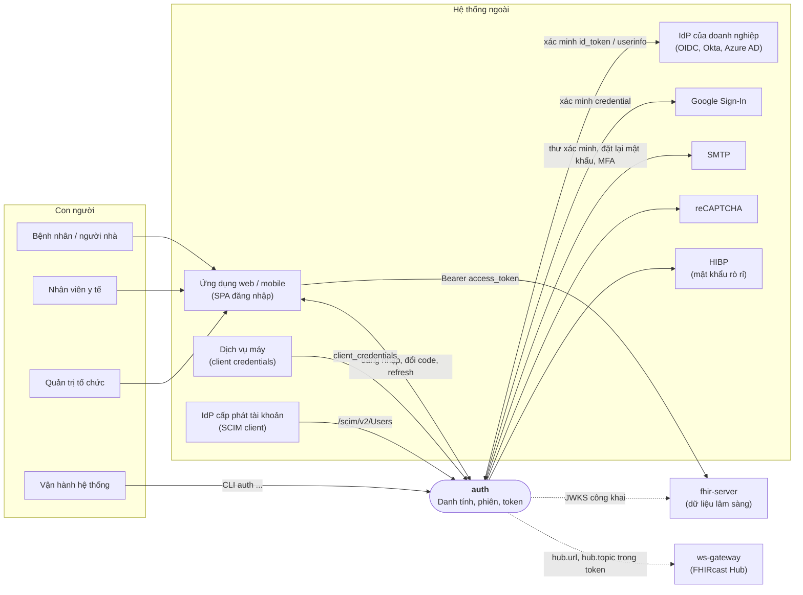
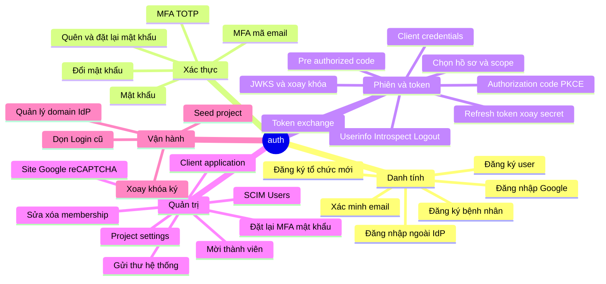
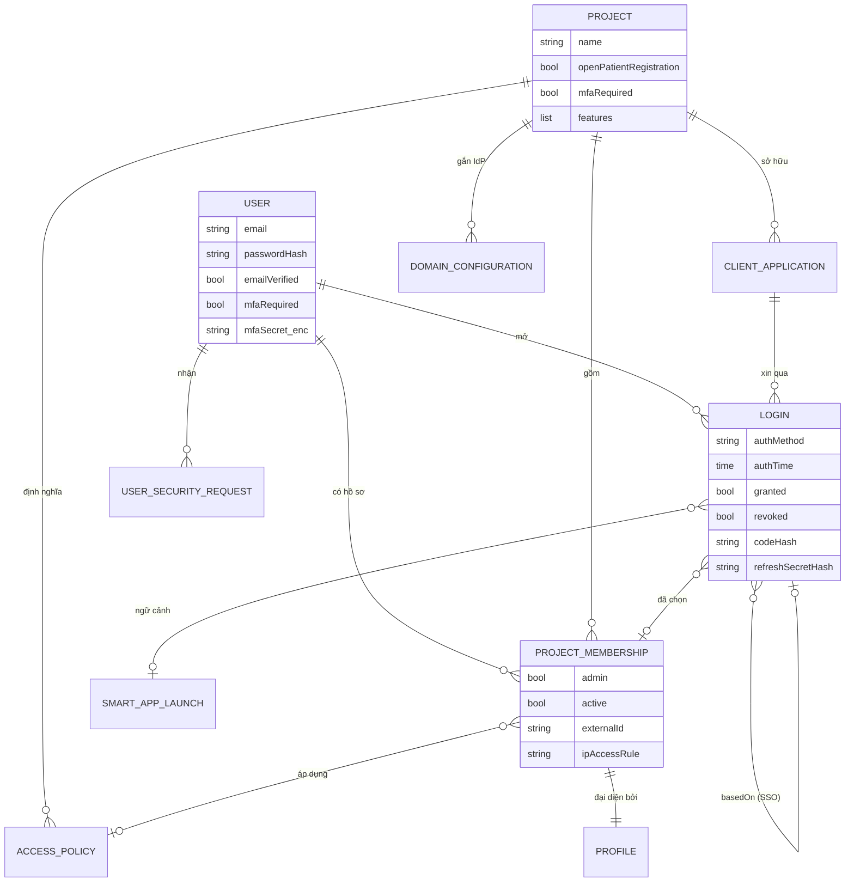

# 1. Tổng quan nghiệp vụ

## 1.1 Mục tiêu và giá trị

`auth` là **dịch vụ danh tính** của nền tảng Trivita: xác minh *ai đang gọi* và cấp *giấy thông hành* (token) nói rõ người đó được làm gì trên dữ liệu FHIR. Nó không giữ dữ liệu lâm sàng.

| Giá trị | Cách đạt được |
|---|---|
| Một tài khoản, nhiều tổ chức | `User` đăng nhập một lần, chọn hồ sơ (`ProjectMembership`) ở tổ chức (`Project`) cần dùng |
| Cách ly dữ liệu giữa tổ chức | Token mang `fhir_project`; `fhir-server` chỉ phục vụ dữ liệu của project đó |
| Quyền tối thiểu | `AccessPolicy` của membership được dịch thành claim chỉ **thu hẹp** quyền; client không tự xin được quyền `fhir.*` |
| An toàn thông tin xác thực | Mật khẩu bcrypt, kiểm rò rỉ, MFA, secret chỉ lưu băm, hạn mức chống dò |
| Tương thích hệ sinh thái | OAuth2/OIDC, SMART on FHIR, SCIM 2.0, IdP ngoài (OIDC, Google) |

## 1.2 Ranh giới hệ thống

**Auth làm:** đăng ký, đăng nhập, MFA, mật khẩu, OAuth2/OIDC, đăng nhập ngoài, quản trị project/membership, SCIM, gửi thư hệ thống.
**Auth không làm:** giao diện đăng nhập (do ứng dụng `AUTH_APP_BASE_URL` đảm nhiệm), dữ liệu lâm sàng, phân quyền từng yêu cầu FHIR (do `fhir-server` thi hành), khái niệm super admin (D-22).

## 1.3 Tác nhân (actor) và vai trò

| Mã | Tác nhân | Là ai | Xác thực bằng | Việc chính |
|---|---|---|---|---|
| A1 | **Khách** | Người chưa có tài khoản | không | Đăng ký, đăng ký tổ chức mới |
| A2 | **Bệnh nhân / người nhà** | `Patient`, `RelatedPerson` | mật khẩu, MFA, Google, IdP | Đăng nhập xem hồ sơ của mình, tự đăng ký (nếu tổ chức mở) |
| A3 | **Nhân viên y tế** | `Practitioner` | mật khẩu, MFA, IdP doanh nghiệp | Đăng nhập làm việc, đổi mật khẩu, bật MFA, xem phiên |
| A4 | **Quản trị tổ chức** | Membership có `admin=true` | như A3 | Mời thành viên, đặt chính sách, tạo client, đặt lại MFA/mật khẩu, thu hồi |
| A5 | **Ứng dụng client** | `ClientApplication` (SPA, mobile, web server) | PKCE, secret, `private_key_jwt` | Xin code/token thay mặt người dùng |
| A6 | **Dịch vụ máy** | `ClientApplication` dùng `client_credentials` | secret hoặc `private_key_jwt` | Gọi API không có người |
| A7 | **IdP / SCIM client** | Okta, Azure AD... | OIDC, SCIM Basic/Bearer | Đồng bộ vòng đời tài khoản |
| A8 | **Vận hành** | SRE / DevOps | quyền máy chủ (CLI, env) | Seed, migrate, xoay khóa, dọn Login |
| A9 | **fhir-server** | Dịch vụ nhận token | JWKS | Xác minh chữ ký, thi hành `fhir_access_policy` |

## 1.4 Bản đồ năng lực

## 1.5 Thuật ngữ

| Thuật ngữ | Nghĩa nghiệp vụ |
|---|---|
| **User** | Tài khoản đăng nhập (email, mật khẩu băm, MFA). Một người = một User. Có thể *thuộc một project* hoặc *phạm vi server* (dùng được ở nhiều project) |
| **Project** | Một tổ chức khách hàng (bệnh viện, phòng khám). Là ranh giới cách ly dữ liệu |
| **ProjectMembership** | "Hồ sơ" của User trong Project: gắn User với một profile FHIR (Patient/Practitioner/RelatedPerson/Bot/ClientApplication), cờ `admin`, `active`, AccessPolicy |
| **Profile** | Hồ sơ FHIR đại diện con người trong Project. Nằm trong schema `identity` của auth; hồ sơ lâm sàng đầy đủ nằm ở `fhir-server` |
| **AccessPolicy** | Danh sách luật nói loại resource nào được đọc/ghi, kèm tiêu chí (ví dụ chỉ compartment của bệnh nhân đó) |
| **ClientApplication** | Ứng dụng được phép xin token: có redirect URI, grant type, secret (tùy chọn), cờ `pkceOptional` |
| **Login** | Một *lần đăng nhập* (phiên). Giữ trạng thái: đã chọn membership chưa, đã qua MFA chưa, đã đổi code chưa, đã bị thu hồi chưa. Là gốc của refresh token |
| **Code** | Mã dùng một lần (10 phút) đổi lấy token ở `/oauth2/token` |
| **Access token** | JWT ký bởi auth, sống 15 phút, mang `fhir_project`, `scope`, `fhir_access_policy` |
| **Refresh token** | Gia hạn không cần nhập lại mật khẩu; mỗi lần dùng xoay secret |
| **MFA** | Yếu tố thứ hai: TOTP (ứng dụng xác thực) hoặc mã 6 số gửi email |
| **UserSecurityRequest** | Yêu cầu một lần qua email: `reset` (đặt lại mật khẩu, 1 giờ) hoặc `verify-email` (7 ngày) |
| **PKCE** | Cơ chế chứng minh bên đổi code chính là bên xin code (S256), bắt buộc với client công khai |
| **Pre-authorized code** | Mã admin cấp sẵn *thay mặt* một membership để ứng dụng đổi token mà không có bước đăng nhập |
| **SMART scope** | `patient/`, `launch`, `fhircast/`... ngữ cảnh ứng dụng y tế |
| **Compartment** | Tập resource thuộc về một bệnh nhân; AccessPolicy của Patient giới hạn trong đó |

## 1.6 Mô hình dữ liệu nghiệp vụ

Chỉ các thực thể mà BA cần hiểu. Tất cả lưu ở schema `identity`.

Sự thật cần nhớ: (1) bí mật (hash mật khẩu, secret MFA, secret refresh/code) chỉ ở `identity`, role `fhir_app` không đọc được; (2) không có khóa ngoại sang schema `fhir`; (3) Patient trong `identity` và Patient lâm sàng ở `fhir-server` là **hai bản ghi cùng id**, hiện tạo thủ công (xem [runbook §12](../runbook.md), điểm còn hở).
