# 2. Luồng nghiệp vụ đầu-cuối

Mỗi luồng nêu **mục tiêu nghiệp vụ**, **các bên**, **sơ đồ**, **kết quả** và **chức năng tham gia** (mã F-xx ở [04-chuc-nang.md](04-chuc-nang.md)).

## Tổng quan vòng đời

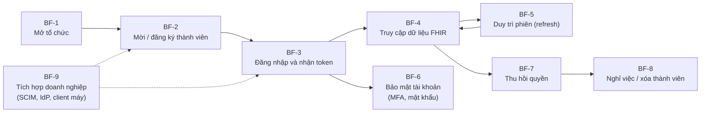

---

## BF-1. Mở tổ chức (onboarding project)

**Mục tiêu:** một bệnh viện/phòng khám có không gian dữ liệu riêng và có admin đầu tiên.
**Hai đường:** (a) **vận hành** seed bằng CLI (khách hàng B2B do Trivita triển khai); (b) **tự phục vụ** `newuser` → `newproject` (nếu server bật đăng ký).

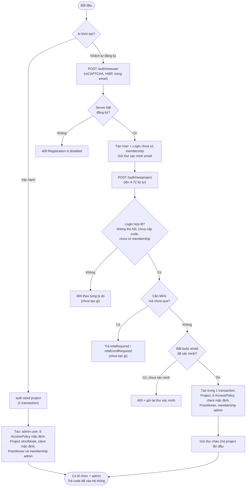

**Kết quả:** Project `active`, admin đăng nhập được. **Tính nguyên tử:** lỗi giữa chừng hoàn tác hết, không có project dở dang. **Chức năng:** F-01, F-02, F-04, F-28.

---

## BF-2. Đưa thành viên vào tổ chức

**Mục tiêu:** đúng người có đúng hồ sơ và đúng quyền.

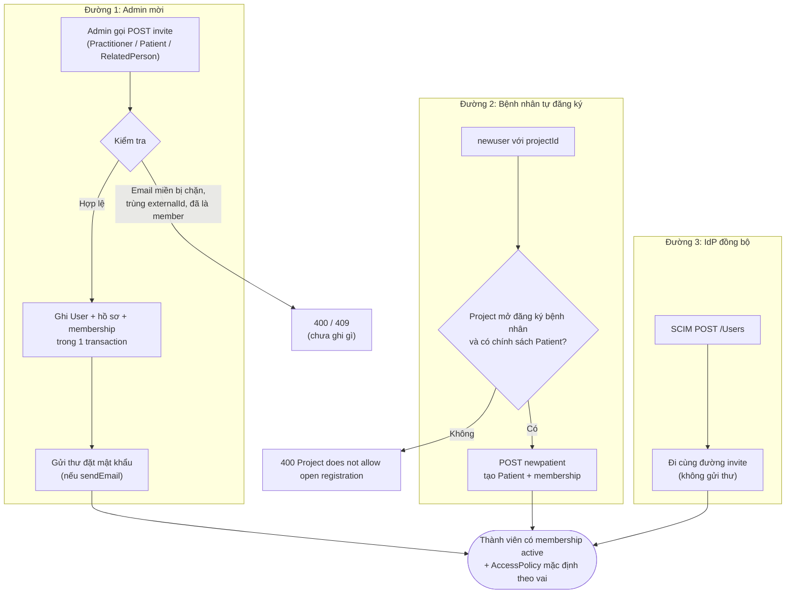

**Luật then chốt:** Practitioner có email bị chặn theo `AUTH_BLOCKED_EMAIL_DOMAINS` hoặc setting `allowedPractitionerEmailDomain`; AccessPolicy mặc định lấy từ `defaultPatientAccessPolicy`/`defaultAccessPolicies` (Admin cho Practitioner có `admin`); user phạm vi project phải thuộc đúng project. **Chức năng:** F-03, F-24, F-25, F-26.

> **Điểm còn hở (đã ghi nhận):** mời bệnh nhân tạo `Patient` trong `identity`; muốn `patient/` compartment hoạt động phải tạo `Patient` cùng id ở `fhir-server` (thủ công, xem runbook §12).

---

## BF-3. Đăng nhập và nhận token (luồng cốt lõi)

**Mục tiêu:** người dùng chứng minh danh tính, chọn hồ sơ, ứng dụng nhận token đúng quyền.
**Bốn cách chứng minh:** mật khẩu, Google, IdP doanh nghiệp (OIDC), hoặc mã cấp sẵn (không người). Dưới đây là đường mật khẩu + SPA.

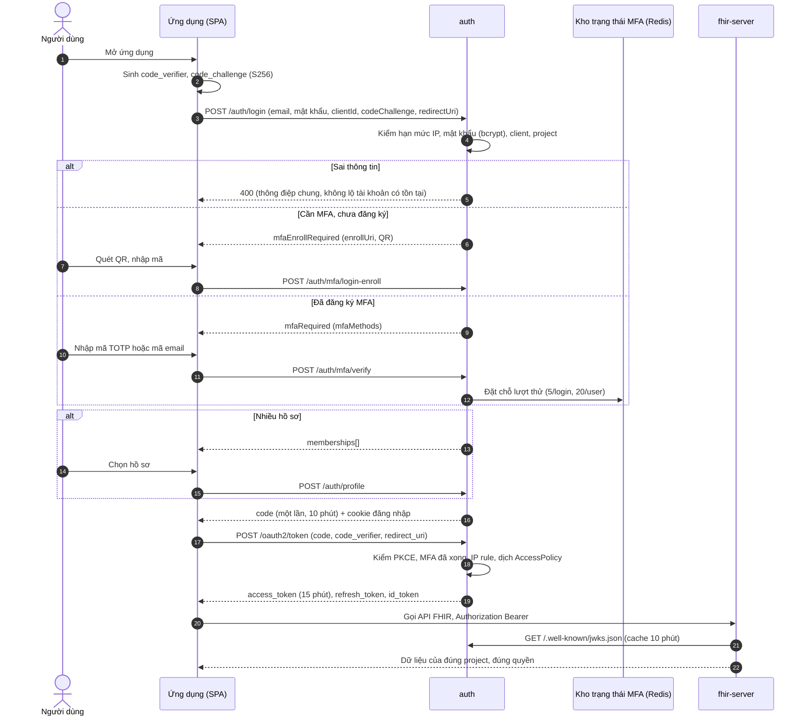

**Kết quả:** token mang `fhir_project`, `scope`, `fhir_access_policy`. **Nguyên tắc:** MFA chưa xong thì **không bao giờ** cấp code (fail đóng). **Chức năng:** F-05..F-10, F-15, F-16, F-22.

### Biến thể: ứng dụng chuyển hướng qua `/oauth2/authorize`

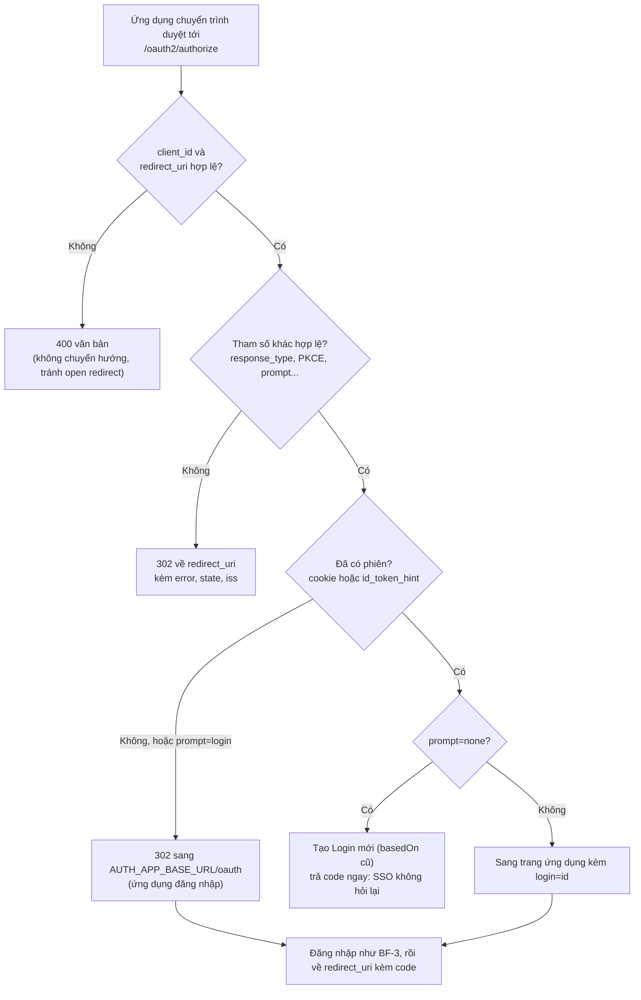

### Biến thể: đăng nhập IdP doanh nghiệp / Google

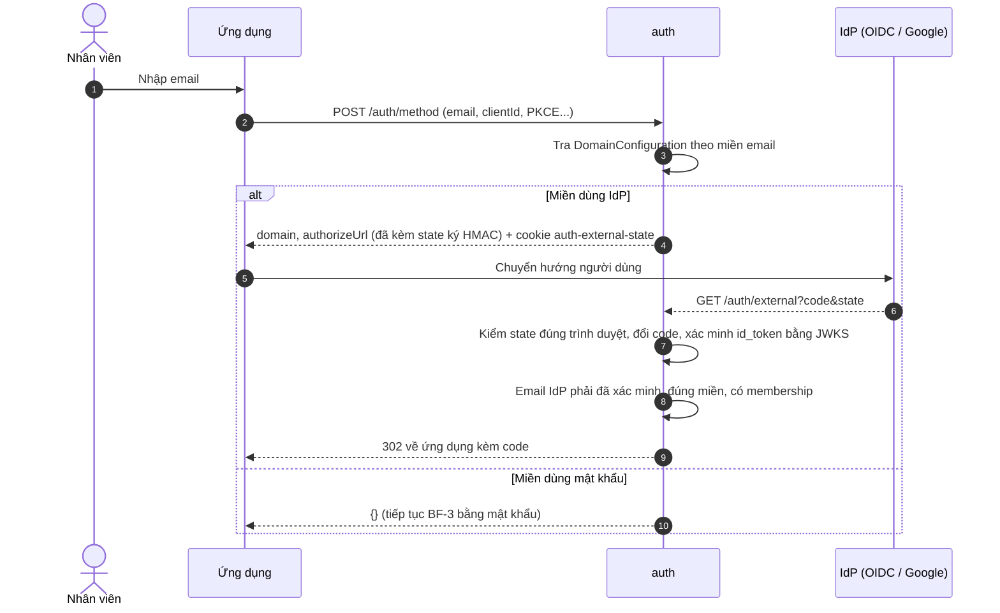

---

## BF-4. Truy cập dữ liệu FHIR bằng token

**Mục tiêu:** `fhir-server` thi hành quyền mà **không gọi lại auth** mỗi yêu cầu.

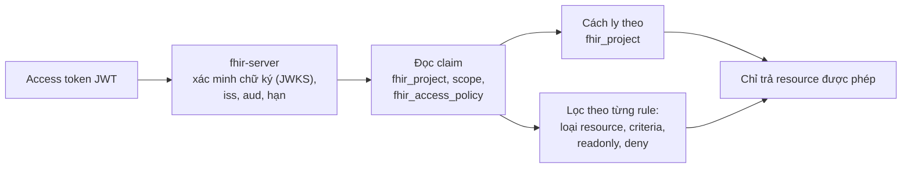

**Hệ quả nghiệp vụ cần BA nắm:** thu hồi quyền chỉ có hiệu lực ở FHIR **sau tối đa 15 phút** (`AUTH_ACCESS_TTL`, quyết định D-13); các route của auth thì từ chối ngay. Đây là đánh đổi *hiệu năng đổi lấy độ trễ thu hồi*. **Chức năng:** F-16, F-22.

---

## BF-5. Duy trì phiên (refresh)

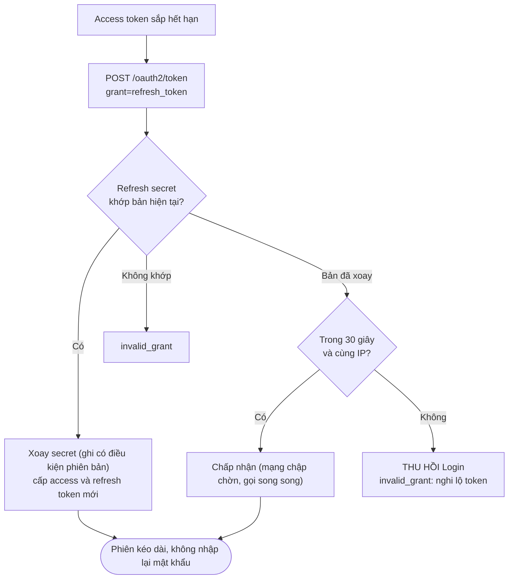

**Ý nghĩa:** phát hiện đánh cắp refresh token: kẻ cắp và người thật cùng dùng thì một bên dùng secret cũ, cả phiên bị thu hồi. **Chức năng:** F-17.

---

## BF-6. Bảo mật tài khoản

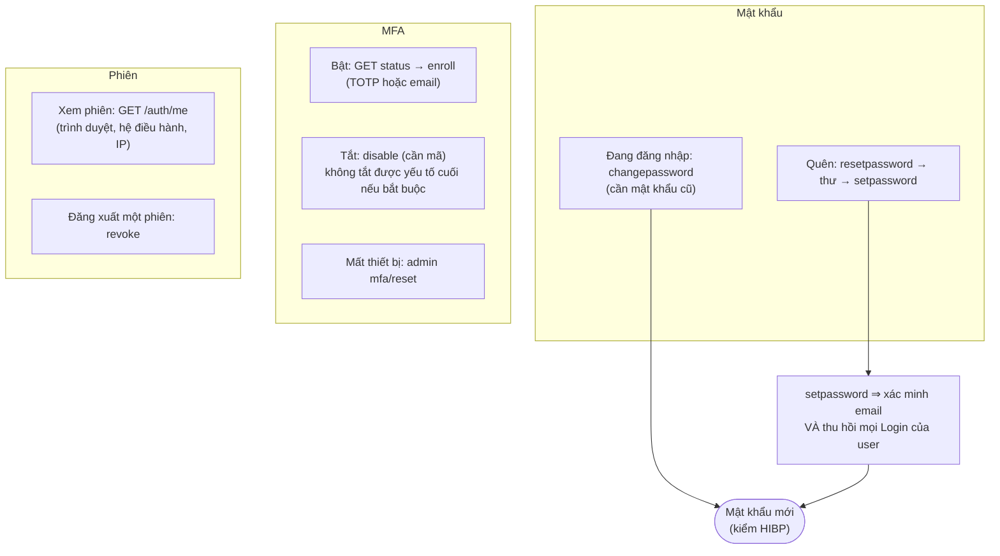

**Chức năng:** F-11, F-12, F-13, F-14, F-25.

---

## BF-7. Thu hồi quyền

Các cách chấm dứt quyền và **độ trễ hiệu lực** (đây là bảng BA/QA/bảo mật cần thống nhất):

| Sự kiện kích hoạt | Tác động lên auth | Tác động lên fhir-server |
|---|---|---|
| Người dùng `logout` / `revoke` | Login bị thu hồi **ngay**; refresh, userinfo, introspect, `/auth/me` 401 | Access token còn sống đến hết ≤ 15 phút |
| Đổi/đặt lại mật khẩu (`setpassword`) | **Mọi** Login của user bị thu hồi | như trên |
| Dùng lại code | Login bị thu hồi | như trên |
| Dùng lại refresh secret cũ (ngoài ân hạn hoặc khác IP) | Login bị thu hồi, cảnh báo log | như trên |
| Sai MFA lần thứ 5 | Login bị thu hồi | — |
| Admin tắt `active` hoặc xóa membership | Token của member bị từ chối ngay ở route auth | ≤ 15 phút |
| Admin gỡ liên kết bệnh nhân (compartment) | — | Token cũ đọc được đến hết hạn |
| Xoay khóa ký, xóa khóa cũ | Token ký khóa cũ không xác minh được sau khi xóa | Từ chối sau khi cache JWKS hết (≤ 10 phút) |

**Chức năng:** F-10, F-13, F-14, F-17, F-21, F-25, F-28.

---

## BF-8. Nghỉ việc / xóa thành viên

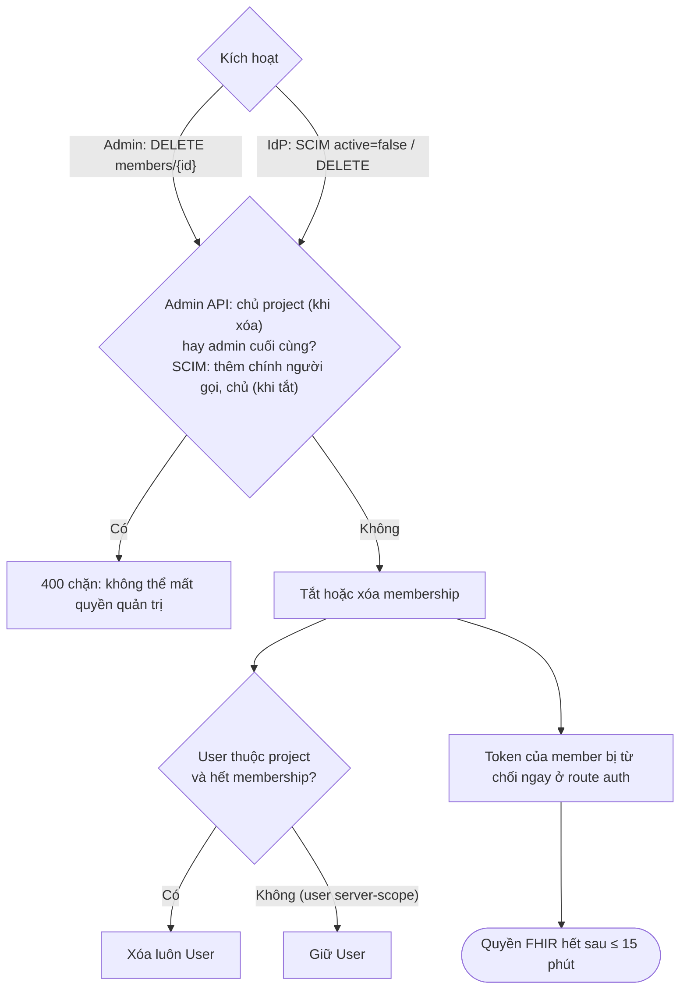

SCIM `active=true` cho membership đã tắt được chấp nhận (IdP là nguồn sự thật) và ghi log kiểm toán. **Chức năng:** F-25, F-26.

---

## BF-9. Tích hợp doanh nghiệp

| Nhu cầu khách hàng | Giải pháp | Luồng |
|---|---|---|
| Nhân viên đăng nhập bằng tài khoản công ty | `auth domain add` + IdP OIDC | BF-3 biến thể IdP |
| IdP tự tạo/khóa tài khoản | SCIM 2.0 `/scim/v2/Users` | Okta/Azure gọi SCIM; membership đồng bộ |
| Hệ thống khác gọi API không có người | Client `client_credentials` + `private_key_jwt` | `POST /oauth2/token` |
| Backend của đối tác thay mặt người dùng | `preauthorize` → `pre-authorized_code` | Admin cấp mã, đối tác đổi token |
| Ứng dụng đã có token IdP, muốn token Trivita | `token-exchange` | `POST /oauth2/token` grant token-exchange |
| Ứng dụng y tế SMART/FHIRcast | scope `launch`, `patient/`, `fhircast/` | Token kèm `hub.url`, `hub.topic` |

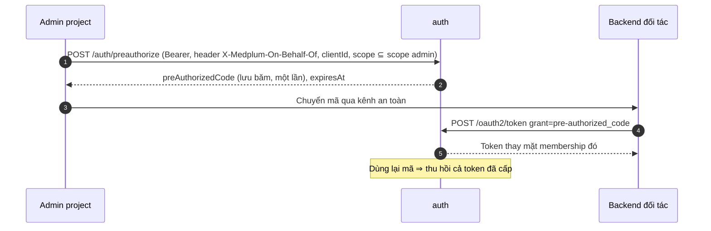

**Chức năng:** F-09, F-16, F-18, F-19, F-20, F-26.
