# 3. Luồng người dùng (user flow)

Góc nhìn của **từng nhân vật** đi qua các bước trên giao diện của *ứng dụng đăng nhập* (auth chỉ cung cấp API; màn hình do ứng dụng ở `AUTH_APP_BASE_URL` dựng). Mỗi luồng ghi rõ **bước màn hình → API gọi → thông điệp cho người dùng**, để UX/FE/QA cùng một bản đồ. Mã F-xx tham chiếu [04-chuc-nang.md](04-chuc-nang.md).

## 3.1 Bản đồ màn hình

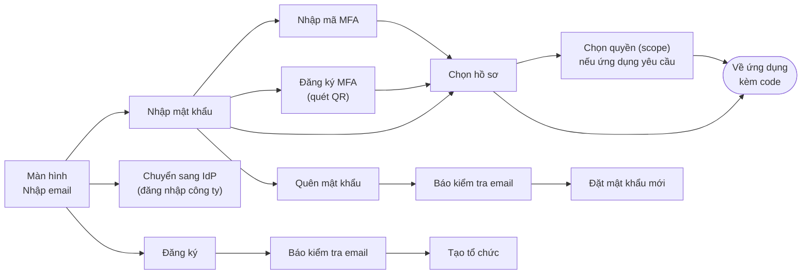

## 3.2 Đăng nhập (mọi người dùng) — F-05, F-06, F-07, F-10

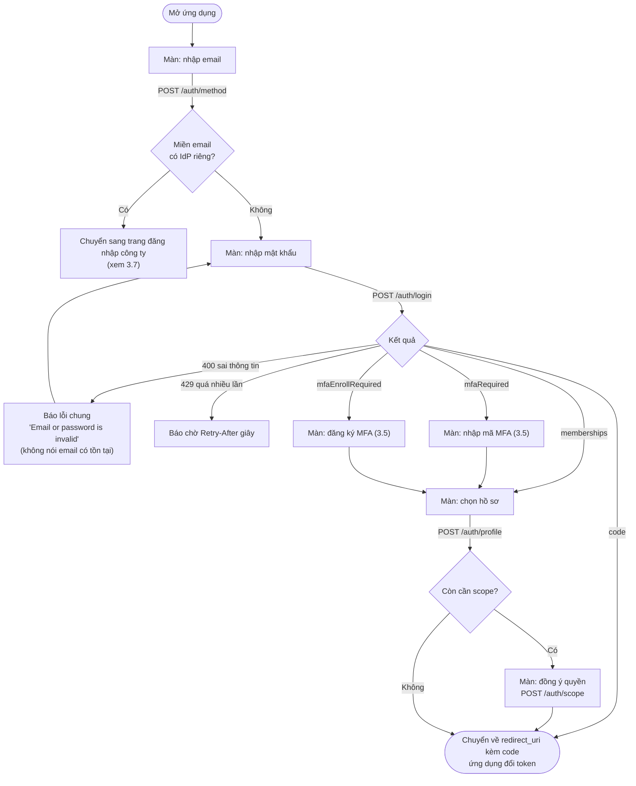

**Thông điệp và hành vi UX cần thống nhất**

| Tình huống | Người dùng thấy | Lý do thiết kế |
|---|---|---|
| Sai mật khẩu hoặc email không tồn tại | Cùng một thông điệp | Không lộ tài khoản có tồn tại (chống dò) |
| Bị giới hạn tốc độ | "Thử lại sau N giây" (`Retry-After`) | Chống đoán mật khẩu (khoảng 60 lần/phút/IP) |
| Login để quá lâu giữa các bước MFA | "Login expired", quay lại nhập mật khẩu | Login chỉ dùng xác minh MFA trong 10 phút |
| Chỉ có một hồ sơ | Bỏ qua màn chọn hồ sơ | Server trả `code` thẳng |
| Lỗi hạ tầng (Redis, HIBP...) | Lỗi chung 500 | Fail đóng: không bao giờ cho qua MFA/kiểm tra bảo mật khi lỗi |

## 3.3 Đăng ký người dùng mới và tổ chức mới — F-01, F-04, F-02

Nhân vật: **Khách (A1)**.

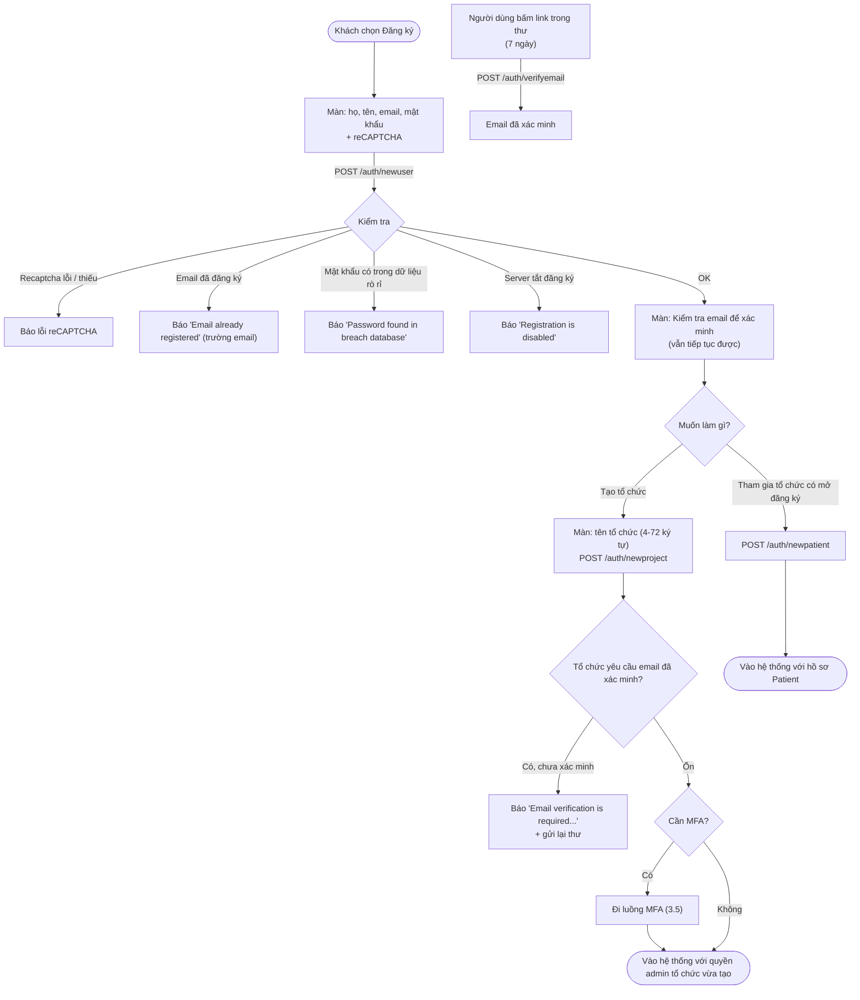

Lưu ý cho FE: client công khai phải gửi `codeChallenge` **ngay ở bước `newuser`** thì mới đổi được code sau `newproject`. Phản hồi `newuser` không có `code`, chỉ có `login` và `emailVerificationRequired`.

## 3.4 Bệnh nhân / người nhà — F-03, F-06, F-14

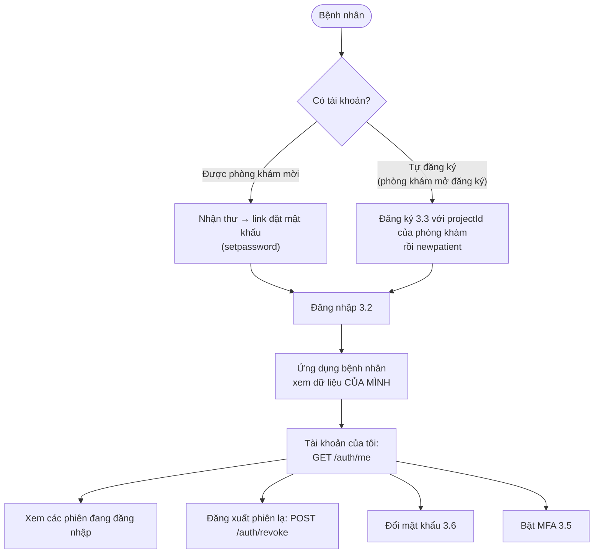

Quyền của bệnh nhân bị giới hạn trong *compartment* của chính họ (token chỉ có tiêu chí `_compartment=Patient/<id>`); không đọc được bệnh nhân khác kể cả qua `_include`, `$everything`. Mặc định chính sách Patient **cho phép ghi** trong compartment của mình; muốn chỉ đọc đặt `readonly: true` (runbook §12).

## 3.5 MFA — F-10, F-11

### a) Đăng ký MFA khi đăng nhập (bị bắt buộc)

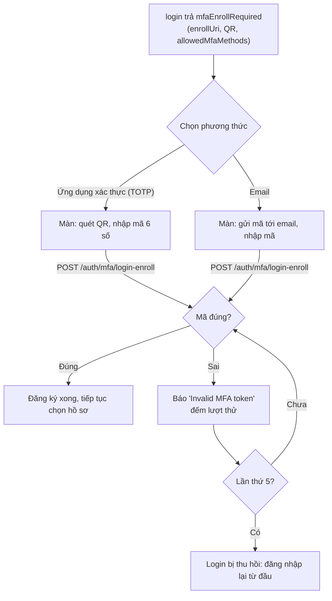

### b) Xác minh MFA mỗi lần đăng nhập

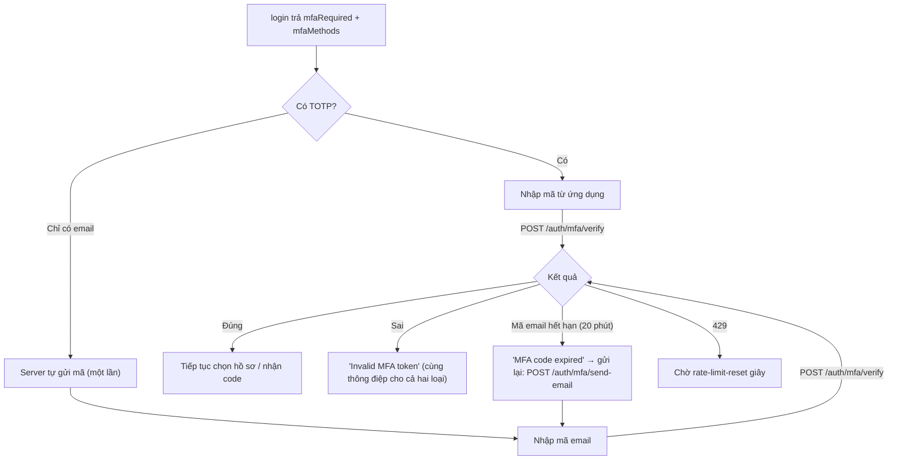

### c) Tự quản lý MFA khi đã đăng nhập

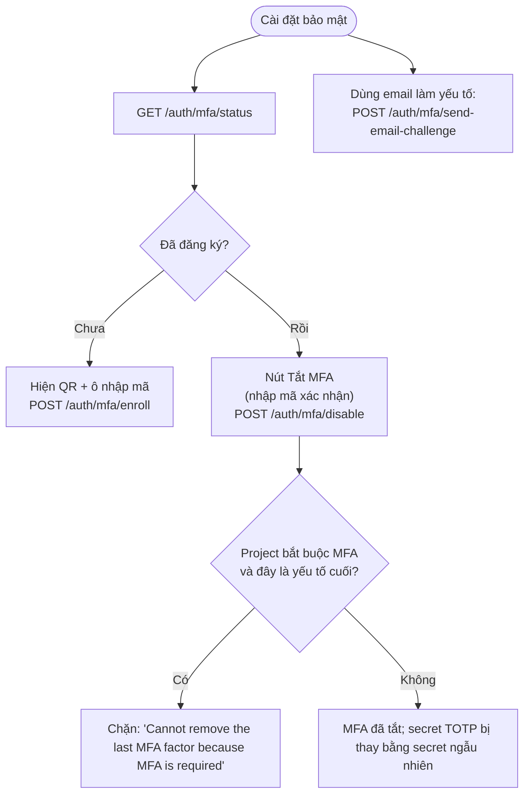

**Mất điện thoại:** người dùng không tự khôi phục; **admin** gọi `members/{id}/mfa/reset` (xem 3.8).

## 3.6 Mật khẩu — F-12, F-13

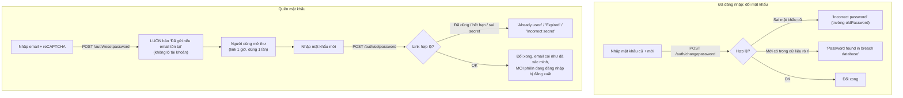

Tài khoản đăng nhập bằng IdP ngoài **không đặt lại mật khẩu ở đây** (`Cannot reset password for external auth`); người dùng đổi ở IdP của công ty.

## 3.7 Đăng nhập bằng tài khoản công ty / Google — F-05, F-08, F-09

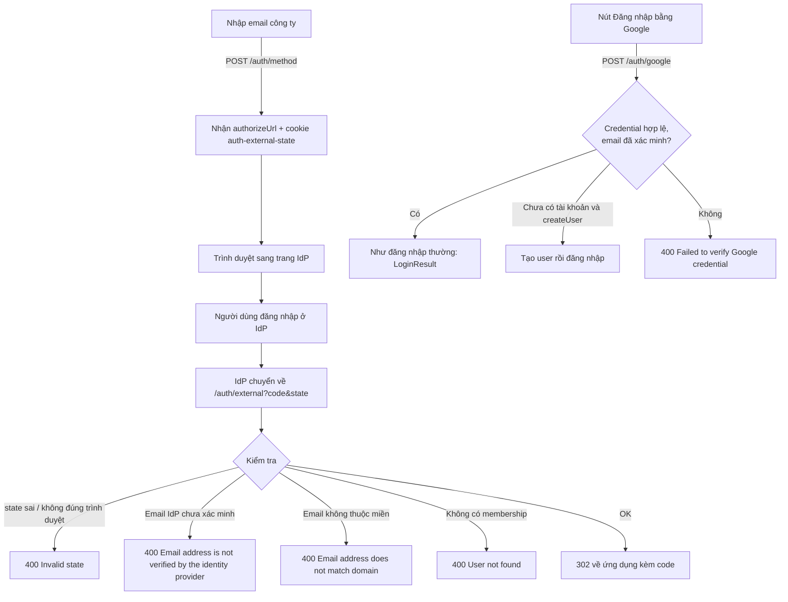

## 3.8 Quản trị tổ chức (A4) — F-23, F-24, F-25

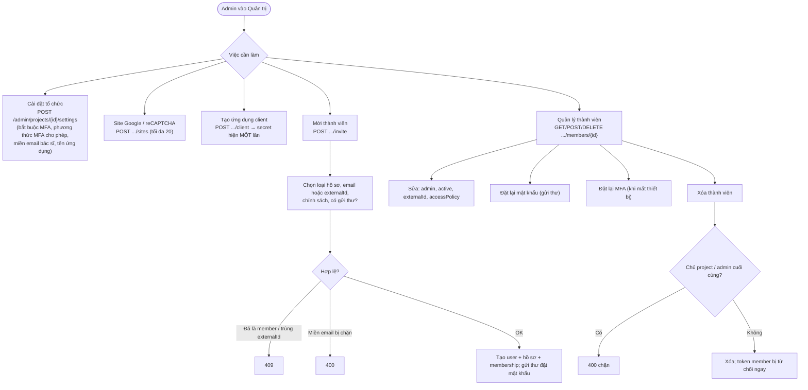

Quy tắc UX cho màn quản trị: thông tin bí mật hiển thị `********` (secret project, secret site); **gửi lại `********` nghĩa là giữ nguyên**; membership của project khác luôn báo 403 chung (không cho dò id).

## 3.9 Ứng dụng đối tác / dịch vụ máy (A5, A6) — F-16..F-21

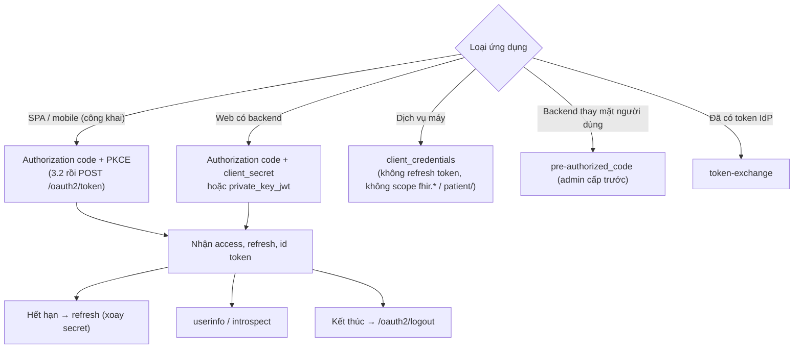
