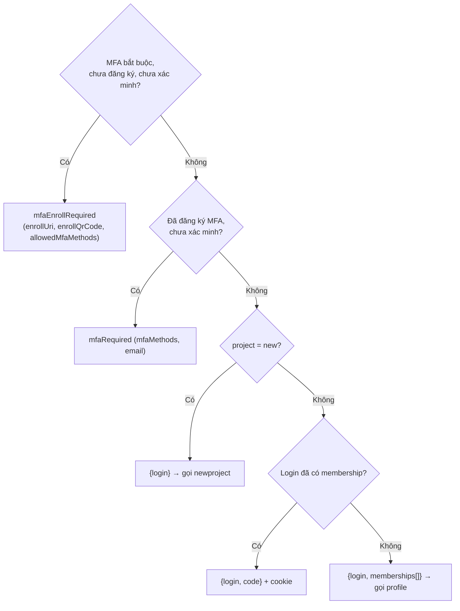
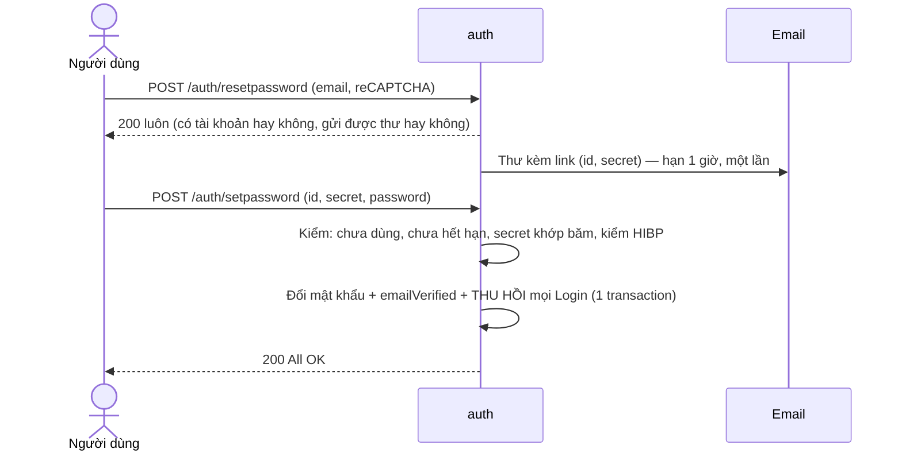

# 4. Danh mục chức năng

Mỗi chức năng theo một khuôn: **Mục đích · Tác nhân · Tiền điều kiện · Luồng chính · Luồng thay thế/lỗi · Luật (BR) · Route · Hậu điều kiện**. Luật `BR-xx` ở [05-luat-va-phan-quyen.md](05-luat-va-phan-quyen.md). Thông điệp lỗi trích nguyên văn từ hợp đồng ([api-contract/](../api-contract/)).

## Mục lục

| Nhóm | Chức năng |
|---|---|
| **Danh tính** | [F-01 Đăng ký user](#f-01) · [F-02 Tạo tổ chức](#f-02) · [F-03 Đăng ký bệnh nhân](#f-03) · [F-04 Xác minh email](#f-04) |
| **Đăng nhập** | [F-05 Chọn phương thức](#f-05) · [F-06 Đăng nhập mật khẩu](#f-06) · [F-07 Chọn hồ sơ và scope](#f-07) · [F-08 Google](#f-08) · [F-09 IdP ngoài](#f-09) |
| **MFA** | [F-10 MFA khi đăng nhập](#f-10) · [F-11 MFA tự quản](#f-11) |
| **Mật khẩu và phiên** | [F-12 Đổi mật khẩu](#f-12) · [F-13 Quên và đặt lại](#f-13) · [F-14 Xem phiên, thu hồi](#f-14) |
| **OAuth2/OIDC** | [F-15 Authorize](#f-15) · [F-16 Token: code](#f-16) · [F-17 Token: refresh](#f-17) · [F-18 Token: client credentials](#f-18) · [F-19 Pre-authorized](#f-19) · [F-20 Token exchange](#f-20) · [F-21 Userinfo, introspect, logout, register](#f-21) · [F-22 JWKS và discovery](#f-22) |
| **Quản trị** | [F-23 Project](#f-23) · [F-24 Mời thành viên](#f-24) · [F-25 Quản lý thành viên](#f-25) · [F-26 SCIM](#f-26) · [F-27 Gửi thư](#f-27) |
| **Vận hành** | [F-28 CLI quản trị](#f-28) · [F-29 Kiểm soát chung](#f-29) |

---

## Danh tính

### F-01. Đăng ký user (`newuser`)

| | |
|---|---|
| **Mục đích** | Tạo tài khoản đăng nhập mới |
| **Tác nhân** | A1 Khách |
| **Tiền điều kiện** | Server bật `AUTH_REGISTER_ENABLED`; có token reCAPTCHA (nếu cấu hình) |
| **Route** | `POST /auth/newuser` |
| **Đầu vào chính** | `firstName`, `lastName` (1-128), `email` (3-72), `password` (8-72 byte); tùy chọn `projectId` (`new` hoặc UUID), `clientId`, PKCE, `recaptchaSiteKey` |

**Luồng chính**
1. Kiểm reCAPTCHA (trước cờ đăng ký).
2. Kiểm PKCE, redirect, origin, project/client **trước khi tạo user** (không để user mồ côi).
3. Kiểm mật khẩu với HIBP.
4. Giữ khóa theo (phạm vi, email) trong transaction để chống trùng song song.
5. Tạo `User` + `Login` chưa có membership; gửi thư xác minh email.
6. Trả `{login, emailVerificationRequired}` (không có `code`).

**Thay thế / lỗi:** `Recaptcha token is required`, `Recaptcha failed`, `Registration is disabled`, `Email already registered` (trường `email`), `Password found in breach database`, `Project not active`, `Project does not allow open registration`, `Client and project do not match`. Lỗi gọi reCAPTCHA/HIBP: `500` (fail đóng). Lỗi gửi thư: chỉ ghi log, vẫn `200`.
**Luật:** BR-01, BR-02, BR-03, BR-05, BR-30. **Hậu điều kiện:** user tồn tại, chưa đăng nhập được vào project cho tới khi có membership.

### F-02. Tạo tổ chức (`newproject`)

| | |
|---|---|
| **Mục đích** | Người dùng vừa đăng ký tự mở một tổ chức và thành admin |
| **Tác nhân** | A1/A3 (user có `login` từ F-01) |
| **Route** | `POST /auth/newproject` — `{login, projectName (4-72)}` |

**Luồng chính:** kiểm trạng thái Login (không thu hồi, chưa cấp code, chưa có membership, đúng project) → kiểm MFA đã đủ → kiểm yêu cầu email đã xác minh (nếu bật) → **một transaction** tạo Project (6 AccessPolicy mặc định), client mặc định, Practitioner, membership admin → thư chào chủ project lần đầu → trả `code`.
**Thay thế / lỗi:** `Registration is disabled`, `New project registration is disabled`, `Login already has a membership`, `Invalid project`, `Login revoked`, `Login granted`, `Email verification is required to create a project. Check your email for a verification link.` (kèm gửi lại thư), `Login ID is required.`, `Project name must be between 4 and 72 characters`. Thiếu MFA: trả `mfaRequired`/`mfaEnrollRequired`, **chưa tạo gì**.
**Luật:** BR-04, BR-06, BR-07, BR-31.

### F-03. Đăng ký bệnh nhân (`newpatient`)

| | |
|---|---|
| **Mục đích** | Bệnh nhân tự gia nhập tổ chức có mở đăng ký |
| **Route** | `POST /auth/newpatient` — `{login, projectId}` |
| **Tiền điều kiện** | `login` từ F-01 với `projectId` đúng; Project `active`, `openPatientRegistration`, có chính sách Patient hoặc `defaultPatientAccessPolicy` |

**Luồng chính:** mọi kiểm tra chạy **trước** khi tạo gì → tạo `Patient` + membership kèm chính sách đăng ký mở (một transaction) → trả `code`.
**Lỗi:** `Login already has a membership`, `Invalid project`, `Login revoked`, `Login granted`, `User must be scoped to the project`, `Project not active`, `Project does not allow open registration`, `Missing login`, `Project ID is required`. **Luật:** BR-06, BR-08. Lưu ý theo mã: `newpatient` **không** kiểm `AUTH_REGISTER_ENABLED` (chỉ `newuser` và `newproject` kiểm), và nếu bước `SetLoginMembership` cuối thất bại thì dữ liệu đã commit (Patient, membership) có thể còn lại. **Lưu ý:** Patient lâm sàng ở `fhir-server` phải tạo riêng cùng id (điểm còn hở).

### F-04. Xác minh email (`verifyemail`)

**Route** `POST /auth/verifyemail` — `{id (UUID), secret}`. **Luồng:** kiểm `redirectUri` **trước khi tiêu thụ** → kiểm `UserSecurityRequest` loại `verify-email` (chưa dùng, chưa hết hạn 7 ngày, secret khớp băm) → đánh dấu `emailVerified` → `200 All OK` hoặc chuyển hướng `redirectUri`. **Lỗi:** `Already used`, `Expired`, `Incorrect secret`, `Invalid user security request type`. **Luật:** BR-09.

---

## Đăng nhập

### F-05. Chọn phương thức đăng nhập (`method`, `clientinfo`)

**Mục đích:** biết email này đăng nhập bằng mật khẩu hay IdP, và lấy giao diện tùy biến của client.
**Route** `POST /auth/method` (`{email}` + tùy chọn `clientId, projectId, scope, nonce, launch, codeChallenge, redirectUri, returnTo`); `GET /auth/clientinfo/{clientId}?redirect_uri=`.
**Luồng:** tra `DomainConfiguration` theo miền email → miền có IdP: trả `{domain, authorizeUrl}` với **state do auth ký (HMAC)**, đặt cookie `auth-external-state`; ngược lại trả `{}`. `clientinfo` trả `signInForm` của client (`{}` nếu không có) và kiểm redirect URI. **Lỗi:** `Invalid redirect URI`. **Luật:** BR-20, BR-21. Có hạn mức đăng nhập (BR-40).

### F-06. Đăng nhập bằng mật khẩu (`login`)

| | |
|---|---|
| **Mục đích** | Xác minh email + mật khẩu và mở một Login |
| **Route** | `POST /auth/login` |
| **Đầu vào** | `email`, `password` (8-72 byte); tùy chọn `projectId` (UUID hoặc `new`), `clientId`, `scope` (mặc định `openid`), `nonce`, PKCE, `launch`, `resourceType`, `redirectUri`, `remember` |

**Luồng chính:** kiểm hạn mức IP → tìm user (user của project trước, rồi user phạm vi server) → so bcrypt (đọc được hash `$2b$` của Node) → tạo `Login` → trả **một** `LoginResult` theo thứ tự ưu tiên:

**Lỗi:** `400` thông điệp chung `Email or password is invalid`; `429` + `Retry-After`; `500` chung khi hạ tầng lỗi. **Luật:** BR-10, BR-11, BR-12, BR-40, BR-41. **Hậu điều kiện:** Login mới (`authMethod=password`).

### F-07. Chọn hồ sơ và scope (`profile`, `scope`, `GET login/{login}`)

**Mục đích:** hoàn tất Login khi user có nhiều membership hoặc ứng dụng cần xác định scope.
**Route** `POST /auth/profile {login, profile (id membership)}`; `POST /auth/scope {login, scope}`; `GET /auth/login/{login}` (dựng lại kết quả, ví dụ polling).
**Luồng:** gắn membership vào Login (kèm kiểm IP rule và SMART) → hoặc đặt scope → trả `LoginResult` (thường là `code`). Mỗi lần dựng lại kết quả phát **code mới** và vô hiệu code cũ.
**Lỗi:** `Profile not found`, `Login already granted`, `Login revoked`. **Luật:** BR-13, BR-14, BR-15.

### F-08. Đăng nhập Google (`google`)

**Route** `POST /auth/google` — `googleClientId`, `googleCredential` (JWT RS256) bắt buộc; tùy chọn `redirectUri, projectId, clientId, scope (mặc định "openid offline_access"), createUser, ...`.
**Luồng:** kiểm `googleClientId` (client chính `AUTH_GOOGLE_CLIENT_ID` hoặc `Project.site.googleClientId`) → xác minh credential (chỉ RS256) → email phải `email_verified=true` → miền email dùng IdP riêng thì trả `{domain, authorizeUrl}` → tìm hoặc (nếu `createUser`) tạo user qua đường có khóa chống trùng → `LoginResult`.
**Lỗi:** `Missing googleClientId`, `Missing googleCredential`, `Invalid redirectUri`, `Invalid googleClientId`, `Failed to verify Google credential` (không lộ chi tiết), `Google credential does not contain email address`, `Email address is not verified by Google`, `User not found`, `Registration is disabled`. **Luật:** BR-22, BR-23.

### F-09. Đăng nhập IdP ngoài (`external`)

**Route** `POST /auth/external/start` (client có `identityProvider` riêng); `GET /auth/external[/{clientId}]` (callback, `302`). Chỉ có khi đặt `AUTH_APP_BASE_URL`.
**Luồng callback:** kiểm `code`, `state` → state phải do auth ký **và** đi cùng cookie đúng trình duyệt → tìm IdP (`Identity provider not found`) → đổi code, xác minh `id_token` bằng JWKS (bắt buộc `jwksUrl`) → email IdP đã xác minh, đúng miền → kiểm redirect **trước khi tạo Login** → chỉ tạo Login khi có membership → `302` về ứng dụng kèm code.
**Lỗi (OperationOutcome 400):** `Missing code`, `Missing state`, `Invalid state`, `Invalid client`, `Identity provider not found`, `Invalid issuer`, `Missing JWKS URL for external identity provider`, `Failed to verify code - check your identity provider configuration`, `Email address is not verified by the identity provider`, `Email address does not match domain`, `Invalid project`, `Invalid redirect URI`, `User not found`. **Luật:** BR-20..BR-23.

---

## MFA

### F-10. MFA khi đăng nhập

| Route | Việc | Đầu vào |
|---|---|---|
| `POST /auth/mfa/login-enroll` | Đăng ký yếu tố khi bị bắt buộc | `login`, `method` (`totp` mặc định / `email`), `token` |
| `POST /auth/mfa/verify` | Xác minh yếu tố mỗi lần đăng nhập | `login`, `token` |
| `POST /auth/mfa/send-email` | Gửi (lại) mã email | `login` |

**Luồng `verify`:** kiểm Login theo thứ tự `Login revoked` → `Login granted` → `Login already verified` → `Invalid login authentication method` (chỉ đăng nhập mật khẩu qua MFA) → `Login expired` (>10 phút từ `authTime`) → **đặt chỗ lượt thử nguyên tử** (5/login, 20/user, 10 phút) → so mã (TOTP RFC 6238 hoặc mã email bcrypt) → thành công: trả `LoginResult`, hoàn lại một lượt của bộ đếm user; sai lần 5: **thu hồi Login**.
**Lỗi:** `Missing login`, `Missing token`, `MFA code expired`, `Already enrolled`, `User not enrolled in MFA`, `Invalid MFA token` (cùng thông điệp cho TOTP và email), `User not enrolled in email MFA`, `429` + `rate-limit-reset`. Kho trạng thái hỏng: `500` chung, **không bao giờ cấp code**.
**Luật:** BR-14, BR-16..BR-19, BR-42.

### F-11. MFA tự quản (đã đăng nhập, Bearer)

| Route | Việc | Lỗi chính |
|---|---|---|
| `GET /auth/mfa/status` | Xem trạng thái; chưa có TOTP thì kèm `enrollUri`, QR | `403` (không phải `User`, login SMART, user toàn cục không đăng nhập mật khẩu/Google) |
| `POST /auth/mfa/enroll` | Đăng ký TOTP hoặc email | `Already enrolled`, `MFA method not allowed`, `Secret not found`, `Missing token`, `Invalid token` |
| `POST /auth/mfa/send-email-challenge` | Gửi mã email để xác nhận | `Email MFA not available` |
| `POST /auth/mfa/disable` | Tắt một yếu tố | `User not enrolled in MFA`, `Invalid method`, `Cannot remove the last MFA factor because MFA is required`, `Invalid token` |

Secret TOTP do server sinh theo cặp (user, login), giữ 20 phút, chỉ thành `User.mfaSecret` khi chính login đó xác nhận bằng mã (hai login cùng đăng ký: đúng một cái thắng). Gỡ TOTP thì `mfaSecret` thay bằng secret ngẫu nhiên. **Luật:** BR-16..BR-19, BR-42.

---

## Mật khẩu và phiên

### F-12. Đổi mật khẩu (`changepassword`, Bearer)

`POST /auth/changepassword {oldPassword, newPassword (8-72 byte)}`. **Lỗi:** `Existing password not set`, `Incorrect password` (trường `oldPassword`), `Password found in breach database`. **Luật:** BR-01, BR-03.

### F-13. Quên và đặt lại mật khẩu (`resetpassword`, `setpassword`)

**Ngoại lệ của "luôn 200" (theo mã):** lỗi ghi `UserSecurityRequest` hoặc lỗi gọi reCAPTCHA vẫn là `500`; `resetpassword` chỉ tìm user đúng phạm vi: không gửi `projectId` thì chỉ tìm user toàn cục và im lặng trả `200`.

**Lỗi `setpassword`:** `Already used`, `Expired`, `Incorrect secret`, `Invalid request type`, pwned. `resetpassword`: `Cannot reset password for external auth...`; `sendEmail=false` không phát request. Cần `AUTH_APP_BASE_URL` để dựng link. **Luật:** BR-03, BR-09, BR-24, BR-25.

### F-14. Xem phiên và thu hồi (`me`, `revoke`, Bearer)

- `GET /auth/me`: `user`, `project`, `membership`, `profile`, `config`, `accessPolicy` (chưa có), `security{mfaEnrolled, mfaRequired, sessions[], memberships[]}`. `sessions[]` gồm `authMethod, remoteAddress, browser, os`. `user`/`security` chỉ có khi đăng nhập bằng `User` và không phải SMART hạn chế; với `ClientApplication` đã bỏ `secret`.
- `POST /auth/revoke {loginId}`: thu hồi một phiên; Login không thuộc user gọi hoặc ngoài project: `404`.
**Luật:** BR-26, BR-27.

---

## OAuth2 / OpenID Connect

### F-15. Authorize (`/oauth2/authorize`)

GET query hoặc POST form: `response_type=code`, `client_id`, `redirect_uri` (khớp **chính xác**), `scope`, `state`, `nonce`, `code_challenge(_method=S256)`, `aud`, `launch`, `prompt` (`none|login`), `max_age` (mặc định 3600), `id_token_hint`. Luồng quyết định ở [BF-3](02-luong-nghiep-vu.md). **Lỗi `client_id`/`redirect_uri`:** `400` văn bản (`Client not found`, `Missing redirect URI`, `Invalid redirect URI`), **không chuyển hướng**. Lỗi khác: `302` về `redirect_uri` kèm `error`, `error_description`, `state`, `iss`: `invalid_request`, `unsupported_response_type`, `request_not_supported`, `login_required`, `access_denied`. Client không có secret bắt buộc có `code_challenge`. Chỉ có khi đặt `AUTH_APP_BASE_URL`. **Luật:** BR-13, BR-28.

### F-16. Token: `authorization_code`

`POST /oauth2/token` (form-urlencoded): `code`, `code_verifier`, `redirect_uri`, `client_id`.
**Luồng:** xác thực client → tra code (kho giữ băm) → kiểm hạn (10 phút từ lúc phát) → **PKCE**: Login có challenge thì verifier luôn bắt buộc và đúng (S256) kể cả client `pkceOptional`; Login không challenge chỉ đổi được khi client xác thực bằng secret/assertion → **MFA đã xong?** (Q8) → dịch AccessPolicy (`ipAccessRule` **không** kiểm ở bước đổi code; nó được kiểm khi tạo Login qua `/oauth2/authorize` phiên, ở `refresh_token` và `client_credentials`) (không dịch được ⇒ `access_denied`) → tiêu thụ code → cấp token.
**Thay thế:** đổi lần hai ⇒ **thu hồi Login** (`invalid_grant`, `Token already granted`); verifier/secret sai **không** làm mất code; chưa qua MFA ⇒ `invalid_grant` `MFA verification required` và **không** tiêu thụ code.
**Phản hồi:** `access_token` (15 phút), `id_token`, `refresh_token`, `scope`, `project`, `profile`; kèm `patient`, `encounter`, `fhirContext`, `need_patient_banner` khi có SMART launch/Patient; `hub.url`, `hub.topic` khi scope có `fhircast/` **và** cấu hình hub. Không lấy được topic ⇒ không cấp token (`500 server_error`). **Luật:** BR-13, BR-14, BR-28..BR-33.

### F-17. Token: `refresh_token`

Luồng và quy tắc xoay secret ở [BF-5](02-luong-nghiep-vu.md). Client bí mật (có secret, đăng nhập không PKCE) phải xác thực; client công khai (PKCE) thì không. Kiểm `ipAccessRule`. Dùng lại secret đã xoay ngoài ân hạn 30 giây hoặc từ IP khác: **thu hồi Login** (`invalid_grant`, `Token revoked`). **Luật:** BR-34, BR-35.

### F-18. Token: `client_credentials`

Dịch vụ máy; xác thực bằng Basic, `client_id`+`client_secret` trong body, hoặc `private_key_jwt` (`aud` = `<AUTH_BASE_URL>/oauth2/token`, `exp` ≤ 5 phút, `jti` dùng một lần, ký RS/ES 256/384/512, JWKS tại `jwks_uri` https qua `safehttp`). Dùng nhiều cách cùng lúc ⇒ `400 Multiple client authentication methods`. **Không** có refresh token; scope `fhir.*` và `patient/` bị `invalid_scope`; scope mặc định `openid`. **Luật:** BR-28, BR-36.

### F-19. Cấp sẵn mã (`preauthorize`) và đổi mã (`pre-authorized_code`)

| Bước | Route | Quy tắc |
|---|---|---|
| Cấp | `POST /auth/preauthorize` (Bearer, **project admin**, header `X-Medplum-On-Behalf-Of`) | `clientId` bắt buộc (client thuộc project), `scope` ⊆ scope người gọi (mặc định `openid`), `expiresIn` 1-604800 giây (mặc định 3600). Mọi thất bại về quyền/header là `403 Forbidden` chung; thiếu Bearer luôn `401` kể cả body sai |
| Đổi | `POST /oauth2/token` grant `urn:ietf:params:oauth:grant-type:pre-authorized_code` | `client_id`, `pre-authorized_code`; mã lưu băm SHA-256, **dùng một lần**; dùng lại ⇒ thu hồi cả token đã cấp |

Lỗi cấp: `Pre-authorization requires onBehalfOfMembership`, `Invalid scope` (trường `scope`), `404` client ngoài project; validator: `Client ID is required`, `Scope must be a string`, `Nonce must be a string`, `expiresIn must be a positive integer not exceeding 604800 seconds`. **Luật:** BR-37.

### F-20. Token exchange (`/auth/exchange`, grant `token-exchange`)

Đổi token của IdP ngoài lấy token Trivita. Ưu tiên grant `urn:ietf:params:oauth:grant-type:token-exchange` (`client_id`, `subject_token`, `subject_token_type=...:access_token`, `membership_id`, `scope`, `nonce`); `POST /auth/exchange` **deprecated**. IdP cấu hình ở máy chủ **bắt buộc** `membership_id`; subject token là JWT thì `aud`/`azp` phải thuộc ứng dụng; userinfo dạng JWT phải xác minh được chữ ký; email IdP chưa xác minh bị từ chối. Trả body token (không phải `LoginResult`). **Lỗi:** `Missing externalAccessToken`, `Missing clientId`, `Missing membership_id`, `Invalid membership`, `Invalid client`, `Invalid subject_token`, `Invalid subject_token_type`, `Missing user info URL`; `429` của IdP giữ nguyên. **Luật:** BR-22, BR-23.

### F-21. Userinfo, introspect, logout, register

| Route | Quy tắc |
|---|---|
| `GET/POST /oauth2/userinfo` (Bearer) | `sub`; thêm theo từng term của scope: `profile` (`profile, locale, updated_at, name, given_name, family_name`), `email` (`email, email_verified`). Không có điện thoại, địa chỉ, ngày sinh (hồ sơ lâm sàng ở `fhir-server`) |
| `POST /oauth2/introspect` (Bearer) | Chỉ token cùng project **và** cùng client với người gọi. Trả `{active:true, iat, exp, iss, sub, client_id, scope, patient}` hoặc đúng `{"active": false}` cho mọi lý do khác. Thiếu `token`: `400 Token to introspect must be provided` |
| `GET/POST /oauth2/logout` (Bearer) | Thu hồi Login **và chuỗi `basedOn` tổ tiên**, xóa cookie `medplum-<client_id>`; `200 All OK` |
| `POST /oauth2/register` | Chỉ khi `AUTH_OAUTH_REGISTER_ENABLED=true`; trả `201 {client_id, client_id_issued_at, redirect_uris}` nếu `redirect_uris[0]` trùng client dựng sẵn; **không** tạo client, không trả secret |

**Luật:** BR-26, BR-27.

### F-22. JWKS và discovery

`GET /.well-known/jwks.json` (`Cache-Control: public, max-age=300`, `ETag`), `openid-configuration` (và `oauth-authorization-server`), `smart-configuration`, `smart-styles.json`, `oauth-protected-resource`. Discovery **chỉ khai thứ đã cài**. Khóa ký RS256 (mặc định) / ES256 / ES384, `kid` là thumbprint RFC 7638. `fhir-server` cache JWKS 10 phút. Xoay khóa: `auth keys generate` → triển khai → đợi quá 10 phút → đặt `AUTH_ACTIVE_KID` → xóa khóa cũ khi token cũ hết hạn. **Luật:** BR-38.

---

## Quản trị

> Nhóm `/admin/projects/*`, SCIM và email **mặc định tắt**; bật bằng cờ cấu hình (F-23..F-27). Người gọi phải là admin hoạt động của project; membership của project khác luôn `403` chung.

### F-23. Quản trị project (`AUTH_ADMIN_ENABLED`)

| Route | Việc | Quy tắc |
|---|---|---|
| `GET /admin/projects/{id}` | Xem project | `secret` và khóa bí mật trong `site` che thành `********` |
| `POST .../settings` | Đặt cài đặt | Chỉ allowlist: `mfaRequired`, `allowedMfaMethods`, `allowedPractitionerEmailDomain` (nhiều mục), `appName`; thay các mục thuộc allowlist, **giữ** mục ngoài allowlist (vd `allow-dangerous-redirect`) |
| `POST .../client` | Tạo ứng dụng client | Chỉ nhận `name, description, redirectUris, pkceOptional, grantType, secret, accessPolicy`; `secret` ≥ 32 ký tự hoặc server sinh 64 hex; trả `201` kèm secret **một lần**; `accessPolicy` phải thuộc project |
| `POST .../sites` | Site Google/reCAPTCHA | Thay toàn bộ `Project.site`, tối đa 20; id/secret đi theo cặp; `googleClientId`, `recaptchaSiteKey` duy nhất giữa các project (`409`); gửi lại `********` = giữ secret hiện có |
| `POST /admin/projects/setpassword` | Admin đặt mật khẩu `{email,password}` | Chỉ user thuộc project; kiểm pwned; thu hồi mọi login |

**Luật:** BR-50..BR-55.

### F-24. Mời thành viên (`invite`)

`POST /admin/projects/{id}/invite`. **Đầu vào:** `resourceType` (Patient/Practitioner/RelatedPerson), `firstName`, `lastName`, `email` **hoặc** `externalId`, `patient` (cho RelatedPerson), `password` (không có thì ngẫu nhiên, người dùng đặt qua link), `scope` (`project|server`; Patient mặc định project, còn lại server; `externalId` luôn project), `sendEmail`, `membership{profile,admin,active,externalId,accessPolicy,access}`, `upsert`, `forceNewMembership`, `mfaRequired`. Trường lạ ⇒ `400`.
**Luồng:** kiểm miền email (Practitioner: `AUTH_BLOCKED_EMAIL_DOMAINS` + `allowedPractitionerEmailDomain`) → kiểm cấu hình thư (chưa cấu hình mà không `sendEmail:false` ⇒ `400` **trước khi ghi**) → **một transaction** ghi user, hồ sơ, membership → gửi thư sau. Thư lỗi: `400` kèm id membership (dữ liệu đã tạo; dùng `resetpassword` gửi lại). Không `conditionalCreate` hồ sơ theo email.
**Lỗi:** `409` đã là member hoặc `externalId` trùng. **Luật:** BR-56..BR-58.

### F-25. Quản lý thành viên (`members`)

| Route | Việc | Quy tắc |
|---|---|---|
| `GET .../members/{mid}` | Đọc | Không thuộc project ⇒ `403` chung |
| `POST .../members/{mid}` | Sửa | Chỉ `admin, active, externalId, accessPolicy, access`; đổi `user/profile/project` ⇒ `400`; `id/resourceType` lệch ⇒ `403`; policy ngoài project ⇒ `400`; `externalId` trùng ⇒ `409` |
| `DELETE .../members/{mid}` | Xóa | User thuộc project hết membership thì bị xóa theo |
| `POST .../members/{mid}/resetpassword` | Gửi thư đặt lại | Chỉ user thuộc project; thiếu email/chưa cấu hình thư `400`, gửi lỗi `500` |
| `POST .../members/{mid}/mfa/reset` | Gỡ yếu tố MFA (`method`: `totp` mặc định / `email`) | Gỡ TOTP thì đổi secret |

**Bảo vệ khác nhau theo đường gọi** (theo mã `lastAdminGuard` và test): `/admin` chặn (`400`) **xóa chủ project** (`Cannot delete the owner of the project`) và **bỏ quyền admin, tắt hoặc xóa admin hoạt động cuối cùng** (`Cannot remove the last administrator of the project`); `/admin` **không** chặn tự hạ quyền hay tự xóa mình miễn còn admin hoạt động khác. SCIM chặn thêm: tắt chủ project, và chính người gọi (tắt hoặc xóa). Token của member bị xóa bị từ chối ngay. **Luật:** BR-59..BR-62.

### F-26. SCIM 2.0 Users

Bật khi **cả** `AUTH_SCIM_ENABLED=true` **và** project có tính năng `scim`. Xác thực: Bearer hoặc Basic `clientId:secret` (Okta chỉ có Basic; tắt bằng `AUTH_SCIM_ALLOW_BASIC=false`); staging/production bắt buộc `AUTH_SCIM_ALLOWED_IPS` khi dùng Basic. Người gọi phải có `membership.admin`.

| Route | Hành vi |
|---|---|
| `GET /scim/v2/Users` | `ListResponse`; `filter` chỉ `userName eq "x"`; `startIndex`, `count` (trần `AUTH_SCIM_MAX_PAGE`), `totalResults` thật |
| `POST` | `201` + `Location`; dùng `userName`, `name`, `emails[0]`, `externalId`, `userType` (mặc định Practitioner), `active`; đi qua đường `AdminInvite`, không gửi thư; `409` trùng, `400` miền bị chặn hoặc thiếu chính sách mặc định |
| `GET/PUT/PATCH/DELETE /{id}` | `id` = id ProjectMembership; id ngoài project / Bot / Client ⇒ `404`. PUT chỉ ghi `name, externalId, emails[0], active`; đổi email ⇒ `emailVerified=false`, vô hiệu security request, thu hồi mọi login (một transaction). PATCH đường dẫn lạ ⇒ `400 invalidPath`. DELETE `204` |

Mọi lỗi là SCIM Error (`application/scim+json`); `401` kèm `WWW-Authenticate`. **Luật:** BR-61, BR-63.

### F-27. Gửi thư hệ thống (`POST /email/v1/send`)

Bật bằng `AUTH_EMAIL_ENABLED=true` **và** project có tính năng `email`; Bearer admin project. Thứ tự kiểm: `401` → `Content-Type must be application/json` → sai kiểu (gộp nhiều issue) → `Email feature is not enabled for this project` → `403 Only project administrators can send emails` → cấu hình SMTP → tệp đính kèm → `200 All OK` / `502 Failed to send email`. Đính kèm: URL **https** qua client chặn SSRF (không theo redirect, timeout 30 giây), hoặc `Binary/<id>` đọc từ `fhir-server` **bằng Bearer của người gọi** (cần `AUTH_EMAIL_FHIR_URL`); không bao giờ đọc tệp cục bộ. Giới hạn: tổng người nhận 50, cỡ thư 10 MiB, tối đa 20 tệp, body 1 MiB. `from` chỉ khi thuộc danh sách duyệt. **Luật:** BR-64.

---

## Vận hành

### F-28. CLI quản trị (`auth ...`)

| Lệnh | Việc |
|---|---|
| `auth seed project -name -admin-email ...` | Tạo trọn bộ một tổ chức (xem BF-1), mật khẩu qua env/stdin |
| `auth client create -project ...` | Tạo client; secret hiện một lần |
| `auth user set-password -email ...` | Đặt mật khẩu (env `AUTH_NEW_PASSWORD` hoặc stdin) |
| `auth domain add ...` | Cấu hình IdP theo miền (URL https, chặn dải nội bộ) |
| `auth project feature -project -feature scim\|email` | Bật tính năng cho project |
| `auth keys generate` | Sinh khóa ký mới (xoay khóa) |
| `auth purge-logins -before <ngày> [-dry-run] [-yes]` | Dọn Login cũ, **xóa vĩnh viễn** khi `-yes` |
| `auth migrate up\|down\|status` | Migrate schema |
| `auth healthcheck` | Dùng cho probe |

Mật khẩu **không bao giờ** qua tham số dòng lệnh. **Luật:** BR-70..BR-72.

### F-29. Kiểm soát chung (xuyên suốt mọi route)

Header bảo mật mọi phản hồi (`Cache-Control: no-store`, CSP, `X-Frame-Options: DENY`, `nosniff`, `Referrer-Policy`, HSTS khi https); CORS chỉ origin trong `AUTH_ALLOWED_ORIGINS`; hạn mức IP (`AUTH_RATE_LIMIT`, `AUTH_LOGIN_RATE_LIMIT`); body JSON hỏng `400 Content could not be parsed`, quá lớn `413`; IP người gọi là địa chỉ kết nối trừ khi `AUTH_TRUSTED_PROXIES`; probe `/healthz`, `/health/live|startup|ready`; tắt êm (SIGTERM ⇒ `ready` 503). **Luật:** BR-40, BR-41, BR-73.
