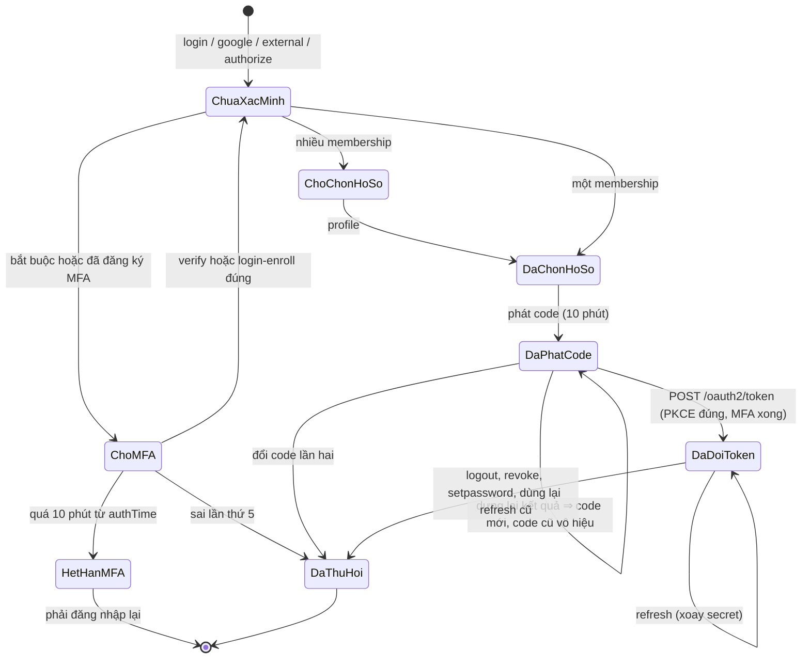
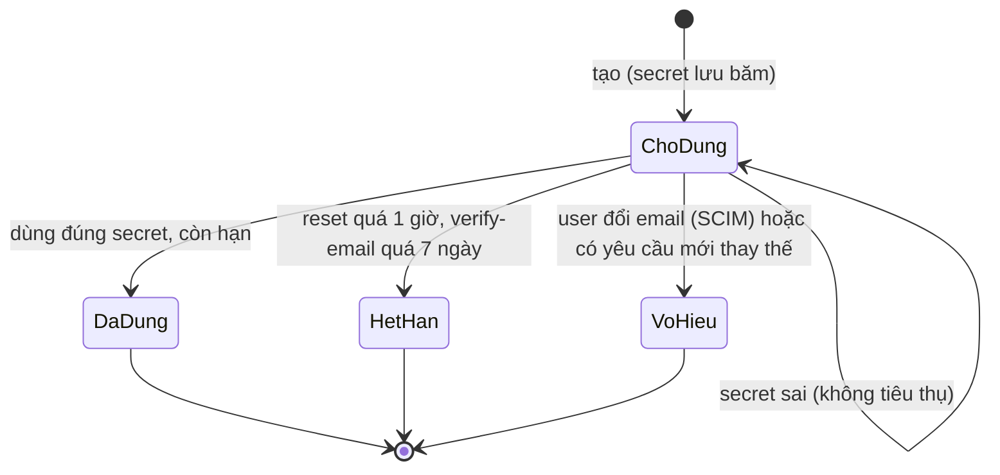
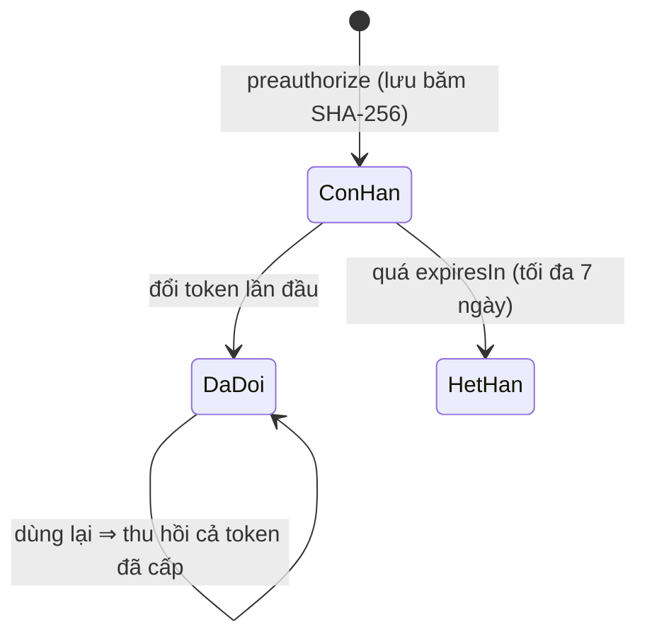

# 5. Luật nghiệp vụ, phân quyền, vòng đời, truy vết

## 5.1 Vòng đời trạng thái

### Login (một lần đăng nhập)

### UserSecurityRequest (yêu cầu qua email)

### Membership

```mermaid
stateDiagram-v2
    [*] --> HoatDong: invite, newproject, newpatient, SCIM POST, seed
    HoatDong --> TamNgung: active=false (admin hoặc SCIM)
    TamNgung --> HoatDong: active=true (IdP là nguồn sự thật, ghi audit)
    HoatDong --> DaXoa: DELETE (trừ chủ project, admin cuối; SCIM thêm chính người gọi)
    TamNgung --> DaXoa: DELETE
    DaXoa --> [*]
    note right of DaXoa: User thuộc project hết membership thì bị xóa theo
```

### Mã cấp sẵn (pre-authorized code)

## 5.2 Ma trận phân quyền (ai gọi được gì)

Ký hiệu: ● được · ○ không · ◐ có điều kiện (ghi chú).

| Chức năng | Khách | Người dùng đã đăng nhập | Admin project | Client (secret/JWT) | Vận hành (CLI) |
|---|:-:|:-:|:-:|:-:|:-:|
| F-01 đăng ký, F-05 method, F-06 login, F-13 reset | ● (reCAPTCHA, hạn mức) | ● | ● | ○ | ○ |
| F-02 newproject, F-03 newpatient | ◐ cần `login` từ F-01 | ◐ | ◐ | ○ | ○ |
| F-04 xác minh email | ● có link | ● | ● | ○ | ○ |
| F-10 MFA khi đăng nhập | ◐ theo id login | ◐ | ◐ | ○ | ○ |
| F-11 MFA tự quản, F-12 đổi mật khẩu, F-14 me/revoke | ○ | ● (chủ thể `User`) | ● | ○ | ○ |
| F-15..F-17 authorize, token code/refresh | ◐ | ● | ● | ● | ○ |
| F-18 client credentials | ○ | ○ | ○ | ● | ○ |
| F-19 preauthorize (cấp) | ○ | ○ | ● + header on-behalf-of | ○ | ○ |
| F-21 userinfo/introspect/logout | ○ | ● | ● | ◐ introspect cùng client/project | ○ |
| F-23 settings, client, sites | ○ | ○ | ● project của mình | ○ | ● |
| F-24 invite, F-25 members | ○ | ○ | ● (trừ xóa chủ project, bỏ/tắt/xóa admin cuối cùng) | ○ | ◐ seed |
| F-26 SCIM | ○ | ○ | ◐ Bearer/Basic của client có `admin` | ◐ | ○ |
| F-27 gửi thư | ○ | ○ | ● nếu project có tính năng `email` | ○ | ○ |
| F-28 CLI | ○ | ○ | ○ | ○ | ● |

Không có siêu quyền xuyên project (D-22): admin chỉ thao tác `projectId` của chính mình.

### Quyền dữ liệu FHIR (token → fhir-server)

| Vai (membership) | Claim `scope` auth tự thêm | Phạm vi dữ liệu |
|---|---|---|
| Admin project | `fhir.admin` | Quản trị trong project |
| Hồ sơ mà mọi rule chỉ đọc | `fhir.read` | Chỉ đọc theo rule |
| Còn lại | `fhir.write` | Đọc ghi theo rule |
| Login có SMART scope | **không thêm** | Theo scope SMART |
| Bệnh nhân (compartment bật) | như trên | Chỉ `_compartment=Patient/<id>` của mình (OR nhiều rule `Communication`) |

## 5.3 Danh mục luật nghiệp vụ

Cột **Loại**: `BM` luật nghiệp vụ · `SEC` bảo mật · `DATA` toàn vẹn dữ liệu · `OPS` vận hành.

### Tài khoản và đăng ký

| Mã | Luật | Loại | F |
|---|---|---|---|
| BR-01 | Mật khẩu 8 ký tự tối thiểu, tối đa 72 **byte** (giới hạn bcrypt) | SEC | F-01,06,12,13 |
| BR-02 | reCAPTCHA kiểm **trước** cờ đăng ký; lỗi gọi reCAPTCHA là lỗi (fail đóng) | SEC | F-01,13 |
| BR-03 | Mọi mật khẩu mới kiểm rò rỉ HIBP (k-anonymity); lỗi gọi HIBP là lỗi (fail đóng) | SEC | F-01,12,13,23 |
| BR-04 | Tên project 4-72 ký tự | BM | F-02 |
| BR-05 | Email duy nhất theo (phạm vi, email), chặn trùng song song bằng khóa trong transaction | DATA | F-01,08 |
| BR-06 | Mọi kiểm tra trạng thái Login/project/chính sách chạy **trước** khi tạo bất cứ gì (không để dữ liệu dở dang) | DATA | F-02,03 |
| BR-07 | Tạo project (project, 6 chính sách, client, hồ sơ, membership admin) trong **một** transaction | DATA | F-02,28 |
| BR-08 | Bệnh nhân tự đăng ký: project `active`, `openPatientRegistration`, có chính sách Patient; user phải thuộc **đúng** project | BM | F-03 |
| BR-09 | Yêu cầu qua email: secret lưu **băm**, dùng một lần, hết hạn (reset 1 giờ, verify-email 7 ngày), kiểm `redirectUri` trước khi tiêu thụ | SEC | F-04,13 |
| BR-30 | Kiểm PKCE/redirect/origin **trước** khi tạo user (không user mồ côi) | DATA | F-01 |
| BR-31 | `newproject` khi login còn thiếu MFA: trả phản hồi MFA, chưa tạo gì | DATA | F-02 |

### Đăng nhập và MFA

| Mã | Luật | Loại | F |
|---|---|---|---|
| BR-10 | Lỗi đăng nhập dùng thông điệp chung (không lộ email có tồn tại); `resetpassword` trả `200` cho email hợp lệ dù có tài khoản hay không (lỗi ghi request hoặc reCAPTCHA vẫn `500`) | SEC | F-06,13 |
| BR-11 | `LoginResult` trả đúng **một** dạng theo thứ tự: mfaEnrollRequired → mfaRequired → project mới → code → memberships | BM | F-06,07 |
| BR-12 | Tìm user của project trước, rồi rơi về user phạm vi server | BM | F-06 |
| BR-13 | `redirect_uri` khớp **chính xác**; lỗi `client_id`/`redirect_uri` không chuyển hướng (chống open redirect) | SEC | F-05,15,16 |
| BR-14 | **MFA chưa xong thì không đổi được code** (`invalid_grant` `MFA verification required`, không tiêu thụ code); lỗi hạ tầng MFA ⇒ 500 chung, không bao giờ cấp code | SEC | F-10,16 |
| BR-15 | Mỗi lần dựng lại kết quả đăng nhập phát code mới và vô hiệu code cũ | SEC | F-07 |
| BR-16 | MFA bắt buộc khi project **hoặc** `User.mfaRequired`; chỉ áp cho đăng nhập bằng mật khẩu | BM | F-06,10,11 |
| BR-17 | TOTP RFC 6238 (SHA-1, 6 số, bước 30 giây, lệch ±1 bước); mỗi mã dùng **một** lần mỗi user (nhớ 4 bước); mã dùng để đăng ký không bị tiêu thụ | SEC | F-10,11 |
| BR-18 | Mã email: 6 số, lưu bcrypt, hạn 20 phút, một lần dùng, gửi lại ghi đè mã cũ; mã hết hạn không chặn TOTP đúng | SEC | F-10 |
| BR-19 | Không gỡ yếu tố MFA cuối cùng khi MFA là bắt buộc; gỡ TOTP thì thay secret ngẫu nhiên | BM | F-11,25 |
| BR-42 | Hạn mức thử MFA đặt chỗ **nguyên tử** trước khi biết đúng/sai: 5 lượt/login, 20/user trong 10 phút; sai lần 5 ⇒ thu hồi login; áp cho `verify`, `login-enroll`, `enroll`, `disable`; gửi mã email tối đa 5 lần/login/20 phút; Login chỉ dùng xác minh MFA trong 10 phút | SEC | F-10,11 |

### Đăng nhập ngoài

| Mã | Luật | Loại | F |
|---|---|---|---|
| BR-20 | `state` do auth ký (HMAC) và chỉ nhận từ đúng trình duyệt (cookie `auth-external-state`) | SEC | F-05,09 |
| BR-21 | URL IdP/JWKS phải https và không thuộc dải nội bộ (chặn SSRF); `id_token` bắt buộc có `jwksUrl` | SEC | F-09,18,28 |
| BR-22 | Email do IdP/Google trả phải **đã xác minh** | SEC | F-08,09,20 |
| BR-23 | Email phải khớp miền cấu hình và user phải có membership; Login chỉ tạo khi biết có membership; lỗi xác minh không lộ chi tiết thư viện | SEC | F-08,09,20 |

### Mật khẩu, phiên

| Mã | Luật | Loại | F |
|---|---|---|---|
| BR-24 | Tài khoản đăng nhập IdP ngoài không đặt lại mật khẩu cục bộ | BM | F-13 |
| BR-25 | `setpassword` đồng thời xác minh email và **thu hồi mọi Login** của user (một transaction) | SEC | F-13 |
| BR-26 | Access token **có trạng thái** ở route auth: login bị thu hồi ⇒ `401` ngay (`userinfo`, `introspect`, `refresh`, `/auth/me`) | SEC | F-14,21 |
| BR-27 | `logout` thu hồi Login và chuỗi `basedOn` tổ tiên; `introspect` chỉ hỏi được token cùng project và client, mọi lý do khác là `{active:false}` | SEC | F-21 |

### Token và quyền

| Mã | Luật | Loại | F |
|---|---|---|---|
| BR-28 | **Ý định thiết kế:** scope do client khai không bao giờ thành quyền (term `fhir.*` ⇒ `invalid_scope`). **Hiện thực tế:** mới được ép ở `client_credentials` (`ValidateRequestedScope` chỉ được gọi ở `token.go`); ở `login`, `authorize`, `exchange`, `refresh`, `pre-authorized_code` scope của Login đi thẳng vào claim `scope` của access token, nên term `fhir.admin` tự xin **không bị lọc** (agent đã thấy token `openid fhir.admin fhir.admin`). **Điểm cần quyết định, chưa sửa mã** | SEC | F-16,18 |
| BR-29 | `fhir.admin/write/read` do auth tự thêm theo membership (admin ⇒ admin; mọi rule chỉ đọc ⇒ read; còn lại write); không thêm khi login có scope SMART; không có `fhir.super` | SEC | F-16 |
| BR-32 | AccessPolicy dịch sang claim **chỉ thu hẹp** (`hiddenFields`, `interaction`, `%...` ngoài danh sách trắng ⇒ cấm cả loại; `readonlyFields`, `writeConstraint` ⇒ chỉ đọc); không dịch được ⇒ `access_denied`, không cấp token | SEC | F-16,17 |
| BR-33 | `hub.topic` FHIRcast ổn định theo chủ thể token; không lấy được ⇒ không cấp token | BM | F-16 |
| BR-34 | Mỗi lần refresh xoay secret bằng ghi có điều kiện phiên bản (hai yêu cầu song song không cùng xoay) | DATA | F-17 |
| BR-35 | Dùng lại secret đã xoay ngoài ân hạn 30 giây hoặc khác IP ⇒ thu hồi Login | SEC | F-17 |
| BR-36 | `client_credentials`: không refresh token; chặn `fhir.*` và `patient/`; không gộp nhiều cách xác thực client; `jti` assertion dùng một lần, `exp` ≤ 5 phút | SEC | F-18 |
| BR-37 | Mã cấp sẵn: lưu băm, một lần, scope ⊆ scope người cấp, ≤ 7 ngày; dùng lại thu hồi cả token đã cấp | SEC | F-19 |
| BR-38 | `iss` khớp `AUTH_ISSUER` **từng ký tự**; ký RS256/ES256/ES384 với `kid`; xoay khóa theo quy trình hai pha | OPS | F-22 |
| BR-39 | **Cửa sổ thu hồi (D-13):** `fhir-server` chỉ xác minh chữ ký nên thu hồi có hiệu lực ở FHIR trễ tới `AUTH_ACCESS_TTL` (15 phút, kèm lệch đồng hồ 30 giây); đây là chấp nhận có chủ đích | BM | F-16,17 |

### Hạn mức và hạ tầng

| Mã | Luật | Loại | F |
|---|---|---|---|
| BR-40 | Hạn mức IP: `AUTH_RATE_LIMIT` (mặc định 20 rps, burst 40) cho `/auth/`, `/oauth2/`, `/.well-known/`, `/admin/`; chặt hơn (`AUTH_LOGIN_RATE_LIMIT`, 1 rps, burst 10) cho `login`, `profile`, `scope`, `method` và các bước nhập thông tin đăng nhập; vượt ⇒ `429` + `Retry-After` | SEC | F-05,06,29 |
| BR-41 | IP người gọi là địa chỉ kết nối; chỉ tin `X-Forwarded-For` khi `AUTH_TRUSTED_PROXIES` chỉ rõ proxy tin cậy | SEC | F-29 |
| BR-73 | Fail đóng: cấu hình sai (hoặc còn biến `AUTHEN_*`) từ chối khởi động; phụ thuộc bảo mật lỗi (MFA, HIBP, reCAPTCHA) là lỗi, không cho qua | SEC | F-29 |

### Quản trị

| Mã | Luật | Loại | F |
|---|---|---|---|
| BR-50 | Admin chỉ thao tác project của mình; membership/project khác ⇒ `403` chung (không cho dò id); không xác thực Basic client ở `/admin` | SEC | F-23..25 |
| BR-51 | Settings chỉ nhận allowlist; thay mục thuộc allowlist, giữ mục ngoài | BM | F-23 |
| BR-52 | `GET` project che `secret` và khóa bí mật trong `site` (`********`); gửi lại `********` = giữ nguyên | SEC | F-23 |
| BR-53 | Secret client chỉ hiện **một lần** khi tạo; ≥ 32 ký tự hoặc sinh 64 hex | SEC | F-23,28 |
| BR-54 | `googleClientId`, `recaptchaSiteKey` duy nhất giữa các project (`409`), `googleClientId` không trùng client chính; tối đa 20 site | DATA | F-23 |
| BR-55 | Admin `setpassword` chỉ cho user thuộc project; thu hồi mọi login | SEC | F-23 |
| BR-56 | `invite`: DTO chặt (trường lạ `400`); ghi user, hồ sơ, membership trong **một** transaction, thư gửi sau | DATA | F-24 |
| BR-57 | Practitioner bị chặn theo `AUTH_BLOCKED_EMAIL_DOMAINS` và `allowedPractitionerEmailDomain` | SEC | F-24,26 |
| BR-58 | AccessPolicy mặc định từ `defaultPatientAccessPolicy`/`defaultAccessPolicies` (Admin cho Practitioner có `admin`); Patient/Practitioner thiếu chính sách mặc định ⇒ `400` | BM | F-24,26 |
| BR-59 | `/admin`: không xóa **chủ project**; không bỏ quyền admin, tắt hoặc xóa **admin hoạt động cuối cùng** (`400`). SCIM: thêm không tắt chủ project, không tắt/xóa chính người gọi. `/admin` không chặn tự hạ quyền khi còn admin khác | BM | F-25,26 |
| BR-60 | Sửa membership chỉ `admin, active, externalId, accessPolicy, access`; `externalId` duy nhất | DATA | F-25 |
| BR-61 | Token của member bị xóa/tắt bị từ chối ngay ở route auth; user thuộc project hết membership thì bị xóa theo | SEC | F-25,26 |
| BR-62 | Admin đặt lại MFA/mật khẩu chỉ cho user thuộc project (user phạm vi server ⇒ `403`) | SEC | F-25 |
| BR-63 | SCIM: mặc định tắt (cần cờ server **và** tính năng project); filter lạ bị từ chối; id ngoài project là `404`; IdP là nguồn sự thật cho `active`; Basic bắt buộc kèm IP allowlist ở staging/production | SEC | F-26 |
| BR-64 | Gửi thư: chặn SSRF, không đọc tệp cục bộ, giới hạn người nhận/kích thước, `from` chỉ trong danh sách duyệt, không ghi `subject` vào log | SEC | F-27 |

### Vận hành

| Mã | Luật | Loại | F |
|---|---|---|---|
| BR-70 | Mật khẩu CLI chỉ qua env hoặc stdin, không qua tham số | SEC | F-28 |
| BR-71 | `purge-logins` xóa **vĩnh viễn**: nên `-dry-run` trước, `-yes` mới xóa | OPS | F-28 |
| BR-72 | `seed project` trong một transaction; admin đã có thì giữ nguyên mật khẩu | DATA | F-28 |

## 5.4 Bảng hạn mức và thời hạn (tra nhanh)

| Đối tượng | Giá trị | Nguồn luật |
|---|---|---|
| Access token | 15 phút (`AUTH_ACCESS_TTL`) | BR-39 |
| Authorization code | 10 phút (`AUTH_AUTH_CODE_TTL`) | BR-15 |
| Ân hạn dùng lại refresh secret | 30 giây, cùng IP | BR-35 |
| Login dùng cho xác minh MFA | 10 phút từ `authTime` | BR-42 |
| Mã email MFA | 20 phút | BR-18 |
| Secret TOTP chờ xác nhận | 20 phút | BR-17 |
| Thử MFA | 5/login, 20/user, cửa sổ 10 phút | BR-42 |
| Gửi mã email MFA | 5/login/20 phút | BR-42 |
| Link đặt lại mật khẩu | 1 giờ, một lần | BR-09 |
| Link xác minh email | 7 ngày, một lần | BR-09 |
| Mã cấp sẵn | mặc định 1 giờ, tối đa 7 ngày | BR-37 |
| `client_assertion` | `exp` ≤ 5 phút, `jti` một lần | BR-36 |
| JWKS | `max-age=300`; `fhir-server` cache 10 phút | BR-38 |
| Hạn mức IP | 20 rps burst 40; đăng nhập 1 rps burst 10 | BR-40 |
| Mật khẩu | 8 ký tự, ≤ 72 byte | BR-01 |
| Site/project | ≤ 20 | BR-54 |
| Email | ≤ 50 người nhận, ≤ 10 MiB, ≤ 20 tệp, body ≤ 1 MiB | BR-64 |

## 5.5 Kịch bản chấp nhận tiêu biểu (cho QA)

Dạng Given-When-Then, mỗi kịch bản trỏ về luật. Đây là bộ **tối thiểu** để nghiệm thu; test tự động chi tiết nằm ở mục 5.6.

| # | Kịch bản | Luật |
|---|---|---|
| AT-01 | **Given** email chưa đăng ký **When** `newuser` với mật khẩu có trong HIBP **Then** `400 Password found in breach database`, không tạo user | BR-03, BR-30 |
| AT-02 | **Given** project bắt buộc MFA, user chưa đăng ký **When** `login` đúng mật khẩu **Then** nhận `mfaEnrollRequired`, **không** có `code` | BR-14, BR-16 |
| AT-03 | **Given** login chưa qua MFA **When** gọi `/oauth2/token` với code (nếu có) **Then** `invalid_grant`, code còn dùng được sau khi xác minh MFA | BR-14 |
| AT-04 | **Given** đã sai MFA 4 lần **When** sai lần 5 **Then** Login bị thu hồi, đăng nhập lại từ đầu | BR-42 |
| AT-05 | **Given** `code` đã đổi **When** đổi lần hai **Then** `invalid_grant` và Login bị thu hồi | BR-14, F-16 |
| AT-06 | **Given** refresh token đã xoay **When** dùng lại từ IP khác **Then** `invalid_grant`, Login bị thu hồi | BR-35 |
| AT-07 | **Given** client công khai **When** đổi code sai `code_verifier` **Then** `invalid_grant`, code **không** mất | BR-13, F-16 |
| AT-08 | **Given** client xin scope `fhir.admin` **When** `client_credentials` **Then** `invalid_scope`. *Với `authorization_code` kịch bản này hiện **không** đạt (xem BR-28)* | BR-28 |
| AT-09 | **Given** user bấm link đặt lại mật khẩu **When** `setpassword` thành công **Then** mọi phiên khác bị thu hồi | BR-25 |
| AT-10 | **Given** email không tồn tại **When** `resetpassword` **Then** vẫn `200` | BR-10 |
| AT-11 | **Given** admin cuối cùng **When** xóa hoặc hạ quyền **Then** `400` | BR-59 |
| AT-12 | **Given** admin project A **When** gọi `/admin/projects/B/...` **Then** `403` | BR-50 |
| AT-13 | **Given** Patient A, B cùng project **When** A đọc resource của B qua `_include`, `$everything`, history **Then** không thấy | §5.2 |
| AT-14 | **Given** access token đã thu hồi **When** gọi `/oauth2/userinfo` **Then** `401` ngay; **When** gọi `fhir-server` **Then** còn dùng được tới ≤ 15 phút | BR-26, BR-39 |
| AT-15 | **Given** IdP trả email chưa xác minh **When** callback **Then** `400`, không tạo Login | BR-22 |
| AT-16 | **Given** SCIM tắt ở project **When** gọi `/scim/v2/Users` **Then** `403 SCIM is not enabled for this project` | BR-63 |
| AT-17 | **Given** 11 lần `login` sai trong vài giây từ một IP **When** lần tiếp theo **Then** `429` + `Retry-After` | BR-40 |
| AT-18 | **Given** `newproject` thiếu MFA **When** gọi **Then** nhận phản hồi MFA và **không** có project mới | BR-31 |

## 5.6 Truy vết luật → bằng chứng kiểm thử

Mức tệp (không liệt kê từng test). Khi sửa luật, chạy nhóm tệp tương ứng; `make test-e2e` chạy `auth` và `fhir-server` thật.

| Nhóm luật | Test |
|---|---|
| BR-01..09, 30, 31 (đăng ký, mật khẩu) | `internal/application/registration_test.go`, `newproject_test.go`, `newpatient_test.go`, `password_test.go`, `securityrequest_test.go`, `security_p4_test.go`; `internal/bootstrap/registration_http_test.go`, `credentials_http_test.go`; `e2e/signup_test.go` (S1-S17) |
| BR-10..15 (đăng nhập, code) | `internal/application/login_test.go`, `flow_test.go`; `internal/bootstrap/http_test.go`, `oauth_code_test.go`, `oauth_authorize_test.go` |
| BR-16..19, 42 (MFA) | `internal/application/mfa_test.go`; `internal/bootstrap/mfa_http_test.go`, `mfa_code_test.go`; `internal/domain/mfa_p5_test.go` |
| BR-20..23 (đăng nhập ngoài) | `internal/application/external_test.go`, `external_exchange_test.go`; `internal/bootstrap/external_http_test.go`, `exchange_google_http_test.go` |
| BR-26, 27, 34..37 (token, refresh, introspect) | `internal/bootstrap/oauth_refresh_test.go`, `oauth_assertion_test.go`, `oauth_preauth_test.go`, `oauth_resource_test.go`, `preauthorize_http_test.go`; `internal/application/grant_test.go` |
| BR-28, 29, 32, 33, 39 (quyền, claim) | `internal/domain/policy_compartment_test.go`, `defaults_test.go`; `internal/bootstrap/oauth_hub_test.go`, `patient_compartment_test.go`; e2e `TestKnownRevocationWindowBetweenAuthAndFhirServer` |
| BR-40, 41, 73 (hạn mức, fail đóng) | `internal/bootstrap/security_controls_test.go`, `container_test.go`; `internal/config/config_test.go` |
| BR-50..62 (admin) | `internal/application/admin_test.go`, `admin_project_test.go`; `internal/bootstrap/admin_http_test.go`, `admin_test.go` |
| BR-63 (SCIM) | `internal/application/scim_test.go`; `internal/bootstrap/scim_http_test.go` |
| BR-64 (thư) | `internal/application/email_test.go`; `internal/bootstrap/email_http_test.go`, `email_binary_test.go`, `smtp_test.go` |
| Hợp đồng route/DTO | `TestRoutesMatchSwaggerContract`, `TestAPIContractIsUpToDate`, `TestSwaggerDTOsAreComplete`, `architecture_test.go` |
| Schema, role | `internal/bootstrap/schema_pg_test.go`; `make test-db` |

> **Khoảng trống đã biết:** các kịch bản AT-xx ở 5.5 chưa gắn từng-test-một với tên test; nếu cần truy vết chặt (audit), bước tiếp theo là gắn tag `// AT-xx` vào test tương ứng và thêm một test kiểm mọi AT-xx đều có test.
