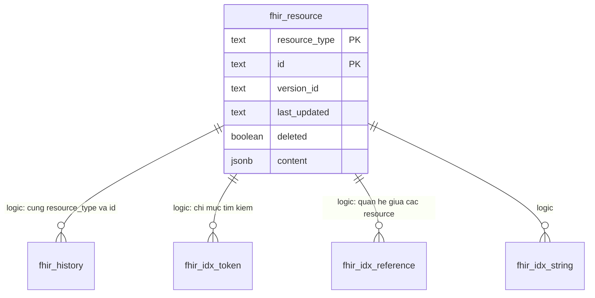

# 1. Bảng vật lý của auth

Auth **không có bảng nghiệp vụ riêng**. Nó chạy trên đúng bộ bảng "kho tài liệu FHIR" của `pkg/fhirstore`, được tạo trong schema PostgreSQL `identity` (hoặc tệp SQLite dev) bởi migration của `fhirstore`. **Mọi bảng và cột được mô tả một lần, đầy đủ ghi chú chức năng, ở [docs/erd/fhirstore-physical.md](../../../../docs/erd/fhirstore-physical.md)**; tệp này chỉ nêu phần riêng của auth.

## 1.1 Auth dùng bảng nào

| Bảng | Auth dùng? | Ghi chú riêng của auth |
|---|---|---|
| `fhir_resource` | **Có, là nơi chứa mọi dữ liệu** | 10 loại resource ([02](02-mo-hinh-logic.md)) cộng hồ sơ `Patient`, `Practitioner`, `RelatedPerson` mà auth tạo. Chứa bí mật dạng băm hoặc mã hóa (S4) |
| `fhir_history` | **Có (tự động)** | Ghi mỗi phiên bản của mọi resource; **giữ lại nội dung cũ kể cả sau khi xóa** (mục 1.4) |
| `fhir_idx_string`, `_token`, `_reference` | **Có** | Phục vụ tìm kiếm của auth: theo email, `identifier`, `user`, `project`, `profile`, `code`/`cookie` của `Login`... |
| `fhir_idx_date`, `_number`, `_quantity`, `_uri` | Tồn tại, **không có dòng** từ 10 loại của auth | 10 loại resource auth sở hữu chỉ có tham số kiểu `string`, `token`, `reference` (đã đếm từ `searchparams_gen.go`); `Patient` do auth tạo có tham số `date` nhưng auth không ghi trường ngày (chưa đếm dòng thật trong DB) |
| `fhir_coding`, `fhir_coding_property`, `fhir_coding_designation`, `fhir_concept_mapping` | **Không dùng, luôn rỗng** | Migration tạo chung cho mọi service; auth không lưu `CodeSystem` hay `ConceptMap` |
| `fhirstore_schema_version` | Có | Bảng phiên bản goose do `pkg/database` tạo lúc migrate; một dòng cho mỗi phiên bản migration đã chạy |

## 1.2 Schema, role, migration

| Chủ đề | Giá trị |
|---|---|
| Schema PostgreSQL | `identity` (một schema riêng; `search_path` đặt ở mức role) |
| Role chạy ứng dụng | `identity_app`: `USAGE` schema, `SELECT/INSERT/UPDATE/DELETE`, kể cả bảng do migration tương lai tạo (`ALTER DEFAULT PRIVILEGES`); không DDL |
| Role migration | `identity_migrate` (chỉ khi `DB_SEPARATE_MIGRATION_ROLES=true`): sở hữu schema, chạy DDL |
| Chế độ mặc định (dev) | một role sở hữu schema, app tự migrate (`DATABASE_AUTO_MIGRATE=true`) |
| Lệnh migrate | `auth migrate up\|down\|status`; ở production chạy ở bước deploy với `DATABASE_MIGRATE_URL` |
| Từ chối khởi động | `DATABASE_REQUIRE_SCHEMA=true` và `search_path` không phải đúng một schema riêng đã tồn tại |
| Backend khác | SQLite (dev, `./auth.db`): không có schema, cột `content` là text; MySQL: **chưa hỗ trợ** cho `fhirstore` |
| Dọn dẹp | `auth purge-logins -before <ngày> [-dry-run] [-yes]` (xóa vĩnh viễn `Login` cùng lịch sử và chỉ mục) |

## 1.3 Bố cục dữ liệu của một resource

Ví dụ minh họa (giá trị giả) của một dòng `fhir_resource` cho `Login`: `resource_type='Login'`, `id='0192f3a4-...'`, `content` là JSON `{"resourceType":"Login","user":{"reference":"User/...a"},"authMethod":"password","granted":true,"meta":{"versionId":"...","lastUpdated":"2026-11-24T10:15:30.123Z","project":"..."}}`. Chỉ mục kèm theo: `fhir_idx_reference(code='user', target='User/...a')`, `fhir_idx_token(code='code', ...)` nếu có `code`.

## 1.4 Hệ quả vận hành riêng của auth

| Chủ đề | Nội dung |
|---|---|
| Bảng lớn nhanh nhất | `fhir_history` và `fhir_idx_*` của `Login`: **mỗi lần xoay refresh secret** (`refresh_token` grant), mỗi lần chọn hồ sơ/scope, mỗi lần cấp hoặc đổi code đều là `UpdateResource` ⇒ một dòng lịch sử mới và xóa-ghi lại chỉ mục của `Login`. Dọn bằng `auth purge-logins` (xóa cả lịch sử). Chưa có số đo thật |
| Bí mật trong lịch sử | `fhir_history.content` giữ bản sao **mọi phiên bản cũ**: mỗi lần đổi mật khẩu để lại hash mật khẩu cũ của `User`; xóa `User`/`ProjectMembership` là xóa mềm nên phiên bản trước vẫn còn. Chỉ `Expunge` (dùng cho `Login`) xóa lịch sử. Chi tiết [03 mục 4](03-quan-he-va-toan-ven.md) |
| Ai đọc được | Chỉ `identity_app`, `identity_migrate` và superuser DB; role `fhir_app` không có quyền (kiểm bằng `make test-db`). Sao lưu cụm PostgreSQL mang theo schema này: coi như dữ liệu S4 |
| Tìm theo project | Không có chỉ mục theo `meta.project` ([03 mục 2](03-quan-he-va-toan-ven.md)): truy vấn "mọi X của project" dựa vào tham số `project` (Reference) hoặc đọc rồi so sánh |
| Khóa phiên bản | Sửa resource dùng `SELECT ... FOR UPDATE` (PostgreSQL) và `Mutate` thử lại tối đa 8 lần khi xung đột phiên bản (`If-Match`) |
