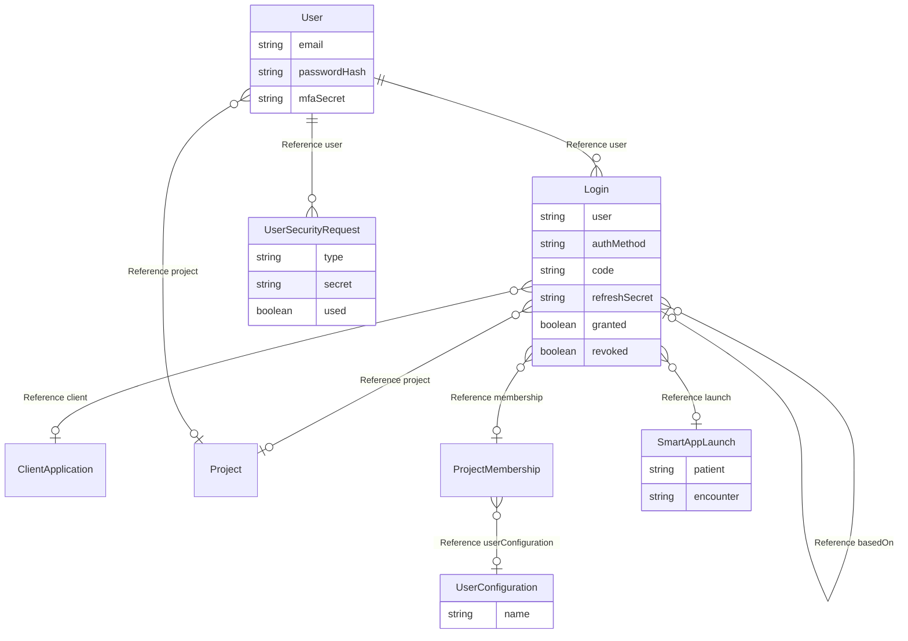
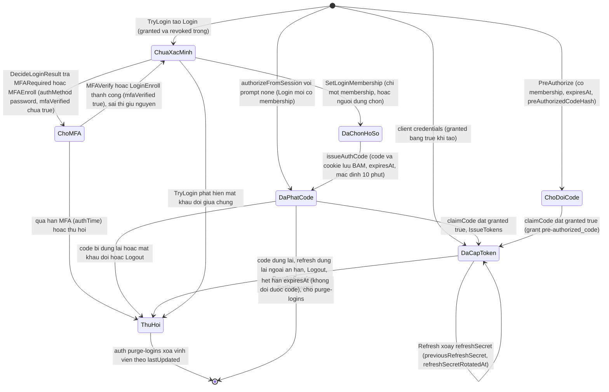
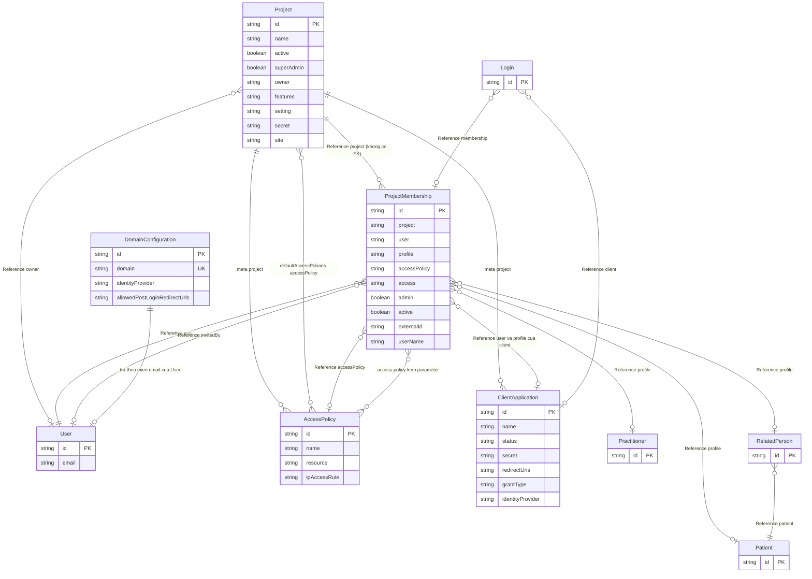

# 2. Mô hình logic: resource của auth

Mọi dữ liệu nghiệp vụ của auth là **resource FHIR dạng JSON** trong bảng `fhir_resource` (cột `content`, khóa `(resource_type, id)`), schema PostgreSQL `identity` ([01](01-bang-vat-ly.md); bảng chi tiết ở [docs/erd/fhirstore-physical.md](../../../../docs/erd/fhirstore-physical.md)). Tệp này mô tả **10 loại resource** auth sở hữu, từng trường, mức nhạy cảm và tham số tìm kiếm được lập chỉ mục; quan hệ giữa chúng và hành vi khi xóa ở [03](03-quan-he-va-toan-ven.md); khóa Redis ở [04](04-kho-khac.md).

**Cách đọc:**

- **Bảng trường**: `Trường` là tên JSON; `Kiểu` theo `pkg/fhir/resource_<loại>.go`; `Bắt buộc` theo struct sinh từ định nghĩa FHIR (không phải luôn là điều kiện kiểm ở mức ứng dụng: validator thật nằm ở `internal/presentation/httpapi` và `application`); `Chức năng` nêu trường chứa gì, vì sao có, ai ghi khi nào, ai đọc; `Nhạy cảm`: S1 định danh kỹ thuật, S2 dữ liệu cá nhân, S4 bí mật xác thực (S0 công khai, S3 dữ liệu lâm sàng không có ở auth).
- **Lược khỏi bảng** các trường dùng chung của mọi resource FHIR: `id`, `meta` (chỉ `meta.versionId`, `meta.lastUpdated` do `fhirstore` đặt, và **`meta.project`** là chuỗi id project sở hữu resource, xem [03](03-quan-he-va-toan-ven.md) mục 2), `implicitRules`, `language`, `text`, `contained`, `extension`, `modifierExtension`, và các trường `_x` (phần mở rộng của kiểu nguyên thủy).
- **Bí mật lưu thế nào** ghi trong cột Chức năng của từng trường: **băm** (SHA-256 hex), **mã hóa** (AES-256-GCM, `enc:v1:<kid>:...`), hoặc **bản rõ**. Có nhiều trường bí mật lưu **bản rõ**: tổng hợp ở mục "Bí mật nào lưu thế nào" cuối tệp.
- Ví dụ giá trị đều là giả.

## Bí mật nào lưu thế nào (tổng hợp, đối chiếu mã)

| Trường | Cách lưu | Ghi chú |
|---|---|---|
| `User.passwordHash` | **băm bcrypt** (`$2a$`/`$2b$`, đọc được hash do Node/Medplum tạo) | cost tối thiểu 10 ở staging/production |
| `User.mfaSecret` | **mã hóa** AES-256-GCM khi có `AUTH_MFA_SECRET_KEYS`; **bản rõ** khi không đặt (dev, có cảnh báo) | bắt buộc đặt ở staging/production |
| `Login.code`, `Login.cookie`, `Login.preAuthorizedCodeHash` | **băm SHA-256 hex** | đọc được kho cũng không dùng lại được code |
| `Login.emailMfa.codeHash` | **băm bcrypt** | mã email 6 số |
| `UserSecurityRequest.secret` | **băm SHA-256 hex** | link đặt lại mật khẩu, xác minh email |
| **`Login.refreshSecret`, `Login.previousRefreshSecret`** | **BẢN RÕ** | khác `docs/architecture.md` dòng 79 ("kho chỉ giữ băm"). Được nhúng nguyên vào claim `refresh_secret` của refresh JWT và so sánh trực tiếp. Rủi ro bị hạn chế vì refresh token là JWT ký bởi auth (chỉ lộ DB không đủ giả mạo), nhưng lộ DB hoặc `fhir_history` là lộ secret còn hiệu lực |
| **`ClientApplication.secret`, `retiringSecret`** | **BẢN RÕ** | che `********` chỉ ở một số phản hồi; `POST .../client` trả secret một lần |
| **`ClientApplication.identityProvider.clientSecret`** (và cùng trường ở `DomainConfiguration`) | **BẢN RÕ** | secret của IdP ngoài |
| **`Project.secret[]`** (gồm `smtpPassword`), **`Project.site[].googleClientSecret`, `recaptchaSecretKey`** | **BẢN RÕ** | `GET /admin/projects/{id}` trả `********` cho `secret` và khóa bí mật trong `site`; `setting` trả nguyên giá trị |

Các bản rõ nói trên **cũng nằm trong `fhir_history`** của schema `identity` (mọi phiên bản cũ); xem [03 mục 4](03-quan-he-va-toan-ven.md). `secretbox` (mã hóa) chỉ dùng cho `User.mfaSecret`.

---

## Cụm danh tính và phiên

Năm loại resource của cụm này đều nằm trong `fhir_resource` (cột `content` là JSON, khóa logic `(resource_type, id)`), schema `identity`. Id do `pkg/fhirstore` sinh khi `Create` nếu resource chưa có id (`newID()` trong `pkg/fhirstore/store.go`); `domain.NewID()` (UUID v4) chỉ dùng khi cần biết id trước khi ghi (Project). Mọi cập nhật qua `Mutate` hoặc `UpdateIfMatch` tăng `meta.versionId` và ghi một dòng `fhir_history`. Không có khóa ngoại: mọi quan hệ là `Reference` trong JSON.

Mức nhạy cảm theo nhãn S0..S4 của bộ tài liệu này: S1 định danh kỹ thuật, S2 dữ liệu cá nhân, S4 bí mật xác thực.

Không có FK: `Login.user` có thể trỏ tới `User`, `ClientApplication` hoặc `Bot` (tìm kiếm khai đích `Bot, ClientApplication, User`); sơ đồ chỉ vẽ `User` và `ClientApplication`. Toàn vẹn do mã ứng dụng giữ (chi tiết ở 03). `Login.basedOn` là tự tham chiếu (phiên dựng trên phiên). `ProjectMembership`, `ClientApplication`, `Project` chỉ là thực thể đích, tài liệu ở nhóm khác.

### User

**Mục đích nghiệp vụ:** tài khoản đăng nhập của một con người: email, họ tên, hash mật khẩu và trạng thái MFA. User không chứa quyền; quyền nằm ở `ProjectMembership` (một User có thể có nhiều membership ở nhiều project). User có `project` là user "cục bộ project" (mỗi project một tài khoản riêng, cùng email vẫn là hai User); không có `project` là user toàn cục.
**Lưu ở:** `fhir_resource`, `resource_type='User'`, schema `identity`.
**Ghi bởi:** `Service.PrepareUser` + `CreateUser` (`application/admin.go`, dùng cho đăng ký và lệnh `auth seed`/`user`), `AdminInvite` (`application/admin_invite.go:233`, tạo User mới khi mời), đăng nhập Google tạo mới (`application/google.go:96`, `emailVerified=true`, không mật khẩu), đăng nhập ngoài và exchange (`external*.go`, đặt `emailVerified`), `SetPassword` (`password.go`, ghi `passwordHash`, `emailVerified`), các hàm MFA (`mfa.go`: `enrollTotp`, email MFA, tắt MFA ở `mfa.go:668` và `admin_project.go:460`), SCIM (`scim.go:368` đổi email thì đặt `emailVerified=false`).
**Vòng đời:** tạo, sửa qua `Mutate` (đọc bản mới nhất rồi ghi kèm điều kiện phiên bản). Xóa cứng chỉ khi gỡ member: `admin_project.go:347` xóa User khi User thuộc đúng project đó (`user.project` khớp) và hết membership; User dùng chung nhiều project hoặc không có `project` thì giữ. Không có xóa mềm trong mã auth.
**Id:** do `fhirstore` sinh (UUID dạng chuỗi) khi tạo.
**Lưu ý vận hành:** tra User theo email dùng chỉ mục `email` (so khớp `exact`) cộng điều kiện `project`; email luôn hạ chữ thường khi tạo (`strings.ToLower` ở `PrepareUser`), nên đừng ghi tay email chữ hoa. Tính duy nhất `(phạm vi, email)` do mã giữ bằng khóa tư vấn trong transaction vì kho không có ràng buộc UNIQUE. `mfaSecret` chỉ được mã hóa khi đặt `AUTH_MFA_SECRET_KEYS`; nếu không, lưu bản rõ (xem bảng).

| Trường | Kiểu | Bắt buộc | Chức năng | Nhạy cảm |
|---|---|---|---|---|
| `identifier` | Identifier[] | không | Danh sách định danh phụ của người dùng (system, value). Auth không có đường ghi (grep `Identifier:` chỉ thấy `session.go:105` sao chép sang phản hồi `/auth/me`); chỉ mục `identifier` có khai nhưng không truy vấn nào của auth dùng. Có thể do công cụ ngoài ghi (chưa kiểm). Chỉ đọc lại khi dựng `/auth/me`. | S2 |
| `firstName` | string | có | Tên riêng, nhập lúc đăng ký/mời (`NewUser`, `InviteRequest`) hoặc lấy từ claim `given_name` của Google. Dùng chào trong thư (`mail.go:66`), dựng tên Patient/Practitioner khi tạo hồ sơ (`newpatient.go:66`), trả về SCIM (`toScim`). | S2 |
| `lastName` | string | có | Họ, cùng nguồn ghi với `firstName`; claim `family_name` của Google. Dùng cho tên hồ sơ và SCIM `name.familyName`. | S2 |
| `externalId` | string | không | Id ở hệ thống ngoài của User. Deprecated: `findLoginUser` không dùng nó mà tra `ProjectMembership.externalId` (`trylogin.go`, chú thích nêu rõ "chỉ cần khi có dữ liệu di trú"). Chỉ còn được đọc làm giá trị dự phòng cho SCIM `externalId` khi membership chưa có (`scim.go:105-107`); auth không ghi. | S2 |
| `email` | string | không | Email đăng nhập, chữ thường. Khóa tra User (`FindInProject`, `FindGlobal` qua chỉ mục `email`), đích gửi thư đặt lại mật khẩu, mã MFA email, claim `email` của token khi scope có `email` (`token.go:130`). SCIM có thể đổi, khi đó `emailVerified` về `false`. Không bắt buộc ở kiểu vì User đăng nhập bằng `externalId` có thể thiếu email. | S2 |
| `emailVerified` | boolean | không | Đã xác minh quyền sở hữu email. Đặt `true` bởi: `VerifyEmail` (link verify-email), `SetPassword` kèm security request, đăng nhập Google và external/exchange, xác minh MFA email thành công (`mfa.go:295`). Đặt `false` bởi SCIM khi đổi email. Đọc ở `newproject.go:59` (cấu hình `RequireVerifiedEmailForProject` chặn tạo project khi chưa xác minh). | S1 |
| `admin` | boolean | không | Cờ admin cũ, bình luận kiểu là `@deprecated`. Không có chỗ nào trong `apps/auth` ghi hoặc đọc `User.admin` (quyền admin hiện ở `ProjectMembership.admin`); chỉ tồn tại vì kiểu FHIR tự sinh. | S1 |
| `passwordHash` | string | không | Hash bcrypt của mật khẩu (`password/bcrypt.go`; mật khẩu tối đa 72 byte, kiểm bởi `PasswordTooLongForHash`). Chỉ lưu BĂM, không bao giờ bản rõ. Ghi bởi `PrepareUser`/`CreateUser`, `SetPassword`, `AdminInvite`. Đọc bởi `VerifyPassword` (so bcrypt; user thiếu hash vẫn so với hash giả để thời gian không lộ sự tồn tại). `TryLogin` đọc lại sau khi tạo Login để phát hiện mật khẩu đổi giữa chừng. Trống với user chỉ đăng nhập qua Google/ngoài. | S4 |
| `mfaSecret` | string | không | Secret TOTP của User. Lưu MÃ HÓA khi đặt `AUTH_MFA_SECRET_KEYS`: AES-256-GCM, dạng `enc:v1:<kid>:<base64(nonce kèm ciphertext)>` (`secretbox`, hỗ trợ xoay khóa theo kid); nếu không đặt khóa thì `secretbox.Plain` lưu BẢN RÕ và log cảnh báo lúc khởi động (`container.go:wireMFA`, chỉ dành cho dev/test). Ghi bởi `enrollTotp`; khi tắt TOTP bị thay bằng secret ngẫu nhiên mới (đã mã hóa) để secret cũ không còn trong DB. Đọc bởi `openSecret` lúc xác minh mã. | S4 |
| `mfaRequired` | boolean | không | User bị bắt buộc dùng MFA (ép riêng, ngoài cài đặt `mfaRequired` của Project). Chỉ `AdminInvite` ghi từ `InviteRequest.MFARequired`. Đọc bởi `IsMFARequired` (`domain/mfa.go`): `true` nếu setting project bật hoặc cờ này bật; với login mật khẩu chưa đăng ký MFA thì `DecideLoginResult` trả `ResultMFAEnroll`. | S1 |
| `mfaEnrolled` | boolean | không | User đã đăng ký ít nhất một yếu tố MFA. Ghi `true` khi đăng ký TOTP hoặc email (`mfa.go:101,389,538`), ghi lại theo số phương thức còn lại khi gỡ (`mfa.go:668`, `admin_project.go:460`). Đọc bởi `DecideLoginResult` (đăng nhập mật khẩu của user đã đăng ký phải qua `ResultMFARequired`) và `/auth/mfa/status`. | S1 |
| `mfaMethod` | string[] | không | Các phương thức đã đăng ký, giá trị thật là `totp` và `email` (`domain.MFATotp`, `MFAEmail`). Thêm bằng `AddMFAMethod`, bớt khi gỡ phương thức. Đọc bởi `EnrolledMFAMethods`, `HasMFAMethod`: quyết định gửi mã email tự động (chỉ khi email là phương thức duy nhất) và lấy secret TOTP nào để kiểm. | S1 |
| `project` | Reference(Project) | không | Phạm vi project của User: có thì User chỉ tồn tại trong project đó (`PrepareUser`, `AdminInvite` với `scope=project`, Google khi có `projectId` cụ thể); thiếu thì là User toàn cục. Chỉ mục `project` phục vụ `FindInProject` (`project = Project/<id>`) và `FindGlobal` (`project:missing=true`). Cũng là điều kiện giữ/xóa User khi gỡ member. | S1 |

Cấu trúc con của `identifier` (kiểu `Identifier`):

| Trường con | Kiểu | Chức năng |
|---|---|---|
| use | code | mục đích dùng định danh (`usual`, `official`...), theo FHIR |
| system | uri | hệ thống cấp định danh; cặp (system, value) là thứ chỉ mục token `identifier` mã hóa |
| value | string | giá trị định danh |

**Tham số tìm kiếm được lập chỉ mục:**

| Tham số | Loại | Đích | Phục vụ |
|---|---|---|---|
| `email` | string | `User.email` | `users.FindInProject` và `users.FindGlobal` (`store/repos.go:27,31`, modifier `exact`): tra User khi đăng nhập, đặt lại mật khẩu, mời, Google, đăng nhập ngoài |
| `external-id` | string | `User.externalId` | không có truy vấn nào của auth dùng (auth tra `external-id` trên `ProjectMembership`, `repos.go:176`) |
| `identifier` | token | `User.identifier` | không có truy vấn nào của auth dùng |
| `project` | reference (Project) | `User.project` | `FindInProject` (khớp `Project/<id>`) và `FindGlobal` (modifier `missing`); đồng bộ với phạm vi User ở `FindUserInScope` |

### Login

**Mục đích nghiệp vụ:** một lần đăng nhập (phiên) của một chủ thể (User, ClientApplication hoặc Bot). Là gốc của authorization code, cookie phiên, refresh token, trạng thái MFA, và là chỗ ghi nhận hồ sơ (membership) đã chọn. Mọi access/id/refresh token do auth ký đều mang `login_id`; `Authenticate` đọc lại Login ở MỖI lần gọi Bearer nên thu hồi Login có hiệu lực ngay ở các route của auth.
**Lưu ở:** `fhir_resource`, `resource_type='Login'`, schema `identity`.
**Ghi bởi (tạo):**
- `TryLogin` qua `newLoginResource` (`trylogin.go`): đăng nhập mật khẩu, Google, external, exchange (`authMethod` = `password`, `google`, `external`, `exchange`).
- `authorizeFromSession` (`token_authorize.go:213`): `/oauth2/authorize` tái dùng phiên có sẵn, tạo Login MỚI với `basedOn` trỏ Login cũ, không đụng Login cũ.
- Client credentials (`token.go:309`): `authMethod='client'`, tạo sẵn `granted=true`, `user` và `client` cùng trỏ ClientApplication.
- `PreAuthorize` (`preauthorize.go:114`): `authMethod='pre-authorized'`, chỉ lưu băm của mã.

**Ghi bởi (sửa):** `SetLoginMembership` (đặt `membership`, `project`; so khớp phiên bản), `issueAuthCode` (đặt `code`, `cookie`, `expiresAt`), `verifyToken` và `SendEmailCode` (`mfaVerified`, `emailMfa`), `claimCode` (`granted`), `rotateRefresh` (secret refresh), `RevokeLogin`/`revokeUserLoginsWith` (`revoked`).
**Vòng đời:** xem sơ đồ dưới. Không bao giờ xóa trong luồng nghiệp vụ: thu hồi bằng `revoked=true`. Dọn bằng lệnh `auth purge-logins` (`PurgeLogins`, `application/admin.go:326`): xóa VĨNH VIỄN (`Expunge`) mọi Login có `meta.lastUpdated` trước mốc `before` (bắt buộc ở quá khứ; có chế độ `dryRun`). Không có tác vụ dọn tự động nào khác trong mã (chưa thấy job định kỳ).
**Id:** do `fhirstore` sinh khi `Create`; id này chính là `login_id` trong token và `login` trong phản hồi đăng nhập.
**Lưu ý vận hành:** Login là resource ghi nhiều nhất của auth và tăng nhanh theo số lần đăng nhập và refresh (mỗi lần refresh xoay secret là một phiên bản mới và một dòng `fhir_history`). Với đăng nhập mật khẩu mà user không có membership nào, Login đã tạo không bị thu hồi nhưng không bao giờ trả code ra ngoài (`selectableMemberships`); chỉ `purge-logins` dọn được. Đăng nhập qua yếu tố ngoài mật khẩu kiểm membership TRƯỚC khi tạo Login nên không để lại Login rác. Hai grant song song trên cùng code hoặc cùng refresh secret được phân xử bằng cập nhật có điều kiện phiên bản (`UpdateIfMatch`, tối đa 5 lần thử, `claimAttempts`).

Một phát hiện cần ghi: `refreshSecret` và `previousRefreshSecret` được lưu BẢN RÕ (xem bảng và mục "Lệch phát hiện" cuối phần này).

Chú giải sơ đồ: trạng thái không lưu thành một trường `status`; chúng suy ra từ các cờ: `ChuaXacMinh` là `membership` trống, `granted`/`revoked` trống; `ChoMFA` là `authMethod='password'`, `mfaVerified` chưa `true` và user thuộc diện MFA (`DecideLoginResult`); `DaChonHoSo` có `membership` nhưng chưa `code`; `DaPhatCode` có `code` và `expiresAt`; `DaCapToken` là `granted=true`; `ThuHoi` là `revoked=true` (cờ thắng mọi cờ khác: `claimCode` và `rotateRefresh` đều kiểm `revoked` trước). Sơ đồ chưa render bằng Mermaid trong phiên viết (chưa kiểm cú pháp bằng công cụ).

| Trường | Kiểu | Bắt buộc | Chức năng | Nhạy cảm |
|---|---|---|---|---|
| `client` | Reference(ClientApplication) | không | Ứng dụng OAuth mà phiên thuộc về. Đặt khi đăng nhập có `clientId`, khi client credentials và pre-authorize. Đọc để: so khớp `client_id` ở đổi code, refresh (`Incorrect client`), kiểm `existingSession` (phiên chỉ dùng lại cho đúng client), nạp client kiểm trạng thái `active` và secret. Login thiếu client (đăng nhập thẳng không qua OAuth app) vẫn hợp lệ. | S1 |
| `profileType` | string | không | Loại hồ sơ muốn đăng nhập (ví dụ `Practitioner`, `Patient`), lấy từ `LoginRequest.ResourceType`. Đọc ở `MembershipsForLogin` (`lookup.go:93`): chỉ giữ membership có `profile` bắt đầu bằng giá trị này. Sao chép sang Login con ở `authorizeFromSession`. | S1 |
| `project` | Reference(Project) | không | Project của phiên. Đặt từ `LoginRequest.ProjectID` khi tạo, rồi ghi đè bằng project của membership ở `SetLoginMembership`. Giá trị đặc biệt `Project/new` nghĩa là đang tạo project mới (`DecideLoginResult` trả `ResultNewProject`, không cấp code). Có chỉ mục `project` nhưng auth không truy vấn bằng nó (chỉ lọc membership theo `refOf(login.Project)`). | S1 |
| `user` | Reference(User, ClientApplication, Bot) | có | Chủ thể đăng nhập. Là User với đăng nhập con người, ClientApplication với `authMethod='client'`, `target.User` với pre-authorized. Khóa liên kết phiên với tài khoản: `ListIDsByUser` (thu hồi mọi phiên khi đổi mật khẩu), `ListByUserSince` (danh sách phiên ở `/auth/me`), kiểm quyền thu hồi phiên (`RevokeSession` so `refOf(login.User)`). | S2 |
| `membership` | Reference(ProjectMembership) | không | Hồ sơ đã chọn; trống nghĩa là phiên chưa hoàn tất. Chỉ đặt một lần bởi `SetLoginMembership` (đặt lần hai là `Login profile already set`), hoặc lúc tạo ở client credentials, pre-authorize, `authorizeFromSession`. Mọi nhánh cấp token đều đòi trường này (`Invalid profile`/`Login missing profile`). Từ membership suy ra project, access policy, IP rule. | S1 |
| `scope` | string | không | Các scope OAuth đã yêu cầu, tách bằng dấu cách (ví dụ `openid profile`, scope SMART). Quyết định claim `email` (`HasScopeTerm`), quyền SMART và ngữ cảnh patient; `authorization` tính lại từ scope này ở mỗi lần đổi code và refresh. Mặc định pre-authorize: `openid` kèm scope SMART của người gọi. | S1 |
| `authMethod` | string | có | Cách xác thực, giá trị thật: `password`, `google`, `external`, `exchange`, `client`, `pre-authorized` (hằng `AuthPassword`... ở `domain/loginrequest.go`; hai giá trị cuối là chuỗi ghi thẳng trong `token.go` và `preauthorize.go`). Chỉ `password` bị ràng buộc MFA (`DecideLoginResult`, `token_code.go` kiểm MFA đúng ở token endpoint); chỉ `password` và `google` quản lý được tài khoản (`CanManageUserAccount`); `pre-authorized` được `PreAuthorizedCode` đòi đúng. Hiện trong danh sách phiên `/auth/me`. | S1 |
| `preAuthorizedCodeHash` | string | không | SHA-256 dạng hex (`domain.HashSecret`) của mã pre-authorized (mã gốc là `GenerateSecret(128)`, 256 ký tự hex, chỉ trả cho người gọi một lần). Chỉ lưu BĂM. Ghi lúc `PreAuthorize`; tra bằng chỉ mục `pre-authorized-code-hash` ở `FindByPreAuthorizedCodeHash`. Dùng một lần: sau khi `granted=true` thì dùng lại sẽ thu hồi Login. | S4 |
| `authTime` | string | có | Thời điểm xác thực, RFC 3339 UTC có mili giây (`2006-01-02T15:04:05.000Z`), do `Clock.Now()` đặt lúc tạo Login. Dùng cho: claim `auth_time` của id token (`token.go:155`), kiểm `max_age` ở `existingSession`, trần tuổi phiên `AUTH_SESSION_MAX_AGE` ở refresh, và cửa sổ hết hạn của bước MFA (`AssertMFALoginActive`). Login con của `authorizeFromSession` kế thừa `authTime` của Login cũ (không đặt lại). | S1 |
| `cookie` | string | không | SHA-256 hex của cookie phiên trình duyệt (cookie gốc là `GenerateSecret(16)`, 32 ký tự hex). Chỉ lưu BĂM. Sinh cùng lúc với `code` ở `issueAuthCode`; lớp presentation đặt vào `Set-Cookie`, giá trị gốc không vào JSON. Đọc bằng chỉ mục `cookie` ở `FindByCookie` khi `/oauth2/authorize` tìm phiên sẵn có. | S4 |
| `code` | string | không | SHA-256 hex của authorization code (gốc 32 ký tự hex). Chỉ lưu BĂM. Ghi ở `issueAuthCode` (gọi lại sinh code mới và code cũ mất hiệu lực); đọc bằng chỉ mục `code` ở `FindByCode` khi đổi code. Hạn tính từ `expiresAt`. Sau khi đổi, code không bị xóa khỏi Login mà `granted=true` khiến mọi lần đổi lại bị coi là dùng lại. | S4 |
| `codeChallenge` | string | không | Giá trị PKCE challenge client gửi lúc đăng nhập (S256 hoặc plain nếu `AllowPlainPKCE`). Không phải bí mật (chỉ là băm của verifier phía client). Nếu có thì ở token endpoint verifier là bắt buộc và được kiểm (`VerifyPKCE`); không có thì chỉ qua khi client đã xác thực bằng secret. Có challenge cũng làm client được coi là công khai ở refresh (`confidential := client.Secret != "" && login.CodeChallenge == ""`). Không kế thừa sang Login con. | S1 |
| `codeChallengeMethod` | string | không | Phương thức PKCE: `S256` (hoặc `plain` khi `AllowPlainPKCE` bật). Đi cùng `codeChallenge`, được `VerifyPKCE` đọc. | S1 |
| `refreshSecret` | string | không | Secret của refresh token, `GenerateSecret(32)` (32 byte = 64 ký tự hex), sinh khi `IncludeRefreshToken` cho yêu cầu (và khi client credentials thì không). Lưu BẢN RÕ trong Login (không băm); nhúng vào claim `refresh_secret` của refresh JWT ký bởi auth (`token.go:184`) và so bằng `EqualSecret` (so SHA-256 hằng thời gian) ở `rotateRefresh`. Xoay mỗi lần refresh bằng cập nhật có điều kiện phiên bản. Bị xóa (`""`) với Login của project super admin (`SetLoginMembership`): không có refresh token. Login trống trường này thì refresh trả `Invalid refresh token`. Lệch với `architecture.md` mục Dữ liệu (nói chỉ lưu băm). | S4 |
| `nonce` | string | không | Giá trị `nonce` OIDC client gửi; chép nguyên vào claim `nonce` của id token (`token.go:154`) để client chống phát lại. Pre-authorize tự sinh `domain.NewID()` nếu không truyền. Không bí mật. | S1 |
| `mfaVerified` | boolean | không | Login đã qua xác minh MFA. Đặt `true` bởi `verifyToken` (sau mã TOTP hoặc email đúng; không làm sống lại Login đã thu hồi) và kế thừa ở `authorizeFromSession`. `DecideLoginResult` và `AssertMFALoginActive` đọc: login mật khẩu của user diện MFA mà chưa `true` thì không phát code; `token_code.go` kiểm lại ở token endpoint (phòng thủ chiều sâu). | S1 |
| `emailMfa` | LoginEmailMfa | không | Mã MFA email đang chờ: `codeHash` (băm bcrypt của mã 6 chữ số, qua `Hasher`) và `expiresAt`. Chỉ lưu BĂM. Ghi bởi `SendEmailCode` (có giới hạn tần suất qua `MFAState.Hit`); xóa (`nil`) khi mã đúng (`verifyToken`) hoặc `clearEmailCode`. Có mặt nghĩa là mã đã gửi, `BuildLoginResult` không gửi lại. | S4 |
| `expiresAt` | string | không | Mốc hết hạn RFC 3339 của code. Ghi bởi `issueAuthCode` (now + `AuthCodeTTL`, mặc định 10 phút) và `PreAuthorize` (now + `expiresIn`, mặc định 3600 giây, tối đa 604800). Tách khỏi `meta.lastUpdated` để các lần ghi Login sau đó không kéo dài code. Đọc ở `AuthorizationCode` và `PreAuthorizedCode`: thiếu hoặc quá hạn là `expired`. Không phải hạn của refresh token hay phiên. | S1 |
| `granted` | boolean | không | Code đã được đổi lấy token (hoặc Login tạo sẵn đã cấp ở client credentials). Đặt `true` bởi `claimCode` (cập nhật có điều kiện phiên bản, chỉ MỘT yêu cầu thắng) và `GrantLogin`. Đọc: dùng lại code khi đã `true` thì `codeReused` thu hồi Login; `sessions` (danh sách phiên) chỉ lấy Login `granted && !revoked`; `existingSession` chỉ dùng lại phiên đã `granted`; `SetLoginMembership` từ chối Login đã `granted`. | S1 |
| `revoked` | boolean | không | Phiên đã bị thu hồi, vĩnh viễn (không có đường bỏ). Đặt `true` bởi `RevokeLogin` (logout cả chuỗi `basedOn`, `RevokeSession`, code bị dùng lại, refresh dùng lại ngoài ân hạn, mật khẩu đổi giữa lúc `TryLogin`) và `revokeUserLoginsWith` (sau `SetPassword`, mọi Login của user). Đọc ở mọi nhánh: `Authenticate`, đổi code, refresh, introspect, MFA. | S1 |
| `admin` | boolean | không | Không có chỗ nào trong `apps/auth` ghi hoặc đọc `Login.admin` (cờ admin lấy từ `ProjectMembership.admin`); chỉ có vì kiểu FHIR tự sinh theo Medplum. | S1 |
| `superAdmin` | boolean | không | Không có chỗ nào trong `apps/auth` ghi hoặc đọc `Login.superAdmin` (super admin suy từ `Project.superAdmin`); chỉ có vì kiểu FHIR tự sinh. | S1 |
| `launch` | Reference(SmartAppLaunch) | không | Ngữ cảnh SMART launch gắn với phiên. Đặt từ `LoginRequest.LaunchID` hoặc tham số `launch` của `/oauth2/authorize`; `checkLoginRequest` kiểm launch tồn tại (không có thì NotFound). Đọc ở các nhánh đổi code, refresh, pre-authorize để nạp `SmartAppLaunch` và thêm `patient`, `encounter`, `fhirContext` vào phản hồi token. Login con kế thừa launch cũ nếu yêu cầu không truyền launch mới. | S1 |
| `remoteAddress` | string | không | Địa chỉ IP của yêu cầu gần nhất ghi vào Login (lúc tạo; cập nhật ở mỗi lần refresh xoay secret, chỉ sau khi qua kiểm IP rule). Dùng kiểm `ipAccessRule` của membership (`SetLoginMembership`) và là điều kiện ân hạn refresh (`withinGrace` chỉ chấp nhận cùng IP đã xoay). Hiện trong danh sách phiên `/auth/me`. | S2 |
| `userAgent` | string | không | Chuỗi User-Agent lúc tạo, cập nhật khi refresh. Chỉ để hiển thị: `sessions` phân tích ra `browser` và `os` cho `/auth/me`. | S2 |
| `pictureUrl` | string | không | URL ảnh đại diện lấy từ Google khi đăng nhập Google (`google.go:126` truyền vào `PictureURL`); chép sang Login con. Medplum dùng để cập nhật ảnh hồ sơ; ở auth bước đó chưa port (`SetLoginMembership` ghi chú "cập nhật ảnh Google chưa port"), nên trường chỉ được lưu, chưa thấy nơi đọc (chưa kiểm presentation). | S2 |
| `basedOn` | Reference(Login) | không | Login cha khi phiên này dựng trên một phiên sẵn có (`authorizeFromSession`, cookie hoặc id_token_hint). `Logout` đi ngược chuỗi này (tối đa 16 bậc, `maxSessionChain`) để thu hồi cả tổ tiên. Không có search param `based-on` nên không liệt kê được Login con (chú thích ở `Logout`). | S1 |
| `previousRefreshSecret` | string | không | Refresh secret ngay trước lần xoay gần nhất, giữ để chấp nhận yêu cầu thử lại trong cửa sổ ân hạn (`AUTH_REFRESH_GRACE`, 0 là tắt) khi cùng IP. Lưu BẢN RÕ (cùng lý do như `refreshSecret`). Dùng một secret xoay cũ ngoài ân hạn là dấu hiệu lộ token, Login bị thu hồi. | S4 |
| `refreshSecretRotatedAt` | string | không | Thời điểm xoay refresh secret gần nhất, RFC 3339 UTC mili giây, ghi cùng `previousRefreshSecret` ở `rotateRefresh`. `withinGrace` tính tuổi từ mốc này so với cửa sổ ân hạn. | S1 |

Cấu trúc con của `emailMfa` (kiểu `LoginEmailMfa`):

| Trường con | Kiểu | Chức năng |
|---|---|---|
| codeHash | string | băm bcrypt của mã 6 chữ số gửi qua email (`Hasher.Hash`); so bằng `Hasher.Compare` ở `emailCodeValid` và `verifyToken` |
| expiresAt | string | hạn của mã email, RFC 3339 mili giây, tính từ `EmailCodeExpiration`; mã hết hạn là yếu tố duy nhất thì `MFA code expired` |

Ngoài các trường trên, Login còn mang một extension (không nằm trong bảng của script): `extension[url=https://trivita.ai/fhir/StructureDefinition/login-redirect-uri].valueUri` lưu `redirect_uri` đã dùng lúc đăng nhập (`SetLoginRedirectURI`), để token endpoint so khớp chính xác theo RFC 6749 §4.1.3 (Medplum không lưu).

**Tham số tìm kiếm được lập chỉ mục:**

| Tham số | Loại | Đích | Phục vụ |
|---|---|---|---|
| `code` | token | `Login.code` | `FindByCode` (`repos.go:77`): đổi authorization code; khóa tra là SHA-256 của code |
| `cookie` | token | `Login.cookie` | `FindByCookie` (`repos.go:68`): `/oauth2/authorize` tìm phiên có sẵn bằng cookie |
| `pre-authorized-code-hash` | token | `Login.preAuthorizedCodeHash` | `FindByPreAuthorizedCodeHash` (`repos.go:59`): grant pre-authorized_code |
| `project` | reference (Project) | `Login.project` | không có truy vấn nào của auth lọc Login theo project (chưa thấy `filter("Login", "project"`) |
| `user` | reference (Bot, ClientApplication, User) | `Login.user` | `ListIDsByUser` (thu hồi mọi phiên khi `SetPassword`) và `ListByUserSince` (phiên trong giờ qua ở `/auth/me`, kèm `_lastUpdated`) |

Bộ lọc `_lastUpdated` (tham số chung, không nằm trong danh sách trên) phục vụ `ListByUserSince` (`gt`) và `ListIDsUpdatedBefore` (`lt`) cho `purge-logins`.

### UserSecurityRequest

**Mục đích nghiệp vụ:** yêu cầu bảo mật dùng một lần gắn với một User, đi qua link trong email: đặt lại mật khẩu (`reset`), nhận lời mời vào project (`invite`) và xác minh email (`verify-email`). Id của request cùng secret gốc tạo thành link (`.../setpassword/<id>/<secret>`).
**Lưu ở:** `fhir_resource`, `resource_type='UserSecurityRequest'`, schema `identity`.
**Ghi bởi:** `IssueSecurityRequest` (`credentials.go`), gọi từ `ResetPassword` (`reset`), `SendVerificationEmail` (`verify-email`, `redirectUri` là trang đăng ký kèm `?login=`), `AdminInvite` (`invite`), `admin_project.go:411` (`reset` do admin kích hoạt). Phát request mới luôn đánh dấu `used` mọi request cùng loại chưa dùng của user (`SupersedePriorSecurityRequests`). Tiêu thụ: `consumeSecurityRequest` (`MarkUsedIfMatch`, trong cùng transaction với `SetPassword` hoặc `VerifyEmail`); `SetPassword` còn vô hiệu mọi request không phải `verify-email` (`RetirePasswordSecurityRequests`).
**Vòng đời:** tạo (`used` trống) -> dùng (`used=true`) hoặc bị thay thế (`used=true` bởi request mới/ khi đổi mật khẩu) hoặc hết hạn (`expiresAt`). Không có việc xóa hay dọn trong mã (chưa thấy `purge` cho loại này): dòng tồn tại mãi.
**Id:** do `fhirstore` sinh khi `Create`; `meta.project` đặt theo `user.project` nếu có.
**Lưu ý vận hành:** secret chỉ lưu BĂM (SHA-256), secret gốc 32 ký tự hex chỉ có trong thư. `ResetPassword` luôn trả thành công kể cả khi email không có user hoặc thư lỗi (chống dò tài khoản). Cửa sổ hiệu lực theo loại: `reset` 1 giờ, `invite` và `verify-email` 7 ngày (`securityRequestWindow`). `ListSince` chỉ quét 7 ngày gần nhất (`MaxSecurityRequestWindow`) theo `_lastUpdated`.

| Trường | Kiểu | Bắt buộc | Chức năng | Nhạy cảm |
|---|---|---|---|---|
| `type` | string | không | Loại yêu cầu, giá trị thật: `reset`, `invite`, `verify-email` (`domain/securityrequest.go`). Quyết định cửa sổ hiệu lực và endpoint chấp nhận: `/auth/setpassword` nhận mọi loại trừ `verify-email`, `/auth/verifyemail` chỉ nhận `verify-email` (`checkSecurityRequest`). Request cũ thiếu `type` được coi là `reset`. | S1 |
| `user` | Reference(User) | có | User sở hữu yêu cầu; đặt mật khẩu hay xác minh email áp lên chính User này. Chỉ mục `user` phục vụ `ListSince` khi vô hiệu request cũ. | S2 |
| `secret` | string | có | SHA-256 hex (`HashSecurityRequestSecret`) của secret gốc 32 ký tự hex. Chỉ lưu BĂM (Q3/L4 của P4): đọc được kho không đủ để dùng link. So bằng `SecurityRequestSecretMatches` (hằng thời gian). Thông báo `Incorrect secret` khi sai. | S4 |
| `used` | boolean | không | Đã tiêu thụ hoặc bị vô hiệu. Đặt `true` bằng cập nhật có điều kiện phiên bản (hai lần dùng song song: một thành công, một nhận `Already used`) hoặc bằng `MarkUsed` khi bị thay thế. Một chiều, không có đường đặt lại. | S1 |
| `expiresAt` | string | không | Mốc hết hạn RFC 3339 mili giây, tính lúc phát: now + cửa sổ theo `type`. Thiếu thì dự phòng `meta.lastUpdated` + cửa sổ; không đọc được mốc nào thì coi như hết hạn (`IsSecurityRequestExpired`, thông báo `Expired`). | S1 |
| `redirectUri` | string | không | URL để chuyển người dùng tới sau khi hoàn tất. Với `verify-email` là trang đăng ký của ứng dụng; `VerifyEmail` kiểm là URL tuyệt đối (có scheme và host) TRƯỚC khi tiêu thụ (link hỏng không làm mất request) rồi trả cho handler đặt `Location`. Với `reset` do `ResetPassword` truyền từ yêu cầu; admin kích hoạt thì để trống. | S0 |

**Tham số tìm kiếm được lập chỉ mục:**

| Tham số | Loại | Đích | Phục vụ |
|---|---|---|---|
| `user` | reference (User) | `UserSecurityRequest.user` | `securityRequests.ListSince` (`repos.go:383`, kèm `_lastUpdated ge`): liệt kê request còn có thể hiệu lực của user để vô hiệu (`retireSecurityRequests`) |

### SmartAppLaunch

**Mục đích nghiệp vụ:** ngữ cảnh khởi chạy SMART on FHIR (bệnh nhân, lượt khám, ngữ cảnh FHIR khác) mà một ứng dụng được mở kèm. Login trỏ tới nó qua `launch`; khi phát token, auth đọc nó để trả `patient`, `encounter`, `fhirContext` và để kiểm scope `patient/*` có ngữ cảnh bệnh nhân.
**Lưu ở:** `fhir_resource`, `resource_type='SmartAppLaunch'`, schema `identity`.
**Ghi bởi:** KHÔNG có đường ghi trong `apps/auth`: kho `launches` chỉ có `Get` (`store/repos.go:345`) và grep không thấy `SmartAppLaunch{` được tạo ở đâu. Đường tạo ở Medplum (`ClientApplication/{id}/$smart-launch`) được kiểm toán là chưa làm (`docs/plans/modules/fhir-parity-audit.md`, Q-09: "CHƯA"). Nghĩa là dòng, nếu có, phải do thao tác ngoài auth (seed hoặc ghi trực tiếp) tạo; còn ghi vào schema `identity` bằng đường nào khác thì (chưa kiểm).
**Vòng đời:** auth chỉ đọc. Không xóa, không dọn.
**Id:** id do bên tạo cấp; giá trị này là `launch` mà client gửi lên `/oauth2/authorize` hoặc `/auth/login`.
**Lưu ý vận hành:** `checkLoginRequest` đòi launch tồn tại (không có thì NotFound, khiến đăng nhập có `launch` lỗi); đổi code, refresh, pre-authorize cũng đọc lại và trả `Invalid launch` nếu mất. Login của project super admin không được mang launch hay scope SMART (`SetLoginMembership`: `SMART scopes are not supported for super admin logins`). `patientContext` ưu tiên `launch.patient`, nếu không thì profile của membership nếu là `Patient/<id>`.

| Trường | Kiểu | Bắt buộc | Chức năng | Nhạy cảm |
|---|---|---|---|---|
| `patient` | Reference(Patient) | không | Bệnh nhân là ngữ cảnh của lần launch, ví dụ `Patient/<id>`. Đọc bởi `patientContext` (`membership.go:19`, kiểm scope `patient/` phải có ngữ cảnh), `addLaunchContext` (đặt `patient` và `need_patient_banner` vào phản hồi token; nếu profile của membership là Patient thì ghi đè bằng chính nó) và `patientOf` (userinfo). `launchValue` chuẩn hóa Reference về id. Reference trỏ sang schema `fhir`, không có FK. | S2 |
| `encounter` | Reference(Encounter) | không | Lượt khám là ngữ cảnh. Đọc bởi `addLaunchContext`, đặt khóa `encounter` của phản hồi token để ứng dụng SMART biết lượt khám hiện hành. Không dùng cho quyết định cấp quyền. | S2 |
| `fhirContext` | Reference[] | không | Danh sách ngữ cảnh FHIR bổ sung theo SMART v2 (ví dụ report, imaging study). `addLaunchContext` chép nguyên mảng vào khóa `fhirContext` của phản hồi token, auth không diễn giải. | S2 |

**Tham số tìm kiếm được lập chỉ mục:** không có (script trả 0 tham số). Chỉ tra theo id (`launches.Get`).

### UserConfiguration

**Mục đích nghiệp vụ:** cấu hình giao diện của một người dùng trong một project: menu điều hướng, tìm kiếm đã lưu và các tùy chọn. `/auth/me` trả nó trong trường `config`.
**Lưu ở:** `fhir_resource`, `resource_type='UserConfiguration'`, schema `identity`.
**Ghi bởi:** KHÔNG có đường ghi trong `apps/auth`: kho `userConfigs` chỉ có `Get` (`store/repos.go:415`); không có `UserConfiguration{` được tạo ngoài giá trị rỗng dựng tạm trong bộ nhớ ở `userConfiguration` (`session.go:119`, không ghi). Bên tạo thực tế (chưa kiểm).
**Vòng đời:** auth chỉ đọc. Liên kết từ `ProjectMembership.userConfiguration` (Reference); membership chưa có tham chiếu thì dùng đối tượng rỗng. Nếu `menu` trống (tham chiếu có nhưng không có menu, hoặc không có tham chiếu) thì `domain.DefaultMenu` dựng menu mặc định tại chỗ theo vai trò (Favorites; Admin cho admin project; Super Admin cho super admin), không lưu lại.
**Id:** id của bên tạo; là giá trị `ProjectMembership.userConfiguration.reference`.
**Lưu ý vận hành:** tham chiếu hỏng (membership trỏ tới UserConfiguration không có) làm `GET /auth/me` lỗi, vì `UserConfigs.Get` trả lỗi chứ không rơi về mặc định (`session.go:121-124`).

| Trường | Kiểu | Bắt buộc | Chức năng | Nhạy cảm |
|---|---|---|---|---|
| `name` | string | không | Tên gọi cấu hình, để người quản trị nhận biết. Có chỉ mục `name` nhưng auth không tra theo nó (chỉ `Get` theo id). Trả nguyên trong `config` của `/auth/me`. | S0 |
| `menu` | UserConfigurationMenu[] | không | Các nhóm menu điều hướng: mỗi nhóm có `title` và danh sách `link` (`name`, `target`). Trả nguyên trong `config.menu`; trống thì thay bằng `DefaultMenu` (không lưu). | S0 |
| `search` | UserConfigurationSearch[] | không | Các tìm kiếm đã lưu: mỗi phần tử `name` và `criteria` (chuỗi truy vấn). Auth không đọc nội dung, chỉ trả trong `config`. | S0 |
| `option` | UserConfigurationOption[] | không | Các tùy chọn giao diện dạng khóa-giá trị: mỗi phần tử có `id` và một trong `valueBoolean`, `valueCode`, `valueDecimal`, `valueInteger`, `valueString`. Auth không đọc nội dung, chỉ trả trong `config`. | S0 |

Cấu trúc con:

| Trường con | Kiểu | Chức năng |
|---|---|---|
| menu[].title | string | tiêu đề nhóm menu (ví dụ `Favorites`, `Admin`) |
| menu[].link[].name | string | nhãn hiển thị của liên kết |
| menu[].link[].target | string | đường dẫn đích trong ứng dụng (ví dụ `/admin/project`) |
| search[].name | string | tên tìm kiếm đã lưu |
| search[].criteria | string | tiêu chí tìm kiếm dạng chuỗi truy vấn |
| option[].id | string | khóa của tùy chọn |
| option[].value[x] | boolean, code, decimal, integer, string | giá trị tùy chọn; đúng một biến thể được dùng |

**Tham số tìm kiếm được lập chỉ mục:**

| Tham số | Loại | Đích | Phục vụ |
|---|---|---|---|
| `name` | string | `UserConfiguration.name` | không có truy vấn nào của auth dùng (chỉ tra theo id từ `ProjectMembership.userConfiguration`) |

### Lệch phát hiện của cụm A

- **`Login.refreshSecret` và `previousRefreshSecret` lưu BẢN RÕ** (`GenerateSecret(32)` gán thẳng, `token_refresh.go`, `trylogin.go`), trong khi `docs/architecture.md` dòng 79 nói "Secret refresh... kho chỉ giữ băm". Chỉ `code`, `cookie`, `preAuthorizedCodeHash`, `UserSecurityRequest.secret` và `emailMfa.codeHash` là băm. Đọc được kho `identity` không đủ để dùng ngay (refresh token là JWT do auth ký, cần khóa ký), nhưng lộ DB làm lộ một nửa bằng chứng; đáng cân nhắc băm hoặc ghi nhận rủi ro.
- **`User.mfaSecret` có thể là bản rõ**: chỉ mã hóa khi đặt `AUTH_MFA_SECRET_KEYS`; mặc định `secretbox.Plain` (log cảnh báo, "chỉ cho dev/test"). Cần chắc cấu hình production có khóa.
- **Trường không bao giờ được ghi hoặc đọc trong auth:** `User.admin`, `Login.admin`, `Login.superAdmin`; `User.identifier` và `User.externalId` auth không ghi (chỉ đọc lại), `Login.pictureUrl` chỉ lưu và sao chép.
- **Chỉ mục khai nhưng không truy vấn nào của auth dùng:** `User.external-id`, `User.identifier`, `Login.project`, `UserConfiguration.name`.
- **`SmartAppLaunch` và `UserConfiguration` không có đường ghi trong auth** (chỉ `Get`); đường tạo launch của Medplum chưa port (audit Q-09). Dòng của hai loại này, nếu tồn tại trong schema `identity`, đến từ nguồn ngoài (chưa kiểm).
- **`UserSecurityRequest` không có dọn dẹp** (khác Login có `purge-logins`); bảng lớn dần theo số lần đặt lại mật khẩu, mời, xác minh email (chưa thấy job).

---

## Cụm tổ chức và phân quyền

Cụm này gồm năm loại resource mà `auth` sở hữu và dùng để trả lời "ai thuộc project nào, với vai trò gì, qua ứng dụng nào, được làm gì": `Project` (đơn vị thuê bao), `ProjectMembership` (một người, một hồ sơ, một project), `ClientApplication` (ứng dụng OAuth), `AccessPolicy` (chính sách quyền) và `DomainConfiguration` (IdP ngoài theo tên miền email). Tất cả lưu dạng JSON trong `fhir_resource.content`, schema `identity`, khóa `(resource_type, id)`. Không có khóa ngoại: mọi quan hệ là `Reference` trong JSON, toàn vẹn do mã ứng dụng giữ (nêu từng chỗ ở dưới).

Quy ước chung của cụm:

- `meta.project` (không nằm trong bảng trường vì là trường chung của `Meta`) mang id project sở hữu resource. Mọi loại trong cụm trừ `Project` và `DomainConfiguration` đều được ghi kèm `meta.project`; các use case so `meta.project` với project của membership trước khi dùng (ví dụ `accessPolicies` ở `internal/application/token.go`, `checkAccessPolicy` ở `admin_project.go`).
- Các nhãn nhạy cảm dùng S0..S4 như ở README của bộ ERD: S0 cấu hình công khai, S1 định danh kỹ thuật, S2 dữ liệu cá nhân, S4 bí mật xác thực.
- Mã `auth` ghi resource qua `fhirstore` (ghi `fhir_resource`, `fhir_history`, và ghi lại `fhir_idx_*` trong cùng transaction). Phần "Ghi bởi" dưới đây chỉ nêu use case ở tầng `internal/application`.

### Project

**Mục đích nghiệp vụ:** đơn vị thuê bao (tenant) của hệ thống: gom người dùng (qua `ProjectMembership`), ứng dụng (`ClientApplication`), chính sách (`AccessPolicy`) và cấu hình đăng nhập (MFA, đăng ký mở, reCAPTCHA, Google, SMTP riêng). Mỗi access token mang `fhir_project` là id của Project này. **Lưu ở:** `fhir_resource`, `resource_type='Project'`, schema `identity`. **Ghi bởi:** `Service.CreateProject` (`internal/application/admin.go`) gọi từ lệnh CLI `auth seed project` (`SeedProject`) và từ `POST /auth/newproject` (`NewProject`, trong một transaction cùng AccessPolicy mặc định, client mặc định, Practitioner và membership admin); `AdminReplaceSettings` (`POST /admin/projects/{id}/settings`) ghi `setting`; `AdminReplaceSites` (`POST /admin/projects/{id}/sites`) ghi `site`; `SetProjectFeature` (CLI `auth project feature`) ghi `features`. **Vòng đời:** tạo một lần khi khởi tạo project; sửa qua ba đường trên; `active=false` làm project ngừng hoạt động nhưng không có use case nào trong `auth` ghi `false` (xem dòng `active`); không có đường xóa project trong `auth` (chưa kiểm xem công cụ ngoài `auth` có xóa không).

**Ràng buộc và người kiểm:**

| Ràng buộc | Ai kiểm | Ở đâu |
|---|---|---|
| Tên project 1 đến 72 ký tự (đếm ký tự, không phải byte); `POST /auth/newproject` yêu cầu 4 đến 72 | mã ứng dụng | `CreateProject` (`admin.go`), `NewProject` (`newproject.go`) |
| Chỉ admin hoạt động của chính project được sửa; `:projectId` lệch project của người gọi là 403 | mã ứng dụng | `adminProject` (`admin_project.go`) |
| `googleClientId` của một site duy nhất giữa các project (409) và không trùng client Google chính của máy chủ | mã ứng dụng, trong transaction giữ khóa theo giá trị (`site-google:<id>`), CSDL không có ràng buộc duy nhất | `AdminReplaceSites` (`admin_project.go`) |
| `recaptchaSiteKey` duy nhất giữa các project (409), khóa `site-recaptcha:<key>` | như trên | `AdminReplaceSites` |
| Chỉ ghi setting thuộc allowlist qua HTTP (4 tên, xem bảng ProjectSetting); setting ngoài allowlist đang có được giữ nguyên | mã ứng dụng | `adminSettingRules`, `AdminReplaceSettings` |
| Tên tính năng khớp `^[a-z][a-z0-9-]{0,63}$` | mã ứng dụng | `SetProjectFeature` (`admin.go`) |
| Khóa Google và reCAPTCHA phải đặt theo cặp (id kèm secret); tối đa 20 site, 20 miền mỗi site | mã ứng dụng | `AdminReplaceSites` |
| `googleClientId` và `recaptchaSiteKey` do CLI hoặc ghi trực tiếp CSDL (không qua `AdminReplaceSites`) không được kiểm duy nhất | không ai kiểm | (chưa có mã; chỉ `AdminReplaceSites` kiểm) |

| Trường | Kiểu | Bắt buộc | Chức năng | Nhạy cảm |
|---|---|---|---|---|
| `identifier` | Identifier[] | không | Định danh ngoài của project (chỉ mục `identifier`). Không có mã nào trong `auth` ghi hoặc đọc trường này; nguồn ghi nếu có là công cụ ngoài (chưa kiểm). | S1 |
| `active` | boolean | không | Vắng hoặc `true` là hoạt động; `false` làm `domain.InactiveReason` trả "Project not active", chặn chọn membership (`SetLoginMembership`), introspect, đăng ký mở (`ProjectRegistrationAllowed`). Không use case nào của `auth` ghi `false`: chỉ đọc, nên việc tắt project phải làm ngoài `auth` (chưa kiểm cách). | S0 |
| `name` | string | không | Tên hiển thị của project, 1 đến 72 ký tự. Ghi khi tạo project; dùng làm `display` của `Reference` tới project, tên client mặc định ("<tên> Default Client"), thư chào và lời mời; trả ở `/auth/me`. Chỉ mục `name`. | S0 |
| `description` | string | không | Mô tả tự do. `auth` không ghi; chỉ trả lại ở `/auth/me` (`GetMe`). | S0 |
| `superAdmin` | boolean | không | Đánh dấu project quản trị tối cao. `auth` chỉ đọc: cấm scope SMART và launch (`membership.go`), bỏ `refreshSecret` của login (không cấp refresh token), cấm `PreAuthorize` (`preauthorize.go`), đổi menu mặc định (`domain/menu.go`). Không có đường ghi trong `auth`; đặt bằng CSDL hoặc công cụ ngoài (chưa kiểm). | S1 |
| `strictMode` | boolean | không | `CreateProject` luôn ghi `true`. Chỉ trả lại ở `/auth/me`; `auth` không dùng để kiểm hợp lệ resource (chưa kiểm xem `fhir-server` có đọc không, vì Project nằm ở schema `identity`). | S0 |
| `checkReferencesOnWrite` | boolean | không | Cờ toàn vẹn tham chiếu kế thừa từ Medplum. Không mã nào trong `apps/` đọc hoặc ghi (grep không thấy); trường chưa dùng. | S0 |
| `owner` | Reference(User) | không | Chủ project, ghi khi tạo project có admin (`CreateProject`, `display` là email). Đọc để: biết người này đã có project chưa (`HasOwnedBy`, quyết định gửi thư chào), chặn xóa membership của chủ (`AdminDeleteMember`) và chặn SCIM vô hiệu chủ (`scimApply`). Không đổi được sau khi tạo. Chỉ mục `owner`. | S2 |
| `features` | string[] | không | Danh sách tính năng bật cho project. Giá trị `auth` thực sự đọc: `scim` (`scimProject`, bật `/scim/v2`), `email` (`SendEmail`, bật route gửi thư `/email/v1/send`, còn cần `AUTH_EMAIL_ENABLED` và người gọi là admin), `google-auth-required` (`SetLoginMembership`: bắt buộc `authMethod=google`). Ghi bởi `AUTH_DEFAULT_PROJECT_FEATURES` khi tạo project, `seed project -features`, CLI `project feature`. Trả ở `/auth/me`. Chỉ mục `features`. | S0 |
| `defaultPatientAccessPolicy` | Reference(AccessPolicy) | không | Chính sách mặc định cho Patient (kế thừa Medplum). Đọc: `defaultPolicyFor` ở lời mời Patient (ưu tiên hơn `defaultAccessPolicies`), `OpenRegistrationPolicy` (dự phòng cho đăng ký mở), SCIM tạo Patient yêu cầu trường này khác rỗng (`scim.go`). `auth` không ghi trường này (chỉ `defaultAccessPolicies` được ghi khi tạo project); đặt bằng CSDL hoặc công cụ ngoài. | S1 |
| `setting` | ProjectSetting[] | không | Cấu hình project, giá trị không bí mật. Admin ghi qua HTTP các tên trong allowlist; `openPatientRegistration` và `allow-dangerous-redirect` chỉ đặt được ngoài HTTP. Xem bảng ProjectSetting. Trả ở `GET /admin/projects/{id}` (đúng giá trị, không che). | S0 |
| `secret` | ProjectSetting[] | không | Bí mật cấp project, tên thực dùng: `smtpHost`, `smtpPort`, `smtpUsername`, `smtpPassword`, `smtpFromAddress`, `smtpSecure`, `smtpApprovedSenders` (`pkg/mailer/project.go`, đọc bởi `SendEmail` khi `AUTH_EMAIL_ALLOW_PROJECT_SMTP` bật). Lưu BẢN RÕ trong JSON (không băm, không mã hóa: `secretbox` chỉ dùng cho secret MFA). `GET /admin/projects/{id}` trả `valueString` là `********` cho mọi mục có giá trị (`maskSettings`). `auth` không có đường ghi (chưa kiểm ai ghi). | S4 |
| `systemSetting` | ProjectSetting[] | không | Cấu hình chỉ người vận hành đặt (admin project không sửa được). `auth` đọc duy nhất `legacyExternalAuth` (boolean): cho phép client có `identityProvider` riêng dùng callback chung `/auth/external` (`systemSettingTrue`, `external.go`). Không đường ghi trong `auth`. Không có trong `AdminProjectView`, nên không lộ qua `/admin`. | S1 |
| `systemSecret` | ProjectSetting[] | không | Bí mật hệ thống cấp project (kế thừa Medplum). Không mã nào trong `auth` đọc hoặc ghi (grep không thấy); không có trong `AdminProjectView`. Nếu có dữ liệu thì là bản rõ trong JSON. | S4 |
| `site` | ProjectSite[] | không | Danh sách site của project (miền web kèm khóa Google và reCAPTCHA riêng). Ghi thay toàn bộ bởi `AdminReplaceSites`. Đọc: `/auth/google` tìm project theo `googleClientId` (`ByGoogleClientID`), reCAPTCHA tìm theo `recaptchaSiteKey` (`FindByRecaptchaSiteKey`, `siteSecret`). Xem bảng ProjectSite. | S4 |
| `link` | ProjectLink[] | không | Liên kết project con sang project khác (mỗi phần tử có `project` là Reference(Project)); chỉ mục `link` ghi đích Project. `auth` không đọc không ghi; chú thích ở `ResolveIPAccessRules` nói policy của project liên kết chưa được hỗ trợ. | S1 |
| `defaultProfile` | ProjectDefaultProfile[] | không | Hồ sơ cấu trúc mặc định theo loại resource (`resourceType`, `profile[]` là URL StructureDefinition). `auth` không đọc không ghi (grep không thấy). | S0 |
| `defaultAccessPolicies` | ProjectDefaultAccessPolicies[] | không | Bảng "loại hồ sơ -> AccessPolicy mặc định" (6 loại, xem bảng con). `CreateProject` tạo trước 6 AccessPolicy rồi ghi bảng này. Đọc: `defaultPolicyFor` khi mời, `createClient` chọn dòng `ClientApplication`, `OpenRegistrationPolicy` chọn dòng `Patient`. | S1 |
| `exportedResourceType` | string[] | không | Danh sách loại resource được xuất (kế thừa Medplum). `auth` không đọc không ghi (grep không thấy). | S0 |

**Bảng con của Project.**

ProjectSetting (dùng chung cho `setting`, `secret`, `systemSetting`, `systemSecret`): mỗi phần tử là một cặp tên và một giá trị thuộc đúng một kiểu `value[x]`.

| Trường con | Kiểu | Chức năng | Nhạy cảm |
|---|---|---|---|
| name | string | Tên setting. Với `setting` qua HTTP phải thuộc allowlist, tên trùng bị 400 (trừ `allowedPractitionerEmailDomain` được nhiều mục). | S0 (S4 khi ở `secret`) |
| valueString | string | Giá trị chuỗi (`allowedMfaMethods`, `allowedPractitionerEmailDomain`, `appName`, `smtpHost`...). Trong `secret` bị che `********` khi đọc qua `/admin`. | S0 hoặc S4 |
| valueBoolean | boolean | Giá trị boolean (`mfaRequired`, `openPatientRegistration`, `allow-dangerous-redirect`, `legacyExternalAuth`, `smtpSecure`). | S0 |
| valueInteger | integer | Giá trị nguyên (`smtpPort` trong `secret`). | S0 |
| valueDecimal | number | Giá trị thập phân; `auth` không dùng. | S0 |

Allowlist setting ghi được qua HTTP (`adminSettingRules`) và các setting khác `auth` đọc:

| Setting | Kiểu | Ai ghi | Ai đọc và tác dụng |
|---|---|---|---|
| mfaRequired | boolean | admin qua HTTP | `domain.IsMFARequired`: bắt buộc MFA với mọi user của project |
| allowedMfaMethods | string | admin qua HTTP | Danh sách `totp` và/hoặc `email` cách nhau dấu phẩy (khác thì 400); `domain.AllowedMFAMethods`, mặc định chỉ `totp` |
| allowedPractitionerEmailDomain | string | admin qua HTTP | Tên miền (có dấu chấm, không `@`, không `/`, tối đa 253 ký tự); được phép nhiều mục; `checkPractitionerDomain` giới hạn miền email khi mời Practitioner |
| appName | string | admin qua HTTP | 1 đến 100 ký tự; tên hiển thị trong thư MFA và nhãn TOTP (`MFAAppName`), thư của project (`ProjectAppName`) |
| openPatientRegistration | boolean | CLI hoặc CSDL (không có trong allowlist) | `OpenRegistrationPolicy`: bật đăng ký mở Patient; thiếu setting này hoặc thiếu chính sách thì từ chối đăng ký |
| allow-dangerous-redirect | boolean | CLI hoặc CSDL | `matchExternalRedirect`: cho khớp redirect URI một phần ở đăng nhập ngoài |

ProjectSite (`site[]`):

| Trường con | Kiểu | Chức năng | Nhạy cảm |
|---|---|---|---|
| name | string | Tên site, 1 đến 100 ký tự, duy nhất trong project; khóa để giữ lại secret cũ khi gửi `********`. | S0 |
| domain | string[] | Miền của site (chữ thường, không `@`, `/`, `:`, khoảng trắng, có dấu chấm, tối đa 20 miền). `auth` chỉ kiểm hợp lệ khi ghi, không dùng để định tuyến (chưa kiểm nơi khác dùng). | S0 |
| googleClientId | string | Google OAuth client id của site; `/auth/google` tra project theo giá trị này; duy nhất giữa project, không trùng client Google máy chủ; đi cặp với `googleClientSecret`. Chỉ mục `google-client-id`. | S0 |
| googleClientSecret | string | Secret Google, lưu BẢN RÕ; `GET /admin/projects/{id}` trả `********` (`maskSites`); gửi lại `********` nghĩa là giữ secret cũ của site cùng tên. | S4 |
| recaptchaSiteKey | string | Khóa site reCAPTCHA công khai; duy nhất giữa project; `ValidateRecaptcha` tra project theo khóa này. Chỉ mục `recaptcha-site-key`. | S0 |
| recaptchaSecretKey | string | Khóa bí mật reCAPTCHA dùng khi xác minh token, lưu BẢN RÕ; bị che `********` khi đọc qua `/admin`, cùng cơ chế giữ lại như trên. | S4 |

ProjectDefaultAccessPolicies (`defaultAccessPolicies[]`):

| Trường con | Kiểu | Chức năng | Nhạy cảm |
|---|---|---|---|
| profileType | string | Một trong `Patient`, `RelatedPerson`, `Admin`, `Practitioner`, `Bot`, `ClientApplication` (`domain.DefaultPolicyProfileTypes`); `Admin` dành cho Practitioner được mời với `admin=true`. | S0 |
| accessPolicy | Reference(AccessPolicy) | Chính sách mặc định của loại đó, tạo cùng project; `display` là tên chính sách. | S1 |

Tính năng (`features`) thực dùng trong mã `auth`: `scim`, `email`, `google-auth-required`. Giá trị khác được lưu và trả ở `/auth/me` nhưng `auth` không đọc.

**Tham số tìm kiếm được lập chỉ mục:**

| Tham số | Loại | Đích | Phục vụ |
|---|---|---|---|
| `features` | token | | Lọc project theo tính năng; `auth` chưa có truy vấn nào dùng tham số này (chưa kiểm ngoài `auth`) |
| `google-client-id` | token | | `projects.ByGoogleClientID`: `/auth/google` chọn project theo client, và kiểm trùng ở `AdminReplaceSites` |
| `identifier` | token | | Không truy vấn nào của `auth` dùng; để tra theo định danh ngoài |
| `link` | reference | Project | Không truy vấn nào của `auth` dùng (Project.link chưa được hỗ trợ) |
| `name` | string | | Không truy vấn nào của `auth` dùng; để tìm project theo tên |
| `owner` | reference | User | `projects.HasOwnedBy`: user đã sở hữu project chưa (thư chào lần đầu ở `NewProject`) |
| `recaptcha-site-key` | token | | `projects.FindByRecaptchaSiteKey`: `ValidateRecaptcha` và kiểm trùng ở `AdminReplaceSites` |

### ProjectMembership

**Mục đích nghiệp vụ:** bản ghi "một người dùng (hoặc client) tham gia một project với một hồ sơ và một quyền". Là điểm nối của mô hình: `Login.membership` trỏ vào đây, và từ đây token lấy `fhir_project`, `profile`, scope vai trò và chính sách. Một `User` có thể có nhiều membership (nhiều project). **Lưu ở:** `fhir_resource`, `resource_type='ProjectMembership'`, schema `identity`. **Ghi bởi:** `CreateProject` (membership admin, hồ sơ Practitioner), `createClient` (membership của client: `user` và `profile` cùng trỏ ClientApplication), `AdminInvite` (`POST /admin/projects/{id}/invite`, cả upsert), `NewPatient` (`POST /auth/newpatient`), `AdminUpdateMember` (`POST /admin/projects/{id}/members/{mid}`), SCIM (`ScimCreate` qua `AdminInvite`, `scimApply`). **Vòng đời:** tạo khi khởi tạo project, mời hoặc đăng ký; sửa `admin`, `active`, `externalId`, `accessPolicy`, `access` (user, profile, project bất biến, 400 nếu đổi); vô hiệu bằng `active=false` (token cũ bị từ chối ngay vì `Authenticate` đọc membership mỗi lần gọi); xóa cứng bằng `AdminDeleteMember` (kèm xóa `User` thuộc project nếu hết membership).

**Ràng buộc và người kiểm:**

| Ràng buộc | Ai kiểm | Ở đâu |
|---|---|---|
| Không xóa, hạ quyền admin hoặc vô hiệu hóa admin hoạt động cuối cùng | mã ứng dụng (`lastAdminGuard` đếm bằng `ListActiveAdmins`, quét mọi membership của project, không có khóa) | `admin_project.go`: `AdminUpdateMember`, `AdminDeleteMember`; `scim.go`: `scimApply` |
| Không xóa membership của chủ project (`Project.owner`) và không vô hiệu hóa chủ qua SCIM | mã ứng dụng | `AdminDeleteMember`, `scimApply` |
| Không tự vô hiệu hóa hoặc tự xóa membership của người gọi qua SCIM | mã ứng dụng | `scimApply`, `ScimDelete` |
| `user`, `profile`, `project` không đổi sau khi tạo | mã ứng dụng | `AdminUpdateMember` |
| `externalId` duy nhất trong project (409) | mã ứng dụng: `FindByExternalID` trước khi ghi; riêng `AdminInvite` chạy trong transaction giữ khóa `invite:<project>:<email hoặc ext:<id>>`; `AdminUpdateMember` và `scimApply` kiểm KHÔNG có khóa, nên hai yêu cầu song song có thể cùng ghi một `externalId` (không ai chặn, chưa có test cho tình huống này) | `admin_invite.go`, `admin_project.go`, `scim.go` |
| Mỗi user chỉ một membership cho một project, trừ khi `forceNewMembership` | mã ứng dụng (`AdminInvite`: 409 "User is already a member of this project") | `admin_invite.go` |
| `accessPolicy` và `access[].policy` phải tồn tại và có `meta.project` bằng project | mã ứng dụng khi ghi (`checkAccessPolicy`) và khi cấp token (`accessPolicies`: lỗi thì token bị từ chối "invalid access policy") | `admin_project.go`, `token.go` |
| Hồ sơ chỉ định trong lời mời phải đúng `resourceType` và thuộc project | mã ứng dụng | `AdminInvite` |
| Login chỉ chọn được membership có `user` trùng `Login.user` và (nếu login gắn project) cùng project | mã ứng dụng | `SetLoginMembership` (`membership.go`) |

| Trường | Kiểu | Bắt buộc | Chức năng | Nhạy cảm |
|---|---|---|---|---|
| `identifier` | Identifier[] | không | Định danh phụ của membership; không có mã ghi. Đọc: trả lại ở `/auth/me` và danh sách chọn membership khi đăng nhập (`MembershipChoice`) để ứng dụng khách phân biệt hai membership. Chỉ mục `identifier`. | S1 |
| `active` | boolean | không | Vắng hoặc `true` là hoạt động. `false` làm `InactiveReason` trả "Profile not active": không chọn được membership, token hiện có bị từ chối, introspect `active:false`, `ListForUser` (loại `active=false` bằng filter `active:not=false`). Ghi bởi admin (`AdminUpdateMember`), mời (`InviteMembership.Active`), SCIM (`active`). Chỉ mục `active`. | S0 |
| `project` | Reference(Project) | có | Project của membership (`display` là tên project). Ghi khi tạo, bất biến. Mọi truy vấn quan trọng lọc theo trường này (`ListByProject`, `ListActiveAdmins`, `FindByExternalID`, `FindByProfile`); ranh giới tenant của `/admin` và SCIM. Chỉ mục `project`. | S1 |
| `invitedBy` | Reference(User) | không | Người mời, `AdminInvite` ghi `a.Membership.User` (user của admin gọi) khi tạo membership mới (không ghi khi upsert). Chỉ để truy vết, không dùng kiểm quyền. | S1 |
| `user` | Reference(User hoặc ClientApplication) | có | Chủ thể đăng nhập (`display` là email với User, tên với client). Ghi khi tạo, bất biến. Dùng: `Login.user` phải trùng khi chọn membership, `ListForUser`, xóa `User` khi hết membership, `clientMembership` tìm membership của client. Schema search param còn khai Bot nhưng `auth` không tạo membership cho Bot. Chỉ mục `user`. | S2 |
| `profile` | Reference(Patient, Practitioner, RelatedPerson hoặc ClientApplication) | có | Hồ sơ nghiệp vụ của người này trong project; sinh claim `profile` của access token và `fhirUser` của id token, và `profile` trả ở `/auth/me`, `userinfo`. Ghi khi tạo, bất biến. `auth` không kiểm hồ sơ có tồn tại ở `fhir-server` (D-2); xem mục "Hồ sơ do auth ghi". Chỉ mục `profile`, `profile-type`. | S2 |
| `userName` | string | không | `userName` SCIM của membership; `AdminInvite` chỉ đặt khi tạo (`InviteMembership.UserName`), không đổi sau; SCIM trả `userName` là giá trị này, rỗng thì trả id hồ sơ (`userNameOf`). Lọc SCIM `userName eq`. Chỉ mục `user-name`. | S2 |
| `externalId` | string | không | Mã định danh ở hệ ngoài (HR, IdP) duy nhất trong project; ghi bởi lời mời, `AdminUpdateMember`, SCIM. Đọc: đăng nhập ngoài ánh xạ theo `sub` (`findLoginUser`, khớp chính xác, cần `projectId`), SCIM `externalId`. Lưu ý cả `User.externalId` (deprecated) còn tồn tại, `toScim` dùng làm dự phòng. Chỉ mục `external-id`. | S2 |
| `accessPolicy` | Reference(AccessPolicy) | không | Chính sách quyền chính của membership; vắng thì xem `access` hoặc không có chính sách. Ghi khi mời (mặc định theo `defaultPolicyFor`), `NewPatient` (chính sách đăng ký mở), `createClient`, `AdminUpdateMember`. Dịch thành claim `fhir_access_policy` (xem phần dịch bên dưới). Chỉ mục `access-policy`. | S1 |
| `access` | ProjectMembershipAccess[] | không | Chính sách bổ sung kèm tham số (dùng cho RelatedPerson: tham số `patient`). Ghi khi mời (RelatedPerson được tự gắn chính sách mặc định kèm `patient`) hoặc `AdminUpdateMember`. Cấu trúc và tác dụng ở bảng con dưới. Chỉ mục `access-policy` (biểu thức gồm cả `access.policy`). | S1 |
| `userConfiguration` | Reference(UserConfiguration) | không | Cấu hình giao diện (menu, tùy chọn) của membership; `userConfiguration` ở `session.go` đọc để dựng `config` của `/auth/me`, thiếu thì dùng menu mặc định (`domain.DefaultMenu`). `auth` không ghi trường này. | S1 |
| `admin` | boolean | không | Quản trị viên project. Ghi: `CreateProject` (`true` cho người tạo), lời mời, `AdminUpdateMember`. Đọc: `adminProject` (cổng của `/admin/*` và SCIM), `RoleScopes` (token nhận scope `fhir.admin`), `lastAdminGuard`, `PreAuthorize`, `SendEmail`. Chỉ mục `admin`. | S1 |

**Bảng con: `access[]` (ProjectMembershipAccess).**

| Trường con | Kiểu | Chức năng | Nhạy cảm |
|---|---|---|---|
| policy | Reference(AccessPolicy) | Chính sách bổ sung, phải thuộc project (kiểm khi ghi). Được gộp cùng `accessPolicy` thành danh sách chính sách của membership (`accessPolicyRefs`, thứ tự: `accessPolicy` trước, rồi `access[i].policy`). | S1 |
| parameter | ProjectMembershipAccessParameter[] | Tham số truyền cho chính sách này (`name` kèm `valueString` hoặc `valueReference`). | S1 |
| parameter.name | string | Tên biến. `policyVars` ghi vào bản đồ biến mọi tên khác `profile` (biến `profile` luôn lấy từ `membership.profile`, không ghi đè được); chỉ `patient` và `profile` được giải ở claim. | S1 |
| parameter.valueReference | Reference | Giá trị tham chiếu của biến, ví dụ `patient` = `Patient/<id>`; ưu tiên hơn `valueString`. Định dạng chặt `^Patient/[A-Za-z0-9.\-]{1,64}$` kiểm khi giải (`policyVarFormat`). | S2 |
| parameter.valueString | string | Giá trị chuỗi của biến khi không có `valueReference`. | S2 |

**Từ membership sang claim của token.**

`Service.authorization` (`internal/application/token.go`) gọi `accessPolicies` (đọc từng AccessPolicy theo `accessPolicyRefs`, lỗi hoặc khác project thì từ chối với "invalid access policy"), rồi `domain.PolicyClaimWith` với `Vars` từ `policyVars(m)` và cờ `AUTH_PATIENT_COMPARTMENT_ENABLED`, rồi `domain.RoleScopes`. Kết quả ghi vào access token: `fhir_project` = id project; `profile` = `membership.profile`; `scope` = scope của login cộng scope vai trò (`fhir.admin` nếu `admin=true`; `fhir.read` nếu mọi rule của chính sách chỉ đọc; `fhir.write` nếu còn lại; không thêm gì nếu login có scope SMART resource); `fhir_access_policy` = claim dịch từ chính sách (chỉ có khi membership có chính sách). Không dịch được thì từ chối cấp token (fail đóng). Id token mang `fhirUser` = `profile`.

**Tham số tìm kiếm được lập chỉ mục:**

| Tham số | Loại | Đích | Phục vụ |
|---|---|---|---|
| `access-policy` | reference | AccessPolicy | Tra membership theo chính sách (cả `accessPolicy` và `access.policy`); `auth` chưa có truy vấn nào dùng tham số này (chưa kiểm ngoài `auth`) |
| `active` | token | | `memberships.ListForUser` lọc `active:not=false` khi chọn membership lúc đăng nhập và tìm membership client |
| `admin` | token | | Không truy vấn nào của `auth` dùng trực tiếp (`ListActiveAdmins` lọc admin trong Go sau khi lọc theo `project`); chỉ mục có sẵn để tra |
| `external-id` | string | | `memberships.FindByExternalID` (so khớp chính xác): đăng nhập ngoài theo `sub`, kiểm trùng ở mời, `AdminUpdateMember`, SCIM |
| `identifier` | token | | Không truy vấn nào của `auth` dùng; để tra membership theo định danh ngoài |
| `profile` | reference | Bot, ClientApplication, Patient, Practitioner, RelatedPerson | `memberships.FindByProfile`: header `X-Medplum-On-Behalf-Of` của `PreAuthorize` khi truyền tham chiếu hồ sơ |
| `profile-type` | token | | Lọc theo loại hồ sơ (biểu thức `resolve().resourceType`); `auth` chưa có truy vấn nào dùng tham số này (chưa kiểm cách `fhirstore` tính giá trị) |
| `project` | reference | Project | `ListByProject`, `ListActiveAdmins`, `ListForUser` (khi có `projectRef`), `FindByExternalID`, `FindByProfile`: ranh giới tenant của mọi truy vấn |
| `user` | reference | Bot, ClientApplication, User | `ListAllForUser`, `ListForUser`: danh sách membership khi đăng nhập, `/auth/me`, xóa `User` khi hết membership, `clientMembership` |
| `user-name` | string | | SCIM lọc `userName eq`: thực tế `ScimList` lọc trong Go sau `ListByProject` (so không phân biệt hoa thường), chưa truy vấn chỉ mục này |

### ClientApplication

**Mục đích nghiệp vụ:** ứng dụng OAuth 2.0 / OIDC đăng ký với `auth` (web app, ứng dụng máy chủ, CLI, ứng dụng SMART): khai redirect URI, secret, grant, thời hạn token và IdP riêng. **Lưu ở:** `fhir_resource`, `resource_type='ClientApplication'`, schema `identity`; ngoài ra có client dựng sẵn không nằm trong kho (`domain.StandardClients`: client `medplum-cli` nếu bật, cộng client cấu hình thêm), được tra trước khi tìm trong kho. **Ghi bởi:** `createClient`/`CreateClient` (`admin.go`) gọi từ `CreateProject` (client mặc định "<tên project> Default Client"), CLI `auth client create`, và `AdminCreateClient` (`POST /admin/projects/{id}/client`); cả ba ghi kèm một ProjectMembership của client (`user` = `profile` = client) trong cùng transaction (riêng `CreateProject` nằm trong transaction của người gọi). **Vòng đời:** chỉ có tạo; không có use case sửa, xoay secret hay xóa trong `auth` (xoay secret bằng `retiringSecret` phải ghi ngoài `auth`: chưa kiểm). `status` khác `active` thì client bị từ chối ở mọi luồng token.

**Ràng buộc và người kiểm:**

| Ràng buộc | Ai kiểm | Ở đâu |
|---|---|---|
| Tên client không rỗng; `secret` do người gọi đặt dài 32 đến 256 ký tự (không đặt thì sinh 32 byte ngẫu nhiên, 64 ký tự hex) | mã ứng dụng | `AdminCreateClient`, `CreateClient`, `clientSecret` (`admin.go`) |
| `grantType` qua HTTP chỉ nhận `authorization_code`, `client_credentials`, `refresh_token`, token-exchange, pre-authorized_code | mã ứng dụng | `adminGrantTypes` (`admin_project.go`) |
| `redirectUris` qua HTTP: URL tuyệt đối, có host, không fragment, scheme `http` hoặc `https` | mã ứng dụng | `AdminCreateClient` |
| `accessPolicy` chỉ định cho membership của client phải thuộc project | mã ứng dụng | `CreateClient`, `AdminCreateClient` |
| `identityProvider`, `signInForm`, `status` KHÔNG đặt được qua HTTP (an toàn SSRF); mặc định không có | mã ứng dụng (DTO chặt) | `AdminClientRequest`, `adminClientFields` (`httpapi/admin.go`) |
| `grantType` không được thi hành riêng cho `authorization_code` và `client_credentials`: `auth` chỉ đọc `grantType` để quyết định cấp refresh token (`refresh_token`), không từ chối grant không khai | không ai kiểm | `domain.IncludeRefreshToken` (chưa thấy chỗ nào khác đọc `GrantType`) |

| Trường | Kiểu | Bắt buộc | Chức năng | Nhạy cảm |
|---|---|---|---|---|
| `status` | string (`active`, `error`, `off`) | không | Trạng thái client. Vắng hoặc `active` là dùng được; giá trị khác bị từ chối ở authorize, đổi code, refresh, client_credentials, pre-authorized, client assertion, token exchange ("Invalid client"). `auth` không có đường ghi; mặc định vắng. | S0 |
| `name` | string | không | Tên hiển thị của client; ghi khi tạo, bắt buộc không rỗng ở use case; là `display` của Reference tới client. Chỉ mục `name`. | S0 |
| `description` | string | không | Mô tả tự do ghi khi tạo; client mặc định ghi "Default client for <tên project>". Không dùng cho quyết định nghiệp vụ. | S0 |
| `signInForm` | ClientApplicationSignInForm | không | Giao diện form đăng nhập của client (`welcomeString`, `logo` kiểu Attachment, `showScopeSelection`). Đọc: `GET /auth/clientinfo/{clientId}` trả nguyên cấu trúc công khai (`ClientInfo`, không ký lại URL Binary). Không ghi qua HTTP của `auth` (chỉ CSDL hoặc ngoài). | S0 |
| `secret` | string | không | Secret của client bí mật. Lưu BẢN RÕ trong JSON (không băm, không mã hóa; so bằng `domain.MatchClientSecret` với so sánh thời gian hằng). Sinh khi tạo (hoặc do người gọi đặt, 32 đến 256 ký tự); trả cho người gọi MỘT LẦN trong phản hồi tạo (`clientSecret` của CLI, body của `POST .../client`). Vắng nghĩa là client công khai (bắt buộc PKCE). Chính sách mặc định của Practitioner, Bot, ClientApplication đặt `hiddenFields=["secret","retiringSecret"]` để không lộ qua API đọc của fhir-server. | S4 |
| `retiringSecret` | string | không | Secret cũ còn hiệu lực trong giai đoạn xoay; `MatchClientSecret` chấp nhận cả `secret` và `retiringSecret` (luôn so cả hai để thời gian không lộ client có secret cũ). Lưu BẢN RÕ. Không use case nào của `auth` ghi trường này (chưa kiểm ai ghi). | S4 |
| `jwksUri` | string | không | URL JWK Set của client cho xác thực `private_key_jwt` (client assertion): `client_assertion.go` lấy khóa công khai từ URL này để xác minh chữ ký; vắng thì từ chối "Client must have a JWK Set URL". Không ghi qua HTTP của `auth`. | S0 |
| `redirectUris` | string[] | không | Redirect URI đã đăng ký; khớp CHÍNH XÁC (`MatchRedirectURI`) ở authorize và đổi code; khớp một phần chỉ khi project bật `allow-dangerous-redirect` ở đăng nhập ngoài. Ghi khi tạo (kiểm định dạng qua HTTP). | S0 |
| `launchUri` | string | không | URL khởi chạy ứng dụng SMART (EHR launch). Không mã nào trong `auth` đọc hoặc ghi (grep không thấy); trường kế thừa chưa dùng. | S0 |
| `launchIdentifierSystems` | ClientApplicationLaunchIdentifierSystems[] | không | Cặp (`resourceType`, `system`) cho launch theo định danh; không mã nào trong `auth` đọc hoặc ghi (grep không thấy). | S0 |
| `pkceOptional` | boolean | không | `true` cho phép bỏ PKCE ở authorize (`domain.ValidatePKCE`); mặc định PKCE bắt buộc. Ghi khi tạo (`-pkce-optional`, `pkceOptional` của body); client `medplum-cli` dựng sẵn đặt `true`. | S0 |
| `identityProvider` | IdentityProvider | không | IdP ngoài RIÊNG của client (đăng nhập qua `/auth/external/{clientId}`). Đọc: `StartClientExternalLogin`, `selectIdentityProvider`, `ExchangeCode`, token exchange (`external_exchange.go`). Chứa `clientSecret` của IdP lưu BẢN RÕ (S4). Không ghi qua HTTP (chặn SSRF); chỉ mục `identity-provider-issuer`. Cấu trúc trường trùng DomainConfiguration (xem bảng IdentityProvider ở mục đó). | S4 |
| `accessTokenLifetime` | string | không | Thời hạn access token riêng của client (chuỗi thời lượng, ví dụ `1h`; `domain.ParseTokenDuration`); không hợp lệ thì ghi log cảnh báo và dùng mặc định. Đọc ở `IssueTokens`. Không ghi qua HTTP. | S0 |
| `refreshTokenLifetime` | string | không | Thời hạn refresh token riêng của client, cùng định dạng và hành vi như trên. | S0 |
| `allowedOrigin` | string[] | không | Danh sách `Origin` được phép đăng nhập qua client này; `domain.OriginAllowed` (gọi ở `trylogin.go`) chặn nếu yêu cầu có `Origin` không nằm trong danh sách (kể cả danh sách rỗng đã khai). Vắng thì không hạn chế. | S0 |
| `grantType` | string[] | không | Các grant client khai. Giá trị hợp lệ khi tạo qua HTTP: `authorization_code`, `client_credentials`, `refresh_token`, `urn:ietf:params:oauth:grant-type:token-exchange`, `urn:ietf:params:oauth:grant-type:pre-authorized_code`. Thực dùng: chứa `refresh_token` thì cấp refresh token (`IncludeRefreshToken`). Không dùng để từ chối grant khác (xem ràng buộc). | S0 |
| `responseType` | string[] | không | Kiểu response client khai. Chỉ mục không có; `auth` kiểm `response_type == "code"` theo tham số request (`token_authorize.go`), không đọc trường này. | S0 |
| `defaultScope` | string[] | không | Scope mặc định khi request authorize không gửi `scope` (`strings.Join(DefaultScope, " ")`, `token_authorize.go`). Không ghi qua HTTP. | S0 |
| `certificateTrustStore` | string | không | Kho chứng chỉ tin cậy (mTLS) kế thừa Medplum; không mã nào trong `auth` đọc hoặc ghi (grep không thấy). | S0 |
| `redirectUri` | string | không | Redirect URI đơn lẻ kiểu cũ (deprecated); `RedirectURIs` gộp với `redirectUris` khi so khớp. `auth` không ghi trường này. | S0 |

**Bảng con của ClientApplication.**

| Trường con | Kiểu | Chức năng | Nhạy cảm |
|---|---|---|---|
| signInForm.welcomeString | string | Lời chào hiển thị ở form đăng nhập; công khai qua `/auth/clientinfo`. | S0 |
| signInForm.logo | Attachment | Logo form đăng nhập (tham chiếu `url`; `auth` không lưu Binary nên trả nguyên tham chiếu). | S0 |
| signInForm.showScopeSelection | boolean | Có cho người dùng chọn scope ở form hay không. | S0 |
| launchIdentifierSystems.resourceType | string | Loại resource của hệ định danh launch; chưa dùng. | S0 |
| launchIdentifierSystems.system | string | URI hệ định danh launch; chưa dùng. | S0 |

**Tham số tìm kiếm được lập chỉ mục:**

| Tham số | Loại | Đích | Phục vụ |
|---|---|---|---|
| `identity-provider-issuer` | string | | Tra client theo issuer của IdP riêng; `auth` chưa có truy vấn nào dùng tham số này (chưa kiểm ngoài `auth`) |
| `name` | string | | Tìm client theo tên; `auth` chưa có truy vấn nào dùng tham số này (đọc client luôn theo id: `Clients.Get`) |

### AccessPolicy

**Mục đích nghiệp vụ:** tập quy tắc xác định một membership được đọc, ghi loại resource nào với điều kiện gì; `auth` dịch (thu hẹp) thành claim `fhir_access_policy` để `fhir-server` thi hành, và dùng `ipAccessRule` để chặn IP khi chọn membership. **Lưu ở:** `fhir_resource`, `resource_type='AccessPolicy'`, schema `identity`. **Ghi bởi:** `CreateProject` tạo 6 chính sách mặc định cho mỗi project (kèm `meta.project`); `auth` KHÔNG có use case nào tạo hay sửa AccessPolicy khác (không có `/admin` cho việc này), nên chính sách tùy biến phải ghi ngoài `auth` (chưa kiểm cách). **Vòng đời:** tạo cùng project; không sửa, không xóa trong `auth`; xóa một chính sách đang được membership trỏ tới làm đăng nhập và cấp token thất bại ("invalid access policy"), không có ai chặn việc xóa này (không FK).

**Ràng buộc và người kiểm:**

| Ràng buộc | Ai kiểm | Ở đâu |
|---|---|---|
| Chính sách được trỏ phải tồn tại và có `meta.project` bằng project của membership | mã ứng dụng khi ghi membership (`checkAccessPolicy`) và khi dùng (`accessPolicies`, `ResolveIPAccessRules`: lỗi chung "Cannot authenticate: Invalid access policy configuration...") | `admin_project.go`, `token.go`, `membership.go` |
| Chính sách có `compartment` hoặc `basedOn` ở mức chính sách không cấp được token | mã ứng dụng (`PolicyClaimWith` trả lỗi `ErrUnsupportedPolicy`) | `domain/tokenscope.go` |
| Claim dịch ra phải qua `fhirauth.ParsePolicy` (cùng bộ phân tích của fhir-server) và không vượt `MaxPolicyBytes` | mã ứng dụng | `authorization` (`token.go`) |
| Một loại có tối đa 16 rule criteria khác nhau (khi bật compartment) | mã ứng dụng | `maxPolicyRules`, `mergeEntries` |

| Trường | Kiểu | Bắt buộc | Chức năng | Nhạy cảm |
|---|---|---|---|---|
| `name` | string | không | Tên chính sách, 6 tên mặc định dạng "Default <Loại> Access Policy" (Patient, RelatedPerson, Admin, Practitioner, Bot, ClientApplication). Dùng làm `display` của Reference ở membership và `defaultAccessPolicies`; chỉ mục `name`. Không dùng để quyết định quyền. | S0 |
| `basedOn` | Reference[] | không | Chính sách kế thừa (ở mức chính sách). Có giá trị thì `PolicyClaim` từ chối cấp token vì không dịch được (fail đóng). Chính sách mặc định không đặt. | S1 |
| `compartment` | Reference | không | Giới hạn toàn chính sách trong một compartment. Có giá trị thì không cấp được token (như `basedOn`). Phạm vi compartment Patient được thể hiện bằng `criteria` có `%patient` của từng rule, không dùng trường này. | S1 |
| `resource` | AccessPolicyResource[] | không | Danh sách rule theo loại resource (bảng con dưới). Nguồn của claim `fhir_access_policy` và của scope `fhir.read`/`fhir.write`. | S1 |
| `ipAccessRule` | AccessPolicyIpAccessRule[] | không | Danh sách luật IP theo thứ tự; `ResolveIPAccessRules` gom từ mọi chính sách của membership, `CheckIPAccessRules` thi hành ở `SetLoginMembership` (khớp đầu tiên quyết định). Chính sách mặc định không đặt. | S0 |

**Bảng con: `resource[]` (AccessPolicyResource).**

| Trường con | Kiểu | Chức năng | Dịch được sang claim? |
|---|---|---|---|
| resourceType | string | Loại resource áp dụng; `*` là mọi loại (không khớp loại project admin và protected). Vắng thì cấp token lỗi ("entry thiếu resourceType"). | Có: thành `resourceType` của rule |
| criteria | string | Điều kiện dạng `Loại?query` (Medplum); `%patient`, `%profile` (và `.id`) được giải bằng biến của membership. `PolicyClaim` bỏ tiền tố `Loại?` (tiền tố khác loại thì cấm loại). | Có (query thuần); có `%` mà chưa bật compartment thì cấm cả loại; criteria trên `*` thì bỏ `*` |
| readonly | boolean | `true` chỉ đọc. Mọi rule của loại phải cùng mức; mức hẹp nhất thắng. | Có: `readonly` |
| interaction | string[] | Giới hạn thao tác (ví dụ `update`). | Không: cấm cả loại (`deny`) |
| hiddenFields | string[] | Trường bị ẩn khi đọc (ví dụ `secret` của ClientApplication). | Không: cấm cả loại (`deny`) |
| readonlyFields | string[] | Trường chỉ đọc. | Không thi hành được: loại đó chỉ đọc |
| writeConstraint | Expression[] | Ràng buộc ghi (FHIRPath). | Không thi hành được: loại đó chỉ đọc |
| compartment | Reference | Compartment của rule. | Không: cấm cả loại |

**Bảng con: `ipAccessRule[]` (AccessPolicyIpAccessRule).**

| Trường con | Kiểu | Chức năng | Dịch được sang claim? |
|---|---|---|---|
| name | string | Nhãn mô tả luật. | Không dùng |
| value | string | Địa chỉ IP, tiền tố (thêm dấu `.`, ví dụ `10.0.` khớp `10.0.1.5`) hoặc `*`. | Không (thi hành ở `auth`, không vào claim) |
| action | string | `allow` hoặc `block`; giá trị khác bị bỏ qua; khớp đầu tiên quyết định, `block` trả 400 "IP address not allowed". | Không |

**Sáu chính sách mặc định** (`domain.DefaultAccessPolicy`, tạo bởi `CreateProject`; kết quả dịch dưới giả định mã hiện tại, đã đọc `PolicyClaimWith` nhưng chưa chạy từng chính sách):

| Loại hồ sơ | Nội dung | Dịch sang claim `fhir_access_policy` |
|---|---|---|
| Patient | Compartment Patient: `Patient?_id=%patient.id`, các loại lâm sàng `?_compartment=%patient` (ghi được, trừ RelatedPerson chỉ đọc), Communication theo `sender` và `recipient` | Cờ compartment tắt: mọi loại dùng `%patient` bị cấm (token vẫn cấp, hồ sơ bệnh nhân bị chặn). Cờ bật: `%patient` giải thành `Patient/<id>` của hồ sơ; Communication thành hai rule OR |
| RelatedPerson | Entry `RelatedPerson?_id=%profile.id&patient=%patient` (interaction `update`) cộng toàn bộ compartment Patient | Entry có `interaction` nên cả loại RelatedPerson bị cấm dù bật compartment (theo mã, chưa chạy kiểm); các loại còn lại như Patient, biến `patient` lấy từ `access[].parameter` |
| Admin | `*` ghi được | `{"resourceType":"*"}`; membership `admin=true` thêm scope `fhir.admin` |
| Practitioner | `*` chỉ đọc cộng entry ghi được từng loại, trừ tri thức quản trị chỉ đọc (MedicationKnowledge, PlanDefinition, ActivityDefinition, ObservationDefinition, ValueSet, StructureDefinition, CodeSystem, Bot, ClientApplication); ClientApplication ẩn `secret`, `retiringSecret` | Loại ClientApplication bị cấm (có `hiddenFields`); các loại còn lại dịch bình thường; `*` giữ nếu không có criteria |
| Bot | Như Practitioner nhưng thêm AccessPolicy, Bot, ClientApplication chỉ đọc | Như Practitioner; AccessPolicy chỉ đọc |
| ClientApplication | Giống Bot | Giống Bot |

Mọi phép dịch chỉ thu hẹp quyền, không bao giờ nới; các chỗ thu hẹp được ghi log (`"access policy được thu hẹp khi dịch sang claim"`).

**Tham số tìm kiếm được lập chỉ mục:**

| Tham số | Loại | Đích | Phục vụ |
|---|---|---|---|
| `name` | string | | Tìm chính sách theo tên; `auth` chưa có truy vấn nào dùng tham số này (đọc chính sách luôn theo id: `AccessPolicies.Get`) |

### DomainConfiguration

**Mục đích nghiệp vụ:** khai báo IdP ngoài (OIDC) cho một tên miền email: người dùng có email thuộc miền đó đăng nhập qua IdP thay vì mật khẩu. **Lưu ở:** `fhir_resource`, `resource_type='DomainConfiguration'`, schema `identity`; nằm trong nhóm loại protected (chỉ super admin truy cập, `protectedResourceTypes` ở `accesspolicy_defaults.go`, không có trong policy mặc định nào). **Ghi bởi:** `AddDomainConfiguration` (`internal/application/domainconfig.go`), gọi duy nhất từ lệnh CLI `auth domain add` (secret của IdP đọc từ `AUTH_DOMAIN_IDP_CLIENT_SECRET` hoặc stdin). **Vòng đời:** chỉ tạo; không có use case sửa hay xóa trong `auth`.

**Ràng buộc và người kiểm:**

| Ràng buộc | Ai kiểm | Ở đâu |
|---|---|---|
| Miền chỉ là tên miền trần (không `@`, `/`, khoảng trắng), chuẩn hóa chữ thường | mã ứng dụng | `AddDomainConfiguration` |
| Mỗi miền chỉ một cấu hình (409 "Domain already configured") | mã ứng dụng, đọc rồi ghi KHÔNG trong transaction và không có khóa, nên hai lệnh `domain add` song song có thể tạo hai cấu hình (`FindByDomain` lấy bản đầu tiên); CSDL không ràng buộc duy nhất | `AddDomainConfiguration` |
| `authorizeUrl`, `tokenUrl` bắt buộc; `jwksUrl` bắt buộc trừ khi `AllowUnsafeURLs` (dev/test); có `jwksUrl` thì phải có `issuer`; `clientId` và `clientSecret` bắt buộc | mã ứng dụng | `AddDomainConfiguration` |
| URL phải https, không userinfo, không dải nội bộ (chống SSRF; `authorizeUrl` chỉ là đích chuyển hướng nên được dải nội bộ) | mã ứng dụng (`OutboundURL`) | `AddDomainConfiguration` |

| Trường | Kiểu | Bắt buộc | Chức năng | Nhạy cảm |
|---|---|---|---|---|
| `domain` | string | có | Tên miền email (chữ thường, ví dụ `example.org`). `externalIdP` cắt phần sau `@` của email đăng nhập rồi tra bằng `FindByDomain` (chỉ mục `domain`); có cấu hình đủ (`authorizeUrl` và `clientId`) thì `/auth/method` trả đường đăng nhập ngoài và `ExternalAuthFor` chặn đặt lại mật khẩu cho user miền đó. | S0 |
| `identityProvider` | IdentityProvider | không | Cấu hình IdP của miền: nơi chuyển hướng, trao đổi code, xác minh id_token. Ghi bởi CLI (bảng con dưới). Ở `selectIdentityProvider` đứng sau IdP riêng của client và trước danh sách IdP cấu hình máy chủ (theo issuer). Giữ `clientSecret` của IdP BẢN RÕ. | S4 |
| `allowedPostLoginRedirectUrls` | string[] | không | URL được phép làm `returnTo` sau đăng nhập ngoài; `ValidReturnTo` yêu cầu cùng scheme, hostname, port và đường dẫn bắt đầu bằng đường dẫn đã cho (`external.go`). Ghi từ `-allowed-redirect-url` của CLI. | S0 |

**Liên kết IdP: `identityProvider` ở DomainConfiguration và ở ClientApplication.** Cùng kiểu `IdentityProvider`. Thứ tự chọn ở `selectIdentityProvider` (`external.go`): (1) callback riêng `/auth/external/{clientId}` dùng `client.identityProvider`; (2) client có IdP riêng nhưng đi callback chung: chỉ khi `systemSetting legacyExternalAuth` của project bật; (3) `DomainConfiguration.identityProvider` theo miền email đã khóa trong `state` ký; (4) IdP cấu hình máy chủ khớp `issuer`. Ánh xạ danh tính: `identitySource`/`identityMappingMode` hoặc `useSubject` (email với `User.email`, hoặc `sub` với `ProjectMembership.externalId`); CLI `domain add` chỉ đặt `useSubject`, `usePkce`, `tokenAuthMethod`, không đặt `identitySource` và `identityMappingMode`.

Bảng con IdentityProvider (dùng chung cho cả hai resource):

| Trường con | Kiểu | Chức năng | Nhạy cảm |
|---|---|---|---|
| issuer | string | `iss` mong đợi của id_token; bắt buộc khi có `jwksUrl`. Chỉ mục `identity-provider-issuer` ở ClientApplication. | S0 |
| audience | string | `aud` mong đợi; mặc định là `clientId`; cũng kiểm `aud` của token đổi ở token exchange (`SubjectTokenAudienceOK`). | S0 |
| jwksUrl | string | URL khóa công khai xác minh chữ ký id_token; bắt buộc trừ dev/test. | S0 |
| authorizeUrl | string | Điểm chuyển hướng trình duyệt tới IdP (`BuildAuthorizeURL`). | S0 |
| tokenUrl | string | Điểm `auth` gọi để đổi code lấy token (`ExchangeCode`); qua kiểm SSRF. | S0 |
| tokenAuthMethod | string | `client_secret_post` gửi secret trong body; vắng thì dùng HTTP Basic (`oidc.go`). CLI đặt qua `-client-secret-post`. | S0 |
| userInfoUrl | string | Điểm userinfo (tùy chọn) để bổ sung claim. | S0 |
| userInfoMode | string | Chế độ userinfo; `gcip` dành cho Google Cloud Identity Platform (`oidc.go`). CLI không đặt. | S0 |
| userInfoApiKey | string | Khóa API cho chế độ userinfo tùy biến; lưu BẢN RÕ. CLI không đặt. | S4 |
| clientId | string | Client id đăng ký ở IdP; bắt buộc. | S0 |
| clientSecret | string | Secret client ở IdP; lưu BẢN RÕ trong JSON; không có API đọc lại của `auth`. | S4 |
| usePkce | boolean | Gửi `code_verifier` cho IdP (`external.go`). | S0 |
| useSubject | boolean | Ánh xạ danh tính theo `sub` thay vì email (`ResolveExternalIdentity`). | S0 |
| identitySource | string | `email` hoặc `subject`; vắng thì suy ra từ `useSubject`. | S0 |
| identityMappingMode | string | `user-email` hoặc `project-membership-external-id` (chỉ hai tổ hợp với `identitySource` được hỗ trợ). | S0 |

**Tham số tìm kiếm được lập chỉ mục:**

| Tham số | Loại | Đích | Phục vụ |
|---|---|---|---|
| `domain` | token | | `domainConfigs.FindByDomain`: tra IdP theo tên miền email ở `/auth/method`, `ExternalAuthFor`, và kiểm trùng miền ở `AddDomainConfiguration` |

### Sơ đồ cụm tổ chức

Mọi quan hệ trong sơ đồ là logic (`Reference` trong JSON, không có FK); toàn vẹn do mã ứng dụng giữ như các bảng ràng buộc ở trên. `User`, `Login`, `Patient`, `Practitioner`, `RelatedPerson` là thực thể đích, mô tả ở mục khác (hoặc mục "Hồ sơ do auth ghi" ở dưới).

Ghi chú sơ đồ: `Project.defaultAccessPolicies` có 6 dòng (một AccessPolicy cho mỗi loại hồ sơ); `ClientApplication` có membership riêng nên cũng đóng vai thực thể đích của `ProjectMembership.user` và `profile`; `DomainConfiguration` không có `Reference` thật tới `User`: quan hệ chỉ là so tên miền email (nhãn vẽ để minh họa), và `domain` chỉ duy nhất theo mã ứng dụng, không theo CSDL.

### Hồ sơ do auth ghi

`auth` không sở hữu hồ sơ lâm sàng, nhưng ghi ba loại hồ sơ tối thiểu vào CHÍNH schema `identity` của nó để một `ProjectMembership.profile` có đích trỏ tới. Struct của `Patient`, `Practitioner`, `RelatedPerson` là FHIR R4 đầy đủ (hàng chục trường) nên không liệt kê hết; bảng dưới chỉ gồm các trường `auth` thực sự ghi hoặc đọc.

| Trường | Loại hồ sơ | auth ghi hay đọc | Nơi trong mã | Ghi chú chức năng | Nhạy cảm |
|---|---|---|---|---|---|
| `meta.project` | cả ba | ghi | `newproject.go`, `newpatient.go`, `admin_invite.go` | Id project sở hữu hồ sơ; so lại khi mời với hồ sơ chỉ định (`Profile does not belong to project`) và khi kiểm Patient của RelatedPerson. | S1 |
| `name[0].given`, `name[0].family` | cả ba | ghi | như trên | Một `HumanName` tạo từ `firstName` và `lastName` của User hoặc lời mời; không có `text`, `use`, `prefix`. `auth` không đọc lại. | S2 |
| `telecom[0]` | cả ba | ghi | như trên | Một `ContactPoint` `system=email`, `use=work`, `value` là email chữ thường; chỉ ghi khi có email (mời theo `externalId` không email thì không có). | S2 |
| `patient` | RelatedPerson | ghi và đọc | `admin_invite.go` | `Reference(Patient)` bắt buộc khi mời RelatedPerson mới; kiểm Patient tồn tại và thuộc project trong kho `auth`; cùng giá trị này là tham số `patient` của `access` (`profilePatient`) giải `%patient` trong chính sách. | S2 |
| `id` | cả ba | ghi (sinh) | `Resources.Create` | Id của hồ sơ sinh khi tạo; ghép thành `ProjectMembership.profile`. Với Patient, đây là id phải trùng với `Patient` ở fhir-server để compartment có nghĩa. | S1 |

**Nơi tạo:**

| Loại | Use case | Điều kiện |
|---|---|---|
| Practitioner | `CreateProject` (người tạo project: `POST /auth/newproject`, CLI `seed project`) | Có `Admin` |
| Patient | `NewPatient` (`POST /auth/newpatient`, tự đăng ký mở) | Project bật `openPatientRegistration`, có chính sách |
| Patient, Practitioner, RelatedPerson | `AdminInvite` (`POST /admin/projects/{id}/invite`) và SCIM `ScimCreate` | Không chỉ định `membership.profile` có sẵn; mỗi lời mời tạo hồ sơ MỚI (không conditionalCreate theo email) |

**Khác hồ sơ lâm sàng ở fhir-server.** Hồ sơ này nằm trong schema `identity` của `auth`, tách khỏi kho `fhir`; chỉ có tên, email và (RelatedPerson) liên kết bệnh nhân. Quyết định D-2 (schema riêng) và D-10: `auth` không kiểm Patient có tồn tại ở `fhir-server`, và các luồng đọc (`/auth/me`, `userinfo`) chỉ trả `{resourceType, id}` hoặc tên và email lấy từ `User`, không đọc hồ sơ này (`userinfo` ghi rõ không có `phone_number`, `birthdate`...). Hệ quả vận hành (`docs/plans/p8-compartment.md`, mục "Điều e2e làm lộ ra"): compartment Patient chỉ có nghĩa khi `Patient` CÙNG id tồn tại ở `fhir-server`; chưa có bước tự động tạo hoặc đồng bộ nên phải tạo thủ công (runbook auth §12). Trong schema `identity` chỉ có các hồ sơ do `auth` ghi, nên việc đọc chéo từ `fhir-server` không thấy chúng (chưa kiểm bằng truy vấn trên CSDL thật).
