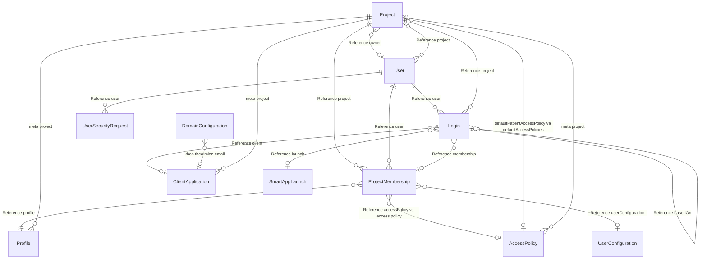

# 3. Quan hệ và toàn vẹn dữ liệu

**Không có khóa ngoại nào** trong schema `identity`. Mọi quan hệ là *logic*: `Reference` trong JSON của resource (tra bằng bảng `fhir_idx_reference` khi tham số tìm kiếm tương ứng tồn tại), hoặc chuỗi `meta.project`. Toàn vẹn do **mã ứng dụng** và **transaction** của `pkg/fhirstore` giữ ([docs/erd/fhirstore-physical.md](../../../../docs/erd/fhirstore-physical.md) mục 2). Hệ quả: dữ liệu mồ côi là có thể xảy ra, và mục 5 liệt kê những nơi đã thấy trong mã.

## 3.1 Sơ đồ logic toàn cục

`Profile` là một trong `Patient`, `Practitioner`, `RelatedPerson`, `Bot`, `ClientApplication`. Quan hệ nào là `Reference` (có thể truy vấn) và quan hệ nào là `meta.project` (chuỗi id, có chỉ mục token `_project` ở `fhir_idx_token`, không phải `Reference`) khác nhau về cách giữ toàn vẹn: xem bảng dưới và mục 3.2.

## 3.2 Bảng quan hệ

Cột **Toàn vẹn** nêu *ai kiểm và ở đâu*; "không ai" nghĩa là không có kiểm nào trong mã đã đọc. **Khi xóa phía "đến"**: không có `ON DELETE` nào (không FK), cột nêu hành vi thực tế của mã.

| Từ | Đến | Bản số | Cách nối | Bắt buộc | Toàn vẹn | Khi xóa phía "đến" | Bằng chứng |
|---|---|---|---|---|---|---|---|
| `Login.user` | `User`, `ClientApplication`, `Bot` | n-1 | `Reference`, chỉ mục `user` | có | `TryLogin` chỉ tạo Login cho user tìm thấy; `client_credentials` tạo Login cho ClientApplication | **Login không bị xóa hay thu hồi** khi User bị xóa; mồ côi tới khi `auth purge-logins` | `application/trylogin.go`, `token.go` (ClientCredentials), `admin_project.go:324` |
| `Login.membership` | `ProjectMembership` | n-1 | `Reference` (không chỉ mục) | không (có sau khi chọn hồ sơ) | `SetLoginMembership` kiểm membership thuộc user, còn hoạt động, IP rule | Token cũ bị từ chối ngay vì `Authenticate` đọc membership mỗi lần gọi; Login còn nguyên | `application/membership.go`, `flow.go` |
| `Login.client` | `ClientApplication` | n-1 | `Reference` | không | `TryLogin` suy từ `clientId` và kiểm project khớp | Login còn; không tạo được Login mới cho client đó | `application/lookup.go`, `registration.go` |
| `Login.project` | `Project` | n-1 | `Reference`, chỉ mục `project` | không | suy từ client hoặc `projectId` | Login còn | `application/trylogin.go` |
| `Login.launch` | `SmartAppLaunch` | n-1 | `Reference` | không | **không đường ghi `SmartAppLaunch` trong auth**; đọc khi cấp token | Thiếu launch ⇒ bỏ ngữ cảnh SMART (chưa kiểm cụ thể) | `application/token_preauth.go` |
| `Login.basedOn` | `Login` | n-1 (chuỗi) | `Reference`, **không có chỉ mục** | không | phiên SSO tạo Login mới `basedOn` Login cũ; `logout` đi ngược tối đa 16 tổ tiên (`maxSessionChain`) | `logout` thu hồi **tổ tiên**; **không liệt kê được Login con** (không có tham số `based-on`) | `application/token_authorize.go`, `token_userinfo.go` |
| `User.project` | `Project` | n-1 | `Reference`, chỉ mục `project` | không (rỗng = user **phạm vi server**, dùng ở nhiều project) | `newuser`/`invite` đặt theo project; `AdminDeleteMember` so `User.project` | User còn | `application/registration.go`, `admin_project.go:340` |
| `UserSecurityRequest.user` | `User` | n-1 | `Reference`, chỉ mục `user` | có | tạo bởi `resetpassword`, `newuser`, `invite` cho user có thật | Dòng yêu cầu **không bị dọn** khi User xóa hoặc khi hết hạn (không có job dọn) | `application/securityrequest.go` |
| `ProjectMembership.project` | `Project` | n-1 | `Reference`, chỉ mục `project` | có | tạo trong cùng transaction với project/profile | — | `application/newproject.go`, `admin_invite.go` |
| `ProjectMembership.user` | `User`, `ClientApplication`, `Bot` | n-1 | `Reference`, chỉ mục `user` | có | tạo cùng transaction với User khi mời | `AdminDeleteMember` xóa membership rồi xóa User nếu `User.project` là project này và hết membership | `admin_project.go:324` đến `347` |
| `ProjectMembership.profile` | `Patient`, `Practitioner`, `RelatedPerson`, `Bot`, `ClientApplication` | n-1 | `Reference`, chỉ mục `profile` | có | hồ sơ tạo cùng transaction (newproject, newpatient, invite, SCIM) | **Hồ sơ không bị xóa khi membership bị xóa** (mồ côi trong `identity`) | `admin_project.go` (không có bước xóa profile) |
| `ProjectMembership.accessPolicy`, `access[].policy` | `AccessPolicy` | n-1 | `Reference`, chỉ mục `access-policy` | không | `AdminUpdateMember` kiểm policy tồn tại **và `meta.project` đúng project** (`400`) | **Xóa AccessPolicy đang được trỏ tới không bị chặn**; đăng nhập/cấp token của membership đó thất bại (`access_denied`) | `admin_project.go:254` |
| `ProjectMembership.userConfiguration` | `UserConfiguration` | n-1 | `Reference` | không | **không đường ghi `UserConfiguration` trong auth** | Trỏ tới resource không tồn tại ⇒ `GET /auth/me` lỗi thay vì rơi về menu mặc định (agent đọc mã, chưa chạy) | `application/session.go` |
| `ProjectMembership.invitedBy` | `User` | n-1 | `Reference` | không | `invite` đặt theo người gọi | — | `admin_invite.go` |
| `Project.owner` | `User` | n-1 | `Reference`, chỉ mục `owner` | không | đặt lúc tạo project (CLI seed, newproject) | `AdminDeleteMember` **chặn xóa chủ project** (`Cannot delete the owner of the project`); SCIM chặn tắt chủ | `admin_project.go:316` |
| `Project.defaultPatientAccessPolicy`, `defaultAccessPolicies[]` | `AccessPolicy` | n-1 | `Reference` | không | đặt lúc tạo project (6 chính sách mặc định) | Xóa policy mặc định: `invite`/`newpatient` báo `Missing default ... access policy` (`400`) | `admin.go:134`, `accesspolicy_defaults.go` |
| `ClientApplication` | `Project` | n-1 | **`meta.project` (chuỗi id), không phải Reference; có chỉ mục token `_project` (`fhir_idx_token`)** | có | `CreateClient` đặt; kiểm khi đăng nhập (client phải thuộc project của request) | Client còn khi project "bị xóa" (auth không có lệnh xóa project) | `application/lookup.go:37`, `token.go:248` |
| `AccessPolicy` | `Project` | n-1 | **`meta.project`**, có chỉ mục token `_project` | có | `SeedProject`/newproject đặt `Meta.Project`; kiểm ở `AdminUpdateMember` và `accessPolicies()` (policy của project khác bị bỏ qua khi cấp token) | — | `admin.go:134`, `token.go:37` |
| `Patient`/`Practitioner`/`RelatedPerson` (hồ sơ do auth ghi) | `Project` | n-1 | **`meta.project`** | có | đặt khi tạo | Còn lại khi membership xóa (mục trên) | `admin.go:162`, `newpatient.go` |
| `DomainConfiguration` | (không tham chiếu) | — | khớp theo **miền email** (`domain`) | — | `AddDomainConfiguration`: tìm theo miền rồi tạo (`Domain already configured` nếu có), **không trong transaction, không khóa** nên hai lệnh song song có thể tạo hai bản | — | `application/domainconfig.go:56` |
| `SmartAppLaunch.patient`, `encounter`, `fhirContext[]` | dữ liệu lâm sàng ở `fhir-server` | n-1 | `Reference` | không | **không kiểm**: auth không đọc schema `fhir`, nên không biết Patient có tồn tại | — | `p8-compartment.md` ("D-2") |

## 3.3 Ràng buộc "thuộc project" qua `meta.project`

`ClientApplication`, `AccessPolicy`, các hồ sơ `Patient`/`Practitioner`/`RelatedPerson`, và `UserSecurityRequest` thuộc một project qua chuỗi `meta.project`, **không** qua `Reference`. Hệ quả: (1) `meta.project` **có** chỉ mục token `_project` (khai ở `pkg/fhir/fhir.go`, không nằm trong `searchparams_gen.go`; agent đã đo một dòng `fhir_idx_token` mỗi resource trên `DicomStudy`, loại của auth chưa đo) nên truy vấn theo project dùng được chỉ mục, nhưng nó không phải `Reference`; trước đây tài liệu này ghi nhầm là không có chỉ mục. Tuy vậy truy vấn kiểu "mọi client của project X" không dùng chỉ mục (auth tránh truy vấn đó và tra theo id); (2) việc cách ly giữa project hoàn toàn do mã so sánh `Meta.Project` với project của người gọi; (3) sửa hay ghi bằng SQL tay bỏ qua kiểm này.

## 3.4 Giữ lại dữ liệu nhạy cảm trong lịch sử và hành vi xóa

Mọi thao tác ghi đều thêm một dòng `fhir_history` mang **nguyên nội dung** tại phiên bản đó, và `DeleteResource` là **xóa mềm** (bảng vật lý: [mục 2 và `fhir_history`](../../../../docs/erd/fhirstore-physical.md)). Kết quả đối với auth:

| Thao tác | Gọi bởi | Cách xóa/ghi | Dữ liệu cũ còn lại ở `fhir_history` |
|---|---|---|---|
| Đổi mật khẩu (`changepassword`, `setpassword`, admin `setpassword`) | `SetPassword` | `UpdateResource` | **hash bcrypt của các mật khẩu cũ** của User |
| Xóa membership và User (`AdminDeleteMember`, SCIM `DELETE`) | `application/admin_project.go`, `scim.go` | `DeleteResource` (xóa mềm) trong một transaction | mọi phiên bản trước của `ProjectMembership` và `User` (email, họ tên, `passwordHash`, `mfaSecret`): **không bị xóa** |
| Xóa Login (`auth purge-logins`) | `application/admin.go` `PurgeLogins` → `logins.Expunge` | `Expunge`: xóa **cứng** `fhir_resource`, `fhir_history`, `fhir_idx_*` | không còn gì (lệnh `-yes` mới thực hiện, **không hoàn tác**) |
| Xoay refresh secret mỗi lần `refresh_token` | `token_refresh.go` | `UpdateResource` (`Mutate`, ghi có điều kiện phiên bản) | **mọi giá trị `refreshSecret` và `previousRefreshSecret` cũ ở bản rõ** (xem [02](02-mo-hinh-logic.md): secret refresh lưu bản rõ) |
| Đổi `Project.secret`, `site`, `ClientApplication.secret` bằng `PUT` ở nơi khác | (ngoài auth: không có use case sửa/xoay secret ClientApplication trong auth) | `UpdateResource` | các giá trị bản rõ cũ |

Hệ quả vận hành: **"xóa user" không xóa dấu vết bí mật**; chỉ `Login` được dọn tận gốc. Muốn xóa thật một `User` hoặc `ProjectMembership` phải `Expunge` (qua API quản trị của `fhir-server` hoặc `pkg/fhirstore`), hiện **chưa có lệnh `auth` cho việc đó**. Sao lưu cụm PostgreSQL mang theo toàn bộ lịch sử này.

## 3.5 Transaction và khóa

`fhirstore` bọc mỗi lần ghi một resource trong transaction (`inTx`): `fhir_resource` + `fhir_history` + chỉ mục. Nhiều resource cần ghi cùng nhau thì `application` dùng `Tx.InTx` (một transaction PostgreSQL), một số kèm **khóa theo khóa logic** (`tx.Locker.Lock`, advisory lock theo giá trị chuỗi) để chống trùng:

| Use case | Ghi trong một transaction | Khóa |
|---|---|---|
| `SeedProject` (CLI `auth seed project`) | admin User (nếu chưa có), 6 AccessPolicy, Project, client mặc định, hồ sơ, membership | (chưa kiểm khóa trong đường seed; khóa `user-email:...` nằm ở `createUserLocked`, dùng bởi tạo user bằng CLI và đăng nhập Google) |
| `newproject` (`CreateProject`) | Project, 6 AccessPolicy, client mặc định, Practitioner, membership. **`SetLoginMembership` chạy sau transaction**: nếu bước cuối lỗi, project đã commit | — (`newproject.go:71`) |
| `newpatient` | Patient, membership | — (`newpatient.go:63`) |
| `AdminInvite` | User, hồ sơ, membership | `lockKey` theo email hoặc `externalId` (`admin_invite.go:196`) |
| `newuser`, tạo user bằng CLI, đăng nhập Google (`createUserLocked`) | **chỉ `User`** (kèm kiểm trùng email); `Login` và `UserSecurityRequest` tạo **sau, ngoài** transaction | `user-email:<phạm vi>:<email>` (chống trùng email song song, S16) |
| `SetPassword` | đổi hash, đánh dấu `emailVerified`, thu hồi mọi Login của User | — (`password.go:56`) |
| `VerifyEmail` | tiêu thụ `UserSecurityRequest` + `User.emailVerified = true` (`Mutate`) | — (`credentials.go:121`) |
| `AdminDeleteMember` | xóa membership, xóa User nếu hết membership | — (`admin_project.go:324`) |
| `AdminReplaceSites` | thay `Project.site` | khóa `site-google:<id>` và `site-recaptcha:<key>` theo thứ tự cố định (kiểm tính duy nhất giữa các project) |
| SCIM đổi email (`scimApply`) | User, `UserSecurityRequest`, thu hồi Login | — (`scim.go:356`) |
| `CreateClient` (CLI) | ClientApplication + membership | — (`admin.go:303`) |

Lỗi giữa chừng hoàn tác toàn bộ transaction (không có project dở dang). Ghi **có điều kiện phiên bản** (`If-Match`, `Mutate` thử lại tối đa 8 lần khi xung đột) dùng cho refresh token, chọn hồ sơ, thu hồi login.

## 3.6 Ràng buộc nghiệp vụ không có ở mức cơ sở dữ liệu

| Ràng buộc | Ai kiểm | Kẽ hở |
|---|---|---|
| Email duy nhất theo (phạm vi, email) | khóa `user-email:...` trong `createUserLocked` và `AdminInvite` | Ghi trực tiếp bằng `pkg/fhirstore` hoặc SQL không qua khóa có thể trùng |
| `googleClientId`, `recaptchaSiteKey` duy nhất giữa các project | **chỉ** `AdminReplaceSites` (có khóa) | Ghi bằng CLI hoặc SQL không ai kiểm |
| `ProjectMembership.externalId` duy nhất trong project | `AdminInvite` (có khóa); `AdminUpdateMember` và SCIM **kiểm không khóa** | Có race giữa hai yêu cầu song song |
| `DomainConfiguration.domain` duy nhất | `AddDomainConfiguration` (kiểm rồi ghi, **không khóa**) | Hai lệnh `auth domain add` song song có thể tạo hai bản |
| Không xóa chủ project, admin cuối cùng | `AdminDeleteMember` và `lastAdminGuard` (quét toàn bộ membership của project, **không khóa**) | Xóa song song hai admin cuối có thể cùng qua |
| AccessPolicy của membership thuộc đúng project | `AdminUpdateMember` kiểm `meta.project`; `accessPolicies()` bỏ policy project khác khi cấp token | Xóa AccessPolicy đang dùng không bị chặn |
| `ClientApplication.grantType` | **không được thi hành**: chỉ dùng quyết định cấp refresh token, không từ chối grant không khai | — |

## 3.7 Vòng đời trạng thái

- **Login**: sơ đồ trạng thái ở [02-mo-hinh-logic.md](02-mo-hinh-logic.md) (mục `Login`).
- **ProjectMembership**:

```mermaid
stateDiagram-v2
    [*] --> HoatDong: invite, newproject, newpatient, SCIM POST, seed, CreateClient
    HoatDong --> TamNgung: active=false (admin API hoặc SCIM)
    TamNgung --> HoatDong: active=true (SCIM được phép, ghi audit)
    HoatDong --> DaXoaMem: DeleteResource (trừ chủ project và admin cuối)
    TamNgung --> DaXoaMem: DeleteResource
    DaXoaMem --> [*]: dòng còn trong fhir_resource với deleted=true; lịch sử còn nguyên
    note right of DaXoaMem: User thuộc project hết membership thì bị xóa mềm theo; hồ sơ profile KHÔNG bị xóa
```

- **UserSecurityRequest**: tạo → dùng (`used`) hoặc hết hạn (`reset` 1 giờ, `invite`/`verify-email` 7 ngày) → **không bao giờ bị xóa** (không có job dọn).

## 3.8 Dọn dẹp và tăng trưởng

| Dữ liệu | Có dọn không | Cách | Ghi chú |
|---|---|---|---|
| `Login` | **Có, thủ công** | `auth purge-logins -before <ngày> [-dry-run] [-yes]` (`Expunge` theo `_lastUpdated`) | Không có job tự động; Login của user không có membership (đăng nhập mật khẩu nhưng chưa có hồ sơ) chỉ dọn được bằng lệnh này |
| `UserSecurityRequest` | **Không** | — | Tăng theo số lần quên mật khẩu/đăng ký/mời |
| `User`, `ProjectMembership`, hồ sơ | Không (xóa mềm) | `Expunge` ngoài auth | lịch sử giữ vĩnh viễn |
| `fhir_history` | **Không** (chỉ `Expunge`) | — | lớn nhất là của `Login` (mỗi lần xoay refresh) |
| Redis | Tự hết hạn theo TTL | [04](04-kho-khac.md) | |
