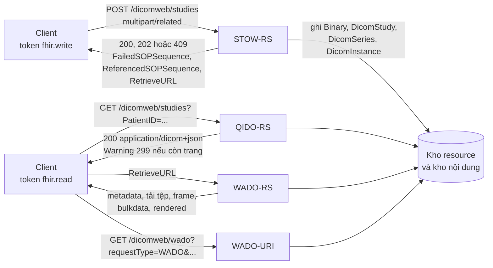
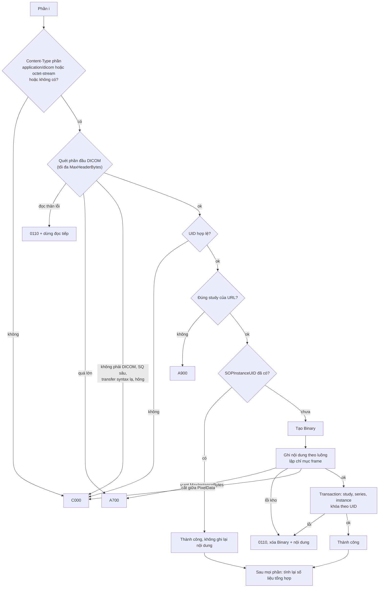

# dicomweb: các trường hợp của nhóm route `dicomweb`

Tệp này mô tả **từng trường hợp phản hồi** của 19 route tag `dicomweb` (STOW-RS, QIDO-RS, WADO-RS, WADO-URI): thứ tự kiểm tra đúng như mã, điều kiện, mã HTTP, header, body, tác dụng phụ. Bảng trường (tham số, kiểu, mô tả) nằm ở [../reference/dicomweb.md](../reference/dicomweb.md) và **không lặp lại ở đây**. Header chung, định dạng lỗi `{"error": ...}`, lỗi xác thực (401/403/400 của super-admin), hạn mức IP và mã trạng thái dùng chung nằm ở [../common.md](../common.md); mỗi mục dưới đây chỉ ghi phần riêng của route. Tag `health` ở `cases/health.md`.

Thông điệp lỗi trích **nguyên văn** từ mã và test (`internal/presentation/httpapi`, `pkg/dicomstow`, `pkg/dicomretrieve`, `pkg/dicomweb`, `apps/dicomweb/internal/bootstrap/*_test.go`). Chỗ chưa có test HTTP xác nhận ghi `(chưa kiểm)`. Ví dụ dùng UID giả: study `1.2.826.0.1.3680043.8.498.1`, series `1.2.826.0.1.3680043.8.498.1.1`, instance `1.2.826.0.1.3680043.8.498.1.1.1`.

## Mục lục nhanh

| Chủ đề | Mục |
|---|---|
| Luồng STOW, QIDO, WADO và bảng kiểu phản hồi | [Luồng điển hình](#luồng-điển-hình), [Kiểu phản hồi](#kiểu-phản-hồi-theo-route) |
| Tầng trước handler (thứ tự middleware) | [Thứ tự chung](#thứ-tự-chung-trước-handler) |
| STOW-RS tệp Part 10 và dạng metadata | [STOW chung](#stow-rs-quy-tắc-chung-của-hai-route-post), route [POST /studies](#post-dicomweb-studies), [POST /studies/{studyUid}](#post-dicomweb-studies-studyuid) |
| QIDO-RS ba cấp | [QIDO chung](#qido-rs-quy-tắc-chung-của-sáu-route) |
| WADO-RS và WADO-URI | [WADO chung](#wado-rs-và-wado-uri-quy-tắc-chung) |
| 501 và 404 | [Route chưa cài](#501-cho-route-chưa-cài-và-404-ngoài-tiền-tố) |
| Bốn tiền tố | [Bốn tiền tố](#khác-biệt-giữa-bốn-tiền-tố) |

## Luồng điển hình



Trình tự thông thường: STOW (một yêu cầu, nhiều instance) rồi QIDO để tìm study/series/instance rồi WADO-RS dùng UID nhận từ QIDO hoặc từ `RetrieveURL` của phản hồi STOW. QIDO cấp instance trả đúng metadata đã làm sạch mà STOW đã lưu nên nhất quán với `.../metadata`.

## Kiểu phản hồi theo route

Chú thích cột "Content-Length": "tường minh" là handler tự đặt; "không đặt" nghĩa là handler không đặt, Go tự chọn (nội dung nhỏ, khoảng dưới 2 KiB, thường có `Content-Length` vì xong trước khi xả; lớn hơn thì chunked) và client **không được dựa vào** (chưa kiểm với nội dung lớn).

| Route (tiền tố bỏ qua) | Content-Type phản hồi thành công | Content-Length | Truyền luồng |
|---|---|---|---|
| `POST /studies`, `POST /studies/{studyUid}` | `application/dicom+json` | không đặt | không (JSON nhỏ dựng sau khi lưu xong) |
| `GET /studies`, `/series`, `/instances`, `/studies/{}/series`, `/studies/{}/instances`, `/studies/{}/series/{}/instances` | `application/dicom+json` (mảng, rỗng là `[]`) | không đặt | không (một trang tối đa 1000 phần tử) |
| `.../metadata` (study, series, instance) | `application/dicom+json` (mảng) | không đặt | có: study và series ghi từng trang 500 instance; instance một phần tử |
| `GET /studies/{}`, `/series/{}`, `/instances/{}` (tải tệp) | `multipart/related; type="application/dicom"; boundary=dicomweb-<24 hex>` | không (chunked) | có, mỗi instance một phần |
| `.../frames/{frame}` | `multipart/related; type="<media type>"; boundary=dicomweb-<24 hex>` | tường minh (biết trước) | có, đọc theo khoảng |
| `.../bulkdata/7FE00010` | như `frames` | tường minh | có |
| `.../rendered`, `.../frames/{frame}/rendered` | `image/jpeg` hoặc `image/png` | không đặt (dựng trong bộ nhớ) | không |
| `GET /wado` với `application/dicom` | `application/dicom` | không đặt | có (`io.Copy` từ kho) |
| `GET /wado` với ảnh | `image/jpeg` hoặc `image/png` | không đặt | không |
| mọi lỗi | `application/json` `{"error": "..."}` | không đặt | không |

## Thứ tự chung trước handler

Áp cho cả 19 route (chi tiết thông điệp ở [common.md](../common.md)):

1. Hạn mức IP (nếu bật) -> 429.
2. `limitBody`: `Content-Length` lớn hơn `DICOMWEB_MAX_REQUEST_BYTES` -> 413 `Body quá lớn` **trước cả xác thực** (yêu cầu không token mà quá trần nhận 413, không phải 401); không có `Content-Length` thì bọc luồng bằng `http.MaxBytesReader`.
3. `guard`: 401, 403, 400 (super-admin). `POST` cần quyền ghi, `GET` cần quyền đọc.
4. Handler của route. Mọi lỗi kiểm hợp lệ của handler xảy ra trước khi ghi byte nào của phản hồi (trừ ngắt kết nối giữa chừng ở WADO).

Kết quả "ngắt kết nối" (metadata, tải tệp, frame, bulkdata, WADO-URI tệp): khi lỗi xảy ra sau khi đã gửi `200`, handler `panic(http.ErrAbortHandler)`; client thấy kết nối bị đóng (đọc thân báo lỗi), không có JSON lỗi. Test: `TestMidStreamFailureAbortsTheConnection`.

---

## STOW-RS: quy tắc chung của hai route POST

### Nhận diện hai dạng yêu cầu

| Dạng | Content-Type yêu cầu | Phần đầu | Phần sau |
|---|---|---|---|
| Tệp Part 10 | `multipart/related; type="application/dicom"; boundary=...` | một tệp DICOM, Content-Type `application/dicom` hoặc `application/octet-stream` (hoặc không có header) | mỗi phần một instance |
| Metadata (PS3.18 10.5.1.2) | `multipart/related; type="application/dicom+json"; boundary=...` | `application/dicom+json`: mảng (hoặc một đối tượng) DICOM JSON | bulkdata, mỗi phần có `Content-Location` hoặc `Content-ID` |

Chỉ **Content-Type của phần đầu** quyết định dạng (`application/dicom+json` -> dạng metadata), không phải tham số `type=` của header yêu cầu.

### Lỗi cả yêu cầu (HTTP 4xx, không có FailedSOPSequence)

| # | Trường hợp | Điều kiện | HTTP | Body `error` | Tác dụng phụ |
|---|---|---|---|---|---|
| R1 | Không phải multipart/related | `mime.ParseMediaType` ra kiểu khác `multipart/related`, hoặc (khi parse lỗi) không bắt đầu bằng `multipart/related` | 415 | `Cần Content-Type multipart/related` | không ghi gì |
| R2 | Thiếu boundary | `multipart/related` không có tham số `boundary` | 400 | `Thiếu boundary` | không ghi gì |
| R3 | Thân multipart hỏng ngay phần đầu | `NextPart` lỗi khi chưa có phần nào (không phải do quá trần) | 400 | `Thân multipart không hợp lệ` | không ghi gì |
| R4 | Không có instance nào | multipart hợp lệ nhưng không có phần (chỉ có boundary đóng) | 400 | `Yêu cầu không có instance nào` | không ghi gì |
| R5 | Thân vượt trần | `Content-Length` > `DICOMWEB_MAX_REQUEST_BYTES` (middleware, trước xác thực), hoặc luồng vượt trần giữa chừng (`http.MaxBytesError`) | 413 | `Body quá lớn` | giữa chừng: instance **đã xong trước đó được giữ** và số liệu tổng hợp vẫn được tính lại (`cleanupAggregates`); instance đang ghi bị xóa (Binary và nội dung) |
| R6 | Repo từ chối quyền | kho trả 401 hoặc 403 khi kiểm instance đã có, tạo `Binary` hoặc ghi resource (token thiếu quyền tạo `Binary`, `DicomStudy`, `DicomSeries`, `DicomInstance`) | 403 (hoặc 401) | `Không đủ quyền` (401: `Chưa xác thực`) | instance đang xử lý được dọn; instance đã lưu trước đó được giữ và tính lại số liệu |
| R7 | Metadata JSON quá lớn (dạng metadata) | phần đầu `application/dicom+json` > 8 MiB | 413 | `Metadata DICOM JSON quá lớn` | không ghi gì |
| R8 | Metadata JSON sai (dạng metadata) | rỗng, không phải mảng/đối tượng DICOM JSON, hoặc mảng rỗng | 400 | một trong `metadata rỗng`, `metadata không phải mảng DICOM JSON hợp lệ: <lỗi json>`, `metadata không phải DICOM JSON hợp lệ: <lỗi json>`, `metadata không có instance nào` | không ghi gì |
| R9 | Bulkdata thiếu khóa (dạng metadata) | phần sau không có `Content-Location` lẫn `Content-ID` | 400 | `Phần bulkdata thiếu Content-Location hoặc Content-ID` | không ghi instance nào (mọi bulkdata được nhận trước khi xử lý instance); tệp tạm bị xóa |
| R10 | Lỗi tạo tệp tạm (dạng metadata) | `os.MkdirTemp` hoặc `os.CreateTemp` lỗi | 500 | `Internal Server Error` (mã gốc có thông điệp `Không tạo được thư mục tạm`/`Không tạo được tệp tạm` nhưng `errorHandler` che mọi 5xx trừ 501) | log `dicomstow: không tạo được thư mục tạm` |

Mã 401/403/400 của xác thực, 429 của hạn mức: xem [common.md](../common.md).

### Thứ tự xử lý từng instance (dạng tệp; dạng metadata dựng Part 10 rồi đi qua cùng đường này)



| # | Bước | Điều kiện thất bại | FailureReason (0008,1197) | Thông điệp nội bộ (không trả cho client, chỉ để trong cấu trúc) | Dọn dẹp |
|---|---|---|---|---|---|
| I1 | Content-Type phần | có header và không phải `application/dicom`/`application/octet-stream`, hoặc không parse được | `0xC000` (49152) | `Phần phải có Content-Type application/dicom` | không có gì để dọn |
| I2 | Đọc phần đầu (tối đa `DICOMWEB_MAX_HEADER_BYTES`, mặc định 1 MiB) | lỗi đọc thân yêu cầu không phải quá trần | `0x0110` (272), **dừng đọc các phần sau** | `đọc thân yêu cầu lỗi` | không |
| I2b | như I2 | luồng vượt trần cả yêu cầu | không phải FailureReason: 413 cả yêu cầu (R5) | | |
| I3 | Quét cấu trúc DICOM | phần đầu vượt trần | `0xA700` (42752) | `Tệp DICOM không hợp lệ: phần đầu quá lớn` | không |
| I3b | như I3 | không phải DICOM, SQ lồng quá sâu, transfer syntax không hỗ trợ, cấu trúc hỏng | `0xC000` | `Tệp DICOM không hợp lệ: không phải DICOM` / `SQ lồng quá sâu` / `transfer syntax không hỗ trợ` / `cấu trúc hỏng` | không |
| I4 | Đọc metadata | `dicomread.ReadHeader` lỗi | `0xC000` | `Không đọc được metadata DICOM` | không |
| I5 | Kiểm UID | StudyInstanceUID, SeriesInstanceUID, SOPInstanceUID hoặc SOPClassUID rỗng, quá 64 ký tự, hoặc không khớp `^[0-9]+(\.[0-9]+)*$` (SOPClassUID rỗng thì lấy MediaStorageSOPClassUID `(0002,0002)`) | `0xC000` | `Thiếu hoặc sai UID (<tag>)` | không |
| I6 | Khớp study của URL | `POST /studies/{studyUid}` và StudyInstanceUID của tệp khác `studyUid` | `0xA900` (43264) | `Instance không thuộc study của yêu cầu` | không |
| I7 | Mã hóa metadata | `json.Marshal` lỗi | `0x0110` | `Không mã hóa được metadata` | không |
| I8 | Kiểm instance đã có | tìm theo `sop-instance-uid` lỗi: 401/403 là R6; lỗi khác | `0x0110` | `Không kiểm được instance đã có` | không |
| I8b | như I8 | **đã có** DicomInstance cùng SOPInstanceUID (trong project của người gọi) | thành công (idempotent) | | không tạo Binary, không ghi lại nội dung |
| I9 | Tạo Binary | `CreateResource(Binary)` lỗi: 401/403 là R6; lỗi khác | `0x0110` | `Không tạo được Binary` | không |
| I9b | Khóa kho | `binarystore.Key` lỗi | `0x0110` | `Khóa kho không hợp lệ` | xóa Binary |
| I10 | Ghi nội dung (đồng thời lập chỉ mục frame nếu PixelData đóng gói) | vượt `DICOMWEB_MAX_INSTANCE_BYTES` (`ErrTooLarge`) | `0xA700` | `Instance vượt trần kích thước` | xóa nội dung + Binary |
| I10b | như I10 | lỗi đọc thân yêu cầu | `0x0110`, dừng đọc các phần sau (hoặc 413 nếu do quá trần cả yêu cầu) | `đọc thân yêu cầu lỗi` | xóa nội dung + Binary |
| I10c | như I10 | lỗi kho khác | `0x0110` | `Không ghi được nội dung` | xóa nội dung + Binary |
| I11 | Kiểm toàn vẹn PixelData | đóng gói: chỉ mục không đọc tới Sequence Delimitation (không phải `ErrUnsplittable` đã đọc đủ); không nén: nhận ít byte hơn độ dài PixelData khai báo | `0xC000` | `Tệp bị cắt giữa PixelData hoặc PixelData đóng gói không hợp lệ` (đóng gói) / `Tệp bị cắt giữa PixelData` (không nén) | xóa nội dung + Binary |
| I12 | Transaction ghi resource (khóa theo UID: study, series, instance) | lỗi ghi: 401/403 là R6; lỗi khác | `0x0110` | `Không lưu được resource` | xóa nội dung + Binary |
| I12b | như I12 | thua đua với yêu cầu song song cùng instance (`created=false`) | thành công (`AlreadyStored`) | | xóa nội dung vừa ghi + Binary |
| I13 | Thân bị cắt giữa chừng | `NextPart` lỗi khi đã có ít nhất một phần (không phải quá trần) | `0x0110` (không có UID), **dừng** | `Thân yêu cầu bị cắt hoặc hỏng giữa chừng` | các instance trước đó được giữ |

`ErrUnsplittable` (PixelData đóng gói không tách được frame): vẫn lưu, chỉ không có chỉ mục frame; WADO-RS quay về quét nội dung.

### Dạng metadata: khác biệt

1. Phần đầu được đọc (tối đa 8 MiB), parse, rồi **mọi bulkdata được nhận hết** về tệp tạm (mỗi phần tối đa `MaxInstanceBytes`) trước khi xử lý instance nào (nên R9 và `Thân multipart không hợp lệ` là lỗi cả yêu cầu, không ghi gì).
2. Khóa tham chiếu: `BulkDataURI` khớp `Content-Location` nguyên văn hoặc `cid:<Content-ID>` (bỏ `<` `>`).
3. Mỗi instance, trước khi vào đường lưu chung (bước I1 trở đi, với Content-Type `application/dicom`):

| # | Điều kiện | FailureReason | Thông điệp nội bộ |
|---|---|---|---|
| M1 | bulkdata phần tham chiếu vượt `MaxInstanceBytes` | `0xA700` | `Bulkdata vượt trần kích thước instance` |
| M2 | `BuildPart10` lỗi (thiếu hoặc sai SOPClassUID/SOPInstanceUID, thiếu bulkdata cho PixelData, giá trị sai kiểu...) | `0xC000` | thông điệp mã hóa, ví dụ `thiếu hoặc sai SOPClassUID (0008,0016) hoặc SOPInstanceUID (0008,0018)`, `không có bulkdata cho PixelData (<uri>)` |

4. Tệp tạm trong `TMPDIR` (hoặc `os.TempDir`) được xóa khi xong, kể cả khi lỗi (`defer os.RemoveAll`). Test `TestD10MetadataStowRoundTrip` kiểm TMPDIR rỗng sau yêu cầu.
5. Cần chỗ đĩa cho tổng bulkdata của một yêu cầu (tối đa `DICOMWEB_MAX_REQUEST_BYTES`).

### Ma trận mã kết quả (khi không có lỗi cả yêu cầu)

| Số instance thành công (kể cả đã có sẵn) | Số instance thất bại | HTTP | Body |
|---|---|---|---|
| >= 1 | 0 | 200 | có `ReferencedSOPSequence`; có `RetrieveURL` cấp study khi mọi instance thành công cùng một study |
| >= 1 | >= 1 | 202 | có cả `ReferencedSOPSequence` và `FailedSOPSequence` |
| 0 | >= 1 | 409 | chỉ `FailedSOPSequence` (không `RetrieveURL`) |

Phần tử phản hồi (đều DICOM JSON, `Content-Type: application/dicom+json`):

| Tag | Tên | Ở đâu | Giá trị |
|---|---|---|---|
| `00081190` | RetrieveURL | gốc phản hồi (nếu một study duy nhất trong các instance thành công) và mỗi phần tử `ReferencedSOPSequence` | `<DICOMWEB_BASE_URL><tiền tố đang dùng>/studies/{study}` hoặc `.../studies/{study}/series/{series}/instances/{sop}` |
| `00081198` | FailedSOPSequence | gốc, chỉ khi có thất bại | SQ; mỗi phần tử có `00081197`, và `00081150`, `00081155` khi đọc được UID |
| `00081199` | ReferencedSOPSequence | gốc, chỉ khi có thành công | SQ; mỗi phần tử có `00081150`, `00081155`, `00081190` |
| `00081197` | FailureReason | trong mỗi phần tử Failed | VR `US`, số thập phân: 272 (`0x0110`), 42752 (`0xA700`), 43264 (`0xA900`), 49152 (`0xC000`) |

`RetrieveBase` lấy từ `DICOMWEB_BASE_URL` (bỏ `/` cuối) cộng phần đường dẫn đứng trước `/studies` của yêu cầu, nên `RetrieveURL` mang đúng tiền tố mà client đã gọi (ví dụ `/api/projects/A/dicomweb`).

### Idempotent, song song, giới hạn

- Gửi lại cùng SOPInstanceUID trong cùng project: thành công (có trong `ReferencedSOPSequence`), không tạo Binary mới, không ghi đè nội dung. Trùng UID ở project khác không liên quan (cách ly project).
- Yêu cầu song song cùng study: transaction khóa theo UID nên không tạo trùng study/series; bên thua đua dọn nội dung.
- Sau khi xử lý hết các phần: tính lại `numberOfStudyRelatedSeries/Instances`... của từng study và series chạm tới (ifMatch, tối đa 3 lần, lỗi chỉ ghi log vì instance đã lưu).
- Tùy chọn: nếu bật tách frame (`Pixels`), instance **mới** (không phải `AlreadyStored`) được đưa vào hàng đợi dựng `DicomInstance.pixelData` chạy nền; không ảnh hưởng phản hồi.
- Giới hạn: `DICOMWEB_MAX_REQUEST_BYTES` (4 GiB), `DICOMWEB_MAX_INSTANCE_BYTES` (1 GiB), `DICOMWEB_MAX_HEADER_BYTES` (1 MiB), metadata JSON 8 MiB.

### Thứ tự ghi và dọn dẹp (tóm tắt)

1. Tạo `Binary` (rỗng, `securityContext` trỏ về id DicomInstance định trước).
2. Ghi nội dung vào kho theo luồng.
3. Transaction: tìm hoặc tạo DicomStudy, DicomSeries, rồi tạo DicomInstance (cuối cùng mới làm dữ liệu hiện ra với người khác).
4. Bất kỳ lỗi nào từ bước 2 đến 3: xóa nội dung rồi xóa Binary (thử lại tối đa 5 lần, lỗi chỉ ghi log `dicomstow: không xóa được ...`). Tiến trình chết giữa chừng có thể để Binary mồ côi (công cụ quét `fhirbinary.Sweep`).
5. Sau mọi phần: tính lại số liệu tổng hợp.

---

<a id="post-dicomweb-studies"></a>
## `POST /dicomweb/studies`

STOW-RS: lưu một hoặc nhiều instance DICOM vào project của người gọi, tự tạo study/series nếu chưa có. [Tham chiếu trường](../reference/dicomweb.md#post-dicomweb-studies)

**Tiền điều kiện:** token quyền ghi (`fhir.write` hoặc tương đương) và quyền tạo `Binary`, `DicomStudy`, `DicomSeries`, `DicomInstance`.

**Thứ tự kiểm tra:**
1. Hạn mức IP (429), `limitBody` (413), xác thực và phân quyền (401/403/400): xem [Thứ tự chung](#thứ-tự-chung-trước-handler).
2. Parse `Content-Type`: 415 `Cần Content-Type multipart/related`, 400 `Thiếu boundary` (R1, R2).
3. Đọc phần đầu: 400 `Thân multipart không hợp lệ` (R3). Phần đầu `application/dicom+json` -> rẽ sang dạng metadata (R7-R10).
4. Từng phần theo [bảng I1-I13](#stow-rs-quy-tắc-chung-của-hai-route-post); mỗi thất bại ghi vào `FailedSOPSequence`, không dừng cả yêu cầu (trừ I2/I10b/I13 dừng đọc tiếp, R5, R6).
5. Không có phần nào: 400 `Yêu cầu không có instance nào` (R4).
6. Tính lại số liệu tổng hợp, chọn 200/202/409, dựng phản hồi.

| # | Trường hợp | Điều kiện | HTTP | Header phản hồi riêng | Body | Tác dụng phụ |
|---|---|---|---|---|---|---|
| C1 | Tất cả thành công | mọi instance lưu được hoặc đã có sẵn | 200 | `Content-Type: application/dicom+json` | `ReferencedSOPSequence` (+ `RetrieveURL` cấp study nếu một study) | tạo Binary, DicomStudy/Series/Instance chưa có; tính lại số liệu; (tùy chọn) xếp hàng dựng pixelData |
| C2 | Gửi lại instance đã có | SOPInstanceUID đã lưu | 200 | như C1 | instance nằm trong `ReferencedSOPSequence` | không ghi nội dung, không tạo Binary; vẫn tính lại số liệu nếu chạm study/series |
| C3 | Một phần thành công | có thành công và có thất bại | 202 | như C1 | cả `ReferencedSOPSequence` và `FailedSOPSequence` | các instance thành công đã lưu; instance thất bại không để lại gì |
| C4 | Không instance nào thành công | mọi phần thất bại (hỏng, không phải DICOM, UID sai, vượt trần instance...) | 409 | như C1 | chỉ `FailedSOPSequence`, không `RetrieveURL` | không lưu gì; Binary/nội dung đã tạo dở được xóa |
| C5 | Không phải multipart | `Content-Type` khác `multipart/related` | 415 | - | `Cần Content-Type multipart/related` | không ghi gì |
| C6 | Thiếu boundary | | 400 | - | `Thiếu boundary` | không ghi gì |
| C7 | Multipart hỏng từ đầu | | 400 | - | `Thân multipart không hợp lệ` | không ghi gì |
| C8 | Không có phần | | 400 | - | `Yêu cầu không có instance nào` | không ghi gì |
| C9 | Body quá lớn | xem R5 | 413 | - | `Body quá lớn` | instance xong trước đó giữ lại và tính lại số liệu |
| C10 | Thiếu quyền ghi | token chỉ đọc | 403 | - | `Token không đủ quyền cho thao tác này` | không ghi gì (test `TestStowOverHTTP`) |
| C11 | Thiếu quyền tạo resource | token có `fhir.write` nhưng không được tạo `Binary`/`Dicom*` | 403 | - | `Không đủ quyền` | instance đang xử lý được dọn; (chưa kiểm bằng test HTTP, theo mã `fatalOf`) |
| C12 | Project khác trong URL | `/projects/B/dicomweb/studies` với token project A | 403 | - | `Không được dùng project khác` | không ghi gì (test) |
| C13 | Không token | | 401 | `WWW-Authenticate: Bearer realm="dicomweb"` | `Thiếu bearer token` | không ghi gì (test) |
| C14 | Lỗi nội bộ không phân loại | lỗi không phải `RequestError` | 500 | - | `Internal Server Error` | log `STOW-RS lỗi` (chưa kiểm: hiện mọi lỗi instance đều thành FailedSOPSequence, nhánh này gần như không đạt) |
| C15 | Metadata dạng JSON: R7-R10 | xem [STOW chung](#stow-rs-quy-tắc-chung-của-hai-route-post) | 413/400/500 | - | như bảng R | như bảng R |
| C16 | Dạng metadata thành công | phần đầu `application/dicom+json` và bulkdata khớp | 200/202/409 | như C1 | như C1-C4 | tệp tạm được xóa |

**Ví dụ**

Yêu cầu STOW tệp (ba tệp, hai series):

```http
POST /dicomweb/studies HTTP/1.1
Host: dicom.example.org
Authorization: Bearer eyJhbGciOi...
Content-Type: multipart/related; type="application/dicom"; boundary="stow-7f3a"

--stow-7f3a
Content-Type: application/dicom

<byte của tệp DICOM Part 10 thứ nhất>
--stow-7f3a
Content-Type: application/dicom

<byte của tệp thứ hai>
--stow-7f3a--
```

Phản hồi 200 (mọi instance thành công, cùng một study):

```http
HTTP/1.1 200 OK
Content-Type: application/dicom+json
X-Request-Id: 5b0f0c1e-1d6a-4f2e-9d57-1c1f2a9b3a10

{
  "00081190": {"vr": "UR", "Value": ["https://dicom.example.org/dicomweb/studies/1.2.826.0.1.3680043.8.498.1"]},
  "00081199": {"vr": "SQ", "Value": [
    {
      "00081150": {"vr": "UI", "Value": ["1.2.840.10008.5.1.4.1.1.2"]},
      "00081155": {"vr": "UI", "Value": ["1.2.826.0.1.3680043.8.498.1.1.1"]},
      "00081190": {"vr": "UR", "Value": ["https://dicom.example.org/dicomweb/studies/1.2.826.0.1.3680043.8.498.1/series/1.2.826.0.1.3680043.8.498.1.1/instances/1.2.826.0.1.3680043.8.498.1.1.1"]}
    }
  ]}
}
```

Phản hồi 202 (một instance lưu được, một instance sai UID; instance sai có UID vì đọc được metadata):

```http
HTTP/1.1 202 Accepted
Content-Type: application/dicom+json

{
  "00081190": {"vr": "UR", "Value": ["https://dicom.example.org/dicomweb/studies/1.2.826.0.1.3680043.8.498.1"]},
  "00081198": {"vr": "SQ", "Value": [
    {
      "00081150": {"vr": "UI", "Value": ["1.2.840.10008.5.1.4.1.1.2"]},
      "00081155": {"vr": "UI", "Value": ["1.2.826.0.1.3680043.8.498.1.1.2"]},
      "00081197": {"vr": "US", "Value": [49152]}
    }
  ]},
  "00081199": {"vr": "SQ", "Value": [
    {
      "00081150": {"vr": "UI", "Value": ["1.2.840.10008.5.1.4.1.1.2"]},
      "00081155": {"vr": "UI", "Value": ["1.2.826.0.1.3680043.8.498.1.1.1"]},
      "00081190": {"vr": "UR", "Value": ["https://dicom.example.org/dicomweb/studies/1.2.826.0.1.3680043.8.498.1/series/1.2.826.0.1.3680043.8.498.1.1/instances/1.2.826.0.1.3680043.8.498.1.1.1"]}
    }
  ]}
}
```

Phản hồi 409 (không instance nào thành công; tệp không phải DICOM nên không có UID):

```http
HTTP/1.1 409 Conflict
Content-Type: application/dicom+json

{
  "00081198": {"vr": "SQ", "Value": [
    {"00081197": {"vr": "US", "Value": [49152]}}
  ]}
}
```

Lỗi cả yêu cầu:

```http
HTTP/1.1 415 Unsupported Media Type
Content-Type: application/json

{"error": "Cần Content-Type multipart/related"}
```

Yêu cầu STOW dạng metadata (một instance, bulkdata PixelData tham chiếu bằng `Content-Location`):

```http
POST /dicomweb/studies HTTP/1.1
Authorization: Bearer eyJhbGciOi...
Content-Type: multipart/related; type="application/dicom+json"; boundary="m-91c2"

--m-91c2
Content-Type: application/dicom+json

[{"00080016":{"vr":"UI","Value":["1.2.840.10008.5.1.4.1.1.2"]},"00080018":{"vr":"UI","Value":["1.2.826.0.1.3680043.8.498.1.1.1"]},
  "0020000D":{"vr":"UI","Value":["1.2.826.0.1.3680043.8.498.1"]},"0020000E":{"vr":"UI","Value":["1.2.826.0.1.3680043.8.498.1.1"]},
  "00280010":{"vr":"US","Value":[8]},"00280011":{"vr":"US","Value":[8]},"00280100":{"vr":"US","Value":[8]},
  "7FE00010":{"vr":"OB","BulkDataURI":"http://bulk/1"}}]
--m-91c2
Content-Type: application/octet-stream
Content-Location: http://bulk/1

<byte điểm ảnh>
--m-91c2--
```

Phản hồi như ví dụ 200 ở trên (cùng đường lưu).

**Lưu ý tích hợp:**
- `type=application/dicom` không đặt trong nháy kép vẫn được nhận (mã tự rút boundary khi parse chuẩn lỗi); chuẩn yêu cầu nháy kép.
- Thông điệp lỗi riêng từng instance **không** nằm trong phản hồi; client chỉ thấy `FailureReason`. Muốn biết lý do chi tiết xem log server theo `X-Request-Id`.
- 200 không có nghĩa instance mới: instance đã có cũng nằm trong `ReferencedSOPSequence`.
- 413 giữa chừng nghĩa là yêu cầu không có phản hồi DICOM JSON dù một số instance đã lưu; gọi lại là idempotent.
- QIDO có thể thấy study ngay sau 200 (tính lại số liệu chạy đồng bộ trước khi trả lời).

---

<a id="post-dicomweb-studies-studyuid"></a>
## `POST /dicomweb/studies/{studyUid}`

STOW-RS vào một study cụ thể: như [POST /studies](#post-dicomweb-studies) nhưng mọi instance phải thuộc `studyUid`. [Tham chiếu trường](../reference/dicomweb.md#post-dicomweb-studies-studyuid)

**Thứ tự kiểm tra:** như `POST /studies`; thêm bước I6 (khớp study) sau kiểm UID. `studyUid` **không** được kiểm tồn tại: study chưa có vẫn được tạo nếu instance khớp UID.

| # | Trường hợp | Điều kiện | HTTP | Header phản hồi riêng | Body | Tác dụng phụ |
|---|---|---|---|---|---|---|
| C1 | Thành công | mọi instance có StudyInstanceUID bằng `studyUid` | 200 | `Content-Type: application/dicom+json` | như `POST /studies` C1 | như C1 |
| C2 | Một phần | một số instance thuộc study khác | 202 | như trên | phần tử thất bại có `00081197` = 43264 | instance đúng study được lưu |
| C3 | Toàn bộ sai study | mọi instance thuộc study khác | 409 | như trên | `FailedSOPSequence` với `00081197` = 43264 (có `00081150`, `00081155`) | không lưu gì (test: `43264`) |
| C4 | Dạng metadata sai study | như C3 với dạng metadata | 409 | như trên | như C3 | không lưu gì (test `TestD10MetadataStowRoundTrip`) |
| C5 | Các lỗi còn lại | như `POST /studies` C5-C14 | như bảng đó | | | |

**Ví dụ**

Phản hồi 409 do instance thuộc study khác:

```http
POST /dicomweb/studies/1.2.826.0.1.3680043.8.498.1 HTTP/1.1
Content-Type: multipart/related; type="application/dicom"; boundary="b"
...
```

```http
HTTP/1.1 409 Conflict
Content-Type: application/dicom+json

{
  "00081198": {"vr": "SQ", "Value": [
    {
      "00081150": {"vr": "UI", "Value": ["1.2.840.10008.5.1.4.1.1.2"]},
      "00081155": {"vr": "UI", "Value": ["1.2.826.0.1.3680043.8.498.9.1.1"]},
      "00081197": {"vr": "US", "Value": [43264]}
    }
  ]}
}
```

**Lưu ý tích hợp:** `RetrieveURL` cấp study chỉ xuất hiện khi có instance thành công. Dùng route này để gửi bổ sung vào study đã biết và để máy chủ báo sai study bằng `0xA900` thay vì tự tạo study mới.

---

## QIDO-RS: quy tắc chung của sáu route

Sáu route chỉ khác **cấp** (study, series, instance) và **phạm vi** lấy từ đường dẫn. Mọi lỗi 4xx xảy ra trước khi ghi byte nào.

| Route | Cấp | Phạm vi cố định bởi đường dẫn | 404 từ đường dẫn |
|---|---|---|---|
| `GET /studies` | study | cả project | không |
| `GET /series` | series | cả project | không |
| `GET /instances` | instance | cả project | không |
| `GET /studies/{studyUid}/series` | series | một study | `Study not found` |
| `GET /studies/{studyUid}/instances` | instance | một study | `Study not found` |
| `GET /studies/{studyUid}/series/{seriesUid}/instances` | instance | một series | `Study not found`, `Series not found` |

### Phân tích tham số (`ParseQIDO`, trước khi truy vấn kho)

Tên thuộc tính: từ khóa DICOM (chính xác chữ hoa/thường như trong bảng) hoặc tag 8 chữ số hex (chữ hoa hay thường đều được). Tham số khác tên: bị bỏ qua và liệt kê trong `Warning` (dạng 2).

| Từ khóa | Tag | Cấp | Quy tắc khớp | Ghi chú |
|---|---|---|---|---|
| `StudyInstanceUID` | `0020000D` | study | khớp chính xác (`:exact`) | |
| `PatientID` | `00100020` | study | chính xác | |
| `PatientName` | `00100010` | study | tiền tố, không phân biệt hoa thường; `*` ở cuối được bỏ | `*` hoặc `?` ở vị trí khác: 400 |
| `AccessionNumber` | `00080050` | study | chính xác | |
| `StudyID` | `00200010` | study | chính xác | |
| `ReferringPhysicianName` | `00080090` | study | tiền tố như `PatientName` | |
| `StudyDate` | `00080020` | study | một ngày hoặc khoảng `YYYYMMDD`, `YYYYMMDD-YYYYMMDD`, `-YYYYMMDD`, `YYYYMMDD-` | ngày phải có thật (loại `20240230`); chỉ một giá trị |
| `ModalitiesInStudy` | `00080061` | study | khớp mã (token) | |
| `SeriesInstanceUID` | `0020000E` | series | chính xác | |
| `SeriesNumber` | `00200011` | series | chính xác | |
| `Modality` | `00080060` | series | lọc sau khi đọc series (so khớp chữ hoa, bỏ khoảng trắng), tối đa 10000 series được quét | |
| `SOPInstanceUID` | `00080018` | instance | chính xác | |
| `SOPClassUID` | `00080016` | instance | chính xác | |
| `InstanceNumber` | `00200013` | instance | chính xác | |

Quy tắc kết hợp:
- Nhiều giá trị cho một thuộc tính (ngăn bằng `\` hoặc `,`) là **OR**; nhiều thuộc tính khác nhau là **AND**. Giá trị rỗng: không lọc.
- Truy vấn ở một cấp được kèm thuộc tính của các cấp **trên** (ví dụ `/series?PatientID=P1`, `/instances?PatientID=P2&Modality=CT`). Thuộc tính của cấp **dưới** cấp đang tìm được chấp nhận nhưng **bỏ qua không báo** (ví dụ `/studies?Modality=MR` không lọc; dùng `ModalitiesInStudy`) (theo mã `Search`, chưa kiểm bằng test).
- Khi đường dẫn đã cố định study (`/studies/{studyUid}/series`, `.../instances`), bộ lọc cấp study trong query bị bỏ qua (chỉ study của đường dẫn được dùng) (theo mã `parentStudies`, chưa kiểm).
- Tham số điều khiển: `limit`, `offset` được đọc; `includefield` (luôn trả mọi thuộc tính đã lưu) và `fuzzymatching` (không hỗ trợ so khớp mờ) được chấp nhận, bỏ qua, **không** báo. Kiểm tên điều khiển không phân biệt hoa thường nhưng `limit`/`offset` chỉ đọc đúng chữ thường (`Limit=5` bị bỏ qua không báo) (theo mã, chưa kiểm).

### Phân trang

| Tham số | Hành vi |
|---|---|
| `limit` | mặc định 100; tối đa 1000 (lớn hơn bị kẹp xuống 1000); `0`, rỗng, không phải toàn chữ số (kể cả `-1`, `+1`, `12abc`): dùng mặc định, **không** 400 |
| `offset` | mặc định 0; không hợp lệ (`-3`, `abc`): dùng 0, không 400 |
| Còn trang sau | `Warning: 299 dicomweb: There are additional results that can be requested` (dạng 1) |
| Hết dữ liệu (kể cả `limit` bằng đúng số còn lại) | không có Warning |

Thứ tự kết quả: study mới cập nhật trước (`-_lastUpdated`); series và instance theo thứ tự ổn định của kho.

### Hai loại `Warning: 299`

| Dạng | Giá trị | Khi nào |
|---|---|---|
| 1 | `299 dicomweb: There are additional results that can be requested` | còn kết quả sau trang này |
| 2 | `299 dicomweb: Ignored unsupported query parameters: <danh sách>` | có tham số không phải thuộc tính hỗ trợ và không phải tham số điều khiển; danh sách theo thứ tự chữ cái, ngăn bằng `, `, tên đúng như client gửi |

Có thể cùng có hai header `Warning` (hai dòng).

### Lỗi 400 của giá trị (thông điệp `<tên tham số client gửi>: <chi tiết>`)

| # | Điều kiện | Body `error` |
|---|---|---|
| Q-E1 | `StudyDate` không phải `YYYYMMDD` có thật, kể cả `2024-01-02` (bị cắt tại `-`) | `StudyDate: ngày phải là YYYYMMDD hợp lệ` |
| Q-E2 | `StudyDate` có nhiều giá trị (ví dụ `20240101-20240102\20240201-`) | `StudyDate: chỉ nhận một ngày hoặc một khoảng ngày` |
| Q-E3 | `StudyDate=-` | `StudyDate: khoảng ngày rỗng` |
| Q-E4 | `PatientName` hoặc `ReferringPhysicianName` có `*` hoặc `?` ngoài vị trí cuối (`ng*en`) | `PatientName: ký tự đại diện chỉ được dùng ở cuối giá trị` |
| Q-E5 | Bộ lọc cấp study quá rộng khi dùng cho `/series` hoặc `/instances` (tra cha: hơn 1000 study khớp) | `Bộ lọc cấp study quá rộng (hơn 1000 study khớp)` |
| Q-E6 | Bộ lọc cấp series quá rộng khi tìm instance (hơn 1000 series khớp) | `Bộ lọc cấp series quá rộng (hơn 1000 series khớp)` |

Lỗi giá trị luôn thắng trước mọi truy vấn kho (kể cả 404 study).

### Phản hồi chung

- 200, `Content-Type: application/dicom+json`, mảng JSON. **Không có kết quả vẫn 200 `[]`** (không 204).
- Study và series: DICOM JSON dựng từ resource (`DicomStudy`, `DicomSeries`; series kèm thuộc tính cấp study).
- Instance: metadata JSON đã làm sạch do STOW lưu, ghi nguyên văn; instance không có metadata hợp lệ bị bỏ khỏi trang.
- Project khác không thấy dữ liệu: `200 []` (không 404) với route không có phạm vi study; route có phạm vi study trả 404.

### Lỗi nội bộ chung

| HTTP | Điều kiện | Body `error` | Tác dụng phụ |
|---|---|---|---|
| 500 | lỗi đọc kho khi tìm study/series/instance, hoặc đọc study của series | `Internal Server Error` (mã gốc `Lỗi xử lý`) | log `dicomretrieve: tìm study` v.v. |
| 403 | kho từ chối quyền đọc `Dicom*` | `Không đủ quyền` | không |

---

<a id="get-dicomweb-studies"></a>
## `GET /dicomweb/studies`

QIDO-RS cấp study: tìm study trong project của token. [Tham chiếu trường](../reference/dicomweb.md#get-dicomweb-studies)

**Thứ tự kiểm tra:** middleware chung; `ParseQIDO` (400 Q-E1..Q-E4); tìm `DicomStudy` với `limit+offset` (sắp mới cập nhật trước); dựng DICOM JSON; Warning.

| # | Trường hợp | Điều kiện | HTTP | Header phản hồi riêng | Body / Content-Type | Tác dụng phụ |
|---|---|---|---|---|---|---|
| C1 | Có kết quả | khớp bộ lọc | 200 | - | mảng study, `application/dicom+json` | không |
| C2 | Còn trang sau | còn kết quả sau `limit` | 200 | `Warning: 299 dicomweb: There are additional results that can be requested` | như C1 | không |
| C3 | Không khớp | không có study | 200 | - | `[]` | không |
| C4 | Tham số lạ | ví dụ `Foo=bar` | 200 | `Warning: 299 dicomweb: Ignored unsupported query parameters: Foo` | kết quả không lọc theo `Foo` | không |
| C5 | `limit`/`offset` sai | `limit=abc&offset=-3` | 200 | - | dùng mặc định | không (test) |
| C6 | Giá trị lọc sai | Q-E1..Q-E4 | 400 | - | `{"error": "<tham số>: <chi tiết>"}` | không |
| C7 | Project khác | token project B | 200 | - | `[]` | không (test) |
| C8 | Lỗi xác thực, hạn mức | xem common | 401/403/429 | | | |
| C9 | Lỗi kho | | 500 | - | `Internal Server Error` | log |

**Ví dụ**

```http
GET /dicomweb/studies?PatientID=P1&StudyDate=20240101-20240131&limit=1 HTTP/1.1
Authorization: Bearer eyJhbGciOi...
```

```http
HTTP/1.1 200 OK
Content-Type: application/dicom+json
Warning: 299 dicomweb: There are additional results that can be requested

[{"0020000D":{"vr":"UI","Value":["1.2.826.0.1.3680043.8.498.1"]},"00100020":{"vr":"LO","Value":["P1"]},"00080020":{"vr":"DA","Value":["20240102"]}}]
```

(Chỉ vài thuộc tính được rút gọn trong ví dụ; tập đầy đủ theo [reference](../reference/dicomweb.md#get-dicomweb-studies).)

**Lưu ý tích hợp:** dùng `ModalitiesInStudy` thay cho `Modality` ở cấp study. Xem [QIDO chung](#qido-rs-quy-tắc-chung-của-sáu-route).

---

<a id="get-dicomweb-series"></a>
## `GET /dicomweb/series`

QIDO-RS cấp series trên cả project. [Tham chiếu trường](../reference/dicomweb.md#get-dicomweb-series)

**Thứ tự kiểm tra:** middleware chung; `ParseQIDO`; nếu có bộ lọc cấp study: tìm tối đa 1000 study cha (hơn thế 400 Q-E5; không study nào: trả `[]`); tìm series (lọc sau theo `Modality` nếu có); với mỗi series đọc study cha (500 nếu lỗi) để thêm thuộc tính cấp study.

| # | Trường hợp | Điều kiện | HTTP | Header phản hồi riêng | Body | Tác dụng phụ |
|---|---|---|---|---|---|---|
| C1 | Có kết quả | khớp | 200 | - | mảng series kèm thuộc tính study | không |
| C2 | Lọc hai cấp | `PatientID=P1` (cấp study) hoặc kèm `Modality=CT` | 200 | - | series của study khớp, lọc `Modality` sau | không (test) |
| C3 | Còn trang | | 200 | `Warning` dạng 1 | | không |
| C4 | Không khớp | kể cả bộ lọc study không ra study nào | 200 | - | `[]` | không |
| C5 | Giá trị lọc sai | Q-E1..Q-E4 | 400 | - | `{"error": ...}` | không |
| C6 | Bộ lọc study quá rộng | hơn 1000 study khớp | 400 | - | `Bộ lọc cấp study quá rộng (hơn 1000 study khớp)` | không |
| C7 | Tham số lạ | | 200 | `Warning` dạng 2 | | không |
| C8 | Lỗi kho | | 500 | - | `Internal Server Error` | log |

**Ví dụ**

```http
GET /dicomweb/series?Modality=MR HTTP/1.1
Authorization: Bearer eyJhbGciOi...
```

```http
HTTP/1.1 200 OK
Content-Type: application/dicom+json

[{"0020000D":{"vr":"UI","Value":["1.2.826.0.1.3680043.8.498.1"]},"0020000E":{"vr":"UI","Value":["1.2.826.0.1.3680043.8.498.1.2"]},"00080060":{"vr":"CS","Value":["MR"]}}]
```

**Lưu ý tích hợp:** `Modality` lọc sau nên với dữ liệu rất lớn (quá 10000 series phải quét) có thể bỏ sót; thu hẹp thêm bằng thuộc tính cấp study.

---

<a id="get-dicomweb-instances"></a>
## `GET /dicomweb/instances`

QIDO-RS cấp instance trên cả project. [Tham chiếu trường](../reference/dicomweb.md#get-dicomweb-instances)

**Thứ tự kiểm tra:** middleware chung; `ParseQIDO`; lọc cha: nếu có bộ lọc cấp study thì tìm study cha (Q-E5); nếu có bộ lọc cấp series hoặc `Modality` thì tìm series cha (Q-E6; không series nào: `[]`); tìm `DicomInstance` với `limit+offset`.

| # | Trường hợp | Điều kiện | HTTP | Header phản hồi riêng | Body | Tác dụng phụ |
|---|---|---|---|---|---|---|
| C1 | Có kết quả | khớp | 200 | - | mảng metadata instance (nguyên văn đã lưu) | không |
| C2 | Lọc theo `SOPInstanceUID` | | 200 | - | một phần tử | không (test) |
| C3 | Lọc ba cấp | `PatientID=P2&Modality=CT` | 200 | - | | không (test) |
| C4 | Còn trang | `limit=3` trên 4 instance | 200 | `Warning` dạng 1; `offset=3` trả 1 phần tử | | không (test) |
| C5 | Không khớp | | 200 | - | `[]` | không |
| C6 | Giá trị lọc sai | Q-E1..Q-E4 | 400 | - | | không |
| C7 | Bộ lọc quá rộng | Q-E5, Q-E6 | 400 | - | | không |
| C8 | Lỗi kho | | 500 | - | `Internal Server Error` | log |

**Ví dụ**

```http
GET /dicomweb/instances?SOPInstanceUID=1.2.826.0.1.3680043.8.498.1.1.2 HTTP/1.1
Authorization: Bearer eyJhbGciOi...
```

```http
HTTP/1.1 200 OK
Content-Type: application/dicom+json

[{"00080018":{"vr":"UI","Value":["1.2.826.0.1.3680043.8.498.1.1.2"]},"00080016":{"vr":"UI","Value":["1.2.840.10008.5.1.4.1.1.2"]}}]
```

**Lưu ý tích hợp:** metadata không chứa PixelData và file meta (`00020010`). Có thể gọi `/metadata` để lấy cùng nội dung theo UID.

---

<a id="get-dicomweb-studies-studyuid-series"></a>
## `GET /dicomweb/studies/{studyUid}/series`

QIDO-RS cấp series trong một study. Như [GET /series](#get-dicomweb-series) với phạm vi study cố định; study không có thì 404. [Tham chiếu trường](../reference/dicomweb.md#get-dicomweb-studies-studyuid-series)

**Thứ tự kiểm tra:** middleware; `ParseQIDO`; tìm study theo `studyUid` (404 `Study not found`); tìm series của study; đọc study cho từng series.

| # | Trường hợp | Điều kiện | HTTP | Header phản hồi riêng | Body | Tác dụng phụ |
|---|---|---|---|---|---|---|
| C1 | Có kết quả | study có | 200 | - | mảng series | không (test: 2 series) |
| C2 | Lọc `Modality` | `?Modality=MR` | 200 | - | series khớp | không (test) |
| C3 | Study không có | `studyUid` không tồn tại trong project (kể cả của project khác) | 404 | - | `Study not found` | không (test) |
| C4 | Giá trị lọc sai | | 400 | - | | không |
| C5 | Còn trang / tham số lạ | | 200 | `Warning` dạng 1 / 2 | | không |
| C6 | Lỗi kho | | 500 | - | `Internal Server Error` | log |

**Ví dụ**

```http
GET /dicomweb/studies/1.2.826.0.1.3680043.8.498.9/series HTTP/1.1
Authorization: Bearer eyJhbGciOi...
```

```http
HTTP/1.1 404 Not Found
Content-Type: application/json

{"error": "Study not found"}
```

**Lưu ý tích hợp:** khác `GET /series`, study vắng mặt là 404 chứ không phải `[]`. Thứ tự: 400 giá trị lọc (Q-E1..) đến trước 404.

---

<a id="get-dicomweb-studies-studyuid-instances"></a>
## `GET /dicomweb/studies/{studyUid}/instances`

QIDO-RS cấp instance trong một study; như [GET /instances](#get-dicomweb-instances) với phạm vi study. [Tham chiếu trường](../reference/dicomweb.md#get-dicomweb-studies-studyuid-instances)

**Thứ tự kiểm tra:** middleware; `ParseQIDO`; tìm study (404 `Study not found`); nếu có bộ lọc cấp series hoặc `Modality` thì tìm series của study (Q-E6); tìm instance theo study (hoặc series đã lọc).

| # | Trường hợp | Điều kiện | HTTP | Header phản hồi riêng | Body | Tác dụng phụ |
|---|---|---|---|---|---|---|
| C1 | Có kết quả | | 200 | - | mảng metadata instance | không (test: 3 và 1 instance) |
| C2 | Lọc theo series | `SeriesInstanceUID`/`Modality` | 200 | - | instance của series khớp; không series nào: `[]` | không |
| C3 | Study không có | | 404 | - | `Study not found` | không (test) |
| C4 | Giá trị lọc sai, quá rộng | Q-E1..Q-E4, Q-E6 | 400 | - | | không |
| C5 | Còn trang / tham số lạ | | 200 | `Warning` | | không |
| C6 | Lỗi kho | | 500 | - | `Internal Server Error` | log |

**Ví dụ:** như [GET /instances](#get-dicomweb-instances); lỗi 404 như ví dụ ở [mục series của study](#get-dicomweb-studies-studyuid-series).

**Lưu ý tích hợp:** bộ lọc cấp study trong query không có tác dụng khi đã chọn study bằng đường dẫn (xem [QIDO chung](#qido-rs-quy-tắc-chung-của-sáu-route)).

---

<a id="get-dicomweb-studies-studyuid-series-seriesuid-instances"></a>
## `GET /dicomweb/studies/{studyUid}/series/{seriesUid}/instances`

QIDO-RS cấp instance trong một series. Như [GET /studies/{studyUid}/instances](#get-dicomweb-studies-studyuid-instances) với phạm vi hẹp thêm một series. [Tham chiếu trường](../reference/dicomweb.md#get-dicomweb-studies-studyuid-series-seriesuid-instances)

**Thứ tự kiểm tra:** middleware; `ParseQIDO`; tìm study (404 `Study not found`); tìm series theo `seriesUid` trong study (không có: 404 `Series not found`); tìm instance theo series.

| # | Trường hợp | Điều kiện | HTTP | Header phản hồi riêng | Body | Tác dụng phụ |
|---|---|---|---|---|---|---|
| C1 | Có kết quả | | 200 | - | mảng metadata instance | không (test: 2 instance) |
| C2 | Series không có trong study | `seriesUid` không thuộc `studyUid` (kể cả thuộc study khác) | 404 | - | `Series not found` | không |
| C3 | Study không có | | 404 | - | `Study not found` | không |
| C4 | Giá trị lọc sai | Q-E1..Q-E4 | 400 | - | | không |
| C5 | Series có nhưng không instance khớp | | 200 | - | `[]` | không |
| C6 | Còn trang / tham số lạ | | 200 | `Warning` | | không |
| C7 | Lỗi kho | | 500 | - | `Internal Server Error` | log |

**Ví dụ**

```http
HTTP/1.1 404 Not Found
Content-Type: application/json

{"error": "Series not found"}
```

**Lưu ý tích hợp:** 404 phân biệt `Study not found` và `Series not found`, nên client biết mắt xích nào sai.

---

## WADO-RS và WADO-URI: quy tắc chung

### Tìm resource và 404 phân biệt

Mọi route lấy nội dung tìm tuần tự study -> series (theo study) -> instance (theo series) trong project của token. Lỗi đầu tiên thắng:

| Mắt xích thiếu | HTTP | Body `error` |
|---|---|---|
| study | 404 | `Study not found` |
| series (không thuộc study) | 404 | `Series not found` |
| instance (không thuộc series) | 404 | `Instance not found` |
| study/series không có instance nào (tải tệp cấp study/series) | 404 | `Instance not found` |
| instance không có ảnh (thiếu Rows/Columns hoặc nội dung gốc; ví dụ báo cáo có cấu trúc) | 404 | `Pixel data not found for instance` |
| Binary của instance không còn (tải tệp, WADO-URI tệp) | 404 | `Instance has no stored content` |
| Binary không còn (frame, bulkdata, rendered) | 404 | `Pixel data not found for instance` |
| bulkdata tag khác `7FE00010` | 404 | `Bulk data not found` |

Dữ liệu của project khác không thấy (404) vì kho đã tách project.

### 500 và 403 chung

| HTTP | Điều kiện | Body `error` | Tác dụng phụ |
|---|---|---|---|
| 500 | lỗi kho, `Binary` hỏng, metadata hỏng, không mở được nội dung, quét/đọc khoảng lỗi, dựng ảnh lỗi | `Internal Server Error` (mã gốc `Lỗi xử lý`) | log chi tiết (khớp `X-Request-Id`) |
| 403 | token đọc được `Dicom*` nhưng không được đọc `Binary` (hoặc kho từ chối 401/403) | `Không đủ quyền` (401 từ kho cũng là `Không đủ quyền`) | không (theo mã `internalErr`, chưa kiểm bằng test HTTP) |

### Multipart của frame và bulkdata

- `Content-Type`: `multipart/related; type="<media type>"; boundary=dicomweb-<24 hex>`.
- Media type theo transfer syntax của tệp: không nén, Implicit/Explicit VR LE, Big Endian và RLE và syntax lạ: `application/octet-stream`; JPEG baseline/extended/lossless (`...4.50`, `.51`, `.57`, `.70`): `image/jpeg`; JPEG-LS (`.80`, `.81`): `image/jls`; JPEG 2000 (`.90`, `.91`): `image/jp2`; Part 2 (`.92`, `.93`): `image/jpx`; HTJ2K (`...4.20x`): `image/jphc`.
- `Content-Type` của **mỗi phần**: media type, kèm `; transfer-syntax=<UID>` khi dữ liệu nén/đóng gói/RLE (không kèm khi không nén little/big endian). Ví dụ phần JPEG baseline: `image/jpeg; transfer-syntax=1.2.840.10008.1.2.4.50`; phần không nén: `application/octet-stream`.
- Mỗi phần dạng `--<boundary>\r\nContent-Type: <...>\r\n\r\n<dữ liệu>\r\n`, kết thúc `--<boundary>--\r\n`.
- `Content-Length` tường minh (tính trước: tổng tiêu đề phần, CRLF, dữ liệu và dòng đóng).
- Nguồn dữ liệu: chỉ mục frame lập lúc STOW (đọc theo khoảng, chỉ đọc đúng byte của frame); instance cũ không có chỉ mục hoặc kho không đọc theo khoảng thì quét nội dung (chậm hơn nhưng cùng kết quả).
- Với kho đọc theo khoảng, phần đầu tiên được mở sẵn trước khi gửi `200`, nên nội dung mất hoặc khoảng hỏng trả 500 sạch thay vì cắt ngang.

### Ngắt kết nối khi lỗi giữa chừng

Áp cho tải tệp, frame, bulkdata, metadata, WADO-URI tệp: sau khi `200` đã gửi mà lỗi (kho, đọc thiếu byte): ghi log `DICOMweb: lỗi khi ghi ...` rồi `panic(http.ErrAbortHandler)`; client thấy kết nối đóng giữa thân (frame có `Content-Length` nên thấy thiếu byte, metadata chunked thấy kết thúc không sạch). Không có JSON lỗi, không đổi mã.

### Chọn kiểu ảnh theo `Accept` / `contentType` có `q`

Hai thuật toán gần giống nhau, khác ở chỗ chấp nhận `application/dicom` và nguồn danh sách.

| Bước | `rendered` (`dicomrender.Negotiate`, dùng `Accept`) | WADO-URI (`pickWadoType`) |
|---|---|---|
| Nguồn danh sách | header `Accept` | tham số `contentType`; rỗng thì `Accept` |
| Rỗng hoặc chỉ khoảng trắng | `image/jpeg` | `image/jpeg` |
| Sắp xếp | theo `q` giảm dần, ổn định (cùng `q` giữ thứ tự xuất hiện) | như bên trái |
| Bỏ | kiểu có `q` bằng 0 (hoặc âm) | như bên trái |
| `q` không parse được | coi là 1 | như bên trái |
| Chọn kiểu đầu tiên hợp lệ | `image/jpeg`, `image/png`; `*/*` và `image/*` -> `image/jpeg` | thêm `application/dicom` -> trả tệp nguyên văn; còn lại như bên trái |
| Kiểu khác (ví dụ `application/pdf`, `text/html`) | bị bỏ qua; không còn kiểu nào hợp lệ -> 406 | như bên trái |
| 406 | `Chỉ hỗ trợ image/jpeg và image/png` | `Chỉ hỗ trợ application/dicom, image/jpeg và image/png` |

Ví dụ: `Accept: image/png;q=0.5, image/jpeg` chọn JPEG; `Accept: */*;q=0.1, image/png` chọn PNG; `Accept: application/dicom` trên `rendered` là 406.

### Dựng ảnh (rendered, WADO-URI ảnh)

- Dựng được: JPEG baseline (`...4.50`) và dữ liệu không nén xám 8 hoặc 16 bit (MONOCHROME1/2), RGB 8 bit. Còn lại (JPEG 2000, JPEG extended 12 bit, RLE, YBR, bảng màu...) là 406.
- JPEG baseline yêu cầu JPEG: **trả nguyên byte** của frame (không giải mã lại); yêu cầu PNG: giải mã rồi mã hóa PNG.
- Cửa sổ: mặc định min..max của dữ liệu (hoặc WindowCenter/Width của tệp); `window=center,width[,linear]` ghi đè.
- Dựng trong bộ nhớ nên giới hạn frame 64 MiB (413).
- Tham số khác của chuẩn (viewport, annotation, iccprofile; WADO-URI: rows, columns, region, annotation, presentation*, transferSyntax, charset) bị bỏ qua không báo.

### Thứ tự kiểm tra của handler `rendered` (cả hai route rendered và WADO-URI ảnh)

1. Số frame (rỗng thì 1): không phải một số nguyên dương -> 400 `Invalid frame number` (danh sách `1,2` cũng 400).
2. `RenderOptions`: `Accept` -> 406; `quality` -> 400; `window` -> 400.
3. Study, series, instance -> 404.
4. Metadata hỏng -> 500.
5. Mở frame: số frame vượt `NumberOfFrames` -> 416; không có ảnh -> 404.
6. Frame lớn hơn 64 MiB -> 413.
7. Kiểu dữ liệu không dựng được -> 406; dựng lỗi khác -> 500.

---

<a id="get-dicomweb-studies-studyuid-metadata"></a>
## `GET /dicomweb/studies/{studyUid}/metadata`

WADO-RS: metadata (DICOM JSON) của mọi instance trong study, ghi theo luồng. [Tham chiếu trường](../reference/dicomweb.md#get-dicomweb-studies-studyuid-metadata)

**Thứ tự kiểm tra:** middleware; tìm study (404 `Study not found`, trước khi ghi byte nào); gửi `200`; ghi `[`, từng trang 500 instance, `]`. Instance không có metadata hợp lệ bị bỏ (log cảnh báo). Lỗi giữa chừng: ngắt kết nối.

| # | Trường hợp | Điều kiện | HTTP | Header phản hồi riêng | Body / Content-Type | Tác dụng phụ |
|---|---|---|---|---|---|---|
| C1 | Thành công | study có instance | 200 | không có `Content-Length` ổn định (chunked khi lớn) | mảng metadata, `application/dicom+json` | không |
| C2 | Study rỗng | study có nhưng không instance | 200 | - | `[]` | không |
| C3 | Study không có | | 404 | - | `Study not found` | không (test) |
| C4 | Lỗi kho trước khi ghi | tìm study lỗi | 500 | - | `Internal Server Error` | log |
| C5 | Lỗi giữa chừng | tìm trang sau lỗi, ghi lỗi | (đã 200) ngắt kết nối | - | thân bị cắt | log `DICOMweb: lỗi khi ghi metadata` |

**Ví dụ**

```http
GET /dicomweb/studies/1.2.826.0.1.3680043.8.498.1/metadata HTTP/1.1
Authorization: Bearer eyJhbGciOi...
```

```http
HTTP/1.1 200 OK
Content-Type: application/dicom+json

[{"00080018":{"vr":"UI","Value":["1.2.826.0.1.3680043.8.498.1.1.1"]}},{"00080018":{"vr":"UI","Value":["1.2.826.0.1.3680043.8.498.1.1.2"]}}]
```

**Lưu ý tích hợp:** không giới hạn 1000 instance như Medplum. Metadata không có PixelData, file meta; dùng `bulkdata` hoặc `frames` để lấy ảnh. Body bị cắt giữa chừng (không đóng `]`) nghĩa là lỗi, không phải kết quả hợp lệ.

---

<a id="get-dicomweb-studies-studyuid-series-seriesuid-metadata"></a>
## `GET /dicomweb/studies/{studyUid}/series/{seriesUid}/metadata`

WADO-RS: metadata mọi instance của series. Như [metadata study](#get-dicomweb-studies-studyuid-metadata). [Tham chiếu trường](../reference/dicomweb.md#get-dicomweb-studies-studyuid-series-seriesuid-metadata)

**Thứ tự kiểm tra:** tìm study (404 `Study not found`) rồi series (404 `Series not found`), trước khi ghi byte nào; sau đó như study.

| # | Trường hợp | Điều kiện | HTTP | Header phản hồi riêng | Body | Tác dụng phụ |
|---|---|---|---|---|---|---|
| C1 | Thành công | | 200 | - | mảng metadata, `application/dicom+json` | không (test: 2 phần tử) |
| C2 | Series rỗng | | 200 | - | `[]` | không |
| C3 | Study không có | | 404 | - | `Study not found` | không |
| C4 | Series không có | `seriesUid` không thuộc study | 404 | - | `Series not found` | không (test) |
| C5 | Lỗi kho / giữa chừng | | 500 / ngắt kết nối | - | | log |

**Ví dụ:** như [metadata study](#get-dicomweb-studies-studyuid-metadata) với `GET /dicomweb/studies/{s}/series/{r}/metadata`.

**Lưu ý tích hợp:** kiểm study và series diễn ra **trước** khi ghi byte đầu nên 404 luôn là JSON sạch.

---

<a id="get-dicomweb-studies-studyuid-series-seriesuid-instances-instanceuid-metadata"></a>
## `GET /dicomweb/studies/{studyUid}/series/{seriesUid}/instances/{instanceUid}/metadata`

WADO-RS: metadata một instance, trả mảng một phần tử. [Tham chiếu trường](../reference/dicomweb.md#get-dicomweb-studies-studyuid-series-seriesuid-instances-instanceuid-metadata)

**Thứ tự kiểm tra:** study (404 `Study not found`), series (404 `Series not found`), instance (404 `Instance not found`); `DicomInstance.metadata` rỗng hoặc không phải JSON hợp lệ: 500; gửi `200`, ghi `[<metadata>]`.

| # | Trường hợp | Điều kiện | HTTP | Header phản hồi riêng | Body | Tác dụng phụ |
|---|---|---|---|---|---|---|
| C1 | Thành công | | 200 | - | `[ {...} ]`, `application/dicom+json`, không có PixelData | không (test) |
| C2 | Study/series/instance không có | | 404 | - | `Study not found` / `Series not found` / `Instance not found` | không |
| C3 | Metadata hỏng | rỗng hoặc JSON không hợp lệ | 500 | - | `Internal Server Error` | log `dicomretrieve: metadata instance` (chưa kiểm bằng test) |

**Ví dụ**

```http
GET /dicomweb/studies/1.2.826.0.1.3680043.8.498.1/series/1.2.826.0.1.3680043.8.498.1.1/instances/1.2.826.0.1.3680043.8.498.1.1.1/metadata HTTP/1.1
Authorization: Bearer eyJhbGciOi...
```

```http
HTTP/1.1 200 OK
Content-Type: application/dicom+json

[{"00080016":{"vr":"UI","Value":["1.2.840.10008.5.1.4.1.1.2"]},"00080018":{"vr":"UI","Value":["1.2.826.0.1.3680043.8.498.1.1.1"]},"00280010":{"vr":"US","Value":[8]}}]
```

**Lưu ý tích hợp:** cùng nội dung với phần tử tương ứng của QIDO cấp instance.

---

<a id="get-dicomweb-studies-studyuid"></a>
## `GET /dicomweb/studies/{studyUid}`

WADO-RS: tải **tệp DICOM Part 10 nguyên văn** của mọi instance trong study, `multipart/related`, mỗi instance một phần. [Tham chiếu trường](../reference/dicomweb.md#get-dicomweb-studies-studyuid)

**Thứ tự kiểm tra:** study (404 `Study not found`); tìm trang đầu instance của study (không có: 404 `Instance not found`); kiểm instance đầu: `Binary` còn (404 `Instance has no stored content`), mở được nội dung (500); gửi `200` chunked; ghi từng instance (lỗi ở instance sau: ngắt kết nối).

| # | Trường hợp | Điều kiện | HTTP | Header phản hồi riêng | Body / Content-Type | Tác dụng phụ |
|---|---|---|---|---|---|---|
| C1 | Thành công | | 200 | `Content-Type: multipart/related; type="application/dicom"; boundary=dicomweb-<hex>`; không `Content-Length` | mỗi instance một phần `Content-Type: application/dicom`, byte giống hệt tệp đã STOW | không (test: 3 phần, khớp byte) |
| C2 | Study không có | | 404 | - | `Study not found` | không (test) |
| C3 | Study không có instance | | 404 | - | `Instance not found` | không |
| C4 | Nội dung instance đầu mất | | 404 | - | `Instance has no stored content` | không |
| C5 | Không mở được nội dung instance đầu | | 500 | - | `Internal Server Error` | log |
| C6 | Lỗi ở instance sau | | (đã 200) ngắt kết nối | - | thân bị cắt | log `DICOMweb: lỗi khi ghi tệp DICOM` |
| C7 | Project khác | | 404 | - | `Study not found` | không (test) |

**Ví dụ**

```http
GET /dicomweb/studies/1.2.826.0.1.3680043.8.498.1 HTTP/1.1
Authorization: Bearer eyJhbGciOi...
```

```http
HTTP/1.1 200 OK
Content-Type: multipart/related; type="application/dicom"; boundary=dicomweb-0a1b2c3d4e5f60718293a4b5
Transfer-Encoding: chunked

--dicomweb-0a1b2c3d4e5f60718293a4b5
Content-Type: application/dicom

<byte tệp Part 10 thứ nhất>
--dicomweb-0a1b2c3d4e5f60718293a4b5
Content-Type: application/dicom

<byte tệp thứ hai>
--dicomweb-0a1b2c3d4e5f60718293a4b5--
```

**Lưu ý tích hợp:** chỉ kiểm hợp lệ instance **đầu**; hỏng ở instance sau dẫn tới phản hồi bị cắt. Client phải kiểm dòng đóng `--boundary--` để chắc đã nhận đủ. Độ dài không biết trước (chunked).

---

<a id="get-dicomweb-studies-studyuid-series-seriesuid"></a>
## `GET /dicomweb/studies/{studyUid}/series/{seriesUid}`

WADO-RS: tải tệp Part 10 của mọi instance trong series. Như [tải study](#get-dicomweb-studies-studyuid). [Tham chiếu trường](../reference/dicomweb.md#get-dicomweb-studies-studyuid-series-seriesuid)

**Thứ tự kiểm tra:** study (404 `Study not found`), series (404 `Series not found`), trang đầu instance (404 `Instance not found`), kiểm instance đầu; sau đó như study.

| # | Trường hợp | Điều kiện | HTTP | Header phản hồi riêng | Body | Tác dụng phụ |
|---|---|---|---|---|---|---|
| C1 | Thành công | | 200 | `Content-Type: multipart/related; type="application/dicom"; boundary=...`, chunked | mỗi instance một phần | không (test: 2 phần) |
| C2 | Study không có | | 404 | - | `Study not found` | không |
| C3 | Series không có | kể cả series của study khác | 404 | - | `Series not found` | không (test) |
| C4 | Series không instance / nội dung mất / lỗi mở | | 404 / 404 / 500 | - | `Instance not found` / `Instance has no stored content` / `Internal Server Error` | log (500) |
| C5 | Lỗi giữa chừng | | ngắt kết nối | - | | log |

**Ví dụ:** như [tải study](#get-dicomweb-studies-studyuid) nhưng chỉ các instance của series.

**Lưu ý tích hợp:** như tải study.

---

<a id="get-dicomweb-studies-studyuid-series-seriesuid-instances-instanceuid"></a>
## `GET /dicomweb/studies/{studyUid}/series/{seriesUid}/instances/{instanceUid}`

WADO-RS: tải tệp Part 10 của một instance (một phần multipart). [Tham chiếu trường](../reference/dicomweb.md#get-dicomweb-studies-studyuid-series-seriesuid-instances-instanceuid)

**Thứ tự kiểm tra:** study, series, instance (404 `Study not found`, `Series not found`, `Instance not found`); tìm instance (theo `sop-instance-uid` trong series); `Binary` còn (404 `Instance has no stored content`); mở nội dung (500); gửi `200`; ghi một phần.

| # | Trường hợp | Điều kiện | HTTP | Header phản hồi riêng | Body | Tác dụng phụ |
|---|---|---|---|---|---|---|
| C1 | Thành công | | 200 | `Content-Type: multipart/related; type="application/dicom"; boundary=dicomweb-<hex>`; không `Content-Length` | một phần `application/dicom`, byte giống tệp đã STOW | không (test) |
| C2 | Study/series/instance không có | | 404 | - | `Study not found` / `Series not found` / `Instance not found` | không (test) |
| C3 | Series của study khác | | 404 | - | `Series not found` | không (test) |
| C4 | Nội dung mất | | 404 | - | `Instance has no stored content` | không |
| C5 | Mở nội dung lỗi | | 500 | - | `Internal Server Error` | log |
| C6 | Lỗi giữa chừng | | ngắt kết nối | - | | log |
| C7 | Instance không có ảnh (SR) | | 200 | như C1 | tệp vẫn tải được | không (chỉ frame/bulkdata/rendered mới 404 `Pixel data not found for instance`) |

**Ví dụ**

```http
HTTP/1.1 200 OK
Content-Type: multipart/related; type="application/dicom"; boundary=dicomweb-0a1b2c3d4e5f60718293a4b5

--dicomweb-0a1b2c3d4e5f60718293a4b5
Content-Type: application/dicom

<byte tệp Part 10>
--dicomweb-0a1b2c3d4e5f60718293a4b5--
```

**Lưu ý tích hợp:** nếu cần tệp thô không multipart: dùng `GET /wado?contentType=application/dicom`.

---

<a id="get-dicomweb-studies-studyuid-series-seriesuid-instances-instanceuid-frames-frame"></a>
## `GET /dicomweb/studies/{studyUid}/series/{seriesUid}/instances/{instanceUid}/frames/{frame}`

WADO-RS: lấy một hoặc nhiều frame (`{frame}` là `1` hoặc danh sách `1,2,3`, đánh số từ 1, tối đa 50). [Tham chiếu trường](../reference/dicomweb.md#get-dicomweb-studies-studyuid-series-seriesuid-instances-instanceuid-frames-frame)

**Thứ tự kiểm tra** (mọi lỗi trước khi ghi byte nào):
1. `ParseFrames`: mỗi phần tử phải toàn chữ số, không rỗng, tối đa 9 ký tự, giá trị >= 1 -> 400 `Invalid frame number`; quá 50 phần tử -> 400 `Too many frames in one request`.
2. Study (404 `Study not found`), series (404 `Series not found`), instance (404 `Instance not found`).
3. Instance không có ảnh -> 404 `Pixel data not found for instance`.
4. Frame lớn hơn `NumberOfFrames` -> 416 `Requested frame number exceeds total frames available`.
5. Tìm nội dung (`Binary` mất -> 404 `Pixel data not found for instance`; chỉ mục hoặc quét lỗi -> 500); số frame trong chỉ mục không đủ -> 416 như trên.
6. Mở khoảng của frame đầu (kho đọc theo khoảng): lỗi -> 500.
7. Gửi `200`, ghi từng phần theo thứ tự client yêu cầu.

Do bước 1 trước bước 2, số frame sai trên instance không tồn tại vẫn là 400.

| # | Trường hợp | Điều kiện | HTTP | Header phản hồi riêng | Body | Tác dụng phụ |
|---|---|---|---|---|---|---|
| C1 | Thành công một frame | | 200 | `Content-Type: multipart/related; type="application/octet-stream"; boundary=dicomweb-<hex>` (không nén); `Content-Length` tường minh | một phần `Content-Type: application/octet-stream` | không (test: frame 1..3, byte khớp) |
| C2 | Nhiều frame | `frames/3,1` | 200 | như C1 | mỗi frame một phần, **đúng thứ tự yêu cầu** (3 rồi 1); trùng số vẫn hai phần | không (test) |
| C3 | Frame nén | JPEG baseline | 200 | `Content-Type` ngoài `type="image/jpeg"`; phần `image/jpeg; transfer-syntax=1.2.840.10008.1.2.4.50` | byte frame (các fragment đã nối) | không (test) |
| C4 | Số frame sai | `0`, `abc`, `1,,2`, `-1`, `01x` | 400 | - | `Invalid frame number` | không (test) |
| C5 | Quá nhiều frame | hơn 50 phần tử | 400 | - | `Too many frames in one request` | không |
| C6 | Vượt số frame | `frames/4` trên 3 frame | 416 | - | `Requested frame number exceeds total frames available` | không (test) |
| C7 | Không có study/series/instance | | 404 | - | `Study not found` / `Series not found` / `Instance not found` | không (test) |
| C8 | Không có ảnh | instance SR | 404 | - | `Pixel data not found for instance` | không (test) |
| C9 | Thiếu quyền `Binary` | token không đọc được `Binary` | 403 | - | `Không đủ quyền` | không (chưa kiểm bằng test HTTP) |
| C10 | Lỗi nội dung | mở/quét/đọc khoảng lỗi trước khi gửi | 500 | - | `Internal Server Error` | log |
| C11 | Lỗi sau khi gửi `200` | đọc thiếu byte | ngắt kết nối | `Content-Length` đã gửi, thân ngắn hơn | | log `DICOMweb: lỗi khi ghi frame` |
| C12 | Project khác | | 404 | - | `Study not found` (frame của A qua B) | không (test) |

**Ví dụ**

```http
GET /dicomweb/studies/1.2.826.0.1.3680043.8.498.1/series/1.2.826.0.1.3680043.8.498.1.1/instances/1.2.826.0.1.3680043.8.498.1.1.2/frames/2 HTTP/1.1
Authorization: Bearer eyJhbGciOi...
```

```http
HTTP/1.1 200 OK
Content-Type: multipart/related; type="image/jpeg"; boundary=dicomweb-0a1b2c3d4e5f60718293a4b5
Content-Length: 132

--dicomweb-0a1b2c3d4e5f60718293a4b5
Content-Type: image/jpeg; transfer-syntax=1.2.840.10008.1.2.4.50

<byte của frame 2>
--dicomweb-0a1b2c3d4e5f60718293a4b5--
```

```http
HTTP/1.1 416 Range Not Satisfiable
Content-Type: application/json

{"error": "Requested frame number exceeds total frames available"}
```

**Lưu ý tích hợp:** `Content-Length` đúng bằng tổng byte phản hồi. Bộ nhớ hằng số; với tệp lớn chỉ đọc đúng byte của frame (kho đọc theo khoảng). Chỉ mục frame tạo lúc STOW; instance cũ chưa `reindex` vẫn lấy được nhưng chậm hơn.

---

<a id="get-dicomweb-studies-studyuid-series-seriesuid-instances-instanceuid-bulkdata-tag"></a>
## `GET /dicomweb/studies/{studyUid}/series/{seriesUid}/instances/{instanceUid}/bulkdata/{tag}`

WADO-RS: bulkdata của instance. Chỉ hỗ trợ PixelData (`{tag}` = `7FE00010`, không phân biệt hoa thường). [Tham chiếu trường](../reference/dicomweb.md#get-dicomweb-studies-studyuid-series-seriesuid-instances-instanceuid-bulkdata-tag)

**Thứ tự kiểm tra:**
1. `tag` khác `7FE00010`: kiểm study, series, instance (404 `Study not found`/`Series not found`/`Instance not found`), rồi 404 `Bulk data not found` (overlay, waveform, tag riêng tư đều vậy vì đã bị bỏ khỏi metadata lúc STOW).
2. `tag` = `7FE00010`: như [frames](#get-dicomweb-studies-studyuid-series-seriesuid-instances-instanceuid-frames-frame) bước 2-7 nhưng **không** kiểm số frame (lấy mọi frame, không trần 50).

| # | Trường hợp | Điều kiện | HTTP | Header phản hồi riêng | Body | Tác dụng phụ |
|---|---|---|---|---|---|---|
| C1 | Không nén | transfer syntax không nén | 200 | `Content-Type: multipart/related; type="application/octet-stream"; boundary=...`; `Content-Length` tường minh | **một** phần `application/octet-stream` chứa mọi frame nối nhau | không (test: byte bằng pixel; chỉ đọc đúng số byte điểm ảnh) |
| C2 | Nén | JPEG... | 200 | `type="image/jpeg"` | mỗi frame một phần `image/jpeg; transfer-syntax=<UID>` | không (test: 2 phần) |
| C3 | Tag viết thường | `7fe00010` | 200 | như C1/C2 | | không (test) |
| C4 | Tag khác | `00091001`, `60003000` | 404 | - | `Bulk data not found` | không (test) |
| C5 | Không có ảnh | instance SR | 404 | - | `Pixel data not found for instance` | không (test) |
| C6 | Không có study/series/instance | | 404 | - | `Study not found` / `Series not found` / `Instance not found` | không (test) |
| C7 | Thiếu quyền `Binary` | | 403 | - | `Không đủ quyền` | (chưa kiểm bằng test HTTP) |
| C8 | Lỗi nội dung / giữa chừng | | 500 / ngắt kết nối | - | `Internal Server Error` | log |
| C9 | Project khác | | 404 | - | | không (test) |

**Ví dụ**

```http
HTTP/1.1 200 OK
Content-Type: multipart/related; type="application/octet-stream"; boundary=dicomweb-0a1b2c3d4e5f60718293a4b5
Content-Length: 219

--dicomweb-0a1b2c3d4e5f60718293a4b5
Content-Type: application/octet-stream

<mọi frame nối nhau>
--dicomweb-0a1b2c3d4e5f60718293a4b5--
```

**Lưu ý tích hợp:** `BulkDataURI` trong metadata trỏ về route này. Không có 416 ở route này.

---

<a id="get-dicomweb-studies-studyuid-series-seriesuid-instances-instanceuid-rendered"></a>
## `GET /dicomweb/studies/{studyUid}/series/{seriesUid}/instances/{instanceUid}/rendered`

WADO-RS: ảnh dựng JPEG hoặc PNG của **frame 1** của instance. [Tham chiếu trường](../reference/dicomweb.md#get-dicomweb-studies-studyuid-series-seriesuid-instances-instanceuid-rendered)

**Thứ tự kiểm tra:** theo [rendered chung](#wado-rs-và-wado-uri-quy-tắc-chung): số frame (rỗng thì 1) -> `Accept` (406) -> `quality` (400) -> `window` (400) -> study/series/instance (404) -> metadata (500) -> mở frame (416/404) -> 413 -> kiểu không dựng được (406) -> lỗi dựng (500).

| # | Trường hợp | Điều kiện | HTTP | Header phản hồi riêng | Body / Content-Type | Tác dụng phụ |
|---|---|---|---|---|---|---|
| C1 | Thành công, mặc định JPEG | không `Accept` | 200 | `Content-Type: image/jpeg` | ảnh JPEG | không (test) |
| C2 | Thành công PNG | `Accept: image/png` | 200 | `Content-Type: image/png` | ảnh PNG | không (test) |
| C3 | JPEG baseline trả nguyên | frame là JPEG baseline và chọn JPEG | 200 | `Content-Type: image/jpeg` | **byte nguyên** của frame | không (test) |
| C4 | Cửa sổ | `window=500,1000` hoặc `window=c,w,linear` | 200 | - | điểm ngoài cửa sổ bão hòa 0 hoặc 255 | không (test) |
| C5 | `Accept` không hỗ trợ | `application/pdf` | 406 | - | `Chỉ hỗ trợ image/jpeg và image/png` | không (test) |
| C6 | `quality` sai | không phải số 1..100 (`0`, `999`, `abc`) | 400 | - | `quality phải từ 1 đến 100` | không (test) |
| C7 | `window` sai dạng | không có 2-3 phần, phần thứ 3 khác `linear` | 400 | - | `window phải có dạng center,width[,linear]` | không |
| C8 | `window` sai số | `a,b`, hoặc width <= 0 (`5,0`) | 400 | - | `window: center và width phải là số, width > 0` | không (test) |
| C9 | Không có study/series/instance | | 404 | - | `Study not found` / `Series not found` / `Instance not found` | không (test) |
| C10 | Không có ảnh | instance SR | 404 | - | `Pixel data not found for instance` | không (test) |
| C11 | Frame quá lớn | frame (kèm phần multipart) > 64 MiB | 413 | - | `Frame quá lớn để dựng ảnh` | không (test) |
| C12 | Định dạng không dựng được | JPEG 2000, JPEG 12 bit, RLE, YBR... | 406 | - | `Chưa hỗ trợ dựng ảnh cho dữ liệu này (<Content-Type phần>)` hoặc `Chưa hỗ trợ dựng ảnh cho định dạng điểm ảnh này` | không (test) |
| C13 | Dữ liệu hỏng | JPEG/điểm ảnh không giải mã được | 500 | - | `Internal Server Error` | log `dicomretrieve: dựng ảnh` |
| C14 | Thiếu quyền `Binary` | | 403 | - | `Không đủ quyền` | (chưa kiểm bằng test HTTP) |
| C15 | Project khác | | 404 | - | | không (test) |

**Ví dụ**

```http
GET /dicomweb/studies/1.2.826.0.1.3680043.8.498.1/series/1.2.826.0.1.3680043.8.498.1.1/instances/1.2.826.0.1.3680043.8.498.1.1.1/rendered?window=500,1000 HTTP/1.1
Authorization: Bearer eyJhbGciOi...
Accept: image/png
```

```http
HTTP/1.1 200 OK
Content-Type: image/png

<byte PNG>
```

```http
HTTP/1.1 406 Not Acceptable
Content-Type: application/json

{"error": "Chỉ hỗ trợ image/jpeg và image/png"}
```

**Lưu ý tích hợp:** `rendered` của instance bằng đúng `frames/1/rendered` (test so từng byte). Thứ tự: `Accept`/`quality`/`window` sai được báo **trước** 404, nên một yêu cầu vừa sai `quality` vừa nhắm instance không có trả 400.

---

<a id="get-dicomweb-studies-studyuid-series-seriesuid-instances-instanceuid-frames-frame-rendered"></a>
## `GET /dicomweb/studies/{studyUid}/series/{seriesUid}/instances/{instanceUid}/frames/{frame}/rendered`

WADO-RS: ảnh dựng JPEG/PNG của **một** frame chỉ định (`{frame}` đơn, từ 1). Như [rendered cấp instance](#get-dicomweb-studies-studyuid-series-seriesuid-instances-instanceuid-rendered) nhưng có số frame. [Tham chiếu trường](../reference/dicomweb.md#get-dicomweb-studies-studyuid-series-seriesuid-instances-instanceuid-frames-frame-rendered)

**Thứ tự kiểm tra:** như rendered chung; khác biệt: bước 1 dùng `{frame}` của đường dẫn.

| # | Trường hợp | Điều kiện | HTTP | Header phản hồi riêng | Body | Tác dụng phụ |
|---|---|---|---|---|---|---|
| C1 | Thành công | frame hợp lệ | 200 | `Content-Type: image/jpeg` hoặc `image/png` theo `Accept` | ảnh | không (test: frame 2 của instance 2 frame cho 0, 85, 170, 255) |
| C2 | Số frame sai | `0`, `abc` | 400 | - | `Invalid frame number` | không (test) |
| C3 | Danh sách frame | `1,2` | 400 | - | `Invalid frame number` (chỉ nhận một frame) | không (test) |
| C4 | Vượt số frame | `frames/2` trên instance 1 frame | 416 | - | `Requested frame number exceeds total frames available` | không (test) |
| C5 | Các lỗi còn lại | `Accept`/`quality`/`window`/404/413/406/500/403 | như [rendered cấp instance](#get-dicomweb-studies-studyuid-series-seriesuid-instances-instanceuid-rendered) C5-C15 | | | |

**Ví dụ**

```http
GET /dicomweb/studies/1.2.826.0.1.3680043.8.498.1/series/1.2.826.0.1.3680043.8.498.1.1/instances/1.2.826.0.1.3680043.8.498.1.1.2/frames/2/rendered HTTP/1.1
Authorization: Bearer eyJhbGciOi...
Accept: image/png;q=0.9, image/jpeg;q=0.5
```

```http
HTTP/1.1 200 OK
Content-Type: image/png

<byte PNG của frame 2>
```

**Lưu ý tích hợp:** khác route `frames/{frame}`, ở đây không nhận danh sách frame. Cấp `rendered` của series và study không có: 501 ([Route chưa cài](#501-cho-route-chưa-cài-và-404-ngoài-tiền-tố)).

---

<a id="get-dicomweb-wado"></a>
## `GET /dicomweb/wado`

WADO-URI (PS3.18 8.1): một instance trên một URL bằng tham số truy vấn; trả tệp DICOM nguyên văn hoặc ảnh. [Tham chiếu trường](../reference/dicomweb.md#get-dicomweb-wado)

**Thứ tự kiểm tra:**
1. `requestType` không phải `WADO` (không phân biệt hoa thường): 400.
2. Thiếu `studyUID`, `seriesUID` hoặc `objectUID`: 400.
3. `anonymize` khác rỗng và khác `no`: 400.
4. Chọn kiểu theo `contentType` (rỗng thì `Accept`) bằng [thuật toán q](#wado-rs-và-wado-uri-quy-tắc-chung): không hợp lệ: 406.
5. Kiểu `application/dicom`: study, series, instance (404), `Binary` (404 `Instance has no stored content`), mở nội dung (500), gửi `200`, `io.Copy`.
6. Kiểu ảnh: `windowCenter`/`windowWidth` thành `window=<c>,<w>` (khi một trong hai có), `imageQuality` thành `quality`, `frameNumber` (rỗng: 1); sau đó như [rendered chung](#wado-rs-và-wado-uri-quy-tắc-chung) từ bước 1.

| # | Trường hợp | Điều kiện | HTTP | Header phản hồi riêng | Body / Content-Type | Tác dụng phụ |
|---|---|---|---|---|---|---|
| C1 | Tệp nguyên văn | `contentType=application/dicom` | 200 | `Content-Type: application/dicom`; không `Content-Length` | byte đúng bằng tệp đã STOW (kể cả SR không ảnh) | không (test) |
| C2 | Ảnh mặc định | không `contentType`, không `Accept` | 200 | `Content-Type: image/jpeg` | JPEG frame 1 | không (test) |
| C3 | Ảnh PNG, frame, cửa sổ | `contentType=image/png&frameNumber=2&windowCenter=128&windowWidth=256` | 200 | `Content-Type: image/png` | PNG; **trùng từng byte** với `.../frames/2/rendered?window=128,256` | không (test) |
| C4 | JPEG baseline nguyên | `contentType=image/jpeg` trên JPEG baseline | 200 | `Content-Type: image/jpeg` | byte nguyên | không (test) |
| C5 | `requestType` sai | `FOO` hoặc thiếu | 400 | - | `requestType phải là WADO` | không (test) |
| C6 | Thiếu UID | | 400 | - | `Thiếu studyUID, seriesUID hoặc objectUID` | không |
| C7 | `anonymize` | `yes` | 400 | - | `Không hỗ trợ anonymize` | không (test) |
| C8 | `contentType` lạ | `text/html` | 406 | - | `Chỉ hỗ trợ application/dicom, image/jpeg và image/png` | không (test) |
| C9 | `frameNumber` hỏng | `x` | 400 | - | `Invalid frame number` | không (test) |
| C10 | `imageQuality` sai | `999` | 400 | - | `quality phải từ 1 đến 100` | không (test) |
| C11 | `windowCenter` thiếu `windowWidth` | `windowCenter=5` | 400 | - | `window: center và width phải là số, width > 0` | không (test) |
| C12 | Vượt frame | `frameNumber=9` trên 3 frame | 416 | - | `Requested frame number exceeds total frames available` | không (test) |
| C13 | Không có study/series/object | | 404 | - | `Study not found` / `Series not found` / `Instance not found` | không (test) |
| C14 | Instance không ảnh, yêu cầu ảnh | SR với kiểu ảnh | 404 | - | `Pixel data not found for instance` | không (test) |
| C15 | JPEG lưu hỏng | không giải mã được | 500 | - | `Internal Server Error` | log (test) |
| C16 | Ảnh không dựng được | JPEG 2000, RLE... | 406 | - | `Chưa hỗ trợ dựng ảnh ...` | không |
| C17 | Frame quá lớn | | 413 | - | `Frame quá lớn để dựng ảnh` | không |
| C18 | Lỗi giữa chừng khi tải tệp | | ngắt kết nối | - | | log `DICOMweb: lỗi khi ghi tệp DICOM (WADO-URI)` |
| C19 | Thiếu quyền `Binary` | | 403 | - | `Không đủ quyền` | (chưa kiểm bằng test HTTP) |
| C20 | Project khác, không token | | 404 / 401 | - | | không (test) |

**Ví dụ**

```http
GET /dicomweb/wado?requestType=WADO&studyUID=1.2.826.0.1.3680043.8.498.1&seriesUID=1.2.826.0.1.3680043.8.498.1.1&objectUID=1.2.826.0.1.3680043.8.498.1.1.1&contentType=application/dicom HTTP/1.1
Authorization: Bearer eyJhbGciOi...
```

```http
HTTP/1.1 200 OK
Content-Type: application/dicom

<byte tệp DICOM Part 10, không bọc multipart>
```

```http
GET /dicomweb/wado?requestType=WADO&studyUID=...&seriesUID=...&objectUID=...&contentType=image/png,image/jpeg;q=0.5&frameNumber=2 HTTP/1.1
```

```http
HTTP/1.1 200 OK
Content-Type: image/png

<byte PNG>
```

**Lưu ý tích hợp:**
- Khi có tham số `contentType`, header `Accept` bị bỏ qua.
- `application/dicom` được chọn theo thứ tự `q` như ảnh; `contentType=image/jpeg,application/dicom;q=0.5` chọn JPEG.
- `rows`, `columns`, `region`, `annotation`, `presentation*`, `transferSyntax`, `charset` bị bỏ qua (không báo).
- Với kiểu ảnh, kiểm `quality`/`window`/`frameNumber` đến **trước** 404 (như `rendered`); với `application/dicom` chỉ có 404.

---

## 501 cho route chưa cài và 404 ngoài tiền tố

Không có mục route riêng vì các đường này không nằm trong swagger; hành vi áp cho **bốn tiền tố**.

| # | Trường hợp | Điều kiện | HTTP | Body `error` | Tác dụng phụ |
|---|---|---|---|---|---|
| N1 | Rendered cấp series | `GET .../series/{s}/rendered` | 501 | `Chưa cài đặt` | không (test) |
| N2 | Rendered cấp study | `GET .../studies/{s}/rendered` | 501 | `Chưa cài đặt` | không (test) |
| N3 | Xóa và mọi method/đường dẫn lạ dưới tiền tố | ví dụ `DELETE /dicomweb/studies/{s}`, `GET /dicomweb/foo`, `GET .../frames` thiếu số frame, `POST /dicomweb/series` | 501 | `Chưa cài đặt` | không |
| N4 | Dịch vụ chưa lắp | cấu hình thiếu `Retrieve` hoặc `Stow` | 501 | `Chưa cài đặt` | không (test; không xảy ra khi chạy bình thường) |
| N5 | Ngoài tiền tố | ví dụ `GET /fhir/R4/Patient` | 404 | `Không có route cho GET /fhir/R4/Patient` | không (test kiểm mã) |

- 501 đi qua **hạn mức, giới hạn body và xác thực** như mọi route DICOMweb: không token là 401, project khác là 403, token chỉ đọc gửi `POST`/`DELETE` là 403, chỉ khi qua mới tới 501. Đây là chủ đích (H5): route chưa cài **không** trả 200 rỗng như Medplum.
- `501` giữ thông điệp `Chưa cài đặt` (khác 5xx khác chỉ có mô tả trạng thái).
- Đường dẫn ngoài tiền tố không qua xác thực, nên 404, không 401.

**Ví dụ**

```http
GET /dicomweb/studies/1.2.826.0.1.3680043.8.498.1/series/1.2.826.0.1.3680043.8.498.1.1/rendered HTTP/1.1
Authorization: Bearer eyJhbGciOi...
```

```http
HTTP/1.1 501 Not Implemented
Content-Type: application/json

{"error": "Chưa cài đặt"}
```

```http
GET /fhir/R4/Patient HTTP/1.1
```

```http
HTTP/1.1 404 Not Found
Content-Type: application/json

{"error": "Không có route cho GET /fhir/R4/Patient"}
```

---

## Khác biệt giữa bốn tiền tố

Cùng tập route và cùng hành vi cho `/dicomweb`, `/api/dicomweb`, `/projects/{projectId}/dicomweb`, `/api/projects/{projectId}/dicomweb`. Quy tắc chi tiết, thông điệp 403/400 và super-admin: [common.md](../common.md) (mục 3 và 4). Điểm riêng của nhóm này:

| Điểm | Hai tiền tố không có project | Hai tiền tố có `projectId` |
|---|---|---|
| Ràng buộc project | không có `projectId` ở URL; `X-Fhir-Project` chỉ dành cho super-admin | `projectId` phải khớp project của token (token thường), không thì 403 `Không được dùng project khác` |
| `RetrieveURL` của STOW | `<DICOMWEB_BASE_URL>/dicomweb/studies/...` hoặc `/api/dicomweb/...` | mang nguyên tiền tố đã gọi, ví dụ `<BASE>/api/projects/A/dicomweb/studies/...` |
| Dữ liệu thấy được | chỉ project của token | như vậy; dữ liệu cùng UID của project khác tách biệt hoàn toàn |

Test: `/api/projects/A/dicomweb/studies` -> 200; `/projects/B/dicomweb/studies` với token A -> 403 (`TestQidoWadoRoundTrip`, `TestStowOverHTTP`).

---

## Phát hiện lệch với common.md

| # | Dòng trong common.md | Điều đúng theo mã | Nguồn |
|---|---|---|---|
| L1 | Mục 2, dòng `Content-Length`: "frame, bulkdata ... tải nguyên văn và metadata dùng chunked, **không** có `Content-Length`" | Chỉ frame và bulkdata đặt `Content-Length` tường minh (`writeFrameStream`). Metadata, tải tệp, WADO-URI tệp không đặt; với nội dung nhỏ Go có thể tự thêm `Content-Length`. QIDO, STOW, rendered, WADO-URI ảnh (`c.Blob`) cũng không đặt tường minh; test chỉ thấy có `Content-Length` với ảnh nhỏ | `httpapi.go` (`writeFrameStream`, `renderedHandler`), `d7_rendered_test.go` |
| L2 | Mục 5: "Trần body ... `413` `Body quá lớn`; kiểm theo `Content-Length` trước khi đọc" | Middleware `limitBody` chạy **trước** `guard`, nên yêu cầu vượt trần `Content-Length` nhận 413 ngay cả khi không có token hoặc token sai; chỉ sau hạn mức IP | `httpapi.go` (`mws`) |
| L3 | Mục 3 (bảng thông điệp xác thực) không có | Lỗi quyền theo loại resource từ kho trả `Không đủ quyền` (403; 401 từ kho cũng cùng thông điệp ở WADO; STOW: 401 là `Chưa xác thực`), do `dicomretrieve.internalErr` và `dicomstow.fatalOf` | `pkg/dicomretrieve/retrieve.go`, `pkg/dicomstow/stow.go` |
| L4 | Mục 5: "lỗi riêng instance (FailureReason `0xA700`)" cho trần instance/phần đầu | Đúng với trần instance và phần đầu; ngoài ra `0xC000` (không hiểu được/cắt giữa PixelData/UID sai), `0xA900` (sai study) và `0x0110` (lỗi xử lý, thân bị cắt) | `pkg/dicomstow/stow.go` |
| L5 | Mục 3: "Lỗi `5xx` ... ngoại lệ `501`" | Đúng; lưu ý lỗi STOW 500 từ tệp tạm (`Không tạo được thư mục tạm`) cũng bị che thành `Internal Server Error` | `httpapi.go` (`errorHandler`) |
| L6 | Mục 1: "Body yêu cầu STOW là `multipart/related`" | Thêm: dạng nhận diện bằng Content-Type của **phần đầu** (`application/dicom+json` -> dạng metadata), không phải tham số `type=`; `type` không đặt trong nháy kép vẫn được nhận | `pkg/dicomstow/stow.go`, `stow_http_test.go` |
| L7 | Tài liệu cũ ngoài thư mục business (`architecture.md`, `api-contract.md`, README) | Nói "mọi route 501": sai; chỉ rendered cấp series/study, xóa, đường dẫn lạ dưới tiền tố mới 501 (comment đầu `httpapi.go` cũng lỗi thời, mô tả D1) | `httpapi.go` |
| L8 | Mục 5: hạn mức IP chỉ nêu `429` | Khi hạn mức bật mà không xác định được IP: 403 `không xác định được người gọi` (đã có ở mục 3) | `httpapi.go` (`rateLimiter`) |
