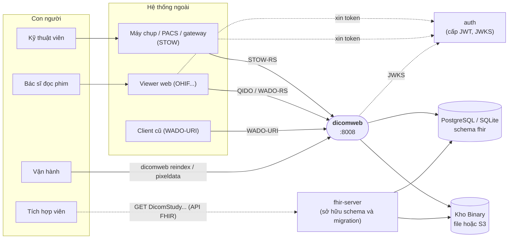
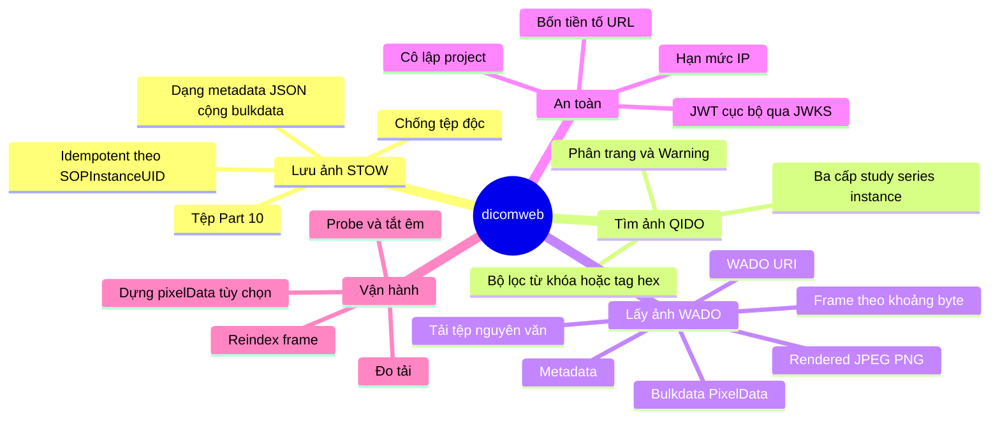
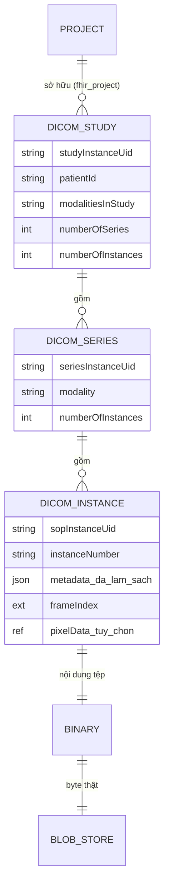

# 1. Tổng quan nghiệp vụ

## 1.1 Mục tiêu và giá trị

`dicomweb` là **kênh nhận và phát hình ảnh y khoa DICOM** của Trivita qua giao thức chuẩn DICOMweb (STOW-RS lưu, QIDO-RS tìm, WADO-RS lấy). Mỗi ảnh được lưu thành tệp trong kho Binary và có hồ sơ FHIR (`DicomStudy`, `DicomSeries`, `DicomInstance`) để tìm cả bằng API FHIR.

| Giá trị | Cách đạt được |
|---|---|
| Viewer và thiết bị dùng giao thức chuẩn | STOW/QIDO/WADO-RS, thêm WADO-URI cho client cũ |
| Tải ảnh lớn không làm rớt API lâm sàng | Dịch vụ riêng, truyền luồng, bộ nhớ hằng số (tải 104 MB đỉnh heap 11 MB) |
| Cách ly dữ liệu giữa tổ chức | Mọi thao tác kho đi qua `fhirauth.Scope` theo `fhir_project` của token |
| Đúng và an toàn hơn Medplum | Sửa các lỗi đã biết của Medplum ([kế hoạch](../../../../docs/plans/cds-dicom/dicom.md) mục 3): route chưa cài trả 501 thay vì 200 rỗng, phản hồi STOW theo chuẩn, truyền luồng... |
| Xem ảnh nhanh | Chỉ mục frame lập lúc lưu: đọc đúng khoảng byte của frame, không quét cả tệp |

## 1.2 Ranh giới hệ thống

**Làm:** nhận, lưu, tìm, trả ảnh DICOM; dựng ảnh xem nhanh (JPEG/PNG) cho một số định dạng; lập lại chỉ mục frame; tùy chọn dựng `DicomInstance.pixelData` (mỗi frame một Binary) cho client đọc qua API FHIR.
**Không làm:** không giải mã mọi định dạng ảnh (JPEG 2000, JPEG-LS, RLE... trả 406 ở `rendered`), không xóa instance, không `rendered` cấp series/study, không `viewport`/`annotation`, không phân tích hay xử lý ảnh, không tự migrate schema (`fhir-server` sở hữu), không cấp token (do `auth`).

## 1.3 Tác nhân

| Mã | Tác nhân | Là ai | Xác thực | Việc chính |
|---|---|---|---|---|
| A1 | **Thiết bị gửi ảnh** | Máy chụp, PACS, gateway | JWT (ghi) | Tải instance lên (F-01, F-02) |
| A2 | **Viewer / bác sĩ đọc phim** | OHIF hoặc viewer khác | JWT (đọc) | Tìm study, mở series, xem frame (F-03..F-08) |
| A3 | **Client cũ** | Hệ thống chỉ biết WADO-URI | JWT (đọc) | Lấy một instance bằng tham số truy vấn (F-09) |
| A4 | **Tích hợp viên** | Dev kết nối hệ thống | JWT | Thử route, đọc lỗi, đọc swagger |
| A5 | **Vận hành** | SRE | quyền máy chủ (CLI, env) | Triển khai, `reindex`, `pixeldata`, xử lý sự cố (F-12, F-13, F-14) |
| A6 | **Super-admin** | Token có cờ super | JWT + `FHIR_JWT_SUPER_ADMIN` | Hành động trong project chọn, có kiểm toán (F-10) |
| A7 | **auth** | Cấp token | JWKS | Nguồn tin cậy của danh tính |
| A8 | **fhir-server** | Cùng miền dữ liệu | cùng DB và kho | Sở hữu migration; phục vụ `DicomStudy/...` và `Binary` qua FHIR |

## 1.4 Bản đồ năng lực

## 1.5 Thuật ngữ

| Thuật ngữ | Nghĩa |
|---|---|
| **DICOM** | Chuẩn tệp và giao thức ảnh y khoa |
| **DICOMweb** | Bộ giao thức DICOM trên HTTP: STOW-RS (lưu), QIDO-RS (tìm), WADO-RS (lấy), WADO-URI (lấy kiểu cũ) |
| **Study / Series / Instance** | Ba cấp phân cấp: một lần khám gồm nhiều series, mỗi series nhiều instance (thường một ảnh/lát cắt). Định danh bằng `StudyInstanceUID`, `SeriesInstanceUID`, `SOPInstanceUID` |
| **Part 10** | Định dạng tệp DICOM chuẩn (có file meta) |
| **Transfer syntax** | Cách mã hóa dữ liệu ảnh (không nén, JPEG, JPEG 2000, RLE...) |
| **PixelData (7FE00010)** | Dữ liệu điểm ảnh, phần lớn dung lượng tệp |
| **Frame** | Một ảnh trong instance nhiều frame (đánh số từ 1) |
| **DICOM JSON** | Biểu diễn metadata dạng JSON (`application/dicom+json`) |
| **Bulkdata** | Dữ liệu nhị phân lớn tách khỏi metadata, lấy bằng URI |
| **pixelData (D11)** | Danh sách tham chiếu `Binary` mỗi frame một cái, nằm ở `DicomInstance.pixelData`, để client đọc frame thẳng qua API FHIR như Medplum. **Tùy chọn, mặc định tắt** vì nhân đôi dung lượng; WADO-RS không dùng |
| **Chỉ mục frame** | Bảng vị trí byte của từng frame, lập lúc STOW, lưu ở extension của `DicomInstance` |
| **SOP / FailureReason** | Mã lý do thất bại từng instance trong phản hồi STOW (0x0110, 0xA700, 0xA900, 0xC000) |
| **Binary** | Resource FHIR giữ metadata của tệp; nội dung nằm ở kho `binarystore` |
| **Rendered** | Ảnh đã dựng sẵn (JPEG/PNG) để xem nhanh, kèm window/level |

## 1.6 Mô hình dữ liệu nghiệp vụ

Cần nhớ: (1) dùng **chung schema `fhir` và role `fhir_app`** với `fhir-server` (D-DW-1, ngoại lệ có chủ đích so với "mỗi service một schema"); (2) dùng **chung kho Binary** nên `FHIR_BINARY_STORAGE` phải trùng; (3) metadata lưu đã làm sạch: bỏ nhóm 0002, PixelData, overlay; nhị phân ≤ 10 KB thành `InlineBinary`, lớn hơn bị bỏ; (4) `DicomInstance.pixelData` **mặc định trống**: bật `DICOMWEB_PIXELDATA_FRAMES=true` thì mỗi frame lưu thêm một `Binary` (gấp đôi dung lượng ảnh), xem F-14.
