# 2. Luồng nghiệp vụ đầu-cuối

Mã F-xx ở [04-chuc-nang.md](04-chuc-nang.md), BR-xx ở [05-luat-va-phan-quyen.md](05-luat-va-phan-quyen.md).

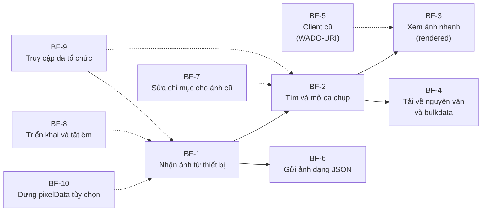

---

## BF-1. Nhận ảnh từ thiết bị (STOW-RS tệp)

**Mục tiêu:** tệp DICOM từ máy chụp được lưu an toàn, tìm được ngay, không mất, không trùng.
**Các bên:** thiết bị (A1), dicomweb, CSDL, kho Binary.

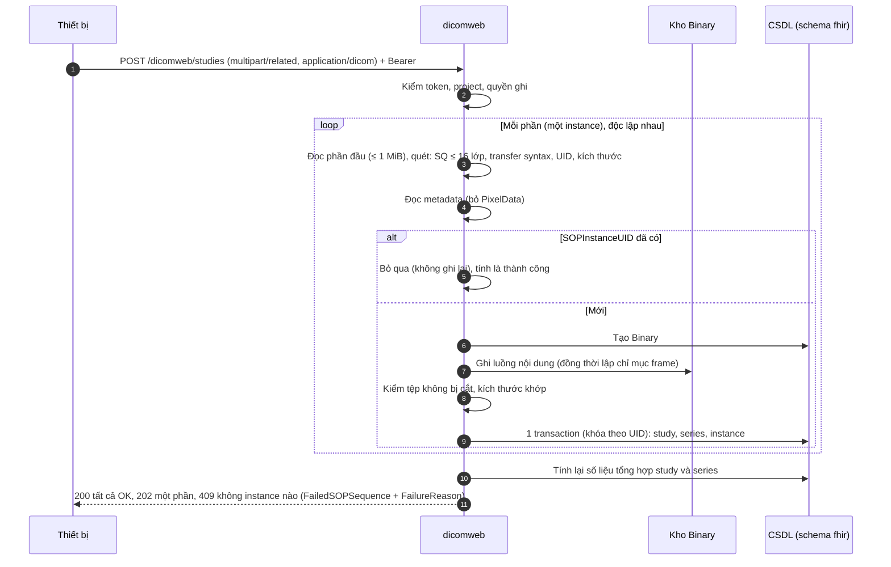

**Rẽ nhánh lỗi từng instance:**

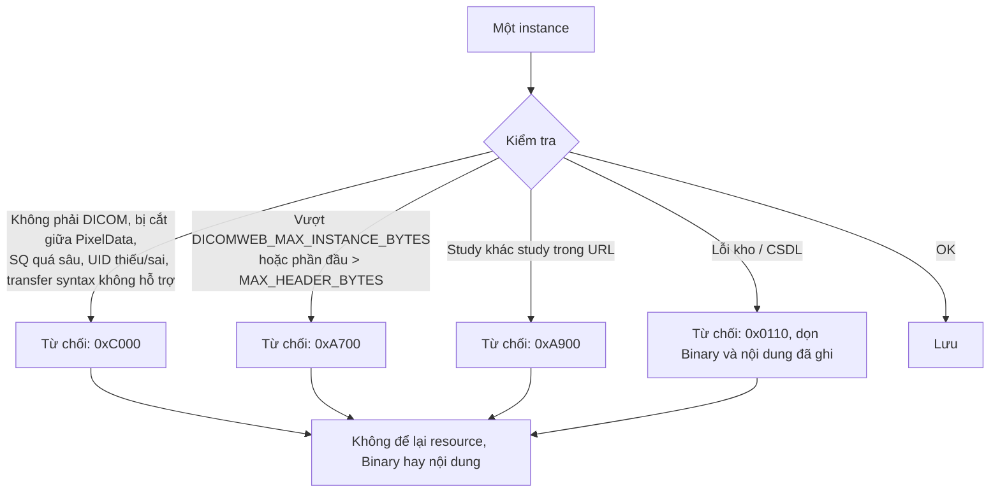

**Lỗi cả yêu cầu:** `415` không phải `multipart/related`; `400` thân hỏng; `403` thiếu quyền ghi; `413` vượt `DICOMWEB_MAX_REQUEST_BYTES` (instance đã xong trước đó **vẫn được giữ**).
**Kết quả:** instance chỉ hiện với người dùng khác khi `DicomInstance` được tạo, tức nội dung đã đủ và đúng. Tải lại cùng instance an toàn (idempotent). **Chức năng:** F-01, F-10, F-13.

---

## BF-2. Tìm và mở một ca chụp (QIDO-RS + WADO-RS metadata)

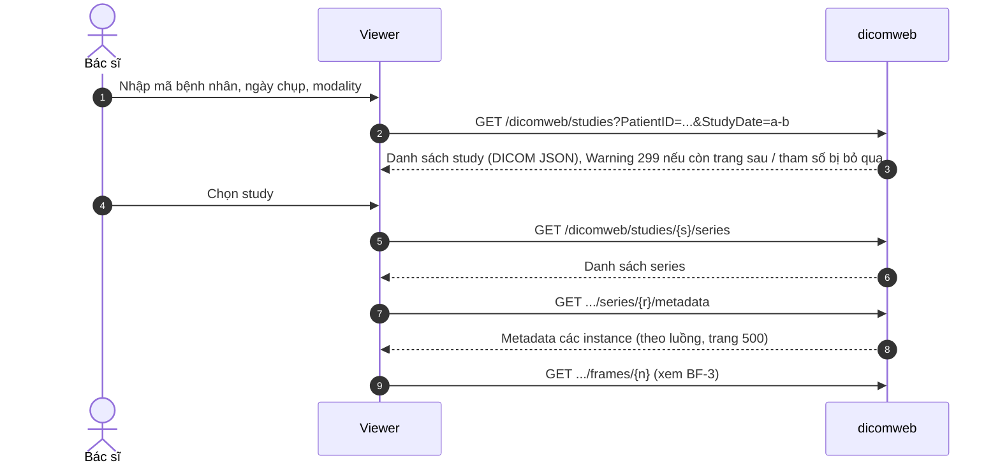

**Điều BA cần biết:** thuộc tính lọc viết theo từ khóa (`PatientID`) hoặc tag hex 8 chữ số (`00100020`); `PatientName` khớp **đầu chuỗi**, không phân biệt hoa thường; nhiều thuộc tính là AND, nhiều giá trị là OR; tham số lạ **không bị bỏ qua lặng lẽ** mà báo `Warning: 299`; không có kết quả thì `200 []` (không phải 204). **Chức năng:** F-03, F-04.

---

## BF-3. Xem ảnh nhanh (frame, rendered)

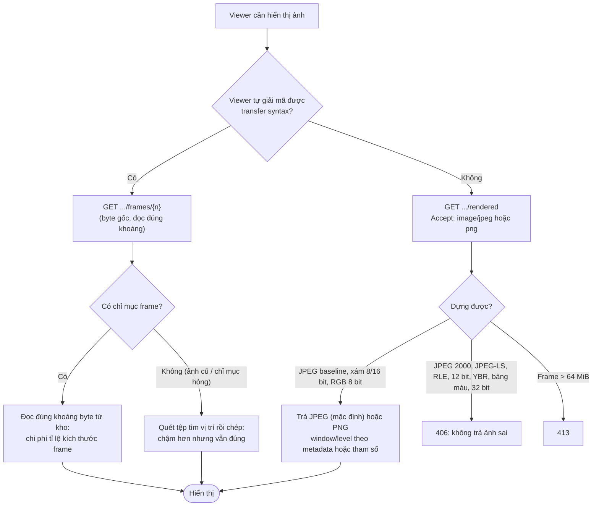

**Lỗi frame:** `404` không có pixel data (báo cáo có cấu trúc, hoặc nội dung đã bị xóa khỏi kho), `416` số frame vượt `NumberOfFrames` (đánh số từ 1), `403` thiếu quyền đọc `Binary`. Lỗi kiểm hợp lệ luôn xảy ra **trước khi ghi byte nào**; lỗi sau đó (kho đứt giữa chừng) làm server **ngắt kết nối** để viewer thấy phản hồi bị cắt, không nhận ảnh dở trông như hợp lệ. **Chức năng:** F-06, F-07.

---

## BF-4. Tải về nguyên văn và bulkdata

| Nhu cầu | Cách | Hành vi |
|---|---|---|
| Sao lưu / chuyển ca sang hệ khác | `GET /studies/{s}`, `/series/{r}`, `/instances/{i}` | `multipart/related; type="application/dicom"`, mỗi instance một phần là tệp Part 10 **nguyên văn**, theo luồng từng trang 100 instance, không `Content-Length` |
| Client DICOMweb đầy đủ cần pixel | `GET .../instances/{i}/bulkdata/7FE00010` | Không nén: MỘT phần chứa mọi frame nối nhau; nén: mỗi frame một phần. Mọi tag khác `404` |

Metadata **không** chứa `BulkDataURI` (PixelData bị bỏ khỏi metadata), nên client phải biết URL theo quy ước. **Chức năng:** F-05, F-08.

---

## BF-5. Client cũ (WADO-URI)

`GET /dicomweb/wado?requestType=WADO&studyUID=&seriesUID=&objectUID=` cho hệ thống chỉ biết giao thức cũ.

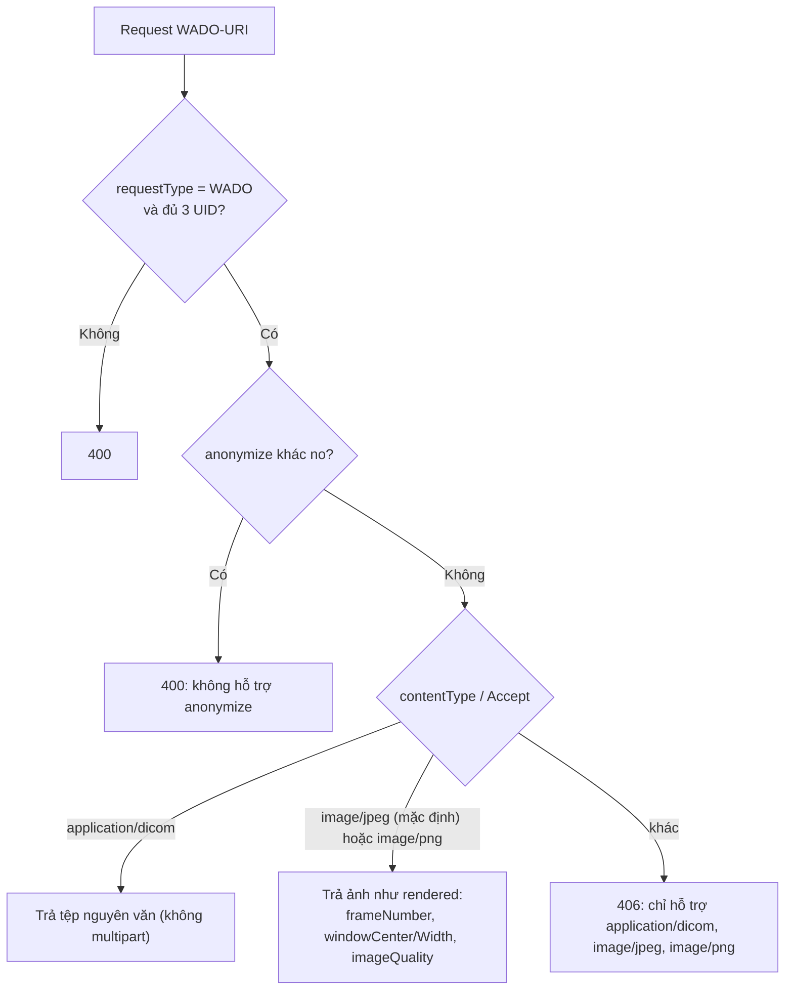

`rows`, `columns`, `region`, `annotation`, `presentation*`, `transferSyntax`, `charset` bị bỏ qua. **Chức năng:** F-09.

---

## BF-6. Gửi ảnh dạng JSON (STOW metadata)

Dành cho hệ thống tạo ảnh từ dữ liệu có cấu trúc (không có tệp Part 10 sẵn).

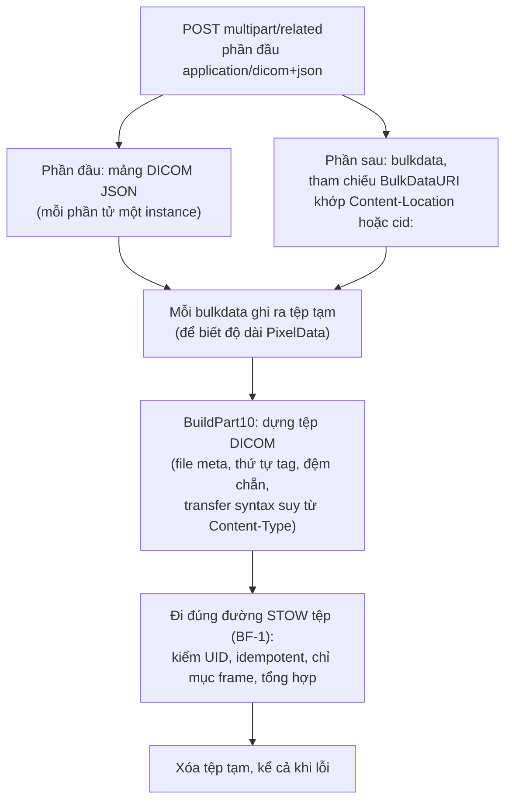

**Giới hạn:** metadata ≤ 8 MiB (413), bulkdata ngoài PixelData ≤ 16 MiB và chỉ cấp ngoài cùng. Big Endian và Deflated bị từ chối; Implicit VR LE được dựng thành Explicit. Instance hỏng bị từ chối riêng (0xC000, hoặc 0xA700 khi bulkdata vượt trần); JSON hỏng, bulkdata thiếu `Content-Location`/`Content-ID` là lỗi cả yêu cầu (400). **Chức năng:** F-02.

---

## BF-7. Sửa chỉ mục cho ảnh cũ (reindex)

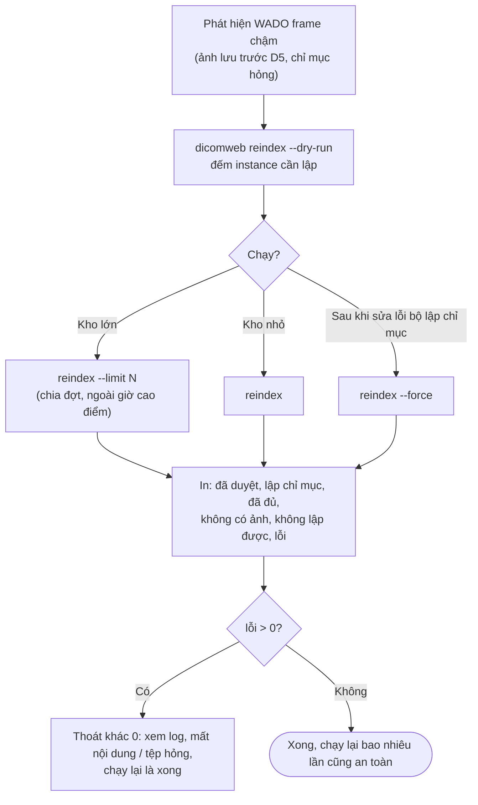

Chạy được khi server đang phục vụ; ghi dùng `If-Match` theo phiên bản đã đọc nên không ghi đè thay đổi song song. **Chức năng:** F-12.

---

## BF-8. Triển khai, khởi động và tắt êm

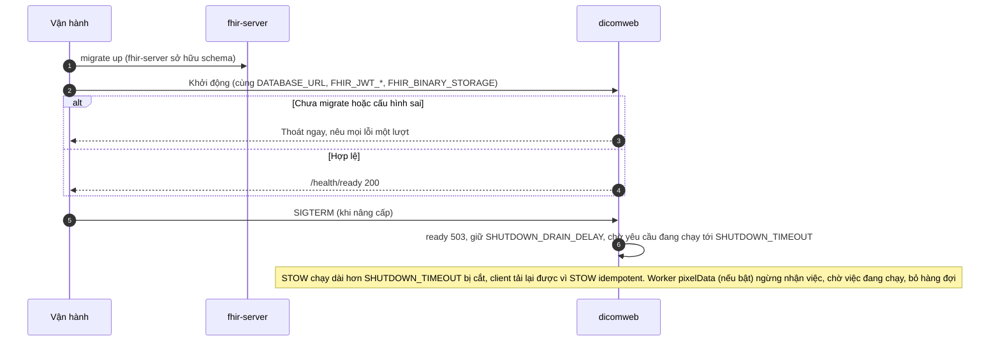

**Chức năng:** F-13.

---

## BF-9. Truy cập đa tổ chức (project)

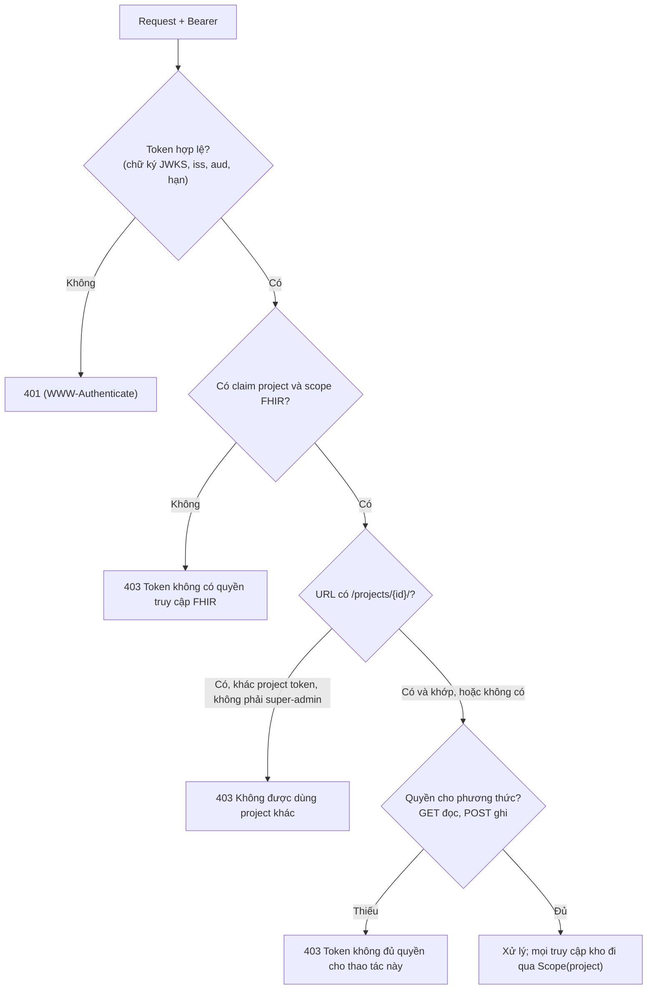

Super-admin: chọn project bằng URL hoặc `X-Fhir-Project` (hai nơi khác nhau ⇒ `400`); không chọn ⇒ `400`; mọi yêu cầu được ghi nhật ký kiểm toán. **Chức năng:** F-10.

## BF-10. Dựng `DicomInstance.pixelData` (tùy chọn, D11)

**Mục tiêu:** client quen Medplum đọc frame **thẳng qua API FHIR** (`DicomInstance.pixelData` → `Binary/{id}`) mà không cần WADO-RS. **Mặc định tắt** vì mỗi frame lưu hai lần (trong tệp gốc và trong Binary riêng) và WADO-RS không dùng.

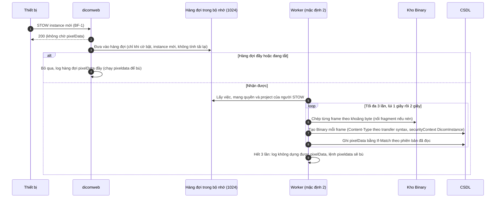

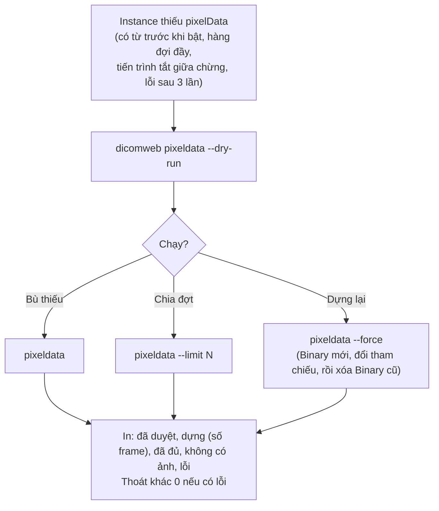

**Điều BA cần biết:** (1) hàng đợi **không bền**: tắt tiến trình hoặc hàng đợi đầy làm instance thiếu pixelData cho tới khi chạy `dicomweb pixeldata` (lưới an toàn); (2) lỗi giữa chừng (một frame không ghi được, thua tranh chấp phiên bản) **xóa mọi Binary và nội dung đã tạo**, không để rác; (3) xóa `DicomInstance` **không** xóa Binary frame của nó (như Medplum); (4) tải lại tệp khác cùng SOPInstanceUID **không** cập nhật pixelData (instance đã có là idempotent); (5) tắt cờ không xóa pixelData đã dựng; (6) mỗi frame cần một lượt đọc và một lượt ghi kho (S3 tính phí theo request). **Chức năng:** F-14.

---

## Bảng sự kiện → hiệu lực

| Sự kiện | Hiệu lực ở dicomweb |
|---|---|
| Token bị thu hồi ở `auth` | dicomweb chỉ xác minh chữ ký nên token còn dùng được tới khi hết hạn (cùng cửa sổ với `fhir-server`, xem tài liệu `auth` D-13) |
| Xoay khóa ký ở `auth` | JWKS được cache; đã tải khóa thì vẫn xác minh khi `auth` tạm tắt |
| Nội dung bị mất khỏi kho | Frame/tải: 404 hoặc 500 sạch; phản hồi đang ghi dở bị ngắt kết nối |
| Tiến trình chết giữa STOW | Có thể để lại Binary hoặc nội dung mồ côi; `fhir-server sweep-binary` quét nội dung mồ côi |
| Tắt tiến trình khi còn việc pixelData trong hàng đợi | Việc đang chạy được chờ xong trong hạn tắt, phần còn trong hàng đợi **bị bỏ**; `dicomweb pixeldata` bù |
| Xóa `DicomInstance` | Binary frame của pixelData **không** bị xóa theo |
