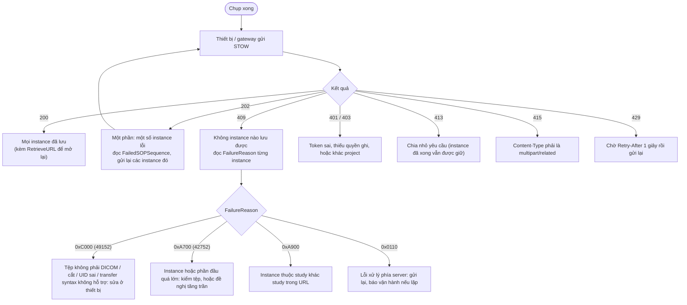
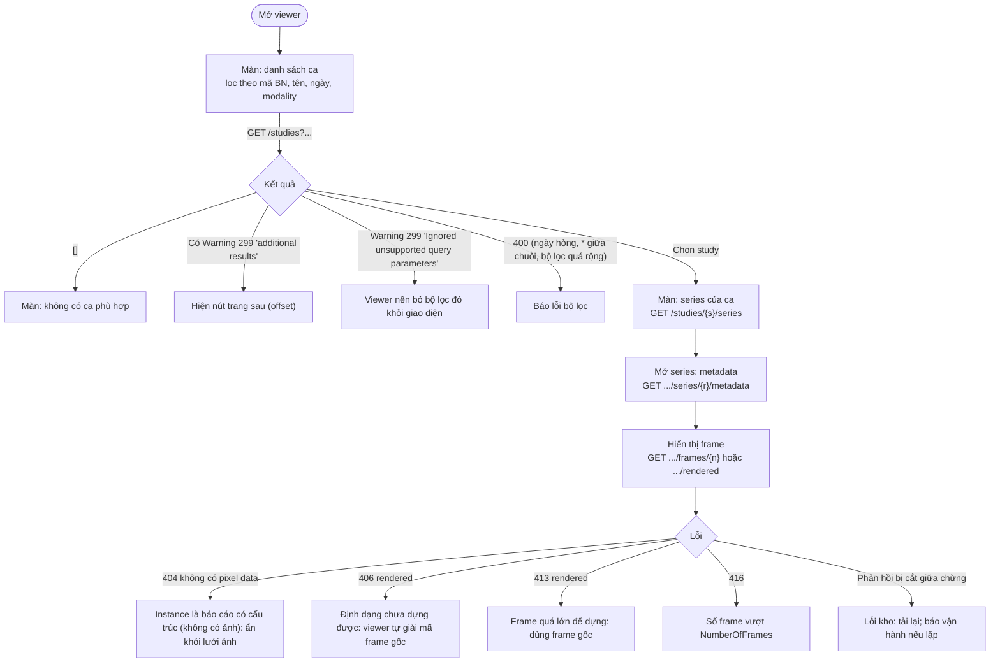
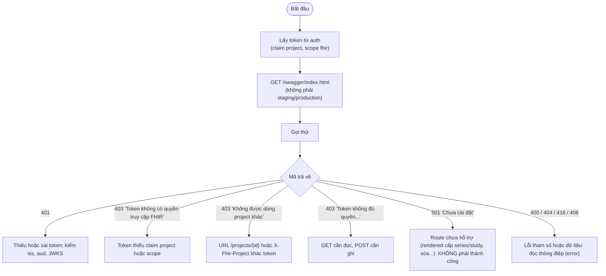
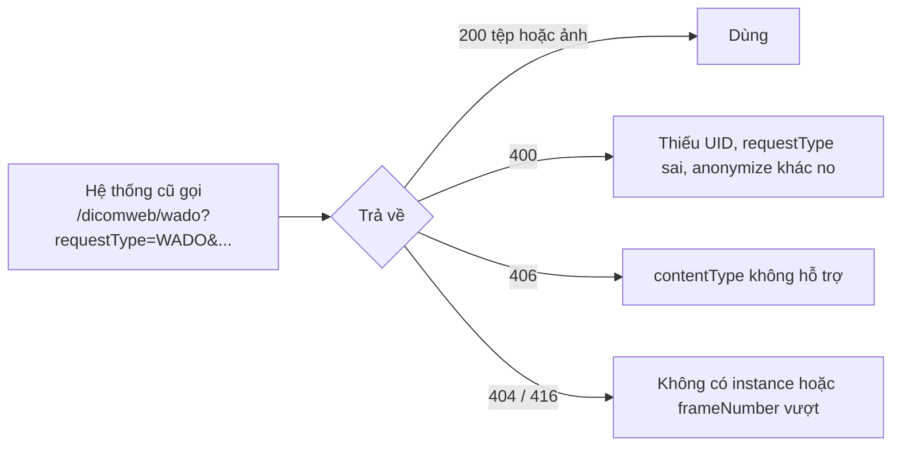
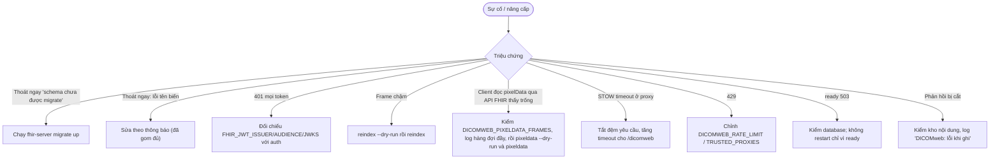

# 3. Luồng người dùng

dicomweb **không có giao diện**; "màn hình" ở đây là của viewer hoặc phần mềm thiết bị. Tài liệu ghi **bước người dùng → request → điều họ thấy** để UX của viewer, đội tích hợp và QA cùng một bản đồ. Mã F-xx ở [04-chuc-nang.md](04-chuc-nang.md).

## 3.1 Kỹ thuật viên: đẩy ca chụp lên hệ thống (F-01, F-02)

**Thông điệp cho thiết bị:** gửi lại **an toàn** vì STOW idempotent theo `SOPInstanceUID` (không tạo bản trùng). Mất kết nối giữa chừng: gửi lại toàn bộ.

## 3.2 Bác sĩ: tìm và đọc phim (F-03..F-08)

**Gợi ý UX:** viewer nên (a) hiển thị `modalitiesInStudy`, số series, số instance từ danh sách study (đã tính sẵn); (b) tải frame song song được vì mỗi frame chỉ đọc đúng khoảng byte; (c) với JPEG 2000/RLE... dùng frame gốc rồi giải mã phía client vì `rendered` trả 406.

## 3.3 Tích hợp viên: thử và đọc lỗi (F-10, F-11)

Mọi lỗi có dạng `{"error": "..."}` (không phải OperationOutcome). Bốn tiền tố URL tương đương: `/dicomweb`, `/api/dicomweb`, `/projects/{id}/dicomweb`, `/api/projects/{id}/dicomweb`; dùng tiền tố có project khi client Medplum sẵn có.

## 3.4 Client cũ (F-09)

## 3.5 Vận hành (F-12, F-13, F-14)

