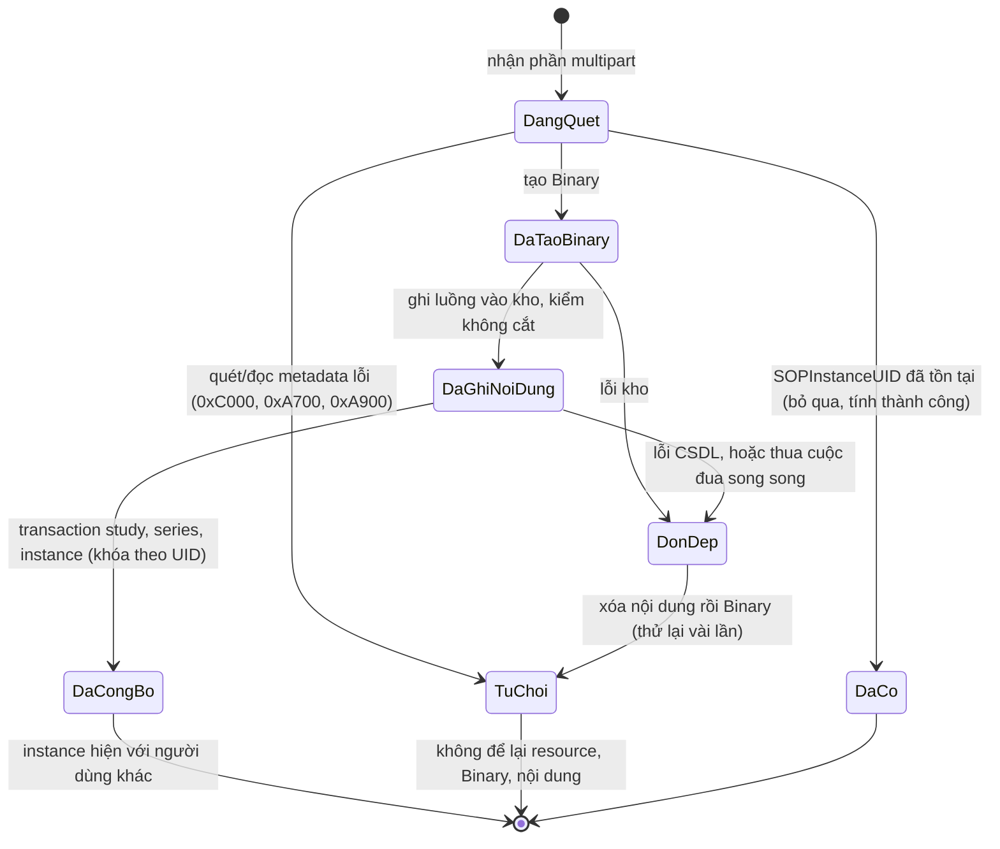
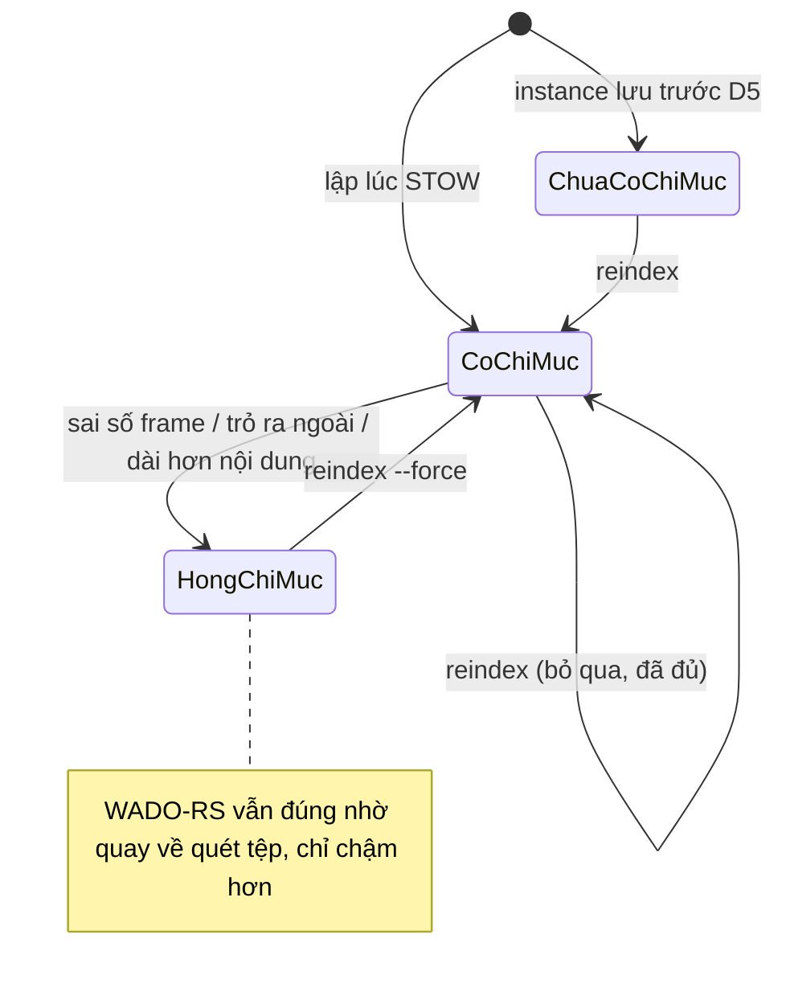
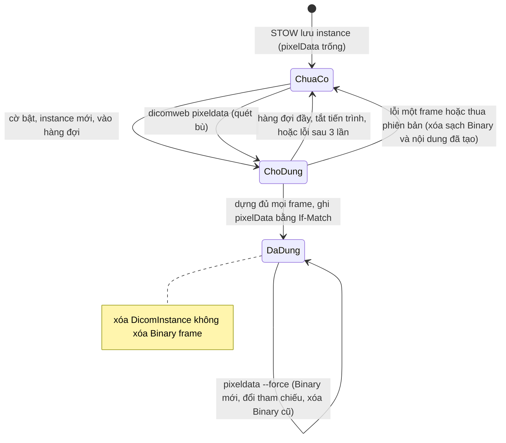
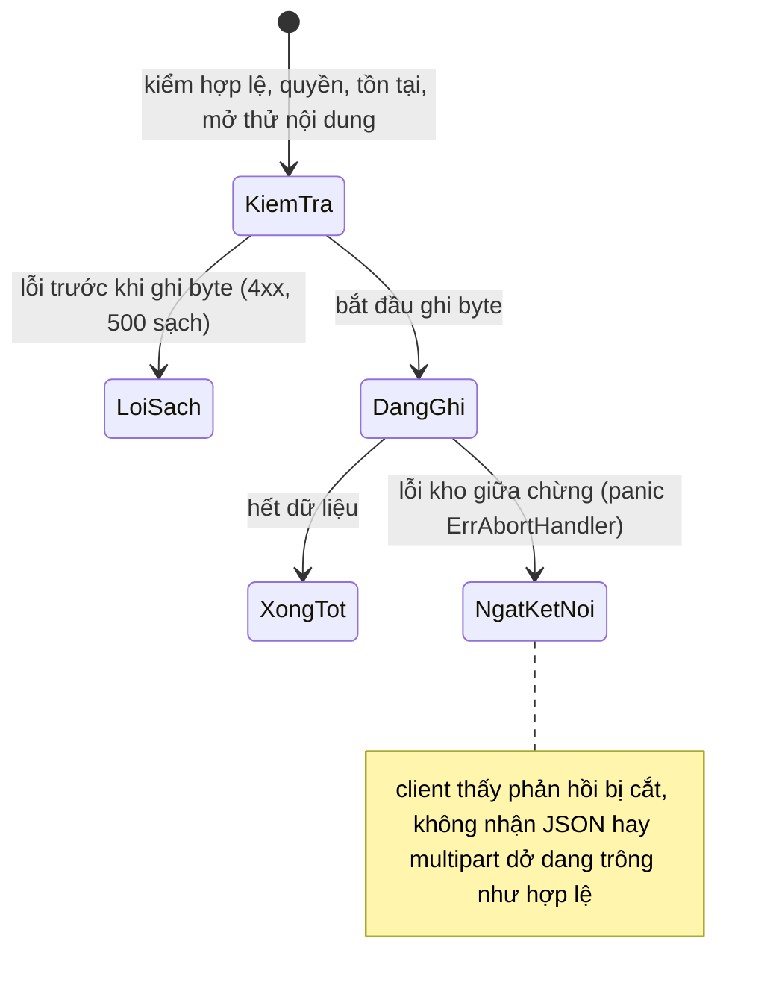

# 5. Luật nghiệp vụ, phân quyền, vòng đời, truy vết

## 5.1 Vòng đời trạng thái

### Một instance trong STOW

### Chỉ mục frame của DicomInstance

### pixelData của một DicomInstance (tùy chọn, D11)

### Phản hồi dài (tải, frame, metadata)

## 5.2 Ma trận phân quyền

● được · ○ không · ◐ có điều kiện.

| Chức năng | Chưa có token | Token đọc | Token ghi | Super-admin | Vận hành (CLI) |
|---|:-:|:-:|:-:|:-:|:-:|
| F-01, F-02 STOW | ○ (401) | ○ (403) | ● | ◐ trong project chọn | ○ |
| F-03..F-09 QIDO, WADO | ○ | ● | ● | ◐ | ○ |
| F-06..F-09 lấy nội dung | ○ | ◐ cần đọc cả `Dicom*` **và** `Binary` | ● | ◐ | ○ |
| Probe `/health/*`, `/healthz`, swagger | ● | ● | ● | ● | ● |
| F-12 reindex, F-14 `pixeldata` | ○ | ○ | ○ | ○ | ● (không qua token) |
| F-14 đọc `pixelData` và `Binary` frame qua API FHIR (fhir-server) | ○ | ◐ theo chính sách truy cập của fhir-server | ◐ | ◐ | ○ |

Quyền theo loại resource (`DicomStudy`, `DicomSeries`, `DicomInstance`, `Binary`) và chính sách truy cập do `fhirauth.Scope` kiểm ở từng thao tác kho. Scope tối thiểu gợi ý: ghi `system/Binary.c system/Dicom*.cru`; đọc `system/Binary.r` kèm đọc `Dicom*`.

## 5.3 Danh mục luật nghiệp vụ

Loại: `BM` nghiệp vụ · `SEC` bảo mật · `DATA` toàn vẹn · `OPS` vận hành.

### Nền tảng và bảo mật

| Mã | Luật | Loại | F |
|---|---|---|---|
| BR-01 | Dùng chung schema `fhir` và role `fhir_app` với `fhir-server` (D-DW-1); `fhir-server` sở hữu migration; dicomweb **không tự migrate** và từ chối khởi động khi `fhirstore.Pending > 0` | DATA | F-13 |
| BR-02 | Xác thực chỉ bằng JWT `auth` kiểm cục bộ qua JWKS; không token tĩnh, không chế độ tắt; mọi truy cập kho đi qua `fhirauth.Scope` (cô lập theo `fhir_project`) | SEC | F-10 |
| BR-03 | `GET` cần quyền đọc, `POST` cần quyền ghi; lấy nội dung cần đọc cả `Dicom*` và `Binary`; thiếu quyền là `403`, không phải `500` | SEC | F-05,06,10 |
| BR-04 | Tiền tố `/projects/{id}/dicomweb` phải khớp project của token; header `X-Fhir-Project` không được chọn project khác; super-admin (`FHIR_JWT_SUPER_ADMIN`) hành động trong project chọn, mọi yêu cầu ghi nhật ký kiểm toán; URL khác header ⇒ `400` | SEC | F-10 |
| BR-05 | Lỗi luôn `{"error": "..."}`; lỗi `5xx` không lộ chi tiết nội bộ; lỗi hạ tầng xác thực không bị đổi thành `401` (fail đóng) | SEC | F-10,13 |
| BR-06 | Không ghi tên bệnh nhân, mã bệnh nhân hay metadata DICOM vào log | SEC | F-13 |

### Lưu ảnh (STOW)

| Mã | Luật | Loại | F |
|---|---|---|---|
| BR-07 | Mỗi instance xử lý **độc lập**: `200` tất cả OK, `202` một phần, `409` không instance nào; lỗi nêu `FailureReason` 0x0110 / 0xA700 / 0xA900 / 0xC000 | BM | F-01 |
| BR-08 | **Idempotent** theo SOPInstanceUID: tải lại không ghi lại nội dung, không tạo Binary mới | DATA | F-01 |
| BR-09 | Thứ tự ghi: Binary (CSDL) → nội dung (kho) → resource DICOM cuối; lỗi ở bước nào thì xóa những gì đã tạo trước đó (nội dung rồi Binary); tiến trình chết có thể để mồ côi, `fhir-server sweep-binary` quét nội dung mồ côi | DATA | F-01 |
| BR-10 | Chống tệp độc: độ sâu SQ ≤ 16, phần đầu ≤ `DICOMWEB_MAX_HEADER_BYTES` (1 MiB), tệp cắt giữa PixelData bị từ chối, Big Endian và Deflated bị từ chối; quét **trước** khi gọi thư viện đọc (SQ lồng sâu 60 KB làm thư viện dùng 2,2 GB) | SEC | F-01,02 |
| BR-11 | Trần: một instance `DICOMWEB_MAX_INSTANCE_BYTES` (1 GiB, vượt ⇒ 0xA700 riêng instance); cả yêu cầu `DICOMWEB_MAX_REQUEST_BYTES` (4 GiB, vượt ⇒ `413`, instance đã xong được giữ) | OPS | F-01,13 |
| BR-12 | Bộ nhớ mỗi yêu cầu STOW là hằng số (phần đầu + vài bộ đệm 64 KB), không phụ thuộc kích thước tệp | OPS | F-01 |
| BR-13 | Khóa theo UID (có tiền tố project) trong transaction để tải song song cùng study không tạo trùng study hay series; hai yêu cầu song song cùng instance chỉ một thắng, bên thua tự dọn | DATA | F-01 |
| BR-14 | Sau STOW tính lại số liệu tổng hợp study (modalities, số series, số instance) và series; lỗi chỉ ghi log, lần tải sau tính lại | DATA | F-01 |
| BR-15 | Instance thuộc study khác study trong URL bị từ chối riêng (0xA900) | BM | F-01 |
| BR-16 | Metadata lưu đã làm sạch: bỏ nhóm 0002, PixelData, overlay; nhị phân ≤ 10 KB thành `InlineBinary`, lớn hơn bị bỏ; đệ quy vào SQ | DATA | F-01,04 |
| BR-26 | STOW metadata: metadata ≤ 8 MiB, bulkdata ngoài PixelData ≤ 16 MiB và chỉ cấp ngoài cùng; bulkdata ghi tệp tạm và xóa khi xong kể cả khi lỗi; transfer syntax suy từ Content-Type bulkdata; đi đúng đường STOW tệp nên mọi luật BR-07..BR-16 áp dụng | DATA | F-02 |
| BR-32 | Instance chỉ hiện với người dùng khác khi `DicomInstance` đã được tạo, tức nội dung đã đủ và đúng | DATA | F-01 |

### Lấy ảnh (QIDO, WADO)

| Mã | Luật | Loại | F |
|---|---|---|---|
| BR-17 | Chỉ mục frame lập lúc STOW; thiếu, hỏng hoặc kho không đọc theo khoảng thì quay về quét tệp: **không bao giờ trả sai dữ liệu**, chỉ chậm hơn | DATA | F-06,08,12 |
| BR-18 | Mọi kiểm tra hợp lệ xảy ra **trước khi ghi byte nào**; lỗi sau đó làm server ngắt kết nối | BM | F-04..09 |
| BR-19 | Frame đánh số từ 1; vượt `NumberOfFrames` ⇒ `416` (kiểm trước khi mở nội dung); instance không có pixel data ⇒ `404`; `404` phân biệt study, series, instance | BM | F-06 |
| BR-20 | QIDO: UID và mã khớp nguyên chuỗi; `PatientName` khớp đầu chuỗi không phân biệt hoa thường; ngày và khoảng ngày; OR theo `\` hoặc dấu phẩy, AND giữa thuộc tính; giá trị sai ⇒ `400` | BM | F-03 |
| BR-21 | Tham số QIDO không hỗ trợ không bị bỏ qua lặng lẽ: báo bằng `Warning: 299`; còn kết quả cũng báo `Warning: 299` | BM | F-03 |
| BR-22 | QIDO thu hẹp theo cấp trên: tối đa 1000 study (nhiều hơn ⇒ `400` bộ lọc quá rộng); lọc `Modality` sau khi đọc tối đa 10000 series | OPS | F-03 |
| BR-23 | Rendered chỉ dựng định dạng đã hỗ trợ; còn lại `406`, không trả ảnh sai; frame > 64 MiB hoặc quá `MaxPixels` ⇒ `413` | BM | F-07,09 |
| BR-24 | Bulkdata chỉ có PixelData (`7FE00010`); overlay, waveform, nhị phân > 10 KB đã bị bỏ lúc STOW nên mọi tag khác `404` | BM | F-08 |
| BR-25 | WADO-URI: `requestType=WADO` và đủ ba UID; `anonymize` khác `no` ⇒ `400`; `contentType` ∈ {application/dicom, image/jpeg, image/png} else `406`; tham số rows, columns, region, annotation, presentation*, transferSyntax, charset bị bỏ qua | BM | F-09 |

### Vận hành

| Mã | Luật | Loại | F |
|---|---|---|---|
| BR-27 | Route chưa cài trả `501` sau xác thực, **không bao giờ `200` rỗng** (sửa lỗi Medplum) | BM | F-11 |
| BR-28 | Hạn mức theo IP đếm theo từng instance, bật mặc định 20 rps ở staging/production; vượt ⇒ `429` + `Retry-After: 1`; sau proxy phải khai `DICOMWEB_TRUSTED_PROXIES` | SEC | F-13 |
| BR-29 | Tắt êm: ready `503`, chờ `SHUTDOWN_DRAIN_DELAY`, chờ yêu cầu đang chạy tới `SHUTDOWN_TIMEOUT`; STOW dài hơn bị cắt, tải lại được nhờ BR-08; `terminationGracePeriodSeconds` > tổng hai giá trị | OPS | F-13 |
| BR-30 | `reindex` an toàn: chạy lại không hại, ghi theo `If-Match` (không ghi đè thay đổi song song), thoát khác 0 khi có `lỗi`, từ chối chạy khi schema chưa migrate | OPS | F-12 |
| BR-33 | pixelData **mặc định tắt** (`DICOMWEB_PIXELDATA_FRAMES=false`) vì mỗi frame lưu hai lần (gấp đôi dung lượng ảnh) và WADO-RS không dùng; tắt cờ không xóa pixelData đã dựng | OPS | F-14 |
| BR-34 | Đường nền chỉ dựng cho instance **mới** (không tính tải lại), không làm chậm hay đổi kết quả STOW; hàng đợi trong bộ nhớ 1024, `DICOMWEB_PIXELDATA_WORKERS` goroutine (mặc định 2), thử lại tối đa 3 lần (lùi 1 giây, 2 giây); hàng đợi **không bền**, `dicomweb pixeldata` là lưới an toàn | OPS | F-14 |
| BR-35 | Việc dựng chạy bằng **quyền và project của người STOW**; mỗi Binary frame mang `securityContext` `DicomInstance/{id}`, `Content-Type` theo transfer syntax, giữ project của instance (project khác không đọc được) | SEC | F-14 |
| BR-36 | Dựng pixelData **không để rác**: lỗi một frame hoặc thua tranh chấp phiên bản (`If-Match`) xóa mọi Binary và nội dung đã tạo; `--force` tạo Binary mới, đổi tham chiếu rồi mới xóa Binary cũ | DATA | F-14 |
| BR-37 | Giới hạn đã biết: xóa `DicomInstance` không xóa Binary frame của nó (như Medplum); tải lại tệp khác cùng SOPInstanceUID không cập nhật pixelData (idempotent); `meta.author` không đặt; `dicomweb pixeldata` thoát khác 0 khi có `lỗi`, chạy lại an toàn | DATA | F-14 |
| BR-31 | `FHIR_BINARY_STORAGE` phải **trùng** của `fhir-server` (cùng bucket và prefix) vì hai service đọc ghi cùng kho | OPS | F-01,13 |

## 5.4 Bảng hạn mức và mặc định

| Đối tượng | Giá trị | Luật |
|---|---|---|
| Phần đầu DICOM nạp vào bộ nhớ | 1 MiB (`DICOMWEB_MAX_HEADER_BYTES`) | BR-10 |
| Độ sâu SQ | 16 (cố định) | BR-10 |
| Một instance | 1 GiB (`DICOMWEB_MAX_INSTANCE_BYTES`) | BR-11 |
| Một yêu cầu STOW | 4 GiB (`DICOMWEB_MAX_REQUEST_BYTES`) | BR-11 |
| Metadata STOW dạng JSON / bulkdata ngoài PixelData | 8 MiB / 16 MiB | BR-26 |
| Nhị phân giữ trong metadata | ≤ 10 KB | BR-16 |
| Chỉ mục frame | ≤ 256 KB | BR-17 |
| Rendered | frame ≤ 64 MiB | BR-23 |
| Trang metadata / tải nguyên văn | 500 / 100 instance | F-04, F-05 |
| QIDO thu hẹp | 1000 study; 10000 series (lọc Modality) | BR-22 |
| Hạn mức IP | 20 rps staging/production; tắt ở local | BR-28 |
| Drain / tắt | `SHUTDOWN_DRAIN_DELAY` 5 giây / `SHUTDOWN_TIMEOUT` 25 giây | BR-29 |
| Probe ready | `READINESS_TIMEOUT` 2 giây | F-13 |
| Worker pixelData | hàng đợi 1024; `DICOMWEB_PIXELDATA_WORKERS` mặc định 2; thử lại 3 lần (lùi 1 giây, 2 giây) | BR-34 |
| Cổng | `:8008` | |

## 5.5 Kịch bản chấp nhận

| # | Kịch bản | Luật |
|---|---|---|
| AT-01 | **Given** instance mới **When** STOW tệp hợp lệ **Then** `200`, `RetrieveURL` mở được, QIDO thấy, frame đúng từng byte | BR-07, BR-32 |
| AT-02 | **Given** instance đã lưu **When** STOW lại cùng SOPInstanceUID **Then** `200`, không thêm Binary hay nội dung | BR-08 |
| AT-03 | **Given** yêu cầu 5 instance, 2 hỏng **When** STOW **Then** `202`, `FailedSOPSequence` nêu 2 instance, 3 instance lưu, 2 hỏng không để lại gì | BR-07, BR-09 |
| AT-04 | **Given** tệp có SQ lồng 2000 lớp **When** STOW **Then** từ chối < 1 giây (0xC000), không cấp phát bộ nhớ đáng kể | BR-10 |
| AT-05 | **Given** tệp bị cắt giữa PixelData **When** STOW **Then** 0xC000, không để lại resource, Binary, nội dung | BR-09, BR-10 |
| AT-06 | **Given** instance vượt trần **When** STOW **Then** 0xA700 riêng instance, instance khác vẫn lưu | BR-11 |
| AT-07 | **Given** URL study A **When** STOW instance study B **Then** 0xA900 | BR-15 |
| AT-08 | **Given** 8 yêu cầu STOW song song cùng study **When** hoàn tất **Then** đúng một study và series, số liệu tổng hợp đúng | BR-13, BR-14 |
| AT-09 | **Given** token project A **When** gọi `/projects/B/dicomweb/...` **Then** `403 Không được dùng project khác` | BR-04 |
| AT-10 | **Given** token chỉ đọc **When** STOW **Then** `403` | BR-03 |
| AT-11 | **Given** token đọc `Dicom*` nhưng không đọc `Binary` **When** lấy frame **Then** `403` (không phải 500) | BR-03 |
| AT-12 | **Given** instance 8 MB frame trong tệp 104 MB **When** lấy frame **Then** đọc đúng 8 MB từ kho, đỉnh heap ~ 8 MB | BR-17 |
| AT-13 | **Given** chỉ mục frame bị hỏng **When** lấy frame **Then** dữ liệu vẫn đúng từng byte (đường quay về) | BR-17 |
| AT-14 | **Given** frame vượt `NumberOfFrames` **When** lấy **Then** `416` trước khi mở nội dung | BR-19 |
| AT-15 | **Given** kho đứt giữa chừng khi tải **When** đang ghi byte **Then** client thấy kết nối bị ngắt, không nhận phản hồi dở trông hợp lệ | BR-18 |
| AT-16 | **Given** ảnh JPEG 2000 **When** `rendered` **Then** `406` | BR-23 |
| AT-17 | **Given** bộ lọc `PatientName=Nguy*` và tham số lạ **When** QIDO **Then** khớp đầu chuỗi, `Warning: 299` báo tham số lạ | BR-20, BR-21 |
| AT-18 | **Given** route rendered cấp series **When** gọi **Then** `501`, không phải `200` rỗng | BR-27 |
| AT-19 | **Given** schema chưa migrate **When** khởi động dicomweb **Then** thoát với "schema chưa được migrate" | BR-01 |
| AT-20 | **Given** instance cũ chưa có chỉ mục **When** `reindex` **Then** chỉ mục giống hệt chỉ mục do STOW lập; chạy lại không làm gì | BR-30 |
| AT-21 | **Given** STOW dạng metadata kèm 96 MB bulkdata **When** xử lý **Then** đỉnh heap < 64 MB, tệp tạm được dọn | BR-26 |
| AT-22 | **Given** `anonymize=yes` **When** WADO-URI **Then** `400` | BR-25 |
| AT-23 | **Given** cờ pixelData tắt **When** STOW rồi đọc `DicomInstance` **Then** `pixelData` trống, WADO-RS vẫn trả frame đúng | BR-33 |
| AT-24 | **Given** cờ bật **When** STOW instance mới **Then** phản hồi `200` không chờ; sau đó `pixelData` có đủ Binary theo thứ tự frame, từng Binary đúng byte và đúng `Content-Type`; project khác nhận `404` | BR-34, BR-35 |
| AT-25 | **Given** lỗi ghi frame thứ hai hoặc thua tranh chấp phiên bản **When** dựng **Then** không còn Binary hay nội dung mồ côi | BR-36 |
| AT-26 | **Given** instance thiếu pixelData **When** `dicomweb pixeldata` (rồi chạy lại) **Then** dựng đủ, lần hai không làm gì; `--force` thay Binary cũ bằng mới | BR-34, BR-36 |

## 5.6 Truy vết luật → bằng chứng kiểm thử

Mức tệp. Khi sửa luật, chạy nhóm tương ứng.

| Nhóm luật | Test |
|---|---|
| BR-01, 13, 29 (khởi động, tắt êm, container) | `apps/dicomweb/internal/bootstrap/bootstrap_test.go` |
| BR-02..06, 27, 28 (xác thực, project, lỗi, hạn mức, 501) | `apps/dicomweb/internal/presentation/httpapi/httpapi_test.go` |
| BR-07..16, 31, 32 (STOW) | `pkg/dicomstow/stow_test.go`, `pkg/dicomweb/scan_test.go`, `pkg/dicomweb/dicomweb_test.go`, `apps/dicomweb/internal/bootstrap/stow_http_test.go` |
| BR-17..19 (frame, chỉ mục) | `pkg/dicomweb/frameindex_test.go`, `pkg/dicomweb/frame_test.go`, `pkg/dicomretrieve/retrieve_test.go`, `apps/dicomweb/internal/bootstrap/retrieve_http_test.go` |
| BR-20..22 (QIDO) | `pkg/dicomretrieve/query_test.go`, `apps/dicomweb/internal/bootstrap/d7_http_test.go` |
| BR-23 (rendered) | `pkg/dicomretrieve/retrieve_test.go`, `apps/dicomweb/internal/bootstrap/d7_rendered_test.go` |
| BR-24, 25 (bulkdata, WADO-URI) | `apps/dicomweb/internal/bootstrap/d9_test.go` |
| BR-26 (STOW metadata) | `pkg/dicomstow/metadata_test.go`, `pkg/dicomweb/encode_test.go`, `apps/dicomweb/internal/bootstrap/d10_test.go` |
| BR-33..37 (pixelData, D11) | `apps/dicomweb/internal/bootstrap/pixeldata_test.go` (kể cả `-race`), `e2e/dicomweb_test.go` (`TestDicomwebPixelDataCommand`) |
| BR-30 (reindex) | `apps/dicomweb/internal/bootstrap/reindex_test.go`, `e2e/dicomweb_test.go` (`TestDicomwebReindexCommand`) |
| Đo tải, định cỡ | `apps/dicomweb/tests/load/load_test.go` |
| Hợp đồng route | `TestRoutesMatchSwaggerContract`, `TestAllPrefixesServeTheSameRoutes`, `TestAPIContractIsUpToDate`; `architecture_test.go` |

> **Khoảng trống:** AT-xx chưa gắn từng-test-một; `tests/integration` (PostgreSQL và S3 thật) và e2e từ image Docker chưa có (máy phát triển không có Docker); PostgreSQL chưa đo tải. Test e2e đa tiến trình (`e2e/dicomweb_test.go`, gồm reindex và pixelData) chỉ chạy khi `TRIVITA_E2E=1`. Tên bộ đếm của `pixeldata` (`dựng (số frame)`) và hạn lùi 1 giây, 2 giây lấy từ tài liệu D11 và mã worker; chưa chạy lại test trong phiên này.
