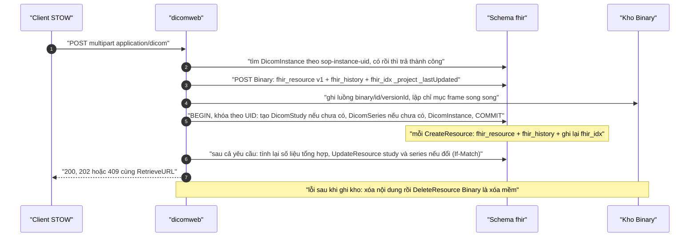

# 1. Bảng vật lý của dicomweb

`dicomweb` **không có bảng riêng và không có migration riêng**. Nó chạy trên bộ bảng "kho tài liệu FHIR" của `pkg/fhirstore` trong schema `fhir`, **cùng schema và cùng role `fhir_app` với `fhir-server`** (quyết định D-DW-1, [../architecture.md](../architecture.md) mục "Dữ liệu"). **Mọi bảng và cột được mô tả một lần, đầy đủ ghi chú chức năng**, ở [docs/erd/fhirstore-physical.md](../../../../docs/erd/fhirstore-physical.md); tệp này chỉ nêu phần riêng của dicomweb.

## 1.1 dicomweb dùng bảng nào

| Bảng | dicomweb dùng? | Ghi chú riêng của dicomweb |
|---|---|---|
| `fhir_resource` | **Có, nơi chứa mọi dữ liệu** | Bốn loại resource: `DicomStudy`, `DicomSeries`, `DicomInstance`, `Binary` ([02](02-mo-hinh-logic.md)). `DicomInstance.content` chứa cả `metadata`: **toàn bộ header DICOM** (trừ PixelData, overlay, nhóm 0002, nhị phân lớn) dạng chuỗi JSON lồng trong JSON, nên là dòng to nhất và nhạy cảm nhất |
| `fhir_history` | **Có (tự động)** | Mỗi lần ghi thêm một dòng **kèm nội dung đầy đủ**. Study và series có thêm một phiên bản mỗi lần STOW làm đổi số liệu tổng hợp; instance có thêm phiên bản khi dựng `pixelData` hoặc lập lại chỉ mục frame, mỗi bản **chép lại cả `metadata`** (đã đo, mục 1.4). Xóa mềm không xóa dòng cũ |
| `fhir_idx_string` | **Có, nhiều nhất** | UID (`study-instance-uid`, `series-instance-uid`, `sop-instance-uid`, `sop-class-uid`), `patient-id`, `patient-name`, `accession-number`, `study-id`, `study-time`, `referring-physicians-name`, `series-number`, `instance-number`. **`raw` giữ nguyên tên và mã bệnh nhân** (PHI, S3) |
| `fhir_idx_token` | Có | `modalities` của study, và `_project` của **mọi** resource (đã đo, mục 1.3) |
| `fhir_idx_reference` | Có | `DicomSeries.study`, `DicomInstance.study`, `DicomInstance.series`: nơi duy nhất lưu quan hệ cha con ở dạng truy vấn được |
| `fhir_idx_date` | Có | `study-date` (khoảng một ngày) và `_lastUpdated` của mọi resource |
| `fhir_idx_number`, `fhir_idx_quantity`, `fhir_idx_uri` | **Không có dòng** | Loại `Dicom*` và `Binary` không có tham số kiểu này |
| `fhir_coding`, `fhir_coding_property`, `fhir_coding_designation`, `fhir_concept_mapping` | **Không dùng** | dicomweb không nạp terminology; bảng rỗng ở mức dịch vụ này (có thể có dữ liệu do `fhir-server` ghi) |
| `fhirstore_schema_version` | Chỉ đọc (`Pending`) | Bảng phiên bản goose do `fhir-server migrate up` tạo; dicomweb từ chối khởi động khi còn migration chưa chạy (`container.go`, thông điệp `schema chưa được migrate`) |

## 1.2 Schema, role, migration

| Chủ đề | Giá trị |
|---|---|
| Schema PostgreSQL | `fhir` (dùng chung với `fhir-server`, `fhir-worker`; `search_path` đặt ở mức role: `ALTER ROLE fhir_app SET search_path = fhir`, `deploy/postgres-init/01-schemas.sh`) |
| Role chạy ứng dụng | `fhir_app`: `USAGE` schema, `SELECT/INSERT/UPDATE/DELETE` mọi bảng (kể cả bảng tương lai), không DDL. **Không có role riêng cho dicomweb**: ngoại lệ so với "mỗi service một role" vì hai service là hai cửa vào của cùng miền dữ liệu; hệ quả là role này đọc được **mọi** resource của schema `fhir` (Patient, Observation...), không chỉ `Dicom*` |
| Role migration | `fhir_migrate` (chỉ khi `DB_SEPARATE_MIGRATION_ROLES=true`): chỉ `fhir-server migrate up` dùng; dicomweb không có lệnh `migrate` |
| `DATABASE_REQUIRE_SCHEMA` | Mặc định `false`; `true` (chỉ PostgreSQL, `config.go` `validate`) làm `database.Open` từ chối khởi động nếu `search_path` không phải đúng một schema riêng. `docker-compose.dicomweb.yml` chạy với `true` (ghi chú đầu tệp, đã chạy thử 2026-11-24) |
| Không đọc được | Schema `identity` của `auth`: role `fhir_app` không có quyền ở đó (`01-schemas.sh`) |
| SQLite (dev) | `DATABASE_URL=sqlite://./fhir.db` (mặc định); cột `content` là text, không schema; **cấm ở staging/production** (`validate`: `không dùng SQLite ở staging/production`). Dùng để chạy test và đo (mục 1.4) |
| MySQL | Chưa hỗ trợ cho `fhirstore` |
| Bắt buộc ở production | PostgreSQL schema `fhir` **và** kho Binary (`FHIR_BINARY_STORAGE` bắt buộc ở mọi môi trường, khác với `fhir-server` nơi nó tùy chọn) |

## 1.3 Đường ghi của một lần STOW

Không có transaction nào bao cả `Binary`, nội dung ở kho và ba resource DICOM: chỉ ba resource DICOM nằm chung một transaction (`persist`). Chi tiết ở [03](03-quan-he-va-toan-ven.md).

**`_project` được lập chỉ mục** (đã đo 2026-11-24 bằng chạy thật trên SQLite): mỗi resource có một dòng `fhir_idx_token` với `code='_project'`, `value=<project>`, và một dòng `fhir_idx_date` với `code='_lastUpdated'`, vì `fhir.SearchParams` luôn thêm `ProjectParam` (`pkg/fhir/fhir.go`) và `indexedParams` (`pkg/fhirstore/crud.go`) lập chỉ mục mọi tham số. `fhirauth.Scope` thêm điều kiện `_project` vào mọi `Search`. Điều này **trái** với câu "không có chỉ mục theo `meta.project`" ở `apps/auth/docs/erd/03` mục 3.3 và `apps/fhir-worker/docs/erd/03` mục 3.2 (xem README, mục Lệch).

## 1.4 Một instance để lại bao nhiêu dòng (đã đo)

Đo bằng chạy thật (SQLite và kho `file:`, `dicomstow.Store` với tệp dựng bởi `pkg/dicomtest`, ảnh 8x8, 16 bit, một frame, 2026-11-24). Đếm bằng truy vấn trực tiếp `fhir_history`, `fhir_resource`, `fhir_idx_*`. **Tệp thật có hàng trăm phần tử header** nên `DicomInstance` thật lớn hơn nhiều so với 2 KB đo ở đây (chưa đo trên tệp thật).

| Tình huống | `fhir_history` (dòng; tổng byte JSON) | `fhir_resource` sống | Dòng `fhir_idx_*` | Tệp ở kho |
|---|---|---|---|---|
| 1 instance, 1 yêu cầu | Study 2 (1.036 B), Series 2 (731 B), Instance 1 (2.038 B), Binary 1 (303 B) | 4 | 25 | 1 |
| 5 instance cùng study, series (4 yêu cầu: 1, 1, 1, 2 instance) | Study **5** (2.728 B), Series **5** (1.880 B), Instance 5 (10.190 B), Binary 5 (1.515 B) | 12 | 61 | 5 |
| Sau `dicomweb pixeldata` cho 5 instance (mỗi instance 1 frame) | Instance **10** (20.750 B: **gấp đôi**, mỗi bản chép lại `metadata`), Binary **10** | 17 (thêm 5 Binary frame) | 71 | **10** |
| Sau đó xóa mềm 1 `DicomInstance` | Instance 11 (thêm bản `DELETE`); bản `POST` cũ **vẫn chứa nguyên metadata** (kiểm bằng truy vấn) | 16 (Instance còn 4; Binary vẫn 10) | 64 (chỉ mục của instance đó bị xóa) | **10** (không tệp nào bị xóa) |

Quy luật suy ra và khớp số đo: mỗi instance mới thêm 9 dòng chỉ mục (instance 7: `_project`, `_lastUpdated`, `study`, `series`, `sop-class-uid`, `sop-instance-uid`, `instance-number`; Binary 2: `_project`, `_lastUpdated`) và study, series được ghi lại **một lần mỗi yêu cầu có instance mới** (số liệu tổng hợp đổi vì `numberOfStudyRelatedInstances` tăng). Client STOW **một instance mỗi yêu cầu** (thường gặp với bộ chụp) làm lịch sử study và series tăng tuyến tính theo số instance (N instance, N yêu cầu: N phiên bản mỗi loại, mỗi bản vài trăm byte đến vài KB; chưa đo với study hàng nghìn instance).

## 1.5 Bảng lớn nhanh và hệ quả vận hành

| Bảng | Vì sao lớn | Hệ quả |
|---|---|---|
| `fhir_history` | Mỗi instance giữ ít nhất 1 bản chứa toàn bộ header DICOM; `pixeldata` và `reindex` (frame) làm **mỗi instance thêm một bản chép lại `metadata`**; xóa mềm không giải phóng | Là nơi **PHI nằm lại lâu nhất** (mục 3.4 của [03](03-quan-he-va-toan-ven.md)). Không có dọn tự động |
| `fhir_resource` | Một dòng cho mỗi instance, series, study và mỗi Binary (kể cả Binary frame nếu bật `pixelData`: số dòng nhân lên theo số frame) | Instance nhiều frame (cine, ảnh nhiều lát) có thể tạo hàng trăm Binary frame mỗi instance khi bật `DICOMWEB_PIXELDATA_FRAMES` |
| `fhir_idx_string` | 9 đến 10 dòng cho mỗi study, nhiều dòng cho mỗi instance | Chứa **tên và mã bệnh nhân bản rõ** (cột `raw`) và bản đã bỏ dấu (`norm`) |
| `fhir_idx_token` | 1 dòng `_project` cho mỗi resource, kể cả mỗi Binary frame | Lớn theo tổng số resource, nhưng mỗi dòng nhỏ |
| Kho Binary | Nội dung DICOM nguyên văn; `pixelData` **nhân đôi** dung lượng ảnh | Dung lượng chủ yếu nằm ở kho chứ không ở PostgreSQL |
