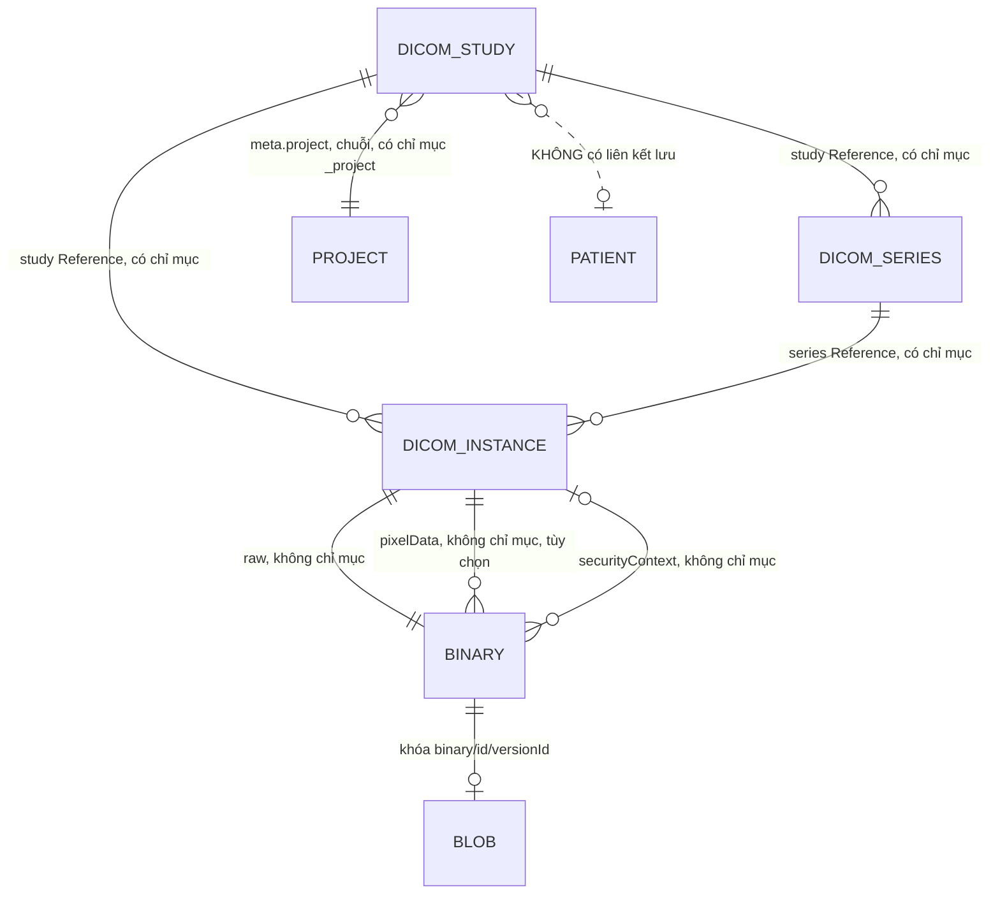
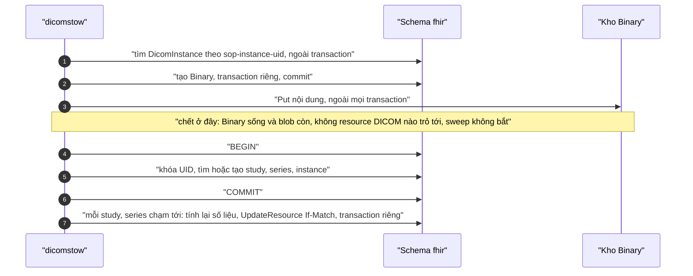
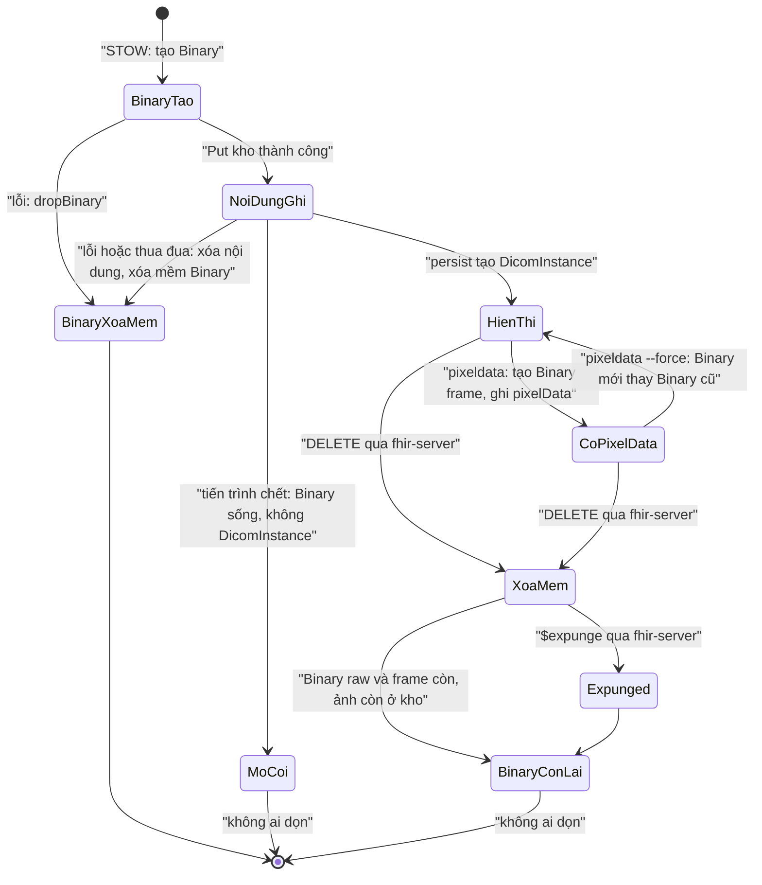

# 3. Quan hệ và toàn vẹn dữ liệu

**Không có khóa ngoại nào** trong schema `fhir` và **không có ràng buộc duy nhất** trên UID DICOM. Mọi quan hệ của ảnh DICOM là *logic*: `Reference` trong JSON (kèm chỉ mục `fhir_idx_reference` cho `study` và `series`), con trỏ `raw`/`pixelData` tới `Binary` (không có chỉ mục), và chuỗi `meta.project`. Toàn vẹn do **mã `pkg/dicomstow`, một transaction chỉ bao ba resource DICOM, và `If-Match`** giữ; `Binary` và nội dung ở kho nằm **ngoài** transaction đó.

## 3.1 Sơ đồ logic

Cây `study ⊃ series ⊃ instance` lưu **cả hai chiều lên trên** ở instance (`study` và `series`), nên "mọi instance của một study" truy vấn được bằng chỉ mục. Chiều **xuống** từ study và series chỉ có nhờ truy vấn ngược (`DicomSeries?study=...`). Đường chấm là *thiếu*: không có liên kết tới `Patient` hay `ImagingStudy`.

## 3.2 Bảng quan hệ

Cột **Toàn vẹn** nêu *ai kiểm và ở đâu*; "không ai" nghĩa là không có kiểm nào trong mã đã đọc. **Khi xóa phía "đến"**: không có `ON DELETE`; cột nêu hành vi thực tế.

| Từ | Đến | Bản số | Cách nối | Bắt buộc | Toàn vẹn | Khi xóa phía "đến" | Bằng chứng |
|---|---|---|---|---|---|---|---|
| `DicomSeries.study` | `DicomStudy` | n-1 | `Reference` `DicomStudy/<id>` + chỉ mục `study` | có (trường bắt buộc) | `persist` tìm hoặc tạo study **trước** series, cùng transaction và khóa UID | study xóa mềm: series và instance **còn nguyên**, trỏ vào tombstone (xem 3.4 về hệ quả QIDO) | `pkg/dicomstow/stow.go` (`persist`) |
| `DicomInstance.study` | `DicomStudy` | n-1 | như trên | có | như trên | như trên | như trên |
| `DicomInstance.series` | `DicomSeries` | n-1 | `Reference` `DicomSeries/<id>` + chỉ mục `series` | có | như trên | như trên | như trên |
| `DicomInstance.raw` | `Binary` | 1-1 | `Reference` `Binary/<id>`, **không chỉ mục** | có | Binary tạo **trước** và ghi nội dung **trước** khi tạo instance; lỗi ở bất cứ bước nào thì xóa nội dung rồi **xóa mềm** Binary (`dropBinary`) | Binary xóa mềm hoặc Expunge: đọc nội dung trả `404 Instance has no stored content`; instance vẫn còn | `stow.go` (`storeOne`), `pkg/dicomretrieve/download.go` (`rawKey`) |
| `DicomInstance.pixelData[]` | `Binary` | 1-n (một mỗi frame) | `Reference[]` | không | tạo tất cả Binary frame trước, ghi `pixelData` sau bằng `If-Match`; lỗi giữa chừng thì xóa các Binary đã tạo | Binary frame xóa: WADO không bị ảnh hưởng (không dùng); client đọc `pixelData` qua API FHIR nhận lỗi | `pkg/dicomretrieve/pixeldata.go` (`BuildPixelData`) |
| `Binary.securityContext` | `DicomInstance` | n-1 | `Reference` `DicomInstance/<id>`, **không chỉ mục** | không | đặt lúc tạo, **trước khi instance tồn tại** (id instance sinh sẵn `instanceID`); nếu instance không được tạo thì trỏ vào chỗ trống | instance xóa mềm: `GET Binary/{id}` ở `fhir-server` bị từ chối (410 khi kiểm `securityContext`); nội dung vẫn ở kho | `stow.go`, `pkg/fhirbinary/access.go` (`canReadSecurityContext`) |
| `Binary` | blob ở kho | 1-1 | khóa `binary/<id>/<versionId>`, `versionId` của **phiên bản đầu** | có (dicomweb luôn dùng kho) | thứ tự CSDL trước, kho sau (versionId do CSDL cấp); bù trừ khi lỗi; **không có transaction chung** | Binary Expunge ở `fhir-server`: nội dung bị xóa (lớp `Wrap`); **xóa mềm: nội dung giữ nguyên** | `pkg/fhirbinary/wrap.go`, `pkg/binarystore` |
| mọi resource `.meta.project` | `Project` (của `auth`) | n-1 | chuỗi id, **chỉ mục token `_project`** (đã đo) | có (không có project thì `403`) | `fhirauth.Scope` ghi đè bằng project của token lúc ghi; mọi đọc, tìm, sửa, xóa đều thêm điều kiện project | `Project` bị xóa ở `auth`: dữ liệu ảnh **còn nguyên**, không ai dọn | `pkg/fhirauth/scope.go` |
| `DicomStudy.patientId` | `Patient` | n-1 (nếu có) | **không có tham chiếu**: chỉ cùng giá trị chuỗi tên/mã | không | **không ai** | Xóa hay sửa `Patient`: study không biết | đã grep `Patient` trong `pkg/dicomstow`, `pkg/dicomretrieve`, `pkg/dicomweb`: không có |

## 3.3 Luật toàn vẹn và đồng thời

| Luật | Cơ chế | Bằng chứng |
|---|---|---|
| Một `SOPInstanceUID` trong một project chỉ có một `DicomInstance` | **Không có ràng buộc duy nhất ở CSDL**: `storeOne` tìm theo `sop-instance-uid` (khớp chính xác) rồi `persist` tìm lại **trong transaction, sau khi giữ khóa** `dicomweb|instance|<uid>` (advisory lock PostgreSQL, thêm tiền tố project) | `stow.go` (`persist`), `pkg/fhirauth/scope.go` (`LockKey`); test `TestConcurrentUploadsDoNotDuplicate`, `TestReuploadIsIdempotent` |
| Hai yêu cầu song song cùng instance | cả hai tạo `Binary` và ghi nội dung (vì kiểm "đã có" ở bước 3 nằm **ngoài** khóa); chỉ một thắng ở `persist`, bên thua gọi `dropBinary` (xóa nội dung, **xóa mềm** Binary) | `stow.go` (`if !created { s.dropBinary }`) |
| Study, series không bị trùng khi tải song song | khóa `dicomweb|study|<uid>` rồi `dicomweb|series|<uid>` rồi `dicomweb|instance|<uid>`, thứ tự cố định nên không bế tắc | `stow.go` |
| **Khóa không làm gì trên SQLite** | `LockKey` ở SQLite chỉ chạy một câu `DELETE ... WHERE 1 = 0` để nâng khóa ghi; ngoài transaction thì bỏ qua | `pkg/fhirstore/store.go` |
| Số liệu tổng hợp đúng khi tải lại, thử lại | tính lại **từ dữ liệu đang lưu** (đếm series và instance), không cộng dồn; ghi bằng `If-Match`, thử tối đa 3 lần, đọc lại khi `412` | `stow.go` (`updateStudy`, `updateSeries`) |
| Số liệu tổng hợp có thể lệch | lỗi cập nhật chỉ **ghi log** (instance đã lưu); lần STOW sau mới tính lại. Instance tải tới mà `updateStudy` hết 3 lần thử thì `numberOfStudyRelatedInstances` sai cho tới lần sau (chưa tái hiện bằng test) | `stow.go` (`updateAggregates`) |
| `pixelData` không ghi đè mù | `BuildPixelData` ghi bằng `If-Match` theo phiên bản đã đọc; thua thì dọn Binary đã tạo rồi báo lỗi | `pixeldata.go` |
| Chỉ mục frame không ghi đè mù | `Reindex` ghi bằng `If-Match`; thua thì tính là `Failed`, chạy lại | `reindex.go` |
| Instance chỉ hiện với người khác khi nội dung đã đủ | `DicomInstance` tạo **sau cùng**; kiểm tệp không bị cắt trước đó | `stow.go` (`truncated`) |

**Kẽ hở (suy từ mã, chưa tái hiện bằng test, trừ khi ghi "đã đo"):**

1. **Cùng `SeriesInstanceUID` đến với `StudyInstanceUID` khác** (file hỏng hoặc cố ý): `persist` tìm series chỉ theo `series-instance-uid`, **không so khớp study của series**; instance mới được ghi với `study` của study theo header và `series` của series đã có (thuộc study khác). Kết quả: instance trỏ chéo giữa hai study. Cũng áp dụng cho study: UID trùng giữa hai bệnh nhân khác nhau gộp vào một study (không so tên bệnh nhân).
2. **Trường nhân khẩu của study đóng băng theo instance đầu tiên**: instance sau cùng study mang tên hay mã bệnh nhân khác bị nhận mà không báo, study giữ giá trị đầu. QIDO cấp study trả giá trị đầu; metadata cấp instance trả giá trị riêng của từng instance.
3. **Kiểm "đã có" nằm ngoài khóa** (mục 3.3): tải song song cùng instance tạo Binary và ghi nội dung hai lần, một bản bị bỏ. Hao phí băng thông, không sai dữ liệu; mỗi bản thua để lại **một Binary xóa mềm** (2 dòng `fhir_history`) trong CSDL.
4. **Không có ràng buộc ở CSDL**: ghi bằng SQL tay hoặc qua `fhir-server` (`POST /DicomInstance` với UID trùng) tạo trùng UID mà không ai chặn. `fhir-server` có thể tạo, sửa, xóa các loại `Dicom*` như resource thường, **bỏ qua mọi luật của STOW** (số liệu tổng hợp, quan hệ, nội dung).

## 3.4 Xóa: xóa mềm và Expunge, ai xóa vĩnh viễn

**Trả lời thẳng:** **không ai trong dicomweb xóa vĩnh viễn thứ gì của ảnh DICOM.** Đã grep `Expunge` và `DeleteResource` trong `pkg/dicomstow`, `pkg/dicomretrieve`, `pkg/dicomweb`, `apps/dicomweb`: không có `Expunge`; chỉ có `DeleteResource` (xóa mềm) trên `Binary` trong các đường **bù trừ lỗi** (`dropBinary`, `dropFrameBinary`). dicomweb **không có API xóa** (không route `DELETE`; architecture ghi "xóa instance" là chưa có). Xóa duy nhất là qua `fhir-server`: `DELETE /fhir/R4/<Loại>/<id>` (xóa mềm) hoặc `POST /fhir/R4/<Loại>/<id>/$expunge` (quản trị, cần quyền xóa trên loại đó, không dùng được với chính sách truy cập, từng resource một, không cascade; `fhirauth.Scope.Expunge`).

**Đã đo** (SQLite và kho `file:`, 2026-11-24, dùng `dicomstow.Store` thật với 5 instance và `pixeldata`; sweep là `fhirbinary.Sweep` giả lập +48 giờ ở chế độ dry-run, là cùng hàm `fhir-server sweep-binary` gọi):

| Thao tác | Dòng `fhir_resource` | `fhir_history` | `fhir_idx_*` | Nội dung ở kho | Binary `raw` và `pixelData` |
|---|---|---|---|---|---|
| Xóa mềm một `DicomInstance` (qua `Scope.DeleteResource`) | thành tombstone `{"resourceType":"DicomInstance"}` với `deleted=true` | **thêm** bản `DELETE`; **các bản cũ giữ nguyên, kể cả bản `POST` chứa `metadata` đầy đủ** (đã kiểm: còn `00100010`) | xóa hết dòng của instance | **không đổi** (10 tệp trước, 10 tệp sau) | **không đổi**; đọc `Binary` raw theo id vẫn được ở mức kho; qua API `fhir-server` thì bị chặn bởi `securityContext` (410) |
| `Expunge` một `DicomInstance` (ở mức `fhirstore`) | xóa hẳn dòng | xóa hẳn mọi bản | xóa | **không đổi** | **không đổi**: `Binary` raw vẫn đọc được (đã đo: `ReadResource` trả `nil` lỗi) |
| Xóa mềm một `Binary` (frame) | tombstone | thêm `DELETE`, bản cũ còn | xóa | **không đổi** | blob còn |
| `sweep-binary` (dry-run +48 giờ) sau cả ba thao tác trên và một Binary mồ côi giả lập (Binary + blob, **không có** `DicomInstance`) | | | | **0 mồ côi, 11 khóa "còn dùng"**, không khóa nào bị xóa | |

**Vì sao `sweep-binary` không dọn được:** `fhirbinary.Sweep` chỉ xóa khóa mà `ReadVersion("Binary", id, versionId)` trả `404`. Ở dicomweb **Binary luôn tạo trước nội dung** nên mọi khóa luôn có dòng `Binary` (còn sống hoặc xóa mềm, cả hai đều tính là "còn dùng": `410 Gone` được xếp vào `Live`). `sweep-binary` chỉ bắt được trường hợp ngược (có khóa ở kho mà **không** có dòng Binary), vốn **không xảy ra** trong dicomweb. Vì vậy khẳng định "`fhir-server sweep-binary` quét nội dung mồ côi" ở [../architecture.md](../architecture.md) (mục STOW-RS) và [../business/05-luat-va-phan-quyen.md](../business/05-luat-va-phan-quyen.md) (BR-09) **không đúng cho các trường hợp của dicomweb** (xem README, mục Lệch).

### Dữ liệu ảnh còn lại ở kho sau khi xóa resource

| Hành động | Ảnh DICOM nguyên văn (PHI, S3) còn ở kho? | PHI còn ở PostgreSQL? |
|---|---|---|
| Xóa mềm `DicomInstance`, `DicomSeries` hoặc `DicomStudy` (API chung) | **Còn** (Binary không đụng tới) | `fhir_history` giữ mọi bản cũ; `DicomInstance.metadata`, tên và mã bệnh nhân ở `DicomStudy` |
| `$expunge` `DicomInstance` | **Còn**, và `Binary` raw **cũng còn nguyên dòng** (mồ côi thật: không `DicomInstance` nào trỏ tới, không `sweep` nào bắt) | xóa hết (resource đó); `Binary` còn (không PHI trong dòng, chỉ `securityContext`) |
| Xóa mềm `Binary` raw của instance | **Còn** (Wrap không xóa nội dung khi xóa mềm; `jobs_maint.go` ghi rõ "xóa mềm giữ nguyên nội dung") | `Binary` tombstone và lịch sử (không PHI) |
| `$expunge` `Binary` raw (qua `fhir-server`, có `Wrap`) | **Xóa** (Wrap xóa nội dung mọi phiên bản sau commit) | xóa dòng; `DicomInstance` vẫn trỏ tới Binary không còn: WADO trả 404 "Instance has no stored content" |
| Lỗi giữa chừng lúc STOW (bù trừ trong dicomweb) | **Xóa** nếu `Blobs.Delete` thành công; nếu lỗi chỉ ghi log `không xóa được nội dung` và **blob ở lại vĩnh viễn** (Binary đã xóa mềm = "còn dùng" với sweep) | Binary tombstone + 2 dòng `fhir_history` |
| Xóa project ở `auth` | **Còn** | **Còn** |

**Để xóa một study cho thật** (ví dụ yêu cầu xóa dữ liệu bệnh nhân) phải làm thủ công và nhiều bước, **không có công cụ nào làm trọn**: `$expunge` từng `DicomInstance`, từng `DicomSeries`, `DicomStudy`, **và** từng `Binary` raw (và từng Binary frame nếu có `pixelData`, mỗi cái một lệnh) bằng `fhir-server`; muốn lấy được id Binary thì phải đọc `DicomInstance.raw` **trước** khi expunge instance. Thứ tự sai (expunge instance trước, quên ghi lại id Binary) để lại ảnh gốc ở kho **không ai tìm được qua API**, chỉ còn cách liệt kê kho. (Suy từ mã và số đo trên; chưa thử một quy trình xóa end-to-end.)

### Hệ quả khác của xóa mềm resource cha

Xóa mềm `DicomStudy` mà **không** xóa series (xóa không cascade): QIDO cấp study không thấy nó (chỉ mục bị xóa) nhưng QIDO cấp series theo `study` vẫn tìm thấy series (chỉ mục `study` của series còn) rồi `ReadResource("DicomStudy", id)` trả `410`, và `Search` ở cấp series đổi lỗi này thành **500** (`internalErr "đọc study của series"`, `pkg/dicomretrieve/search.go`). Suy từ mã, chưa chạy.

## 3.5 Transaction và đường ghi

- Ba resource DICOM nằm trong **một** transaction (`fhirrouter.Transactional.RunInTransaction`); `Binary`, nội dung ở kho và số liệu tổng hợp **mỗi thứ một bước riêng**.
- Mỗi `CreateResource`/`UpdateResource` bên trong lại ghi `fhir_resource` + `fhir_history` + ghi lại `fhir_idx_*` ([đường ghi chung](../../../../docs/erd/fhirstore-physical.md)).
- Nếu repo không hỗ trợ transaction, `persist` chạy tuần tự không transaction (`if tx, ok := ...; ok`); với `fhirauth.Scope(fhirstore)` ở production là có.

## 3.6 Ràng buộc nghiệp vụ không có ở mức cơ sở dữ liệu

| Ràng buộc | Ai giữ | Kẽ hở |
|---|---|---|
| UID hợp lệ: chỉ số và dấu chấm, tối đa 64 ký tự | `storeOne` (`uidPattern`) kiểm 4 UID trước khi ghi | ghi qua `fhir-server` không kiểm |
| Instance thuộc study của đường dẫn `POST /studies/{uid}` | `storeOne` (`ReasonDataSetMismatch` 0xA900) | chỉ ở đường STOW |
| Kích thước instance, header, yêu cầu | `DICOMWEB_MAX_INSTANCE_BYTES`, `DICOMWEB_MAX_HEADER_BYTES`, `DICOMWEB_MAX_REQUEST_BYTES` | |
| Cô lập project | `fhirauth.Scope` (ghi đè `meta.project`, thêm điều kiện `_project`) | ghi trước khi bật tách project không có `meta.project` nên không ai thấy; `reindex` và `pixeldata` ở CLI dùng kho **chưa tách project** (duyệt mọi project) |
| Quyền đọc/ghi theo loại (`Dicom*`, `Binary`) | `fhirauth.Scope` với scope SMART của token (Q-D1) | |
| Quan hệ study, series, instance nhất quán | không ai kiểm chéo (mục 3.3, kẽ hở 1) | |

## 3.7 Vòng đời của một DicomInstance

## 3.8 Dọn dẹp và tăng trưởng

| Thứ | Dọn bởi | Ghi chú |
|---|---|---|
| `fhir_history` của `Dicom*` | **không ai** | chỉ Expunge; tăng theo số yêu cầu STOW (study, series) và số lần `pixeldata`, `reindex` (instance) |
| Binary mồ côi do chết giữa STOW | **không ai** (`sweep-binary` không bắt: mục 3.4) | để lại dòng Binary sống có `securityContext` trỏ vào instance không tồn tại, và blob; muốn phát hiện phải liệt kê `Binary` và so với `DicomInstance` (không có công cụ, không có chỉ mục `securityContext`) |
| Tệp tạm của STOW dạng metadata | `os.MkdirTemp` trong `TMPDIR`, xóa khi xong kể cả lỗi (`pkg/dicomstow/metadata.go`) | tiến trình bị kill giữa chừng để lại thư mục tạm (chưa kiểm có dọn khi khởi động) |
| Hàng đợi `pixelData` | mất khi tiến trình tắt | `dicomweb pixeldata` quét bù |
| Dữ liệu của project đã xóa | **không ai** | |
