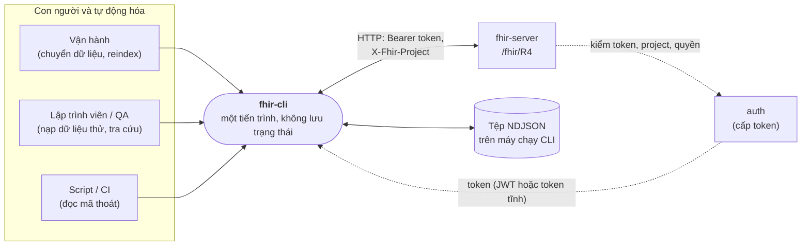
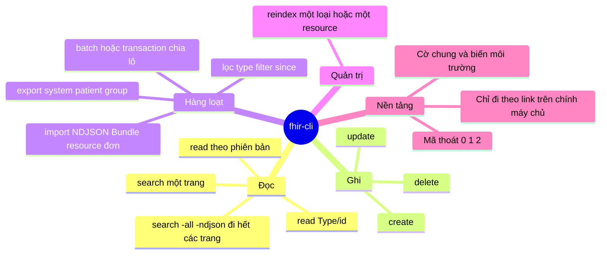
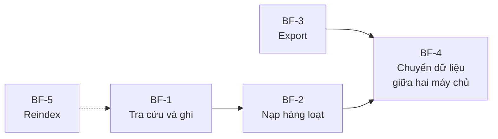
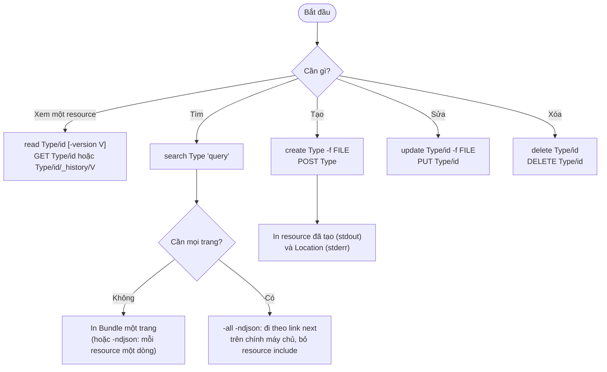
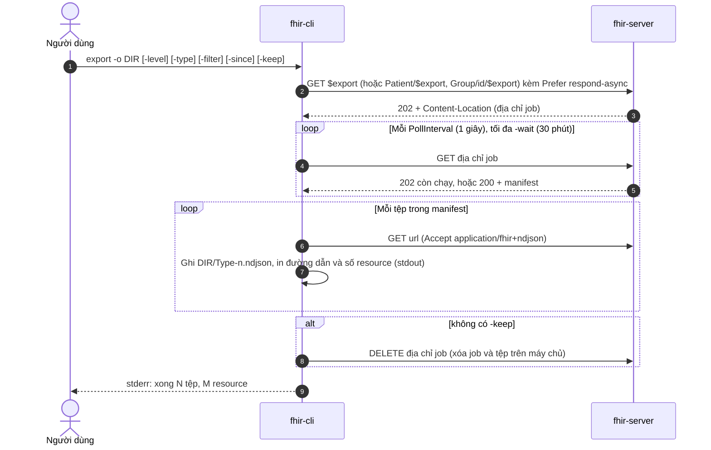
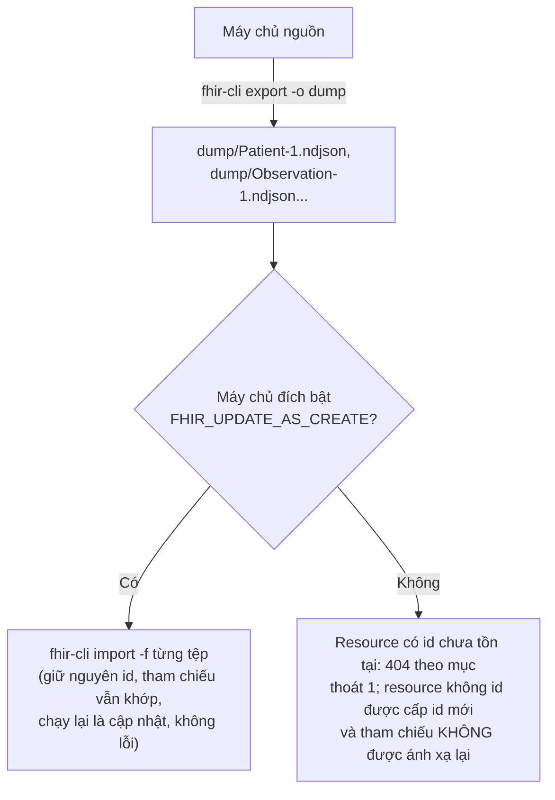
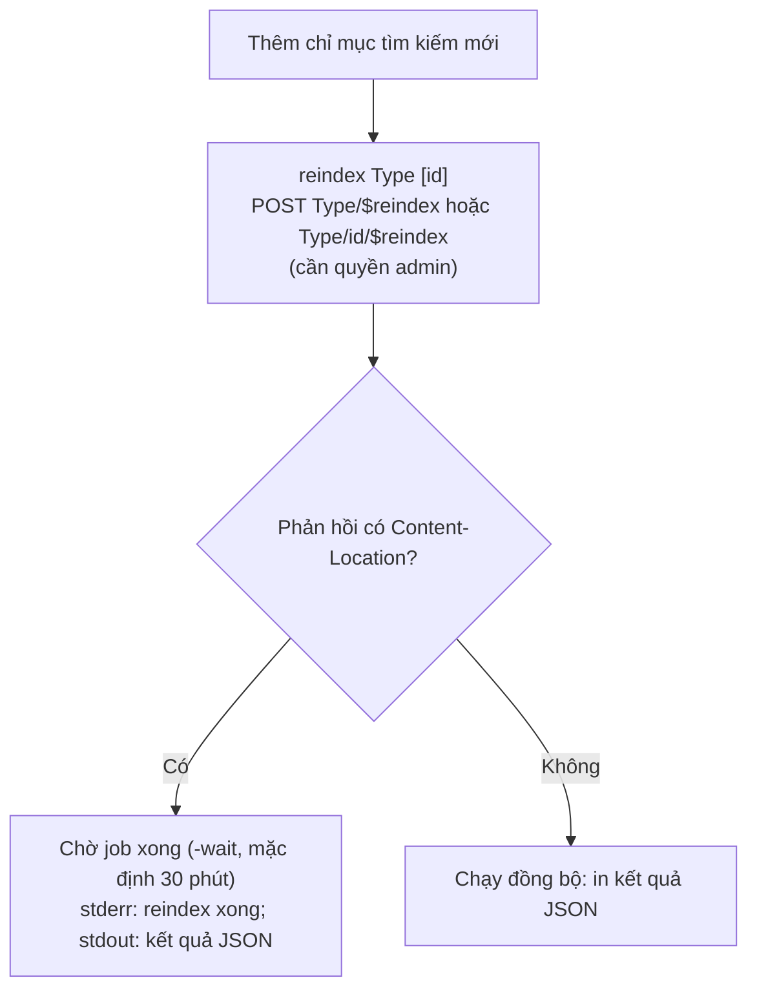

# 1. Tổng quan và luồng nghiệp vụ

## 1.1 Mục tiêu và giá trị

`fhir-cli` cho người vận hành và lập trình viên thao tác với `fhir-server` từ terminal hoặc script mà **không cần viết mã HTTP**: đọc, tìm, ghi, xóa, nạp hàng loạt, xuất hàng loạt và lập lại chỉ mục.

| Giá trị | Cách đạt được |
|---|---|
| Nạp dữ liệu thử và di chuyển dữ liệu nhanh | `import` nhận NDJSON, một resource hoặc Bundle, chia lô, báo lỗi theo từng mục |
| Di chuyển dữ liệu giữa môi trường | `export` rồi `import`; giữ nguyên `id` khi máy chủ đích bật `FHIR_UPDATE_AS_CREATE=true` |
| Tự động hóa | Dữ liệu ra `stdout`, thông báo ra `stderr`, mã thoát ổn định (0, 1, 2), cấu hình bằng biến môi trường |
| An toàn thông tin xác thực | Chỉ đi theo link trên chính máy chủ trong `-base`; không bao giờ gửi token tới host khác |
| Không phụ thuộc | Chỉ thư viện chuẩn của Go, chỉ nói chuyện qua HTTP API của `fhir-server` |

## 1.2 Ranh giới hệ thống



**Làm:** `read`, `search`, `create`, `update`, `delete`, `import`, `export`, `reindex`, chọn máy chủ và project bằng cờ hoặc biến môi trường.
**Không làm:** websocket subscription, `$validate`, terminology, quản trị project; không tự đăng nhập hay xin token (token do người dùng cấp sẵn); không lưu trạng thái giữa các lần chạy; không ánh xạ lại tham chiếu giữa các resource khi `id` thay đổi; không có image Docker (công cụ dòng lệnh, `make build APP=fhir-cli` ra `bin/fhir-cli`).

## 1.3 Tác nhân

| Mã | Tác nhân | Là ai | Việc chính |
|---|---|---|---|
| A1 | **Vận hành** | SRE / DevOps | Chuyển dữ liệu giữa môi trường (export, import), `reindex` sau khi thêm chỉ mục |
| A2 | **Lập trình viên / QA** | Dev, tester | Nạp dữ liệu thử, tra cứu và sửa tay một resource |
| A3 | **Script / CI** | Tiến trình tự động | Gọi lệnh, quyết định theo mã thoát và `stdout` |
| A4 | **fhir-server** | Máy chủ đích | Thi hành lệnh qua API FHIR; kiểm token và quyền; chạy job nền (export, reindex) |
| A5 | **auth** | Dịch vụ danh tính | Cấp token mà CLI gửi đi (CLI không gọi `auth`) |

## 1.4 Bản đồ năng lực



## 1.5 Thuật ngữ

| Thuật ngữ | Nghĩa |
|---|---|
| **FHIR R4 / resource** | Chuẩn dữ liệu y tế; một resource là một bản ghi JSON có `resourceType` và `id` |
| **Bundle** | Gói nhiều resource; `batch` (mỗi mục độc lập) hoặc `transaction` (tất cả hoặc không) |
| **NDJSON** | Mỗi dòng một đối tượng JSON; định dạng của `import` và của tệp export |
| **Bulk export (`$export`)** | Job nền của máy chủ gom dữ liệu thành các tệp NDJSON; CLI tạo job, chờ, tải về |
| **`Prefer: respond-async`** | Header yêu cầu máy chủ chạy bất đồng bộ: trả `202` và `Content-Location` là địa chỉ hỏi trạng thái |
| **Update-as-create** | Máy chủ cho phép `PUT Type/id` tạo mới khi `id` chưa có (cấu hình `FHIR_UPDATE_AS_CREATE`) |
| **Reindex (`$reindex`)** | Lập lại chỉ mục tìm kiếm cho một loại hoặc một resource; cần quyền admin |
| **Project** | Tổ chức/không gian dữ liệu; token super-admin chọn project bằng header `X-Fhir-Project` |
| **Lô (chunk)** | Nhóm tối đa `-size` resource (mặc định 100) gửi trong một Bundle |

---

## 1.6 Các luồng nghiệp vụ



### BF-1. Tra cứu và ghi một resource

**Mục tiêu:** xem hoặc sửa nhanh một resource, hoặc lấy ra tất cả resource khớp một tiêu chí.


**Kết quả:** JSON ra `stdout`. **Chức năng:** F-01..F-04, F-08, F-09.

### BF-2. Nạp hàng loạt

**Mục tiêu:** đưa nhiều resource vào máy chủ, biết chính xác mục nào lỗi.

```mermaid
sequenceDiagram
    autonumber
    actor V as Người dùng
    participant C as fhir-cli
    participant S as fhir-server
    V->>C: import -f data.ndjson [-mode] [-size]
    C->>C: Đọc toàn bộ đầu vào, nhận dạng: Bundle, resource đơn, hoặc NDJSON
    loop Mỗi lô tối đa size resource
        C->>C: Mỗi resource có id: PUT Type/id; không id: POST Type
        C->>S: POST Bundle (type batch hoặc transaction)
        alt batch
            S-->>C: Bundle phản hồi, mỗi mục một status
            C->>C: Đếm mục 2xx là ok, còn lại là lỗi (in mục N (Type/id): status: diagnostics)
        else transaction và có mục lỗi
            S-->>C: Lỗi cả lô, lô được hoàn tác
            C-->>V: Dừng ngay: gửi Bundle (mục a-b): lỗi. Các lô sau không được gửi
        end
    end
    C-->>V: stdout: đã nạp X, lỗi Y, tổng Z (thoát 1 nếu Y lớn hơn 0)
```

**Kết quả:** `đã nạp X, lỗi Y, tổng Z` ở `stdout`; mã thoát `1` nếu có mục lỗi. **Điều BA cần biết:** (1) `id` có sẵn nhưng chưa tồn tại ở đích sẽ lỗi `404` theo mục nếu đích không bật `FHIR_UPDATE_AS_CREATE`; (2) `transaction` là tất cả hoặc không **theo từng lô**, không theo cả tệp (xem lệch số 1 ở README); (3) tham chiếu giữa các resource **không** được ánh xạ lại khi đích cấp `id` mới. **Chức năng:** F-05, F-08.

### BF-3. Export

**Mục tiêu:** lấy toàn bộ hoặc một phần dữ liệu về tệp NDJSON.



**Kết quả:** các tệp `DIR/<Type>-<n>.ndjson`. **Điều BA cần biết:** nếu dọn job thất bại thì chỉ cảnh báo, vẫn thoát 0; nếu lỗi **giữa chừng khi đang tải** thì tệp đã ghi còn nguyên và job **không** bị xóa (còn trên máy chủ tới khi hết `FHIR_EXPORT_RETENTION`, mặc định 24 giờ theo runbook). **Chức năng:** F-06.

### BF-4. Chuyển dữ liệu giữa hai máy chủ


**Thứ tự nạp:** nạp loại được tham chiếu trước (ví dụ `Patient`) rồi loại tham chiếu tới nó (`Observation`); với `FHIR_UPDATE_AS_CREATE` bật, tham chiếu `Patient/<id>` giữ nguyên nên kiểm bằng `search Observation subject=Patient/<id>`. Theo runbook: đây là **xuất logic**, không thay thế sao lưu. **Chức năng:** F-05, F-06.

### BF-5. Reindex


**Chức năng:** F-07.

## 1.7 Bảng sự kiện → hiệu lực

| Sự kiện | Hiệu lực |
|---|---|
| Người dùng nhấn Ctrl+C hoặc tiến trình nhận SIGTERM | Yêu cầu HTTP đang chạy bị hủy, lệnh thoát `1`; job export đã tạo **còn trên máy chủ** |
| Token hết hạn hoặc sai | `HTTP 401: ...` ở `stderr`, thoát `1`, không ghi gì |
| Máy chủ đích bật hạn mức | `HTTP 429` theo từng yêu cầu; CLI không tự thử lại |
| Một lô `import` lỗi toàn bộ (transaction) | Dừng; lô đã gửi trước đó vẫn được ghi |
| Tải tệp export quá `-timeout` (60s) | Yêu cầu bị hủy, lệnh thoát `1`, job còn trên máy chủ |
