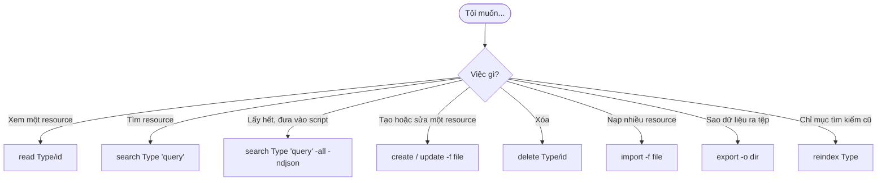
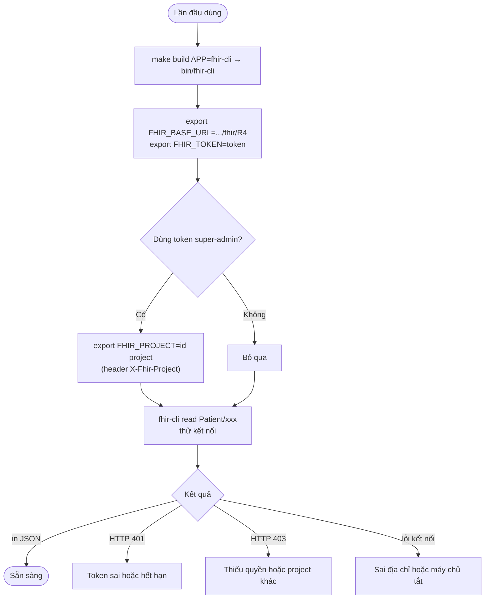
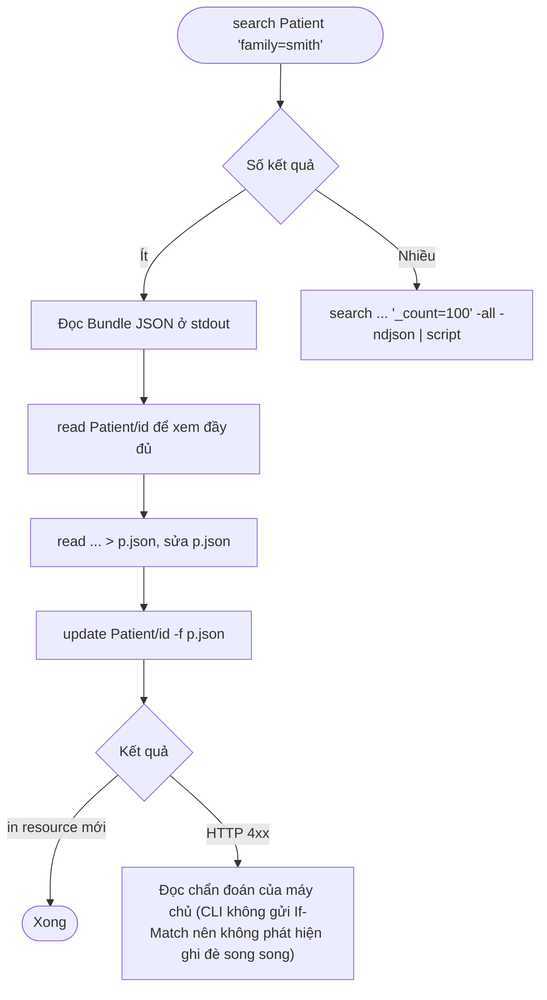
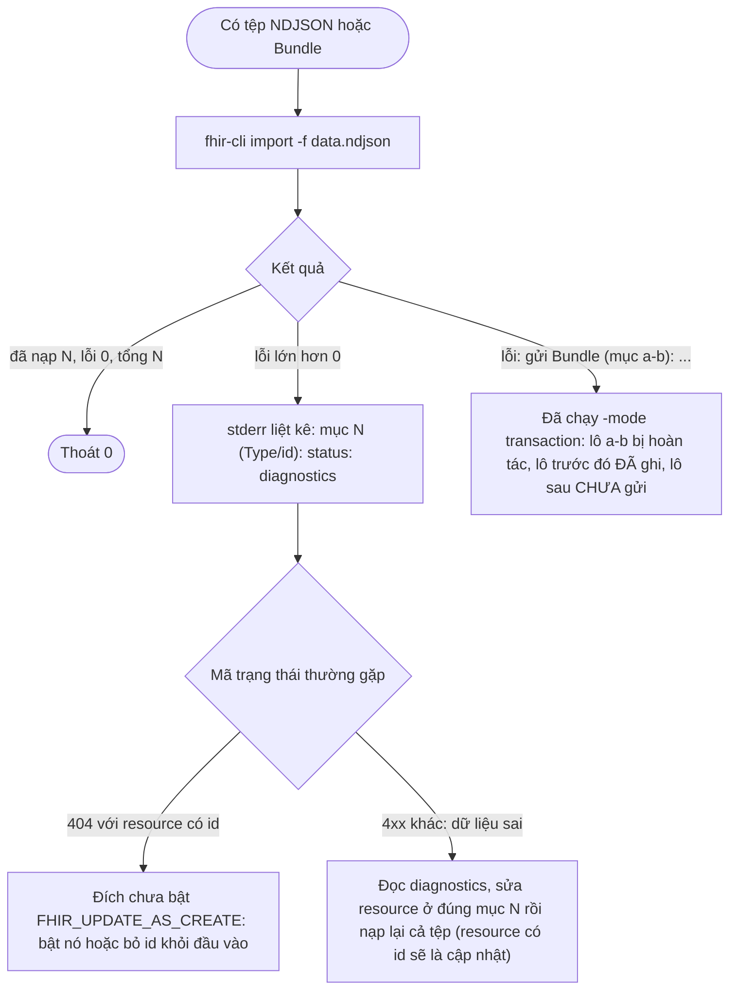
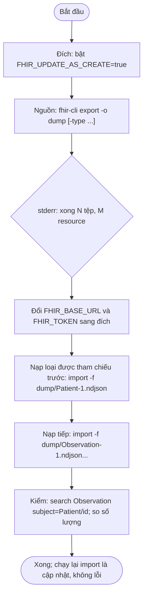

# 2. Luồng người dùng

Giao diện là dòng lệnh: "màn hình" là terminal. Mỗi luồng ghi **lệnh gõ → điều thấy ở `stdout`/`stderr` → mã thoát → việc cần làm tiếp**. Mã F-xx ở [03-chuc-nang.md](03-chuc-nang.md).

## 2.1 Quy ước đầu ra (để viết script)

| Luồng | Nội dung | Ví dụ |
|---|---|---|
| `stdout` | **Dữ liệu**: JSON (đã định dạng, thụt 2 khoảng trắng), NDJSON (`search -ndjson`), dòng tổng kết của `import`, danh sách tệp của `export` | `đã nạp 3, lỗi 0, tổng 3` |
| `stderr` | **Thông báo và lỗi**: `lỗi: ...`, tiến độ (`đã tạo job export, đang chờ...`), `Location: ...`, `đã xóa Patient/1`, `reindex xong`, cảnh báo | `lỗi: HTTP 404: ...` |
| Mã thoát | `0` thành công; `1` lỗi (máy chủ, I/O, dữ liệu sai, mục `import` lỗi); `2` sai cách dùng hoặc cấu hình sai | xem bảng dưới |

Script nên đọc `stdout` để lấy dữ liệu, kiểm mã thoát, và chỉ ghi `stderr` vào log.

## 2.2 Mã thoát và việc cần làm

| Mã | Khi nào | Thông điệp tiêu biểu (`stderr`) | Việc cần làm |
|---|---|---|---|
| 0 | Thành công; `help` | | |
| 0 | `export` xong nhưng không dọn được job | `cảnh báo: không dọn được job trên máy chủ: ...` | Dữ liệu đã đủ; xóa job tay hoặc để máy chủ tự dọn theo `FHIR_EXPORT_RETENTION` |
| 1 | Máy chủ trả lỗi | `lỗi: HTTP <mã>: <chẩn đoán>` | Đọc chẩn đoán: 401 token, 403 quyền, 404 không có, 4xx dữ liệu sai |
| 1 | Đầu vào hỏng | `lỗi: dòng N không phải JSON hợp lệ`, `lỗi: đầu vào rỗng`, `lỗi: đầu vào phải là resource hoặc Bundle có resourceType`, `lỗi: nội dung không phải JSON hợp lệ` | Sửa tệp đầu vào |
| 1 | `import` có mục lỗi | `mục N (Type/id): <status>: <diagnostics>` rồi `lỗi: K resource không nạp được` | Sửa các mục đã liệt kê; mục tốt đã được nạp (batch) |
| 1 | Hết thời gian chờ job | `lỗi: hết thời gian chờ job (30m0s)` | Tăng `-wait`, kiểm job trên máy chủ |
| 1 | Không kết nối được, hủy bằng Ctrl+C, hết `-timeout` | lỗi của Go (`context canceled`, `Client.Timeout exceeded`...) | Kiểm mạng, địa chỉ; tăng `-timeout` cho tệp lớn |
| 2 | Sai cách dùng | `lỗi: cách dùng: ...`, `lệnh không biết: "x"` | Xem `fhir-cli help` |
| 2 | URL gốc sai | `lỗi: URL gốc không hợp lệ: "x" (cần dạng http://host:port/fhir/R4)` | Sửa `-base` hoặc `FHIR_BASE_URL` |
| 2 | Không có lệnh | in trợ giúp | |

## 2.3 Chọn lệnh

## 2.4 Thiết lập ban đầu (mọi người dùng)

Thứ tự ưu tiên cấu hình: **cờ** (`-base`, `-token`, `-project`, `-timeout`) thắng **biến môi trường** (`FHIR_BASE_URL`, `FHIR_TOKEN`, `FHIR_PROJECT`); `-base` mặc định `http://localhost:8005/fhir/R4`. Cờ chung phải đứng **trước** tên lệnh.

## 2.5 Tra cứu và sửa tay (A2)

Lưu ý: `-all` **bắt buộc đi kèm `-ndjson`** (`lỗi: -all cần -ndjson (mỗi trang là một Bundle riêng)`, mã `2`); kiểm tra này xảy ra **sau** yêu cầu đầu tiên. `create` nhận *tên loại* (`create Patient`), `update` nhận `Type/id`; truyền `-f -` để đọc `stdin`.

## 2.6 Nạp hàng loạt (A1, A2)

**Lời khuyên:** muốn "tất cả hoặc không" cho cả tệp, đặt `-size` lớn hơn số resource với `-mode transaction`. Muốn nạp tối đa dù có lỗi, dùng `-mode batch` (mặc định).

## 2.7 Chuyển dữ liệu giữa hai máy chủ (A1)

Mỗi loại có thể có nhiều tệp (`Patient-1.ndjson`, `Patient-2.ndjson`...): nạp **hết** các tệp. Đây là xuất logic, không thay thế sao lưu.

## 2.8 Export có sự cố (A1)

| Triệu chứng | Nguyên nhân | Việc cần làm |
|---|---|---|
| `lỗi: máy chủ không bắt đầu job export (HTTP <mã>)` | Máy chủ không trả `202` kèm `Content-Location` (suy từ mã, chưa có test) | Kiểm phiên bản và cấu hình máy chủ |
| `lỗi: HTTP 404: ...` ngay khi bắt đầu | `-level group/<id>` với Group không tồn tại | Kiểm id Group |
| `lỗi: hết thời gian chờ job (...)` | Job quá lâu | Tăng `-wait`; job vẫn chạy trên máy chủ |
| `lỗi: tải <url>: ...` giữa chừng | Mạng, token hết hạn, quá `-timeout` | Tệp đã ghi còn nguyên; job **chưa** bị xóa; chạy lại (job mới) hoặc xóa job cũ |
| `lỗi: manifest có tên loại không hợp lệ: "..."` | Manifest có tên loại chứa `/`, `\` hoặc `..` | Chặn có chủ đích (tránh ghi ra ngoài thư mục đích); báo quản trị máy chủ |
| `lỗi: HTTP <mã>: ... _typeFilter` | `-filter` thiếu dạng `Type?query` (máy chủ từ chối, test chỉ kiểm mã thoát 1 và chuỗi `_typeFilter`) | Dùng đúng `-filter "Patient?active=true"` |

## 2.9 Reindex (A1)

Sau khi thêm chỉ mục: `fhir-cli reindex Observation` (cả loại) hoặc `fhir-cli reindex Observation <id>` (một resource); **không** nhận dạng `Observation/<id>` (`lỗi: cách dùng: reindex Type [id]`, mã `2`). Cần token có quyền admin, không thì `HTTP 403`. Thấy `reindex xong` ở `stderr` và kết quả JSON ở `stdout`.
