# 4. Luật nghiệp vụ, quyền, vòng đời, truy vết

## 4.1 Vòng đời

### Job export (phía CLI)

```mermaid
stateDiagram-v2
    [*] --> TaoJob: GET $export kèm Prefer respond-async
    TaoJob --> ThatBai: không phải 202 kèm Content-Location
    TaoJob --> DangChay: 202, có địa chỉ job
    DangChay --> DangChay: hỏi trạng thái mỗi giây, 202 còn chạy
    DangChay --> HetGio: quá -wait (30 phút)
    DangChay --> Xong: 2xx khác 202 kèm manifest
    Xong --> DangTai: mỗi tệp trong manifest
    DangTai --> LoiGiuaChung: lỗi mạng, quá -timeout, hủy
    DangTai --> DaTai: ghi hết DIR/Type-n.ndjson
    DaTai --> DonJob: không có -keep: DELETE job
    DaTai --> GiuJob: có -keep
    DonJob --> [*]: thoát 0 (dọn lỗi chỉ cảnh báo)
    GiuJob --> [*]: thoát 0
    LoiGiuaChung --> [*]: thoát 1; tệp đã ghi còn, job CÒN trên máy chủ
    HetGio --> [*]: thoát 1; job còn chạy trên máy chủ
    ThatBai --> [*]: thoát 1
```

### Một lần `import`

```mermaid
stateDiagram-v2
    [*] --> Doc: đọc toàn bộ đầu vào
    Doc --> Loi: rỗng, JSON hỏng, thiếu resourceType
    Doc --> ChiaLo: resource, Bundle hoặc NDJSON
    ChiaLo --> GuiLo: lô kế tiếp (tối đa size resource)
    GuiLo --> DocKetQua: batch: mỗi mục có status
    GuiLo --> DungTaiLo: transaction hoặc lỗi cả lô: lô hoàn tác, lệnh dừng
    DocKetQua --> GuiLo: còn lô
    DocKetQua --> TongKet: hết lô
    TongKet --> [*]: thoát 0 nếu lỗi bằng 0, ngược lại thoát 1
    DungTaiLo --> [*]: thoát 1; lô trước ĐÃ ghi, lô sau CHƯA gửi
    Loi --> [*]: thoát 1
```

## 4.2 Quyền cần có ở `fhir-server`

`fhir-cli` **không tự kiểm quyền**: nó gửi token và hiển thị quyết định của máy chủ (`HTTP 401` sai token, `HTTP 403` thiếu quyền). Bảng dưới là quyền cần có theo tài liệu của dự án; chi tiết do `fhir-server` và AccessPolicy quyết định (chưa kiểm lại trong mã server khi viết bộ này).

| Lệnh | Quyền token cần có | Ghi chú |
|---|---|---|
| `read`, `search` | đọc | AccessPolicy có thể thu hẹp kết quả |
| `export` | đọc (theo loại) | Tệp export lưu tạm trên máy chủ dưới dạng `Binary`; job dọn khi xong |
| `create`, `update`, `delete`, `import` | ghi | `import` có `id` cần đích bật `FHIR_UPDATE_AS_CREATE` mới tạo được |
| `reindex` | **admin** (`README`, runbook) | Thiếu quyền ⇒ `HTTP 403` |
| Chọn project bằng `-project` | token **super-admin** | Token thường không được chọn project khác |

## 4.3 Danh mục luật nghiệp vụ

Loại: `BM` nghiệp vụ · `SEC` bảo mật · `DATA` toàn vẹn · `OPS` vận hành.

### Đọc, ghi

| Mã | Luật | Loại | F |
|---|---|---|---|
| BR-01 | `read`, `update`, `delete` nhận đúng dạng `Type/id` (hai thành phần không rỗng, không `/` thừa); `create` nhận tên loại, không có `/`; sai là mã thoát `2` | BM | F-01,03,04 |
| BR-02 | `search -all` bắt buộc đi kèm `-ndjson` (mỗi trang là một Bundle riêng); `-all` chỉ đi theo link `next` trên chính máy chủ | BM | F-02 |
| BR-03 | `search -ndjson` bỏ resource `search.mode = include` và entry không có resource | BM | F-02 |
| BR-04 | `create` và `update` chỉ kiểm nội dung là JSON hợp lệ; tính hợp lệ FHIR do máy chủ quyết | BM | F-03 |

### Nạp hàng loạt

| Mã | Luật | Loại | F |
|---|---|---|---|
| BR-05 | `import` nhận Bundle (lấy `entry[].resource`), resource đơn, hoặc NDJSON; `Bundle.type` và `entry.request` của đầu vào **bị bỏ qua**; đầu vào rỗng, dòng JSON hỏng, thiếu `resourceType` là lỗi (thoát `1`) | BM | F-05 |
| BR-06 | Resource có `id` ⇒ `PUT Type/id`; không có `id` ⇒ `POST Type` (đích cấp `id` mới). Vì vậy giữ nguyên `id` chỉ khi đích bật `FHIR_UPDATE_AS_CREATE=true`; tắt thì `id` chưa tồn tại báo `404` theo mục | DATA | F-05 |
| BR-07 | Chia lô theo `-size` (mặc định 100, tối thiểu 1), mỗi lô một Bundle. `transaction` là tất cả hoặc không **theo từng lô**: lô lỗi hoàn tác riêng lô đó, lệnh **dừng** ở lô lỗi, lô **trước đó đã ghi**, lô sau **chưa gửi** | DATA | F-05 |
| BR-08 | `batch` (mặc định): mục lỗi không ảnh hưởng mục khác; lỗi in theo từng mục kèm số thứ tự; thoát `1` nếu có lỗi; dòng tổng kết `đã nạp X, lỗi Y, tổng Z` luôn in khi chạy hết | BM | F-05 |
| BR-09 | Tham chiếu giữa resource **không** được ánh xạ lại; chỉ còn khớp khi `id` giữ nguyên (đích bật update-as-create) | DATA | F-05 |

### Export, reindex

| Mã | Luật | Loại | F |
|---|---|---|---|
| BR-10 | `export` luôn gửi `Prefer: respond-async` và chỉ coi là bắt đầu khi nhận `202` kèm `Content-Location`; hỏi trạng thái mỗi giây (`PollInterval`), `202` là còn chạy, mã 2xx khác là xong; quá `-wait` (30 phút) là lỗi | OPS | F-06 |
| BR-11 | Mỗi tệp ghi `DIR/<Type>-<n>.ndjson` (`n` đếm theo loại từ 1); tên loại chứa `/`, `\` hoặc `..` bị **từ chối** (`manifest có tên loại không hợp lệ`) để không ghi ra ngoài thư mục đích | SEC | F-06 |
| BR-13 | Không có `-keep`: `DELETE` job sau khi tải xong; dọn thất bại chỉ cảnh báo (vẫn thoát `0`). Lỗi giữa chừng khi tải: tệp đã ghi còn, job **không** bị xóa | OPS | F-06 |
| BR-16 | `reindex` và `export` chờ job nền theo cùng cách (BR-10); hủy (Ctrl+C, SIGTERM) hoặc hết hạn thoát `1` và **không** dọn job đang chạy trên máy chủ | OPS | F-06,07 |
| BR-17 | `reindex Type [id]`: tham số đầu không được chứa `/`; có `Content-Location` thì chờ job, không thì coi là đồng bộ; cần quyền admin ở máy chủ | BM | F-07 |

### Nền tảng và giới hạn

| Mã | Luật | Loại | F |
|---|---|---|---|
| BR-12 | Dữ liệu ra `stdout`, thông báo và lỗi ra `stderr`; mã thoát `0`, `1`, `2` | OPS | F-01..F-10 |
| BR-14 | `-timeout` (60s) áp cho **từng yêu cầu HTTP kể cả tải tệp export**: tệp tải lâu hơn bị hủy; `-wait` là hạn của cả job, độc lập với `-timeout` | OPS | F-06,08 |
| BR-15 | `import` đọc **cả đầu vào** vào bộ nhớ (dòng NDJSON tối đa 64 MiB); mỗi phản hồi, gồm cả tệp export, được đọc **trọn vào bộ nhớ** và **cắt âm thầm ở 1 GiB** (không báo lỗi, thoát `0` với dữ liệu thiếu) | DATA | F-05,06 |
| BR-18 | Cờ thắng biến môi trường; `-base` phải là `http`/`https` có host (không thì thoát `2`); cờ chung đứng trước tên lệnh | OPS | F-08 |
| BR-19 | Token chỉ được đặt vào header `Authorization` của yêu cầu tới máy chủ trong `-base`; CLI không in token | SEC | F-08 |
| BR-20 | Mọi link (phân trang, `Content-Location`, URL tệp) chỉ lấy path và query, ghép vào `-base`, và path phải nằm dưới path của `-base`; **không bao giờ gửi token tới host khác** | SEC | F-09 |
| BR-21 | Thông điệp lỗi máy chủ: `diagnostics` (rỗng thì `details.text`) của `OperationOutcome`, nối bằng `; `; hoặc `error` của JSON thường; hoặc thân dưới 500 ký tự; hoặc dòng trạng thái HTTP | OPS | F-10 |
| BR-22 | CLI **không tự thử lại** (kể cả `429`, `5xx`) và **không gửi `If-Match`**: `update` ghi đè phiên bản hiện tại, không phát hiện ghi song song | DATA | F-03,05 |

## 4.4 Bảng giới hạn và mặc định

| Đối tượng | Giá trị | Luật |
|---|---|---|
| Gốc API | `http://localhost:8005/fhir/R4` | BR-18 |
| `-timeout` mỗi yêu cầu | 60s | BR-14 |
| `-wait` job (export, reindex) | 30 phút | BR-10 |
| Khoảng hỏi trạng thái job | 1 giây | BR-10 |
| `-size` lô import | 100 (tối thiểu 1) | BR-07 |
| `-mode` import | `batch` | BR-08 |
| `-level` export | `system` | F-06 |
| Đọc phản hồi tối đa | 1 GiB, cắt âm thầm | BR-15 |
| Dòng NDJSON tối đa | 64 MiB (bộ đệm khởi đầu 1 MiB) | BR-15 |
| Giữ tệp export trên máy chủ nếu job không được dọn | `FHIR_EXPORT_RETENTION` (mặc định 24 giờ theo runbook) | BR-13 |

## 4.5 Kịch bản chấp nhận

| # | Kịch bản | Luật |
|---|---|---|
| AT-01 | **Given** `import` NDJSON gồm resource có `id` đã tồn tại, resource không `id`, và dòng trống **When** `-size 2` **Then** `đã nạp 3, lỗi 0, tổng 3`; resource có `id` được cập nhật, không `id` được tạo | BR-05, BR-06, BR-07 |
| AT-02 | **Given** NDJSON có một resource sai **When** `import` (batch) **Then** `mục 2 (Patient)` ở `stderr`, tổng `đã nạp 1, lỗi 1`, mục tốt đã nạp, thoát `1` | BR-08 |
| AT-03 | **Given** `import -mode transaction` có một mục sai trong một lô **When** chạy **Then** lô hoàn tác, không resource nào của lô được ghi, thoát `1` | BR-07 |
| AT-04 | **Given** tệp lớn hơn `-size` và lô thứ hai lỗi (`transaction`) **When** chạy **Then** lô thứ nhất đã ghi, lô thứ ba chưa gửi, thoát `1` *(chưa có test: xem 4.7)* | BR-07 |
| AT-05 | **Given** đích tắt `FHIR_UPDATE_AS_CREATE` **When** nạp resource có `id` chưa tồn tại **Then** `404` theo mục, thoát `1` | BR-06 |
| AT-06 | **Given** đích bật `FHIR_UPDATE_AS_CREATE` **When** `export` nguồn rồi `import` **Then** `id` giữ nguyên, `search Observation subject=Patient/<id>` còn khớp, nạp lại là cập nhật không lỗi | BR-06, BR-09 |
| AT-07 | **Given** nhiều trang kết quả **When** `search -all -ndjson` **Then** mọi resource theo thứ tự, mọi yêu cầu kèm token (link `next` đi qua cùng máy chủ) | BR-02, BR-20 |
| AT-08 | **Given** `search -all` không `-ndjson` **When** chạy **Then** `-all cần -ndjson`, thoát `2` | BR-02 |
| AT-09 | **Given** link `next` trỏ host khác **When** `search -all` **Then** token không bị gửi tới host đó | BR-20 |
| AT-10 | **Given** `export` không `-keep` **When** xong **Then** tệp `Type-1.ndjson` đủ dòng, và không còn `Binary` của export trên máy chủ; có `-keep` thì còn | BR-13 |
| AT-11 | **Given** `export -level group/<id>` **When** chạy **Then** chỉ xuất thành viên của Group; Group không tồn tại ⇒ `404`, thoát `1` | F-06 |
| AT-12 | **Given** `reindex Patient/<id>` **When** chạy **Then** `cách dùng`, thoát `2`; `reindex Patient <id>` chờ job và in `reindex xong` | BR-17 |
| AT-13 | **Given** sai token **When** `read` **Then** `HTTP 401`, thoát `1`; **Given** URL gốc sai **Then** thoát `2` | BR-18, BR-21 |
| AT-14 | **Given** tệp export lớn hơn 1 GiB hoặc tải quá `-timeout` **When** `export` **Then** hành vi theo BR-15 và BR-14 *(chưa có test: xem 4.7)* | BR-14, BR-15 |

## 4.6 Truy vết luật → test

Mức tệp và tên test. Đã chạy `go test ./apps/fhir-cli/...` lúc viết: đạt.

| Nhóm luật | Test |
|---|---|
| BR-01, 04, 12 | `internal/cli/cli_test.go`: `TestCRUDCommands`, `TestUsageAndConnectionErrors` |
| BR-02, 03, 20 | `cli_test.go`: `TestSearchAllFollowsPagesAndStaysOnServer`; `internal/client/client_test.go`: `TestResolveKeepsRequestsOnOwnServer` |
| BR-05..09 | `cli_test.go`: `TestImportNDJSONBundleAndErrors`, `TestExportThenImportKeepsIDsWhenUpdateAsCreateIsOn` |
| BR-10, 11, 13 | `cli_test.go`: `TestExportDownloadsFilesAndCleansUp`, `TestExportWithTypeFilter` |
| BR-17 | `cli_test.go`: `TestReindexWaitsForJob` |
| BR-18, 19, 21 | `cli_test.go`: `TestUsageAndConnectionErrors`; `client_test.go`: `TestHeadersAndErrors` |
| Luật kiến trúc | `architecture_test.go` (gốc repo): `apps/fhir-cli` chỉ được import chính nó |

## 4.7 Khoảng trống đã biết

- **Chưa có test:** `transaction` nhiều lô (BR-07, AT-04), cắt âm thầm ở 1 GiB (BR-15), hủy do `-timeout` khi tải tệp lớn (BR-14), hết `-wait` (BR-10), hủy bằng tín hiệu (BR-16), tên loại độc hại trong manifest (BR-11), lỗi giữa chừng khi tải để lại job (BR-13), cảnh báo khi dọn job thất bại. `cmd/fhir-cli` không có test.
- **Hành vi cần quyết định (chưa sửa mã):** BR-15 cắt âm thầm nên có thể xuất ra tệp thiếu mà vẫn báo thành công (nên báo lỗi khi chạm trần hoặc truyền luồng thẳng ra đĩa); BR-14 `-timeout` chung cho tải tệp lớn; BR-22 không có `If-Match`.
- **Phụ thuộc máy chủ chưa kiểm lại:** bảng quyền ở 4.2 lấy từ README và runbook, chưa đối chiếu trong mã `fhir-server`.
