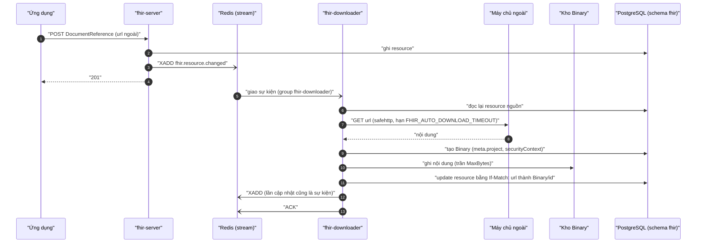

# fhir-downloader: kiến trúc

## Vì sao tách

Theo mục 1 của [service-principles.md](../../../docs/service-principles.md); đã thử bậc rẻ hơn (cùng binary với cờ `FHIR_AUTO_DOWNLOAD_WORKER` của `fhir-server`, có từ bước S1) và chọn bậc 3 theo quyết định D-SP-1 của người dùng (2026-11-24).

| Điều kiện | Có không | Bằng chứng |
|---|---|---|
| **C. Miền lỗi, vòng đời deploy** | **Có (mạnh)** | `pkg/fhirdownload` gọi `GET` tới URL do người dùng cung cấp. Trong `fhir-server` đường ra Internet nằm cùng tiến trình với API; tách ra thì API chạy được **không có quyền ra Internet** (chính sách mạng egress chỉ mở cho service này) và máy chủ ngoài chậm hay chết không giữ goroutine, kết nối DB hay bộ nhớ của API |
| A. Hồ sơ tải khác | Có thể, **chưa có số đo** | tải tệp lớn (tới `FHIR_AUTO_DOWNLOAD_MAX_BYTES`), I/O ra ngoài; chưa đo tải nào cho cụm này |
| B. Dữ liệu hoặc bí mật riêng | **Không** | dùng chung schema `fhir` và kho Binary với `fhir-server` (cùng mô hình `dicomweb`, D-DW-1, D-SP-8). Lợi ích duy nhất về bí mật: không cần `FHIR_JOB_SIGNING_KEY`, JWKS của `auth`, khóa token websocket |
| D. Đội khác | không | |

Hệ quả phải nói thẳng: chia role DB riêng không thu hẹp được gì vì `fhir_resource` chứa mọi loại; lợi ích thật là chính sách mạng và tách miền lỗi, không phải ranh giới dữ liệu.

## Luồng

Việc đổi `url` là một lần ghi mới của resource nguồn: sự kiện này đi tiếp lên Redis để `fhir-notifier` hoặc Subscription thấy. Sự kiện đó không gây tải lặp vì `url` đã là `Binary/<id>` (tương đối), không phải URL ngoài.

## Lắp ráp (`internal/bootstrap`)

| Thành phần | Chi tiết |
|---|---|
| DB | `pkg/database` với schema `fhir`; **không migrate**: `fhirstore.Pending > 0` thì từ chối khởi động (`fhir-server migrate up` trước) |
| Kho Binary | `file:` hoặc `s3:` theo `FHIR_BINARY_STORAGE`, **trùng** với `fhir-server` |
| Broker | `pkg/messaging` driver `redis` cố định (broker bộ nhớ không đến được tiến trình khác, D-SP-3), consumer group `BROKER_GROUP` (mặc định `fhir-downloader`) |
| Worker | `pkg/fhirdownload`, `Async=false`: lỗi tạm trả về cho broker (không ACK) để thử lại rồi dead-letter |
| Ghi resource | `fhirsub.Wrap(store, broker)`: lần cập nhật attachment phát sự kiện; `Binary` tạo qua kho gốc (không phát) |
| Probe | `/healthz`, `/health/live`, `/health/startup` (không phụ thuộc ngoài); `/health/ready` kiểm database và Redis, 503 khi đang tắt |

Không import `apps/fhir-server` (C-1). Hợp đồng dây duy nhất với `fhir-server` là sự kiện `fhirsub.EventType` (`fhir.resource.changed`, `fhirsub.ChangeEvent`) và schema `fhir`.

## Độ bền và idempotency

- **Giao ít nhất một lần.** Redis Streams: lỗi tạm (HTTP 4xx/5xx từ máy chủ ngoài, lỗi mạng, lỗi ghi kho hay DB) làm handler trả lỗi, message nằm trong PEL, replica nào đó nhận lại sau `ClaimIdle` (30s), tối đa 5 lần rồi sang `trivita:events:fhir.resource.changed:dead`. Lỗi vĩnh viễn (URL bị chặn, quá `MaxBytes`, loại nội dung cấm, resource đã xóa hoặc đã đổi URL) chỉ ghi log và ACK, không thử lại.
- **Idempotent.** Nhận lại cùng sự kiện khi đã tải xong thì không tải lại: handler đọc resource hiện tại, `url` đã là `Binary/<id>` nên không còn URL ngoài (`TestRedeliveredEventDoesNotDownloadTwice` ở `pkg/fhirdownload`). Thua ghi song song (`If-Match`) thì dọn Binary và tệp vừa tạo rồi thử lại trên phiên bản mới.
- **Dừng và chạy lại không mất việc.** Sự kiện ghi lúc service không chạy nằm trong stream; group tạo từ đầu stream nên service chạy sau vẫn nhận (`TestProcessesEventsPublishedWhileTheServiceWasDown`, `TestStopsGracefullyAndResumesEventsAfterRestart`). Redis chết rồi sống lại: readiness 503 rồi trở lại 200, xử lý tiếp (`TestSurvivesRedisOutage`).
- **Mồ côi.** Chết giữa lúc tạo Binary và ghi kho có thể để lại Binary hoặc tệp mồ côi; dọn bằng `fhir-server sweep-binary` (như Binary thường).

## Consumer group: vì sao khác `trivita`

`fhir-server` nghe với group `trivita`. Cùng group thì hai bên **chia nhau** sự kiện (mỗi message tới một bên), nên việc tải có thể rơi vào bên không tải. `fhir-downloader` dùng group riêng để **cùng nhận mọi sự kiện**; nhiều replica của chính nó dùng chung group `BROKER_GROUP` để chia việc. Cấu hình từ chối `BROKER_GROUP=trivita`.

## Đánh đổi và giới hạn

- **Giai đoạn chuyển**: nếu `fhir-server` còn `FHIR_AUTO_DOWNLOAD_WORKER=true` (mặc định) cùng lúc service này chạy, cả hai tải (hai Binary cho một URL; bên thứ hai thấy `url` đã đổi thì bỏ, nhưng có thể đã tải trước). Phải tắt worker ở API ngay khi bật service này (xem runbook).
- **Không có số đo** cho điều kiện A (tải, băng thông, bộ nhớ khi tải tệp lớn); `FHIR_AUTO_DOWNLOAD_MAX_BYTES` mặc định 256 MiB và ghi theo luồng nên bộ nhớ không tỉ lệ với kích thước tệp (`binarystore.Put` đọc từ `resp.Body`), nhưng chưa đo.
- **Không giới hạn số URL mỗi resource và tổng băng thông**; nên dùng `FHIR_AUTO_DOWNLOAD_ALLOWED_PREFIXES` ở production.
- **Cần egress riêng**: nếu service không được đặt ở vùng mạng có đường ra Internet khác API thì lợi ích an ninh chính của việc tách chưa đạt (chỉ còn tách tải).
- Độ dài stream Redis và cảnh báo khi service này sập lâu chưa được quy định (stream tích tụ).
- `safehttp` chặn dải nội bộ gồm `0.0.0.0/8` (bổ sung ở S2 sau khi e2e phát hiện `host.docker.internal` của OrbStack, `0.250.250.254`, lọt qua).
