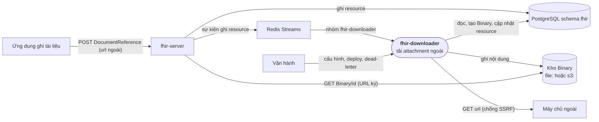
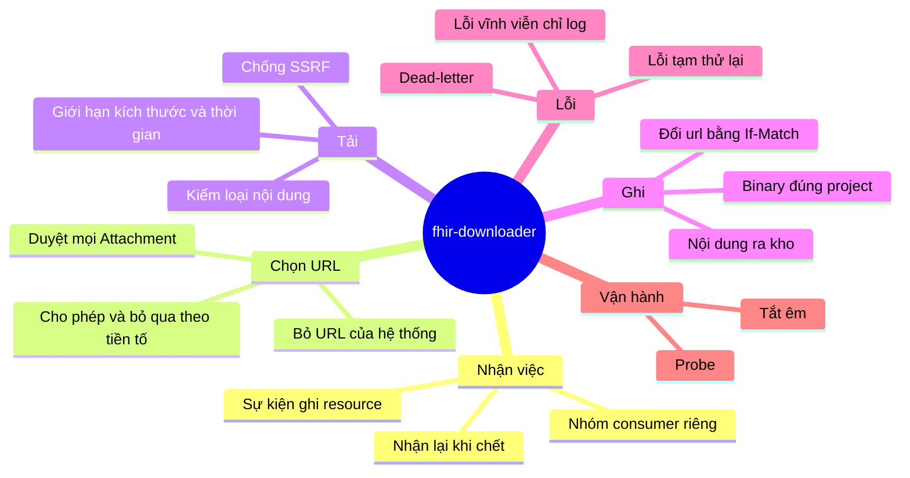
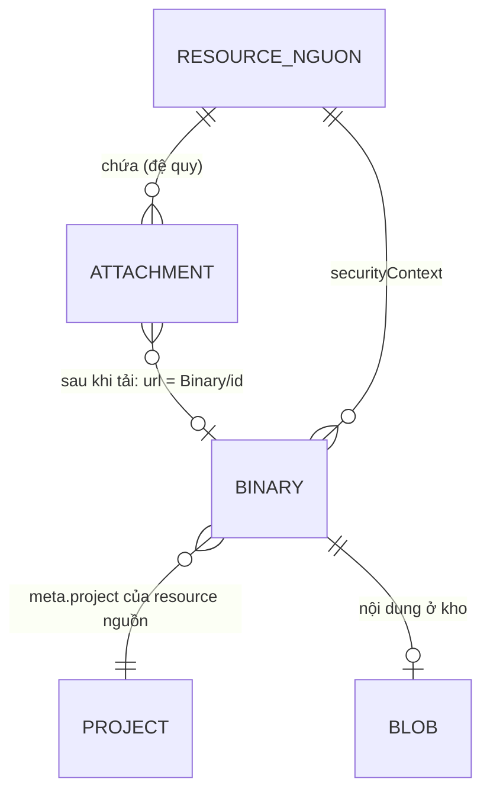
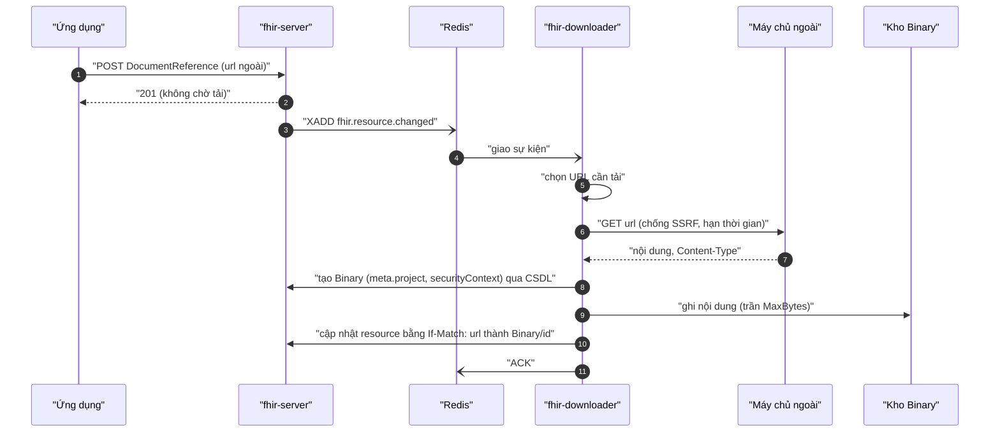
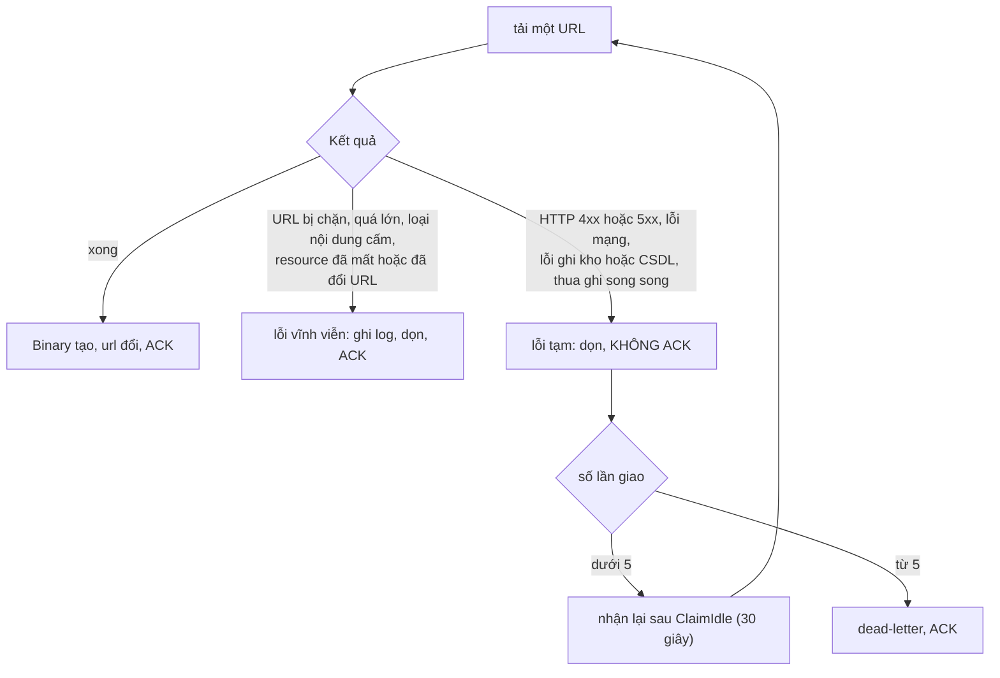

# 1. Tổng quan nghiệp vụ và luồng nghiệp vụ

## 1.1 Mục tiêu và giá trị

Người dùng ghi một tài liệu (ví dụ `DocumentReference`) có `attachment.url` trỏ tới **một máy chủ ngoài**. `fhir-downloader` tải tệp đó về kho của hệ thống và đổi đường dẫn thành `Binary/<id>`, để dữ liệu **không phụ thuộc** đường dẫn ngoài (hết hạn, đổi chỗ, bị xóa) và đi qua cùng cơ chế quyền và URL ký như Binary thường.

| Giá trị | Cách đạt được |
|---|---|
| `fhir-server` không cần quyền ra Internet | việc gọi ra ngoài nằm hoàn toàn ở service này (chính sách mạng chỉ mở cho nó) |
| Không tải tới địa chỉ nội bộ | `pkg/safehttp` chặn dải nội bộ (kể cả `0.0.0.0/8`) trước và lúc kết nối |
| Đúng tổ chức | `Binary` mang `meta.project` của resource nguồn và `securityContext` trỏ về nó |
| Không mất việc khi dừng hoặc sập | sự kiện nằm trong stream Redis, nhóm consumer giữ vị trí; lỗi tạm không ACK nên thử lại |
| Không tải lặp | nhận lại sự kiện cũ thì thấy đường dẫn đã là `Binary/<id>` nên bỏ qua |

## 1.2 Ranh giới hệ thống

**Làm:** nhận sự kiện ghi resource, chọn attachment cần tải, tải, tạo Binary đúng project, đổi `url` thành `Binary/<id>` bằng `If-Match`, thử lại khi lỗi tạm.
**Không làm:** nhận yêu cầu của người dùng, xác thực token, phục vụ tệp đã tải (API làm, qua kho), migrate schema, giao webhook, chạy job nền.

## 1.3 Tác nhân

| Mã | Tác nhân | Là ai | Xác thực bằng | Việc chính |
|---|---|---|---|---|
| A1 | **Ứng dụng ghi tài liệu** | Client ghi resource có `Attachment` | token ở `fhir-server` | Ghi resource; về sau đọc `Binary/<id>` |
| A2 | **fhir-server** | API | không áp dụng | Ghi resource và phát sự kiện lên Redis |
| A3 | **Máy chủ ngoài** | Nơi chứa tệp | không (URL có thể chứa token ký trong query) | Trả nội dung khi bị `GET` |
| A4 | **Vận hành** | SRE | quyền máy chủ | Bật service, đặt giới hạn, theo dõi dead-letter |
| A5 | **Replica khác** | `fhir-downloader` cùng nhóm | cùng Redis và CSDL | Chia việc; nhận lại việc của replica chết |
| A6 | **fhir-notifier và Subscription** | Bên nghe sự kiện | Redis | Thấy thêm lần cập nhật attachment (một bản `update`) |

## 1.4 Bản đồ năng lực

## 1.5 Thuật ngữ

| Thuật ngữ | Nghĩa nghiệp vụ |
|---|---|
| **Attachment** | Kiểu dữ liệu FHIR có `url`, `contentType`, `title`...; xuất hiện ở nhiều loại resource (`DocumentReference.content.attachment`, `Media.content`...) |
| **URL ngoài** | `http` hoặc `https` tuyệt đối không thuộc chính hệ thống (không bắt đầu bằng `FHIR_BASE_URL` hay địa chỉ `/storage`) |
| **Sự kiện ghi resource** | `fhir.resource.changed` (`ChangeEvent`): `interaction`, `resourceType`, `id`, nội dung resource |
| **Nhóm consumer** | `BROKER_GROUP` (mặc định `fhir-downloader`), khác `trivita` của `fhir-server` để cả hai cùng nhận mọi sự kiện |
| **PEL** | Danh sách message đã giao nhưng chưa ACK; message lỗi tạm nằm ở đây rồi được nhận lại |
| **Dead-letter** | Stream `trivita:events:fhir.resource.changed:dead`: message vượt 5 lần giao |
| **Lỗi tạm / vĩnh viễn** | tạm: trả lỗi cho broker để thử lại; vĩnh viễn: chỉ ghi log và bỏ (không thử lại) |

## 1.6 Mô hình dữ liệu nghiệp vụ

Sự thật cần nhớ: (1) service **không có dữ liệu riêng**, chỉ tạo `Binary` và sửa `url` trong resource đã có; (2) lần sửa là một phiên bản mới của resource nguồn (có lịch sử, phát sự kiện `update`); (3) không có khóa ngoại.

---

## 1.7 Luồng nghiệp vụ

### BF-1. Tải attachment ngoài thành Binary của hệ thống

**Mục tiêu:** biến `attachment.url` ngoài thành `Binary/<id>` đúng project. **Các bên:** A1, A2, `fhir-downloader`, A3, kho.

**Kết quả:** `url` của mọi attachment trùng đổi thành `Binary/<id>`; `GET` resource thấy URL ký của kho. **Điều không thấy trong hình:** người ghi nhận `201` ngay, đường dẫn đổi sau ít giây và **không có trạng thái "đang tải"**; lần sửa là một phiên bản mới nên Subscription thấy thêm một thông báo `update`. **Chức năng:** F-01..F-05.

### BF-2. Xử lý khi tải thất bại

**Mục tiêu:** không mất việc khi lỗi tạm, không thử lại vô ích khi lỗi vĩnh viễn.

**Kết quả:** lỗi vĩnh viễn: resource giữ `url` ngoài, không để lại Binary hay tệp; lỗi tạm: dọn rồi thử lại. **Điều không thấy trong hình:** `4xx` của máy chủ ngoài cũng đi nhánh "tạm" (xem Lệch 1); sau dead-letter không có công cụ xử lý lại. **Chức năng:** F-06.

### BF-3. Resource đổi hoặc mất trong lúc đang tải

Trước khi tải, service đọc lại resource hiện tại: đã mất thì bỏ; `url` đã không còn (đã đổi hoặc đã được tải) thì bỏ. Sau khi tải, đọc lại lần nữa và cập nhật bằng `If-Match`: thua ghi song song thì **dọn** Binary và tệp vừa tạo rồi trả lỗi tạm để thử lại trên phiên bản mới; không còn attachment trùng URL thì dọn và bỏ. **Chức năng:** F-04, F-05, F-06.

### BF-4. Dừng và chạy lại không mất sự kiện

Sự kiện nằm trong stream; nhóm consumer tạo từ đầu stream nên service chạy sau vẫn nhận sự kiện ghi lúc nó không chạy. Tắt êm: ngừng nhận, việc đang tải được chờ tới `SHUTDOWN_TIMEOUT`; message chưa ACK nằm trong PEL cho replica khác nhận lại. Redis chết: `/health/ready` `503` nhưng liveness vẫn `200`; Redis sống lại thì tự nối lại. **Chức năng:** F-01, F-07.

### BF-5. Chuyển việc tải từ API sang service

Dựng `fhir-downloader` (cùng CSDL, Redis, kho, `FHIR_BASE_URL`), kiểm `/health/ready`; đặt `FHIR_AUTO_DOWNLOAD_WORKER=false` ở `fhir-server` (giữ `FHIR_AUTO_DOWNLOAD=true` để API còn phát sự kiện) và khởi động lại; chặn đường ra Internet của API ở hạ tầng. Quay lại: đặt `true`, rồi dừng service. Hai bên cùng chạy làm mỗi URL bị tải hai lần. **Chức năng:** F-01, F-07. Chi tiết ở [../runbook.md](../runbook.md).
