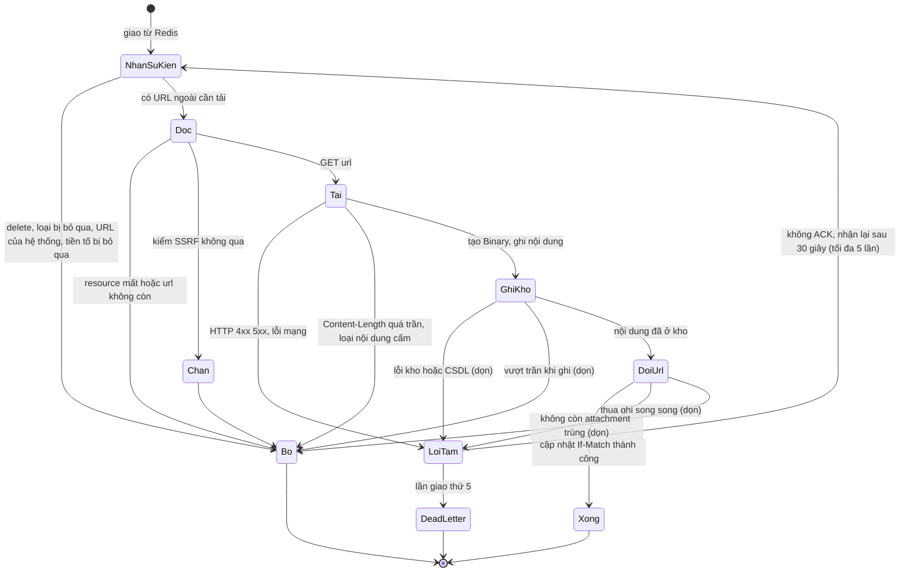

# 4. Luật nghiệp vụ, quyền, vòng đời, truy vết

## 4.1 Vòng đời một lần tải (một URL của một resource)

Điều không thấy trong hình: `Bo`, `Chan` và `Xong` đều ACK; chỉ `LoiTam` giữ message; sau `DeadLetter` không có đường quay lại (chưa có công cụ).

## 4.2 Quyền và ranh giới an toàn

`fhir-downloader` **không có người gọi** nên không có token, phân quyền hay vai trò. Quyền và ranh giới đến từ:

| Cơ chế | Hiệu lực |
|---|---|
| Role DB `fhir_app` và `DATABASE_REQUIRE_SCHEMA` | chỉ đọc, ghi schema `fhir`; không đọc được schema `identity` |
| Kho tách project **không dùng** | service ghi bằng kho gốc, không tách project; project do **service tự gán** từ `meta.project` của resource nguồn |
| `pkg/safehttp` | chặn dải nội bộ (loopback, mạng riêng, link-local, CGNAT, `0.0.0.0/8`, metadata đám mây...), kiểm lại lúc kết nối (chống DNS rebinding), giới hạn chuyển hướng |
| Chính sách mạng ở hạ tầng | chỉ service này được ra Internet (lý do chính của việc tách; **không** mô phỏng được trong compose) |
| Giới hạn tải | `FHIR_AUTO_DOWNLOAD_MAX_BYTES`, `FHIR_AUTO_DOWNLOAD_TIMEOUT`, danh sách cho phép và bỏ qua theo tiền tố |

Hệ quả: resource nguồn **không có `meta.project`** (kho chưa `assign-project`) cho ra `Binary` không có project; không kiểm quyền người ghi tài liệu có được tải URL đó hay không (ai ghi được resource đều kích hoạt được việc tải, trong giới hạn danh sách cho phép).

## 4.3 Luật nghiệp vụ

### Chọn URL (BR-01..03)

| Mã | Luật | Loại | F |
|---|---|---|---|
| BR-01 | Bỏ qua sự kiện `delete`, loại `Binary`, `AsyncJob`, `AuditEvent`, `Subscription`, sự kiện không có nội dung hoặc id, và nội dung không giải mã được thành resource. | DATA | F-01, F-02 |
| BR-02 | Chỉ tải `Attachment.url` là `http` hoặc `https` tuyệt đối có host, không bắt đầu bằng `FHIR_BASE_URL/` hay địa chỉ `/storage`, không khớp tiền tố bỏ qua (thắng danh sách cho phép); nếu có danh sách cho phép thì phải khớp một tiền tố. Địa chỉ `Binary/<id>` (tương đối) không bị tải lại. | DATA | F-02 |
| BR-03 | Duyệt mọi `Attachment` trong cây resource (sâu tối đa 64 tầng); mỗi URL chỉ tải một lần trong một resource. | DATA | F-02 |

### Tải và an toàn (BR-04..08)

| Mã | Luật | Loại | F |
|---|---|---|---|
| BR-04 | Trước khi tải và sau khi tải, đọc lại resource hiện tại: đã mất hoặc đã xóa thì bỏ; `url` không còn trong resource thì bỏ (đã đổi hoặc đã được tải). | DATA | F-03, F-05 |
| BR-05 | Chống SSRF: mặc định chặn URL tới địa chỉ nội bộ (kiểm URL trước và kiểm lại lúc kết nối); bị chặn là lỗi vĩnh viễn (log, không thử lại); log chỉ ghi host, không ghi URL đầy đủ hay query (có thể chứa token ký). | SEC | F-03 |
| BR-06 | `Content-Length` lớn hơn `FHIR_AUTO_DOWNLOAD_MAX_BYTES` (mặc định theo `FHIR_STORAGE_MAX_UPLOAD_BYTES`) thì bỏ không tạo Binary; không biết độ dài thì chặn khi đang ghi (dọn, bỏ). | OPS | F-03, F-04 |
| BR-07 | Loại nội dung lấy theo thứ tự: header phản hồi, `attachment.contentType`, `application/octet-stream`; loại nằm trong danh sách chặn của kho thì bỏ. | SEC | F-03 |
| BR-08 | Mỗi lần tải có hạn `FHIR_AUTO_DOWNLOAD_TIMEOUT` (mặc định 30 giây, phải > 0). | OPS | F-03 |

### Ghi (BR-09..11)

| Mã | Luật | Loại | F |
|---|---|---|---|
| BR-09 | `Binary` tạo ra mang `meta.project` của resource nguồn (nếu có) và `securityContext` = `<Loại>/<id>` của resource nguồn nên project khác không đọc được; nội dung ghi vào kho **sau** khi dòng Binary được tạo; lỗi kho thì dọn dòng và khóa. | DATA | F-04 |
| BR-10 | Không để lại gì khi thất bại: mọi nhánh lỗi (tạm hoặc vĩnh viễn) sau khi đã tạo Binary đều dọn Binary và tệp ở kho. | DATA | F-04, F-05 |
| BR-11 | Đổi `url` của mọi attachment trùng thành `Binary/<id>` (điền `contentType` nếu trống) bằng `If-Match`; thua ghi song song thì dọn và thử lại trên phiên bản mới; lần sửa là một phiên bản mới có lịch sử và phát sự kiện `update`; nhận lại cùng sự kiện không tải lại (idempotent). Một sự kiện có nhiều URL xử lý tuần tự: một URL lỗi tạm làm cả sự kiện thử lại. | DATA | F-05, F-06 |

### Lỗi và độ bền (BR-12..13)

| Mã | Luật | Loại | F |
|---|---|---|---|
| BR-12 | Lỗi tạm (HTTP `4xx` hoặc `5xx`, lỗi mạng, lỗi ghi kho hoặc CSDL, thua ghi song song) không ACK: message nhận lại sau `ClaimIdle` (30 giây, quét mỗi 10 giây), tối đa 5 lần giao; không phân biệt lỗi vĩnh viễn của máy chủ ngoài (`404`, `403` cũng thử lại). | OPS | F-06 |
| BR-13 | Message vượt 5 lần giao chuyển sang `trivita:events:fhir.resource.changed:dead` rồi ACK; attachment giữ `url` ngoài; không có công cụ xử lý lại, muốn tải lại phải ghi lại resource. | OPS | F-06 |

### Vận hành (BR-14..19)

| Mã | Luật | Loại | F |
|---|---|---|---|
| BR-14 | Redis bắt buộc (`REDIS_URL`); consumer group `BROKER_GROUP` (mặc định `fhir-downloader`) khác `trivita` để cùng nhận mọi sự kiện cùng `fhir-server`; cấu hình từ chối `trivita`; nhiều replica dùng chung group để chia việc. | OPS | F-01 |
| BR-15 | Service không migrate: `fhirstore.Pending > 0` thì từ chối khởi động (`schema chưa được migrate`); cấu hình sai bị từ chối và nêu mọi lỗi; `FHIR_AUTO_DOWNLOAD_ALLOW_PRIVATE` cấm ở staging/production; `FHIR_BINARY_STORAGE` phải trùng `fhir-server`. | OPS | F-01, F-07 |
| BR-16 | Sự kiện ghi lúc service không chạy vẫn được xử lý khi chạy lại (nhóm consumer tạo từ đầu stream). | OPS | F-01 |
| BR-17 | `/health/ready` kiểm database và Redis (`503` khi hỏng hoặc đang tắt); liveness không phụ thuộc ngoài; `SIGTERM` thoát mã 0 sau khi chờ việc đang tải. | OPS | F-07 |
| BR-18 | Không giới hạn số URL mỗi resource và tổng băng thông: mỗi attachment ngoài là một lần tải tuần tự; nên dùng danh sách cho phép ở production. | OPS | F-02, F-03 |
| BR-19 | Giai đoạn chuyển: nếu `fhir-server` còn `FHIR_AUTO_DOWNLOAD_WORKER=true` cùng lúc thì mỗi URL có thể bị tải hai lần; phải tắt worker ở API ngay khi bật service. | OPS | F-01 |

## 4.4 Bảng thời hạn và giới hạn

| Hạng mục | Mặc định | Cấu hình |
|---|---|---|
| Thời gian tối đa mỗi lần tải | 30 giây | `FHIR_AUTO_DOWNLOAD_TIMEOUT` |
| Kích thước tối đa một tệp | 256 MiB (theo `FHIR_STORAGE_MAX_UPLOAD_BYTES`) | `FHIR_AUTO_DOWNLOAD_MAX_BYTES` |
| Nhận lại message lỗi tạm | sau 30 giây, quét mỗi 10 giây | cố định (`messaging.New` không cho chỉnh) |
| Số lần giao tối đa | 5, rồi dead-letter | cố định |
| Độ sâu duyệt `Attachment` | 64 tầng | cố định |
| Chờ tắt êm | `SHUTDOWN_DRAIN_DELAY` (5 giây) rồi `SHUTDOWN_TIMEOUT` (25 giây) | cấu hình |

## 4.5 Kịch bản chấp nhận

| # | Kịch bản (Given When Then) | Luật |
|---|---|---|
| AT-01 | Given `fhir-downloader` chạy và máy chủ ngoài trả PDF, When ghi `DocumentReference` có `url` ngoài (có token trong query), Then `url` thành `Binary/<id>`, nội dung đúng, `Binary` có `meta.project` và `securityContext` của resource nguồn, máy chủ ngoài bị gọi đúng 1 lần, log không chứa token. | BR-02, BR-05, BR-09, BR-11 |
| AT-02 | Given hai attachment cùng URL trong một resource, When tải, Then chỉ một lần gọi ra ngoài và cả hai `url` đổi thành cùng `Binary/<id>`. | BR-03, BR-11 |
| AT-03 | Given URL là địa chỉ nội bộ và không bật `ALLOW_PRIVATE`, When tải, Then không có Binary, không gọi, `url` giữ nguyên. | BR-05 |
| AT-04 | Given URL thuộc `FHIR_BASE_URL`, `/storage` hoặc tiền tố bỏ qua, When ghi, Then không tải. | BR-02 |
| AT-05 | Given sự kiện `delete` hoặc loại `Binary`, `Subscription`, When nhận, Then không gọi ra ngoài. | BR-01 |
| AT-06 | Given máy chủ ngoài trả `5xx`, When tải, Then không để lại Binary hay tệp, sự kiện được thử lại. | BR-10, BR-12 |
| AT-07 | Given tệp lớn hơn trần hoặc `Content-Type` bị cấm, When tải, Then bỏ, không để lại Binary hay tệp, không thử lại. | BR-06, BR-07, BR-10 |
| AT-08 | Given resource đổi giữa lúc tải (thua `If-Match`), When cập nhật, Then Binary vừa tạo bị dọn và lần thử sau thành công trên phiên bản mới. | BR-10, BR-11 |
| AT-09 | Given resource bị xóa hoặc `url` đã đổi giữa lúc tải, When xử lý, Then dọn và bỏ, không lỗi. | BR-04 |
| AT-10 | Given sự kiện cũ được giao lại sau khi đã tải xong, When xử lý, Then không tải lại, không có Binary thứ hai, resource không đổi. | BR-11 |
| AT-11 | Given `fhir-server` (group `trivita`) và `fhir-downloader` cùng nghe, When ghi 5 tài liệu, Then cả hai cùng nhận đủ mọi sự kiện (kể cả 5 lần cập nhật do chính service gây ra) và có đúng 5 Binary. | BR-14 |
| AT-12 | Given service chưa chạy, When ghi tài liệu rồi khởi động service, Then tài liệu được tải. | BR-16 |
| AT-13 | Given service bị `SIGTERM`, When tắt, Then thoát mã 0; sự kiện ghi lúc dừng được xử lý sau khi chạy lại. | BR-16, BR-17 |
| AT-14 | Given Redis chết rồi sống lại, When đó, Then `/health/ready` `503` (liveness vẫn `200`) rồi trở lại `200` và xử lý tiếp. | BR-17 |
| AT-15 | Given schema chưa migrate hoặc cấu hình sai (`BROKER_GROUP=trivita`, thiếu kho Binary), When khởi động, Then từ chối và nêu tên biến. | BR-14, BR-15 |
| AT-16 | Given role DB hẹp quyền và `DATABASE_REQUIRE_SCHEMA=true`, When tải, Then nội dung kho đúng từng byte. | BR-09, BR-15 |

## 4.6 Truy vết luật đến bằng chứng kiểm thử

| Nhóm luật | Test |
|---|---|
| BR-01, BR-02 (chọn URL) | `pkg/fhirdownload/download_test.go`: `TestSkipsUrlsThatAreNotExternalOrNotAllowed`, `TestIgnoresDeletesAndUnrelatedTypes`; `apps/fhir-downloader/internal/bootstrap/bootstrap_test.go`: `TestSkipsOwnAndIgnoredURLs` |
| BR-03, BR-11 (đổi url, idempotent) | `pkg/fhirdownload/download_test.go`: `TestDownloadsExternalAttachmentIntoProjectBinary`, `TestRedeliveredEventDoesNotDownloadTwice`, `TestVersionConflictCleansUpAndRetrySucceeds` |
| BR-04 (mất hoặc đổi giữa chừng) | `pkg/fhirdownload/download_test.go`: `TestResourceChangedOrDeletedWhileDownloading` |
| BR-05 (SSRF) | `pkg/fhirdownload/download_test.go`: `TestBlocksPrivateAddressesByDefault`; `apps/fhir-downloader/internal/bootstrap/bootstrap_test.go`: `TestBlocksInternalAddressesByDefault`; `apps/fhir-downloader/tests/e2e/downloader_test.go`: `TestBlocksInternalAddressesByDefaultInTheImage`; `pkg/safehttp/safehttp_test.go` |
| BR-06, BR-07, BR-10 (giới hạn, dọn) | `pkg/fhirdownload/download_test.go`: `TestPermanentRefusalsLeaveNothing`, `TestTemporaryFailuresAreReturnedAndLeaveNothing` |
| BR-08, BR-15 (cấu hình) | `apps/fhir-downloader/internal/config/config_test.go`: `TestInvalidConfigIsRejectedWithTheVariableName`, `TestAllErrorsAreReportedTogether`, `TestProductionBaselineIsValid` |
| BR-09 (Binary đúng project) | `apps/fhir-downloader/internal/bootstrap/bootstrap_test.go`: `TestDownloadsAttachmentAnnouncedByTheAPI`; `apps/fhir-downloader/tests/integration/integration_test.go`: `TestDownloadsUnderNarrowRoleAndRequiredSchema` |
| BR-12, BR-13 (lỗi tạm, dead-letter) | `pkg/fhirdownload/download_test.go`: `TestTemporaryFailuresAreReturnedAndLeaveNothing`; `pkg/messaging/messaging_test.go`: `TestRedisBrokerDeliversAndAcks` (phần lõi của thử lại và dead-letter); không có test riêng cho dead-letter của service này |
| BR-14, BR-16 (nhóm, dừng và chạy lại) | `apps/fhir-downloader/internal/bootstrap/bootstrap_test.go`: `TestEachConsumerGroupReceivesEveryEvent`, `TestProcessesEventsPublishedWhileTheServiceWasDown`; `apps/fhir-downloader/tests/e2e/downloader_test.go`: `TestStopsGracefullyAndResumesEventsAfterRestart` |
| BR-15, BR-17 (migrate, probe, tắt êm) | `apps/fhir-downloader/internal/bootstrap/bootstrap_test.go`: `TestRefusesToStartOnUnmigratedSchema`, `TestReadinessReflectsDependenciesAndDraining`, `TestServeShutsDownGracefullyOnSignal`; `apps/fhir-downloader/tests/integration/integration_test.go`: `TestSurvivesRedisOutage`; `apps/fhir-downloader/tests/e2e/downloader_test.go`: `TestRefusesBadConfigurationAndUnmigratedSchema`, `TestImageIsHealthyNonRootAndDownloadsEndToEnd` |
| BR-18, BR-19 | không có test (là giới hạn và rủi ro vận hành, xem 4.7) |

## 4.7 Lệch, rủi ro và điểm chưa kiểm

- **Mọi `4xx` và `5xx` của máy chủ ngoài bị coi là lỗi tạm (BR-12):** `404`, `403`, `410` cũng thử lại 5 lần mỗi lần cách tối thiểu 30 giây (tổng khoảng 2 đến 3 phút) rồi vào dead-letter; nên phân loại lỗi vĩnh viễn của máy chủ ngoài (`404`, `410`, `403`).
- **Dead-letter không có công cụ (BR-13):** cần quy trình (xem stream, ghi lại resource) hoặc lệnh xử lý lại.
- **Không giới hạn số URL và băng thông (BR-18):** một resource nhiều attachment ngoài chiếm replica lâu trong một sự kiện; chưa có hạn mức theo project.
- **Không kiểm quyền người ghi (4.2):** ai ghi được resource có `Attachment` đều khiến service gọi URL đó (trong danh sách cho phép); rủi ro chi phí và dò mạng ngoài; nên dùng `FHIR_AUTO_DOWNLOAD_ALLOWED_PREFIXES` ở production.
- **Resource không có `meta.project` cho Binary không project (4.2):** xảy ra khi kho chưa `assign-project`.
- **Chưa kiểm:** dead-letter của chính service này; hành vi khi máy chủ ngoài trả `3xx` chuyển hướng tới nội bộ (do `safehttp` giữ, có test ở `pkg/safehttp`); đo tải và băng thông khi tải tệp lớn; kho S3 trong smoke test.
- **Điều kiện A của việc tách chưa có số đo** (xem [../architecture.md](../architecture.md)).
