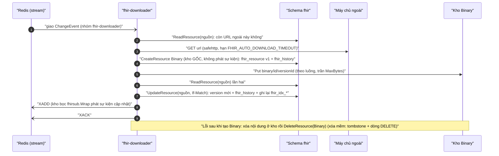

# 1. Bảng vật lý của fhir-downloader

`fhir-downloader` **không có bảng riêng**. Nó chạy trên bộ bảng "kho tài liệu FHIR" của `pkg/fhirstore` trong schema `fhir` (cùng schema và role với `fhir-server`). **Mọi bảng và cột được mô tả một lần, đầy đủ ghi chú chức năng**, ở [docs/erd/fhirstore-physical.md](../../../../docs/erd/fhirstore-physical.md); tệp này chỉ nêu phần riêng của service.

## 1.1 Service dùng bảng nào

| Bảng | Dùng? | Ghi chú riêng của downloader |
|---|---|---|
| `fhir_resource` | **Có** | Đọc resource nguồn (`ReadResource`, hai lần mỗi URL: trước khi tải và ngay trước khi ghi); ghi dòng `Binary` mới; **cập nhật** dòng resource nguồn (đổi `Attachment.url`). Dòng `Binary` không có `data` (nội dung ở kho) |
| `fhir_history` | **Có (tự động)** | Mỗi `CreateResource`/`UpdateResource`/`DeleteResource` thêm một dòng **kèm nội dung**. Phiên bản resource nguồn **trước khi đổi URL** (có URL gốc) nằm lại vĩnh viễn |
| `fhir_idx_uri` | Có (gián tiếp) | Tham số `location` của `DocumentReference` (`content.attachment.url`) và các tham số `uri` tương tự được lập lại khi resource nguồn được ghi: dòng cũ (URL ngoài) bị thay bằng dòng `Binary/<id>` |
| `fhir_idx_*` còn lại | Có (gián tiếp) | Mọi lần cập nhật resource nguồn xóa rồi ghi lại toàn bộ chỉ mục của resource đó (`reindex`), dù chỉ `url` đổi |
| `fhir_idx_*` của `Binary` | Không có dòng | Loại `Binary` không có tham số tìm kiếm (`resource_fields.py`: 0 tham số) |
| `fhir_coding`, `fhir_coding_property`, `fhir_coding_designation`, `fhir_concept_mapping` | **Không dùng** | Service không nạp terminology; bảng tồn tại nhưng rỗng nếu `fhir-server` cũng không nạp |
| `fhirstore_schema_version` | Chỉ đọc (kiểm `Pending`) | Bảng phiên bản goose do `fhir-server migrate up` tạo; downloader từ chối chạy khi còn migration chưa chạy |

## 1.2 Schema, role, migration

| Chủ đề | Giá trị |
|---|---|
| Schema PostgreSQL | `fhir` (dùng chung với `fhir-server`, `fhir-worker`, `fhir-notifier`, `dicomweb`; `search_path` đặt ở mức role) |
| Role chạy ứng dụng | `fhir_app`: `USAGE` schema, `SELECT/INSERT/UPDATE/DELETE`; không DDL |
| Role migration | `fhir_migrate` (chỉ khi tách role): **chỉ `fhir-server migrate up` dùng**; downloader không bao giờ migrate |
| Từ chối khởi động | `fhirstore.Pending > 0` (`schema chưa được migrate`), hoặc `DATABASE_REQUIRE_SCHEMA=true` mà `search_path` không phải đúng một schema riêng, hoặc SQLite ở staging/production |
| Backend khác | SQLite (dev, `content` là text, không schema); MySQL: chưa hỗ trợ cho `fhirstore` |
| Kết nối | `DATABASE_MAX_OPEN_CONNS` mặc định 20 cho mỗi replica (tổng mọi service phải nhỏ hơn `max_connections`) |

Điều mà role `fhir_app` **cho phép** nhưng downloader **không làm**: đọc hay ghi mọi loại resource khác ngoài loại nguồn có `Attachment` và `Binary`. Quyền không bị thu hẹp ở mức DB (chung `fhir_resource` cho mọi loại, [architecture.md](../architecture.md)); ranh giới nằm ở mã (`skipTypes`, chỉ ghi `Binary` và đổi `url`).

## 1.3 Đường ghi của một lần tải (một URL)

Mỗi `UpdateResource`/`CreateResource` là **một transaction riêng** (`fhir_resource` + `fhir_history` + `fhir_idx_*`, [đường ghi chung](../../../../docs/erd/fhirstore-physical.md)); `Binary`, kho và resource nguồn **không cùng transaction**. Thứ tự: CSDL (`Binary`) trước, kho sau, resource nguồn cuối ([03](03-quan-he-va-toan-ven.md)).

## 1.4 Một lần tải để lại bao nhiêu dòng (suy từ mã, chưa đo)

| Tình huống | `fhir_resource` | `fhir_history` | Kho | Sự kiện Redis |
|---|---|---|---|---|
| Thành công, một URL | `Binary`: +1 dòng; nguồn: sửa tại chỗ (version +1) | `Binary`: +1; nguồn: +1 (bản đã đổi URL; bản cũ có URL gốc đã nằm sẵn) | +1 khóa `binary/<id>/<versionId>` | +1 (cập nhật nguồn; `Binary` không phát) |
| Thành công, N URL của một resource | `Binary`: +N | nguồn: +N, `Binary`: +N | +N | +N; mỗi bản cập nhật lại được downloader nhận và đọc lại resource |
| Tạm thời hỏng **trước** khi tạo `Binary` (HTTP 4xx/5xx, lỗi mạng) | không đổi | không đổi | không đổi | không (không ACK, giao lại) |
| Hỏng **sau** khi tạo `Binary` (lỗi kho, thua `If-Match`, resource mất) | `Binary`: tombstone `{resourceType:"Binary"}`, `deleted=true` | `Binary`: +2 (tạo, `DELETE`) mỗi lần thử | xóa nội dung (nếu đã ghi) | không |
| Vĩnh viễn bị từ chối (chặn SSRF, quá trần theo `Content-Length`, loại nội dung cấm) | không đổi | không đổi | không đổi | không (ACK) |
| Quá trần **khi ghi** (không có hoặc sai `Content-Length`) | `Binary` tombstone | `Binary`: +2 | xóa phần đã ghi | không (ACK) |

Số trong bảng đọc từ `download.go` (`downloadOne`, `drop`) và `fhirstore.DeleteResource`; **chưa chạy đo** như ở `fhir-worker`.

## 1.5 Bảng lớn nhanh và hệ quả vận hành

| Bảng | Vì sao lớn | Hệ quả |
|---|---|---|
| `fhir_history` | mỗi lần ghi thêm một dòng chứa **cả nội dung**; resource nguồn có nhiều attachment (nhiều `url` ngoài) sinh N phiên bản, mỗi phiên bản chép toàn resource (ví dụ `DocumentReference`, hay `Patient` kèm ảnh nhúng `data` có thể lớn); xóa mềm `Binary` không xóa dòng cũ | không có đường dọn; chỉ Expunge mới giải phóng |
| `fhir_resource` | tombstone `Binary` tích lũy theo số lần thử hỏng sau khi tạo `Binary` | nhỏ từng dòng, tăng theo số lỗi |
| `fhir_idx_*` của resource nguồn | ghi lại toàn bộ khi cập nhật | tải ghi gấp (số URL) lần cho resource nhiều attachment |
| Kho Binary | mỗi tệp tải về tới `FHIR_AUTO_DOWNLOAD_MAX_BYTES` (mặc định bằng `FHIR_STORAGE_MAX_UPLOAD_BYTES` = 256 MiB) | **không giới hạn số URL mỗi resource và tổng dung lượng**; không dọn khi resource nguồn bị xóa ([03](03-quan-he-va-toan-ven.md) mục 3.5) |
