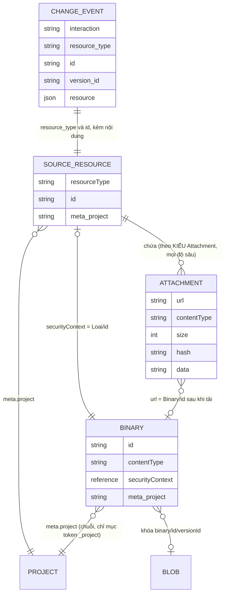

# 2. Mô hình logic

`fhir-downloader` **không sở hữu loại resource riêng**. Nó ghi **một** loại, `Binary` (tệp tải về), và **đọc rồi cập nhật** các resource nguồn có `Attachment` (do `fhir-server` sở hữu). Lưu ở `fhir_resource` schema `fhir`. Nhãn nhạy cảm S0..S4 theo `references/templates.md` của skill: S1 định danh kỹ thuật, S2 dữ liệu cá nhân, S3 dữ liệu lâm sàng, S4 bí mật xác thực.

## 2.1 ERD logic

Không có khóa ngoại; quan hệ là chuỗi trong JSON (xem [03](03-quan-he-va-toan-ven.md)). `PROJECT` thuộc `auth` (ở đây chỉ là chuỗi id); `ATTACHMENT` không phải resource mà là kiểu dữ liệu nằm trong resource nguồn; `CHANGE_EVENT` là thông điệp Redis, không phải dòng CSDL ([04](04-kho-khac.md)).

## 2.2 Binary

**Mục đích nghiệp vụ:** đại diện cho **một tệp đã tải về** từ URL ngoài; sau khi tải, `Attachment.url` của resource nguồn trỏ tới nó (`Binary/<id>`). **Lưu ở:** `fhir_resource` (`resource_type='Binary'`), schema `fhir`; nội dung tệp ở kho (`FHIR_BINARY_STORAGE`), **không** ở `data`. **Ghi bởi:** `fhir-downloader` (`CreateResource` qua kho gốc: không phát sự kiện, id UUID v4 do `newID`); xóa mềm khi bù trừ lỗi (`drop`). **Đọc bởi:** `fhir-server` (`GET Binary/{id}` và `/storage`). **Vòng đời:** không bao giờ được sửa sau khi tạo; không có đường dọn khi resource nguồn bị xóa (03 mục 3.5).

| Trường | Kiểu | Bắt buộc | Chức năng | Nhạy cảm |
|---|---|---|---|---|
| `id` | string (UUID v4 dạng `xxxxxxxx-xxxx-4xxx-yxxx-xxxxxxxxxxxx`) | có | Do downloader tự sinh bằng `crypto/rand` (`newID`) và dùng làm nửa khóa kho `binary/<id>/<versionId>` và làm đích `Attachment.url` (`Binary/<id>`) | S1 |
| `contentType` | string | có | Loại nội dung **cuối cùng**: ưu tiên header `Content-Type` của máy chủ ngoài (đã bỏ tham số như `charset`), nếu rỗng hoặc sai thì lấy `Attachment.contentType` khai ở resource nguồn, nếu vẫn rỗng thì `application/octet-stream`. Bị kiểm danh sách chặn (`binarystore.CheckMetadata`: `application/x-sh`, `application/java-archive`, `application/x-msdownload`...) trước khi tạo. `GET Binary/{id}` dùng nó làm `Content-Type` trả về | S1 |
| `securityContext` | Reference | có (service luôn đặt) | Trỏ về **resource nguồn** `<Loại>/<id>` (ví dụ `DocumentReference/abc`): quyền đọc Binary theo resource nguồn (proxy kiểm soát truy cập, theo định nghĩa FHIR). **Khác** `fhir-worker` (không đặt). Là trường duy nhất cho biết tệp thuộc về ai | S2 (lộ liên hệ tới hồ sơ bệnh nhân qua loại và id) |
| `data` | string (base64) | không | **Luôn rỗng**: service ghi nội dung thẳng vào kho theo luồng (`BinaryRepo` không kèm nội dung). Nội dung thật là tệp tải về, có thể là hồ sơ lâm sàng (PDF, ảnh) | S3 (nội dung ở kho) |
| `url` | string | không | **Không dùng** (service không đặt) | S1 |
| `meta.project` | string | có khi resource nguồn có project | Lấy từ `meta.project` của **resource nguồn** (`cur.GetMeta().Project`); kho không tách project nên **service tự gán** để `Binary` thuộc đúng project; project khác đọc `Binary/{id}` nhận `404`. Nếu resource nguồn không có project thì `Binary` cũng không | S1 |

**Tham số tìm kiếm được lập chỉ mục:** không có (loại `Binary` không có tham số riêng).

## 2.3 Resource nguồn có Attachment (đọc và cập nhật)

Service **không sở hữu** các loại này (thuộc `fhir-server`); chỉ **đọc** để tìm URL ngoài và **cập nhật** đúng một thứ: `Attachment.url`. Nó xét **mọi** `Attachment` ở mọi độ sâu (tìm theo **kiểu** `fhir.Attachment`, không theo tên khóa `url`, để không nhầm `Extension.url` hay `Reference`; độ sâu tối đa 64) của mọi loại **trừ** `Binary`, `AsyncJob`, `AuditEvent`, `Subscription` (`skipTypes`). Có 30 tệp `pkg/fhir/resource_*.go` khai trường `Attachment` (đếm bằng grep, tính cả `Bot`, `ClientApplication`, `PackageRelease`): gồm `DocumentReference` (`content.attachment`), `DiagnosticReport` (`presentedForm`), `Media` (`content`), `Patient`, `Practitioner`, `Person`, `RelatedPerson` (`photo`), `Communication`, `Questionnaire`, `QuestionnaireResponse`, `Task`, `Claim`, `Contract`, `Consent`... (không liệt kê đủ ở đây).

| Trường của `Attachment` | Service làm gì | Chức năng và hệ quả | Nhạy cảm |
|---|---|---|---|
| `url` | **Đọc** để chọn URL cần tải; **ghi** thay bằng `Binary/<id>` (mọi attachment trùng URL trong resource đều đổi) | Là đầu vào duy nhất của việc tải: chỉ `http(s)` tuyệt đối, có host, không phải của chính hệ thống (`FHIR_BASE_URL`, `/storage`), qua danh sách cho phép và bỏ qua. Sau khi đổi, URL gốc **chỉ còn trong `fhir_history`** và trong sự kiện đã phát. URL có thể kèm **token ký trong query** | S2 đến S4 (token ký là bí mật truy cập, nằm lại ở lịch sử) |
| `contentType` | **Đọc** (dự phòng khi máy chủ ngoài không trả loại hợp lệ); **ghi** nếu đang trống | Điền loại nội dung thật vào attachment nếu người gửi không khai | S1 |
| `size` | Không đọc, không ghi | **Không cập nhật** sau tải: giá trị người gửi khai (nếu có) có thể lệch tệp thật | S1 |
| `hash` | Không đọc, không ghi | **Không tính lại**: sha-1 người gửi khai không được kiểm với tệp tải về | S1 |
| `data` | Không đọc, không ghi | Attachment có `data` nhúng không bị đụng; chỉ `url` được xét | S3 |
| `meta.project` của resource nguồn | **Đọc** | Nguồn của `meta.project` cho `Binary` | S1 |
| Phần còn lại của resource | Không đụng | `UpdateResource` ghi lại **toàn bộ** resource vừa đọc lại (`fresh`) với `url` đã đổi; trường lạ của phiên bản mới hơn không mất vì đọc lại ngay trước khi ghi, và ghi có `If-Match` | theo loại |

**Tham số tìm kiếm bị ảnh hưởng:** mọi tham số của loại nguồn được lập lại khi cập nhật (`reindex`), đáng chú ý `DocumentReference.location` (uri, `content.attachment.url`): trước khi tải tìm được theo URL ngoài, sau khi tải tìm được theo `Binary/<id>`.

## 2.4 Sự kiện `ChangeEvent` (hợp đồng dây, không phải dòng CSDL)

Trường theo `pkg/fhirsub/event.go`. Downloader **nhận** và **phát** loại sự kiện này.

| Trường JSON | Chức năng | Nhạy cảm |
|---|---|---|
| `interaction` | `create`, `update` hoặc `delete`; downloader bỏ qua `delete` | S1 |
| `resource_type`, `id`, `version_id` | Định danh phiên bản vừa ghi; downloader đọc **lại** resource từ CSDL theo `resource_type` và `id` chứ không tin nội dung sự kiện cho việc ghi | S1 |
| `resource` | **JSON đầy đủ của resource vừa ghi** (kể cả URL gốc, token ký, trường lâm sàng); downloader dùng nó để tìm URL ngoài và bỏ qua khi rỗng | S3 |
| `event_id`, `occurred_at` (của `core.BaseEvent`) và `id`, `type`, `occurred_at`, `payload` của phong bì `messaging.Envelope` | Định danh và thời điểm của thông điệp; `type` là topic `fhir.resource.changed`, `payload` là JSON của `ChangeEvent` | S1 |
