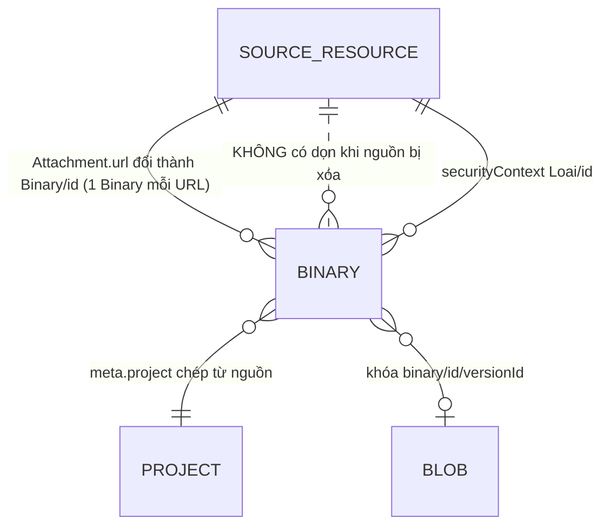

# 3. Quan hệ và toàn vẹn dữ liệu

**Không có khóa ngoại nào** trong schema `fhir`. Mọi quan hệ của downloader là *logic*: chuỗi trong JSON (`Attachment.url` = `Binary/<id>`, `Binary.securityContext` = `<Loại>/<id>`, `meta.project`) và khóa kho `binary/<id>/<versionId>`. Toàn vẹn do **mã ứng dụng, `If-Match` và từng transaction riêng lẻ** giữ; không có transaction nào bao cả `Binary`, kho và resource nguồn.

## 3.1 Sơ đồ logic

Đường chấm là *thiếu* liên kết dọn dẹp: xóa resource nguồn không xóa `Binary` đã tải (03 mục 3.5).

## 3.2 Bảng quan hệ

Cột **Toàn vẹn** nêu *ai kiểm và ở đâu*; "không ai" nghĩa là không có kiểm nào trong mã đã đọc. **Khi xóa phía "đến"**: không có `ON DELETE`; cột nêu hành vi thực tế.

| Từ | Đến | Bản số | Cách nối | Bắt buộc | Toàn vẹn | Khi xóa phía "đến" | Bằng chứng |
|---|---|---|---|---|---|---|---|
| `Attachment.url` (resource nguồn) | `Binary` | n-1 (nhiều attachment trùng URL trong một resource dùng chung một `Binary`) | chuỗi `Binary/<id>` trong JSON, **không** có chỉ mục tham chiếu (có thể tìm qua `uri` như `DocumentReference.location`) | chỉ sau khi tải | `Binary` và nội dung kho được tạo **trước**, đổi `url` **sau** bằng `If-Match`; ghi nguồn thất bại thì `drop` | xóa mềm `Binary` thì `GET Binary/{id}` trả `410`; `url` trong nguồn vẫn trỏ tới | `pkg/fhirdownload/download.go` (`downloadOne`) |
| `Binary.securityContext` | resource nguồn | n-1 | `Reference.reference` = `<Loại>/<id>` | có (luôn đặt) | downloader đặt từ `ev.ResourceType`/`ev.ID` của sự kiện; không kiểm lại nguồn còn tồn tại sau đó | nguồn bị xóa: `Binary` còn, `securityContext` trỏ vào tombstone; **không ai dọn** | `download.go` (`bin := &fhir.Binary{...}`) |
| `Binary.meta.project` | `Project` (của `auth`) | n-1 | chuỗi id, không chỉ mục | khi nguồn có project | downloader chép từ `meta.project` của nguồn đã đọc ở đầu `downloadOne` | `Project` bị xóa: `Binary` còn; không ai dọn | `download.go`; test `TestDownloadsExternalAttachmentIntoProjectBinary` |
| `Binary` | blob ở kho | 1-1 (mỗi phiên bản `Binary` một blob; service chỉ tạo phiên bản 1) | khóa `binary/<id>/<versionId>` (`binarystore.Key`) | có | thứ tự **CSDL trước, kho sau**; lỗi kho thì `drop` (xóa blob rồi `DeleteResource` Binary) | `DeleteResource` (xóa mềm) **không** xóa blob; `drop` xóa blob riêng | `download.go` (`drop`) |
| Sự kiện Redis → resource nguồn | `fhir_resource` | n-1 | `resource_type` và `id` trong `ChangeEvent`; service **đọc lại** từ CSDL | có | handler đọc `ReadResource`; `404`/`410` thì bỏ qua (ACK); URL không còn thì bỏ qua | không áp dụng | `download.go` (`downloadOne`, `gone`, `hasURL`) |
| Bản cập nhật nguồn → sự kiện Redis | stream | 1-1 | phát **sau commit** (`fhirsub.Wrap`) | không | không có outbox: chết đúng giữa commit và phát thì sự kiện mất; lỗi phát chỉ log | không áp dụng | `pkg/fhirsub/repo.go` (`publish`) |

## 3.3 Luật toàn vẹn và đồng thời

| Luật | Cơ chế | Bằng chứng |
|---|---|---|
| Không tải lại điều đã tải (idempotent) | handler đọc nguồn, thấy `url` đã là `Binary/<id>` (không còn URL ngoài) thì thoát | `hasURL`; `TestRedeliveredEventDoesNotDownloadTwice` |
| Không ghi đè bản mới hơn của nguồn | đọc **lại** nguồn ngay trước khi ghi, ghi bằng `UpdateOptions.IfMatch = versionId`; thua (`412`) thì xóa `Binary` và nội dung vừa tạo rồi **trả lỗi để thử lại** trên phiên bản mới | `download.go`; `TestVersionConflictCleansUpAndRetrySucceeds` |
| Nguồn đã đổi hoặc bị xóa trong lúc tải | `ReadResource` lần hai: `410`/`404` thì dọn và bỏ; URL không còn khớp (`n == 0`) thì dọn và bỏ | `TestResourceChangedOrDeletedWhileDownloading` |
| `Binary` thuộc đúng project | service tự gán `meta.project` từ nguồn (kho gốc không tự gán) | `download.go` |
| Không tải ngoài danh sách | `wanted`: `http(s)` tuyệt đối, bỏ `OwnPrefixes` và `Ignored`, nếu `Allowed` không rỗng thì phải khớp một tiền tố; chống SSRF ở `safehttp` (kiểm lại lúc kết nối) | `download.go` (`wanted`), `pkg/safehttp` |
| Một URL lỗi tạm làm lỗi cả sự kiện | `process` dừng ở URL đầu lỗi và trả lỗi; các URL **trước** đã đổi (idempotent khi giao lại), các URL **sau** chưa thử | `download.go` (`process`) |
| Mỗi lần ghi là một transaction riêng | `fhirstore.inTx` | `pkg/fhirstore/crud.go` |

**Kẽ hở (suy từ mã, chưa tái hiện bằng test):**

1. **Ghi `Binary` rồi mới ghi kho, nên chết giữa chừng để lại `Binary` mà không có nội dung** (hoặc có nội dung mà `Binary` không được tham chiếu): xem 3.5.
2. **`drop` có thể thất bại im lặng**: xóa blob lỗi hoặc `DeleteResource` lỗi 5 lần (chờ 10, 20, 40, 80, 160 ms) chỉ được `slog.Warn` (`không xóa được nội dung`, `không xóa được Binary`) và mã trả lỗi gốc; khi đó blob hoặc `Binary` sống nhưng không ai tham chiếu.
3. **Sự kiện tự thân gây xử lý lặp**: mỗi bản cập nhật `url` là một sự kiện mới tới chính nhóm `fhir-downloader`; resource nhiều URL ngoài bị đọc lại N lần (an toàn nhờ `hasURL`, nhưng tốn đọc CSDL).
4. **Hai nơi cùng tải** khi `fhir-server` còn `FHIR_AUTO_DOWNLOAD_WORKER=true` (mặc định) và downloader chạy: có thể tải hai lần cho một URL; bên thua `If-Match` hoặc thấy `url` đã đổi thì dọn bằng `drop` (để lại tombstone như mục 1.4) ([architecture.md](../architecture.md)).

## 3.4 Xóa: xóa mềm và dữ liệu nằm lại

| Dữ liệu | Hành vi khi bị xóa | Ai xóa vĩnh viễn |
|---|---|---|
| `Binary` bị bù trừ (`drop`) | `DeleteResource` = **xóa mềm**: dòng `fhir_resource` thành tombstone `{"resourceType":"Binary"}`, `deleted=true`, chỉ mục bị xóa, thêm dòng `fhir_history` kiểu `DELETE`; **dòng v1 (có `securityContext` và `meta.project`) nằm lại** | **không ai** (không gọi `Expunge`) |
| Nội dung ở kho của `Binary` bị bù trừ | `Blobs.Delete` ngay trong `drop` | `drop` (chỉ khi xóa không lỗi) |
| URL gốc của attachment | bị thay ở dòng hiện tại; **nằm lại** ở `fhir_history` của nguồn và trong sự kiện đã phát | **không ai** |
| `Binary` của tệp đã tải thành công | không bao giờ bị xóa bởi service | `fhir-server` (xóa `Binary` hoặc `$expunge` quản trị) |
| Sự kiện đã xử lý | `XACK` chỉ gỡ khỏi PEL, **không** xóa khỏi stream | không ai (không `XTRIM`, không `MAXLEN`) |

## 3.5 Mồ côi và dọn dẹp

| Dữ liệu | Khi nào thành mồ côi | Ai dọn | Còn tồn |
|---|---|---|---|
| Dòng `Binary` không có blob | chết (hoặc `Put` lỗi mà `drop` cũng lỗi) giữa `CreateResource` Binary và `Blobs.Put` | **không ai** (`sweep-binary` chỉ đi từ blob sang CSDL) | dòng `Binary` sống, `GET Binary/{id}` lỗi vì thiếu nội dung |
| Blob có dòng `Binary` nhưng không attachment nào trỏ tới | chết giữa `Put` và `UpdateResource` nguồn; hoặc `drop` xóa `Binary` mềm nhưng xóa blob lỗi | **không ai**: `fhirbinary.Sweep` coi khóa là còn sống nếu `ReadVersion` thấy phiên bản **kể cả bản xóa** (`pkg/fhirbinary/sweep.go`), mà `Binary` luôn có dòng trước khi ghi blob | blob và dòng `Binary` nằm lại, tốn dung lượng, vẫn đọc được bằng id |
| Blob không có dòng `Binary` nào | **không xảy ra** với service này (CSDL luôn ghi trước kho) | `fhir-server sweep-binary` | — |
| `Binary` khi resource nguồn bị xóa | xóa nguồn không động tới `Binary` | **không ai** | `Binary` và blob còn; `securityContext` trỏ vào resource đã xóa |
| Sự kiện trong `:dead` | lần giao thứ 5 vẫn lỗi (04 mục 4.2) | không ai | nằm vĩnh viễn |

Lệch với tài liệu cũ: [architecture.md](../architecture.md) ghi "dọn bằng `fhir-server sweep-binary`" cho trường hợp chết giữa tạo `Binary` và ghi kho; đọc mã cho thấy `sweep-binary` **không** dọn các trường hợp này (chỉ dọn blob mà CSDL trả `404` cho mọi phiên bản). Chưa tái hiện bằng chạy thật.

## 3.6 Vòng đời một lần tải

Sơ đồ trạng thái đầy đủ ở [business/04](../business/04-luat-va-phan-quyen.md) mục 4.1. Hệ quả cho dữ liệu: chỉ nhánh `GhiKho` → `DoiUrl` → `Xong` để lại thứ bền (`Binary` sống, blob, nguồn đã đổi `url`); các nhánh lỗi sau khi tạo `Binary` để lại tombstone và lịch sử (mục 1.4); các nhánh `Bo`/`Chan` không để lại gì.
