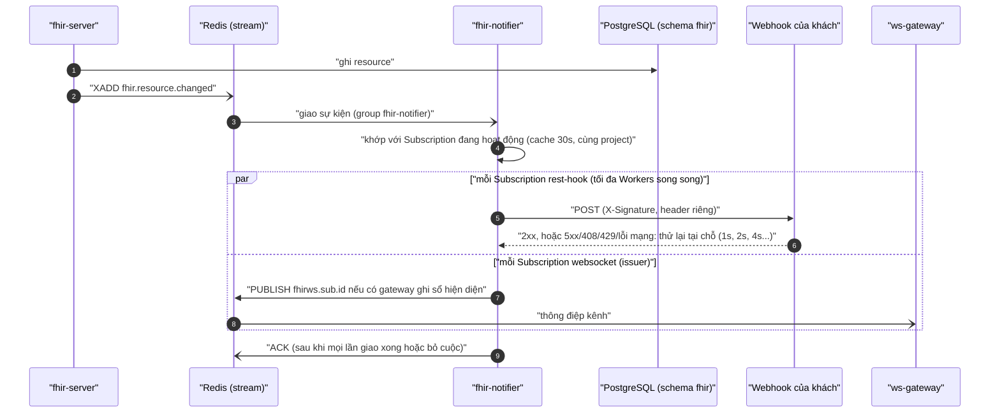

# fhir-notifier: kiến trúc

## Vì sao tách

Theo mục 1 của [service-principles.md](../../../docs/service-principles.md); đã thử bậc rẻ hơn (cùng binary với cờ `FHIR_SUBSCRIPTION_DELIVERY` của `fhir-server`, có từ bước S1) và chọn bậc 3 theo quyết định D-SP-1 của người dùng (2026-11-24).

| Điều kiện | Có không | Bằng chứng |
|---|---|---|
| **C. Miền lỗi, vòng đời deploy** | **Có** | webhook chậm hoặc chết chiếm worker, kết nối và bộ nhớ của API (hàng đợi giao 1024 trong bộ nhớ, `fhirsub.Manager`); restart API là mất thông báo đang chờ và đang hẹn thử lại (P3a). Tách ra thì API không còn gọi webhook ra ngoài và deploy API không làm rớt thông báo |
| A. Hồ sơ tải khác | Có thể, **chưa có số đo** | tải theo số sự kiện x số Subscription (khớp `criteria`) và chờ I/O ngoài; chưa đo |
| B. Dữ liệu hoặc bí mật riêng | **Không** | dùng chung schema `fhir` với `fhir-server` (D-DW-1, D-SP-8). Lợi ích về bí mật: header xác thực và `subscription-secret` trong Subscription chỉ cần đọc ở đây; không cần `FHIR_JOB_SIGNING_KEY`, JWKS của `auth`, khóa ký token websocket |
| D. Đội khác | không | |

Hệ quả phải nói thẳng: chia role DB riêng không thu hẹp được gì vì `fhir_resource` chứa mọi loại; lợi ích thật là tách miền lỗi, chính sách mạng (chỉ service này gọi webhook) và độ bền.

## Luồng

Subscription được nạp từ kho gốc (cache 30 giây; sự kiện của chính Subscription làm mới ngay). Subscription chỉ nhận sự kiện của cùng `meta.project`. Tự tắt: đếm thất bại dùng chung các replica trên Redis; đủ ngưỡng `FHIR_SUBSCRIPTION_AUTO_DISABLE` thì chuyển `status=off` kèm `error` bằng `If-Match`.

## Độ bền (P0-1, hướng (a) của D-SP-4)

Giao **đồng bộ trong handler** của Redis Stream (`fhirsub.Config.Durable`): handler chỉ trả nil, broker mới ACK, khi mọi lần giao của sự kiện đã **thành công** hoặc đã **bỏ cuộc** (lỗi không thử lại được, hoặc hết `FHIR_WEBHOOK_MAX_ATTEMPTS`). Hệ quả:

- **Chết hoặc tắt giữa lúc giao**: lần giao đang chạy bị hủy, handler trả lỗi, message ở lại PEL; replica nào đó nhận lại sau `BROKER_CLAIM_IDLE` rồi giao lại. Không mất thông báo đang chờ hay đang hẹn thử lại (trước đây nằm trong bộ nhớ). Test: `TestAnotherReplicaDeliversWhatTheStoppedOneLeftUnfinished`.
- **Giao ít nhất một lần, có thể trùng**: Subscription đã được giao thành công trước khi chết sẽ nhận lại cùng sự kiện khi message được xử lý lại. Bên nhận phải khử trùng lặp (header không có mã sự kiện riêng; `X-Medplum-Subscription` và nội dung resource có `meta.versionId` giúp khử trùng).
- **Bỏ cuộc không bị dead-letter**: thông báo đã hết lượt thử chỉ được ghi log (`fhirsub: giao thất bại, bỏ cuộc`) và tính vào ngưỡng tự tắt rồi message được ACK; không có nơi lưu để giao lại sau. Dead-letter (`...:dead`) chỉ dành cho message mà handler cứ lỗi vì tắt máy quá `MaxDeliveries` (5) lần.
- **`BROKER_CLAIM_IDLE` phải dài hơn chuỗi giao xấu nhất** (mặc định tự tính: hơn gấp đôi `MaxAttempts` x `Timeout` cộng các lần chờ, tối thiểu 1 phút); ngắn hơn thì replica khác nhận lại message còn đang giao và giao trùng. Cấu hình từ chối giá trị ngắn hơn `FHIR_WEBHOOK_MAX_ATTEMPTS` x `FHIR_WEBHOOK_TIMEOUT`. Hệ quả ngược: instance chết thì thông báo dở dang trễ ít nhất chừng đó trước khi được giao lại.
- **Webhook chậm không chặn hàng đợi**: `FHIR_WEBHOOK_WORKERS` sự kiện xử lý song song (`messaging.RedisOptions.Concurrency`) và tối đa chừng đó webhook giao song song cho mỗi sự kiện. Đổi lại thứ tự giao giữa các sự kiện không được bảo đảm (tài liệu hiện có đã ghi không bảo đảm thứ tự).
- **Một sự kiện khớp nhiều Subscription chậm**: handler chỉ xong khi Subscription chậm nhất xong (tới vài chục giây ở cấu hình mặc định), giữ một message PEL và một slot song song trong thời gian đó.

## Websocket

Với `FHIR_WS_MODE=issuer` (cùng giá trị với `fhir-server`): `Manager.AttachRemote` khớp một lần cho cả cụm (handler nhóm) rồi phát `WSMessage` lên kênh `fhirws.sub.<id>` nếu sổ hiện diện báo có `ws-gateway` đang giữ socket bind Subscription đó. Việc phát này **không bền** (Redis pub/sub, at-most-once, như thiết kế cũ). Cấp token bind (`$get-ws-binding-token`) **vẫn ở `fhir-server`** vì cần kiểm quyền người gọi; service này không có khóa ký token. `FHIR_WS_MODE=embedded` (Hub trong tiến trình) bị từ chối.

## Lắp ráp (`internal/bootstrap`)

| Thành phần | Chi tiết |
|---|---|
| DB | `pkg/database` với schema `fhir`; **không migrate**: `fhirstore.Pending > 0` thì từ chối khởi động |
| Broker | `pkg/messaging` driver `redis` cố định (D-SP-3), consumer group `BROKER_GROUP` (mặc định `fhir-notifier`), `Concurrency = FHIR_WEBHOOK_WORKERS`, `ClaimIdle` như trên |
| Manager | `pkg/fhirsub`, `Durable=true`, đọc và tự tắt Subscription qua kho gốc, đếm thất bại bằng `RedisFailureTracker` (dùng chung replica) |
| Probe | `/healthz`, `/health/live`, `/health/startup` (không phụ thuộc ngoài); `/health/ready` kiểm database và Redis, 503 khi đang tắt |
| Dừng | Manager dừng trước (hủy lần giao đang chạy), rồi broker (chờ handler), rồi DB |

Không import `apps/fhir-server` (C-1). Hợp đồng dây với `fhir-server`: sự kiện `fhirsub.EventType` (`fhirsub.ChangeEvent`), schema `fhir`, kênh và sổ hiện diện websocket (`fhirsub.WSChannel`, `WSPresenceKey`).

## Consumer group: vì sao khác `trivita`

`fhir-server` nghe với group `trivita`. Cùng group thì hai bên **chia nhau** sự kiện, nên một sự kiện có thể rơi vào bên không giao. `fhir-notifier` dùng group riêng để **cùng nhận mọi sự kiện**; nhiều replica của chính nó dùng chung `BROKER_GROUP` để chia việc. Cấu hình từ chối `BROKER_GROUP=trivita`.

## Đánh đổi và giới hạn

- **Giai đoạn chuyển**: nếu `fhir-server` còn giao (`FHIR_SUBSCRIPTION_DELIVERY=true`, mặc định) cùng lúc service này chạy thì mỗi Subscription được giao hai lần. Phải tắt giao ở API ngay khi bật service này (xem runbook).
- **Không có số đo** cho điều kiện A (chi phí khớp theo số Subscription, thông lượng giao).
- **Cache Subscription 30 giây**: Subscription mới có thể trễ tới chừng đó ở replica khác (sự kiện của chính Subscription làm mới ngay ở replica nhận nó).
- `secret` và header xác thực của Subscription vẫn lưu rõ trong resource (như trước).
- Độ dài stream Redis và cảnh báo khi service này sập lâu chưa được quy định (stream tích tụ).
