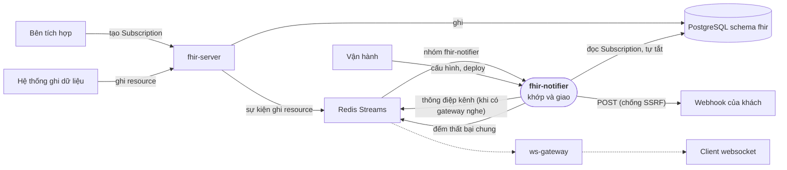
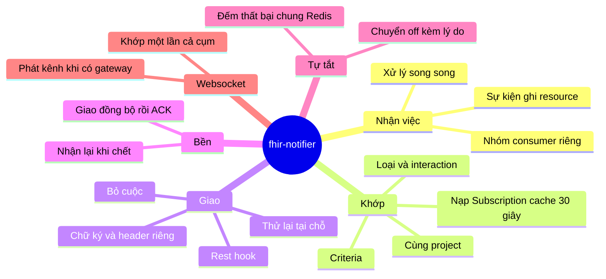
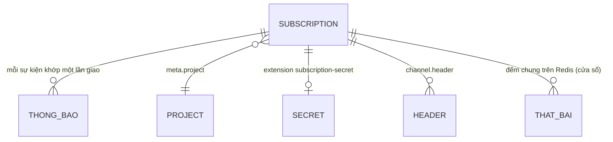
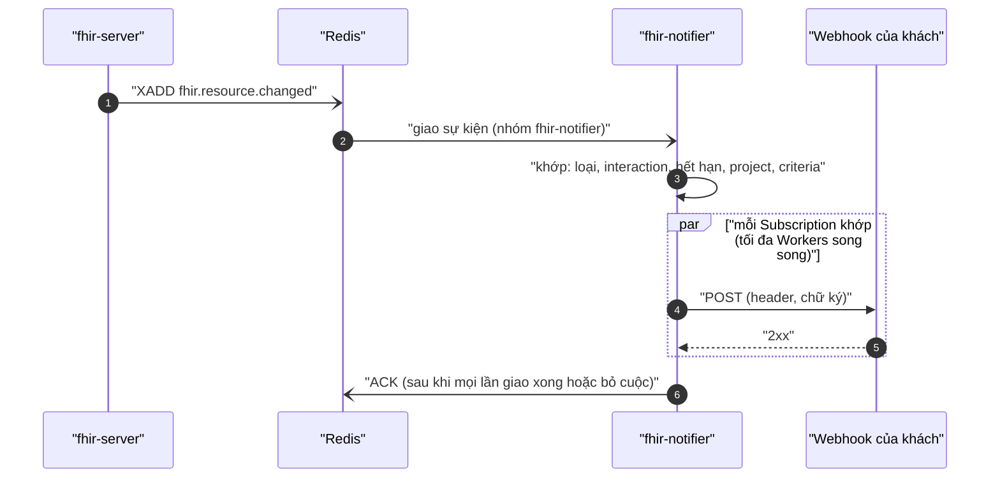
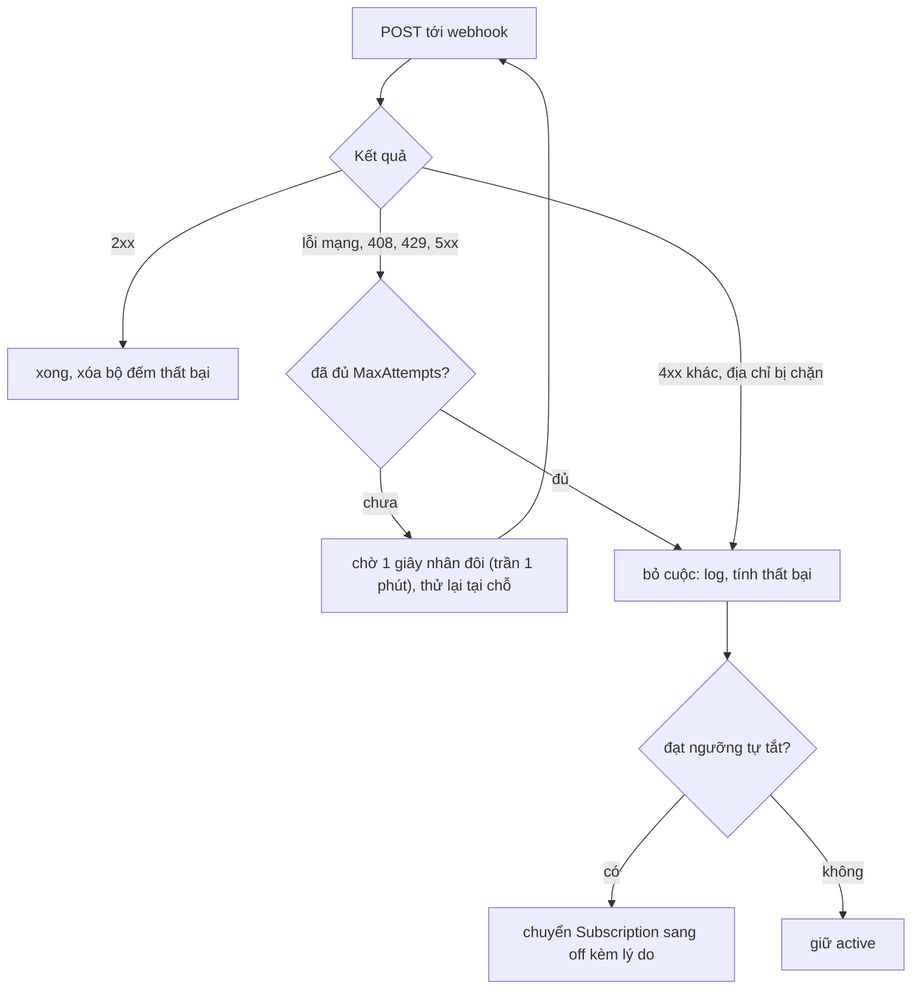

# 1. Tổng quan nghiệp vụ và luồng nghiệp vụ

## 1.1 Mục tiêu và giá trị

Khách (bên tích hợp) tạo một `Subscription` ở `fhir-server` ("khi có resource khớp tiêu chí này thì báo cho tôi qua địa chỉ này"). `fhir-notifier` theo dõi các lần ghi resource, **khớp** với các Subscription đang hoạt động và **giao thông báo**: `POST` tới webhook của khách (rest-hook) hoặc phát lên kênh websocket cho `ws-gateway`.

| Giá trị | Cách đạt được |
|---|---|
| API không gánh việc gọi webhook | việc gọi ra ngoài và khớp tiêu chí nằm ở service này |
| Không mất thông báo khi deploy hoặc sập | giao bền: giao đồng bộ trong handler, chỉ ACK sau khi giao xong hoặc bỏ cuộc; chết giữa chừng thì replica khác nhận lại |
| Webhook chậm không chặn người khác | nhiều sự kiện xử lý song song (`FHIR_WEBHOOK_WORKERS`) và nhiều Subscription của một sự kiện giao song song |
| Không lộ dữ liệu giữa tổ chức | Subscription chỉ nhận sự kiện cùng `meta.project` |
| Không gọi tới địa chỉ nội bộ | `pkg/safehttp` chặn dải nội bộ trước và lúc kết nối |
| Subscription hỏng tự dừng | đủ ngưỡng thất bại thì tự chuyển `off` (đếm chung các replica trên Redis) |

## 1.2 Ranh giới hệ thống

**Làm:** nhận sự kiện, nạp Subscription đang hoạt động (cache 30 giây), khớp theo loại, interaction, hết hạn, project và `criteria`, giao rest-hook (thử lại tại chỗ, bỏ cuộc), tự tắt Subscription lỗi lặp lại, phát sự kiện websocket lên kênh Redis.
**Không làm:** nhận yêu cầu của người dùng, tạo hay sửa Subscription (chỉ tự tắt), cấp token websocket (API làm), giữ kết nối websocket (`ws-gateway`), kiểm Subscription lúc tạo, lưu thông báo đã bỏ cuộc để giao lại, migrate schema.

## 1.3 Tác nhân

| Mã | Tác nhân | Là ai | Xác thực bằng | Việc chính |
|---|---|---|---|---|
| A1 | **Bên tích hợp** | Khách tạo Subscription và vận hành webhook | token ở `fhir-server` | Tạo Subscription; nhận webhook; khử trùng lặp |
| A2 | **Hệ thống ghi dữ liệu** | Bất kỳ client ghi resource | token ở `fhir-server` | Gây ra sự kiện |
| A3 | **fhir-server** | API | không áp dụng | Ghi resource, phát sự kiện, cấp token websocket |
| A4 | **Webhook của khách** | Máy nhận | tùy khách (header riêng, chữ ký) | Trả `2xx` khi nhận được |
| A5 | **ws-gateway** | Giữ kết nối websocket | Redis | Ghi sổ hiện diện, nghe kênh Subscription |
| A6 | **Vận hành** | SRE | quyền máy chủ | Bật service, đặt cấu hình, xử lý sự cố |
| A7 | **Replica khác** | `fhir-notifier` cùng nhóm | cùng Redis và CSDL | Chia việc, nhận lại việc dở |

## 1.4 Bản đồ năng lực

## 1.5 Thuật ngữ

| Thuật ngữ | Nghĩa nghiệp vụ |
|---|---|
| **Subscription** | Resource FHIR khai báo tiêu chí (`criteria`, ví dụ `Patient?family=Smith`) và kênh nhận (`rest-hook` có `endpoint` hoặc `websocket`) |
| **Giao bền** | Giao đồng bộ ngay trong xử lý sự kiện; chỉ ACK sau khi mọi lần giao đã xong (giao được hoặc bỏ cuộc) |
| **Bỏ cuộc** | Hết số lần thử hoặc lỗi không thử lại được: ghi log, tính vào ngưỡng tự tắt, **không** lưu để giao lại |
| **Tự tắt** | Chuyển `Subscription.status` sang `off` kèm `error` khi đủ `FHIR_SUBSCRIPTION_AUTO_DISABLE` thất bại trong cửa sổ thời gian |
| **Sổ hiện diện** | Khóa Redis `fhirws.bound.<id>` cho biết có `ws-gateway` đang giữ socket bind Subscription đó |
| **Nhóm consumer** | `BROKER_GROUP` (mặc định `fhir-notifier`), khác `trivita` của `fhir-server` |
| **Giao ít nhất một lần** | Thông báo có thể tới hai lần (sau khi chết giữa lúc giao); không bao giờ cố ý mất khi chỉ do restart |

## 1.6 Mô hình dữ liệu nghiệp vụ

Sự thật cần nhớ: (1) service **không có dữ liệu bền riêng**: chỉ đọc Subscription và (khi tự tắt) ghi `status`, `error` bằng `If-Match`; thông báo không được lưu; (2) bộ đếm thất bại nằm ở Redis, tự hết hạn; (3) không có khóa ngoại.

---

## 1.7 Luồng nghiệp vụ

### BF-1. Giao rest-hook bền

**Mục tiêu:** báo cho bên nhận mỗi khi resource khớp, không mất khi restart. **Các bên:** A2, A3, `fhir-notifier`, A4.

**Kết quả:** bên nhận có thông báo; sự kiện được ACK. **Điều không thấy trong hình:** thông báo chỉ gồm resource sau khi ghi (`create`, `update`) hoặc `{}` khi `delete`; thứ tự giữa các sự kiện không được bảo đảm. **Chức năng:** F-01..F-04.

### BF-2. Thử lại và bỏ cuộc

**Kết quả:** giao được hoặc bỏ cuộc; sự kiện luôn được ACK sau đó. **Điều không thấy trong hình:** bỏ cuộc không lưu thông báo; tắt máy giữa lúc thử lại thì sự kiện nằm lại PEL và replica khác giao lại từ đầu (BF-5). **Chức năng:** F-04, F-05.

### BF-3. Tự tắt Subscription lỗi lặp lại

Khi đặt `FHIR_SUBSCRIPTION_AUTO_DISABLE` (ví dụ 10 thất bại trong 3.600 giây): mỗi lần bỏ cuộc ghi một thất bại vào bộ đếm chung trên Redis; một lần giao thành công xóa bộ đếm; đủ ngưỡng thì đọc Subscription, nếu còn `active` thì chuyển `status=off` và `error` = `Automatically disabled after N consecutive failed events in the last S seconds` bằng `If-Match` (bị sửa song song thì thôi, lần thất bại sau xét lại). Muốn bật lại: bên tích hợp sửa bên nhận rồi đặt lại `status=active`. **Chức năng:** F-06.

### BF-4. Websocket qua gateway

Với `FHIR_WS_MODE=issuer`: service khớp **một lần cho cả cụm**; nếu sổ hiện diện báo có `ws-gateway` đang giữ socket bind Subscription đó thì phát `{"sub","event"}` lên kênh Redis `fhirws.sub.<id>` để gateway đẩy cho client; nếu không có gateway nào nghe thì không phát (bộ đếm `Unheard`). Việc phát này **không bền**. Token bind do `fhir-server` cấp. **Chức năng:** F-07.

### BF-5. Dừng, sập và nhận lại

Tắt êm hoặc chết giữa lúc giao: lần giao đang chạy bị hủy, message không được ACK và ở lại PEL; replica khác nhận lại sau `BROKER_CLAIM_IDLE` (mặc định tối thiểu 1 phút) và **giao lại từ đầu** (kể cả Subscription đã được giao trước đó: trùng). Sự kiện ghi lúc service không chạy vẫn nằm trong stream và được giao khi chạy lại. Redis chết: `/health/ready` `503`, liveness `200`, tự nối lại. **Chức năng:** F-01, F-08.

### BF-6. Chuyển giao từ API sang service

Dựng `fhir-notifier` (cùng CSDL, Redis, `FHIR_WS_MODE`, `FHIR_SUBSCRIPTION_AUTO_DISABLE`), kiểm ready; đặt `FHIR_SUBSCRIPTION_DELIVERY=false` ở `fhir-server` (giữ `FHIR_SUBSCRIPTIONS=true` để API còn phát sự kiện) và khởi động lại; chặn đường gọi webhook ra ngoài của API ở hạ tầng. Quay lại: đặt `true` (tùy chọn `FHIR_WEBHOOK_DURABLE=true`), rồi dừng service. Hai bên cùng giao thì mỗi Subscription nhận hai lần. **Chức năng:** F-01, F-08. Chi tiết ở [../runbook.md](../runbook.md).
