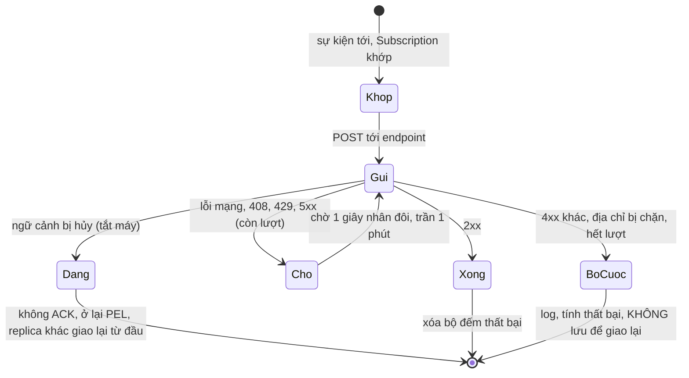
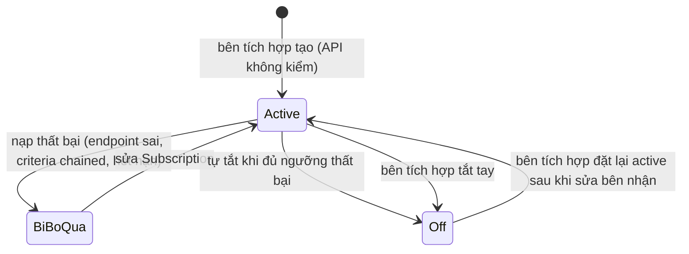

# 4. Luật nghiệp vụ, quyền, vòng đời, truy vết

## 4.1 Vòng đời

### Một lần giao (một Subscription, một sự kiện)

### Subscription

Điều không thấy trong hình: `BiBoQua` **không phải trạng thái của resource** (vẫn `active`); chỉ có log WARN và Subscription không nhận được gì. Chỉ `Active -> Off` do service gây ra.

## 4.2 Quyền và ranh giới an toàn

`fhir-notifier` **không có người gọi** nên không có token hay vai trò. Quyền và ranh giới đến từ:

| Cơ chế | Hiệu lực |
|---|---|
| Subscription chỉ nhận sự kiện cùng `meta.project` | chống rò dữ liệu giữa tổ chức (khớp theo project của Subscription và của resource) |
| `pkg/safehttp` | chặn webhook tới địa chỉ nội bộ (loopback, mạng riêng, link-local, CGNAT, `0.0.0.0/8`...), kiểm lúc kết nối (chống DNS rebinding) |
| Role DB `fhir_app` + `DATABASE_REQUIRE_SCHEMA` | chỉ schema `fhir`; không đọc `identity` |
| Chính sách mạng ở hạ tầng | chỉ service này được gọi ra webhook (lý do chính của việc tách; **không** mô phỏng được trong compose) |
| Chữ ký `X-Signature` | bên nhận xác minh thông báo đến từ hệ thống (nếu Subscription có `secret`) |

Hệ quả cần biết: (1) Subscription **không có AccessPolicy** của người tạo áp lên nội dung thông báo ở service này: thông báo gồm **toàn bộ JSON resource khớp trong project**, không lọc theo quyền người tạo Subscription (khác kênh websocket ở `ws-gateway` có lọc theo quyền từng người nhận); (2) ai tạo được Subscription trong project đều nhận được dữ liệu khớp; (3) `secret` và header xác thực lưu rõ trong Subscription (BR-17).

## 4.3 Luật nghiệp vụ

### Nhận và khớp (BR-01..05)

| Mã | Luật | Loại | F |
|---|---|---|---|
| BR-01 | Nhận mọi sự kiện ghi resource qua consumer group `BROKER_GROUP` (mặc định `fhir-notifier`, khác `trivita`; cấu hình từ chối `trivita`); mỗi message giao cho một replica trong nhóm. | OPS | F-01 |
| BR-02 | Một Subscription chỉ khớp khi: cùng loại resource; `interaction` thuộc danh sách hỗ trợ (rỗng là mọi interaction); chưa quá `end`; cùng `meta.project` với resource; resource khớp `criteria`. | SEC | F-03 |
| BR-03 | Lỗi khi đối sánh một Subscription chỉ làm bỏ Subscription đó (log WARN), không ảnh hưởng Subscription khác của cùng sự kiện. | OPS | F-03 |
| BR-04 | Danh sách Subscription đang hoạt động được cache `CacheTTL` (30 giây); sự kiện của chính Subscription làm mới ngay ở replica nhận nó; replica khác thấy thay đổi sau tối đa 30 giây. | OPS | F-02 |
| BR-05 | Subscription chỉ nhận kênh `rest-hook` hoặc `websocket`; bị bỏ qua khi nạp (log WARN, `status` vẫn `active`) nếu endpoint không hợp lệ, `criteria` không dùng được, `criteria` chained hoặc `_has` hoặc modifier terminology; API không kiểm lúc tạo. | OPS | F-02 |

### Giao (BR-06..13)

| Mã | Luật | Loại | F |
|---|---|---|---|
| BR-06 | Thông báo rest-hook là `POST` tới `channel.endpoint` với thân là JSON resource (`{}` khi `delete`) và header `Content-Type: application/fhir+json`, `X-Medplum-Subscription`, `X-Medplum-Interaction`, khi xóa thêm `X-Medplum-Deleted-Resource`. | DATA | F-04 |
| BR-07 | Header riêng của Subscription (`Tên: giá trị`) được thêm vào, trừ `Host`, `Content-Length`, `Transfer-Encoding`, `Connection`. | DATA | F-04 |
| BR-08 | Có `subscription-secret` thì thêm `X-Signature` = hex HMAC-SHA256 của thân bằng secret. | SEC | F-04 |
| BR-09 | Webhook tới địa chỉ nội bộ bị chặn (trước và lúc kết nối); bị chặn là lỗi không thử lại; `FHIR_WEBHOOK_ALLOW_PRIVATE` cấm ở staging/production. | SEC | F-04 |
| BR-10 | Giao đồng bộ trong handler: các lần giao của một sự kiện chạy song song tới `FHIR_WEBHOOK_WORKERS`, nhiều sự kiện cũng xử lý song song tới chừng đó; handler chỉ xong khi Subscription chậm nhất xong. Mỗi lần có hạn `FHIR_WEBHOOK_TIMEOUT` (mặc định 10 giây). | OPS | F-01, F-04 |
| BR-11 | Mọi `2xx` là thành công; lỗi mạng, `408`, `429`, `5xx` thử lại tại chỗ (chờ 1 giây nhân đôi, trần 1 phút) tối đa `FHIR_WEBHOOK_MAX_ATTEMPTS` lần (mặc định 5); các `4xx` khác bỏ cuộc ngay. | OPS | F-05 |
| BR-12 | **Giao ít nhất một lần**: ngữ cảnh bị hủy (tắt máy, chết) giữa lúc giao thì message không ACK và replica khác giao lại **toàn bộ sự kiện** sau `BROKER_CLAIM_IDLE`, kể cả Subscription đã được giao (trùng); webhook không có mã sự kiện riêng nên bên nhận tự khử trùng lặp. | OPS | F-04, F-09 |
| BR-13 | Bỏ cuộc (hết lượt hoặc lỗi không thử lại) chỉ ghi log và tính thất bại; thông báo **không** được lưu để giao lại sau và không vào dead-letter; sự kiện vẫn được ACK. | OPS | F-05 |

### Tự tắt và websocket (BR-14..15)

| Mã | Luật | Loại | F |
|---|---|---|---|
| BR-14 | Với `FHIR_SUBSCRIPTION_AUTO_DISABLE`: mỗi bỏ cuộc ghi một thất bại vào bộ đếm chung trên Redis; một lần giao thành công xóa bộ đếm; đủ ngưỡng thì Subscription còn `active` được chuyển `off` kèm `error` bằng `If-Match` (đã đổi trạng thái hoặc bị sửa song song thì không ghi đè). | OPS | F-06 |
| BR-15 | `FHIR_WS_MODE=issuer`: Subscription websocket được khớp một lần cho cả cụm và chỉ khi sổ hiện diện `fhirws.bound.<id>` còn member mới phát `{"sub","event"}` lên kênh `fhirws.sub.<id>`; không bền; `embedded` bị từ chối; chế độ tắt thì Subscription websocket bị bỏ qua. | OPS | F-07 |

### Vận hành (BR-16..21)

| Mã | Luật | Loại | F |
|---|---|---|---|
| BR-16 | Service không migrate: `fhirstore.Pending > 0` thì từ chối khởi động; cấu hình sai bị từ chối và nêu mọi lỗi. | DATA | F-08 |
| BR-17 | `secret` và header xác thực của Subscription nằm rõ trong resource Subscription (và lịch sử): ai đọc được Subscription đọc được chúng; service không ghi chúng vào log. | SEC | F-04 |
| BR-18 | `BROKER_CLAIM_IDLE` (mặc định tự tính: hơn gấp đôi chuỗi giao xấu nhất, tối thiểu 1 phút) quyết định độ trễ nhận lại việc dở; đặt ngắn hơn `FHIR_WEBHOOK_MAX_ATTEMPTS` x `FHIR_WEBHOOK_TIMEOUT` bị từ chối. | OPS | F-09 |
| BR-19 | `/health/ready` kiểm database và Redis (`503` khi hỏng hoặc đang tắt); liveness không phụ thuộc ngoài. | OPS | F-08 |
| BR-20 | `SIGTERM`: ready `503`, chờ `SHUTDOWN_DRAIN_DELAY`, hủy các lần giao đang chạy rồi đóng, thoát mã 0; việc dở ở lại PEL. | OPS | F-08 |
| BR-21 | Giai đoạn chuyển: nếu `fhir-server` còn `FHIR_SUBSCRIPTION_DELIVERY=true` cùng lúc thì mỗi Subscription nhận hai lần; phải tắt giao ở API ngay khi bật service. | OPS | F-01 |

## 4.4 Bảng thời hạn và giới hạn

| Hạng mục | Mặc định | Cấu hình |
|---|---|---|
| Hạn mỗi lần gọi webhook | 10 giây | `FHIR_WEBHOOK_TIMEOUT` |
| Số lần thử tối đa | 5 | `FHIR_WEBHOOK_MAX_ATTEMPTS` (1 đến 20) |
| Chờ giữa các lần thử | 1 giây nhân đôi, trần 1 phút | cố định |
| Sự kiện xử lý song song và lần giao song song mỗi sự kiện | 4 | `FHIR_WEBHOOK_WORKERS` (1 đến 256) |
| Cache Subscription | 30 giây | cố định |
| Nhận lại việc dở | tối thiểu 1 phút (tự tính) | `BROKER_CLAIM_IDLE` |
| Ngưỡng tự tắt | tắt | `FHIR_SUBSCRIPTION_AUTO_DISABLE` |

## 4.5 Kịch bản chấp nhận

| # | Kịch bản (Given When Then) | Luật |
|---|---|---|
| AT-01 | Given Subscription `Patient?family=Hooked` và `fhir-notifier` chạy, When ghi Patient "Hooked" và "Ignored", Then đúng một thông báo với header `X-Medplum-Subscription`, `X-Medplum-Interaction: create` và header riêng. | BR-02, BR-06, BR-07 |
| AT-02 | Given Subscription của project A, When ghi Patient khớp ở project B rồi ở project A, Then chỉ lần ở project A được giao. | BR-02 |
| AT-03 | Given máy nhận trả `503` hai lần rồi `200`, When giao, Then ba lần gọi, giao được, không giao thêm sau khi ACK. | BR-11 |
| AT-04 | Given máy nhận luôn lỗi, When giao với `MaxAttempts=4`, Then đúng 4 lần gọi rồi bỏ cuộc, không giao lại. | BR-11, BR-13 |
| AT-05 | Given máy nhận trả `4xx` khác, When giao, Then bỏ cuộc sau một lần. | BR-11 |
| AT-06 | Given endpoint là địa chỉ nội bộ và không bật `ALLOW_PRIVATE`, When giao, Then không gọi. | BR-09 |
| AT-07 | Given Subscription có secret, When giao, Then `X-Signature` đúng HMAC-SHA256; khi xóa resource thì thân là `{}` và có `X-Medplum-Deleted-Resource`. | BR-06, BR-08 |
| AT-08 | Given `fhir-server` (group `trivita`) và `fhir-notifier` cùng nghe, When ghi 6 resource khớp, Then notifier giao đủ 6 và group của fhir-server nhận đủ 7 sự kiện (gồm Subscription). | BR-01 |
| AT-09 | Given một webhook treo, When ghi sự kiện khác, Then sự kiện sau vẫn được giao (không chặn nhau). | BR-10 |
| AT-10 | Given service chưa chạy, When ghi resource rồi khởi động, Then thông báo được giao. | BR-01 |
| AT-11 | Given replica A đang giao (webhook treo) rồi dừng, When replica B (cùng nhóm) chạy, Then B nhận lại message chưa ACK và giao (≥ 2 lần gọi tổng cộng, trùng được chấp nhận). | BR-12, BR-18 |
| AT-12 | Given `FHIR_SUBSCRIPTION_AUTO_DISABLE` 2 thất bại trong 60 giây, When hai sự kiện đều bị bỏ cuộc, Then Subscription chuyển `off` với `error` `Automatically disabled after 2 consecutive failed events...`; sau lần đầu vẫn `active`. | BR-14 |
| AT-13 | Given `FHIR_WS_MODE=issuer` và Subscription websocket, When chưa có gateway ghi sổ hiện diện, Then khớp nhưng không phát (`Unheard`); When đã có, Then đúng một thông điệp lên kênh. | BR-15 |
| AT-14 | Given `FHIR_WS_MODE` tắt, When ghi resource khớp Subscription websocket, Then không phát và không đếm. | BR-15 |
| AT-15 | Given Subscription có endpoint không hợp lệ, `criteria` sai, hoặc đã hết hạn, When ghi resource, Then Subscription đó không giao (chỉ log), Subscription tốt vẫn giao. | BR-05 |
| AT-16 | Given schema chưa migrate hoặc cấu hình sai (`BROKER_GROUP=trivita`, `FHIR_WS_MODE=embedded`, `BROKER_CLAIM_IDLE` quá ngắn), When khởi động, Then từ chối nêu tên biến. | BR-01, BR-15, BR-16, BR-18 |
| AT-17 | Given Redis chết rồi sống lại, When đó, Then ready `503` (liveness `200`) rồi `200` và giao tiếp. | BR-19 |
| AT-18 | Given `SIGTERM`, When tắt, Then thoát mã 0; việc ghi lúc dừng được giao sau khi chạy lại và thông báo đã giao không bị giao lại. | BR-20 |
| AT-19 | Given role DB hẹp quyền và `DATABASE_REQUIRE_SCHEMA=true`, When ghi resource khớp, Then giao đúng một lần. | BR-16 |

## 4.6 Truy vết luật đến bằng chứng kiểm thử

| Nhóm luật | Test |
|---|---|
| BR-01 (nhóm consumer) | `apps/fhir-notifier/internal/bootstrap/bootstrap_test.go`: `TestEachConsumerGroupReceivesEveryEvent`, `TestDeliversEventsPublishedWhileTheServiceWasDown`; `apps/fhir-notifier/internal/config/config_test.go`: `TestInvalidConfigIsRejectedWithTheVariableName` |
| BR-02, BR-03 (khớp, project) | `apps/fhir-notifier/internal/bootstrap/bootstrap_test.go`: `TestDeliversWebhookForMatchingSubscriptionAnnouncedByTheAPI`, `TestSubscriptionOnlyReceivesEventsOfItsOwnProject`; `pkg/fhirsub/fhirsub_test.go`: `TestInteractionFilter`, `TestSubscriptionOnlySeesOwnProject` |
| BR-04, BR-05 (nạp, bị bỏ qua) | `pkg/fhirsub/fhirsub_test.go`: `TestSubscriptionChangesApplyImmediately`, `TestSkippedSubscriptions` |
| BR-06..08 (webhook, header, chữ ký) | `pkg/fhirsub/fhirsub_test.go`: `TestDeliveryForCreateUpdateDelete`; `apps/fhir-notifier/internal/bootstrap/bootstrap_test.go`: `TestDeliversWebhookForMatchingSubscriptionAnnouncedByTheAPI` |
| BR-09 (SSRF) | `pkg/fhirsub/fhirsub_test.go`: `TestSSRFGuardBlocksInternalTargets`; `apps/fhir-notifier/tests/e2e/notifier_test.go`: `TestBlocksInternalAddressesByDefaultInTheImage`; `pkg/safehttp/safehttp_test.go` |
| BR-10 (song song) | `apps/fhir-notifier/internal/bootstrap/bootstrap_test.go`: `TestSlowWebhookDoesNotBlockOtherEvents`; `pkg/fhirsub/durable_test.go`: `TestDurableSlowWebhookDoesNotBlockOthers`; `pkg/messaging/messaging_test.go`: `TestRedisConcurrencyDoesNotBlockBehindSlowHandler` |
| BR-11, BR-13 (thử lại, bỏ cuộc) | `apps/fhir-notifier/internal/bootstrap/bootstrap_test.go`: `TestRetriesInPlaceOnTemporaryFailureThenStops`; `pkg/fhirsub/durable_test.go`: `TestDurableDeliversInsideTheHandlerAndRetriesInPlace`, `TestDurableGivesUpOnPermanentErrorAndAcks`, `TestDurableStopsRetryingAfterMaxAttempts`; `pkg/fhirsub/fhirsub_test.go`: `TestRetries` |
| BR-12, BR-18 (giao ít nhất một lần, nhận lại) | `apps/fhir-notifier/internal/bootstrap/bootstrap_test.go`: `TestAnotherReplicaDeliversWhatTheStoppedOneLeftUnfinished`; `apps/fhir-notifier/tests/integration/integration_test.go`: `TestAnotherReplicaClaimsTheUnfinishedMessageOnRealRedis`; `pkg/fhirsub/durable_test.go`: `TestDurableRedeliversAfterTheDeliveringProcessStops`, `TestDurableClaimIdleCoversTheWorstDeliveryChain` |
| BR-14 (tự tắt) | `apps/fhir-notifier/internal/bootstrap/bootstrap_test.go`: `TestAutoDisablesSubscriptionAfterRepeatedFailuresSharedOnRedis`; `pkg/fhirsub/failure_test.go` |
| BR-15 (websocket) | `apps/fhir-notifier/internal/bootstrap/bootstrap_test.go`: `TestWebsocketIssuerPublishesToChannelOnlyWhenAGatewayListens`, `TestWebsocketSubscriptionsAreIgnoredWhenModeIsOff`; `pkg/fhirsub/ws_remote_test.go` |
| BR-16, BR-19, BR-20 (migrate, probe, tắt êm) | `apps/fhir-notifier/internal/bootstrap/bootstrap_test.go`: `TestRefusesToStartOnUnmigratedSchema`, `TestReadinessReflectsDependenciesAndDraining`, `TestRedisOutageMakesItNotReadyButStillAlive`, `TestServeShutsDownGracefullyOnSignal`; `apps/fhir-notifier/tests/integration/integration_test.go`: `TestDeliversUnderNarrowRoleAndRequiredSchema`, `TestSurvivesRedisOutage`; `apps/fhir-notifier/tests/e2e/notifier_test.go`: `TestStopsGracefullyAndResumesEventsAfterRestart`, `TestRefusesBadConfigurationAndUnmigratedSchema`, `TestImageIsHealthyNonRootAndDeliversEndToEnd` |
| BR-17, BR-21 | không có test (rủi ro lưu trữ và giai đoạn chuyển, xem 4.7) |

## 4.7 Lệch, rủi ro và điểm chưa kiểm

- **Giao ít nhất một lần (BR-12):** bên nhận phải khử trùng lặp; webhook không mang mã sự kiện riêng (chỉ `X-Medplum-Subscription`, `X-Medplum-Interaction` và nội dung resource có `meta.versionId`). Nên cân nhắc thêm header mã sự kiện.
- **Bỏ cuộc không lưu (BR-13):** thông báo hết lượt thử mất vĩnh viễn (chỉ còn log và bộ đếm tự tắt); không có dead-letter cho giao thất bại, không có API xem hoặc giao lại.
- **Subscription lỗi bị bỏ qua âm thầm (BR-05):** người tạo không biết; API không kiểm lúc tạo; `status` vẫn `active`.
- **Cache 30 giây (BR-04):** Subscription mới hoặc vừa tắt có hiệu lực chậm ở replica khác.
- **Nội dung thông báo không lọc theo quyền người tạo Subscription (4.2):** gồm toàn bộ resource khớp trong project; nếu cần giới hạn trường hoặc loại, phải kiểm lúc tạo Subscription (chưa có).
- **`secret` và header xác thực lưu rõ (BR-17).**
- **Một sự kiện giữ slot và PEL tới khi Subscription chậm nhất xong (BR-10):** tới vài chục giây ở cấu hình mặc định (5 lần x 10 giây cộng chờ); webhook chết làm mọi sự kiện cùng Subscription đó trễ.
- **Độ trễ nhận lại việc dở (BR-18):** tối thiểu 1 phút.
- **Chưa kiểm:** thông lượng và độ trễ khi có nhiều Subscription hoặc nhiều sự kiện (điều kiện A chưa có số đo, xem [../architecture.md](../architecture.md)); e2e với `ws-gateway` thật; webhook có chuyển hướng `3xx` (do `safehttp` giữ); hành vi khi Subscription có hàng nghìn bản.
