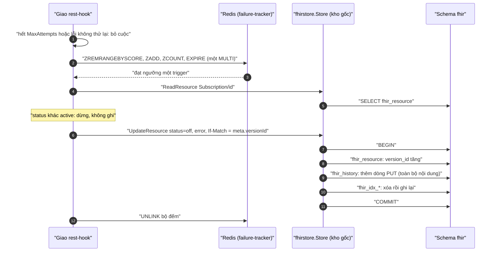

# 1. Bảng vật lý của fhir-notifier

`fhir-notifier` **không có bảng riêng**. Nó chạy trên bộ bảng "kho tài liệu FHIR" của `pkg/fhirstore` trong schema `fhir` (cùng schema và role với `fhir-server`). **Mọi bảng và cột được mô tả một lần, đầy đủ ghi chú chức năng**, ở [docs/erd/fhirstore-physical.md](../../../../docs/erd/fhirstore-physical.md); tệp này chỉ nêu phần riêng của notifier và **không migrate**.

## 1.1 Notifier dùng bảng nào

Notifier chỉ chạm CSDL ở **ba chỗ**, đều với loại `Subscription` (`pkg/fhirsub/manager.go` `load`, `pkg/fhirsub/failure.go` `autoDisable`); không có truy vấn nào khác (`grep "m.repo\."` trong `pkg/fhirsub` chỉ ra `Search`, `ReadResource`, `UpdateResource`; `ReadResource` ở `ws_token.go` thuộc bên cấp token, notifier không dùng).

| Bảng | Notifier dùng? | Ghi chú riêng của notifier |
|---|---|---|
| `fhir_resource` | **Có** | **Đọc:** `Subscription?status=active` (trang 1.000, phân trang bằng `Offset`) mỗi lần cache hết hạn (30 giây) hoặc bị làm mới; `ReadResource Subscription/<id>` trước khi tự tắt. **Ghi:** đúng một loại thao tác, `UpdateResource` đặt `status=off`, `error=<thông điệp>` (có `If-Match`). Không bao giờ tạo hoặc xóa |
| `fhir_history` | Có (tự động, khi ghi) | Mỗi lần tự tắt thêm một dòng `PUT` chứa **toàn bộ** Subscription (kể cả secret và header) |
| `fhir_idx_token` | Có (đọc: `status`; ghi lại khi tự tắt) | Điều kiện `status=active` dùng chỉ mục token `status`; tự tắt xóa dòng `status=active` và ghi `status=off` (cùng transaction với ghi resource) |
| `fhir_idx_string`, `_reference`, `_uri` | Chỉ phát sinh khi tự tắt (ghi lại chỉ mục) | Subscription có `criteria` (string), `author` (reference), `url` (uri) |
| `fhir_idx_date`, `_number`, `_quantity` | Không | Subscription không có tham số loại này |
| `fhir_coding`, `fhir_coding_property`, `fhir_coding_designation`, `fhir_concept_mapping` | **Không dùng** | Notifier không nạp terminology |
| `fhirstore_schema_version` | Chỉ đọc (kiểm `Pending`) | Bảng phiên bản goose do `fhir-server migrate` tạo; notifier từ chối chạy khi còn migration chưa chạy |

**Tài liệu đối chiếu:** thông báo giao đi **không đọc lại resource từ CSDL**: nội dung nằm sẵn trong sự kiện (`ChangeEvent.resource`), nên notifier không có truy vấn theo từng thông báo. Khối lượng đọc CSDL không phụ thuộc lưu lượng ghi, chỉ phụ thuộc số Subscription `active` và chu kỳ cache.

## 1.2 Schema, role, migration

| Chủ đề | Giá trị |
|---|---|
| Schema PostgreSQL | `fhir` (dùng chung với `fhir-server`, `fhir-worker`, `dicomweb`; `search_path` đặt ở mức role) |
| Role chạy ứng dụng | `fhir_app`: `USAGE` schema, `SELECT/INSERT/UPDATE/DELETE`, kể cả bảng do migration tương lai tạo; không DDL. Dùng thực tế: `SELECT`, `INSERT` (history, chỉ mục), `UPDATE`, `DELETE` (chỉ mục cũ) khi tự tắt |
| Role migration | `fhir_migrate` (chỉ khi `DB_SEPARATE_MIGRATION_ROLES=true`): **chỉ `fhir-server migrate up` dùng**; notifier không có lệnh migrate |
| Chế độ mặc định (dev) | SQLite hoặc một role sở hữu schema; notifier **không** tự migrate |
| Từ chối khởi động | `fhirstore.Pending > 0` (`schema chưa được migrate`), hoặc `DATABASE_REQUIRE_SCHEMA=true` mà `search_path` không phải đúng một schema riêng |
| Không đọc được | schema `identity` của `auth` (role `fhir_app` không có quyền) |
| Backend khác | SQLite (dev, cột `content` là text, không schema; cấm ở staging/production, `config.go`); MySQL: **chưa hỗ trợ** cho `fhirstore` |

## 1.3 Đường ghi duy nhất của notifier (tự tắt)

Khác với [đường ghi chung](../../../../docs/erd/fhirstore-physical.md): **không có sự kiện nào được phát sau commit** (kho gốc, không bọc `fhirsub.Repo`) và đọc rồi ghi **không nằm trong một transaction**; chống ghi đè bằng `If-Match` (`412` thì bỏ qua, lần thất bại sau xét lại).

## 1.4 Bảng lớn nhanh và hệ quả vận hành

| Bảng | Với notifier | Hệ quả |
|---|---|---|
| `fhir_history` | chỉ tăng một dòng mỗi lần tự tắt (hiếm) | không đáng kể; nhưng dòng đó **chứa secret và header ở bản rõ** (xem 03 mục 3.3) |
| `fhir_resource` | không tăng (chỉ UPDATE) | không |
| Tải đọc | một truy vấn `Subscription` mỗi 30 giây mỗi replica (cộng thêm khi có sự kiện loại `Subscription`) | tăng theo số replica, không theo lưu lượng. `Offset` phân trang: hàng nghìn Subscription `active` thì nhiều trang (chưa đo) |
