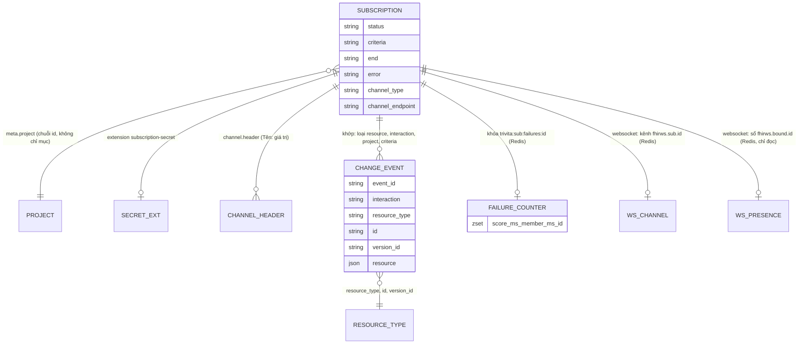

# 2. Mô hình logic

`fhir-notifier` chỉ sở hữu (theo nghĩa **sửa**) **một loại resource: `Subscription`**, và chỉ sửa hai trường của nó. Ngoài ra nó **đọc** nội dung mọi loại resource qua sự kiện trên stream (không từ CSDL). `Subscription` lưu ở `fhir_resource` (`resource_type='Subscription'`), schema `fhir`. Nhãn nhạy cảm S0..S4 theo `references/templates.md` của skill: S1 định danh kỹ thuật, S2 dữ liệu cá nhân, S3 dữ liệu lâm sàng, S4 bí mật xác thực.

## 2.1 ERD logic

Không có khóa ngoại và **không có bảng**: `CHANGE_EVENT` là message trên Redis Streams; `FAILURE_COUNTER`, `WS_CHANNEL`, `WS_PRESENCE` là khóa Redis ([04](04-kho-khac.md)); `SECRET_EXT` và `CHANNEL_HEADER` là phần tử bên trong JSON của Subscription; `PROJECT` thuộc `auth` (chỉ là chuỗi id ở đây).

## 2.2 Subscription

**Mục đích nghiệp vụ:** đăng ký nhận thông báo khi resource thay đổi: tiêu chí (`criteria`), nơi nhận (`channel`), thời hạn (`end`). **Lưu ở:** `fhir_resource`, schema `fhir`. **Ghi bởi:** `fhir-server` (người dùng tạo, sửa, xóa qua API; không kiểm `criteria` hay `endpoint` lúc tạo, xem business BR-05); **`fhir-notifier` chỉ ghi `status` và `error`** khi tự tắt. **Đọc bởi:** `fhir-notifier` (`buildEntry`: `status` `active`, `channel`, `criteria`, `end`, `meta.project`, extension). **Dọn:** không có (không ai xóa Subscription hết hạn; `end` chỉ làm notifier bỏ qua nó).

| Trường | Kiểu | Bắt buộc | Chức năng | Nhạy cảm |
|---|---|---|---|---|
| `status` | string (`requested`, `active`, `error`, `off`) | có | Chỉ `active` được nạp (`Subscription?status=active`). **Notifier đổi `active` thành `off` khi tự tắt** (chỉ khi còn `active` lúc đọc lại). `requested` và `error` không do notifier đặt; có chỉ mục `status` (token) phục vụ truy vấn nạp | S1 |
| `criteria` | string `<Loại>?<tham số>` | có | Quy tắc khớp: phần trước `?` là loại resource (so với `resource_type` của sự kiện), phần sau là tham số tìm kiếm áp lên JSON resource trong bộ nhớ (`fhirsearch.Match`). Chained, `_has`, modifier terminology thì Subscription bị **bỏ qua âm thầm** (log WARN, `status` vẫn `active`). Có chỉ mục `criteria` (string) | S1 (nhưng có thể chứa giá trị tìm kiếm nhạy cảm, ví dụ `Patient?identifier=...`: S2) |
| `end` | string (RFC 3339) | không | Hạn của Subscription: sau thời điểm này sự kiện không khớp nữa (so lúc nạp và lúc khớp); giá trị không parse được thì coi như không có hạn. Không có việc dọn hay chuyển `off` | S1 |
| `error` | string | không | **Notifier ghi** khi tự tắt: `Automatically disabled after <n> consecutive failed events in the last <s> seconds`. Không bao giờ xóa (người dùng đặt lại khi bật lại) | S1 |
| `reason` | string | có | Mô tả lý do tạo; **notifier không đọc** | S1 |
| `contact` | ContactPoint[] | không | Liên hệ khắc phục sự cố; **notifier không đọc** (có chỉ mục `contact`, token) | S2 |
| `channel` | SubscriptionChannel | có | Kênh giao; notifier chỉ nhận `type` `rest-hook` hoặc `websocket`, kênh khác bị bỏ qua khi nạp | S1 |
| `channel.type` | string | có | `rest-hook`: notifier POST tới `endpoint`. `websocket`: chỉ khi `FHIR_WS_MODE=issuer`, notifier phát lên kênh Redis. Có chỉ mục `type` (token) | S1 |
| `channel.endpoint` | string (URL) | có với rest-hook | Đích webhook; phải là http/https có host, không chứa userinfo, không trỏ dải nội bộ (chống SSRF, kiểm lúc nạp và lúc kết nối). Có chỉ mục `url` (uri). Có thể chứa token trong query | S4 nếu chứa token, ngược lại S1 |
| `channel.header` | string[] (`Tên: giá trị`) | không | Header thêm vào mỗi lần giao (trừ `Host`, `Content-Length`, `Transfer-Encoding`, `Connection`). **Thường chứa `Authorization: Bearer ...`**; dòng không có `:` hoặc tên rỗng bị bỏ | S4 |
| `channel.payload` | string (MIME) | không | **Notifier không đọc**: thân luôn là JSON resource đầy đủ (hoặc `{}` khi xóa) bất kể giá trị này. Có chỉ mục `payload` (token) | S1 |
| `extension[subscription-interaction]` | extension (`https://medplum.com/fhir/StructureDefinition/subscription-supported-interaction`), `valueCode` | không | Mỗi extension là một interaction được nhận (`create`, `update`, `delete`); không có extension nào nghĩa là nhận mọi interaction | S1 |
| `extension[subscription-secret]` | extension (`https://www.medplum.com/fhir/StructureDefinition/subscription-secret`, hoặc dạng cũ `.../StructureDefinition-subscriptionSecret`), `valueString` | không | **Khóa HMAC-SHA256** ký thân thông báo vào header `X-Signature`; lấy giá trị đầu tiên không rỗng. **Lưu bản rõ** | S4 |
| `meta.project` | string | có khi bật JWT ở API | Project của người tạo; Subscription chỉ khớp sự kiện có cùng `meta.project` (cả hai rỗng cũng khớp: chế độ token tĩnh) | S1 |
| `meta.versionId` | string | có | Dùng làm `If-Match` khi tự tắt | S1 |

**Tham số tìm kiếm được lập chỉ mục** (7, từ `resource_fields.py`): `status`, `type`, `payload`, `contact` (token); `criteria` (string); `url` (uri); `author` (reference → Patient, Practitioner, RelatedPerson, ClientApplication, Bot; từ `meta.author`). **Notifier chỉ dùng `status`** (điều kiện nạp).

## 2.3 ChangeEvent (resource đi qua stream, notifier chỉ đọc)

Không phải resource FHIR mà là message trên stream `trivita:events:fhir.resource.changed` ([04](04-kho-khac.md) mục 4.1): mỗi entry có một trường `data` = JSON của `Envelope` (`id`, `type`=`fhir.resource.changed`, `occurred_at`, `payload`); `payload` là `ChangeEvent` (`pkg/fhirsub/event.go`). **Phát bởi** `fhirsub.Repo` ở `fhir-server` (và `fhir-worker` với resource do batch async ghi) sau commit; **đọc bởi** notifier.

| Trường | Kiểu | Bắt buộc | Chức năng | Nhạy cảm |
|---|---|---|---|---|
| `event_id` | string (id ngẫu nhiên) | có | Mã sự kiện (`core.BaseEvent`); chỉ để log, **không** được chuyển cho bên nhận webhook (nên bên nhận không khử trùng lặp theo mã được) | S1 |
| `occurred_at` | RFC 3339 | có | Lúc tạo sự kiện ở bên phát | S1 |
| `interaction` | string `create`/`update`/`delete` | có | Đối chiếu với `extension[subscription-interaction]`; `delete` làm thân webhook thành `{}` và thêm `X-Medplum-Deleted-Resource` | S1 |
| `resource_type` | string | có | So với phần loại của `criteria`; nối với `id` thành `<Loại>/<id>` ở header xóa | S1 |
| `id` | string | có | Id resource | S1 |
| `version_id` | string | không | Phiên bản vừa ghi; notifier **không dùng** | S1 |
| `resource` | JSON thô | không | **Toàn bộ nội dung phiên bản vừa ghi** (với `delete`: phiên bản cuối trước khi xóa). Notifier parse để khớp `criteria` và chuyển nguyên văn làm thân webhook. Chứa `meta.project` (so với Subscription) | S3 (dữ liệu lâm sàng) và S2 |

## 2.4 WSMessage (notifier phát, ws-gateway nhận)

Thông điệp Pub/Sub trên kênh `fhirws.sub.<id>` ([04](04-kho-khac.md) mục 4.3): JSON `{"sub":"<id Subscription>","event":<ChangeEvent>}` (`pkg/fhirsub/ws_remote.go`).

| Trường | Kiểu | Bắt buộc | Chức năng | Nhạy cảm |
|---|---|---|---|---|
| `sub` | string | có | Id Subscription; gateway so với tên kênh, lệch thì bỏ (đếm `Malformed`) | S1 |
| `event` | ChangeEvent | có | **Toàn bộ sự kiện kể cả `resource` đầy đủ**; gateway mới lọc theo quyền từng người nhận, notifier không lọc | S3 |

## 2.5 Resource khác: chỉ đi qua

Notifier **không lưu, không đọc từ CSDL, không sửa** resource nào ngoài `Subscription`. `Patient`, `Observation`... chỉ xuất hiện dưới dạng `ChangeEvent.resource` (mục 2.3) trong bộ nhớ trong lúc khớp và giao; không có bản sao nào ở CSDL hay Redis do notifier tạo (bản trong stream do bên phát tạo).

| Loại | Đọc từ đâu | Ghi ở đâu | Ghi chú |
|---|---|---|---|
| Mọi loại resource | `ChangeEvent.resource` (stream) | không | khớp `criteria`, gửi nguyên văn qua webhook hoặc `WSMessage` |
| `Subscription` (loại sự kiện) | stream: sự kiện loại `Subscription` làm `Invalidate()` cache ngay ở replica nhận | không | replica khác chờ hết `CacheTTL` |
