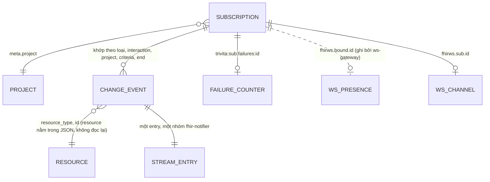
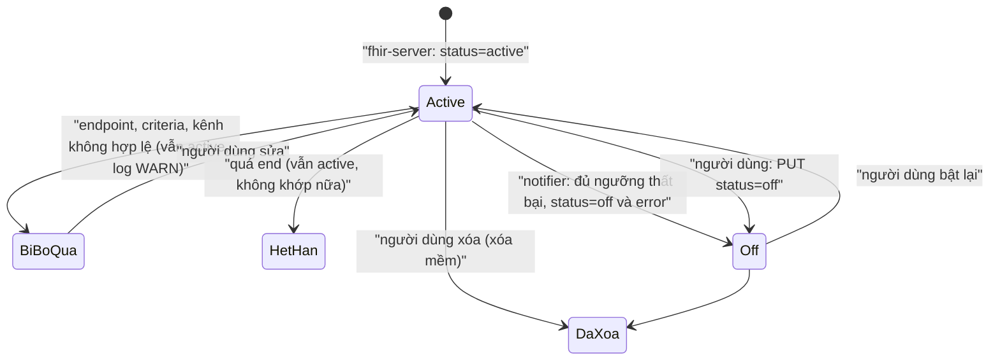

# 3. Quan hệ và toàn vẹn dữ liệu

**Không có khóa ngoại nào** trong schema `fhir`. Quan hệ của notifier là *logic*: chuỗi `meta.project`, tên loại và điều kiện trong `criteria`, id Subscription nằm trong tên khóa Redis. Toàn vẹn do **mã ứng dụng, `If-Match` và độ bền của consumer group** giữ; không có transaction nào bao cả CSDL lẫn Redis.

## 3.1 Sơ đồ logic

## 3.2 Bảng quan hệ

Cột **Toàn vẹn** nêu *ai kiểm và ở đâu*; "không ai" nghĩa là không có kiểm nào trong mã đã đọc. **Khi xóa phía "đến"**: không có `ON DELETE`; cột nêu hành vi thực tế.

| Từ | Đến | Bản số | Cách nối | Bắt buộc | Toàn vẹn | Khi xóa phía "đến" | Bằng chứng |
|---|---|---|---|---|---|---|---|
| `Subscription.meta.project` | `Project` (của `auth`) | n-1 | chuỗi id, **không chỉ mục** | có khi bật JWT | API gán từ token lúc tạo; notifier so bằng với `meta.project` của resource trong sự kiện (`e.project != evProject` thì bỏ) | `Project` bị xóa: Subscription còn và vẫn được giao; không ai dọn | `pkg/fhirsub/manager.go` (`dispatch`) |
| `Subscription` | `ChangeEvent` | 1-n | khớp theo bốn điều kiện (loại, interaction, hạn, project) rồi `criteria` | không | notifier; lỗi khớp một Subscription chỉ bỏ Subscription đó | Subscription bị xóa: biến mất khỏi cache sau tối đa 30 giây (hoặc ngay nếu có sự kiện `Subscription` tới replica đó) | `manager.go` (`dispatch`, `active`) |
| `ChangeEvent.resource` | `Resource` (CSDL) | n-1 | `(resource_type, id)` trong JSON | có | **không ai**: notifier không đọc lại CSDL; resource bị xóa hoặc sửa tiếp sau khi phát vẫn giao theo bản trong sự kiện | giao bản cũ | `manager.go` (`dispatch`), `deliver.go` (`newDelivery`) |
| `Subscription` | bộ đếm `trivita:sub:failures:<id>` | 1-1 | id Subscription trong tên khóa | không | notifier tạo khi bỏ cuộc, xóa khi giao thành công hoặc sau khi tự tắt; **tự hết hạn** sau cửa sổ lớn nhất | Subscription bị xóa: khóa tự hết hạn (EXPIRE = cửa sổ lớn nhất của trigger) | `pkg/fhirsub/failure.go` |
| `Subscription` (websocket) | sổ `fhirws.bound.<id>` | 1-1 | id trong tên khóa | không | **ws-gateway ghi** (`Mark`, TTL 30 giây mặc định, gia hạn mỗi TTL/3); notifier chỉ `Present` | gateway chết: mục hết hạn sau TTL, notifier ngừng phát | `pkg/fhirsub/ws_remote.go`, `pkg/messaging/redis_channels.go` |
| `Subscription` (websocket) | kênh `fhirws.sub.<id>` | 1-1 | id trong tên kênh | không | Pub/Sub không bền; notifier phát **sau khi** thấy sổ có member, gateway đăng ký kênh **trước** khi ghi sổ (thứ tự do `Feed.ensure` giữ) | không có người nghe: thông điệp mất (không lỗi) | `ws_remote.go` |
| Sự kiện | nhóm consumer `fhir-notifier` | n-1 | entry trong stream, PEL | có | `XACK` chỉ khi mọi lần giao đã xong hoặc đã bỏ cuộc (BR-12) | entry bị `XTRIM`/`XDEL` mà còn trong PEL: `reclaim` ACK để dọn | `pkg/messaging/redis.go` |

## 3.3 Bí mật và xóa mềm

- `Subscription.extension[subscription-secret]` và `channel.header` lưu **bản rõ** trong `fhir_resource.content` và **mọi phiên bản trong `fhir_history`** (`PUT` của người dùng, `PUT` tự tắt của notifier).
- Subscription bị xóa là **xóa mềm** (`DeleteResource`: tombstone, dòng `fhir_history` kiểu `DELETE`): các phiên bản cũ **giữ nguyên nội dung kể cả secret**. Không thấy đường Expunge dành cho Subscription trong mã notifier hay `fhirsub` (chưa kiểm ở `fhir-server`; `grep Expunge` trong `pkg/fhirsub` chỉ cho `Repo.Expunger` chuyển tiếp).
- **Log:** notifier không in `secret` hay `channel.header` (các `slog` ở `pkg/fhirsub/{manager,deliver,failure,ws_remote}.go` chỉ in id Subscription, `criteria`, mã trạng thái, số lần thử, `error`). **Nhưng trường `error` là lỗi của `http.Client.Do` (dạng `Post "<URL đầy đủ>": ...`) và lỗi `url.Parse`, nên có thể chứa nguyên `channel.endpoint` kể cả query (token nếu có)** ở log `giao thất bại, bỏ cuộc` và `bỏ qua Subscription có endpoint không hợp lệ` (suy từ mã: `deliver.go` `giveUp`, `manager.go` `buildEntry`, `safehttp.CheckURL`; chưa tái hiện bằng test). `DATABASE_ECHO=true` in câu SQL **kèm tham số** nên lộ secret khi ghi Subscription (chỉ gỡ lỗi).

## 3.4 Tự tắt: luật và kẽ hở

Luật (`pkg/fhirsub/failure.go`):

1. Mỗi **sự kiện giao thất bại cuối cùng** (đã hết `MaxAttempts` hoặc lỗi không thử lại: 4xx khác 408/429, địa chỉ bị chặn, request hỏng) ghi một điểm vào bộ đếm của Subscription. Thất bại từng lần thử không tính.
2. **Một lần giao thành công xóa cả bộ đếm** (nên "liên tiếp" thật sự theo nghĩa chưa có thành công xen giữa trong cửa sổ).
3. Với mỗi trigger theo thứ tự cấu hình, nếu số điểm trong `timeWindowSeconds` gần nhất `>= maxConsecutiveFailures` thì trigger đầu tiên đạt sẽ tắt.
4. Tắt = đọc lại Subscription, **chỉ khi còn `active`**, đặt `status=off`, `error=<thông điệp>`, ghi với `If-Match: meta.versionId`; `412` thì bỏ qua; các lỗi khác chỉ log. Xong thì xóa bộ đếm và `Invalidate()` cache **replica này**.
5. Không tạo `AuditEvent` (mã ghi chú: "Go chưa lưu AuditEvent vào kho").

Kẽ hở (suy từ mã, chưa tái hiện bằng test trừ khi ghi khác):

| # | Kẽ hở | Hệ quả |
|---|---|---|
| 1 | Ghi qua `fhirstore.Store` gốc nên **không phát `ChangeEvent`** cho lần tự tắt | replica khác và `fhir-server` chỉ thấy `off` sau tối đa `CacheTTL` (30 giây); trong lúc đó vẫn giao và vẫn đếm thất bại (nhưng `autoDisable` đọc lại thấy `off` thì dừng) |
| 2 | Tự tắt **chép lại toàn bộ Subscription** (đọc rồi ghi cả đối tượng) | thêm một bản chứa secret và header ở `fhir_history`; nếu người dùng vừa sửa song song thì `412` và lần tắt bị bỏ |
| 3 | Mất Redis: `Record` trả lỗi (chỉ log), **không tắt** và thất bại đó không được đếm; Redis khởi động lại trắng: bộ đếm về 0 | Subscription hỏng bị giao thêm lâu hơn ngưỡng; chỉ có log `không ghi được thất bại để tự tắt Subscription` |
| 4 | Bộ đếm và ghi `off` không cùng transaction: chết giữa hai bước | lần thất bại sau đếm lại và tắt tiếp (bản số `>=` nên vẫn đạt) |

## 3.5 Vòng đời trạng thái của Subscription (phần notifier thấy)

`BiBoQua` và `HetHan` **không phải trạng thái lưu**; chỉ `Active -> Off` do notifier gây ra.
