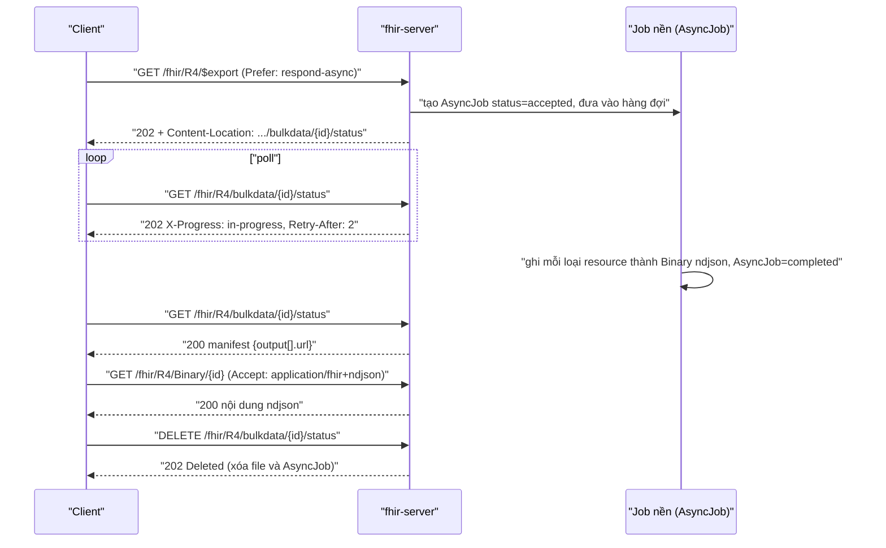

# Trường hợp phản hồi: nhóm `bulk`

Xuất dữ liệu hàng loạt (FHIR Bulk Data Access, định dạng NDJSON) theo mô hình bất đồng bộ: gọi `$export` để tạo job, hỏi trạng thái ở `bulkdata/{id}/status` cho tới khi xong, tải từng file kết quả, rồi (tùy chọn) `DELETE` để dọn. Tham chiếu trường: [../reference/bulk.md](../reference/bulk.md). Xác thực, hạn mức, định dạng lỗi chung: [../common.md](../common.md#3-định-dạng-lỗi).

Phạm vi tài liệu: ba route trong swagger. Mã còn đăng ký `GET /fhir/R4/Patient/$export` và `GET /fhir/R4/Group/{id}/$export` (cùng hàm `exportStart`, khác mức `_level`); các khác biệt của hai dạng đó được nêu trong phần "Lưu ý tích hợp" của `$export`.



**Kiểu phản hồi nhiều dạng**

| Route | Dạng | HTTP | Content-Type | Thân |
|---|---|---|---|---|
| `$export` | đã nhận | 202 | `application/fhir+json` | OperationOutcome `information`/`informational` `Accepted`, header `Content-Location` |
| `status` GET | đang chờ hoặc chạy | 202 | không có thân | header `X-Progress`, `Retry-After` |
| `status` GET | xong | 200 | `application/json` (KHÔNG phải `fhir+json`) | manifest (`transactionTime`, `request`, `requiresAccessToken`, `output[]`, `error[]`) |
| `status` GET | job lỗi | 500 | `application/fhir+json` | OperationOutcome `exception` lấy từ kết quả job |
| `status` GET | job đã hủy hoặc đã xóa | 410 | `application/fhir+json` | OperationOutcome `deleted`, `Gone` |
| `status` DELETE | đã hủy job đang chạy | 202 | `application/fhir+json` | OperationOutcome `informational` `Cancelled` |
| `status` DELETE | đã xóa job xong, lỗi hoặc đã hủy | 202 | `application/fhir+json` | OperationOutcome `informational` `Deleted` |

**Mô hình job (AsyncJob).** Mỗi export là một resource `AsyncJob` nội bộ trong project của người gọi, id là id trong URL `status`. Trạng thái: `accepted` (gồm cả đang chờ hàng đợi và đang chạy) -> `completed` | `error` | `cancelled`. `AsyncJob.request` có dạng `export?<query>` (query nội bộ: `_level`, `_group`, `_type`, `_typeFilter`, `_since`); `AsyncJob.output` là `Parameters` danh sách file. Job chạy ở tiến trình nền với quyền của người gọi (chữ ký quyền gắn vào AsyncJob nếu có `JobSeal`), tối đa `FHIR_JOB_CONCURRENCY` job đồng thời (mặc định 2). Giành quyền chạy bằng lease (`FHIR_JOB_LEASE`, mặc định 5 phút, tự gia hạn mỗi lease/3); tiến trình chết thì replica khác tiếp quản job `accepted` mà lease hết hạn (vòng bảo trì mỗi `FHIR_JOB_MAINTENANCE_INTERVAL`, mặc định 30s), tiến trình tắt êm thì nhả lease để chạy lại. Nếu `FHIR_JOB_EXECUTION=false` ở mọi tiến trình thì job nằm `accepted` mãi.

**Tệp kết quả nằm ở đâu.** Mỗi loại resource được ghi thành một hoặc nhiều resource `Binary` (`contentType: application/fhir+ndjson`, nội dung base64 ghi bằng `CreateResource` của repository; có kho đối tượng hay không là tùy cấu hình Binary của repository, chưa kiểm). Tách file khi nội dung ndjson đạt 8 MiB (`exportFileBytes`); mỗi file một `output[]` với `type`, `url`, `count`. `url` là `<BASE_URL>/Binary/<id>` và tải bằng `GET /fhir/R4/Binary/{id}` với `Authorization: Bearer ...` (manifest có `requiresAccessToken: true`). Không có presign và không có redirect; `/storage` không dính tới export. Khi `Accept` không phải JSON (để trống hoặc `application/fhir+ndjson`), handler Binary trả nội dung thô với `Content-Type: application/fhir+ndjson`, `Content-Disposition: attachment`, `X-Content-Type-Options: nosniff`; `Accept: application/fhir+json` trả resource Binary dạng JSON. Chi tiết tải Binary ở nhóm `fhir` (không lặp ở đây).

**Hết hạn.** Job `completed`, `error`, `cancelled` có `meta.lastUpdated` cũ hơn `FHIR_EXPORT_RETENTION` (mặc định 24 giờ, âm = không bao giờ) bị vòng bảo trì xóa cùng file Binary (chạy ngay khi khởi động rồi mỗi `FHIR_JOB_MAINTENANCE_INTERVAL`; đặt interval 0 thì tắt dọn). Sau khi xóa, `GET status` trả 410 theo hành vi kho in-memory trong test (`TestExpireJobs`, `TestExportCancelWhileRunningAndDelete`); với kho SQL chưa kiểm.

<a id="get-fhir-r4-export"></a>
## `GET /fhir/R4/$export`

Tạo job export toàn hệ thống (mọi loại resource, hoặc `_type`). Trả 202 ngay, không chờ job chạy. [Tham chiếu trường](../reference/bulk.md#get-fhir-r4-export)

**Tiền điều kiện / cờ bật route:** luôn đăng ký. Cần có tiến trình chạy job nền (`FHIR_JOB_EXECUTION`, mặc định true) để job tiến triển.

**Thứ tự kiểm tra** (theo `exportStart`):
1. Hạn mức IP (429) -> xác thực Bearer (401) -> vai trò read (403). Xem common.
2. Header `Prefer` KHÔNG chứa `respond-async` (không phân biệt hoa thường, kiểm bằng chứa chuỗi) -> 400 `Bulk export cần header Prefer: respond-async`.
3. `ParseInput`: thân phản hồi không phải object -> 400 `Body phải là một resource hoặc Parameters` (GET thường không có thân).
4. `_outputFormat` (nếu có) không thuộc `ndjson`, `application/ndjson`, `application/fhir+ndjson`, `text/ndjson` -> 400 `_outputFormat chỉ hỗ trợ ndjson, nhận <giá trị>`.
5. Mỗi phần tử `_type` (phân cách bằng dấu phẩy hoặc lặp tham số) không phải tên resource FHIR -> 400 `_type không hợp lệ: <tên>`.
6. (Chỉ `Group/{id}/$export`) đọc Group bằng quyền người gọi: không có -> 404; `actual=false` -> 400 `Group <id> không liệt kê thành viên (actual=false)`; quá 5000 Patient -> 400 `Group có quá nhiều thành viên Patient (> 5000)`.
7. `_typeFilter`: sai cú pháp -> 400 `_typeFilter không hợp lệ (cần Type?query): <mảnh>`; tham số điều khiển -> 400 `_typeFilter không nhận tham số điều khiển <tên>`; loại không nằm trong `_type` -> 400 `_typeFilter có loại <Loại> không nằm trong _type`; điều kiện search sai -> 400 `_typeFilter <mảnh>: <lý do>`.
8. `_since` (nếu có) không phải instant RFC3339 -> 400 `_since phải là instant RFC3339`.
9. `StartJob`: ký quyền job (nếu bật) -> tạo `AsyncJob` `accepted` (GHI DỮ LIỆU: một dòng AsyncJob trong project) -> `Submit` vào hàng đợi. Lỗi ký -> 500 `không ký được quyền của job: ...`; lỗi hàng đợi -> 500 `không đưa được job vào hàng đợi: ...` (AsyncJob đã tạo vẫn còn, `accepted`, và vòng khôi phục có thể chạy nó sau, chưa kiểm).
10. Trả 202. Việc tìm resource và ghi file chạy NGOÀI request, kiểm tra quyền đọc từng loại chỉ xảy ra lúc job chạy.

| # | Trường hợp | Điều kiện | HTTP | Header phản hồi riêng | Body | Tác dụng phụ |
|---|---|---|---|---|---|---|
| X1 | Đã nhận | `Prefer: respond-async` và tham số hợp lệ | 202 | `Content-Location: <BASE_URL>/bulkdata/<jobId>/status` | OperationOutcome `information`/`informational`, `Accepted` | tạo AsyncJob `accepted`; job nền chạy sau |
| X2 | Thiếu Prefer | không có `respond-async` | 400 | - | `Bulk export cần header Prefer: respond-async` | không tạo job |
| X3 | `_outputFormat` lạ | ví dụ `csv` | 400 | - | `_outputFormat chỉ hỗ trợ ndjson, nhận csv` | không |
| X4 | `_type` sai | ví dụ `Patient,Foo` | 400 | - | `_type không hợp lệ: Foo` | không |
| X5 | `_typeFilter` sai | xem bước 7 | 400 | - | các thông điệp ở bước 7 | không |
| X6 | `_since` sai | không phải RFC3339 (ví dụ chỉ ngày `2026-01-01`, hoặc dấu `+` của múi giờ chưa mã hóa nên bị đọc thành khoảng trắng) | 400 | - | `_since phải là instant RFC3339` | không |
| X7 | Thiếu hoặc sai token | - | 401 | `WWW-Authenticate: Bearer realm="fhir"` | `Thiếu hoặc sai bearer token` | không |
| X8 | Token không đủ vai trò | dưới read | 403 | - | `Token không đủ quyền cho thao tác này` | không |
| X9 | Hết hạn mức | vượt `FHIR_RATE_LIMIT` | 429 | `Retry-After: 1` | `quá nhiều yêu cầu, thử lại sau` | không |
| X10 | Không ký được quyền job | `JobSeal` lỗi | 500 | - | `không ký được quyền của job: ...` | không tạo job |
| X11 | Không đưa được vào hàng đợi | `Submit` lỗi | 500 | - | `không đưa được job vào hàng đợi: ...` | AsyncJob đã tạo (chưa kiểm xử lý tiếp) |
| X12 | Job lỗi lúc chạy (không phải phản hồi của route này, thấy ở `status`) | lỗi tìm hoặc ghi file | - | - | xem route `status` GET | AsyncJob `error`, file đã ghi bị dọn |

**Ví dụ**

```http
GET /fhir/R4/$export?_type=Patient,Observation&_since=2026-11-01T00:00:00Z HTTP/1.1
Authorization: Bearer eyJhbGciOi...
Prefer: respond-async
Accept: application/fhir+json
```

```http
HTTP/1.1 202 Accepted
Content-Type: application/fhir+json
Content-Location: http://localhost:8005/fhir/R4/bulkdata/0192a3c4-7d1e-7a55-9c12-4f8e2b6a1d90/status

{ "resourceType": "OperationOutcome",
  "issue": [ { "severity": "information", "code": "informational",
    "details": { "text": "Accepted" }, "diagnostics": "Accepted" } ] }
```

**Lưu ý tích hợp:**
- Thứ tự gọi: `$export` -> poll `status` theo `Retry-After` -> tải từng `output[].url` -> `DELETE status` khi đã tải xong (không bắt buộc, dọn sớm).
- `_type`: mặc định xuất mọi loại trừ `AsyncJob` và `Binary`; ở mức hệ thống không chỉ định `_type` thì loại mà người gọi không có quyền đọc bị BỎ QUA im lặng (không lỗi), còn có `_type` rõ ràng mà thiếu quyền thì job kết thúc `error`. Nêu tên `_type=Binary` hoặc `AsyncJob` rõ ràng vẫn được chấp nhận (chưa kiểm hành vi; xem rủi ro cuối tệp).
- `_since`: lọc `_lastUpdated >= _since` (`ge`). Resource đã xóa không có trong kết quả (search không trả bản xóa), không có tập "đã xóa" riêng.
- `_typeFilter=Type?query`: OR giữa các điều kiện cùng loại, loại không có điều kiện xuất đủ; nếu thiếu `_type` thì chỉ xuất các loại được nêu trong `_typeFilter`.
- Dữ liệu đọc bằng phân trang offset 1000 bản ghi/lần sắp theo `_lastUpdated`: bản ghi sửa hoặc thêm trong lúc xuất có thể bị lặp hoặc sót. Không có ảnh chụp nhất quán.
- Mức `Patient/$export`: Patient và resource trong compartment Patient (mọi tham số compartment trỏ tới Patient), loại ngoài compartment bị bỏ nếu có `_type`. Mức `Group/{id}/$export`: chỉ Patient là thành viên đang hoạt động của Group (bỏ `inactive`, bỏ thành viên không phải Patient, trùng bỏ) và resource trong compartment của họ; Group đọc hai lần (lúc gọi để báo lỗi sớm và lúc job chạy).
- Idempotent: KHÔNG. Mỗi lần gọi tạo job và bộ file mới; không có khóa idempotency.

<a id="get-fhir-r4-bulkdata-id-status"></a>
## `GET /fhir/R4/bulkdata/{id}/status`

Hỏi trạng thái export; khi xong trả manifest các file NDJSON. [Tham chiếu trường](../reference/bulk.md#get-fhir-r4-bulkdata-id-status)

**Tiền điều kiện / cờ bật route:** luôn đăng ký. Cần vai trò read cho MỌI phương thức của đường dẫn này (xem rủi ro cuối tệp).

**Thứ tự kiểm tra** (theo `exportStatus`):
1. Hạn mức IP (429) -> xác thực (401) -> vai trò read (403).
2. Đọc `AsyncJob/{id}` bằng repository của người gọi (tách theo project): không có hoặc project khác -> 404; đã xóa -> 410 (từ repository).
3. Resource không phải AsyncJob export (`request` không bắt đầu `export?`) -> 404 `Not found` (ví dụ id của job batch async hay reindex).
4. Theo `status` của job: `completed` -> 200 manifest; `error` -> 500 OperationOutcome lưu trong kết quả job (không có thì `Job lỗi`); `cancelled` -> 410 `Gone`; còn lại (`accepted`) -> 202 kèm `X-Progress`, `Retry-After`.

| # | Trường hợp | Điều kiện | HTTP | Header phản hồi riêng | Body | Tác dụng phụ |
|---|---|---|---|---|---|---|
| S1 | Đang chờ hoặc chạy | `status=accepted` | 202 | `X-Progress: in-progress`, `Retry-After: 2` | không có thân | không |
| S2 | Xong | `status=completed` | 200 | `Content-Type: application/json` | manifest: `transactionTime`, `request`, `requiresAccessToken: true`, `output[]`, `error: []` | không |
| S3 | Xong nhưng không có dữ liệu | job completed, không loại nào có resource | 200 | như S2 | như S2 với `output: []` | không |
| S4 | Job lỗi | `status=error` | 500 | `Content-Type: application/fhir+json` | OperationOutcome `exception`, `diagnostics` = lỗi của job (ví dụ `tìm Patient: ...`, `ghi file Patient: ...`, `Group <id> không liệt kê thành viên (actual=false)`) | không; file đã ghi bị dọn lúc job lỗi |
| S5 | Đã hủy hoặc đã xóa | `status=cancelled`, hoặc AsyncJob đã bị xóa (DELETE, hết hạn) | 410 | - | OperationOutcome `deleted`, `Gone` | không |
| S6 | Không có job | id không tồn tại, hoặc thuộc project khác | 404 | - | OperationOutcome `not-found` (`Not found` hoặc thông điệp của repository, chưa kiểm nguyên văn) | không |
| S7 | Không phải job export | id là job loại khác | 404 | - | `Not found` | không |
| S8 | Thiếu hoặc sai token | - | 401 | `WWW-Authenticate: Bearer realm="fhir"` | `Thiếu hoặc sai bearer token` | không |
| S9 | Hết hạn mức | - | 429 | `Retry-After: 1` | `quá nhiều yêu cầu, thử lại sau` | không |

**Ví dụ**

```http
GET /fhir/R4/bulkdata/0192a3c4-7d1e-7a55-9c12-4f8e2b6a1d90/status HTTP/1.1
Authorization: Bearer eyJhbGciOi...
```

Đang chạy:

```http
HTTP/1.1 202 Accepted
X-Progress: in-progress
Retry-After: 2
```

Xong:

```http
HTTP/1.1 200 OK
Content-Type: application/json

{
  "transactionTime": "2026-11-24T09:21:07Z",
  "request": "http://localhost:8005/fhir/R4/$export?_level=system&_since=2026-11-01T00%3A00%3A00Z&_type=Patient%2CObservation",
  "requiresAccessToken": true,
  "output": [
    { "type": "Patient", "url": "http://localhost:8005/fhir/R4/Binary/5d0c8e61-2f3a-4b7c-8a19-0e6b7d4c2f33", "count": 120 },
    { "type": "Observation", "url": "http://localhost:8005/fhir/R4/Binary/a41b9f0e-6c27-4d58-b3a1-9d2e7c5f8a02", "count": 3410 }
  ],
  "error": []
}
```

Job lỗi (cùng cấu trúc OperationOutcome):

```http
HTTP/1.1 500 Internal Server Error
Content-Type: application/fhir+json

{ "resourceType": "OperationOutcome",
  "issue": [ { "severity": "error", "code": "exception",
    "details": { "text": "tìm Patient: ..." }, "diagnostics": "tìm Patient: ..." } ] }
```

**Lưu ý tích hợp:** `Retry-After` luôn là `2` (giây), cố định, không phản ánh tiến độ; `X-Progress` luôn `in-progress`. Hai chỗ lệch với đặc tả Bulk Data: (1) `transactionTime` là thời điểm job ghi kết quả xong (gán lúc hoàn tất), không phải thời điểm chụp dữ liệu như đặc tả, nên không dùng làm mốc `_since` cho lần sau mà không cộng dư; (2) `request` ghép từ query nội bộ của job nên luôn có `_level=system|patient|group` (và `_group=<id>` cho Group) và query được mã hóa theo `url.Values.Encode` (khóa sắp theo bảng chữ cái), không phải URL gốc client gọi; mức Patient hiện ra là `$export?_level=patient` chứ không phải `Patient/$export`. Mảng `error` luôn rỗng: lỗi từng phần không được ghi, hoặc job xong trọn, hoặc `error` (500). File có `url` tải bằng `GET Binary/{id}` kèm Bearer, đừng thêm Bearer vào URL khác miền.

<a id="delete-fhir-r4-bulkdata-id-status"></a>
## `DELETE /fhir/R4/bulkdata/{id}/status`

Hủy export đang chạy, hoặc xóa kết quả export đã xong, đã lỗi, đã hủy. [Tham chiếu trường](../reference/bulk.md#delete-fhir-r4-bulkdata-id-status)

**Tiền điều kiện / cờ bật route:** luôn đăng ký. Vai trò read là đủ (xem rủi ro cuối tệp).

**Thứ tự kiểm tra** (theo `exportCancel` -> `cancelJob`):
1. Hạn mức IP (429) -> xác thực (401) -> vai trò read (403).
2. Đọc `AsyncJob/{id}` bằng repository của người gọi: không có hoặc project khác -> 404; đã xóa -> 410. Không phải job export -> 404 `Not found`.
3. Job `accepted` (chờ hàng đợi hoặc đang chạy): ghi `status=cancelled` (GHI: cập nhật AsyncJob, không If-Match), gọi hủy ngữ cảnh nếu job đang chạy trong CHÍNH tiến trình này -> 202 `Cancelled`.
4. Job `completed`, `error` hoặc `cancelled`: xóa các Binary kết quả (ưu tiên Expunge xóa hẳn; không đủ quyền thì xóa mềm; không xóa được thì chỉ ghi log WARN `không xóa được file kết quả`, vẫn tiếp tục), rồi xóa AsyncJob -> 202 `Deleted`. Lỗi xóa AsyncJob -> lỗi của repository.

**Độ trễ hủy.** Trạng thái `cancelled` có hiệu lực ngay trong DB: `GET status` trả 410 ngay. Việc dừng job: cùng tiến trình thì hủy ngữ cảnh tức thì; job chạy ở replica khác thì phải chờ nhịp heartbeat của job đó (mỗi `FHIR_JOB_LEASE/3`, mặc định khoảng 100 giây) mới thấy `cancelled` và dừng. Khi job dừng hoặc xong, kết quả bị bỏ và file đã tạo bị xóa, nên không để lại file của job đã hủy. Test: `TestExportCancelWhileRunningAndDelete`.

| # | Trường hợp | Điều kiện | HTTP | Header phản hồi riêng | Body | Tác dụng phụ |
|---|---|---|---|---|---|---|
| D1 | Hủy job đang chờ hoặc chạy | `status=accepted` | 202 | `Content-Type: application/fhir+json` | OperationOutcome `informational`, `Cancelled` | AsyncJob -> `cancelled`; job dừng (độ trễ như trên); file đã ghi bị dọn khi job dừng |
| D2 | Xóa kết quả job xong hoặc lỗi | `completed` hoặc `error` | 202 | như D1 | `Deleted` | xóa mọi Binary kết quả và AsyncJob |
| D3 | Xóa job đã hủy | `cancelled` | 202 | như D1 | `Deleted` | xóa AsyncJob và Binary còn sót |
| D4 | Hủy lần hai | job đã bị D2 hoặc D3 xóa | 410 | - | OperationOutcome `deleted`, `Gone` | không |
| D5 | Không có job | id không tồn tại hoặc project khác | 404 | - | `Not found` (hoặc thông điệp repository, chưa kiểm) | không |
| D6 | Không phải job export | job loại khác | 404 | - | `Not found` | không |
| D7 | Thiếu hoặc sai token | - | 401 | `WWW-Authenticate: Bearer realm="fhir"` | `Thiếu hoặc sai bearer token` | không |
| D8 | Hết hạn mức | - | 429 | `Retry-After: 1` | `quá nhiều yêu cầu, thử lại sau` | không |

**Ví dụ**

```http
DELETE /fhir/R4/bulkdata/0192a3c4-7d1e-7a55-9c12-4f8e2b6a1d90/status HTTP/1.1
Authorization: Bearer eyJhbGciOi...
```

```http
HTTP/1.1 202 Accepted
Content-Type: application/fhir+json

{ "resourceType": "OperationOutcome",
  "issue": [ { "severity": "information", "code": "informational",
    "details": { "text": "Cancelled" }, "diagnostics": "Cancelled" } ] }
```

**Lưu ý tích hợp:** phân biệt `Cancelled` (job đang chạy, chỉ đánh dấu) với `Deleted` (đã dọn thật) qua `details.text`. Muốn dọn sạch một job đang chạy phải gọi DELETE hai lần (lần hai sau khi job đã dừng, ra D3 `Deleted`); nếu không, vòng bảo trì tự xóa sau `FHIR_EXPORT_RETENTION`. DELETE không idempotent theo mã trạng thái (202 rồi 410).

## Phát hiện lệch với common.md

`common.md` chưa có lúc viết (chưa đối chiếu).

Lệch so với tài liệu cũ/mô tả sinh:
- `reference/bulk.md` mô tả `transactionTime` là "thời điểm chụp dữ liệu": mã gán thời điểm job hoàn tất.
- `reference/bulk.md` mô tả `request` là "URL yêu cầu export ban đầu": mã trả query nội bộ (`_level=...`), không phải URL gốc.
- `reference/bulk.md` chưa liệt kê 410 (job đã hủy, đã xóa hoặc hết hạn) và 500 (job lỗi) của route `GET status`, và 404/410 của `DELETE`.
- `reference/bulk.md` ghi `Content-Type` phản hồi `application/fhir+json` cho route `$export`: đúng với 202/400, nhưng manifest 200 của `status` là `application/json`.

Rủi ro bảo mật và hành vi đáng chú ý (ghi trung thực "hiện thực tế", suy ra từ mã, chưa chạy thử):
- `RequiredRole` coi mọi method của `bulkdata/{id}/status` là vai trò read, nên một token chỉ-đọc gọi được `DELETE` để hủy hoặc xóa job. Chú thích mã nói "của chính mình" nhưng không có kiểm chủ sở hữu: AsyncJob được miễn kiểm loại (`allow`) và chỉ tách theo project, nên mọi người dùng cùng project có quyền read thấy, hủy, xóa export của nhau.
- Khi xóa job đã xong, `deleteBinaries` cần quyền delete/expunge của người gọi trên Binary. Token chỉ-đọc hoặc bị chính sách giới hạn không xóa được file (chỉ ghi log WARN), nhưng AsyncJob vẫn bị xóa; khi đó file Binary không còn AsyncJob trỏ tới nên vòng hết hạn không dọn được: file kết quả có thể tồn tại mãi (mồ côi) và vẫn tải được bằng id.
- Xóa mềm giữ nguyên nội dung Binary (chỉ Expunge mới xóa hẳn); dữ liệu y tế export có thể còn trong DB sau `DELETE` nếu người gọi không có quyền expunge.
- `_type=Binary` hoặc `_type=AsyncJob` được `IsResourceType` chấp nhận; chưa kiểm job có xuất các Binary file kết quả khác hay không (mặc định `exportSkip` chỉ áp khi không nêu `_type`).
