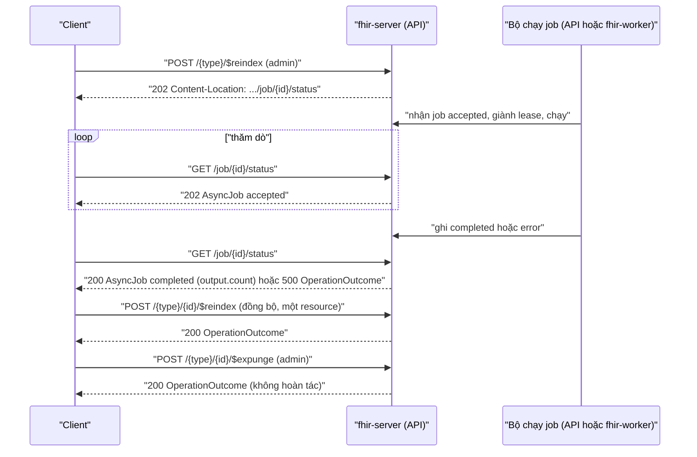

# Trường hợp phản hồi: nhóm `operation`

Nhóm này có **11 route** của các operation FHIR và việc nền: nạp bảng mã và bảng ánh xạ lớn (`$import`), cài gói định nghĩa (`$install`), xuất hồ sơ theo bệnh nhân (`$everything`), kiểm tra resource (`$validate`), lập lại chỉ mục (`$reindex`), xóa vĩnh viễn (`$expunge`) và đọc trạng thái job nền (`job/{id}/status`). Quy ước chung (header bảo mật, `X-Request-Id`, định dạng `OperationOutcome`, xác thực, hạn mức, kích thước thân) ở [common.md](../common.md); bảng trường ở [reference/operation.md](../reference/operation.md). Mục này chỉ nêu điều kiện, phản hồi và tác dụng phụ. Việc nền xuất dữ liệu (`$export`, `bulkdata/{id}/status`) và batch bất đồng bộ nằm ở [bulk.md](bulk.md); chúng dùng chung cơ chế job ở mục "Job bất đồng bộ" dưới đây.

Điều kiện có route: luôn có (router FHIR luôn đăng ký các operation này). Riêng nhánh phụ thuộc kho: `$reindex` cần kho cài `Reindexer`, `$expunge` cần `Expunger`, `$import` cần `ConceptStore`/`MappingStore`; kho không cài thì `501` (kho PostgreSQL và SQLite của fhir-server đều cài đủ, nên nhánh `501` chỉ gặp với kho tự cắm).

**Sơ đồ chuyển route** (cách một ứng dụng dùng nhóm này):



## Các kiểu phản hồi của nhóm

| Kiểu | Khi nào | `Content-Type` | Cấu trúc |
|---|---|---|---|
| OperationOutcome thông tin | `$validate` hợp lệ (`All OK` hoặc cảnh báo), `$reindex` một resource, `$expunge`, `$reindex` cả loại (202) | `application/fhir+json; charset=utf-8` | `OperationOutcome`; thông điệp ở `issue[0].details.text` và `diagnostics` (cùng nội dung) |
| OperationOutcome lỗi | mọi `4xx`/`5xx` | như trên | `issue[0].severity=error`, `code` theo mã HTTP: `invalid` (400), `login` (401), `forbidden` (403), `not-found` (404), `not-supported` (405, 415, 501), `deleted` (410), `exception` (500) |
| Parameters | `CodeSystem/$import`: `200` | như trên | `Parameters` với một phần `return` là resource `CodeSystem` |
| ConceptMap | `ConceptMap/$import`: `200` | như trên | chính resource `ConceptMap` (không bọc Parameters) |
| Bundle phản hồi gói | `PackageRelease/$install`: `200` | như trên | `Bundle` `batch-response` của các entry trong gói |
| Bundle hồ sơ | `Patient/$everything`: `200` | như trên | `Bundle` `searchset` (không có `link`), tùy chọn một entry `OperationOutcome` `search.mode=outcome` khi bị cắt |
| AsyncJob | `GET job/{id}/status`: `202` (chưa xong) và `200` (xong) | như trên | resource `AsyncJob` (không phải `Parameters`, không phải `OperationOutcome`) |
| Thân rỗng | `POST` kèm `Prefer: return=minimal` (chỉ nhánh thành công) | - | không có thân; mã và header vẫn giữ (đã đo ở `$validate` và `$reindex` cả loại) |

`Prefer` trên các route `POST` của nhóm: `return=minimal` bỏ thân thành công, `return=OperationOutcome` thay thân bằng `{"severity":"information","code":"informational","details":{"text":"OK"}}` (`writeResponse`, áp cho mọi `POST`/`PUT`/`PATCH` có thân). Không áp cho lỗi và không áp cho `GET` (`$everything`, `job/{id}/status`). `Prefer: respond-async` **không có tác dụng** ở nhóm này: `$reindex` cả loại luôn chạy nền, các route còn lại luôn đồng bộ.

## Thứ tự kiểm tra chung

1. **Hạn mức theo IP** (`FHIR_RATE_LIMIT`, đứng trước xác thực): `429` `quá nhiều yêu cầu, thử lại sau` kèm `Retry-After: 1` (`code=invalid`); không xác định được IP là `403` `không xác định được người gọi`. Xem [common.md mục 5](../common.md#5-hạn-mức-kích-thước).
2. **Cổng xác thực** (`Guard`): token sai hoặc thiếu là `401`; vai trò của token thấp hơn vai trò route cần (bảng ở mục "Vai trò admin") là `403` `Token không đủ quyền cho thao tác này`. Cổng chạy **trước** khi khớp route nên `POST /Foo/$reindex` với token `read` là `403`, không phải `404`.
3. **Thân**: tối đa 16 MiB (`413` `Body quá lớn`); `Content-Type` lạ là `415` `Content-Type không hỗ trợ: <mt>`; JSON hỏng là `400` `JSON không hợp lệ: <lỗi giải mã>`; form (`application/x-www-form-urlencoded`) được gộp vào query, không thành thân.
4. **Khớp route** của router FHIR: `resourceType` phải là tên resource thật (khác thì `404` `Không có route cho POST Foo/$validate`); đường dẫn khớp route của method khác thì `405` `POST không được hỗ trợ cho Patient/$import` (`not-supported`).
5. **Handler** của từng route (xem từng mục). Với các route cần quản trị: kiểm admin (`RequireAdmin`) **trước** mọi việc khác trong handler.


## Vai trò admin

Quyền quản trị được kiểm ở **hai lớp**, và hai lớp không áp cho cùng danh sách route.

| Lớp | Nơi | Áp cho | Từ chối bằng |
|---|---|---|---|
| Cổng HTTP (`RequiredRole`, `httpapi/auth.go`) | trước router, theo đuôi đường dẫn | `$reindex` (cả hai route) và `$expunge`: cần `admin`. `$validate`, `$everything` và `GET job/{id}/status`: cần `read`. `$import`, `$install`: chỉ cần `write` (là `POST` thường) | `403` `Token không đủ quyền cho thao tác này` |
| `RequireAdmin` (`fhirauth.Repo`, trong handler) | sau khi khớp route | `PackageRelease/{id}/$install`, `CodeSystem/$import`, `CodeSystem/{id}/$import`, `ConceptMap/$import`, `ConceptMap/{id}/$import` | `403` `Thao tác này chỉ dành cho quản trị project` (hoặc `Không xác định được người gọi` khi thiếu Principal) |

**Ai là admin.** Chế độ JWT: scope `fhir.admin` (vai trò `admin`, quyền `cruds` trên mọi loại) hoặc `fhir.super` khi `AllowSuperAdmin`. `RequireAdmin` còn đòi **không có AccessPolicy** (claim chính sách khác rỗng thì `403` ngay cả khi có `fhir.admin`) trừ super-admin. Scope SMART theo loại (`system/*.cruds`, `system/Patient.cruds`...) **không bao giờ** cho vai trò `admin`: tối đa `write`. Chế độ token tĩnh: token trong `FHIR_ADMIN_TOKENS` có vai trò `admin`; `FHIR_WRITE_TOKENS` là `write`; `FHIR_READ_TOKENS` là `read`.

**Super-admin** phải gửi `X-Fhir-Project` hợp lệ (thiếu: `400` `Super-admin phải chọn project bằng header X-Fhir-Project`); mọi yêu cầu của họ vào nhóm này được ghi log kiểm toán (`"audit": true`), kể cả bị từ chối. Thao tác chạy trong đúng project đã chọn.

**Hiện thực tế ở chế độ token tĩnh (rủi ro, ghi trung thực).** `AdminChecker` chỉ do lớp tách project `fhirauth.Repo` cài, và lớp này chỉ được bọc khi bật JWT. Ở chế độ token tĩnh, router giữ kho thường (không cài `RequireAdmin`) nên bước kiểm admin trong handler **bị bỏ qua**: một token `write` tĩnh gọi được `PackageRelease/{id}/$install`, `CodeSystem/{id}/$import` và `ConceptMap/{id}/$import` (đã đo: token `FHIR_WRITE_TOKENS` nạp concept vào CodeSystem và ánh xạ vào ConceptMap, `200`; gọi `$install` PackageRelease không tồn tại ra `404`, không phải `403`). Chỉ `$reindex` và `$expunge` vẫn chặn token `write` tĩnh vì được chặn ở cổng HTTP. Chế độ JWT đúng như bảng trên (đã đo: token `fhir.write` gọi `$install` và `$import` đều `403` `Thao tác này chỉ dành cho quản trị project`). Route `GET job/{id}/status` không đòi `admin` ở cả hai chế độ.

**Quyền theo loại resource** (chế độ JWT) tiếp tục kiểm ở kho: `$expunge` đòi quyền `d` trên loại, `$reindex` (cả hai) đòi quyền `u`, `$import` ghi concept đòi `u` trên `CodeSystem`/`ConceptMap`; `fhir.admin` có sẵn `cruds` nên chỉ token SMART ghép (ví dụ `fhir.admin` bị thu hẹp bằng AccessPolicy) mới gặp các lỗi này. Với AccessPolicy: `$reindex` và `$expunge` bị từ chối (`Reindex không dùng được với chính sách truy cập`, `Expunge không dùng được với chính sách truy cập`, `403`; ghim bằng `pkg/fhirauth/policy_test.go`).

## Job bất đồng bộ

Chỉ **một** route của nhóm tạo job: `POST /fhir/R4/{resourceType}/$reindex` (loại job `reindex`). Cùng cơ chế còn dùng cho `$export` và batch `Prefer: respond-async` (xem [bulk.md](bulk.md)). `$install` và `$import` **không** chạy nền: chúng trả `200` đồng bộ (khác với [common.md mục 6](../common.md#6-mã-http-chung) liệt kê `202`; xem mục "Phát hiện lệch").

### Vòng đời `AsyncJob`

Job là resource `AsyncJob` lưu cùng kho với dữ liệu lâm sàng (cùng project của người gọi). `status` chỉ có **bốn** giá trị trong mã: `accepted`, `completed`, `error`, `cancelled`. **Không có** giá trị `queued` hay `in-progress`: `accepted` gộp ba pha (xếp hàng, đang chạy, mồ côi chờ nhận lại), phân biệt bằng **lease** ở `transactionTime`.

```mermaid
stateDiagram-v2
    [*] --> accepted: "API tạo AsyncJob (kèm job-seal nếu bật JWT)"
    accepted --> accepted: "bộ chạy giành lease, gia hạn mỗi lease/3"
    accepted --> completed: "hàm job thành công, ghi output"
    accepted --> error: "lỗi, panic, chữ ký sai, loại job không có"
    accepted --> cancelled: "DELETE job (chỉ batch) hoặc DELETE bulkdata (chỉ export)"
    accepted --> accepted: "tắt êm: nhả lease; chết đột ngột: lease hết hạn rồi tiếp quản"
    completed --> [*]: "xóa sau FHIR_EXPORT_RETENTION"
    error --> [*]: "xóa sau FHIR_EXPORT_RETENTION"
    cancelled --> [*]: "xóa sau FHIR_EXPORT_RETENTION"
```



| Thuật ngữ trong yêu cầu | `status` thật | Nhận biết |
|---|---|---|
| queued (chờ nhận) | `accepted` | `transactionTime` vắng (chưa ai giành lease) |
| in-progress (đang chạy) | `accepted` | `transactionTime` là thời điểm tương lai (hạn lease, gia hạn mỗi `FHIR_JOB_LEASE`/3) |
| mồ côi | `accepted` | `transactionTime` đã quá hạn, hoặc vắng sau khi tắt êm |
| completed | `completed` | `transactionTime` là lúc hoàn tất; `output` là Parameters kết quả |
| error | `error` | `output` có phần `outcome` là OperationOutcome (`code=exception`) |
| cancelled | `cancelled` | chỉ đạt được bằng `DELETE` (export, batch) hoặc ghi tay vào AsyncJob; **không có** API hủy job `reindex` |

**Đọc trạng thái** (`GET /fhir/R4/job/{id}/status`, mục riêng bên dưới): `accepted` là `202` kèm thân `AsyncJob`; `completed` là `200` kèm `AsyncJob`; `error` là `500` kèm OperationOutcome lấy từ `output`; `cancelled` là `410` `Gone`. Không có header `Retry-After` hay tiến độ: client thăm dò theo chu kỳ tự chọn.

### Lease, nhận job và ai chạy

1. **Tạo** (`startJob`): ghi `AsyncJob` `accepted` với `requestTime` (RFC 3339, giây), `request` = `reindex?resourceType=<Loại>`, chữ ký quyền (job-seal, bên dưới) ở extension `https://trivita.ai/fhir/StructureDefinition/job-seal`. Bản ghi mang `meta.project` của người gọi (do lớp tách project đóng dấu). Bản ghi được ghi **trước** khi trả `202`; hàng đợi nội bộ không giới hạn kích thước (mỗi lần `Submit` là một goroutine chờ chỗ trong `FHIR_JOB_CONCURRENCY`, mặc định 2 job đồng thời mỗi tiến trình).
2. **Chạy** (`runJob`): đọc `AsyncJob`; bỏ qua nếu `status` khác `accepted` hoặc lease còn hiệu lực; **giành lease** bằng cập nhật có điều kiện `If-Match` (chỉ một bên thắng, bên thua im lặng bỏ job); đặt `transactionTime` = bây giờ + `FHIR_JOB_LEASE` (mặc định 5 phút); chạy hàm job; gia hạn lease mỗi `FHIR_JOB_LEASE`/3 (heartbeat cũng đọc lại job để thấy `cancelled`); xong thì ghi `completed` hoặc `error` bằng ngữ cảnh độc lập (không bị hủy theo tiến trình đang tắt) và đặt `transactionTime` = lúc xong.
3. **Tắt êm**: job dở nhả lease (xóa `transactionTime`), vẫn `accepted`, **không** bị đánh dấu lỗi; lần khởi động sau hoặc bộ chạy khác nhận lại. **Chết đột ngột**: lease hết hạn, `RecoverJobs` nộp lại, chạy lại từ đầu (`reindex` idempotent nên chạy lại an toàn).
4. **Vòng bảo trì** (`FHIR_JOB_MAINTENANCE_INTERVAL`, mặc định 30 giây ở `fhir-server`; 0 là tắt): `RecoverJobs` nộp mọi job `accepted` hết lease và đủ cũ (`requestTime` cách nay quá grace, mặc định 30 giây ở router) rồi `ExpireJobs`. Độ trễ nhận một job mới ở API ≈ ngay lập tức (nộp thẳng lúc tạo); job bị bỏ sót chỉ được nhặt ở chu kỳ bảo trì sau.

**Ai chạy job khi `FHIR_JOB_EXECUTION=false`.** Tiến trình API **chỉ tạo `AsyncJob` và trả `202`**: không nộp vào bộ điều phối và vòng bảo trì **không** gọi `RecoverJobs` (chỉ còn `ExpireJobs`). Job đứng ở `accepted` cho tới khi một **`fhir-worker`** (service riêng, dùng chung CSDL, không có route nghiệp vụ; xem [../../../fhir-worker/docs/api-contract.md](../../../fhir-worker/docs/api-contract.md) và `business/04-luat-va-phan-quyen.md`) nhận qua vòng `RecoverJobs` của chính nó (mặc định chu kỳ 5 giây, grace 2 giây, `FHIR_JOB_CONCURRENCY` mặc định 2). **Không có worker thì job ở `accepted` mãi**: `GET job/{id}/status` luôn `202`, không có hạn chót hay lỗi (đã đo: tạo `$reindex` với `FHIR_JOB_EXECUTION=false` ra `202` bình thường). Tiến trình API ghi cảnh báo lúc khởi động (`FHIR_JOB_EXECUTION=false: tiến trình này không chạy job nền; ...`). Worker không kiểm token: quyền của job lấy hoàn toàn từ job-seal. Hủy khi tách API và worker có độ trễ (worker chỉ thấy `cancelled` ở heartbeat kế tiếp, tối đa khoảng `FHIR_JOB_LEASE`/3, mặc định khoảng 100 giây).

### Job-seal (chữ ký quyền, HMAC)

Job chạy sau khi yêu cầu HTTP kết thúc nên không còn token. Chế độ JWT: lúc tạo, `JobSeal` ghi **ảnh chụp quyền của người gọi** (`sub`, `grants` theo loại, AccessPolicy; phiên bản `v=2`) rồi ký **HMAC-SHA256** với `FHIR_JOB_SIGNING_KEY`, ràng buộc bốn thứ: id job, project của job, chuỗi `request`, và ảnh chụp. Dạng chuỗi: `base64url(ảnh chụp).base64url(HMAC)`. Lúc chạy, `JobOpen` kiểm chữ ký rồi dựng Principal: `Subject` `job:<id>`, vai trò **luôn `read`**, `Grants` và AccessPolicy từ ảnh chụp, cộng quyền **chỉ ghi** (không đọc) trên `Binary` để lưu và dọn file kết quả. Ai sửa `request`, đổi project của job hoặc tự tạo AsyncJob đều làm chữ ký sai.

| Lỗi chữ ký | Kết quả |
|---|---|
| thiếu, sai chữ ký, chữ ký của job khác | job `error`, `output.outcome` `job thiếu hoặc sai chữ ký quyền`; poll `500` |
| ảnh chụp hỏng | job `error` `job có ảnh chụp quyền hỏng` |
| phiên bản ảnh chụp khác `2` | job `error` `job có ảnh chụp quyền phiên bản cũ, hãy chạy lại` |
| chính sách hỏng | job `error` `job có chính sách hỏng` |

Hệ quả vận hành: khóa `FHIR_JOB_SIGNING_KEY` phải **giống nhau trên mọi replica và fhir-worker** (bắt buộc khi dùng JWKS, tối thiểu 32 ký tự); lệch khóa hoặc xoay khóa làm job đang chờ bị từ chối (không có khóa cũ). Chế độ token tĩnh **không có chữ ký**: job chạy trên cả kho, không tách project (BR-12 của worker). Ghi nhận thêm: chuỗi chữ ký **nằm trong thân** `AsyncJob` mà `GET job/{id}/status` trả cho mọi người đọc job (cùng project), và phần ảnh chụp là base64 không mã hóa (lộ `sub` và `grants` của người tạo; không giả mạo được vì có HMAC).

### Quyền xem, hạn mức, tác dụng phụ chung

- **Ai xem được job**: mọi token có vai trò `read` trở lên **trong cùng project** (không chỉ người tạo): `AsyncJob` được miễn kiểm quyền theo loại, nhưng vẫn bị tách project (job của project khác là `404`). Token tĩnh: mọi token đọc được mọi job.
- **Ai tạo được job `reindex`**: chỉ `admin`. Lưu ý: bất kỳ token `write` nào cũng `POST /AsyncJob` ghi được một bản ghi `AsyncJob` thô (đã đo, `201`); ở chế độ JWT job đó vô hại (không có chữ ký hợp lệ nên chạy là `error`), ở chế độ tĩnh bản ghi `accepted` với `request` hợp lệ (ví dụ `reindex?resourceType=Patient`) sẽ được vòng `RecoverJobs` nhặt và chạy vì không có chữ ký để kiểm (suy từ mã, chưa đo).
- **Hạn mức**: không có hạn mức số job theo người dùng hay project. Chỉ có hạn mức theo IP của cả API (`429`, mục chung) và `FHIR_JOB_CONCURRENCY` giới hạn số job chạy đồng thời mỗi tiến trình (job thừa chờ trong hàng đợi trong bộ nhớ, không bị từ chối). `ExpireJobs` xóa `AsyncJob` `completed`/`error`/`cancelled` loại `export?`, `batch?`, `reindex?` quá `FHIR_EXPORT_RETENTION` (mặc định 24 giờ; âm là không bao giờ), kèm các Binary kết quả (bằng Expunge nếu được).
- **Tác dụng phụ**: một dòng `AsyncJob` (mỗi lần tạo, cộng một phiên bản mỗi lần đổi trạng thái hoặc gia hạn lease, nên `_history` của job dài theo thời gian chạy); kết quả ở `output`. Mọi lần ghi `AsyncJob` đi qua kho đã bọc `fhirsub` (khi có broker) và `pkg/fhirsub` không loại trừ loại `AsyncJob`, nên phát sự kiện `fhir.resource.changed` như resource khác `(chưa kiểm bằng test: chỉ suy từ mã)`.

---


<a id="post-fhir-r4-resourcetype-validate"></a>
## `POST /fhir/R4/{resourceType}/$validate`

Kiểm tra một resource theo cấu trúc và ràng buộc FHIRPath của loại trong đường dẫn, **không lưu gì**. [Tham chiếu trường](../reference/operation.md#post-fhir-r4-resourcetype-validate)

**Vai trò:** `read` (cổng HTTP). Handler không đụng kho nên **không kiểm quyền theo loại, project hay AccessPolicy** (JWT `fhir.read` đủ; đã đo `200` với token `fhir.read`).

**Thứ tự kiểm tra:**
1. Hạn mức, xác thực, vai trò `read` (mục chung).
2. Giải mã thân (`413`, `415`, `400` JSON hỏng).
3. `ParseInput`: thân phải là object (mảng hoặc chuỗi: `400` `Body phải là một resource hoặc Parameters`); nếu là `Parameters` thì mỗi `parameter[i]` phải có `name` (`400` `Parameters.parameter[<i>] thiếu name`).
4. Chọn tài liệu: phần `resource` của `Parameters` nếu có, không thì chính thân. Không có tài liệu, hoặc tài liệu vẫn là `Parameters` (không có `resource`): `400` `Thiếu resource cần kiểm tra`.
5. `resourceType` của tài liệu phải bằng loại trong đường dẫn: `400` `resourceType không khớp: đường dẫn là Patient, resource là "Observation"`.
6. `fhirvalidate.Validate` (bỏ invariant FHIRPath khi `FHIR_SKIP_CONSTRAINTS=true`; `FHIR_SKIP_VALIDATION` **không** tác dụng ở route này). Có lỗi mức `error`: `400` kèm OperationOutcome mọi vấn đề. Chỉ cảnh báo: `200` kèm cảnh báo. Không vấn đề: `200` `All OK`.

**Tham số `profile` và `mode`.** Dạng `Parameters` chấp nhận tên bất kỳ nhưng **chỉ đọc `resource`**: `profile`, `mode` (`create`/`update`/`delete`) và mọi tham số khác bị bỏ qua (đã đo: `Parameters` có `mode=create` và `profile` ra cùng kết quả như không có). Không kiểm theo profile hay `StructureDefinition` nào: chỉ kiểm theo mô hình cơ sở FHIR R4 của loại. Chạy không khác nhau giữa create và update.

| # | Trường hợp | Điều kiện | HTTP | Header phản hồi riêng | Body | Tác dụng phụ |
|---|---|---|---|---|---|---|
| V1 | Hợp lệ, không vấn đề | `Validate` không trả issue | 200 | - | OperationOutcome `information`/`informational`, `details.text` `All OK` | không ghi gì |
| V2 | Hợp lệ kèm cảnh báo | chỉ có issue `warning`, ví dụ thiếu narrative | 200 | - | OperationOutcome; mỗi cảnh báo `severity=warning`, `code=invariant`, `details.text` `Vi phạm invariant dom-6: A resource should have narrative for robust management`, `expression` `["Patient"]` (đã đo với Patient không có `text`) | không ghi gì |
| V3 | Không hợp lệ: thuộc tính lạ | `{"resourceType":"Patient","bogus":1}` | 400 | - | `severity=error`, `code=structure`, `details.text` `Thuộc tính không hợp lệ "bogus"`, `expression` `["Patient.bogus"]` | không ghi gì |
| V4 | Không hợp lệ: thiếu thuộc tính bắt buộc, sai kiểu, sai mã | do `fhirvalidate` | 400 | - | từng issue `code` `required`, `structure`, `invariant`...; ví dụ `Thiếu thuộc tính bắt buộc "content"` với `expression` `["PackageRelease.content"]` | không ghi gì |
| V5 | `Prefer: return=minimal` (thành công) | V1 hoặc V2 | 200 | - | **không có thân** (đã đo) | không ghi gì |
| V6 | Thiếu resource | thân rỗng, hoặc `Parameters` không có `resource` | 400 | - | `Thiếu resource cần kiểm tra` | không ghi gì |
| V7 | `resourceType` không khớp | đường dẫn `Patient`, thân `Observation` | 400 | - | `resourceType không khớp: đường dẫn là Patient, resource là "Observation"` | không ghi gì |
| V8 | Thân không phải object | mảng hoặc chuỗi JSON | 400 | - | `Body phải là một resource hoặc Parameters` | không ghi gì |
| V9 | Parameters thiếu `name` | `parameter[i]` không có `name` | 400 | - | `Parameters.parameter[0] thiếu name` | không ghi gì |
| V10 | Form thay vì JSON | `application/x-www-form-urlencoded` | 400 | - | `Thiếu resource cần kiểm tra` (form gộp vào query, không thành thân) | không ghi gì |
| V11 | JSON hỏng | `{` | 400 | - | `JSON không hợp lệ: unexpected EOF` | không ghi gì |
| V12 | `Content-Type` lạ | `text/plain` | 415 | - | `Content-Type không hỗ trợ: text/plain` | không ghi gì |
| V13 | Loại không tồn tại | `POST /Foo/$validate` | 404 | - | `Không có route cho POST Foo/$validate` | không ghi gì |
| V14 | Sai method | `GET /Patient/$validate` | 404 | - | `Not found` (khớp route đọc `Patient/{id}` với id `$validate`) | không ghi gì |
| V15 | Thiếu hoặc sai token | - | 401 | `WWW-Authenticate: Bearer realm="fhir"` | `Thiếu hoặc sai bearer token` (token tĩnh) | không ghi gì |

Lỗi 401, 403, 413, 429 theo mục chung. **Tác dụng phụ chung:** không ghi dữ liệu, không history, không chỉ mục, không sự kiện, không audit.

**Ví dụ**

```http
POST /fhir/R4/Patient/$validate HTTP/1.1
Authorization: Bearer <access_token>
Content-Type: application/fhir+json

{ "resourceType": "Patient", "gender": "male", "bogus": 1 }
```

```http
HTTP/1.1 400 Bad Request
Content-Type: application/fhir+json; charset=utf-8

{"resourceType":"OperationOutcome","issue":[{"severity":"error","code":"structure","details":{"text":"Thuộc tính không hợp lệ \"bogus\""},"diagnostics":"Thuộc tính không hợp lệ \"bogus\"","expression":["Patient.bogus"]}]}
```

Dạng `Parameters` (kết quả giống gửi thẳng resource):

```http
POST /fhir/R4/Patient/$validate HTTP/1.1
Content-Type: application/fhir+json

{ "resourceType": "Parameters", "parameter": [
  { "name": "resource", "resource": { "resourceType": "Patient", "gender": "male" } },
  { "name": "mode", "valueCode": "create" } ] }
```

```http
HTTP/1.1 200 OK
Content-Type: application/fhir+json; charset=utf-8

{"resourceType":"OperationOutcome","issue":[{"severity":"warning","code":"invariant","details":{"text":"Vi phạm invariant dom-6: A resource should have narrative for robust management"},"diagnostics":"Vi phạm invariant dom-6: A resource should have narrative for robust management","expression":["Patient"]}]}
```

**Lưu ý tích hợp:** (1) lỗi nghiệp vụ trả `400` (không phải `200` kèm issue `error` như FHIR chuẩn), nên client phải xử lý thân của `400`; (2) cảnh báo dom-6 xuất hiện với mọi resource không có `text`, vì vậy `200` không đồng nghĩa "không có issue"; (3) mọi lần ghi (`POST /{type}`, `PUT`) dùng cùng bộ kiểm, nên `$validate` là cách xem trước lỗi `400` của lần ghi; (4) với token chỉ có scope SMART theo loại, `$validate` vẫn không kiểm quyền theo loại.

---

<a id="get-fhir-r4-patient-id-everything"></a>
## `GET /fhir/R4/Patient/{id}/$everything`

Trả một `Bundle` `searchset` gồm `Patient` và mọi resource trong compartment của bệnh nhân đó. [Tham chiếu trường](../reference/operation.md#get-fhir-r4-patient-id-everything)

**Vai trò:** `read`. Router đăng ký **cả `POST`** (cùng handler, tham số đọc từ query hoặc `Parameters` trong thân; vai trò `read`); swagger chỉ công bố `GET`.

**Phân trang: không có.** Route trả một bundle duy nhất; `_count` là **trần cứng** (mặc định 1000, tối đa 10000), không phải cỡ trang. Không có `_offset`, cursor, `link` `next`/`self` (đã đo: bundle không có `link`). Phần vượt trần bị cắt và báo bằng một entry cảnh báo.

**Compartment và thứ tự.** Lấy `Patient` trước (trừ khi `_type` loại nó hoặc `_since` mới hơn `meta.lastUpdated`), rồi các loại thuộc `fhir.PatientCompartment()` theo **thứ tự bảng chữ cái của tên loại**; trong mỗi loại, mọi resource tìm được qua từng tham số compartment (`<param>=Patient/<id>`, kết quả gộp và loại trùng theo id) được **sắp theo id tăng dần** rồi thêm vào cho tới khi đủ `_count`. Vì vậy phần bị cắt là các loại cuối bảng chữ cái, không theo `lastUpdated`.

**Thứ tự kiểm tra:**
1. Hạn mức, xác thực, vai trò `read`.
2. `ParseInput` (`400` như `$validate` với thân hỏng nếu gọi `POST`).
3. `_count`: không phải số `400` `Tham số _count phải là số nguyên`; ngoài `1..10000` `400` `_count phải trong khoảng 1 đến 10000`.
4. `_since` phải đúng RFC 3339 (`2024-01-31T10:00:00Z`; `2024` là sai): `400` `_since phải là thời điểm RFC 3339, ví dụ 2024-01-31T10:00:00Z`.
5. `_type` (danh sách cách nhau bằng dấu phẩy hoặc lặp): mỗi tên phải là loại resource thật: `400` `_type không hợp lệ: Foo`.
6. Đọc `Patient/{id}` bằng kho của người gọi: không có `404` `Not found`; đã xóa mềm `410` `Gone`; (JWT) project khác `404`, thiếu quyền đọc `Patient` `403` `Token thiếu quyền r (SMART) trên Patient`, AccessPolicy không cho `Chính sách truy cập không cho phép Patient`.
7. Gom từng loại: tham số compartment không dùng được thì bỏ qua và ghi log cảnh báo; **người gọi không được tìm kiếm một loại**: nếu **không** chỉ định `_type` thì loại đó bị **bỏ qua im lặng** (không làm hỏng cả bundle); nếu có chỉ định `_type` thì lỗi `403` được trả để người gọi biết.
8. Dựng bundle, `total` = số entry thực (không tính entry cảnh báo).

| # | Trường hợp | Điều kiện | HTTP | Header phản hồi riêng | Body | Tác dụng phụ |
|---|---|---|---|---|---|---|
| E1 | Đủ hồ sơ | không `_type`, `_since`; tổng không vượt `_count` | 200 | - | `Bundle` `searchset`, `timestamp`, `total` = số entry; entry đầu `Patient` (`search.mode=match`), tiếp theo các loại theo thứ tự bảng chữ cái; mỗi entry có `fullUrl` dựng từ `FHIR_BASE_URL`; không `link` | không ghi gì |
| E2 | Bị cắt | số resource lớn hơn `_count` | 200 | - | như E1 với đúng `_count` entry `match`, cộng entry cuối `search.mode=outcome` là OperationOutcome `severity=warning`, `code=too-costly`, `details.text` `Kết quả bị cắt bớt`, `diagnostics` `Kết quả bị cắt ở <n> resource; dùng _type hoặc _since để thu hẹp`; `total` = `_count` (đã đo với `_count=2`) | không ghi gì |
| E3 | Lọc theo loại | `_type=Observation` | 200 | - | chỉ các loại đã chọn (không có `Patient` nếu không liệt kê) | không ghi gì |
| E4 | Lọc theo thời gian | `_since=<RFC 3339>` | 200 | - | chỉ resource có `_lastUpdated >= _since`; không còn gì thì `total` 0 và **không có** `entry` (đã đo `_since=2099-01-01T00:00:00Z`); resource đã xóa không xuất hiện | không ghi gì |
| E5 | `_count` sai | `0`, `10001`, `x` | 400 | - | `_count phải trong khoảng 1 đến 10000` hoặc `Tham số _count phải là số nguyên` | không ghi gì |
| E6 | `_since` sai | không đúng RFC 3339 | 400 | - | `_since phải là thời điểm RFC 3339, ví dụ 2024-01-31T10:00:00Z` | không ghi gì |
| E7 | `_type` sai | tên loại lạ | 400 | - | `_type không hợp lệ: Foo` | không ghi gì |
| E8 | Bệnh nhân không có hoặc ở project khác | - | 404 | - | `Not found` | không ghi gì |
| E9 | Bệnh nhân đã xóa mềm | - | 410 | - | `Gone` (`code=deleted`) | không ghi gì |
| E10 | Thiếu quyền (JWT) | token không có quyền `r` trên `Patient`; hoặc `_type` chỉ định loại không được tìm kiếm | 403 | - | `Token thiếu quyền r (SMART) trên Patient` hoặc lỗi của loại bị cấm | không ghi gì |
| E11 | Loại ngoài `Patient` | `GET /Observation/{id}/$everything` | 404 | - | `Không có route cho GET Observation/<id>/$everything` | không ghi gì |

Lỗi 401, 413, 429 theo mục chung. Với bệnh nhân có `Binary` được tham chiếu, `ResponseHook` (khi bật kho ngoài) đổi tham chiếu thành URL ký ở **mọi** entry của bundle như các phản hồi đọc khác. **Tác dụng phụ chung:** không ghi, không audit ở tầng router (token tĩnh và JWT thường không có audit riêng cho `$everything`; super-admin có log kiểm toán chung).

**Ví dụ**

```http
GET /fhir/R4/Patient/3f6e566a-fd6e-44a7-9afe-93eb8c2c157d/$everything?_type=Patient,Observation&_count=2 HTTP/1.1
Authorization: Bearer <access_token>
```

```http
HTTP/1.1 200 OK
Content-Type: application/fhir+json; charset=utf-8

{"resourceType":"Bundle","type":"searchset","timestamp":"2026-11-24T10:11:35Z","total":2,
 "entry":[
  {"fullUrl":"http://fhir.test/fhir/R4/Patient/3f6e566a-fd6e-44a7-9afe-93eb8c2c157d","resource":{"resourceType":"Patient","id":"3f6e566a-fd6e-44a7-9afe-93eb8c2c157d","gender":"male"},"search":{"mode":"match"}},
  {"fullUrl":"http://fhir.test/fhir/R4/Observation/c50b7281-bebd-4e77-b51a-8d42d5fbadc1","resource":{"resourceType":"Observation","id":"c50b7281-bebd-4e77-b51a-8d42d5fbadc1","status":"final","code":{"text":"c"},"subject":{"reference":"Patient/3f6e566a-fd6e-44a7-9afe-93eb8c2c157d"}},"search":{"mode":"match"}},
  {"resource":{"resourceType":"OperationOutcome","issue":[{"severity":"warning","code":"too-costly","details":{"text":"Kết quả bị cắt bớt"},"diagnostics":"Kết quả bị cắt ở 2 resource; dùng _type hoặc _since để thu hẹp"}]},"search":{"mode":"outcome"}}]}
```

**Lưu ý tích hợp:** (1) không thể lấy "trang sau": khi gặp entry `outcome` phải thu hẹp bằng `_type` (gọi từng loại) hoặc `_since`; (2) giá trị cắt phụ thuộc thứ tự loại theo bảng chữ cái và id, không phải mức quan trọng lâm sàng; (3) `_since` lọc theo `meta.lastUpdated`, nên không phát hiện được resource đã bị xóa; (4) không nhận `_count` lớn hơn 10000 (muốn nhiều hơn, dùng bulk `Patient/$export`, xem [bulk.md](bulk.md)); (5) các loại token không được đọc bị bỏ qua im lặng khi không có `_type`: bundle thiếu loại không đồng nghĩa bệnh nhân không có dữ liệu loại đó.

---

<a id="post-fhir-r4-resourcetype-reindex"></a>
## `POST /fhir/R4/{resourceType}/$reindex`

Lập lại chỉ mục tìm kiếm của **mọi resource thuộc một loại** (khi định nghĩa SearchParameter đổi). Chạy **nền**: trả `202` ngay kèm đường dẫn trạng thái. [Tham chiếu trường](../reference/operation.md#post-fhir-r4-resourcetype-reindex)

**Vai trò:** `admin` (cổng HTTP). Vòng đời job, lease, job-seal, ai chạy: xem [Job bất đồng bộ](#job-bất-đồng-bộ) và [Vai trò admin](#vai-trò-admin).

**Thứ tự kiểm tra:**
1. Hạn mức, xác thực, vai trò `admin` (`403` `Token không đủ quyền cho thao tác này` cho token `read`, `write` và mọi token SMART).
2. Khớp route (loại phải là resource thật, nếu không `404` `Không có route cho POST Foo/$reindex`).
3. Router có `Reindexer`? Không: `501` `Repository không hỗ trợ reindex`.
4. `startJob`: loại job `reindex` đã đăng ký (nếu không `500` `loại job không tồn tại: reindex`, chỉ do lỗi lập trình); **ký quyền** nếu bật JWT (lỗi: `500` `không ký được quyền của job: <lỗi>`); **ghi `AsyncJob` `accepted`** (qua kho của người gọi: JWT đóng dấu `meta.project`); nếu `FHIR_JOB_EXECUTION=true` thì nộp vào bộ điều phối (lỗi sau khi tắt: `500` `không đưa được job vào hàng đợi: <lỗi>`, khi đó dòng `AsyncJob` đã ghi vẫn còn).
5. Trả `202`. **Chưa kiểm** loại `resourceType` có dữ liệu hay không: loại rỗng vẫn `202` rồi job hoàn tất với `count` 0. Loại bất kỳ kể cả `AsyncJob` đều nhận `202` (đã đo `POST /AsyncJob/$reindex` ra `202`).

Thân (nếu có) và `Prefer: respond-async` **bị bỏ qua**; `Prefer: return=minimal` bỏ thân `202` nhưng giữ `Content-Location` (đã đo).

| # | Trường hợp | Điều kiện | HTTP | Header phản hồi riêng | Body | Tác dụng phụ |
|---|---|---|---|---|---|---|
| R1 | Chấp nhận | admin, loại hợp lệ | 202 | `Content-Location: <FHIR_BASE_URL>/job/<jobId>/status` (không có `FHIR_BASE_URL`: `job/<jobId>/status` tương đối) | OperationOutcome `information`/`informational`, `details.text` `Accepted` | ghi `AsyncJob` `accepted` (`request` `reindex?resourceType=Patient`, extension job-seal nếu JWT); nộp vào hàng đợi nếu `FHIR_JOB_EXECUTION=true`; **không** động tới resource nào ngay |
| R2 | Chấp nhận, `Prefer: return=minimal` | như R1 | 202 | `Content-Location` như R1 | không có thân | như R1 |
| R3 | Kho không cài reindex | kho tự cắm | 501 | - | `Repository không hỗ trợ reindex` | không ghi gì |
| R4 | Không ký được | `JobSeal` lỗi | 500 | - | `không ký được quyền của job: <lỗi>` | không ghi gì |
| R5 | Không nộp được | orchestrator đã tắt | 500 | - | `không đưa được job vào hàng đợi: workflow: orchestrator đã tắt` | dòng `AsyncJob` `accepted` còn lại, sẽ do `RecoverJobs` nhặt (nếu có bộ chạy) |
| R6 | Thiếu quyền | token `read`, `write`, SMART | 403 | - | `Token không đủ quyền cho thao tác này` | không ghi gì |
| R7 | Không xác thực | - | 401 | `WWW-Authenticate: Bearer realm="fhir"` | `Thiếu hoặc sai bearer token` | không ghi gì |
| R8 | Loại không tồn tại | `POST /Foo/$reindex` (token admin) | 404 | - | `Không có route cho POST Foo/$reindex` | không ghi gì |
| R9 | Sai method | `GET /Patient/$reindex` | 404 | - | `Not found` (khớp đọc `Patient/{id}` với id `$reindex`) | không ghi gì |
| R10 | Job chạy: hoàn tất | xem bên dưới | (poll) 200 | - | `AsyncJob` `completed`, `output.parameter[0]` `{name:"count", valueInteger:<n>}` | index của mọi resource chưa xóa của loại (trong project của người gọi nếu JWT) được tính lại; không đổi `versionId`, không tạo history, không phát sự kiện resource |
| R11 | Job chạy: lỗi | AccessPolicy trong token, kho lỗi, chữ ký sai | (poll) 500 | - | OperationOutcome từ `output`, ví dụ `Reindex không dùng được với chính sách truy cập` (`403` ở bên trong, nhưng poll trả `500`), `job thiếu hoặc sai chữ ký quyền` | reindex dở **không hoàn tác** (đã xong các lô trước); không rollback |

**Việc job làm khi chạy** (`reindex`, loại job có phạm vi): chế độ JWT chạy bằng kho tách project với quyền dựng lại từ job-seal: chỉ **liệt kê id resource của project người gọi** (lô 200, `Total=none`) rồi reindex từng resource (quyền `u` trên loại và AccessPolicy kiểm một lần ở đầu job; mỗi resource thuộc project vì danh sách đã lọc theo project); kho thường (token tĩnh) reindex theo loại trên **cả kho** (không tách project), theo lô 200 mỗi lô một transaction. Resource đã xóa mềm không được reindex. Tiến độ không lộ ra ngoài (không có `output` khi đang chạy). `reindex` chạy lại an toàn (idempotent).

**Hủy.** Không có API hủy: `DELETE /job/{id}/status` chỉ nhận job batch và trả `404` `Not found` với job `reindex`; `GET/DELETE /bulkdata/{id}/status` chỉ nhận export và trả `404` (đã đo `GET`). Job `reindex` hết hạn bị xóa bởi `ExpireJobs` sau `FHIR_EXPORT_RETENTION`.

**Ví dụ**

```http
POST /fhir/R4/Patient/$reindex HTTP/1.1
Authorization: Bearer <access_token_admin>
```

```http
HTTP/1.1 202 Accepted
Content-Type: application/fhir+json; charset=utf-8
Content-Location: https://fhir.trivita.example/fhir/R4/job/e79a3df2-e7a4-48d5-9af3-89c49e562a19/status

{"resourceType":"OperationOutcome","issue":[{"severity":"information","code":"informational","details":{"text":"Accepted"},"diagnostics":"Accepted"}]}
```

**Lưu ý tích hợp:** (1) nhớ lấy id job từ `Content-Location`; (2) khi API chạy `FHIR_JOB_EXECUTION=false`, `202` chỉ có nghĩa "đã ghi nhận", việc chạy phụ thuộc `fhir-worker`; (3) token có AccessPolicy qua được `202` nhưng job sẽ `error`: dùng token quản trị không có chính sách; (4) không có quota: gọi lặp tạo nhiều job song song (mỗi lần một dòng `AsyncJob`), không có khử trùng lặp.

---

<a id="post-fhir-r4-resourcetype-id-reindex"></a>
## `POST /fhir/R4/{resourceType}/{id}/$reindex`

Lập lại chỉ mục **một** resource, đồng bộ. [Tham chiếu trường](../reference/operation.md#post-fhir-r4-resourcetype-id-reindex)

**Vai trò:** `admin` (cổng HTTP). Không tạo job, không có `202`.

**Thứ tự kiểm tra:**
1. Hạn mức, xác thực, vai trò `admin`.
2. Khớp route (`resourceType` thật).
3. Kho có `Reindexer`? Không: `501` `Repository không hỗ trợ reindex`.
4. **Đọc resource** bằng kho của người gọi: không có `404` `Not found`; đã xóa mềm `410` `Gone`; (JWT) project khác `404`; thiếu quyền đọc `403`.
5. `Reindex(type, id)`: (JWT) cần quyền `u` trên loại (`403` `Token thiếu quyền u (SMART) trên <Loại>`), AccessPolicy bị chặn (`403` `Reindex không dùng được với chính sách truy cập`), sở hữu theo project (`404`); rồi tính lại chỉ mục của resource đó trong một transaction.
6. `200` OperationOutcome.

| # | Trường hợp | Điều kiện | HTTP | Header phản hồi riêng | Body | Tác dụng phụ |
|---|---|---|---|---|---|---|
| O1 | Thành công | resource tồn tại, chưa xóa | 200 | - | OperationOutcome `information`/`informational`, `details.text` `Reindexed Patient/<id>` | chỉ mục search của resource được tính lại; không đổi `versionId`, không tạo history, không sự kiện; `Prefer: return=minimal` bỏ thân (theo `writeResponse`, chưa đo riêng route này) |
| O2 | Resource không có | id lạ | 404 | - | `Not found` | không ghi gì |
| O3 | Đã xóa mềm | resource bị `DELETE` | 410 | - | `Gone` (`code=deleted`) | không ghi gì |
| O4 | Thiếu quyền, project khác | JWT | 403 / 404 | - | như mô tả bước 4 và 5 | không ghi gì |
| O5 | Có AccessPolicy | JWT | 403 | - | `Reindex không dùng được với chính sách truy cập` (ghim bằng `policy_test.go`; chưa đo qua HTTP) | không ghi gì |
| O6 | Kho không hỗ trợ | - | 501 | - | `Repository không hỗ trợ reindex` | không ghi gì |
| O7 | Thiếu quyền route | token `read`, `write` | 403 | - | `Token không đủ quyền cho thao tác này` | không ghi gì |
| O8 | Không xác thực | - | 401 | `WWW-Authenticate: Bearer realm="fhir"` | `Thiếu hoặc sai bearer token` | không ghi gì |
| O9 | Loại không tồn tại | `Foo` | 404 | - | `Không có route cho POST Foo/<id>/$reindex` | không ghi gì |

Lỗi 429, 500 theo mục chung.

**Ví dụ**

```http
POST /fhir/R4/Patient/3f6e566a-fd6e-44a7-9afe-93eb8c2c157d/$reindex HTTP/1.1
Authorization: Bearer <access_token_admin>
```

```http
HTTP/1.1 200 OK
Content-Type: application/fhir+json; charset=utf-8

{"resourceType":"OperationOutcome","issue":[{"severity":"information","code":"informational","details":{"text":"Reindexed Patient/3f6e566a-fd6e-44a7-9afe-93eb8c2c157d"},"diagnostics":"Reindexed Patient/3f6e566a-fd6e-44a7-9afe-93eb8c2c157d"}]}
```

**Lưu ý tích hợp:** chỉ dùng cho một resource (đồng bộ, trong thời gian của yêu cầu HTTP); dùng khi sửa tay dữ liệu trong CSDL hoặc kiểm tra một resource bị lệch chỉ mục. Cả loại: `POST /{type}/$reindex`.

---

<a id="post-fhir-r4-resourcetype-id-expunge"></a>
## `POST /fhir/R4/{resourceType}/{id}/$expunge`

**Xóa vĩnh viễn** một resource cùng toàn bộ lịch sử, chỉ mục và dữ liệu dẫn xuất. **Không hoàn tác.** [Tham chiếu trường](../reference/operation.md#post-fhir-r4-resourcetype-id-expunge)

**Ai được phép.** Chỉ vai trò `admin` (cổng HTTP; xem [Vai trò admin](#vai-trò-admin)): token tĩnh trong `FHIR_ADMIN_TOKENS`, hoặc JWT có `fhir.admin` (hoặc super-admin với `X-Fhir-Project`). Token `write`, `read` và mọi token SMART nhận `403` (đã đo cả ba). Chế độ JWT kiểm thêm: quyền `d` (delete) trên loại, **không có AccessPolicy**, và resource thuộc project của người gọi. Không có bước `RequireAdmin` riêng (cổng HTTP là hàng rào duy nhất cho vai trò). Loại bất kỳ đều expunge được, kể cả `AsyncJob` (đã đo `200`), `Binary`, `Subscription`, `CodeSystem`.

**Thứ tự kiểm tra:**
1. Hạn mức, xác thực, vai trò `admin`.
2. Khớp route (`resourceType` thật).
3. Kho có `Expunger`? Không: `501` `Repository không hỗ trợ expunge`.
4. (JWT) project của người gọi (`403` `Không xác định được project của người gọi`), quyền `d` (`403` `Token thiếu quyền d (SMART) trên <Loại>`), AccessPolicy (`403` `Expunge không dùng được với chính sách truy cập`), và sở hữu theo **lịch sử**: lấy project từ phiên bản còn nội dung bất kỳ nên resource đã xóa mềm của chính project vẫn expunge được, của project khác `404`.
5. **Trong một transaction**: đếm dòng `fhir_history` của `(loại, id)`; bằng 0 thì `404` `Not found`; xóa chỉ mục tìm kiếm; xóa `fhir_history` và `fhir_resource`; nếu là `CodeSystem` xóa toàn bộ concept, thuộc tính, designation dẫn xuất; nếu là `ConceptMap` xóa toàn bộ ánh xạ dẫn xuất.
6. Bọc kho ngoài (`fhirbinary`, khi bật `FHIR_BINARY_STORAGE`): nếu loại là `Binary`, lấy danh sách mọi `versionId` từ lịch sử **trước** khi xóa; **sau khi commit** xóa nội dung của từng phiên bản ở kho đối tượng (lỗi xóa chỉ ghi log `fhirbinary: không xóa được nội dung`, không làm hỏng yêu cầu). Trong transaction lớn hơn thì dồn các khóa xóa tới lúc commit.
7. `200`.

**`_history` có bị xóa không:** **có**. Cả `fhir_history` (mọi phiên bản, kể cả phiên bản xóa) và dòng hiện hành bị xóa; sau đó `GET /{type}/{id}`, `GET /{type}/{id}/_history` và `$expunge` lần hai đều `404` (đã đo). Khác với `DELETE` (xóa mềm, `410`, history còn).

**Binary ở kho ngoài có bị xóa không:** **chỉ khi chính resource bị expunge là `Binary`**: nội dung mọi phiên bản của Binary đó ở kho đối tượng bị xóa sau commit (không đồng bộ với transaction CSDL; nếu xóa đối tượng lỗi thì để lại đối tượng mồ côi, chỉ có log). Expunge resource **khác** (ví dụ `DocumentReference`, `Patient` có `photo`) **không** xóa các `Binary` mà nó tham chiếu và không có cascade nào: tham chiếu của resource khác tới resource đã expunge trở thành treo. `Binary` mà `data` còn nằm base64 trong CSDL thì đi theo dòng bị xóa.

**Sự kiện và Subscription:** không phát sự kiện `fhir.resource.changed` cho expunge (`fhirsub.Repo.Expunge` chuyển thẳng xuống kho, không `publish`); Subscription và `fhir-notifier` không được báo. Không audit ở tầng router (chỉ log chung của yêu cầu; super-admin có log kiểm toán).

| # | Trường hợp | Điều kiện | HTTP | Header phản hồi riêng | Body | Tác dụng phụ |
|---|---|---|---|---|---|---|
| X1 | Thành công, resource hiện hành | admin, resource có | 200 | - | OperationOutcome `information`/`informational`, `details.text` `Expunged Patient/<id>` | xóa chỉ mục, `fhir_history`, `fhir_resource` (không hoàn tác); `CodeSystem`: xóa concept/property/designation; `ConceptMap`: xóa ánh xạ; `Binary`: xóa nội dung mọi phiên bản ở kho ngoài; không sự kiện |
| X2 | Thành công, resource đã xóa mềm | đã `DELETE` trước đó | 200 | - | như X1 (đã đo) | như X1 |
| X3 | `Prefer: return=minimal` | thành công | 200 | - | không có thân (theo `writeResponse`; chưa đo riêng route này) | như X1 |
| X4 | Resource không có (kể cả đã expunge) | không còn dòng history | 404 | - | `Not found` | không ghi gì (idempotent theo nghĩa: lần hai `404`) |
| X5 | Resource của project khác | JWT | 404 | - | `Not found` | không ghi gì |
| X6 | Thiếu quyền loại | JWT không có `d` trên loại | 403 | - | `Token thiếu quyền d (SMART) trên <Loại>` | không ghi gì |
| X7 | Có AccessPolicy | JWT | 403 | - | `Expunge không dùng được với chính sách truy cập` | không ghi gì |
| X8 | Kho không hỗ trợ | - | 501 | - | `Repository không hỗ trợ expunge` | không ghi gì |
| X9 | Thiếu quyền route | token `read`, `write`, SMART | 403 | - | `Token không đủ quyền cho thao tác này` | không ghi gì (đã đo: resource còn nguyên) |
| X10 | Không xác thực | - | 401 | `WWW-Authenticate: Bearer realm="fhir"` | `Thiếu hoặc sai bearer token` | không ghi gì |
| X11 | Loại không tồn tại | `Foo` | 404 | - | `Không có route cho POST Foo/x/$expunge` | không ghi gì |
| X12 | Lỗi CSDL giữa chừng | lỗi trong transaction | 500 | - | `(chưa kiểm nguyên văn)` | transaction hoàn tác, không xóa gì |

Lỗi 429 theo mục chung.

**Ví dụ**

```http
POST /fhir/R4/Patient/3f6e566a-fd6e-44a7-9afe-93eb8c2c157d/$expunge HTTP/1.1
Authorization: Bearer <access_token_admin>
```

```http
HTTP/1.1 200 OK
Content-Type: application/fhir+json; charset=utf-8

{"resourceType":"OperationOutcome","issue":[{"severity":"information","code":"informational","details":{"text":"Expunged Patient/3f6e566a-fd6e-44a7-9afe-93eb8c2c157d"},"diagnostics":"Expunged Patient/3f6e566a-fd6e-44a7-9afe-93eb8c2c157d"}]}
```

**Lưu ý tích hợp:** (1) đây là **hủy bằng chứng** (mất cả lịch sử), chỉ dùng cho yêu cầu xóa dữ liệu theo pháp lý hoặc dọn dữ liệu thử; `DELETE` là cách xóa thông thường; (2) không cascade: expunge `Patient` không xóa `Observation` của bệnh nhân đó; (3) phải expunge các `Binary` đính kèm riêng nếu cần xóa file; (4) không báo cho Subscription nên hệ thống đích không biết resource đã biến mất; (5) job export hết hạn dùng chính cơ chế này (Expunge) để xóa file kết quả.

---

<a id="get-fhir-r4-job-id-status"></a>
## `GET /fhir/R4/job/{id}/status`

Đọc trạng thái một job nền do `$reindex` (và `$export`, batch async) tạo. Chi tiết vòng đời ở [Job bất đồng bộ](#job-bất-đồng-bộ). [Tham chiếu trường](../reference/operation.md#get-fhir-r4-job-id-status)

**Vai trò:** `read` (không phải `admin`): mọi token đọc được trong cùng project xem được mọi job. Chỉ có `GET` ở route này cho vai trò `read`; `DELETE job/{id}/status` là route hủy của batch async (bulk.md) cần vai trò `write`, `POST` cũng `write` (đã đo `POST` và `DELETE` với token `read` ra `403` `Token không đủ quyền cho thao tác này`).

**Thứ tự kiểm tra:**
1. Hạn mức, xác thực, vai trò `read`.
2. Đọc `AsyncJob/{id}` bằng kho của người gọi (JWT: miễn kiểm quyền theo loại với `AsyncJob`, vẫn tách project; không có hoặc project khác `404` `Not found`; id của resource khác loại cũng `404`).
3. Rẽ nhánh theo `status`.

| # | Trường hợp | Điều kiện | HTTP | Header phản hồi riêng | Body | Tác dụng phụ |
|---|---|---|---|---|---|---|
| J1 | Chưa xong | `status=accepted` (xếp hàng, đang chạy hoặc mồ côi) | 202 | - | resource `AsyncJob` (`status`, `requestTime`, `request`, `transactionTime` = hạn lease nếu đang chạy, `extension` job-seal nếu JWT); **không** có `Retry-After` | không ghi gì |
| J2 | Xong | `status=completed` | 200 | - | `AsyncJob` đầy đủ, `output` là `Parameters` (reindex: `parameter[0]` `{"name":"count","valueInteger":n}`) | không ghi gì |
| J3 | Lỗi | `status=error` và `output` có phần `resource` là OperationOutcome | 500 | - | chính OperationOutcome đó (ví dụ `diagnostics` `job thiếu hoặc sai chữ ký quyền`; `code=exception`) | không ghi gì |
| J4 | Lỗi không kèm chi tiết | `status=error`, không có OperationOutcome trong `output` | 500 | - | `Job lỗi` (`code=exception`) | không ghi gì |
| J5 | Đã hủy | `status=cancelled` | 410 | - | `Gone` (`code=deleted`) | không ghi gì |
| J6 | Không có job | id lạ, id của resource khác loại, job project khác | 404 | - | `Not found` | không ghi gì |
| J7 | Không xác thực | - | 401 | `WWW-Authenticate: Bearer realm="fhir"` | `Thiếu hoặc sai bearer token` (token tĩnh) / `Thiếu bearer token` (JWT) | không ghi gì |

Lỗi 429 theo mục chung. J3 và J4 là **500 như phản hồi của chính job**, không phải lỗi của route: thân `500` của poll không phân biệt được với lỗi máy chủ thật ngoài `diagnostics`; đọc `diagnostics` để biết nguyên nhân.

**Ví dụ**

```http
GET /fhir/R4/job/e79a3df2-e7a4-48d5-9af3-89c49e562a19/status HTTP/1.1
Authorization: Bearer <access_token>
```

Đang chờ hoặc chạy:

```http
HTTP/1.1 202 Accepted
Content-Type: application/fhir+json; charset=utf-8

{"resourceType":"AsyncJob","id":"e79a3df2-e7a4-48d5-9af3-89c49e562a19","meta":{"versionId":"f252fdc0-c4e6-48ee-9131-80095c85f1a6","lastUpdated":"2026-11-24T10:11:35.155Z","project":"A"},"status":"accepted","requestTime":"2026-11-24T10:11:35Z","request":"reindex?resourceType=Patient"}
```

Xong:

```http
HTTP/1.1 200 OK
Content-Type: application/fhir+json; charset=utf-8

{"resourceType":"AsyncJob","id":"e79a3df2-e7a4-48d5-9af3-89c49e562a19","meta":{"versionId":"f252fdc0-c4e6-48ee-9131-80095c85f1a6","lastUpdated":"2026-11-24T10:11:35.155Z"},"status":"completed","requestTime":"2026-11-24T10:11:35Z","transactionTime":"2026-11-24T10:11:35Z","request":"reindex?resourceType=Patient","output":{"resourceType":"Parameters","parameter":[{"name":"count","valueInteger":1}]}}
```

Lỗi (job chạy sai chữ ký):

```http
HTTP/1.1 500 Internal Server Error
Content-Type: application/fhir+json; charset=utf-8

{"resourceType":"OperationOutcome","issue":[{"severity":"error","code":"exception","diagnostics":"job thiếu hoặc sai chữ ký quyền"}]}
```

**Lưu ý tích hợp:** (1) `202` ở đây có **thân** (`AsyncJob`) khác `202` của `$reindex` (OperationOutcome); (2) job `accepted` có thể ở trạng thái đó rất lâu nếu API tắt thực thi và chưa có `fhir-worker`; client cần hạn chót phía mình; (3) kết quả sẽ biến mất sau `FHIR_EXPORT_RETENTION` (mặc định 24 giờ, lúc đó `404`); (4) không dùng route này cho `$export` (dùng `GET /bulkdata/{id}/status`, xem [bulk.md](bulk.md): cùng job nhưng khác dạng phản hồi và `bulkdata` trả `404` cho job `reindex`).

---

<a id="post-fhir-r4-packagerelease-id-install"></a>
## `POST /fhir/R4/PackageRelease/{id}/$install`

Cài một gói định nghĩa: nội dung gói là `Bundle` (batch hoặc transaction) nằm trong một `Binary` mà `PackageRelease.content.url` trỏ tới (`Binary/<id>`). **Đồng bộ** (không có `202`, không có job). [Tham chiếu trường](../reference/operation.md#post-fhir-r4-packagerelease-id-install)

**Vai trò:** cổng HTTP chỉ cần `write`; trong handler `RequireAdmin` (chỉ có tác dụng ở chế độ JWT, xem [Vai trò admin](#vai-trò-admin)). Bundle chạy **với quyền của người gọi**: mọi kiểm tra quyền theo loại, tách project, AccessPolicy áp cho từng entry; quản trị mà thiếu quyền ghi một loại trong gói thì entry đó lỗi.

**Thứ tự kiểm tra:**
1. Hạn mức, xác thực, vai trò `write`.
2. `RequireAdmin` (JWT): `403` `Thao tác này chỉ dành cho quản trị project`.
3. Đọc `PackageRelease/{id}`: không có `404` `Not found`. (Loại sai id có `/`: không khớp route.)
4. `readPackageBundle`: `content` vắng hoặc `content.url` không có dạng `Binary/<id>` (kể cả có thêm `/`): `400` `PackageRelease.content.url phải có dạng Binary/<id>`; đọc `Binary` (không có `404`); lấy nội dung (kho ngoài qua `BinaryContent`, hoặc base64 trong `data`: sai base64 `400` `Nội dung gói không phải base64 hợp lệ`); dài hơn 64 MiB `400` `Gói vượt quá giới hạn 64 MiB`; giải mã JSON, không phải `Bundle`: `400` `Nội dung gói phải là Bundle JSON`.
5. **Ghi `PackageInstallation` `installing`** (`package`, `packageRelease`, `version` chép từ `PackageRelease`).
6. `installBundle`: chạy Bundle như `POST /fhir/R4` (batch hoặc transaction, đúng ngữ nghĩa của loại Bundle; `Prefer: respond-async` không áp). Entry có `response.status` từ 400 trở lên làm hỏng cả lần cài: `400` kèm OperationOutcome của entry (thêm `expression` `Bundle.entry[<i>]`), hoặc `400` `Entry <i> lỗi: <status>` nếu entry không có OperationOutcome. Transaction hỏng thì **hoàn tác toàn bộ** resource của gói; batch hỏng thì các entry thành công trước đó **vẫn được ghi** (không hoàn tác).
7. **Cập nhật `PackageInstallation`**: `installed` hoặc `error`. Cập nhật lỗi mà không có lỗi trước: trả lỗi của cập nhật.
8. `200` Bundle phản hồi.

| # | Trường hợp | Điều kiện | HTTP | Header phản hồi riêng | Body | Tác dụng phụ |
|---|---|---|---|---|---|---|
| I1 | Cài thành công | mọi entry có status dưới 400 | 200 | - | `Bundle` `batch-response` với từng entry (`fullUrl`, `resource` đã ghi, `response.status` như `201 Created`, `location`, `etag`, `lastModified`) | mỗi entry ghi resource (version mới, chỉ mục, sự kiện `fhir.resource.changed` và Subscription như ghi thường, vì đi qua cùng kho); ghi `PackageInstallation` `installed` |
| I2 | Cài lại cùng gói | gọi lần hai | 200 | - | như I1 với **id mới** (đã đo: `POST Patient` trong gói tạo một Patient thứ hai) | **không idempotent**: lặp lại mọi entry không điều kiện; thêm một `PackageInstallation` mới. Muốn idempotent, gói phải dùng `PUT`/`If-None-Exist` |
| I3 | Entry lỗi, batch | một entry trả 4xx/5xx | 400 | - | OperationOutcome của entry kèm `Bundle.entry[i]`, hoặc `Entry 0 lỗi: 404 Not Found` (đã đo) | entry thành công trước đó giữ nguyên; `PackageInstallation` `error` |
| I4 | Entry lỗi, transaction | - | 400 | - | như I3 | hoàn tác toàn bộ resource của gói; `PackageInstallation` `error` (tạo ngoài transaction nên còn) |
| I5 | `content.url` sai | không phải `Binary/<id>` | 400 | - | `PackageRelease.content.url phải có dạng Binary/<id>` (đã đo) | không tạo `PackageInstallation` |
| I6 | Nội dung không phải Bundle | - | 400 | - | `Nội dung gói phải là Bundle JSON` (đã đo) | không tạo `PackageInstallation` |
| I7 | Sai base64, quá lớn | - | 400 | - | `Nội dung gói không phải base64 hợp lệ` / `Gói vượt quá giới hạn 64 MiB` | không tạo `PackageInstallation` |
| I8 | `PackageRelease` hoặc `Binary` không có | - | 404 | - | `Not found` (đã đo cho `PackageRelease`) | không ghi gì |
| I9 | Thiếu quyền admin (JWT) | token `write` | 403 | - | `Thao tác này chỉ dành cho quản trị project` (đã đo) | không ghi gì |
| I10 | Thiếu quyền route | token `read` | 403 | - | `Token không đủ quyền cho thao tác này` | không ghi gì |
| I11 | Không xác thực | - | 401 | `WWW-Authenticate: Bearer realm="fhir"` | `Thiếu hoặc sai bearer token` | không ghi gì |
| I12 | Token `write` tĩnh | chế độ token tĩnh | 200 / theo thao tác | - | không bị chặn ở bước admin (xem [Vai trò admin](#vai-trò-admin)): đã đo gọi `$install` PackageRelease lạ ra `404`, không phải `403` | như I1 |

Lỗi 413, 429, 500 theo mục chung. **Chú ý `Prefer: return=minimal`** làm mất `Bundle` phản hồi (`writeResponse`; chưa đo riêng route này).

**Ví dụ**

```http
POST /fhir/R4/PackageRelease/2b9a7984-f7ca-4384-991d-87bac6a2c275/$install HTTP/1.1
Authorization: Bearer <access_token_admin>
```

```http
HTTP/1.1 200 OK
Content-Type: application/fhir+json; charset=utf-8

{"resourceType":"Bundle","type":"batch-response","timestamp":"2026-11-24T10:12:26Z","entry":[{"fullUrl":"http://fhir.test/fhir/R4/Patient/0c88bbf6-9662-44e8-aa3a-3fcfc0854ad9","resource":{"resourceType":"Patient","id":"0c88bbf6-9662-44e8-aa3a-3fcfc0854ad9","gender":"male"},"response":{"status":"201 Created","location":"http://fhir.test/fhir/R4/Patient/0c88bbf6-9662-44e8-aa3a-3fcfc0854ad9/_history/d03774c9-94ef-43ec-8a82-58fd60112fea","etag":"W/\"d03774c9-94ef-43ec-8a82-58fd60112fea\"","lastModified":"2026-11-24T10:12:26.480Z"}}]}
```

```http
HTTP/1.1 400 Bad Request
Content-Type: application/fhir+json; charset=utf-8

{"resourceType":"OperationOutcome","issue":[{"severity":"error","code":"invalid","details":{"text":"Entry 0 lỗi: 404 Not Found"},"diagnostics":"Entry 0 lỗi: 404 Not Found"}]}
```

**Lưu ý tích hợp:** (1) thứ tự: tạo `Binary` chứa gói, tạo `PackageRelease` trỏ tới nó, rồi `$install`; (2) tra `PackageInstallation` (`status`) để biết lần cài nào `error`; (3) cài lại nhân đôi dữ liệu nếu gói dùng `POST` không điều kiện; (4) gói lớn (tới 64 MiB) chạy trong một yêu cầu HTTP nên coi chừng thời gian chờ của proxy.

---

<a id="post-fhir-r4-codesystem-id-import"></a>
## `POST /fhir/R4/CodeSystem/{id}/$import`

Nạp concept, thuộc tính và designation vào **kho concept dẫn xuất** của một `CodeSystem` (cho bảng mã lớn), không sửa JSON của CodeSystem. **Đồng bộ.** [Tham chiếu trường](../reference/operation.md#post-fhir-r4-codesystem-id-import)

**Vai trò:** cổng `write`; `RequireAdmin` trong handler (JWT; xem [Vai trò admin](#vai-trò-admin)).

**Body bắt buộc là `Parameters`** với các phần lặp lại: `concept` (`valueCoding` `{code, display}`), `property` (`part` `code`, `property`, `value[x]`), `designation` (`part` `code`, `language`, `value`). Mỗi loại tối đa **10000** phần tử mỗi lần gọi (tối đa 30000 phần tử tổng, thân tối đa 16 MiB). `display` và `value` của designation được chuẩn hóa Unicode NFC. Phần có `name` khác bị bỏ qua.

**Thứ tự kiểm tra:**
1. Hạn mức, xác thực, vai trò `write`.
2. `RequireAdmin` (JWT): `403` `Thao tác này chỉ dành cho quản trị project`.
3. Kho có `ConceptStore`? Không: `501` `Repository không hỗ trợ kho concept`.
4. `ParseInput` rồi `parseImportBody`: thân không phải `Parameters` (kể cả thân rỗng) `400` `Body phải là Parameters`; `concept` thiếu `code` `400` `concept thiếu code`; `property` thiếu `code`/`property`/`value` `400` `property cần code, property và value`; `designation` thiếu `code`/`value` `400` `designation cần code và value`; quá 10000 mỗi loại `400` `Mỗi loại tối đa 10000 phần tử mỗi lần gọi`. (Các lỗi nội dung này đến **trước** việc tìm CodeSystem.)
5. Đọc `CodeSystem/{id}` bằng kho của người gọi: không có `404` `Not found`; (JWT) project khác `404`.
6. Với mỗi `property`: phải khai báo trong `CodeSystem.property[].code`, hoặc là `parent`/`hierarchyMeaning`: nếu không `400` `Property không xác định: <tên>`. Kiểu của thuộc tính lấy từ khai báo.
7. **Một transaction** (nếu kho hỗ trợ): `PutConcepts` (upsert theo `(system, code)`, ghi đè `display`); `PutConceptProperties` (mọi `code` phải đã có hoặc vừa được thêm ở bước trước: không thì `400` `Concept chưa có: <code>`, báo mã thiếu **đầu tiên** theo thứ tự đầu vào; trùng thì bỏ qua); `PutConceptDesignations` (cùng luật mã thiếu, trùng bỏ qua). Lỗi ở bước nào thì **hoàn tác cả lần gọi**.
8. `200` Parameters.

| # | Trường hợp | Điều kiện | HTTP | Header phản hồi riêng | Body | Tác dụng phụ |
|---|---|---|---|---|---|---|
| C1 | Thành công | thân hợp lệ | 200 | - | `Parameters` `{"parameter":[{"name":"return","resource":<CodeSystem>}]}`; `CodeSystem` là bản hiện hành (**không đổi**) | upsert hàng ở `fhir_coding`, `fhir_coding_property`, `fhir_coding_designation`; **không** đổi `versionId` hay `lastUpdated` của CodeSystem (đã đo), không history, không sự kiện, không Subscription |
| C2 | Gọi lại cùng dữ liệu | như C1 | 200 | - | như C1 | an toàn (concept ghi đè, thuộc tính và designation trùng bị bỏ qua); nên được dùng để tải bảng mã lớn theo nhiều lô |
| C3 | Thân không phải Parameters | resource khác, mảng, thân rỗng | 400 | - | `Body phải là Parameters` (hoặc `Body phải là một resource hoặc Parameters` với mảng/chuỗi) | không ghi gì |
| C4 | Phần tử thiếu trường | xem bước 4 | 400 | - | `concept thiếu code`, `property cần code, property và value`, `designation cần code và value` | không ghi gì |
| C5 | Vượt hạn mức phần tử | hơn 10000 một loại | 400 | - | `Mỗi loại tối đa 10000 phần tử mỗi lần gọi` (đã đo với 10001) | không ghi gì |
| C6 | Thuộc tính chưa khai báo | `property.property` không có ở `CodeSystem.property` | 400 | - | `Property không xác định: zz` | không ghi gì |
| C7 | Mã chưa có | property hoặc designation tham chiếu `code` không tồn tại | 400 | - | `Concept chưa có: ZZ` | **hoàn tác cả lần gọi** (concept của cùng lần cũng không ghi) |
| C8 | CodeSystem không có | id lạ | 404 | - | `Not found` | không ghi gì |
| C9 | Thiếu quyền admin (JWT) | token `write` | 403 | - | `Thao tác này chỉ dành cho quản trị project` | không ghi gì |
| C10 | Thiếu quyền route | token `read` | 403 | - | `Token không đủ quyền cho thao tác này` | không ghi gì |
| C11 | Không xác thực | - | 401 | `WWW-Authenticate: Bearer realm="fhir"` | `Thiếu hoặc sai bearer token` | không ghi gì |
| C12 | Kho không có kho concept | kho tự cắm | 501 | - | `Repository không hỗ trợ kho concept` | không ghi gì |
| C13 | Thân quá lớn | trên 16 MiB | 413 | - | `Body quá lớn` | không ghi gì |
| C14 | Token `write` tĩnh | chế độ token tĩnh | 200 | - | không bị chặn ở bước admin (đã đo `200`) | như C1 |
| C15 | `id` không phải CodeSystem | `POST /Patient/$import` | 405 | - | `POST không được hỗ trợ cho Patient/$import` | không ghi gì |

**Ví dụ**

```http
POST /fhir/R4/CodeSystem/410d27b2-7c08-4888-8d96-ee66e1a1bb43/$import HTTP/1.1
Authorization: Bearer <access_token_admin>
Content-Type: application/fhir+json

{ "resourceType": "Parameters", "parameter": [
  { "name": "concept", "valueCoding": { "code": "A", "display": "Alpha" } },
  { "name": "concept", "valueCoding": { "code": "B", "display": "Beta" } },
  { "name": "property", "part": [
      { "name": "code", "valueCode": "A" }, { "name": "property", "valueCode": "p1" }, { "name": "value", "valueString": "x" } ] },
  { "name": "designation", "part": [
      { "name": "code", "valueCode": "A" }, { "name": "language", "valueCode": "vi" }, { "name": "value", "valueString": "Anpha" } ] } ] }
```

```http
HTTP/1.1 200 OK
Content-Type: application/fhir+json; charset=utf-8

{"resourceType":"Parameters","parameter":[{"name":"return","resource":{"resourceType":"CodeSystem","id":"410d27b2-7c08-4888-8d96-ee66e1a1bb43","meta":{"versionId":"f38e5999-325f-4d32-a741-29b431a3bb92","lastUpdated":"2026-11-24T10:11:35.465Z"},"url":"http://ex.org/cs","status":"active","content":"not-present","property":[{"code":"p1","type":"string"}]}}]}
```

**Lưu ý tích hợp:** (1) concept không nằm trong JSON của CodeSystem; chỉ `$expand`, `$lookup`, `$validate-code`, `$subsumes` (xem [terminology.md](terminology.md)) đọc kho này; (2) nạp bảng cực lớn bằng nhiều lô ≤10000 (an toàn gọi lại); (3) property cần được khai báo trước ở `CodeSystem.property` (sửa bằng `PUT /CodeSystem/{id}`); (4) `$expunge` CodeSystem xóa luôn concept đã nạp.

---

<a id="post-fhir-r4-codesystem-import"></a>
## `POST /fhir/R4/CodeSystem/$import`

Như [`CodeSystem/{id}/$import`](#post-fhir-r4-codesystem-id-import) nhưng chọn CodeSystem bằng tham số `system` (url canonical) thay vì id. [Tham chiếu trường](../reference/operation.md#post-fhir-r4-codesystem-import)

**Khác với route có id:**
- `system` lấy từ phần `Parameters` `system` (`valueUri`) hoặc query `?system=` (query được gộp, query đi trước). Thiếu cả hai: `400` `Chưa chỉ định CodeSystem (system hoặc id)`. Kiểm này đứng **sau** khi phân tích thân (lỗi nội dung đến trước) và **trước** khi tìm CodeSystem.
- Tìm theo `url` (`findByURL`): tham số `version` (hoặc dạng `system|version`) chọn phiên bản; không có `version` thì lấy phiên bản lớn nhất theo so sánh chuỗi `version`. Không thấy: `404` `CodeSystem không tồn tại: <canonical>` (nguyên văn có kèm canonical, đã đo `CodeSystem không tồn tại: http://nope`).
- Mọi thứ còn lại (admin, thứ tự, giới hạn, lỗi, tác dụng phụ, `Parameters` với `return`) giống route có id.

| # | Trường hợp | Điều kiện | HTTP | Header phản hồi riêng | Body | Tác dụng phụ |
|---|---|---|---|---|---|---|
| S1 | Thành công | `system` khớp một CodeSystem | 200 | - | `Parameters` `return` = CodeSystem (đã đo) | như C1 |
| S2 | Thiếu `system` | không có `system` trong Parameters hoặc query | 400 | - | `Chưa chỉ định CodeSystem (system hoặc id)` (đã đo) | không ghi gì |
| S3 | `system` không có | url lạ | 404 | - | `CodeSystem không tồn tại: http://nope` (đã đo) | không ghi gì |
| S4 | Các lỗi nội dung, hạn mức phần tử | như C3 đến C7 | 400 | - | như route có id | không ghi gì |
| S5 | Quyền, xác thực | như C9 đến C11 | 403 / 401 | như route có id | như route có id | không ghi gì |

**Ví dụ**

```http
POST /fhir/R4/CodeSystem/$import HTTP/1.1
Authorization: Bearer <access_token_admin>
Content-Type: application/fhir+json

{ "resourceType": "Parameters", "parameter": [
  { "name": "system", "valueUri": "http://ex.org/cs" },
  { "name": "concept", "valueCoding": { "code": "A", "display": "Alpha" } } ] }
```

```http
HTTP/1.1 200 OK
Content-Type: application/fhir+json; charset=utf-8

{"resourceType":"Parameters","parameter":[{"name":"return","resource":{"resourceType":"CodeSystem","id":"410d27b2-7c08-4888-8d96-ee66e1a1bb43","url":"http://ex.org/cs","status":"active","content":"not-present"}}]}
```

**Lưu ý tích hợp:** với route có id, tham số `system` trong thân bị bỏ qua (id thắng). Nên dùng route này khi chỉ biết url canonical của bảng mã.

---

<a id="post-fhir-r4-conceptmap-id-import"></a>
## `POST /fhir/R4/ConceptMap/{id}/$import`

Nạp ánh xạ concept vào **kho ánh xạ dẫn xuất** của một `ConceptMap` (cho bảng ánh xạ lớn; `ConceptMap/$translate` đọc lại từ đó). **Đồng bộ.** [Tham chiếu trường](../reference/operation.md#post-fhir-r4-conceptmap-id-import)

**Vai trò:** cổng `write`; `RequireAdmin` trong handler (JWT).

**Body bắt buộc là `Parameters`** với phần lặp `mapping`; mỗi `mapping` có `part`: `source` (`valueCoding`, **`code` bắt buộc**), `target` (`valueCoding`, **`system` bắt buộc**; để trống `code` cho ánh xạ rỗng), `relationship` (`valueCode`, mặc định `equivalent`; `equivalent` được lưu thành rỗng), `comment` (`valueString`) và các `property`, `dependsOn`, `product` lặp (mỗi cái có `part` `code` bắt buộc và `value[x]`). Tối đa **10000** `mapping` mỗi lần gọi.

**Thứ tự kiểm tra:**
1. Hạn mức, xác thực, vai trò `write`.
2. `RequireAdmin` (JWT).
3. Kho có `MappingStore`? Không: `501` `Repository không hỗ trợ kho ánh xạ`.
4. `ParseInput`; route có id mà thân lại có `url`: `400` `Tham số url không dùng được với operation trên một ConceptMap cụ thể`.
5. `parseMappings`: thân không phải `Parameters` `400` `Body phải là Parameters`; `mapping` thiếu `source.code` `400` `mapping thiếu source.code`; thiếu `target.system` `400` `mapping thiếu target.system`; `property`/`dependsOn`/`product` thiếu `code` `400` `<tên> thiếu code` (ví dụ `property thiếu code`); không có `mapping` nào `400` `Cần ít nhất một mapping`; quá 10000 `400` `Tối đa 10000 mapping mỗi lần gọi`.
6. Đọc `ConceptMap/{id}`: không có `404` `Not found`.
7. `PutMappings` trong transaction (nếu có): ghi đè theo cặp (nguồn, đích); trùng nguồn và đích trong cùng lần được **gộp thành một dòng**.
8. `200` với chính `ConceptMap` (không bọc `Parameters`, khác `CodeSystem/$import`).

| # | Trường hợp | Điều kiện | HTTP | Header phản hồi riêng | Body | Tác dụng phụ |
|---|---|---|---|---|---|---|
| M1 | Thành công | thân hợp lệ | 200 | - | resource `ConceptMap` hiện hành (không đổi, đã đo) | ghi đè ánh xạ ở kho ánh xạ; không đổi `versionId`/`lastUpdated` của ConceptMap, không history, không sự kiện |
| M2 | Nạp lại | cùng cặp nguồn-đích | 200 | - | như M1 | an toàn (ghi đè) |
| M3 | Không có mapping | `parameter` rỗng | 400 | - | `Cần ít nhất một mapping` (đã đo) | không ghi gì |
| M4 | Thiếu `source.code` | - | 400 | - | `mapping thiếu source.code` (đã đo) | không ghi gì |
| M5 | Thiếu `target.system` | - | 400 | - | `mapping thiếu target.system` (đã đo) | không ghi gì |
| M6 | Thuộc tính ánh xạ thiếu code | `property`/`dependsOn`/`product` không có `code` | 400 | - | `property thiếu code` (đã đo) | không ghi gì |
| M7 | Thân không phải Parameters | - | 400 | - | `Body phải là Parameters` (đã đo) | không ghi gì |
| M8 | Có `url` ở route có id | - | 400 | - | `Tham số url không dùng được với operation trên một ConceptMap cụ thể` (đã đo) | không ghi gì |
| M9 | Vượt hạn mức | hơn 10000 mapping | 400 | - | `Tối đa 10000 mapping mỗi lần gọi` (theo mã; chưa đo) | không ghi gì |
| M10 | ConceptMap không có | id lạ | 404 | - | `Not found` (đã đo) | không ghi gì |
| M11 | Thiếu quyền admin (JWT) | token `write` | 403 | - | `Thao tác này chỉ dành cho quản trị project` (đã đo) | không ghi gì |
| M12 | Thiếu quyền route | token `read` | 403 | - | `Token không đủ quyền cho thao tác này` (đã đo) | không ghi gì |
| M13 | Không xác thực | - | 401 | `WWW-Authenticate: Bearer realm="fhir"` | `Thiếu hoặc sai bearer token` | không ghi gì |
| M14 | Kho không có kho ánh xạ | kho tự cắm | 501 | - | `Repository không hỗ trợ kho ánh xạ` | không ghi gì |
| M15 | Token `write` tĩnh | chế độ token tĩnh | 200 | - | không bị chặn ở bước admin (đã đo) | như M1 |

**Ví dụ**

```http
POST /fhir/R4/ConceptMap/0cc03023-1206-49b4-bfb8-52cc2a6e6fda/$import HTTP/1.1
Authorization: Bearer <access_token_admin>
Content-Type: application/fhir+json

{ "resourceType": "Parameters", "parameter": [
  { "name": "mapping", "part": [
    { "name": "source", "valueCoding": { "system": "http://a.example/cs", "code": "1", "display": "One" } },
    { "name": "target", "valueCoding": { "system": "http://b.example/cs", "code": "I" } },
    { "name": "relationship", "valueCode": "equivalent" } ] } ] }
```

```http
HTTP/1.1 200 OK
Content-Type: application/fhir+json; charset=utf-8

{"resourceType":"ConceptMap","id":"0cc03023-1206-49b4-bfb8-52cc2a6e6fda","meta":{"versionId":"b4ba6fed-a025-4992-a8ce-38429988cc6c","lastUpdated":"2026-11-24T10:11:35.472Z"},"url":"http://ex.org/cm","status":"active"}
```

**Lưu ý tích hợp:** khác Medplum ở chỗ ánh xạ trùng nguồn và đích gộp một dòng; phân loại `relationship` `equivalent` được lưu rỗng; chỉ `ConceptMap/$translate` đọc kho này (xem [terminology.md](terminology.md)). `$expunge` ConceptMap xóa luôn ánh xạ đã nạp.

---

<a id="post-fhir-r4-conceptmap-import"></a>
## `POST /fhir/R4/ConceptMap/$import`

Như [`ConceptMap/{id}/$import`](#post-fhir-r4-conceptmap-id-import) nhưng chọn ConceptMap bằng tham số `url` (canonical). [Tham chiếu trường](../reference/operation.md#post-fhir-r4-conceptmap-import)

**Khác với route có id:**
- `url` bắt buộc (Parameters `url` `valueUri` hoặc query `?url=`); thiếu: `400` `Chưa chỉ định ConceptMap (url hoặc id)` (đã đo). Tham số `conceptMapVersion` (nếu `url` chưa có `|`) được nối thành `url|version`.
- Tìm theo `url` (`findByURL`, phiên bản lớn nhất theo so sánh chuỗi nếu không chỉ định): không thấy `404` `ConceptMap không tồn tại: <url>` (đã đo `ConceptMap không tồn tại: http://nope`).
- Thân vẫn được kiểm trước khi tìm ConceptMap (nên thân hỏng cho `400` dù `url` sai); mọi thứ còn lại giống route có id.

| # | Trường hợp | Điều kiện | HTTP | Header phản hồi riêng | Body | Tác dụng phụ |
|---|---|---|---|---|---|---|
| N1 | Thành công | `url` khớp | 200 | - | resource `ConceptMap` (đã đo) | như M1 |
| N2 | Thiếu `url` | - | 400 | - | `Chưa chỉ định ConceptMap (url hoặc id)` | không ghi gì |
| N3 | `url` không có | - | 404 | - | `ConceptMap không tồn tại: http://nope` | không ghi gì |
| N4 | Lỗi nội dung, hạn mức, quyền, xác thực | như M3 đến M15 | 400 / 403 / 401 | như route có id | như route có id | không ghi gì |

**Ví dụ**

```http
POST /fhir/R4/ConceptMap/$import HTTP/1.1
Authorization: Bearer <access_token_admin>
Content-Type: application/fhir+json

{ "resourceType": "Parameters", "parameter": [
  { "name": "url", "valueUri": "http://ex.org/cm" },
  { "name": "mapping", "part": [
    { "name": "source", "valueCoding": { "system": "http://a.example/cs", "code": "1" } },
    { "name": "target", "valueCoding": { "system": "http://b.example/cs", "code": "I" } } ] } ] }
```

```http
HTTP/1.1 200 OK
Content-Type: application/fhir+json; charset=utf-8

{"resourceType":"ConceptMap","id":"0cc03023-1206-49b4-bfb8-52cc2a6e6fda","url":"http://ex.org/cm","status":"active"}
```

**Lưu ý tích hợp:** dùng khi chỉ biết url canonical; với `ConceptMap` có nhiều phiên bản, truyền `conceptMapVersion` hoặc `url|version` để chọn đích xác.

---

## Phát hiện lệch với common.md

| Nguồn | Nội dung | Điều đúng theo mã |
|---|---|---|
| `common.md` mục 6, dòng `202` | liệt kê `$import` và `$install` trong nhóm trả `202` chấp nhận việc bất đồng bộ | `$import` (cả CodeSystem, ConceptMap) và `$install` chạy **đồng bộ** và trả `200`. Chỉ `POST /{type}/$reindex` (cùng `$export` và batch async ở nhóm khác) trả `202` |
| `api-contract.md` (tài liệu cũ), dòng `GET /fhir/R4/job/{id}/status` | thân `200` là `fhir.Parameters` | thân là resource `AsyncJob` (`200` khi `completed`, `202` khi `accepted`); lỗi job là `500`, đã hủy là `410`. Swagger cũng chỉ liệt kê `200, 401, 403, 404` cho route này (thiếu `202`, `410`, `500`) |
| swagger `$everything` | liệt kê `200, 401, 403, 404` | còn trả `400` (`_count`, `_since`, `_type` sai); router còn đăng ký `POST` cùng handler |
| swagger `$import`, `$install` | `200, 400, 401, 403, 404` | còn có thể trả `501` (kho không hỗ trợ), `413`, `500` |
| `common.md` mục 4 (bảng vai trò) | `$import`, `$install` là `write` | đúng ở cổng HTTP; hàng rào `admin` thật nằm trong handler (`RequireAdmin`) và **chỉ có hiệu lực ở chế độ JWT**; ở chế độ token tĩnh token `write` gọi được (xem [Vai trò admin](#vai-trò-admin)) |
| brief giao việc | trạng thái job `queued/in-progress` | mã chỉ có `accepted`, `completed`, `error`, `cancelled`; `queued` và `in-progress` đều là `accepted`, phân biệt bằng lease ở `transactionTime` |
| `reference/operation.md` (sinh), `$reindex` cả loại | mô tả 202 + lỗi 401/403 | thêm `501` (kho không có `Reindexer`) và `500` (không ký được, không nộp được) |
