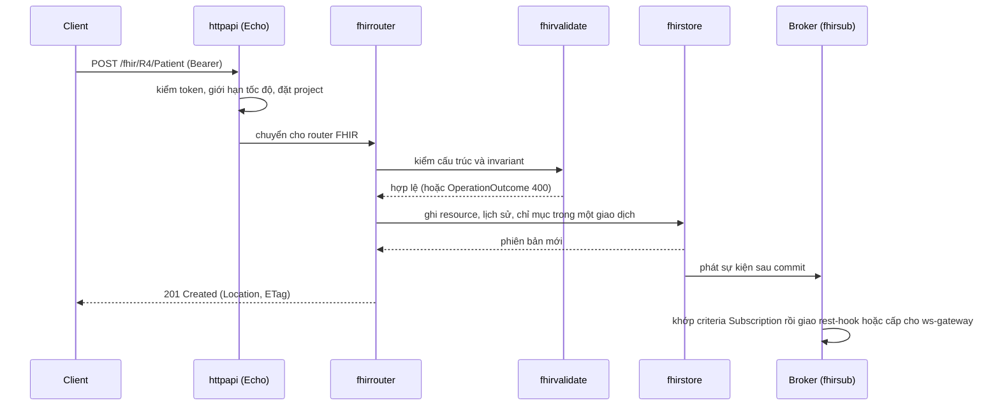

# fhir-server: kiến trúc

Cập nhật 2026-11-23. Mô tả `fhir-server` làm gì, không làm gì, vì sao là một service riêng, các thành phần, luồng chính và hành vi khi lỗi. Cấu hình ở [config.md](config.md), cách kiểm ở [testing.md](testing.md), vận hành ở [runbook.md](runbook.md), hợp đồng API ở [api-contract.md](api-contract.md) (chi tiết: [api-contract/](api-contract/)).

## 1. Làm gì, không làm gì

**Làm:** máy chủ **FHIR R4** (bản Go của phần lõi `medplum-server`).

- REST đầy đủ: create, read, vread, update, patch, delete (kể cả có điều kiện), history, search (chained, `_has`, `_include`, `_filter`, terminology `:below`/`:above`/`:in`), batch và transaction, GraphQL chỉ đọc, `metadata` (CapabilityStatement).
- Kiểm dữ liệu khi ghi theo định nghĩa chính thức: cấu trúc, kiểu, cardinality, invariant FHIRPath.
- Operation: `$validate`, `$everything`, `$expand`, `$lookup`, `$subsumes`, `$translate`, `$reindex`, `$expunge`, `$export` (Bulk Data bất đồng bộ), batch bất đồng bộ (`Prefer: respond-async`), job nền (`AsyncJob`).
- Subscription: rest-hook (giao có retry, chống SSRF) và websocket (cấp token bind; kết nối do `ws-gateway` giữ khi `FHIR_WS_MODE=issuer`, hoặc Hub nhúng ở `embedded`).
- Kho nội dung Binary thô (`file:` hoặc `s3:`), URL ký `/storage`, `$presigned-url`.
- Tách dữ liệu theo project, AccessPolicy theo claim, scope SMART, super-admin có nhật ký kiểm toán.

**Không làm:**

- **Không cấp token và không giữ tài khoản.** `auth` cấp token; `fhir-server` chỉ kiểm chữ ký bằng JWKS (hoặc dùng token tĩnh cho dev/máy-với-máy).
- **Không đọc schema `identity`** của `auth`; role `fhir_app` không có quyền gì trên schema đó.
- **Không giữ kết nối websocket** khi `FHIR_WS_MODE=issuer`: deploy hay khởi động lại `fhir-server` không ngắt socket.
- **Không phục vụ giao diện** và không có CDS Hooks, DICOMweb, key-value, MCP, Agent (xem [../../../docs/api-contract/others.md](../../../docs/api-contract/others.md)).

## 2. Vì sao tách (điều kiện theo [service-principles.md](../../../docs/service-principles.md) mục 1)

`fhir-server` là **lõi** của hệ thống: không phải kết quả của một lần tách mà là phần còn lại sau khi tách các phần có lý do riêng.

| Điều kiện | Bằng chứng |
|---|---|
| **A. Hồ sơ tải khác** | `fhir-server` scale theo **số yêu cầu** (đọc, ghi, search, job nền); `ws-gateway` scale theo **số socket**; `auth` theo số lượt đăng nhập. |
| **B. Ranh giới dữ liệu** | Dữ liệu lâm sàng ở schema `fhir` với role `fhir_app`; bí mật định danh (mật khẩu, khóa ký) ở schema `identity` mà role này không đọc được (kiểm bằng `make test-db`). |
| **C. Miền lỗi và vòng đời deploy** | Deploy `fhir-server` không còn làm rớt websocket (đã kiểm bằng container thật). `auth` sập thì token còn hạn vẫn dùng được tới hết TTL vì `fhir-server` chỉ kiểm chữ ký. |
| D. Đội sở hữu khác | Chưa có. |

Điều **chưa** tách và lý do: `fhir-worker` (export lớn chạy chung tiến trình với API) chờ số đo tải thực (task #12c); `dicomweb` chưa đóng gói.

## 3. Cấu trúc

Toàn bộ nghiệp vụ FHIR nằm trong thư viện dùng chung `pkg/`; app chỉ lắp ráp chúng và lo cấu hình, xác thực, vận hành. Vì vậy `fhir-server` **không có** `domain/` và `application/` riêng:

```
cmd/fhir-server           điểm vào: serve (mặc định) | migrate | assign-project | sweep-binary | healthcheck
internal/config           cấu hình từ biến môi trường, kiểm hợp lệ
internal/presentation/httpapi   Echo: xác thực, probe, annotation OpenAPI; router FHIR gắn bằng wildcard
internal/bootstrap        composition root (container.go), CLI (cli.go), kho Binary (storage.go)
```

| Thư viện | Việc |
|---|---|
| `pkg/fhir` | Kiểu Go cho 171 resource R4 và Medplum, schema, bảng search parameter (sinh bởi `tools/fhirgen`) |
| `pkg/fhirpath` | Engine FHIRPath |
| `pkg/fhirvalidate` | Kiểm cấu trúc, kiểu, cardinality, invariant |
| `pkg/fhirsearch` | Phân tích và đối sánh yêu cầu search |
| `pkg/fhirrouter` | Các interaction REST trên interface `Repository`, adapter `net/http`, GraphQL, operation, job nền (`AsyncJob`), bulk export, batch bất đồng bộ |
| `pkg/fhirstore` | `Repository` SQL (PostgreSQL, SQLite), chỉ mục search, migration |
| `pkg/fhirauth` | JWT, scope, AccessPolicy, tách project, ký quyền của job nền |
| `pkg/fhirsub` | Subscription: phát sự kiện sau commit, khớp criteria, giao rest-hook, websocket |
| `pkg/fhirbinary`, `pkg/binarystore` | Binary thô, URL ký, kho `file:`/`s3:`, quét mồ côi |
| `pkg/messaging` | Broker sự kiện (bộ nhớ hoặc Redis Streams) |
| `pkg/safehttp` | Gọi HTTP ra ngoài có chống SSRF (rest-hook) |

Quy tắc phụ thuộc **được ép** bởi `architecture_test.go` ở gốc repo: `internal/presentation` chỉ được import các thư viện đã liệt kê cho nó và `internal/config` chỉ `pkg/envconfig` và `pkg/httpsec`.

## 4. Dữ liệu

- **Một schema riêng `fhir`** trong database dùng chung (role `fhir_app` chỉ DML; role `fhir_migrate` sở hữu schema và chạy DDL), hoặc một database riêng. SQLite chỉ để dev (`./fhir.db`). Chi tiết role và init script ở [runbook.md mục 3](runbook.md).
- Bảng: `fhir_resource` (bản hiện tại), `fhir_history` (mọi phiên bản), các bảng chỉ mục `fhir_idx_*` (string, token, reference, date, number, quantity, uri), `fhirstore_schema_version` (goose). **Chỉ mục search là dữ liệu dẫn xuất** từ `content`: đổi định nghĩa search parameter thì phải `$reindex`.
- Mọi resource mang `meta.project` do server gán từ token (giá trị client gửi bị ghi đè); không có FK chéo sang schema `identity`.
- Job nền là resource `AsyncJob`; kết quả bulk export là `Binary` trong DB (mỗi tệp khoảng 8 MiB). Nội dung Binary thô ở kho tệp khi bật `FHIR_BINARY_STORAGE`, resource chỉ giữ metadata.
- Redis (tùy chọn): broker sự kiện khi nhiều replica (`BROKER_DRIVER=redis`), và bắt buộc khi `FHIR_WS_MODE=issuer`.

## 5. Xác thực và phân quyền

Hai chế độ **loại trừ nhau** (đặt `FHIR_JWT_ISSUER` thì không dùng token tĩnh):

| Chế độ | Cách dùng | Ghi chú |
|---|---|---|
| JWT (khuyến nghị, bắt buộc ở production thực tế) | Access token do `auth` ký, kiểm bằng JWKS (`FHIR_JWKS_URL`, cache 10 phút); `iss`, `aud`, `exp`, `sub`, claim project, và scope | Dữ liệu tách theo claim `fhir_project`; AccessPolicy lấy từ claim `fhir_access_policy` |
| Token tĩnh | `FHIR_READ_TOKENS`, `FHIR_WRITE_TOKENS`, `FHIR_ADMIN_TOKENS` (dạng `tên:secret`, >= 24 ký tự) | Cho dev và máy-với-máy; xoay bằng cách thêm token mới cạnh cũ |

Quyền: `read` (đọc, search, `$validate`, `$everything`), `write` (ghi, batch), `admin` (`$reindex`, `$expunge`). Scope SMART (`system/*.read`...) và AccessPolicy (chọn loại resource, tiêu chí, chỉ đọc) áp thêm trên đó. Thiếu hoặc sai token là `401`; đúng token nhưng thiếu project hoặc scope là `403`. Resource của project khác trả `404`.

**Super-admin** chỉ có tác dụng khi `FHIR_JWT_SUPER_ADMIN=true`: scope `fhir.super` chọn project bằng header `X-Fhir-Project`; mọi yêu cầu (kể cả bị từ chối) ghi một dòng log WARN `audit=true`.

**Job nền mang chữ ký quyền** (`FHIR_JOB_SIGNING_KEY`, dùng chung mọi replica): job không có chữ ký hợp lệ báo `error` chứ không chạy, để job không bao giờ chạy với quyền lớn hơn người tạo.

## 6. Luồng chính

### Một yêu cầu ghi



### Bulk export bất đồng bộ

`GET /fhir/R4/$export` với `Prefer: respond-async` tạo `AsyncJob` và trả `202` kèm `Content-Location` tới `bulkdata/{id}/status`. Một replica nhận job bằng `If-Match` (chỉ một replica chạy), giữ lease `FHIR_JOB_LEASE` và tự gia hạn. Poll cho tới khi `200` kèm manifest; mỗi `url` trong `output` là một `Binary` NDJSON. Vòng bảo trì (`FHIR_JOB_MAINTENANCE_INTERVAL`) đưa lại hàng đợi job mồ côi đã hết lease và xóa kết quả quá `FHIR_EXPORT_RETENTION`.

### Websocket Subscription (tách riêng)

`fhir-server` chạy `FHIR_WS_MODE=issuer`: cấp token bind (`$get-ws-binding-token`, ký HMAC bằng `FHIR_WS_SIGNING_KEY`) và khớp sự kiện, đẩy lên Redis. `ws-gateway` giữ kết nối, chỉ xác minh token bằng cùng khóa. Hợp đồng ở [../../ws-gateway/docs/api-contract.md](../../ws-gateway/docs/api-contract.md).

## 7. Hành vi khi lỗi và khi tắt

| Tình huống | Hành vi |
|---|---|
| Cấu hình sai | Từ chối khởi động, liệt kê mọi lỗi một lượt ([config.md](config.md)) |
| Schema chưa migrate | Từ chối chạy (`schema chưa được migrate`); không có nguy cơ chạy trên schema cũ |
| SIGTERM | `/readyz` 503, giữ `SHUTDOWN_DRAIN_DELAY`, chờ yêu cầu tới `SHUTDOWN_TIMEOUT`; job chưa xong **nhả lease** để instance khác chạy lại; socket nhúng đóng bằng 1001 |
| DB hỏng | `/readyz` 503 (`database: false`); `/healthz` vẫn 200 |
| Redis hỏng (khi dùng) | `/readyz` 503 (`broker: false`); sự kiện chưa xử lý vẫn nằm trên Redis nhưng lần giao rest-hook đang thử lại (hàng đợi ở bộ nhớ) thì mất khi restart |
| `auth`/JWKS tạm sập | Đã tải được khóa thì vẫn xác minh token (cache), khóa mới chưa nhận được cho tới khi `auth` lên lại |
| Job `accepted` bị bỏ giữa chừng | Vòng bảo trì chạy lại từ đầu; batch async chạy tiếp từ checkpoint |

## 8. Quan hệ với service khác

- **auth:** nhận token qua JWKS. `FHIR_JWT_ISSUER` phải bằng `AUTH_ISSUER` (mặc định `AUTH_BASE_URL`) **đúng từng ký tự**; `FHIR_JWT_AUDIENCE` = `AUTH_AUDIENCE`; `FHIR_JWKS_URL` = `<AUTH_BASE_URL>/.well-known/jwks.json` (có thể là địa chỉ nội bộ). `auth` còn gọi `fhir-server` để đọc tệp đính kèm `Binary/<id>` khi gửi thư (`AUTH_EMAIL_FHIR_URL`, bằng Bearer của người gọi).
- **ws-gateway:** chung Redis và `FHIR_WS_SIGNING_KEY` (xem mục 6).
- **fhir-cli:** công cụ dòng lệnh gọi API này (import, export, reindex); không phải service.

## 9. Chưa làm hoặc chưa kiểm

- Số đo tải (search, bulk export, nhiều replica tranh job, websocket nhiều kết nối) chưa có; diễn tập sao lưu và khôi phục chưa làm ([runbook.md mục 13](runbook.md)).
- Compartment Patient (P8, xong): tìm kiếm nhận `_compartment=Patient/<id>` (OR các tham số compartment, `pkg/fhirsearch/compartment.go`); policy của token cho phép nhiều rule cùng loại là OR (tối đa 16) và đẩy điều kiện xuống store qua `Request.Filters/Exprs` nên `_total`, phân trang, `_include` và `$everything` đều bị giới hạn đúng. Auth chỉ phát loại claim này khi bật `AUTH_PATIENT_COMPARTMENT_ENABLED`; vận hành ở [../../auth/docs/runbook.md §12](../../auth/docs/runbook.md#12-bật-compartment-patient). Bệnh nhân cần có `Patient` cùng id trong `fhir-server`; chi tiết ở [../../auth/docs/plans/p8-compartment.md](../../auth/docs/plans/p8-compartment.md).
- `fhir-worker` chưa tách (mục 2); route `/fhir/R4/...` trong swagger chưa có test máy so với router thật ([api-contract.md](api-contract.md)).
