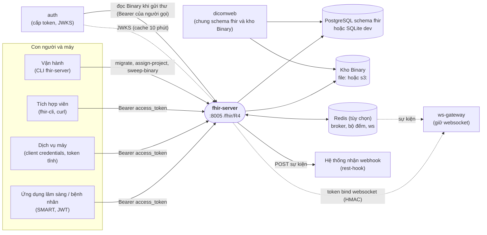
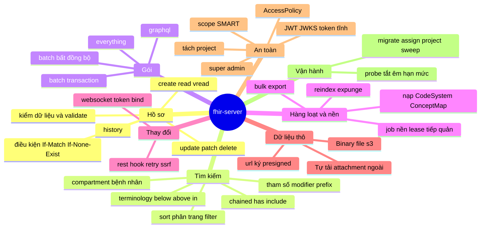
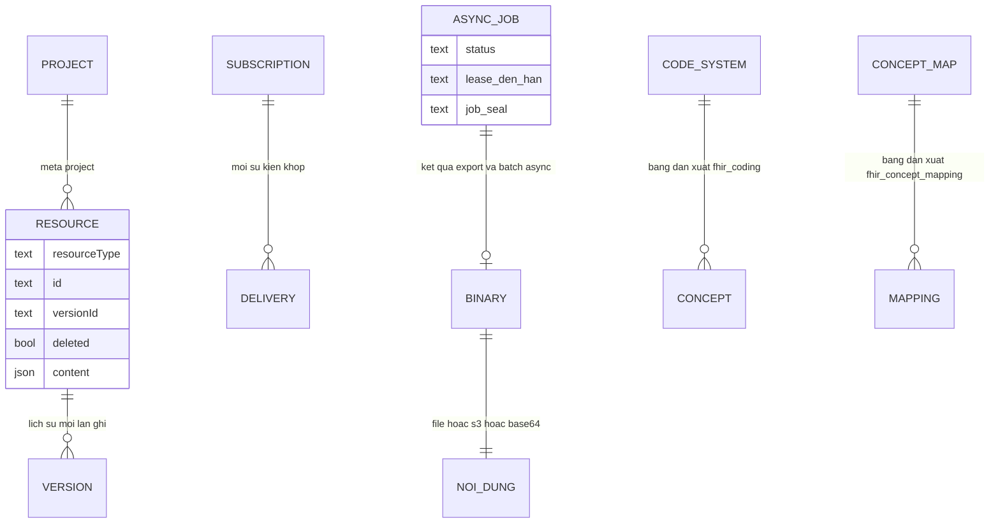

# 1. Tổng quan nghiệp vụ

## 1.1 Mục tiêu và giá trị

`fhir-server` là **kho dữ liệu lâm sàng của Trivita**, phục vụ qua giao diện chuẩn **HL7 FHIR R4**: mọi ứng dụng (EMR, ứng dụng bệnh nhân, hệ thống tích hợp, công cụ phân tích) đọc, ghi, tìm và theo dõi hồ sơ y tế bằng một API thống nhất. Đây là bản Go của phần lõi `medplum-server`; **nghiệp vụ FHIR nằm trong thư viện dùng chung `pkg/*`**, app chỉ lắp ráp, xác thực và vận hành.

| Giá trị | Cách đạt được |
|---|---|
| Một API chuẩn cho mọi loại hồ sơ | REST đầy đủ (create, read, vread, update, patch, delete, history, search, batch, transaction) cho các loại resource R4 và Medplum (README ghi 171 loại, chưa đếm lại) |
| Dữ liệu đúng khi vào | Kiểm cấu trúc, kiểu, cardinality, invariant FHIRPath trước khi ghi; `$validate` để thử mà không lưu |
| Cách ly giữa tổ chức | Mọi resource mang `meta.project` do **server gán từ token**; project khác không thấy dữ liệu (trả `404`) |
| Quyền tối thiểu | Scope SMART từng chữ (`c r u d s`) và AccessPolicy trong token (loại, tiêu chí, chỉ đọc, compartment bệnh nhân) |
| Truy vết và khôi phục | Mọi phiên bản được giữ (`_history`); xóa là xóa mềm; `$expunge` xóa vĩnh viễn |
| Theo dõi thay đổi | Subscription rest-hook (webhook có retry, chống SSRF) và websocket (qua `ws-gateway`) |
| Việc lớn không chặn API | Bulk export, `$reindex`, batch lớn chạy thành job nền có lease, tiếp quản và retention |

## 1.2 Ranh giới hệ thống

**Làm:** lưu và phục vụ resource FHIR; tìm kiếm; lịch sử; batch và transaction; terminology; bulk export; Subscription; Binary thô; tách project và phân quyền theo token.
**Không làm:** không cấp token và không giữ tài khoản (do `auth`); không đọc schema `identity`; không giữ kết nối websocket khi `FHIR_WS_MODE=issuer` (do `ws-gateway`); không có giao diện, CDS Hooks, DICOMweb (`dicomweb`), key-value, MCP, Agent.

## 1.3 Tác nhân

| Mã | Tác nhân | Là ai | Xác thực bằng | Việc chính |
|---|---|---|---|---|
| A1 | **Ứng dụng lâm sàng / bệnh nhân** | EMR, ứng dụng SMART, ứng dụng bệnh nhân | JWT của `auth` (scope SMART, AccessPolicy) | Đọc, ghi, tìm hồ sơ trong project của người dùng |
| A2 | **Dịch vụ máy** | Hệ thống tích hợp, ETL | JWT `client_credentials` hoặc token tĩnh `READ/WRITE/ADMIN` | Nạp và lấy dữ liệu hàng loạt, tự động hóa |
| A3 | **Tích hợp viên / dev** | Lập trình viên, QA | như A1, A2 (qua `fhir-cli`, curl) | Thử API, nạp dữ liệu thử, `$validate` |
| A4 | **Quản trị project** | Token có `fhir.admin`, không bị AccessPolicy thu hẹp | JWT | `$reindex`, `$expunge` (và mọi thao tác ghi nếu token cho phép) |
| A5 | **Vận hành** | SRE | quyền máy chủ (CLI, biến môi trường) | `migrate`, `assign-project`, `sweep-binary`, theo dõi job và probe |
| A6 | **Super-admin** | Tài khoản vận hành xuyên project | JWT scope `fhir.super` + `FHIR_JWT_SUPER_ADMIN=true` | Hành động trong project chọn bằng `X-Fhir-Project`, có nhật ký kiểm toán |
| A7 | **Hệ thống nhận webhook** | Endpoint của đối tác | nhận `POST`, kiểm `X-Signature` | Nhận sự kiện thay đổi (rest-hook) |
| A8 | **Ứng dụng realtime** | Trình duyệt, dịch vụ nghe websocket | token bind (`$get-ws-binding-token`) | Nhận thông báo qua `ws-gateway` |
| A9 | **auth** | Dịch vụ danh tính | JWKS | Nguồn tin cậy của token |
| A10 | **dicomweb** | Dịch vụ ảnh DICOM | cùng DB và kho | Ghi `DicomStudy/Series/Instance` và `Binary` vào schema `fhir`, cùng migration do `fhir-server` sở hữu |

## 1.4 Bản đồ năng lực

## 1.5 Thuật ngữ

| Thuật ngữ | Nghĩa nghiệp vụ |
|---|---|
| **Resource** | Một bản ghi FHIR dạng JSON có `resourceType` và `id` (Patient, Observation...). Khóa là `(resourceType, id)` |
| **Phiên bản (version)** | Mỗi lần ghi tạo một `versionId` mới; bản cũ giữ trong lịch sử. `ETag` là `W/"versionId"` |
| **Xóa mềm / `$expunge`** | `DELETE` chỉ đánh dấu đã xóa (đọc trả `410`); `$expunge` xóa vĩnh viễn resource và toàn bộ lịch sử |
| **Bundle** | Gói nhiều thao tác; `batch` (mỗi mục độc lập) hoặc `transaction` (tất cả hoặc không) |
| **Search parameter** | Tham số tìm kiếm của một loại; giá trị được lập chỉ mục khi ghi (dữ liệu dẫn xuất từ nội dung, đổi định nghĩa thì phải `$reindex`) |
| **Project** | Tổ chức/không gian dữ liệu; resource mang `meta.project`, do server gán |
| **Scope SMART** | Quyền theo loại và chữ cái: `c` tạo, `r` đọc, `u` sửa, `d` xóa, `s` tìm (`system\|user/<Loại\|*>.<quyền>`) |
| **AccessPolicy (claim)** | Mảng rule trong token `fhir_access_policy`: loại được truy cập, tiêu chí lọc, chỉ đọc, từ chối; thu hẹp quyền |
| **Compartment (Patient)** | Tập resource thuộc một bệnh nhân; `_compartment=Patient/<id>` giới hạn kết quả |
| **AsyncJob** | Resource biểu diễn một job nền (export, reindex, batch async), kèm lease và chữ ký quyền |
| **Lease** | Quyền chạy job có hạn, tự gia hạn; hết hạn thì replica khác tiếp quản |
| **job-seal** | Chữ ký HMAC ảnh chụp quyền của người tạo job; job không có chữ ký hợp lệ không chạy |
| **Bulk export** | `$export` bất đồng bộ: job gom dữ liệu thành tệp NDJSON (resource `Binary`) |
| **Subscription** | Đăng ký nhận thông báo khi resource khớp `criteria` thay đổi; kênh `rest-hook` hoặc `websocket` |
| **SSRF** | Tấn công làm máy chủ gọi tới địa chỉ nội bộ; rest-hook chặn loopback, mạng riêng, link-local, CGNAT, multicast |
| **Binary thô** | Nội dung tệp lưu ở kho file/S3, resource `Binary` chỉ giữ metadata; truy cập qua URL ký `/storage` |
| **Super-admin** | Token `fhir.super` hành động trong project do header `X-Fhir-Project` chọn |

## 1.6 Mô hình dữ liệu nghiệp vụ (mức khái quát)

Chi tiết bảng và cột: [docs/erd/fhirstore-physical.md](../../../../docs/erd/fhirstore-physical.md) (bộ bảng dùng chung); mô hình logic của `fhir-server` là **mọi loại resource R4** cộng các loại điều hành dưới đây.

Quan hệ giữa resource là `Reference` trong JSON, **không có khóa ngoại** ở mức DB; toàn vẹn tham chiếu **không được kiểm khi ghi** theo kết quả grep (không mã nào của `pkg/` hay `apps/fhir-server` đọc `Project.checkReferencesOnWrite` hay `strictMode`: hai trường này của Medplum chỉ tồn tại trong kiểu dữ liệu); các luật kiểm dữ liệu khi ghi ở mục BR-25..29 của [05](05-luat-va-phan-quyen.md). Mọi thay đổi (tạo, sửa, xóa) ghi resource, lịch sử và chỉ mục trong **một transaction** rồi mới phát sự kiện cho Subscription.
