# 2. Luồng nghiệp vụ đầu-cuối

Mỗi luồng nêu **mục tiêu**, **các bên**, **sơ đồ**, **kết quả**, **chức năng tham gia** (F-xx ở [04-chuc-nang.md](04-chuc-nang.md)), và điều **không thấy trong hình**. Luật `BR-xx` ở [05-luat-va-phan-quyen.md](05-luat-va-phan-quyen.md).

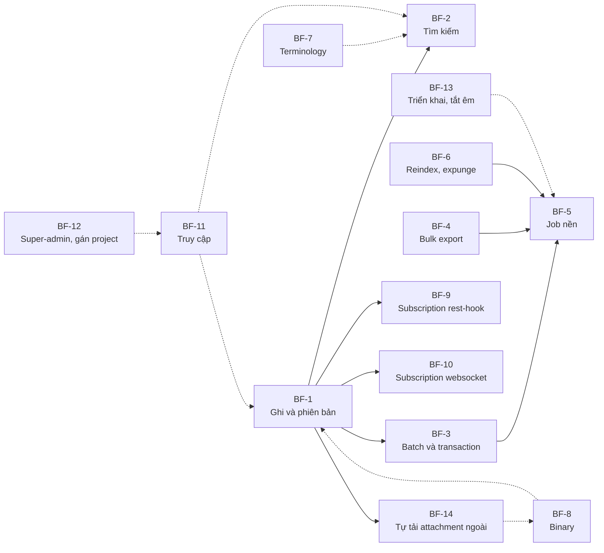

---

### BF-1. Ghi dữ liệu và phiên bản

**Mục tiêu:** ghi resource có phiên bản, lịch sử, khóa lạc quan và thao tác có điều kiện, an toàn khi nhiều người ghi đồng thời.
**Các bên:** ứng dụng khách; lớp xác thực (vai trò, project, chữ SMART); router (kiểm dữ liệu, điều kiện); kho SQL (transaction, lịch sử, chỉ mục); bộ phát sự kiện Subscription.

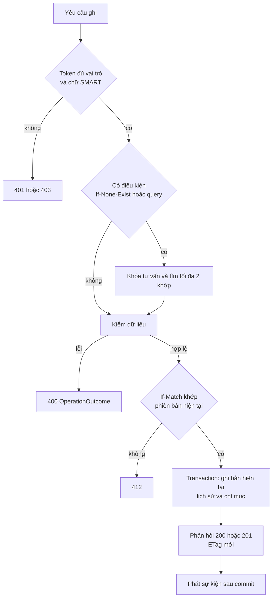

Điều không thấy trong hình: update luôn sinh phiên bản mới kể cả khi nội dung giống hệt; chỉ mục search được lập lại trong cùng transaction nên search thấy dữ liệu ngay sau phản hồi; ở PostgreSQL khóa dòng và khóa tư vấn bảo đảm hai yêu cầu đồng thời chỉ một thắng, còn kho không hỗ trợ khóa thì tạo có điều kiện chỉ an toàn khi chỉ có một writer. Xóa mềm thêm phiên bản xóa thay vì bỏ dòng.
**Kết quả:** resource có phiên bản mới và lịch sử đầy đủ (hoặc lỗi không đổi dữ liệu).
**Chức năng tham gia:** F-01, F-03, F-04, F-05, F-06, F-11.

### BF-2. Tìm kiếm

**Mục tiêu:** trả đúng và chỉ những resource người gọi được thấy, theo tham số chuẩn FHIR, có phân trang.
**Các bên:** ứng dụng khách; bộ phân tích `fhirsearch`; router (giải chained, `_has`, terminology); lớp tách project; kho SQL.

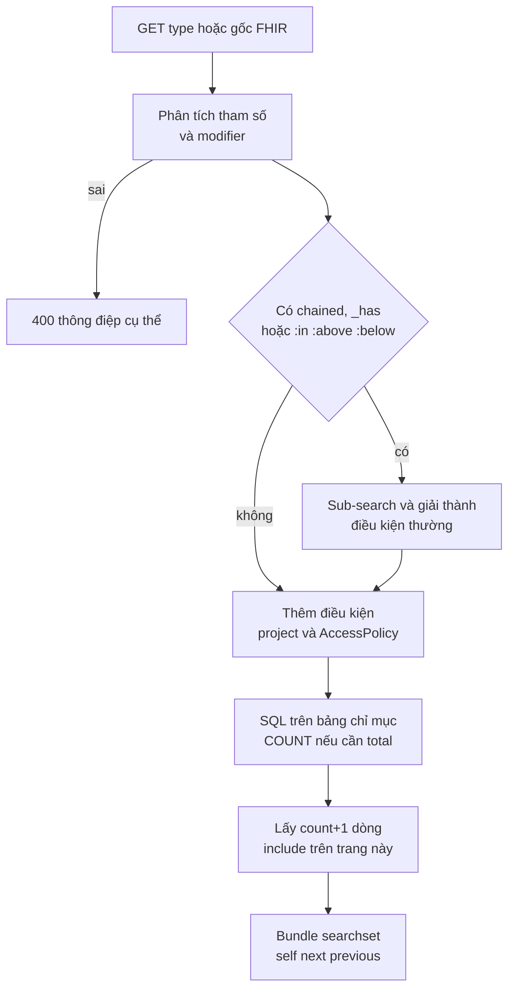

Điều không thấy trong hình: `_total` mặc định là `none` nên không tốn câu COUNT; `_include` chỉ xét các kết quả của trang hiện tại; điều kiện chained và terminology là ảnh chụp tại thời điểm tìm; các lớp lọc sau truy vấn (loại đọc được, chính sách, project) là lớp phòng thủ thứ hai sau khi điều kiện đã được đẩy xuống SQL. Chuỗi được chuẩn hóa bỏ dấu cả khi lập chỉ mục lẫn khi tìm nên "nguyen" khớp "Nguyễn".
**Kết quả:** Bundle `searchset` với `total` (nếu yêu cầu) và link phân trang.
**Chức năng tham gia:** F-07, F-08, F-12, F-13.

### BF-3. Batch và transaction (đồng bộ và bất đồng bộ)

**Mục tiêu:** gộp nhiều thao tác ghi đọc trong một lần gọi, hoặc nạp lượng lớn ở nền mà không giữ kết nối.
**Các bên:** ứng dụng khách; router (phân tích, sắp thứ tự, thay urn:uuid); kho (transaction); bộ điều phối job nền (async); Binary lưu đầu vào, checkpoint và kết quả.

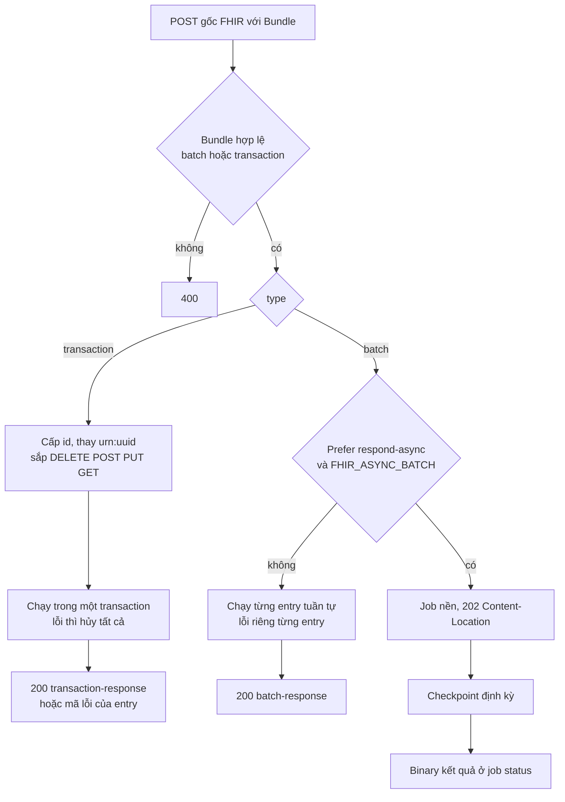

Điều không thấy trong hình: transaction kèm `respond-async` bị 400 ngay (không tạo job); bundle batch vẫn cần vai trò WRITE ở tầng HTTP kể cả khi chỉ có GET; batch async khi tiến trình chết sẽ được replica khác tiếp quản và chạy lại các entry sau checkpoint cuối (ít nhất một lần, POST không điều kiện không nhân bản vì id cấp sẵn); hủy job không hoàn tác những gì đã ghi.
**Kết quả:** Bundle phản hồi (đồng bộ) hoặc AsyncJob hoàn tất trỏ tới Binary chứa `batch-response`.
**Chức năng tham gia:** F-09, F-10, F-20 (hạ tầng job), F-01, F-03, F-05.

### BF-4. Bulk export

**Mục tiêu:** xuất dữ liệu project thành NDJSON không giữ kết nối, đúng quyền người xuất.

**Các bên:** client (ETL), router, vòng chạy job, kho SQL, AsyncJob, Binary.

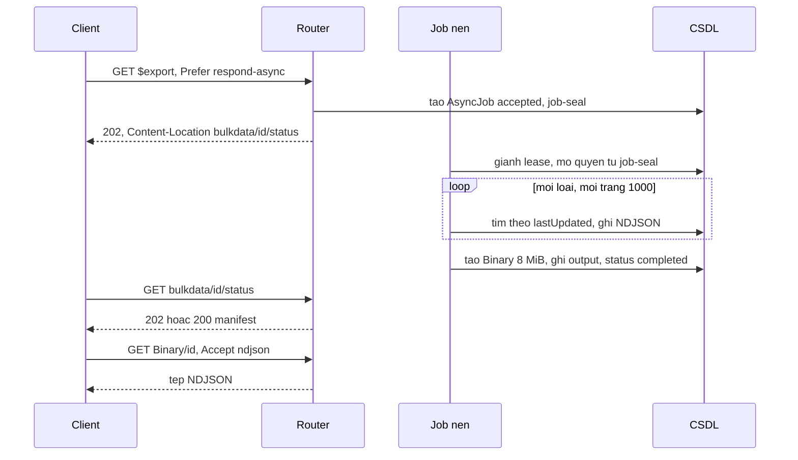

Điều không thấy trong hình: mỗi loại được tìm bằng phân trang offset nên ghi đồng thời có thể làm lặp hoặc sót; tệp là Binary nằm trong CSDL (không vào kho `file:`/`s3:`), tải tệp cần quyền đọc Binary; không có checkpoint nên job chết giữa chừng chạy lại từ đầu và các Binary của lần trước (nếu job vẫn `accepted`) không được ghi trong output nên chỉ bị dọn nếu job hủy hoặc lỗi trong cùng process (xem Lệch).

**Kết quả:** manifest 200 với danh sách `{type,url,count}`; hoặc 500 khi lỗi; hoặc 410 khi hủy; sau FHIR_EXPORT_RETENTION AsyncJob và tệp bị xóa (404).

**Chức năng tham gia:** F-17, F-20, F-23 (tải tệp), F-24 (quyền), F-25 (project).

### BF-5. Job nền (vòng đời, lease, tiếp quản)

**Mục tiêu:** mọi job chạy đúng một lần hiệu lực, sống sót qua tắt êm và chết đột ngột.

**Các bên:** router, orchestrator Inline, heartbeat, vòng bảo trì, AsyncJob trong CSDL.

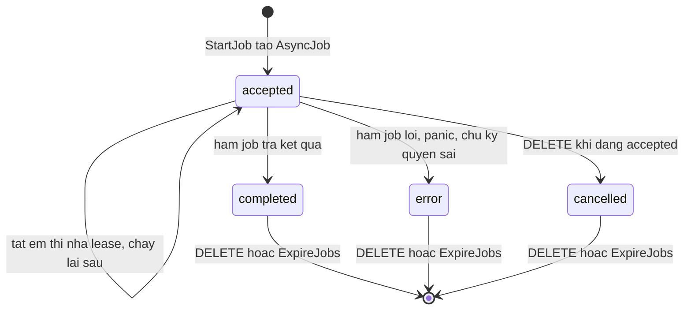

Điều không thấy trong hình: "đang chạy" không phải một trạng thái; đó là `accepted` mà `transactionTime` (lease) còn hạn. `transactionTime` của job đã xong đổi nghĩa thành thời điểm hoàn tất. `ExpireJobs` xóa hẳn (Expunge, cả lịch sử và file kết quả, từ 2026-11-24) job export, batch và `reindex` đã quá `FHIR_EXPORT_RETENTION`; sau đó trạng thái của chúng trả `404`. Hủy một job đang chạy ở replica khác có hiệu lực ở vòng thăm dò kế tiếp (`FHIR_JOB_CANCEL_POLL`, mặc định 2 giây; trước 2026-11-24 là nhịp heartbeat JobLease/3).

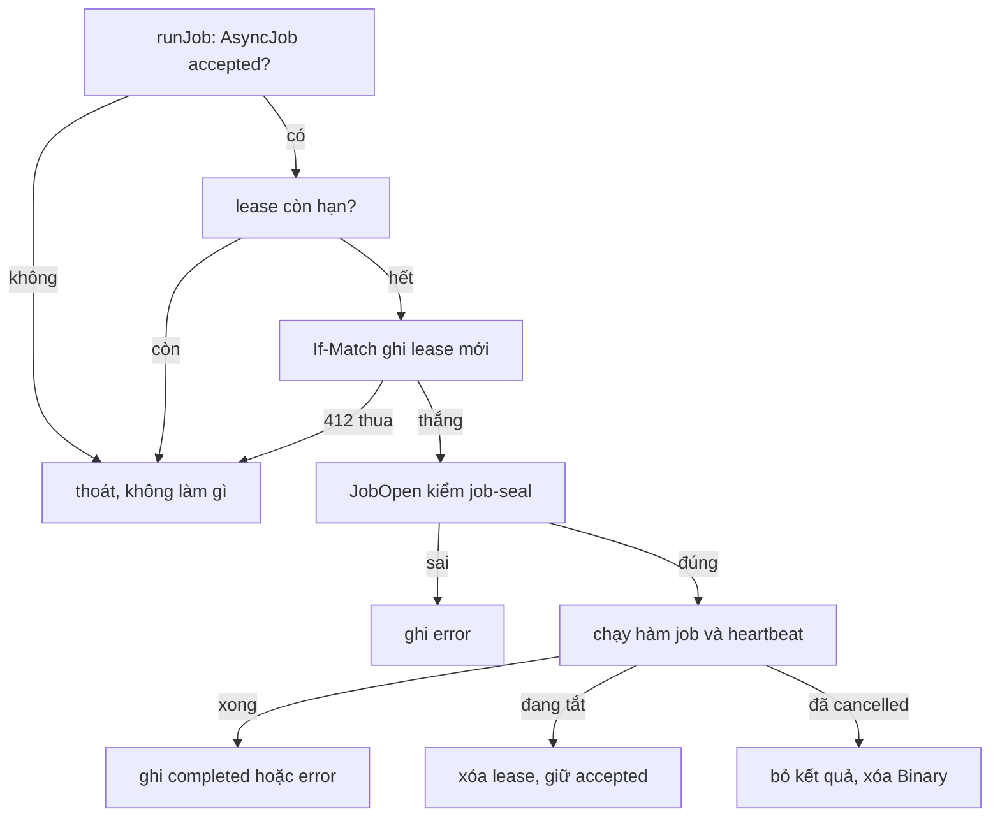

Điều không thấy trong hình: nhánh "thua" không phải lỗi và không log mức lỗi (412 được nuốt); nhánh "đang tắt" chỉ áp dụng khi hàm job trả lỗi VÀ context của orchestrator đã bị hủy (job hoàn tất đúng lúc tắt vẫn ghi `completed`).

**Kết quả:** AsyncJob ở một trong bốn trạng thái; replica chết thì job được nhặt lại sau tối đa FHIR_JOB_LEASE cộng một chu kỳ FHIR_JOB_MAINTENANCE_INTERVAL.

**Chức năng tham gia:** F-20, F-17, F-18, F-10 (batch async).

### BF-6. Bảo trì chỉ mục (reindex, expunge)

**Mục tiêu:** sửa chỉ mục tìm kiếm hoặc xóa vĩnh viễn một resource theo yêu cầu quản trị.

**Các bên:** quản trị, router, repository, job nền, kho Binary.

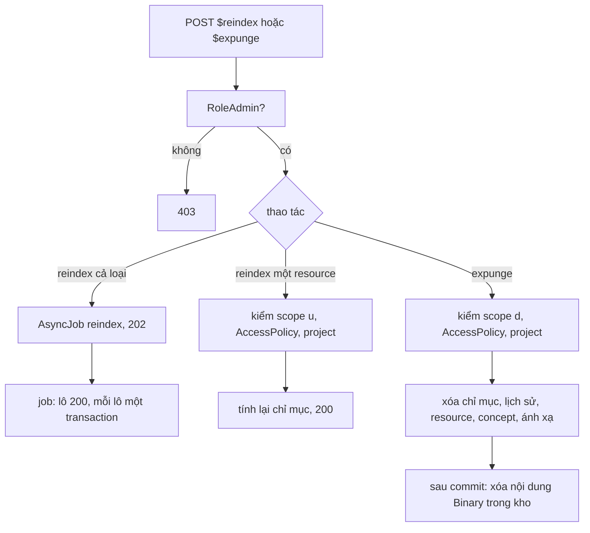

Điều không thấy trong hình: `reindex` cả loại chạy bằng repository không tách project nên đi qua mọi project dù người gọi chỉ là admin một project (xem Lệch); `expunge` không dọn tham chiếu từ resource khác, không sinh lịch sử và không thể hoàn tác; job reindex có thể chạy lại bất kỳ lúc nào vì chỉ ghi chỉ mục.

**Kết quả:** chỉ mục khớp JSON; hoặc resource biến mất hoàn toàn (đọc 404, `_history` 404, tìm không thấy), nội dung Binary bị xóa sau commit.

**Chức năng tham gia:** F-18, F-19, F-20, F-23, F-26.

### BF-7. Terminology (nạp và tra cứu)

**Mục tiêu:** có bảng mã và ánh xạ trong server rồi tra cứu hoặc dùng làm điều kiện tìm kiếm.

**Các bên:** quản trị, công cụ nạp, router, repository (ConceptStore, MappingStore), ứng dụng.

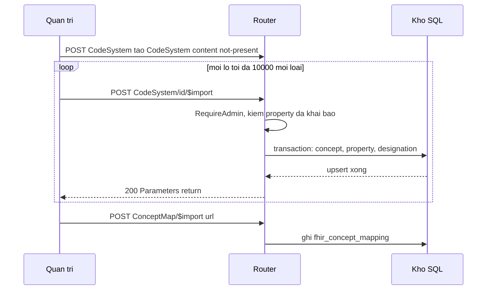

Điều không thấy trong hình: mỗi lô là một transaction riêng nên nạp dở dang không làm hỏng dữ liệu đã nạp; công cụ phải nạp concept trước property và designation; CodeSystem có `content` khác `not-present` sẽ không được tra từ bảng dẫn xuất.

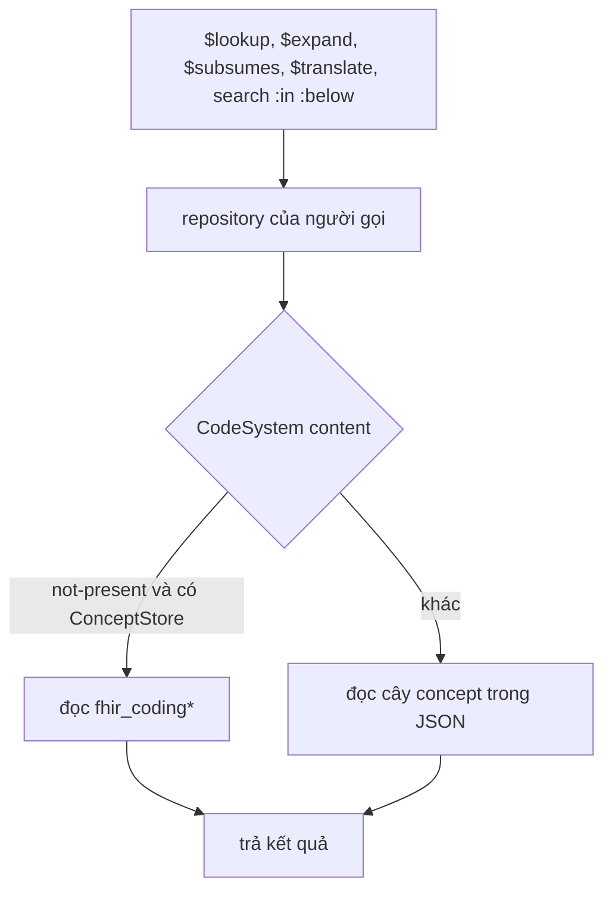

Điều không thấy trong hình: `$subsumes` và `:below`, `:above` luôn đọc cây trong JSON (không dùng bảng dẫn xuất); `$translate` luôn cộng cả ánh xạ nạp vào và ánh xạ nằm trong JSON của ConceptMap.

**Kết quả:** tra cứu trả kết quả theo dữ liệu hiện có; nạp lặp lại không đổi kết quả.

**Chức năng tham gia:** F-15, F-16, F-19 (expunge dọn bảng), F-07 (modifier).

### BF-8. Binary và URL ký

**Mục tiêu:** lưu tệp lớn ngoài JSON FHIR và chia sẻ có kiểm soát qua URL có hạn.

**Các bên:** ứng dụng, router, lớp bọc Binary, kho `file:` hoặc `s3:`, bộ ký.

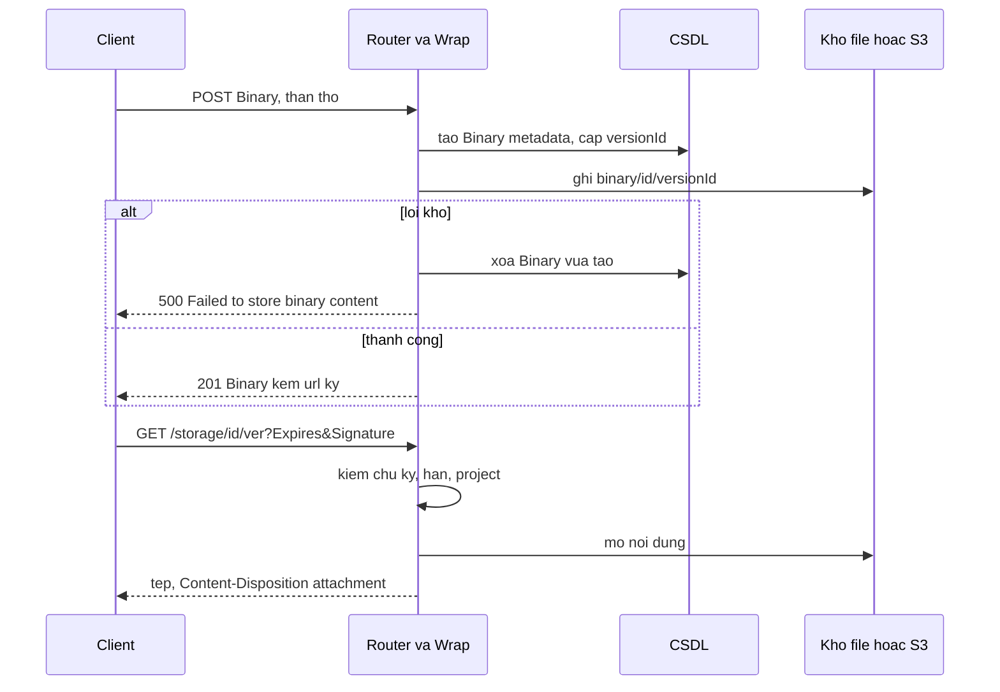

Điều không thấy trong hình: nếu tiến trình chết giữa bước tạo metadata và ghi kho thì Binary có metadata mà không có nội dung (GET 404), còn nếu chết giữa ghi kho và commit (bundle) thì nội dung mồ côi chờ `sweep-binary`; lệnh quét chỉ dọn nội dung, không dọn Binary thiếu nội dung.

**Kết quả:** Binary có nội dung đọc được qua `GET Binary/{id}` (người có quyền) hoặc URL ký (người nhận link, đến hết `Expires`).

**Chức năng tham gia:** F-23, F-19 (expunge xóa nội dung), F-26 (sweep-binary), F-24 và F-25 (quyền, project).

---

### BF-9. Subscription rest-hook

- **Mục tiêu:** hệ thống ngoài được báo gần thời gian thực khi dữ liệu khớp tiêu chí thay đổi, mà không làm chậm hay làm hỏng việc ghi.
- **Các bên:** client ghi dữ liệu; `fhirsub.Repo` (bọc kho); broker (`memory` hoặc `redis`); `Manager`; worker giao; endpoint của hệ thống nhận; Redis (nếu nhiều replica); vận hành.

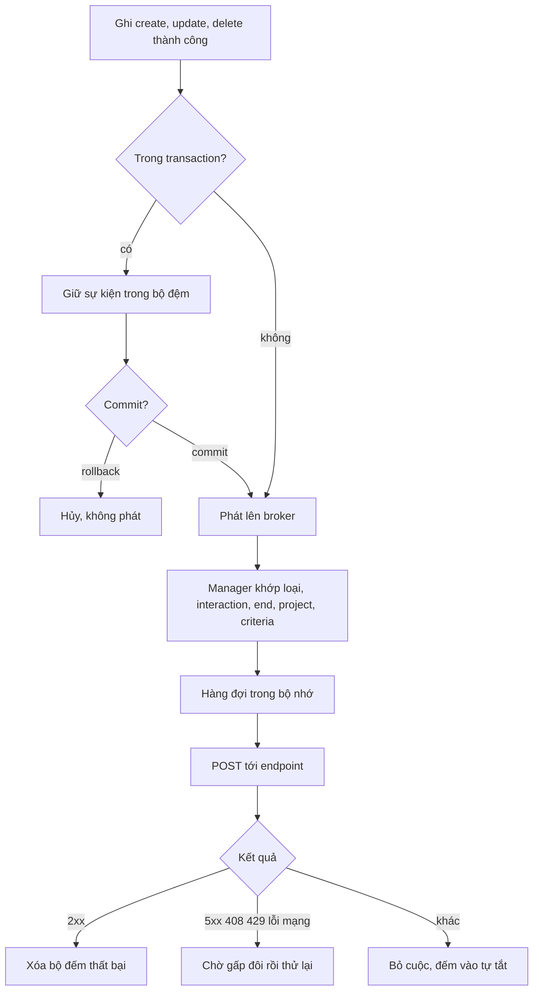

- **Kết quả:** mỗi lần khớp cho ra một thông báo tới endpoint (at-least-once, không bảo đảm thứ tự, có thể mất khi tiến trình chết giữa chừng); Subscription lỗi kéo dài tự chuyển `off` nếu bật cấu hình. Điều vận hành cần nhớ: sau commit mà trước khi phát sự kiện, nếu tiến trình chết thì sự kiện không bao giờ được phát (không có outbox).
- **Chức năng tham gia:** F-01, F-03, F-04, F-05, F-09 (nguồn sự kiện), F-21.

### BF-10. Subscription websocket

- **Mục tiêu:** ứng dụng nhận thông báo realtime qua một kết nối sống lâu, chỉ thấy dữ liệu mà người đó được đọc.
- **Các bên:** ứng dụng client; fhir-server (cấp token, khớp sự kiện); Hub nhúng hoặc ws-gateway; Redis (kênh và sổ hiện diện, chế độ `issuer`).

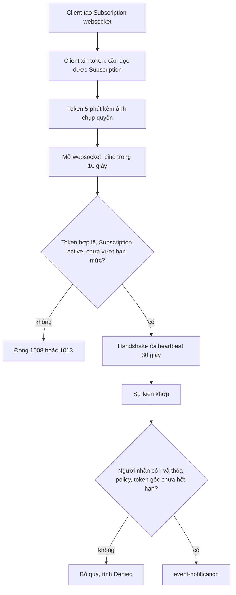

- **Kết quả:** client nhận `event-notification` cho đúng các thay đổi khớp và được phép đọc; không có replay khi rớt kết nối. Giới hạn đã biết: token dùng lại được tới khi hết hạn; quyền không cập nhật giữa chừng; Subscription tắt hoặc xóa không ngắt kết nối. Phần giữ kết nối của chế độ `issuer` mô tả ở [ws-gateway](../../../ws-gateway/docs/README.md).
- **Chức năng tham gia:** F-22, F-21 (khớp sự kiện), F-24 (ảnh chụp quyền), F-25 (cùng project).

### BF-11. Truy cập (token, project, quyền, AccessPolicy, bản ghi)

- **Mục tiêu:** mỗi yêu cầu chỉ chạm được vào dữ liệu đúng project, đúng loại, đúng thao tác và đúng bản ghi mà token cho phép; mọi thứ khác bị từ chối (401, 403) hoặc che giấu (404).
- **Các bên:** client; cổng `Guard` (`httpapi`); `fhirauth.Verifier` và JWKS của `auth`; `fhirauth.Repo` (tách project, scope, policy); kho.

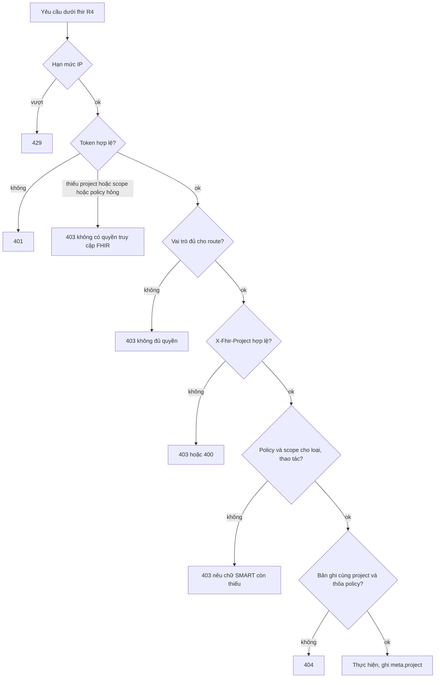

Thứ tự kiểm tra của một yêu cầu (chế độ JWT; token tĩnh chỉ có bước 1, 2, 4, 5):

| # | Bước | Kiểm gì | Thất bại |
|---|---|---|---|
| 1 | Hạn mức IP | Số yêu cầu/giây của IP (trước xác thực) | `429` kèm `Retry-After: 1` |
| 2 | Token | Có bearer; chữ ký, `iss`, `aud`, `exp`, `sub` (JWT) hoặc khớp băm (tĩnh) | `401` (JWT: `Thiếu bearer token` hoặc `Token không hợp lệ`; tĩnh: `Thiếu hoặc sai bearer token`) |
| 3 | Quyền dùng cho FHIR | Có claim project (trừ super-admin), có scope cấp quyền, claim AccessPolicy đúng định dạng | `403` `Token không có quyền truy cập FHIR` |
| 4 | Vai trò cổng | Vai trò suy từ scope hoặc loại token so với `RequiredRole(method, path)` | `403` `Token không đủ quyền cho thao tác này` |
| 5 | Chọn project | Người thường: header trống hoặc đúng project của mình; super-admin: header hợp lệ | `403` `Token không được chọn project khác` hoặc `400` `Super-admin phải chọn project bằng header X-Fhir-Project` |
| 6 | Project có mặt | `Principal.Project` không rỗng | `403` `Không xác định được project của người gọi` |
| 7 | AccessPolicy cho loại | Loại có rule (hoặc rule `*`), không `deny`, và không `readonly` khi ghi | `403` `Chính sách truy cập không cho phép <Loại>` |
| 8 | Scope SMART cho loại | Đủ chữ cần cho thao tác (xem BR-49, BR-50) | `403` `Token thiếu quyền <chữ> (SMART) trên <Loại>` |
| 9 | Bản ghi | Bản ghi cùng `meta.project` và thỏa `criteria` của policy (đọc, vread, history, sửa, xóa); với tạo và sửa: bản mới cũng phải thỏa policy | `404` khi đọc hoặc sửa bản ngoài phạm vi; `403` `Resource không thỏa tiêu chí của chính sách truy cập` khi bản ghi ra không thỏa |
| 10 | Kết quả search | Điều kiện project và policy đẩy xuống kho (`total` và phân trang đúng), rồi lọc lại từng kết quả và `_include`/`_revinclude` theo project, scope, policy | Bản ngoài phạm vi bị loại im lặng |

- **Kết quả:** token đúng quyền thao tác trên đúng bản ghi; token sai bị từ chối ở bước sớm nhất có thể. Với job nền, ảnh chụp quyền (project, grants theo loại, policy) được ký HMAC-SHA256 vào `AsyncJob` bằng `FHIR_JOB_SIGNING_KEY` và job chỉ chạy với đúng quyền đó (job sai hoặc thiếu chữ ký bị đánh dấu lỗi); với websocket, ảnh chụp nằm trong token bind (BF-10).
- **Chức năng tham gia:** F-24, F-25, F-27; mọi F-01..F-20 chịu lớp này.

### BF-12. Super-admin và gán project cho dữ liệu cũ

- **Mục tiêu:** (a) vận hành xuyên project có kiểm toán; (b) đưa dữ liệu ghi trước khi bật tách project vào đúng project để có người nhìn thấy.
- **Các bên:** super-admin; vận hành; fhir-server; kho; kho log.

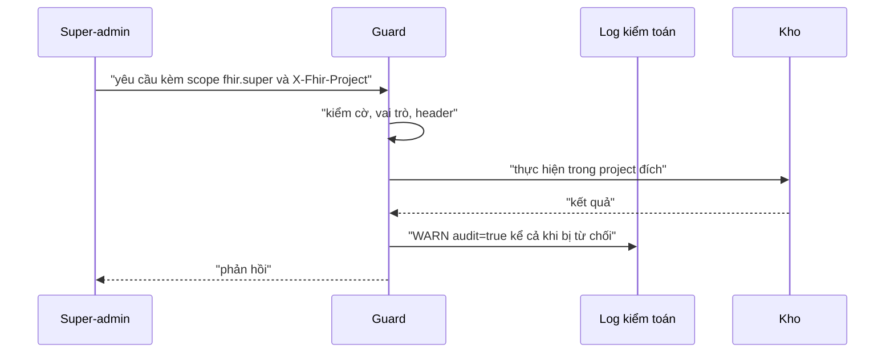

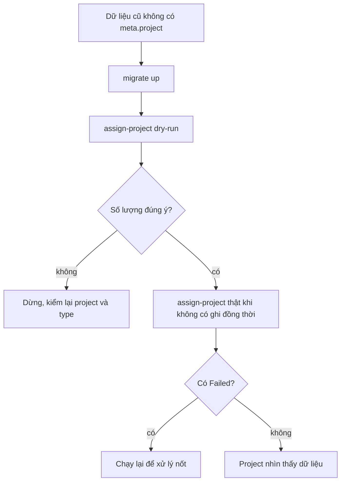

- **Kết quả:** (a) mỗi hành động của super-admin để lại một dòng audit; (b) resource cũ nhận `meta.project` và một phiên bản mới, chạy lại thì xử lý phần còn lại. Phải chạy `assign-project` khi không có ghi đồng thời: nếu resource bị sửa giữa lúc quét và lúc gán, nó bị bỏ qua và tính vào lỗi.
- **Chức năng tham gia:** F-25, F-26, F-24.

### BF-13. Triển khai, migrate, tắt êm

- **Mục tiêu:** nâng cấp và khởi động nhiều replica an toàn (không chạy trên schema cũ, ứng dụng không có quyền DDL) và tắt không rớt yêu cầu.
- **Các bên:** vận hành; PostgreSQL (schema `fhir`, role `fhir_migrate` và `fhir_app`); fhir-server; bộ cân bằng tải; Redis (nếu có).

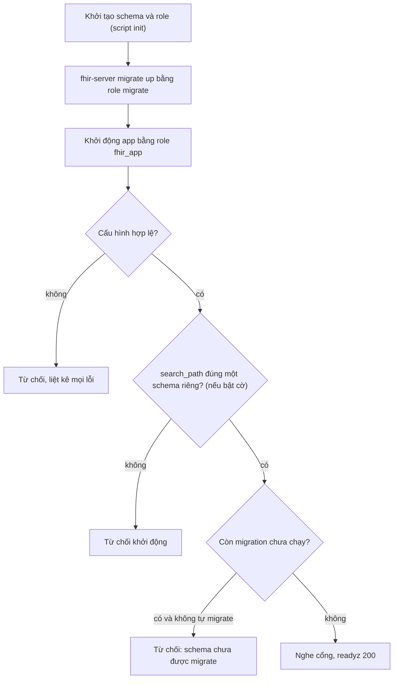

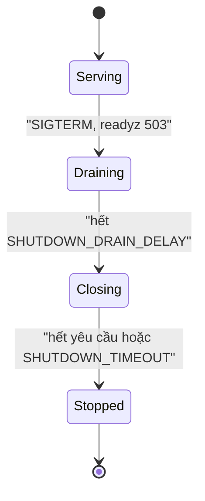

Điều không thấy trong hình: thứ tự nâng cấp cả cụm là `auth` trước, rồi `fhir-server`, rồi `ws-gateway`; với compartment bệnh nhân thì nâng mọi instance `fhir-server` TRƯỚC khi `auth` bật `AUTH_PATIENT_COMPARTMENT_ENABLED`. Role `fhir_app` chỉ có DML (không DDL, không `TRUNCATE`) nên `DATABASE_AUTO_MIGRATE=false` và `DATABASE_MIGRATE_URL` là role `fhir_migrate`; `migrate down` không chạy trên production (khôi phục từ sao lưu để quay lại phiên bản cũ). `DATABASE_REQUIRE_SCHEMA=true` (PostgreSQL) làm cả server lẫn `migrate` từ chối chạy khi `search_path` không phải đúng một schema riêng đã tồn tại.

- **Kết quả:** mọi replica chỉ chạy trên schema đã migrate; tắt êm không cắt yêu cầu đang xử lý trong `SHUTDOWN_TIMEOUT`; job nền chưa xong nhả lease cho instance khác chạy lại.
- **Chức năng tham gia:** F-26, F-27, F-20 (nhả lease khi tắt, cụm khác).

---

### BF-14. Tự tải attachment ngoài về kho Binary

- **Mục tiêu:** biến tham chiếu tệp ở máy chủ ngoài (`Attachment.url`) thành `Binary` nằm trong kho của đúng project, không làm chậm hay làm hỏng lần ghi gốc.
- **Các bên:** ứng dụng ghi resource; bộ phát sự kiện (cùng nguồn với Subscription); worker tự tải; máy chủ ngoài; kho Binary (`file:`/`s3:`); CSDL.

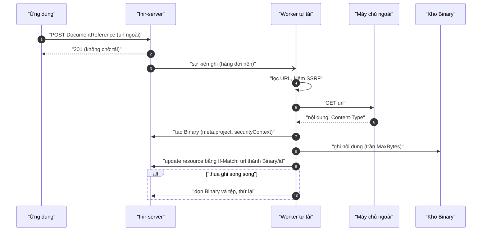

- **Kết quả:** sau ít giây, attachment trỏ `Binary/<id>` (đọc qua F-23 như Binary thường, kể cả URL ký), resource có thêm một phiên bản; nếu lỗi vĩnh viễn thì giữ nguyên URL ngoài và chỉ có log.
- **Chức năng tham gia:** F-28; F-01, F-03 (ghi gốc và ghi thay URL), F-23 (đọc Binary), F-21 (Subscription nhận thêm một update).
- **Không thấy trong hình:** việc tải là tối ưu nỗ lực tốt nhất (best effort), không có trạng thái "đang tải" hay API hỏi tiến độ; người dùng chỉ thấy `url` đổi. Máy chủ ngoài chậm hay chết không ảnh hưởng độ trễ ghi, nhưng broker bộ nhớ mất việc khi khởi động lại (BR-71).
