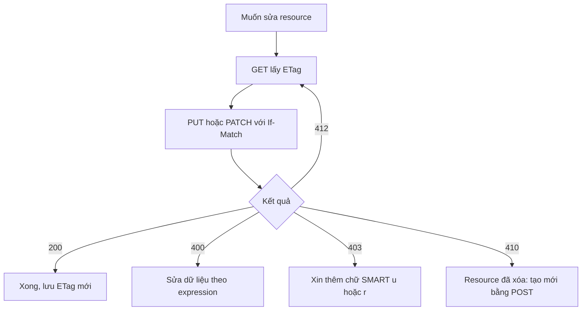
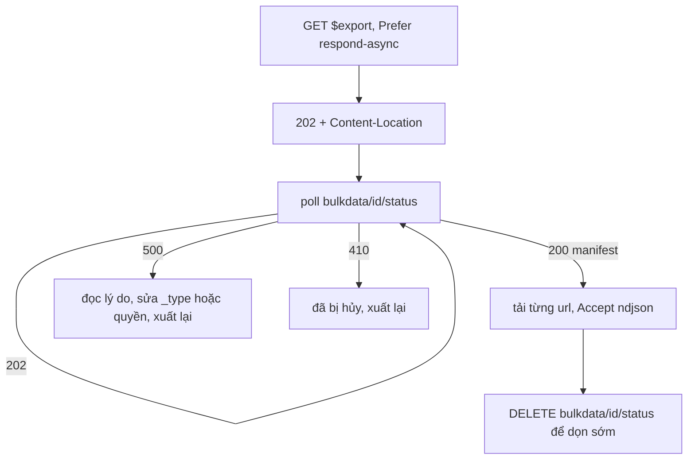
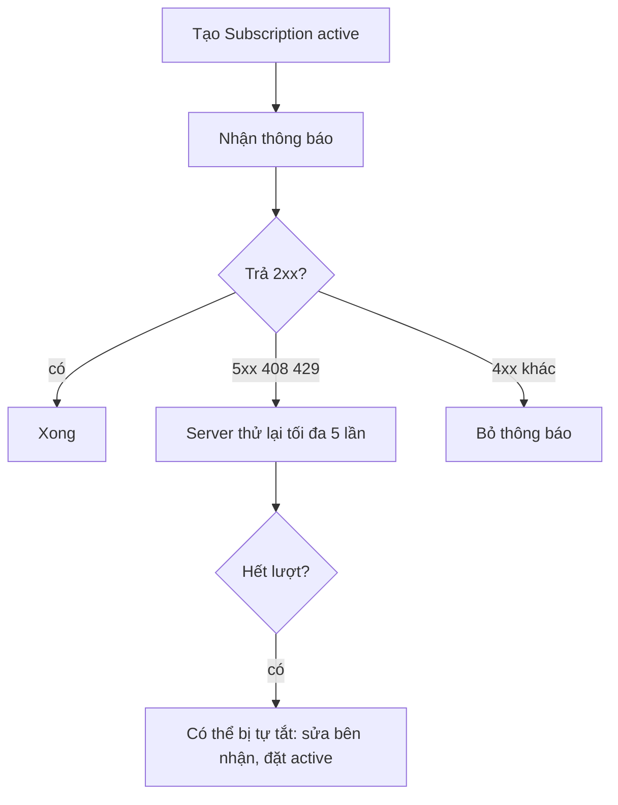

# 3. Luồng người dùng

fhir-server **không có giao diện**; "màn hình" là của ứng dụng client, `fhir-cli`, curl hoặc script. Mỗi luồng ghi **bước, gọi gì, thấy gì, lỗi nào thì làm gì**, để dev tích hợp, QA và đội ứng dụng cùng một bản đồ. Mã F-xx ở [04-chuc-nang.md](04-chuc-nang.md), luật ở [05-luat-va-phan-quyen.md](05-luat-va-phan-quyen.md).

---

### Nhân vật: Nhà phát triển ứng dụng tích hợp (ghi và đọc dữ liệu)

| Bước | Gọi gì | Thấy gì | Lỗi nào thì làm gì |
|---|---|---|---|
| 1. Khám phá | `GET /metadata` | CapabilityStatement công khai | 5xx: kiểm `/readyz` |
| 2. Tạo bệnh nhân | `POST /Patient` | 201, `Location`, `ETag` | 400: đọc `issue[].expression` để sửa trường |
| 3. Tạo không trùng | `POST /Patient` + `If-None-Exist: identifier=sys|val` | 201 lần đầu, 200 lần sau | 412: tiêu chí quá rộng, dùng định danh duy nhất |
| 4. Sửa an toàn | `GET` lấy `ETag`, `PUT` + `If-Match` | 200 + `ETag` mới | 412: đọc lại, trộn thay đổi, thử lại |
| 5. Sửa một phần | `PATCH` + `application/json-patch+json` | 200 | 415: đặt Content-Type đúng; 400: sửa thao tác |
| 6. Xóa | `DELETE /Patient/{id}` | 204 | 404: id sai hoặc project khác |
| 7. Xem lịch sử | `GET /Patient/{id}/_history` | Bundle history, mới nhất trước | 404: không thấy |

| Mã HTTP hoặc lỗi | Hành động của người dùng |
|---|---|
| 400 `resourceType không khớp ...` | Sửa đường dẫn hoặc body cho cùng loại |
| 400 OperationOutcome kiểm dữ liệu | Đọc `expression`, sửa trường, gửi lại |
| 401 | Lấy token mới (thiếu hoặc sai bearer token) |
| 403 `Token thiếu quyền <chữ> (SMART) trên <Type>` | Xin cấp chữ còn thiếu, hoặc dùng token khác |
| 404 `Not found` | Kiểm id và project; PUT vào id chưa có chỉ tạo khi `FHIR_UPDATE_AS_CREATE` bật |
| 410 | Resource đã xóa, không dùng lại id |
| 412 | Đọc lại ETag (If-Match) hoặc thu hẹp tiêu chí (nhiều khớp) |
| 415 | Đặt đúng Content-Type |
| 429 | Đợi `Retry-After` rồi thử lại |

### Nhân vật: Nhà phân tích dữ liệu (tìm kiếm và hồ sơ bệnh nhân)

| Bước | Gọi gì | Thấy gì | Lỗi nào thì làm gì |
|---|---|---|---|
| 1. Tìm theo tên có hoặc không dấu | `GET /Patient?name=nguyen&_count=50&_total=accurate` | Bundle, `total`, `link next` | 400 tên tham số: kiểm `metadata` |
| 2. Gom nhiều loại | `GET /Observation?subject:Patient.name=an&_include=Observation:subject` | Observation kèm Patient (mode include) | 400 `chained search/_has khớp quá nhiều ...`: thêm tiêu chí |
| 3. Theo mã gốc | `GET /Condition?code:below=sys|code` | Condition mang mã con cháu | 404 hoặc 400: CodeSystem phải nằm trong server |
| 4. Hồ sơ trọn gói | `GET /Patient/{id}/$everything?_type=Observation&_since=...` | Bundle, cảnh báo nếu cắt | Có entry `too-costly`: thu hẹp `_type` hoặc `_since` |
| 5. Truy vấn linh hoạt | `POST /$graphql` | `{data, errors}` | `errors` báo quyền hoặc vượt 1000 resource |

| Mã HTTP hoặc lỗi | Hành động của người dùng |
|---|---|
| 400 `_count không hợp lệ` | Dùng số nguyên không âm; trần là 1000 |
| 400 `search hệ thống có tham số X cần _type` | Thêm `_type=A,B` |
| 403 trên search | Cần chữ `s` trên loại |
| `total` lệch khi dữ liệu đổi giữa các trang | Phân trang theo offset: tải lại từ đầu hoặc chấp nhận lệch |

### Nhân vật: Hệ thống nạp dữ liệu hàng loạt

| Bước | Gọi gì | Thấy gì | Lỗi nào thì làm gì |
|---|---|---|---|
| 1. Nạp gói nhỏ có tham chiếu | `POST /` transaction với `urn:uuid` | 200 `transaction-response` | Mã lỗi của entry lỗi + `Bundle.entry[i]`: sửa, gửi lại (không ghi gì) |
| 2. Nạp lô lớn | `POST /` batch + `Prefer: respond-async` | 202 + `Content-Location` | 400 nếu là transaction: đổi sang batch |
| 3. Theo dõi | `GET /job/{id}/status` lặp | 202 đang chạy, 200 xong + `results` | 500: đọc OperationOutcome; 410: đã bị hủy |
| 4. Lấy kết quả | `GET /Binary/{id}` | Bundle `batch-response` | 404: kết quả đã quá hạn giữ |
| 5. Hủy | `DELETE /job/{id}/status` | 202 | Entry đã ghi không được hoàn tác |

### Nhân vật: quản trị dữ liệu thuật ngữ

Mục tiêu: đưa một bảng mã lớn và ánh xạ vào server.

| Bước | Gọi gì | Thấy gì | Lỗi nào thì làm gì |
|---|---|---|---|
| 1 | `POST CodeSystem` với `content: not-present` và khai báo `property` | 201 CodeSystem | 422 kiểm dữ liệu: sửa resource |
| 2 | `POST CodeSystem/{id}/$import` với tối đa 10000 `concept` | 200 Parameters `return` | 403: dùng token admin; 400 quá 10000: chia nhỏ |
| 3 | Lặp bước 2 cho `property`, `designation` | 200 | 400 `Concept chưa có: <code>`: nạp concept trước; 400 `Property không xác định`: khai báo trong CodeSystem.property |
| 4 | `POST ConceptMap/$import` (hoặc theo id) | 200 ConceptMap | 400 thiếu `target.system`: sửa mapping |
| 5 | `GET ValueSet/$expand?url=...&count=20` | 200 `expansion.total` | 422 `ValueSet quá lớn...`: thu hẹp bằng filter hoặc danh sách concept |

| Mã HTTP hoặc lỗi | Hành động của người dùng |
|---|---|
| 403 `Thao tác này chỉ dành cho quản trị project` | Xin token có scope `fhir.admin` không kèm AccessPolicy |
| 400 `Mỗi loại tối đa 10000 phần tử mỗi lần gọi` | Chia lô |
| 422 `CodeSystem ... không có nội dung trên server` | Nạp concept trước khi mở rộng |
| 404 `Không có mã ...` | Kiểm lại mã và `system` |

### Nhân vật: nhà phân tích dữ liệu (bulk export)

Thấy gì: poll nên chờ theo `Retry-After: 2`; tệp chỉ tồn tại tới hết FHIR_EXPORT_RETENTION.

| Mã HTTP hoặc lỗi | Hành động của người dùng |
|---|---|
| 400 `Bulk export cần header Prefer: respond-async` | Thêm header |
| 400 `_type không hợp lệ`, `_since phải là instant RFC3339` | Sửa tham số |
| 500 khi poll | Đọc chẩn đoán; thường do `_type` ngoài quyền; xin thêm scope hoặc bỏ loại đó |
| 404 khi tải tệp | Thiếu quyền đọc Binary, hoặc quá retention, hoặc project khác |
| 410 khi poll | Job đã hủy |

### Nhân vật: quản trị vận hành

| Bước | Gọi gì | Thấy gì | Lỗi nào thì làm gì |
|---|---|---|---|
| 1 | `POST {type}/$reindex` | 202 + `Content-Location` job | 403: cần admin; 501: kho không hỗ trợ |
| 2 | `GET job/{id}/status` | 202 rồi 200 AsyncJob `completed` (count) | 500: đọc chẩn đoán, gọi lại |
| 3 | `POST {type}/{id}/$reindex` | 200 `Reindexed ...` ngay | 404: sai id; 403 AccessPolicy: dùng token admin không chính sách |
| 4 | `POST {type}/{id}/$expunge` | 200 `Expunged ...` | 404: đã không còn; KHÔNG hoàn tác, sao lưu trước |
| 5 | `fhir-server sweep-binary -dry-run` rồi không `-dry-run` | Dòng tổng kết số khóa | `số nội dung mồ côi bất thường`: kiểm DATABASE_URL trước khi `-force` |
| 6 | Theo dõi job mồ côi sau sự cố | Job tự chạy lại sau lease hết hạn | Giữ FHIR_JOB_MAINTENANCE_INTERVAL > 0 |

### Nhân vật: ứng dụng tải tệp (Binary)

| Bước | Gọi gì | Thấy gì | Lỗi nào thì làm gì |
|---|---|---|---|
| 1 | `POST Binary` thân thô, `Content-Type`, `_filename` | 201 Binary + `url` ký | 400 `Invalid file extension` hoặc `Invalid content type`: đổi tệp; 413: quá trần 256 MiB |
| 2 | `GET Binary/{id}` | Nội dung thô | 404: không có hoặc không đủ quyền; 403 ngữ cảnh bảo mật |
| 3 | `GET Binary/{id}/$presigned-url?upload=true` | `url` PUT có hạn | 403 `Không có quyền cập nhật Binary` |
| 4 | `PUT /storage/{id}/{ver}?...` | 200 | 401 chữ ký, 410 hết hạn (xin URL mới), 409 phiên bản cũ (xin URL mới), 400 `Content-Type mismatch` |

---

### Nhân vật: ứng dụng ghi tài liệu có đường dẫn ngoài (tự tải attachment)

Chỉ có khi vận hành bật `FHIR_AUTO_DOWNLOAD` (mặc định tắt; xem BF-14).

| Bước | Gọi gì | Thấy gì | Lỗi nào thì làm gì |
|---|---|---|---|
| 1 | `POST DocumentReference` có `content[].attachment.url` ngoài | 201 ngay, `url` vẫn là địa chỉ ngoài | Không có lỗi tải ở bước này: việc tải chạy nền |
| 2 | `GET DocumentReference/{id}` sau ít giây | `url` thành `Binary/<id>`, `versionId` tăng một | `url` vẫn là địa chỉ ngoài: tải thất bại, bị chặn (địa chỉ nội bộ, ngoài danh sách cho phép), quá cỡ hoặc loại bị cấm; xem log của vận hành, ghi lại resource để kích hoạt lại |
| 3 | `GET Binary/{id}` | Nội dung thô (như Binary thường) | 404: không đủ quyền hoặc project khác |

### Nhân vật: nhà tích hợp nhận webhook

| Bước | Gọi gì | Thấy gì | Lỗi nào thì làm gì |
|---|---|---|---|
| 1. Dựng máy chủ nhận | Endpoint https công khai (không phải IP nội bộ) | Nhận `POST` có `X-Medplum-Subscription`, `X-Medplum-Interaction` | Địa chỉ nội bộ bị chặn: dùng tên miền công khai |
| 2. Tạo Subscription | `POST /Subscription` với `status=active`, `criteria`, `channel.endpoint`, tùy chọn secret | `201` | `403`: token thiếu quyền ghi hoặc chữ `c` trên `Subscription` |
| 3. Xác minh nguồn | So `X-Signature` với HMAC-SHA256 của body bằng secret | Khớp thì tin | Không khớp: bỏ thông báo, kiểm secret |
| 4. Trả lời nhanh | Trả `2xx` trong 10 giây | Thông báo coi là đã giao | `5xx`, `408`, `429`: server thử lại (1, 2, 4, 8 giây); `4xx` khác: bị bỏ, không thử lại |
| 5. Khử trùng lặp | Dùng `meta.versionId`, `lastUpdated` | Không xử lý thông báo cũ hoặc lặp | Không bảo đảm thứ tự, có thể trùng |
| 6. Khi Subscription bị tắt | `GET /Subscription/{id}` thấy `status=off`, `error` | Lý do tự tắt | Sửa bên nhận rồi đặt lại `status=active` (PUT hoặc PATCH) |

### Nhân vật: lập trình viên ứng dụng realtime

| Bước | Gọi gì | Thấy gì | Lỗi nào thì làm gì |
|---|---|---|---|
| 1. Tạo Subscription websocket | `POST /Subscription` với `channel.type=websocket` | `201` | Như trên |
| 2. Xin token | `GET /Subscription/{id}/$get-ws-binding-token` | `token`, `expiration`, `websocket-url` | `404`: không đọc được Subscription; `400` `Subscription không dùng kênh websocket` hoặc `Subscription không hoạt động (status=...)`: sửa Subscription |
| 3. Bind | Mở websocket tới `websocket-url`, gửi `bind-with-token` trong 10 giây | `SubscriptionStatus` `handshake` | Đóng 1008 (token sai hoặc hết hạn, quá hạn mức): xin token mới; đóng 1013: thử lại |
| 4. Nhận | Đọc Bundle `history` | `heartbeat` mỗi 30 giây, `event-notification` | Mất kết nối: xin token mới, bind lại, đọc lại dữ liệu bằng search vì không có replay; dùng `eventsSinceSubscriptionStart` phát hiện thiếu |
| 5. Hết hạn đăng nhập | Access token gốc hết hạn | Binding thôi nhận | Làm mới token đăng nhập, xin token bind mới |

### Nhân vật: lập trình viên client SMART (gọi API với token của `auth`)

| Bước | Gọi gì | Thấy gì | Lỗi nào thì làm gì |
|---|---|---|---|
| 1. Lấy token | Từ dịch vụ `auth` | JWT có `fhir_project`, `scope`, có thể `fhir_access_policy` | Không có `fhir_project`: nhận `403` `Token không có quyền truy cập FHIR`, xin cấp project |
| 2. Gọi API | `Authorization: Bearer <JWT>` | `200` | `401` `Token không hợp lệ`: token hết hạn, sai issuer hoặc audience, sai `kid`: lấy token mới; kiểm cấu hình `iss` và `aud` hai bên |
| 3. Bị `403` thiếu quyền | Đọc thông điệp | `Token thiếu quyền <chữ> (SMART) trên <Loại>` | Xin thêm scope đúng chữ (PATCH cần `r` và `u`; thao tác có điều kiện cần `s`) |
| 4. Bị `403` do policy | Đọc thông điệp | `Chính sách truy cập không cho phép <Loại>` | Loại ngoài chính sách hoặc `readonly`: xin chính sách khác |
| 5. Bị `404` với id có thật | Kiểm project của token | Resource thuộc project khác hoặc ngoài tiêu chí policy | Đúng thiết kế, không phải lỗi |
| 6. Bị `429` | Đọc `Retry-After` | Chờ 1 giây rồi thử lại | Giảm tần suất |

### Nhân vật: vận hành và triển khai

| Bước | Gọi gì | Thấy gì | Lỗi nào thì làm gì |
|---|---|---|---|
| 1. Chuẩn bị | Đặt biến cấu hình theo môi trường | Server khởi động | Từ chối khởi động nêu tên biến: sửa theo thông báo, không hạ `ENVIRONMENT` để né |
| 2. Nâng schema | `fhir-server migrate status` rồi `migrate up` (role migrate) | `migration chưa áp dụng: N` rồi 0 | `schema chưa được migrate` khi khởi động app: chạy `migrate up` |
| 3. Kiểm sức khỏe | `/healthz`, `/readyz`, `fhir-server healthcheck` | `200`; readyz có `database`, `broker` | `503` kéo dài: kiểm DB (`DATABASE_URL`, số kết nối) và Redis |
| 4. Dữ liệu cũ | `assign-project -project X -dry-run` rồi bỏ `-dry-run` | Số resource đã quét và gán | Có lỗi: chạy lại khi không còn ghi đồng thời |
| 5. Dọn Binary mồ côi | `sweep-binary -dry-run` rồi chạy thật (cron) | Số khóa mồ côi, đã xóa | `quá nửa là mồ côi`: kiểm `DATABASE_URL` trước khi dùng `-force` |
| 6. Tắt hoặc cuốn chiếu | SIGTERM | readyz `503`, chờ drain, tắt | Đặt `terminationGracePeriodSeconds` hoặc `stop_grace_period` lớn hơn drain cộng timeout |

### Nhân vật: super-admin

| Bước | Gọi gì | Thấy gì | Lỗi nào thì làm gì |
|---|---|---|---|
| 1. Lấy token | Token có scope `fhir.super` | Chỉ có tác dụng khi `FHIR_JWT_SUPER_ADMIN=true` | Cờ tắt: `403` |
| 2. Chọn project | Header `X-Fhir-Project: <id>` mỗi yêu cầu | Xử lý như thuộc project đó | Thiếu hoặc sai định dạng: `400` `Super-admin phải chọn project bằng header X-Fhir-Project` |
| 3. Hành động | Mọi route FHIR | Quyền admin trong project đã chọn | Resource không có trong project đó: `404` |
| 4. Kiểm toán | Kho log | Dòng `audit=true` | Thu log vào kho không sửa được và đặt cảnh báo |

### Bảng mã HTTP và lỗi sang hành động của người dùng

| Mã hoặc lỗi | Nghĩa | Người dùng làm gì |
|---|---|---|
| `401` `Thiếu hoặc sai bearer token` hoặc `Thiếu bearer token` | Không có token | Gửi `Authorization: Bearer ...` |
| `401` `Token không hợp lệ` (có `error="invalid_token"`) | Sai chữ ký, hết hạn, sai `iss` hoặc `aud` | Lấy token mới; kiểm cấu hình issuer, audience |
| `403` `Token không có quyền truy cập FHIR` | Thiếu project, thiếu scope, policy hỏng | Xin token đúng project và scope; kiểm claim `fhir_access_policy` |
| `403` `Token không đủ quyền cho thao tác này` | Vai trò thấp hơn route cần | Dùng token WRITE hoặc ADMIN |
| `403` `Token thiếu quyền <chữ> (SMART) trên <Loại>` | Thiếu chữ SMART | Xin scope có chữ đó |
| `403` `Chính sách truy cập không cho phép <Loại>` | Policy cấm loại hoặc `readonly` | Xin chính sách khác |
| `403` `Resource không thỏa tiêu chí của chính sách truy cập` | Bản ghi ra không thỏa `criteria` | Sửa dữ liệu cho đúng phạm vi |
| `403` `Token không được chọn project khác` | Gửi `X-Fhir-Project` khác project | Bỏ header hoặc dùng đúng project |
| `400` `Super-admin phải chọn project bằng header X-Fhir-Project` | Super-admin thiếu header | Thêm header hợp lệ |
| `404` | Không có, hoặc thuộc project khác, hoặc ngoài policy | Kiểm id và project |
| `410` | Đã xóa (kể cả id đã xóa của project khác) | Không khôi phục qua API |
| `413` `Body quá lớn` | Body trên 16 MiB (Binary dùng trần riêng) | Giảm kích thước hoặc dùng Binary thô |
| `429` | Vượt hạn mức IP | Chờ `Retry-After` |
| `503` ở `/readyz` | Đang tắt hoặc DB, broker hỏng | Vận hành kiểm hạ tầng; client thử lại |
