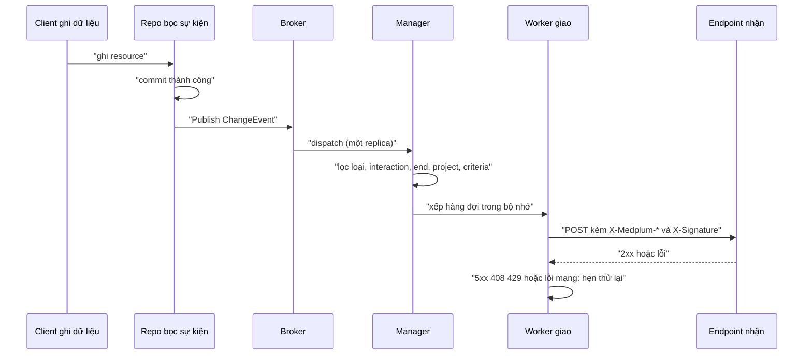
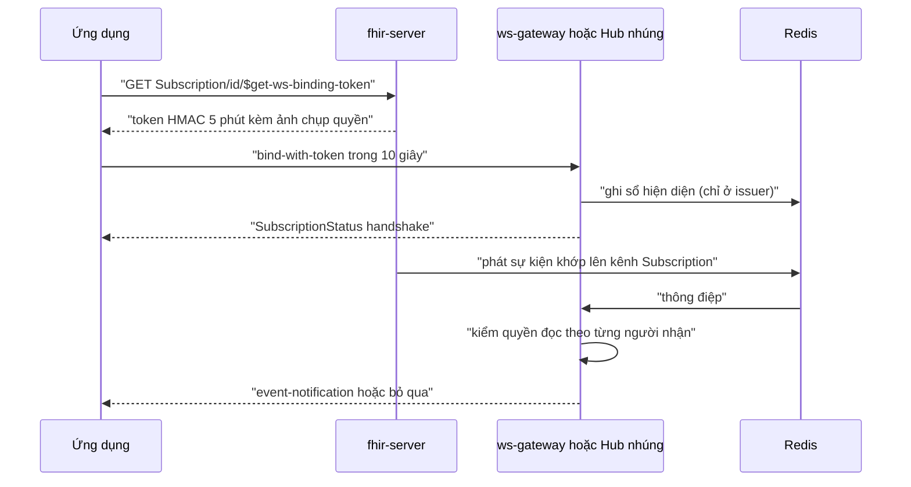
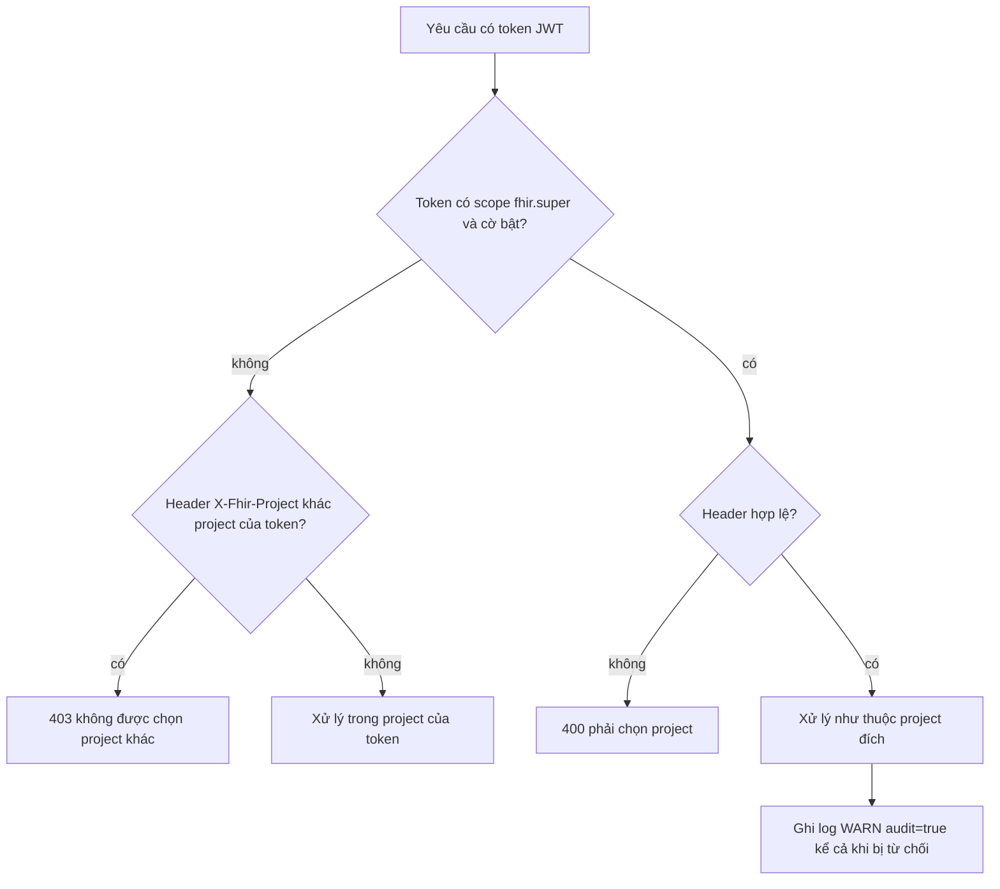

# 4. Danh mục chức năng

Khuôn mỗi chức năng: **Mục đích · Tác nhân · Tiền điều kiện · Cách gọi · Luồng · Lỗi · Tác dụng phụ · Luật**. Thông điệp và mã HTTP nguyên văn từ mã (nghiệp vụ nằm ở `pkg/fhirrouter`, `fhirsearch`, `fhirstore`, `fhirvalidate`, `fhirauth`, `fhirsub`, `fhirbinary`, `binarystore`, `workflow`; app chỉ lắp ráp). Bảng route đầy đủ ở [../api-contract.md](../api-contract.md); luật `BR-xx` ở [05-luat-va-phan-quyen.md](05-luat-va-phan-quyen.md); luồng `BF-x` ở [02-luong-nghiep-vu.md](02-luong-nghiep-vu.md).

| Chức năng | Tên |
|---|---|
| [F-01](#f-01) | Tạo resource (create, If-None-Exist) |
| [F-02](#f-02) | Đọc và đọc phiên bản (read, vread) |
| [F-03](#f-03) | Cập nhật (PUT, If-Match, PUT có điều kiện, update-as-create) |
| [F-04](#f-04) | Vá (PATCH, JSON Patch, PATCH có điều kiện) |
| [F-05](#f-05) | Xóa (delete, xóa theo query) |
| [F-06](#f-06) | Lịch sử phiên bản (history) |
| [F-07](#f-07) | Tìm kiếm theo loại |
| [F-08](#f-08) | Tìm kiếm hệ thống và POST _search |
| [F-09](#f-09) | Batch và transaction đồng bộ |
| [F-10](#f-10) | Batch bất đồng bộ (Prefer: respond-async) |
| [F-11](#f-11) | Kiểm dữ liệu khi ghi và $validate |
| [F-12](#f-12) | Patient/$everything |
| [F-13](#f-13) | GraphQL chỉ đọc |
| [F-14](#f-14) | Metadata (CapabilityStatement) |
| [F-15](#f-15) | Terminology tra cứu ($lookup, $expand, $subsumes, $translate) |
| [F-16](#f-16) | Terminology nạp ($import, PackageRelease/$install) |
| [F-17](#f-17) | Bulk export ($export, theo dõi, hủy) |
| [F-18](#f-18) | $reindex (loại: nền; một resource: đồng bộ) |
| [F-19](#f-19) | $expunge (xóa vĩnh viễn) |
| [F-20](#f-20) | Job nền AsyncJob (lease, chữ ký quyền, bảo trì, retention, /job/{id}/status) |
| [F-21](#f-21) | Subscription rest-hook (giao thông báo, retry, chống SSRF, tự tắt) |
| [F-22](#f-22) | Subscription websocket (`$get-ws-binding-token`, phối hợp ws-gateway) |
| [F-23](#f-23) | Binary thô (kho file: và s3:, /storage URL ký, $presigned-url) |
| [F-24](#f-24) | Xác thực và phân quyền (JWT/JWKS, token tĩnh, scope SMART, AccessPolicy, compartment) |
| [F-25](#f-25) | Tách project (`meta.project`) và super-admin |
| [F-26](#f-26) | CLI vận hành (`migrate`, `assign-project`, `sweep-binary`, `healthcheck`) |
| [F-27](#f-27) | Kiểm soát chung (probe, tắt êm, hạn mức, giới hạn body, CORS, lỗi OperationOutcome) |
| [F-28](#f-28) | Tự tải attachment ngoài về kho Binary (`FHIR_AUTO_DOWNLOAD`) |

---

### F-01. Tạo resource (create, If-None-Exist)

| Mục | Nội dung |
|---|---|
| Mục đích | Lưu một resource mới, server cấp id và phiên bản đầu tiên; hỗ trợ tạo có điều kiện chống trùng |
| Tác nhân | Ứng dụng khách có vai trò WRITE (hoặc scope có `c`) |
| Tiền điều kiện | Vai trò WRITE; chữ `c` trên loại; nếu có `If-None-Exist` thì cần thêm chữ `s` (vì phải tìm trước); resourceType hợp lệ |
| Route hoặc cách gọi | `POST /fhir/R4/{type}`, header tùy chọn `If-None-Exist: <query search>`, `Prefer: return=minimal` hoặc `return=OperationOutcome` |
| Đầu vào chính | Body là resource JSON có `resourceType` khớp đường dẫn |

**Luồng chính:**
1. `readRequest` giải mã body: rỗng thì body nil; Content-Type phải rỗng, `application/json` hoặc `+json` (hoặc form, graphql).
2. `writeBody` kiểm body là object, `resourceType` khớp đường dẫn, rồi `fhirvalidate.Validate` (xem F-11). Lỗi mức error thì dừng.
3. Không có `If-None-Exist`: gán `id` mới (UUID v4 do server cấp; id client gửi bị bỏ), xóa `meta.versionId` và `meta.lastUpdated` client gửi, gọi `CreateResource`. Kho gán `versionId` (UUID) và `lastUpdated` (ms, UTC), ghi bảng hiện tại, bảng lịch sử (method POST) và chỉ mục search trong một transaction.
4. Có `If-None-Exist`: phân tích query, lấy khóa tư vấn theo (project, loại, tiêu chí) rồi tìm tối đa 2 kết quả. 0 khớp thì tạo như bước 3; 1 khớp thì trả resource có sẵn; nhiều khớp thì lỗi.
5. Phản hồi 201 kèm `ETag: W/"<versionId>"`, `Last-Modified`, `Location` (dạng `<base>/Type/id/_history/<vid>`, tương đối nếu chưa đặt FHIR_BASE_URL). `Prefer: return=minimal` bỏ body; `return=OperationOutcome` trả một OperationOutcome "OK".

**Thay thế / lỗi:**
- 1 khớp `If-None-Exist`: 200 và resource cũ (không tạo, không có `Location`).
- Nhiều khớp: 412 `Nhiều resource khớp If-None-Exist`.
- `If-None-Exist` không có tiêu chí hợp lệ: 400 `Thao tác có điều kiện cần tiêu chí search`; query hỏng: 400 `If-None-Exist không hợp lệ`.
- Body không phải object: 400 `Body phải là một resource JSON`; sai kiểu: 400 `resourceType không khớp: đường dẫn là X, body là "Y"`.
- Không qua kiểm dữ liệu: 400 OperationOutcome, mỗi lỗi một issue có `expression` là đường dẫn.
- Content-Type lạ: 415 `Content-Type không hỗ trợ: <mt>`; JSON hỏng: 400 `JSON không hợp lệ: ...`; body quá 16 MiB: 413.
- Thiếu quyền: 401 (không token), 403 (thiếu vai trò hoặc chữ `c`).

**Tác dụng phụ:** thêm một dòng lịch sử; cập nhật chỉ mục search; nếu bật Subscription thì phát sự kiện sau commit (xem F-21); resource trong project của người gọi (JWT: `meta.project` luôn bị ghi đè).

**Luật:** BR-01, BR-02, BR-04, BR-09, BR-25, BR-29.

### F-02. Đọc và đọc phiên bản (read, vread)

| Mục | Nội dung |
|---|---|
| Mục đích | Lấy phiên bản hiện tại hoặc một phiên bản cụ thể của resource |
| Tác nhân | Mọi ứng dụng khách có vai trò READ |
| Tiền điều kiện | Chữ `r` trên loại (khác `s`: token chỉ có `s` không đọc được theo id); resource thuộc project của người gọi và thỏa AccessPolicy |
| Route hoặc cách gọi | `GET /{type}/{id}`, `GET /{type}/{id}/_history/{vid}`; header điều kiện `If-None-Match`, `If-Modified-Since` |
| Đầu vào chính | `type`, `id`, `vid` (chỉ vread) |

**Luồng chính:**
1. Kiểm quyền và project, đọc dòng hiện tại (read) hoặc dòng lịch sử theo `versionId` (vread).
2. Read có kiểm điều kiện: `If-None-Match` (danh sách ETag yếu hoặc `*`) thắng `If-Modified-Since`; trùng `versionId` hiện tại thì 304, không body, vẫn kèm `ETag` và `Last-Modified`. `If-Modified-Since` so theo giây; ngày sai thì bỏ qua điều kiện.
3. Loại Binary có thể trả nội dung thô theo `Accept` (xem F-23). Còn lại 200 + resource + `ETag: W/"<vid>"` + `Last-Modified`.

**Thay thế / lỗi:**
- Chưa từng có: 404 `Not found`.
- Đã xóa (read hoặc vread phiên bản xóa): 410 `Gone` (code `deleted`).
- Resource của project khác hoặc ngoài AccessPolicy: 404 như thể không tồn tại. Ngoại lệ: resource đã xóa không còn nội dung để so project nên trả 410 thay vì 404 (id là UUID nên khó đoán).
- Không có phiên bản `vid`: 404.

**Tác dụng phụ:** không có.

**Luật:** BR-01, BR-02, BR-06, BR-09, BR-19.

### F-03. Cập nhật (PUT, If-Match, PUT có điều kiện, update-as-create)

| Mục | Nội dung |
|---|---|
| Mục đích | Thay toàn bộ resource bằng phiên bản mới; tùy chọn khóa lạc quan bằng `If-Match`; tìm theo tiêu chí; tạo mới theo id client chọn |
| Tác nhân | Ứng dụng khách có vai trò WRITE |
| Tiền điều kiện | Chữ `u`. Update-as-create cần bật `FHIR_UPDATE_AS_CREATE=true` (mặc định tắt) và thêm chữ `c`. PUT có điều kiện cần thêm chữ `s` (và `c` nếu 0 khớp) |
| Route hoặc cách gọi | `PUT /{type}/{id}`; `PUT /{type}?<query>`; header `If-Match: W/"<vid>"` |
| Đầu vào chính | Resource đầy đủ; `id` trong body (nếu có) phải bằng id đường dẫn |

**Luồng chính (PUT theo id):**
1. `writeBody` như F-01; kiểm `id` body khớp đường dẫn.
2. Đọc `If-Match` (bỏ `W/` và nháy kép; `*` không có nghĩa đặc biệt, bị coi là một versionId lạ).
3. `UpdateResource` trong transaction, khóa dòng (PostgreSQL `FOR UPDATE`): đọc phiên bản hiện tại, so `If-Match`, ghi phiên bản mới (luôn sinh `versionId` mới, kể cả khi nội dung không đổi), thêm lịch sử method PUT, lập lại chỉ mục. `meta.versionId` và `lastUpdated` client gửi bị bỏ.
4. 200 kèm `ETag` mới.

**PUT có điều kiện:** tìm tối đa 2 kết quả dưới khóa (project, loại, query). 0 khớp thì tạo mới 201 (body không được kèm `id`); 1 khớp thì cập nhật bản đó (id body nếu có phải đúng id tìm thấy; `If-Match` được áp dụng); nhiều khớp thì 412.

**Update-as-create (khi bật cờ):** nếu update trả 404: có `If-Match` thì giữ 404; id không khớp `^[A-Za-z0-9\-.]{1,64}$` thì 400 `id không hợp lệ cho update-as-create (1-64 ký tự chữ, số, '-', '.')`; còn lại tạo mới với id đó, trả 201. Nếu id vừa bị chiếm bởi PUT đồng thời cùng project thì chuyển thành cập nhật; nếu id bị project khác chiếm (không thấy được) thì 404 để không lộ sự tồn tại.

**Thay thế / lỗi:**
- Phiên bản khác `If-Match`: 412 `Phiên bản không khớp: hiện tại <versionId>`.
- Chưa có và cờ tắt: 404 `Not found`. Đã xóa: 410 `Gone` (kể cả khi bật cờ, không tái tạo resource đã xóa).
- `id` body khác đường dẫn: 400 `id trong body không khớp với đường dẫn`; khác resource tìm thấy: 400 `id trong body không khớp với resource tìm thấy`.
- PUT có điều kiện 0 khớp mà body có id: 400 `PUT có điều kiện không khớp resource nào thì không được kèm id`; không tiêu chí: 400 `Thao tác có điều kiện cần tiêu chí search`; nhiều khớp: 412 `Nhiều resource khớp tiêu chí`.
- Project khác: 404 (xem F-25).

**Tác dụng phụ:** thêm một phiên bản lịch sử; lập lại chỉ mục; sự kiện Subscription (nếu bật).

**Luật:** BR-02, BR-03, BR-05, BR-07, BR-09, BR-25, BR-29.

### F-04. Vá (PATCH, JSON Patch, PATCH có điều kiện)

| Mục | Nội dung |
|---|---|
| Mục đích | Sửa một phần resource bằng RFC 6902 mà không gửi lại toàn bộ |
| Tác nhân | Ứng dụng khách có vai trò WRITE |
| Tiền điều kiện | Chữ `r` VÀ `u` (server đọc rồi ghi); PATCH có điều kiện thêm `s` |
| Route hoặc cách gọi | `PATCH /{type}/{id}` hoặc `PATCH /{type}?<query>`; `Content-Type: application/json-patch+json`; `If-Match` tùy chọn |
| Đầu vào chính | Mảng thao tác `add`, `remove`, `replace`, `move`, `copy`, `test` |

**Luồng chính:**
1. Content-Type nếu có phải chứa `json-patch+json`; thiếu header thì vẫn chấp nhận.
2. Body phải là mảng JSON.
3. Đọc phiên bản hiện tại (404/410 nếu không có), áp các thao tác trên bản sao, theo thứ tự; một thao tác lỗi thì cả PATCH lỗi.
4. Kết quả phải là object cùng `resourceType` và cùng `id`; rồi qua `writeBody` (kiểm dữ liệu như F-11).
5. Ghi bằng đường update của F-03 (kể cả `If-Match`), 200 + resource mới. PATCH không bao giờ tạo mới.

**PATCH có điều kiện:** tìm tối đa 2 kết quả; 0 khớp thì 404 `Not found`; 1 khớp thì vá; nhiều khớp thì 412.

**Thay thế / lỗi:**
- Content-Type khác: 415 `PATCH cần Content-Type application/json-patch+json`.
- Body không phải mảng: 400 `Body của PATCH phải là một mảng JSON Patch`.
- Thao tác lỗi: 400 `JSON Patch không áp dụng được: thao tác <i> (<op> <path>): <lý do>` (ví dụ `test thất bại`, `thiếu path`, `thiếu value`, `op không hỗ trợ`).
- Đổi kiểu: 400 `Không được đổi resourceType bằng PATCH`; đổi id: 400 `Không được đổi id bằng PATCH`; kết quả không hợp lệ: 400 OperationOutcome như F-11.
- `If-Match` lệch: 412.

**Tác dụng phụ:** như F-03.

**Luật:** BR-03, BR-07, BR-08, BR-09, BR-25.

### F-05. Xóa (delete, xóa theo query)

| Mục | Nội dung |
|---|---|
| Mục đích | Xóa mềm một resource: đọc sau đó trả 410, lịch sử vẫn còn |
| Tác nhân | Ứng dụng khách có vai trò WRITE |
| Tiền điều kiện | Chữ `d`; xóa theo query thêm chữ `s` |
| Route hoặc cách gọi | `DELETE /{type}/{id}`; `DELETE /{type}?<query>` |
| Đầu vào chính | id hoặc tiêu chí search |

**Luồng chính:**
1. Kiểm quyền, kiểm resource thuộc project/AccessPolicy của người gọi.
2. Trong transaction: khóa dòng, ghi phiên bản "xóa" (nội dung chỉ còn `resourceType`, `id`, `meta` mới), đặt `deleted=true`, thêm lịch sử method DELETE, xóa hết chỉ mục search của resource đó.
3. 204, không body.

**Xóa theo query:** tìm tối đa 2 kết quả: 0 khớp thì 204 (không làm gì); 1 khớp thì xóa rồi 204 (nếu giữa lúc tìm và xóa đã bị xóa, 404 hoặc 410 được coi là đã đạt mục tiêu); nhiều khớp thì 412 `Nhiều resource khớp tiêu chí` (không xóa hàng loạt).

**Thay thế / lỗi:**
- Chưa từng có: 404. Đã xóa: 204 (xóa lặp là idempotent).
- Không tiêu chí: 400 `Thao tác có điều kiện cần tiêu chí search`.
- Không có kiểm tham chiếu: xóa resource đang được resource khác tham chiếu vẫn thành công (xem BR-28).

**Tác dụng phụ:** thêm một dòng lịch sử loại xóa; bỏ khỏi mọi kết quả search; nếu bật Subscription thì phát sự kiện xóa. Xóa vĩnh viễn là F-19 (`$expunge`).

**Luật:** BR-02, BR-06, BR-07, BR-09, BR-28.

### F-06. Lịch sử phiên bản (history)

| Mục | Nội dung |
|---|---|
| Mục đích | Xem mọi phiên bản của một resource, gồm cả phiên bản xóa |
| Tác nhân | Ứng dụng khách có vai trò READ |
| Tiền điều kiện | Chữ `r` trên loại; resource (còn nội dung) thuộc project/AccessPolicy của người gọi |
| Route hoặc cách gọi | `GET /{type}/{id}/_history` (chỉ mức instance) |
| Đầu vào chính | `type`, `id` |

**Luồng chính:**
1. Đọc toàn bộ dòng lịch sử theo thứ tự `seq` giảm dần (mới nhất trước).
2. Dựng Bundle `type=history`, `total` bằng số phiên bản. Mỗi entry có `request.method` (POST, PUT, DELETE), `response.status` (201, 200, 204), `response.etag`, `response.lastModified`; phiên bản xóa không có `resource`.
3. Kiểm project dựa trên phiên bản còn nội dung bất kỳ; mọi phiên bản còn nội dung phải cùng project.

**Thay thế / lỗi:** chưa từng có hoặc không thấy được: 404. Lịch sử không phân trang và bỏ qua `_count`, `_since` (trả hết); không có history mức loại hay mức hệ thống (route không tồn tại, 404 hoặc 405).

**Tác dụng phụ:** không có.

**Luật:** BR-02, BR-06, BR-19.

### F-07. Tìm kiếm theo loại

| Mục | Nội dung |
|---|---|
| Mục đích | Tìm resource của một loại theo tham số search chuẩn FHIR, trả Bundle `searchset` |
| Tác nhân | Ứng dụng khách có vai trò READ |
| Tiền điều kiện | Chữ `s` trên loại; kết quả luôn chỉ gồm project của người gọi và thỏa AccessPolicy (điều kiện được đẩy xuống SQL nên `total` và phân trang chỉ đếm phần được thấy) |
| Route hoặc cách gọi | `GET /{type}?...`, `POST /{type}/_search` (form `application/x-www-form-urlencoded`, trộn vào query) |
| Đầu vào chính | Tham số search, `_count`, `_offset`, `_sort`, `_total`, `_summary=count`, `_elements`, `_include`, `_revinclude`, `_filter`, `_compartment`, `_type` |

**Luồng chính:**
1. `fhirsearch.Parse`: duyệt khóa theo thứ tự chữ cái (`_type` trước); mỗi tham số tra trong bảng search parameter của loại (ưu tiên khai báo riêng, sau đó tham số chung). Có `.` ở khóa (không escape) là chained; `_has:Type:param:filter` là reverse chained.
2. Giải điều kiện cần giải trước: token `:in`, `:not-in`, `:above`, `:below` thành danh sách `system|code` (xem BR-17); chained và `_has` thành điều kiện thường bằng sub-search qua cùng repository, độ sâu tối đa 4, mỗi sub-search tối đa 5000 resource.
3. Dựng SQL trên bảng chỉ mục (string, token, reference, date, number, quantity, uri), thêm điều kiện project và AccessPolicy. `_count` mặc định 20, tối đa 1000 (lớn hơn bị cắt thầm lặng), `_count=0` cho Bundle không entry. Lấy `count+1` dòng để biết còn trang sau.
4. Kiểu tham số và so khớp: string là tiền tố không phân biệt hoa thường và bỏ dấu (đ thành d), `:exact` phân biệt, `:contains` chứa; token `system|code`, `|code` (không system), `system|`, `:text`; date theo khoảng thời gian; prefix `eq ne gt lt ge le sa eb ap` cho date, number, quantity; reference theo `Type/id`, id trần, URL; uri với `:below`, `:above`; composite; `:missing=true|false`; `:not`; `:Type` trên reference.
5. `_sort` theo giá trị đầu tiên của tham số (thiếu giá trị luôn xếp cuối), `-` là giảm dần, khóa phụ là loại rồi id; không sắp theo composite hoặc special.
6. `_include` lấy resource được tham chiếu bởi các kết quả trên trang hiện tại; `_revinclude` lấy resource tham chiếu tới chúng; entry có `search.mode=include`, không tính vào `total`. Bản `:iterate` được chấp nhận nhưng không lặp (xem Lệch).
7. Bundle có `link` `self`, `next` (khi còn dữ liệu, dùng `_offset`), `previous` (khi offset > 0); `total` chỉ có khi `_total` khác `none` (mặc định `none`). `_summary=count` ép `_count=0` và `_total=accurate`; `_elements` giữ `resourceType`, `id`, `meta` và các phần tử được chọn.

**Thay thế / lỗi (400 với OperationOutcome, thông điệp nguyên văn):**
- `_count không hợp lệ: "x"`, `_offset không hợp lệ: ...`, `_total không hợp lệ: ...`, `_type không hợp lệ: X`.
- `tham số search không hợp lệ: <code>`, `modifier không hợp lệ: <mod>`, `tham số sắp xếp không hợp lệ: <code>`.
- `tham số _query chưa được hỗ trợ` (cũng `_contained`, `_containedType`); tham số kiểu `special` và modifier `:identifier` chưa hỗ trợ.
- `giá trị _include không hợp lệ: "..." (cần Type:param[:target])`.
- `chained search/_has khớp quá nhiều resource X (> 5000); thu hẹp tiêu chí`, `chained search lồng quá sâu`.
- `_compartment cần chỉ định loại resource` hoặc `_compartment chỉ được đặt một lần`.
- Thiếu chữ `s`: 403 `Token thiếu quyền s (SMART) trên <Type>`.

**Tác dụng phụ:** không có. Phân trang theo offset nên dữ liệu thêm hoặc xóa giữa hai lần gọi có thể làm lệch hoặc lặp bản ghi giữa các trang.

**Luật:** BR-10, BR-11, BR-12, BR-13, BR-14, BR-15, BR-16, BR-17, BR-18, BR-19.

### F-08. Tìm kiếm hệ thống và POST _search

| Mục | Nội dung |
|---|---|
| Mục đích | Tìm xuyên nhiều loại ở gốc FHIR, hoặc gửi query dài bằng form |
| Tác nhân | Ứng dụng khách có vai trò READ |
| Tiền điều kiện | Chữ `s` trên MỌI loại trong `_type` (thiếu một loại là 403 cả yêu cầu); không `_type` thì cần `s` trên mọi loại (`*`), nếu không chỉ tìm trong các loại có `s` |
| Route hoặc cách gọi | `GET /fhir/R4?_type=A,B&...`; `POST /fhir/R4/{type}/_search` (xem F-07) |
| Đầu vào chính | `_type` (danh sách), các tham số tìm được ở ít nhất một loại trong `_type` |

**Luồng chính:**
1. Như F-07, nhưng mỗi tham số được tra theo từng loại trong `_type`; loại không khai báo tham số đó thì bị loại khỏi kết quả (điều kiện thành `(type=A AND ...) OR (type=B AND ...)`).
2. Khóa phụ sắp xếp: thứ tự `_type` rồi id (không có `_type` thì tên loại rồi id).
3. Có AccessPolicy: danh sách loại được giao với các loại chính sách cho phép; giao rỗng thì trả Bundle rỗng.
4. Trả Bundle `searchset`, `link` không có tiền tố loại (`.` nếu chưa đặt FHIR_BASE_URL).

**Thay thế / lỗi:** có tham số mà không có `_type`: 400 `search hệ thống có tham số <code> cần _type` (hoặc `search hệ thống có tham số cần _type`); `_compartment`: 400; `_has` yêu cầu đúng một kiểu. Form: body `application/x-www-form-urlencoded` hỏng thì 400 `Form không hợp lệ`.

**Tác dụng phụ:** không có.

**Luật:** BR-10, BR-12, BR-15, BR-19.

### F-09. Batch và transaction đồng bộ

| Mục | Nội dung |
|---|---|
| Mục đích | Gộp nhiều thao tác trong một yêu cầu; batch cho từng entry độc lập, transaction cho tính nguyên tử |
| Tác nhân | Ứng dụng khách có vai trò WRITE (ngay cả khi bundle chỉ chứa GET) |
| Tiền điều kiện | Chữ SMART kiểm THEO TỪNG ENTRY như gọi riêng thao tác đó; transaction cần repository hỗ trợ giao dịch |
| Route hoặc cách gọi | `POST /fhir/R4` với `Bundle.type` là `batch` hoặc `transaction` |
| Đầu vào chính | `entry[].request.method` và `url`, `entry[].resource`, `request.ifMatch`, `request.ifNoneExist`, `fullUrl` |

**Luồng chính (chung):**
1. Kiểm `resourceType=Bundle` và `type` thuộc `batch` hoặc `transaction`; phân tích mọi entry trước khi chạy (entry thiếu `request`, `method` hoặc `url` thì 400 cả bundle, chưa có gì bị ghi).
2. `Bundle.entry` rỗng vẫn hợp lệ (trả bundle phản hồi rỗng).

**Batch:** chạy các entry tuần tự theo vị trí; mỗi entry đi qua đúng đường xử lý của một yêu cầu riêng (kể cả kiểm dữ liệu, quyền, project). Lỗi của một entry thành `response.status` (ví dụ `404 Not Found`, `403 Forbidden`) kèm `response.outcome`, các entry khác vẫn chạy. Bundle phản hồi `batch-response` luôn 200. Không thay `urn:uuid`.

**Transaction:**
1. Với mỗi POST: nếu có `ifNoneExist` thì tìm trước (nhiều khớp là 412 `Nhiều resource khớp ifNoneExist`, 1 khớp thì dùng lại resource đó, entry trả 200); không thì cấp sẵn id mới. Nếu `fullUrl` bắt đầu bằng `urn:uuid:` thì ghi nhận ánh xạ sang `Type/id`.
2. Thay mọi `reference` bằng `urn:uuid:...` đã biết bằng `Type/id` (tham chiếu `urn:uuid` không có entry tương ứng được giữ nguyên, không báo lỗi).
3. Sắp thứ tự xử lý ổn định: DELETE, POST, PUT/PATCH, GET (bất kể thứ tự trong bundle); method khác thì 400 `method không hỗ trợ trong Bundle: X`.
4. Chạy tất cả trong MỘT transaction CSDL. Một entry lỗi thì hủy toàn bộ và trả đúng mã HTTP của entry lỗi (không phải Bundle), OperationOutcome có thêm `expression` `Bundle.entry[<i>]` với i là vị trí trong bundle gốc.
5. Thành công: 200 `transaction-response`, entry theo đúng thứ tự gốc, mỗi entry có `response.status` (ví dụ `201 Created`), `location`, `etag`, `lastModified`.

**Thay thế / lỗi:**
- 400 `Body phải là Bundle`; 400 `Bundle.type phải là batch hoặc transaction`; 400 `entry[<i>] không hợp lệ`, `entry[<i>] thiếu request`, `entry[<i>].request cần method và url`.
- 501 `Repository không hỗ trợ transaction`.
- Transaction: entry thiếu chữ SMART hoặc ngoài project thì cả transaction bị hủy với 403 hoặc 404 (không có kết quả từng phần).
- `Prefer: return=minimal` áp lên cả Bundle phản hồi (vì là POST): body bị bỏ. (chưa kiểm bằng test)

**Tác dụng phụ:** mỗi entry ghi thành công thêm một dòng lịch sử; ở transaction mọi sự kiện Subscription chỉ phát sau commit (nếu bật).

**Luật:** BR-20, BR-21, BR-22, BR-23.

### F-10. Batch bất đồng bộ (Prefer: respond-async)

| Mục | Nội dung |
|---|---|
| Mục đích | Chạy bundle batch lớn ở nền để không giữ kết nối HTTP; lấy kết quả sau |
| Tác nhân | Ứng dụng khách có vai trò WRITE; quyền SMART của người gọi được niêm phong theo job |
| Tiền điều kiện | `FHIR_ASYNC_BATCH=true` (mặc định tắt: header bị bỏ qua và batch chạy đồng bộ); `Bundle.type=batch`; JWT: cần `FHIR_JOB_SIGNING_KEY` hoặc khóa suy ra |
| Route hoặc cách gọi | `POST /fhir/R4` kèm `Prefer: respond-async`; theo dõi `GET /job/{id}/status`; hủy hoặc dọn `DELETE /job/{id}/status` |
| Đầu vào chính | Bundle batch; cấu hình `FHIR_BATCH_CHECKPOINT_ENTRIES` (mặc định 10 entry, ngoài ra tối thiểu 5 giây một lần) |

**Luồng chính:**
1. Kiểm bundle như F-09 (lỗi cấu trúc thì 400, chưa tạo job).
2. Lưu bundle đầu vào thành Binary cùng project với job, tạo AsyncJob loại `batch` (có chữ ký quyền người gọi), đưa vào hàng đợi. Trả 202 kèm `Content-Location: <base>/job/<id>/status` và OperationOutcome `Accepted`.
3. Job chạy mỗi entry qua đường xử lý của một yêu cầu riêng với context của người gọi (cùng quyền, project, kiểm dữ liệu như batch đồng bộ). Id của POST không điều kiện được cấp sẵn từ lần chạy đầu.
4. Cứ mỗi N entry hoặc 5 giây, lưu checkpoint (vị trí, các đoạn kết quả, danh sách id cấp sẵn).
5. Xong: ghi Binary kết quả chứa Bundle `batch-response`; AsyncJob.output là `Parameters{results: Reference(Binary/<id>)}`; dọn Binary đầu vào và các đoạn tạm. `GET /job/{id}/status` trả 202 khi đang chạy, 200 + AsyncJob khi xong.

**Thay thế / lỗi và hệ quả khi gián đoạn:**
- Transaction kèm respond-async: 400 `Transaction không chạy async được (Prefer: respond-async chỉ dùng cho batch)`, chưa tạo job.
- Tiến trình chết hoặc tắt êm: job giữ lại, replica khác tiếp quản sau hết lease (F-20) và chạy tiếp từ checkpoint cuối. Ngữ nghĩa ÍT NHẤT MỘT LẦN cho từng entry: các entry sau checkpoint cuối chạy lại; POST không điều kiện có id cấp sẵn nên chạy lại không tạo bản trùng (thấy resource đã tạo thì trả lại với 201; đã bị entry sau xóa thì 201 không body). PUT, DELETE, PATCH, POST có điều kiện chạy lại theo ngữ nghĩa thường (PUT idempotent; DELETE lặp là 204; PATCH có thể áp lần hai).
- Hủy: `DELETE /job/{id}/status` khi job đang chạy thì đặt `cancelled`, job dừng ở entry kế tiếp, kết quả tạm bị xóa, 202 `Cancelled`; job đã xong, lỗi hoặc hủy thì xóa job và Binary kết quả, 202 `Deleted`. Các entry đã ghi KHÔNG được hoàn tác. Job khác loại (không phải `batch`) hoặc của project khác: 404.
- Status của job `cancelled`: 410; `error`: 500 kèm OperationOutcome của lỗi.
- Kết quả giữ theo `FHIR_EXPORT_RETENTION` (mặc định 24 giờ) rồi bị dọn.

**Tác dụng phụ:** tạo AsyncJob và các Binary tạm; các entry ghi như batch đồng bộ.

**Luật:** BR-20, BR-21, BR-23, BR-24.

### F-11. Kiểm dữ liệu khi ghi và $validate

| Mục | Nội dung |
|---|---|
| Mục đích | Chặn resource sai cấu trúc hoặc vi phạm invariant trước khi lưu; cho phép kiểm thử trước không ghi |
| Tác nhân | Mọi thao tác ghi (tự động) và ứng dụng khách gọi `$validate` (vai trò READ) |
| Tiền điều kiện | Mặc định bật. `FHIR_SKIP_VALIDATION=true` bỏ hẳn kiểm khi ghi (cấm ở staging/production, service từ chối khởi động); `FHIR_SKIP_CONSTRAINTS=true` chỉ bỏ invariant FHIRPath |
| Route hoặc cách gọi | Tự động trong create, update, patch, và entry của bundle; tường minh: `POST /{type}/$validate` |
| Đầu vào chính | Resource JSON (hoặc Parameters có tham số `resource` với `$validate`) |

**Luồng chính:**
1. Kiểm cấu trúc theo định nghĩa R4: thuộc tính lạ, kiểu, mảng hay đơn, giá trị rỗng, cardinality tối thiểu, choice type, định dạng kiểu nguyên thủy (regex của đặc tả).
2. Kiểm invariant FHIRPath (dom-2, pat-1, obs-6, ...) trừ khi `FHIR_SKIP_CONSTRAINTS`.
2a. Khi `FHIR_VALIDATE_PROFILES=true` và resource có `meta.profile`: kiểm theo StructureDefinition tương ứng trong kho (cardinality min/max, `fixed[x]`, `pattern[x]`, `maxLength`, giới hạn kiểu của `[x]`, invariant do profile khai báo, slicing theo discriminator `value`, `pattern`, `exists`, `type` kèm `closed`, `ordered`, `openAtEnd`). Chỉ chạy khi cấu trúc cơ bản đã đúng. Discriminator `profile` hoặc đường dẫn có hàm FHIRPath chỉ cho cảnh báo, không áp cardinality của slice. Chưa kiểm binding terminology, đích `Reference`, resource lồng (`contained`, `Bundle.entry`) theo profile riêng, và giá trị Extension theo profile kiểu.
3. Chỉ issue mức `error` chặn việc ghi; `warning` (ví dụ dom-6) không chặn và không được trả lại ở thao tác ghi.
4. Lỗi: 400 OperationOutcome, mỗi issue có `severity=error`, `code`, `diagnostics`, `details.text` và `expression` (ví dụ `Patient.name[0].given[1]`).
5. `$validate` luôn kiểm (kể cả khi `FHIR_SKIP_VALIDATION`), không chạm CSDL: hợp lệ thì 200 OperationOutcome (`All OK` hoặc kèm cảnh báo), không hợp lệ thì 400 với toàn bộ issue (cả cảnh báo).

**Thay thế / lỗi:** `$validate`: 400 `Thiếu resource cần kiểm tra`; 400 `resourceType không khớp: đường dẫn là X, resource là "Y"`. PATCH được kiểm sau khi áp patch (F-04).

**Giới hạn đã kiểm trong mã:** KHÔNG có validate theo profile (`meta.profile`, StructureDefinition), slicing, fixed/pattern, binding với terminology, kiểm đích của Reference, chế độ strict riêng, hay cờ kiểm tham chiếu khi ghi (không tồn tại `checkReferencesOnWrite` hay `strictMode`).

**Tác dụng phụ:** không có (`$validate` không ghi).

**Luật:** BR-25, BR-26, BR-27, BR-28, BR-29.

### F-12. Patient/$everything

| Mục | Nội dung |
|---|---|
| Mục đích | Lấy hồ sơ của một bệnh nhân: Patient và mọi resource trong compartment Patient |
| Tác nhân | Ứng dụng khách có vai trò READ |
| Tiền điều kiện | Chữ `r` trên Patient (đọc Patient trước); chữ `s` trên từng loại trong compartment |
| Route hoặc cách gọi | `GET` hoặc `POST /Patient/{id}/$everything` |
| Đầu vào chính | `_type` (danh sách), `_since` (RFC 3339), `_count` |

**Luồng chính:**
1. Kiểm `_count` (mặc định 1000, hợp lệ 1 đến 10000), `_since` (RFC 3339), `_type` (loại có thật).
2. Đọc Patient (404/410 nếu không có hoặc ngoài project). Thêm Patient vào kết quả nếu `_type` rỗng hoặc có Patient, và (khi có `_since`) Patient được cập nhật từ `_since`.
3. Với mỗi loại trong compartment (theo thứ tự chữ cái, bỏ Patient), với mỗi tham số compartment chạy search `param=Patient/{id}` (kèm `_lastUpdated=ge<since>`), phân trang nội bộ 1000, gộp theo id.
4. Thêm lần lượt theo loại, id tăng dần, dừng khi đủ `_count`; vượt thì cắt và thêm một entry `OperationOutcome` (`search.mode=outcome`) cảnh báo `too-costly`: `Kết quả bị cắt ở <n> resource; dùng _type hoặc _since để thu hẹp`.
5. Bundle `searchset`, `total` = số resource đã thêm (không tính entry cảnh báo).

**Thay thế / lỗi:**
- 400 `_count phải trong khoảng 1 đến 10000`, `Tham số _count phải là số nguyên`, `_since phải là thời điểm RFC 3339, ví dụ 2024-01-31T10:00:00Z`, `_type không hợp lệ: X`.
- Loại người gọi không được tìm kiếm: bỏ qua im lặng khi KHÔNG chỉ định `_type`; có chỉ định `_type` thì 403 để người gọi biết.
- Patient không có hoặc project khác: 404.

**Tác dụng phụ:** không có. Bản ghi dựa trên search nên không chốt ảnh chụp nhất quán giữa các loại.

**Luật:** BR-19, BR-10.

### F-13. GraphQL chỉ đọc

| Mục | Nội dung |
|---|---|
| Mục đích | Cho client chọn đúng trường, nạp resource tham chiếu trong một lần gọi |
| Tác nhân | Ứng dụng khách có vai trò READ |
| Tiền điều kiện | Quyền đọc/tìm từng resource áp như REST (chữ `r` cho `Type(id:)`, `s` cho `TypeList`/`TypeConnection`, project và AccessPolicy) |
| Route hoặc cách gọi | `GET` hoặc `POST /$graphql` (JSON `{query, variables, operationName}`, hoặc `Content-Type: application/graphql`, hoặc `?query=`) |
| Đầu vào chính | Truy vấn dạng `Type(id:)`, `TypeList(...)`, `TypeConnection(...)`, `OtherList(_reference: param)` |

**Luồng chính:**
1. Phân tích truy vấn: tối đa 64 KiB, độ sâu selection tối đa 12; chỉ query, không mutation hay subscription.
2. Mỗi field gốc: `Type(id:)` đọc một resource (không thấy thì `null`, không lỗi); `TypeList` tìm kiếm với `_count` mặc định 20, tối đa 100, có `_offset`, `_sort`; `TypeConnection` thêm `count`, `offset`, `pageSize`, `edges`.
3. Trong resource: trường JSON theo tên, `resource` trên Reference để nạp resource tham chiếu, `... on Type`, fragment, alias, biến.
4. Ngân sách chống lạm dụng: tối đa 1000 resource nạp cho một truy vấn.
5. Kết quả 200 dạng `{data, errors}`; `Content-Type` là `application/json` (không phải `application/fhir+json`).

**Thay thế / lỗi:**
- Lỗi cú pháp, thiếu query, nhiều operation mà không có `operationName`: 400 (`thiếu query`, `nhiều operation: cần operationName`, `không có operation X`, `truy vấn quá dài (> 65536 byte)`, `selection lồng quá sâu (> 12)`).
- Lỗi thực thi (không có quyền, vượt ngân sách `truy vấn vượt giới hạn 1000 resource`, field gốc sai) nằm trong `errors` của HTTP 200, `data` của field đó là `null`. Lỗi 403 của repository trở thành thông điệp trong `errors`, không phải HTTP 403.
- Không hỗ trợ: mutation, subscription, introspection (`__schema`), directive `@include`/`@skip` (bị bỏ qua); trường không có trả `null`.

**Tác dụng phụ:** không có.

**Luật:** BR-19, BR-15.

### F-14. Metadata (CapabilityStatement)

| Mục | Nội dung |
|---|---|
| Mục đích | Cho client tự khám phá khả năng của máy chủ |
| Tác nhân | Bất kỳ ai, không cần token |
| Tiền điều kiện | Không (công khai, không cần xác thực, cả khi bật JWT) |
| Route hoặc cách gọi | `GET /fhir/R4/metadata` (đúng method GET và đúng đường dẫn; cho phép dấu `/` cuối) |
| Đầu vào chính | Không |

**Luồng chính:** trả CapabilityStatement `status=active`, `kind=instance`, `fhirVersion=4.0.1`, `format=application/fhir+json`, `patchFormat=application/json-patch+json`, `software.name=trivita-fhir`; `rest.mode=server`, interaction hệ thống `transaction`, `batch`, `search-system`; mỗi loại resource có `versioning=versioned`, `readHistory=true`, `conditionalCreate=true`, `conditionalUpdate=true`, `conditionalDelete=single`, và các interaction `read`, `vread`, `update`, `patch`, `delete`, `history-instance`, `create`, `search-type`, cùng danh sách search parameter (bỏ composite và special).

**Thay thế / lỗi:** `DELETE /metadata` và method khác: 405 (trong mã, tầng route). Metadata luôn tĩnh theo loại, không phản ánh cờ cấu hình (xem Lệch).

**Tác dụng phụ:** không có.

**Luật:** BR-09, BR-15.

### F-15. Terminology tra cứu ($lookup, $expand, $subsumes, $translate)

| Mục | Nội dung |
|---|---|
| Mục đích | Cho ứng dụng lâm sàng hỏi nghĩa của một mã, danh sách mã của một ValueSet, quan hệ cha con giữa hai mã và bản dịch mã giữa hai hệ mã, mà không cần máy chủ thuật ngữ ngoài. Cũng là nền cho modifier `:in`, `:not-in`, `:below`, `:above` khi tìm kiếm (F-07). |
| Tác nhân | Mọi token có vai trò đọc (RoleRead), kể cả khi gọi bằng POST; không cần quyền ghi. Ứng dụng EMR, bộ kiểm dữ liệu, giao diện chọn mã. |
| Tiền điều kiện | CodeSystem, ValueSet, ConceptMap cần tra đã nằm trong chính server (không có SNOMED/LOINC ngoài; muốn có phải nạp, xem F-16). Người gọi phải đọc được các resource đó trong project của mình. |
| Route hoặc cách gọi | `CodeSystem/$lookup`, `CodeSystem/{id}/$lookup`, `ValueSet/$expand`, `ValueSet/{id}/$expand`, `CodeSystem/$subsumes`, `CodeSystem/{id}/$subsumes`, `ConceptMap/$translate`, `ConceptMap/{id}/$translate`; cả GET và POST. Cùng nhóm có `$validate-code` của CodeSystem và ValueSet. Chi tiết route: [fhir-operations.md](../../api-contract/fhir-operations.md). |
| Đầu vào chính | `$lookup`: `system`+`code` hoặc `coding`, `version`, `property` (lặp). `$expand`: `url` (kèm `valueSetVersion`) hoặc `valueSet` (resource trong Parameters) hoặc id; `filter`, `count`, `offset`. `$subsumes`: `system`, `codeA`, `codeB` hoặc `codingA`, `codingB`. `$translate`: `code`+`system` hoặc `coding` hoặc `codeableConcept`; `url` hoặc id của ConceptMap; `targetsystem`; `reverse=true`. |

**Luồng chính:**

1. Guard HTTP xác định vai trò: mọi route trên (cả POST) chỉ cần RoleRead.
2. Router đọc dữ liệu qua repository của người gọi (đã tách project, đã áp scope SMART và AccessPolicy); resource ở project khác coi như không tồn tại.
3. `$lookup`: lấy `code` (hoặc `coding.code`); tìm CodeSystem theo id hoặc theo `system` (có `version` thì khớp phiên bản, nhiều phiên bản thì lấy phiên bản lớn nhất theo so sánh chuỗi). Nếu CodeSystem có `content = not-present` và repository có kho concept dẫn xuất, đọc từ bảng `fhir_coding`, `fhir_coding_property`, `fhir_coding_designation`; ngược lại đọc cây concept nằm trong JSON của CodeSystem. Trả Parameters: `name` (title hoặc name), `display`, `version`, `definition` (chỉ nhánh trong resource), `designation`, `property` (gồm `parent`, `child`, và thuộc tính khai báo; lọc theo `property` nếu có). Ở kho dẫn xuất số `child` trả về tối đa 1000.
4. `$expand`: nạp ValueSet (id, `valueSet` nhúng, hoặc `url`); nếu ValueSet đã có `expansion` mà không có `compose` thì trả lại các mã đó. Với `compose.include` hỗ trợ: `system` (CodeSystem trong server), danh sách `concept`, `valueSet` (giao với `system` nếu có đủ cả hai), `filter` với `is-a`, `descendent-of`, `=`, `regex`; `compose.exclude` trừ đi sau cùng. Kết quả khử trùng theo `system|code`. Sau đó áp `filter` văn bản (chứa trong code hoặc display, không phân biệt hoa thường), rồi `offset`, rồi `count` (0 là lấy hết). Trả ValueSet với `compose` bị bỏ, `expansion.total` (tổng trước khi cắt trang), `expansion.offset`, `expansion.timestamp`.
5. `$subsumes`: tìm CodeSystem, kiểm cả hai mã có trong cây concept; trả `outcome` là `equivalent` (hai mã giống nhau), `subsumes` (A là tổ tiên của B), `subsumed-by` (A là con cháu của B) hoặc `not-subsumed`.
6. `$translate`: nếu có id hoặc `url` thì dùng đúng ConceptMap đó; nếu không, cần `system` và tìm các ConceptMap theo `source-system` (và `target-system` nếu có `targetsystem`; `reverse=true` đảo hai tham số này), tối đa 50 bản đồ. Với mỗi bản đồ lấy ánh xạ từ bảng `fhir_concept_mapping` (nếu có kho ánh xạ) cộng với `group.element.target` nằm trong JSON; nếu không khớp phần tử nào mà `group.unmapped.mode` là `provided` hoặc `fixed` thì trả bản dịch mặc định. Kết quả xếp theo độ mạnh (equal, equivalent, relatedto, wider, subsumes, narrower, specializes, inexact), bỏ `unmatched` và `disjoint`. `result=true` khi còn ít nhất một `match`.

**Thay thế / lỗi:**

| Tình huống | HTTP | Thông điệp (nguyên văn từ mã) |
|---|---|---|
| `$lookup` thiếu mã | 400 | `Thiếu tham số code (hoặc coding)` |
| Thiếu `system` (không có id) | 400 | `Thiếu tham số system` |
| Mã không có trong CodeSystem | 404 | `Không có mã <code> trong <url>` |
| Không có CodeSystem, ValueSet, ConceptMap theo canonical | 404 | `<Loại> không tồn tại: <canonical>` |
| `$expand` thiếu `url` và `valueSet` | 400 | `Thiếu tham số url hoặc valueSet` |
| `valueSet` nhúng không phải ValueSet | 400 | `valueSet phải là ValueSet` |
| `count` hoặc `offset` âm hoặc không phải số | 400 | `count và offset phải >= 0` (số âm); không phải số thì lỗi từ bộ đọc tham số |
| ValueSet không có `compose` cũng không có `expansion` | 422 | `ValueSet không có compose` |
| Include trỏ CodeSystem không có trong server | 422 | `CodeSystem không có trên server: <url>` |
| CodeSystem `content=not-present` mà chưa nạp concept nào | 422 | `CodeSystem <url> không có nội dung trên server` |
| ValueSet vòng tham chiếu | 422 | `ValueSet tham chiếu vòng: <url>` |
| Kết quả mở rộng quá 100000 mã | 422 | `ValueSet quá lớn để mở rộng (tối đa 100000 mã)` |
| Filter lạ (kể cả regex ở kho dẫn xuất) | 422 | `filter không hỗ trợ: <property> <op>` |
| Regex sai cú pháp | 400 | `filter regex không hợp lệ: ...` |
| `$subsumes` thiếu mã | 400 | `Thiếu codeA/codeB (hoặc codingA/codingB)` |
| `$subsumes` mã lạ | 404 | `Không có mã <code> trong <url>` |
| `$translate` thiếu mã | 400 | `Thiếu tham số code (hoặc coding)` |
| `$translate` không có id, url, system | 400 | `Thiếu url/id của ConceptMap hoặc system của mã nguồn` |
| `$translate` không có bản dịch | 200 | Parameters `result=false` kèm `message` = `Không có bản dịch cho <code>` (không phải lỗi) |
| `$validate-code` mã không thuộc | 200 | `result=false`, `message` = `Mã <code> không thuộc ValueSet` hoặc `Mã <code> không có trong <url>` |

**Modifier khi tìm kiếm (F-07), cùng cơ chế:** `:in` và `:not-in` nhận URL chuẩn hoặc `ValueSet/<id>`; `:below` và `:above` nhận `system|code` (gồm chính mã gốc). Router đổi mỗi điều kiện thành danh sách `system|code` tường minh (OR) trước khi xuống repository, nên SQL không biết terminology. Giới hạn tối đa 5000 mã mỗi điều kiện, vượt thì 400 `ValueSet có quá nhiều mã cho :in/:not-in (> 5000); thu hẹp ValueSet` hoặc `kết quả :below có quá nhiều mã (> 5000); chọn mã gốc hẹp hơn`. Giá trị `:in` không phải URL hay `ValueSet/<id>` thì 400 `giá trị :in phải là URL chuẩn hoặc ValueSet/<id>: <giá trị>`; giá trị `:below`, `:above` thiếu `system|code` thì 400 `giá trị :below phải có dạng system|code: <giá trị>`. Mã lạ trong `:below/:above` không khớp gì. `:not-in` với ValueSet rỗng thì điều kiện luôn đúng; `:in`, `:below`, `:above` với tập rỗng thì không khớp gì. Kết quả là ảnh chụp tại lúc tìm.

**Tác dụng phụ:** không ghi dữ liệu, không sinh sự kiện. `$expand` tính lại toàn bộ trong bộ nhớ mỗi lần gọi (không có bộ nhớ đệm), nên ValueSet gần trần 100000 mã chậm và tốn RAM.

**Luật:** BR-56, BR-57, BR-58.

---

### F-16. Terminology nạp ($import, PackageRelease/$install)

| Mục | Nội dung |
|---|---|
| Mục đích | Nạp bảng mã lớn (hàng trăm nghìn concept) và bảng ánh xạ lớn vào bảng dẫn xuất thay vì nhét vào JSON của CodeSystem hoặc ConceptMap; và cài một gói định nghĩa (PackageRelease) thành Bundle. |
| Tác nhân | Quản trị project (scope `fhir.admin`) hoặc super-admin. Công cụ nạp như fhir-cli. |
| Tiền điều kiện | Repository có kho concept (SQL luôn có; bản nhớ chỉ dùng cho test) và kho ánh xạ. CodeSystem hoặc ConceptMap đích đã tạo. Muốn nạp rồi tra được thì CodeSystem phải có `content = not-present` (xem Lệch). Với `$install`: PackageRelease đã tạo, trỏ `content.url = Binary/<id>` và Binary chứa Bundle. |
| Route hoặc cách gọi | `POST CodeSystem/$import`, `POST CodeSystem/{id}/$import`, `POST ConceptMap/$import`, `POST ConceptMap/{id}/$import`, `POST PackageRelease/{id}/$install`. Đồng bộ, không phải job nền. |
| Đầu vào chính | Body bắt buộc là Parameters. CodeSystem: `system` (uri, nếu không có id), `concept` (valueCoding: code, display), `property` (part: code, property, value), `designation` (part: code, language, value). ConceptMap: `url` (chỉ với đường dẫn không có id), `conceptMapVersion`, `mapping` (lặp; part: `source`, `target` là valueCoding, `relationship` mặc định equivalent, `comment`, và các `property`, `dependsOn`, `product` mỗi cái part `code` + `value[x]`). `$install` không cần body. |

**Luồng chính ($import CodeSystem):**

1. Guard HTTP chỉ yêu cầu RoleWrite cho route POST này (xem Lệch về quyền admin).
2. Router gọi `RequireAdmin` của repository (khi có JWT): chỉ cho qua super-admin, hoặc admin project không bị AccessPolicy thu hẹp. Sai thì 403.
3. Repository phải có kho concept, nếu không 501 `Repository không hỗ trợ kho concept`.
4. Đọc Parameters; mỗi loại (concept, property, designation) tối đa 10000 phần tử mỗi lần gọi. Hiển thị và giá trị designation được chuẩn hóa Unicode NFC.
5. Phải có id hoặc `system`; tìm CodeSystem (404 nếu không có). Mỗi `property` phải được khai báo trong `CodeSystem.property`, hoặc là `parent` (hoặc `hierarchyMeaning` nếu có); không thì 400.
6. Trong MỘT transaction: ghi concept (upsert theo `system_id, code`, cập nhật display), rồi property (bỏ qua nếu đã có), rồi designation (bỏ qua nếu đã có). Mỗi ghi chèn theo lô 500 dòng mỗi câu INSERT; kiểm các mã tham chiếu có sẵn theo lô 10000 mã. Mã trong property hoặc designation phải đã có từ trước hoặc có trong chính lần gọi này (concept được ghi trước).
7. Trả 200 Parameters với `return` là CodeSystem. Gọi lại cùng dữ liệu là an toàn (upsert, `ON CONFLICT`).

**Luồng chính ($import ConceptMap):** như trên, nhưng tìm ConceptMap theo id hoặc theo `url` (+`conceptMapVersion`); id và `url` cùng có thì 400. Mỗi `mapping` cần `source.code` và `target.system`; `target.code` rỗng nghĩa là ánh xạ rỗng (không có đích). Tối đa 10000 mapping mỗi lần; ghi vào `fhir_concept_mapping` khóa `(map_id, source_system, source_code, target_system, target_code)`, nạp lại cùng khóa là ghi đè. Trả 200 và ConceptMap.

**Luồng chính (PackageRelease/$install):**

1. `RequireAdmin` như trên.
2. Đọc PackageRelease; `content.url` phải là `Binary/<id>` (không có dấu `/` sau id).
3. Đọc nội dung Binary (từ kho đối tượng nếu bật, không thì `data` base64); tối đa 64 MiB; phải là Bundle JSON.
4. Ghi PackageInstallation `installing`.
5. Chạy Bundle như batch hoặc transaction thường, bằng quyền của người gọi (mọi kiểm quyền và tách project vẫn áp dụng cho từng entry).
6. Entry nào có status >= 400 thì cả lần cài là lỗi: PackageInstallation thành `error` và trả 400 kèm OperationOutcome của entry. Nếu mọi entry thành công thì `installed` và trả 200 Bundle kết quả.

**Thay thế / lỗi:**

| Tình huống | HTTP | Thông điệp |
|---|---|---|
| Không phải quản trị (JWT) | 403 | `Thao tác này chỉ dành cho quản trị project` (hoặc `Không xác định được người gọi`) |
| Body không phải Parameters | 400 | `Body phải là Parameters` |
| Không có id lẫn `system` | 400 | `Chưa chỉ định CodeSystem (system hoặc id)` |
| `concept` thiếu code | 400 | `concept thiếu code` |
| `property` thiếu thành phần | 400 | `property cần code, property và value` |
| `designation` thiếu thành phần | 400 | `designation cần code và value` |
| Quá 10000 phần tử mỗi loại | 400 | `Mỗi loại tối đa 10000 phần tử mỗi lần gọi` |
| Property chưa khai báo | 400 | `Property không xác định: <property>` |
| Mã chưa có (property, designation) | 400 | `Concept chưa có: <code>` |
| ConceptMap: id và url cùng có | 400 | `Tham số url không dùng được với operation trên một ConceptMap cụ thể` |
| ConceptMap: thiếu cả hai | 400 | `Chưa chỉ định ConceptMap (url hoặc id)` |
| mapping thiếu nguồn hoặc đích | 400 | `mapping thiếu source.code`, `mapping thiếu target.system` |
| Không có mapping nào | 400 | `Cần ít nhất một mapping` |
| Quá 10000 mapping | 400 | `Tối đa 10000 mapping mỗi lần gọi` |
| Kho concept hoặc ánh xạ không có | 501 | `Repository không hỗ trợ kho concept` hoặc `Repository không hỗ trợ kho ánh xạ` |
| `$install`: `content.url` sai dạng | 400 | `PackageRelease.content.url phải có dạng Binary/<id>` |
| `$install`: gói quá lớn | 400 | `Gói vượt quá giới hạn 64 MiB` |
| `$install`: không phải Bundle | 400 | `Nội dung gói phải là Bundle JSON` |
| `$install`: entry lỗi | 400 | OperationOutcome của entry, kèm vị trí entry; hoặc `Entry <i> lỗi: <status>` |

**Chia lô:** một lần gọi chứa tối đa 10000 mỗi loại và trong tối đa một body 16 MiB, nên nạp bảng mã lớn là vòng lặp ở phía công cụ: lần gọi đầu nạp concept, các lần sau nạp property và designation (mã phải có trước). Mỗi lần gọi là một transaction độc lập; nạp dở dang giữa hai lần gọi không phải lỗi, vì cả hai đều upsert.

**Tác dụng phụ:** ghi `fhir_coding`, `fhir_coding_property`, `fhir_coding_designation` (hoặc `fhir_concept_mapping`); CodeSystem và ConceptMap không đổi phiên bản và không có bản ghi lịch sử. `$install` tạo PackageInstallation (có lịch sử) và các resource của gói. Nếu tiến trình chết giữa `$install`, PackageInstallation kẹt ở `installing` vĩnh viễn (không có tiến trình dọn); Bundle transaction thì rollback, batch thì phần đã chạy vẫn còn.

**Luật:** BR-59, BR-60.

---

### F-17. Bulk export ($export, theo dõi, hủy)

| Mục | Nội dung |
|---|---|
| Mục đích | Xuất khối lượng lớn dữ liệu của project thành các tệp NDJSON để phân tích hoặc sao lưu, không giữ kết nối HTTP. |
| Tác nhân | Token đọc trở lên (RoleRead là đủ để khởi tạo, theo dõi và hủy export của chính mình); nhà phân tích, hệ thống ETL. |
| Tiền điều kiện | Header `Prefer: respond-async`. Người xuất phải đọc được `Binary` (scope `Binary.read` hoặc chính sách có `Binary`) mới tải được tệp kết quả. Replica phải có tiến trình job nền chạy. |
| Route hoặc cách gọi | `GET $export` (mức hệ thống), `GET Patient/$export` (mọi Patient và resource trong compartment Patient), `GET Group/{id}/$export` (thành viên Group), `GET bulkdata/{id}/status`, `DELETE bulkdata/{id}/status`. Tệp tải bằng `GET Binary/{id}` với `Accept: application/fhir+ndjson`. |
| Đầu vào chính | `_type` (danh sách loại), `_since` (instant RFC3339), `_outputFormat` (ndjson), `_typeFilter` (`Type?query`). |

**Luồng chính:**

1. Kiểm `Prefer` chứa `respond-async` (không phân biệt hoa thường). Thiếu thì 400 `Bulk export cần header Prefer: respond-async`.
2. `_outputFormat` phải rỗng hoặc một trong `ndjson`, `application/ndjson`, `application/fhir+ndjson`, `text/ndjson`; khác thì 400 `_outputFormat chỉ hỗ trợ ndjson, nhận <giá trị>`.
3. Mỗi `_type` phải là tên resource hợp lệ, không thì 400 `_type không hợp lệ: <tên>`.
4. Mức Group: kiểm sớm bằng quyền người gọi (Group 404 nếu không có hoặc ở project khác; 400 `Group <id> không liệt kê thành viên (actual=false)`; 400 `Group có quá nhiều thành viên Patient (> 5000)`).
5. `_typeFilter` (`Type?query`; lặp tham số hoặc nối bằng dấu phẩy ngay trước `Type?`): loại phải hợp lệ, điều kiện phải parse được, không được dùng tham số điều khiển (`_count`, `_sort`, `_include`, `_revinclude`, `_elements`, `_summary`, `_total`, `_offset`, `_page_token`). Loại trong `_typeFilter` phải nằm trong `_type` (nếu `_type` có); nếu chỉ có `_typeFilter` thì xuất đúng các loại được nêu. Các điều kiện cùng loại là OR; loại không có điều kiện xuất đủ.
6. `_since` phải là instant RFC3339, không thì 400 `_since phải là instant RFC3339`.
7. Tạo AsyncJob `accepted` (kind `export`, request ghi `_level`, `_type`, `_typeFilter`, `_since`, `_group`), gắn chữ ký quyền nếu JWT bật (F-20), đưa vào hàng đợi. Trả 202 với OperationOutcome `Accepted` và header `Content-Location: <base>/bulkdata/{id}/status`.
8. Job chạy với quyền của người gọi: mỗi loại tài nguyên được tìm theo `_lastUpdated` tăng dần, từng trang 1000, ghi mỗi resource một dòng JSON. Khi bộ đệm đạt từ 8 MiB trở lên thì ghi thành một Binary `application/fhir+ndjson` rồi mở tệp mới (nên mỗi tệp khoảng 8 MiB, tệp cuối nhỏ hơn). Mức hệ thống bỏ `AsyncJob` và `Binary`; mức Patient và Group chỉ lấy loại thuộc compartment Patient, tìm theo từng tham số compartment trỏ về Patient (resource thuộc nhiều tham số chỉ xuất một lần); Group dùng id Patient thành viên đang hoạt động.
9. Kết quả là Parameters `output` (part `type`, `url` = `<base>/Binary/<id>`, `count`) ghi vào AsyncJob, trạng thái `completed`.
10. Client poll `bulkdata/{id}/status`: `accepted` trả 202 kèm `X-Progress: in-progress` và `Retry-After: 2`; `completed` trả 200 manifest JSON (`transactionTime` = lúc hoàn tất, `request` = URL `$export` ban đầu, `requiresAccessToken: true`, `output` mảng `{type,url,count}`, `error: []`); `error` trả 500 OperationOutcome (chẩn đoán là lý do thật); `cancelled` trả 410.
11. Client tải từng `url` bằng token có quyền đọc Binary.

**Thay thế / lỗi:**

| Tình huống | HTTP | Ghi chú |
|---|---|---|
| Thiếu `Prefer: respond-async` | 400 | `Bulk export cần header Prefer: respond-async` |
| `_outputFormat`, `_type`, `_since`, `_typeFilter` sai | 400 | Các thông điệp ở trên; `_typeFilter có loại <T> không nằm trong _type`; `_typeFilter không hợp lệ (cần Type?query): <mảnh>`; `_typeFilter không nhận tham số điều khiển <tên>`; `_typeFilter <mảnh>: <lỗi tham số>` |
| `_type` tường minh mà người gọi không được đọc loại đó | 202 rồi job `error` | Poll trả 500; không bỏ qua lặng lẽ |
| Không chỉ định `_type` mà thiếu quyền một số loại | 200 | Loại đó bị bỏ qua, các loại còn lại vẫn xuất |
| Status của job không phải export | 404 | Cùng phản hồi như không tồn tại |
| Status của project khác | 404 | Repository tách project |
| Job lỗi giữa chừng | 500 khi poll | Các Binary đã ghi bị xóa, không để file mồ côi |
| Job bị hủy khi đang chạy | 410 khi poll | Kết quả bị bỏ, Binary đã ghi bị xóa |
| Kết quả quá retention | 404 | AsyncJob và Binary đã bị bảo trì xóa |
| Replica chết khi job đang chạy | Poll vẫn 202 cho tới khi replica khác tiếp quản | Chạy lại từ đầu (export không có checkpoint), xem F-20 |

**Hủy:** `DELETE bulkdata/{id}/status` (RoleRead đủ). Job `accepted` (đang chờ hoặc đang chạy): đánh dấu `cancelled`, ngắt context của job đang chạy ở process này, trả 202 `Cancelled`; job chạy ở replica khác thấy trạng thái `cancelled` ở vòng thăm dò kế tiếp (`FHIR_JOB_CANCEL_POLL`, mặc định 2 giây; trước 2026-11-24 phải chờ nhịp heartbeat JobLease/3, mặc định khoảng 100 giây) và tự dừng. Job đã `completed`, `error`, `cancelled`: xóa các Binary kết quả và AsyncJob, trả 202 `Deleted`.

**Tác dụng phụ:** tạo AsyncJob và các Binary NDJSON; Binary này nằm TRONG CƠ SỞ DỮ LIỆU (dữ liệu base64 trong resource), không vào kho tệp `file:`/`s3:` dù FHIR_BINARY_STORAGE bật, vì job dùng repository không bọc Binary (nên không vướng trần base64 1 MiB). Bảo trì định kỳ xóa theo FHIR_EXPORT_RETENTION. Phân trang bằng offset nên dữ liệu ghi trong lúc xuất có thể bị lặp hoặc sót.

**Luật:** BR-32, BR-34 (cùng BR-30, BR-31 của F-20).

---

### F-18. $reindex (loại: nền; một resource: đồng bộ)

| Mục | Nội dung |
|---|---|
| Mục đích | Lập lại chỉ mục tìm kiếm (các bảng chỉ mục của resource) từ JSON đã lưu, sau khi đổi SearchParameter hoặc sửa lỗi lệch chỉ mục. |
| Tác nhân | Quản trị (RoleAdmin; scope `fhir.admin`). |
| Tiền điều kiện | Repository cài giao diện Reindexer (SQL và bản nhớ đều có). |
| Route hoặc cách gọi | `POST {type}/$reindex` (cả loại), `POST {type}/{id}/$reindex` (một resource). |
| Đầu vào chính | Không có body; loại và id lấy từ đường dẫn. |

**Luồng chính (cả loại):**

1. Guard HTTP: đường dẫn kết thúc `/$reindex` đòi RoleAdmin với mọi method (thiếu thì 403 `Token không đủ quyền cho thao tác này`).
2. Router kiểm repository có Reindexer, không thì 501 `Repository không hỗ trợ reindex`.
3. Tạo AsyncJob (kind `reindex`, `resourceType` = loại), trả 202 + `Content-Location: <base>/job/{id}/status`.
4. Job là job có phạm vi: chạy bằng kho đã tách project với quyền của người gọi (khôi phục từ chữ ký job). Liệt kê id resource của ĐÚNG project (lô 200), reindex từng resource (kiểm sở hữu theo project). Token có AccessPolicy: job lỗi `403 Reindex không dùng được với chính sách truy cập`. Chế độ token tĩnh (không tách project): chạy trên cả kho như trước.
5. Xong ghi Parameters `count` (số resource đã xử lý), AsyncJob `completed`. Poll bằng `GET job/{id}/status`: 202 kèm AsyncJob khi chưa xong, 200 AsyncJob khi xong, 500 OperationOutcome khi lỗi.

**Luồng chính (một resource, đồng bộ):**

1. RoleAdmin như trên; đọc resource bằng repository của người gọi (không có, đã xóa hoặc ở project khác thì 404/410).
2. Repository của người gọi (khi JWT): kiểm scope `u` của loại; token có AccessPolicy bị chặn 403 `Reindex không dùng được với chính sách truy cập`; kiểm sở hữu theo project.
3. Tính lại chỉ mục của đúng resource đó trong một transaction; trả 200 OperationOutcome `Reindexed <Type>/<id>`.

**Thay thế / lỗi:**

| Tình huống | HTTP | Thông điệp |
|---|---|---|
| Không phải admin | 403 | `Token không đủ quyền cho thao tác này` |
| Repository không hỗ trợ | 501 | `Repository không hỗ trợ reindex` |
| Một resource: không tồn tại hoặc project khác | 404 | Như đọc |
| Một resource: AccessPolicy | 403 | `Reindex không dùng được với chính sách truy cập` |
| Một resource: thiếu scope `u` của loại | 403 | Lỗi quyền theo loại |
| Job lỗi (DB lỗi, panic) | 500 khi poll | Chẩn đoán chứa lý do; AsyncJob `error` |
| Tiến trình tắt giữa chừng | Poll vẫn 202 | Nhả lease, chạy lại từ đầu ở lần khởi động sau hoặc replica khác (idempotent, không checkpoint) |

**Tác dụng phụ:** ghi lại các bảng chỉ mục; không đổi JSON, versionId, lịch sử hay `lastUpdated`; không sinh sự kiện Subscription. Job không có điểm dừng giữa chừng nhưng không có API hủy (xem Lệch). Kết quả AsyncJob của `reindex` không bị bảo trì xóa (xem Lệch).

**Luật:** BR-33 (cùng BR-30, BR-31).

---

### F-19. $expunge (xóa vĩnh viễn)

| Mục | Nội dung |
|---|---|
| Mục đích | Xóa hẳn một resource cùng toàn bộ lịch sử và chỉ mục (khác DELETE là xóa mềm, vẫn nằm trong `_history`); dùng khi cần loại bỏ dữ liệu theo yêu cầu pháp lý hoặc sai sót. KHÔNG hoàn tác. |
| Tác nhân | Quản trị (RoleAdmin). |
| Tiền điều kiện | Resource có ít nhất một dòng lịch sử (kể cả đã xóa mềm). |
| Route hoặc cách gọi | `POST {type}/{id}/$expunge` (mọi method đều đòi RoleAdmin). |
| Đầu vào chính | Loại và id trong đường dẫn. |

**Luồng chính:**

1. Guard HTTP đòi RoleAdmin.
2. Repository của người gọi (khi JWT): kiểm scope `d` của loại; AccessPolicy bị chặn 403 `Expunge không dùng được với chính sách truy cập`; kiểm sở hữu theo lịch sử (project khác thì 404).
3. Nếu là `Binary` và kho đối tượng bật: đọc trước danh sách phiên bản từ lịch sử để biết các khóa nội dung.
4. Trong một transaction CSDL: đếm dòng lịch sử (không có thì 404), xóa chỉ mục, xóa `fhir_history` và `fhir_resource`; nếu loại là CodeSystem thì xóa luôn concept, property, designation của nó; nếu là ConceptMap thì xóa luôn ánh xạ của nó.
5. Sau khi commit, xóa nội dung Binary trong kho theo từng khóa của mọi phiên bản. Trong transaction của bundle thì xóa sau khi cả transaction commit. Lỗi xóa kho chỉ ghi log (nội dung thành mồ côi, dọn bằng `sweep-binary`, F-26).
6. Trả 200 OperationOutcome `Expunged <Type>/<id>`.

**Thay thế / lỗi:**

| Tình huống | HTTP | Ghi chú |
|---|---|---|
| Không phải admin | 403 | `Token không đủ quyền cho thao tác này` |
| Không có lịch sử (chưa từng có, hoặc đã expunge) | 404 | Gọi lần hai trả 404 |
| Project khác | 404 | Như không tồn tại |
| AccessPolicy | 403 | `Expunge không dùng được với chính sách truy cập` |
| Repository không hỗ trợ | 501 | `Repository không hỗ trợ expunge` |
| Lỗi giữa chừng transaction | 500 | Rollback, không mất gì |
| Tiến trình chết sau commit, trước khi xóa kho | 200 đã không kịp trả | Resource đã mất khỏi CSDL, nội dung Binary còn trong kho (mồ côi) |

**Tác dụng phụ:** mất vĩnh viễn dữ liệu và lịch sử; tham chiếu từ resource khác tới resource vừa xóa không được dọn (mã không có bước đó, suy từ mã); không cascade compartment. Không tạo AsyncJob.

**Luật:** BR-33, BR-60.

---

### F-20. Job nền AsyncJob (lease, chữ ký quyền, bảo trì, retention, /job/{id}/status)

| Mục | Nội dung |
|---|---|
| Mục đích | Chạy việc dài (export, reindex, batch bất đồng bộ F-10) ngoài vòng đời của yêu cầu HTTP, sống sót qua tắt êm và chết đột ngột, không chạy trùng giữa nhiều replica, và chạy đúng quyền của người đã yêu cầu. |
| Tác nhân | Router (tạo job); vòng chạy job trong process; vòng bảo trì; người gọi (poll, hủy). |
| Tiền điều kiện | Cấu hình: FHIR_JOB_CONCURRENCY (mặc định 2), FHIR_JOB_LEASE (mặc định 5m, phải > 0), FHIR_JOB_MAINTENANCE_INTERVAL (mặc định 30s, 0 là tắt, phải >= 0), FHIR_EXPORT_RETENTION (mặc định 24h, âm là không bao giờ xóa), FHIR_JOB_SIGNING_KEY (xem dưới). Mọi replica dùng chung một CSDL. Orchestrator của bootstrap là `Inline` (goroutine trong process, hàng đợi trong bộ nhớ); trạng thái thật nằm ở resource AsyncJob.; `FHIR_JOB_EXECUTION=false` (mặc định `true`) làm API chỉ nhận yêu cầu và tạo AsyncJob (202), không chạy và không tiếp quản job mồ côi: phải có tiến trình khác chạy (service `fhir-worker`), nếu không job ở `accepted` mãi. |
| Route hoặc cách gọi | `GET job/{id}/status` (RoleRead); `DELETE job/{id}/status` (RoleWrite; chỉ cho job batch bất đồng bộ); `GET`/`DELETE bulkdata/{id}/status` (F-17). |
| Đầu vào chính | Loại job (`export`, `reindex`, `batch`), tham số trong `AsyncJob.request` dạng `kind?query`. |

**Trạng thái:** mã chỉ có bốn giá trị `status`: `accepted`, `completed`, `error`, `cancelled` (không có `active` hay `in-progress` trong dữ liệu; "đang chạy" là `accepted` kèm lease còn hạn). Xem sơ đồ ở BF-5.

**Luồng chính (tạo job):**

1. `StartJob`: kiểm loại job đã đăng ký (không thì 500 `loại job không tồn tại: <kind>`).
2. Tạo AsyncJob `accepted` với `requestTime`, `request`. Khi JWT bật, tính chữ ký quyền (job-seal) và gắn vào extension `https://trivita.ai/fhir/StructureDefinition/job-seal`; lỗi ký thì 500 `không ký được quyền của job: <lỗi>`. AsyncJob được tạo bằng repository của người gọi nên mang `meta.project` của họ.
3. Chạy bước chuẩn bị nếu có (batch async lưu Bundle đầu vào); lỗi thì AsyncJob bị xóa.
4. Đưa vào orchestrator; lỗi (ví dụ đã tắt) thì 500 `không đưa được job vào hàng đợi: <lỗi>`. AsyncJob đã tạo vẫn ở `accepted` và sẽ được vòng bảo trì chạy sau (xem Lệch).
5. Trả 202 và `Content-Location`. Không có khóa idempotency: mỗi lần gọi tạo một job mới.

**Luồng chính (chạy job):**

1. Orchestrator Inline chờ chỗ trong hàng FHIR_JOB_CONCURRENCY rồi gọi `runJob`.
2. Đọc AsyncJob bằng repository không tách; bỏ qua nếu `status != accepted` hoặc lease còn hạn.
3. Giành lease: ghi `transactionTime` = bây giờ + FHIR_JOB_LEASE bằng cập nhật có `If-Match` (chỉ một replica thắng; thua thì thôi, không lỗi).
4. Dựng quyền: nếu JWT bật, `JobOpen` kiểm chữ ký (ràng buộc id job, project của AsyncJob, `request`, ảnh chụp quyền) và dựng lại principal; loại job đăng ký "scoped" (export, batch async) chạy bằng repository tách project với principal đó, loại khác (reindex) chạy bằng repository không tách. Chữ ký sai hoặc thiếu thì job ghi `error` với `job thiếu hoặc sai chữ ký quyền` (hoặc `job có ảnh chụp quyền phiên bản cũ, hãy chạy lại`) và không chạy.
5. Chạy hàm của loại job, có `recover` panic (thành lỗi `job panic: ...`); đồng thời goroutine theo dõi cứ `FHIR_JOB_CANCEL_POLL` (mặc định 2 giây, không vượt JobLease/3) đọc lại AsyncJob: nếu `cancelled` thì hủy context của job; nếu còn `accepted` và đã đủ JobLease/3 kể từ lần gia hạn trước thì gia hạn lease (hai nhịp tách nhau để lease không bị ghi dày).
6. Ghi kết quả bằng context độc lập (10 giây): đọc lại AsyncJob; nếu đã `cancelled` thì bỏ kết quả và xóa Binary kết quả; nếu job lỗi VÀ process đang tắt thì xóa `transactionTime` (nhả lease), giữ `accepted`; ngược lại đặt `transactionTime` = lúc xong, xóa checkpoint, `status = completed` hoặc `error` (kèm OperationOutcome trong `output`).
7. `GET job/{id}/status`: `accepted` 202 + AsyncJob; `completed` 200 + AsyncJob; `error` 500 + OperationOutcome (hoặc `Job lỗi`); `cancelled` 410. Không có hoặc project khác: 404.

**Bảo trì (nền, mỗi FHIR_JOB_MAINTENANCE_INTERVAL, và ngay khi khởi động):**

- `RecoverJobs`: tìm AsyncJob `accepted` có lease đã hết hạn (hoặc chưa từng có) và `requestTime` cũ hơn JobRecoveryGrace (30 giây, không có biến môi trường) rồi đưa lại vào hàng đợi; việc giành lease vẫn qua `If-Match` nên nhiều replica cùng chạy không làm job chạy trùng.
- `ExpireJobs`: xóa AsyncJob có `status` là `completed`, `error` hoặc `cancelled` mà `_lastUpdated` cũ hơn FHIR_EXPORT_RETENTION, chỉ cho request bắt đầu bằng `export?` hoặc `batch?`, kèm Binary kết quả (và với batch, Bundle đầu vào và các đoạn kết quả tạm). Retention âm thì không xóa gì.

**Tắt êm:** `Shutdown` dừng vòng bảo trì, rồi orchestrator ngừng nhận job mới và chờ job đang chạy tới hạn tắt (SHUTDOWN_TIMEOUT của bước tắt chung); hết hạn thì hủy context. Job nào dừng vì tắt sẽ nhả lease để lần khởi động sau hoặc replica khác chạy lại, không bị đánh dấu `error`. Job đang chờ chỗ trong hàng đợi nội bộ mà chưa được giành lease vẫn `accepted` và được vòng bảo trì nhặt lại.

**Tiến trình chết đột ngột:** lease không được nhả nên job `accepted` vẫn giữ `transactionTime` tương lai; tối đa FHIR_JOB_LEASE sau, lease hết hạn, `RecoverJobs` ở replica còn sống (hoặc ở lần khởi động sau) đưa lại và job chạy lại từ đầu, trừ job biết dùng checkpoint (batch async lưu trạng thái ở extension job-state để tiếp tục). Cần FHIR_JOB_MAINTENANCE_INTERVAL > 0; nếu đặt 0 thì không ai nhặt lại.

**FHIR_JOB_SIGNING_KEY (chữ ký quyền):** chỉ có nghĩa khi JWT bật (FHIR_JWT_ISSUER). Khi dùng JWKS là BẮT BUỘC (`FHIR_JOB_SIGNING_KEY: bắt buộc khi dùng JWKS (ký quyền của job nền, mọi replica dùng chung)`), tối thiểu 32 ký tự (`FHIR_JOB_SIGNING_KEY: tối thiểu 32 ký tự`), mọi replica dùng chung. Khi dùng HMAC (chỉ dev; staging/production cấm HMAC) mà để trống thì khóa được suy từ FHIR_JWT_HMAC_SECRET. Khi dùng token tĩnh (không JWT) thì không có chữ ký quyền, và job chạy bằng repository không tách project.

**Thay thế / lỗi:** gom ở bảng sau.

| Tình huống | Kết quả |
|---|---|
| Hai replica cùng giành một job | Một thắng (If-Match), một thôi |
| Lease hết hạn khi job còn chạy (DB treo, heartbeat không ghi được) | Replica khác có thể tiếp quản và chạy trùng; ghi kết quả cuối không dùng If-Match nên bản ghi sau cùng thắng (xem Lệch) |
| Job panic | AsyncJob `error`, chẩn đoán `job panic: <giá trị>` |
| Loại job không đăng ký khi chạy | AsyncJob `error`, `loại job không tồn tại: <kind>` |
| Chữ ký quyền sai hoặc bị sửa | AsyncJob `error`, `job thiếu hoặc sai chữ ký quyền` |
| Hủy khi job `accepted` | `cancelled`, 202 `Cancelled`; job chạy dừng ở heartbeat kế hoặc ngay nếu cùng process |
| Hủy khi job xong | Xóa AsyncJob và Binary kết quả, 202 `Deleted` |
| Hủy job khác loại với route (ví dụ DELETE job/{id}/status cho export) | 404 |
| Hủy `reindex` | 404 (route `job/{id}/status` chỉ nhận job `batch?`) |

**Luật:** BR-30, BR-31, BR-34.

---

### F-21. Subscription rest-hook (giao thông báo, retry, chống SSRF, tự tắt)

| Mục | Nội dung |
|---|---|
| Mục đích | Khi một resource được tạo, sửa hoặc xóa, server gọi `POST` tới địa chỉ của hệ thống ngoài (webhook) nếu resource khớp `criteria` của một Subscription đang `active`, để hệ thống ngoài phản ứng gần thời gian thực mà không phải hỏi dò. |
| Tác nhân | Nhà tích hợp (tạo Subscription và dựng máy chủ nhận); hệ thống nhận webhook; vận hành (cấu hình, xử lý khi webhook không tới). |
| Tiền điều kiện | `FHIR_SUBSCRIPTIONS=true` (mặc định `false`: không phát và không giao gì, test `TestSubscriptionsOffByDefault`). `BROKER_DRIVER` là `memory` (một tiến trình) hoặc `redis` (nhiều replica, cần `REDIS_URL`). Người tạo Subscription có quyền ghi loại `Subscription` (F-01). `FHIR_WEBHOOK_ALLOW_PRIVATE` phải `false` ở staging/production. `FHIR_SUBSCRIPTION_DELIVERY=false` (mặc định `true`; cần `BROKER_DRIVER=redis`, không dùng với `FHIR_WS_MODE=embedded`) làm API chỉ PHÁT sự kiện và cấp token bind, không giao rest-hook và không khớp websocket (để `fhir-notifier`, chưa có, làm). `FHIR_WEBHOOK_DURABLE=true` (mặc định `false`, cần `BROKER_DRIVER=redis`) giao rest-hook ĐỒNG BỘ trong handler của Redis Stream và chỉ ACK sau khi giao xong hoặc bỏ cuộc, nên restart không mất thông báo đang chờ (giao ít nhất một lần, bên nhận có thể thấy trùng); service `fhir-notifier` luôn giao bền. |
| Route hoặc cách gọi | Không có route riêng cho giao: tạo Subscription bằng `POST /fhir/R4/Subscription` (F-01). Giao là tác dụng phụ của mọi ghi thành công (F-01, F-03, F-04, F-05, F-09). |
| Đầu vào chính | Subscription: `status=active`, `criteria` dạng `Loại?tham số=giá trị`, `channel.type=rest-hook`, `channel.endpoint` (http hoặc https), tùy chọn `channel.header` (mỗi phần tử `Tên: giá trị`), `end` (RFC 3339), extension `https://www.medplum.com/fhir/StructureDefinition/subscription-secret` (khóa ký, `valueString`), extension `https://medplum.com/fhir/StructureDefinition/subscription-supported-interaction` (`valueCode` là `create`, `update` hoặc `delete`; lặp được). |
| Cấu hình | `FHIR_WEBHOOK_WORKERS` (4), `FHIR_WEBHOOK_MAX_ATTEMPTS` (5), `FHIR_WEBHOOK_TIMEOUT` (10s), `FHIR_WEBHOOK_ALLOW_PRIVATE` (false), `FHIR_SUBSCRIPTION_AUTO_DISABLE` (rỗng: tắt tính năng tự tắt), `BROKER_DRIVER`, `REDIS_URL`. Số worker, số lần thử, timeout phải > 0 (kiểm lúc khởi động). Hàng đợi giao 1024 phần tử và thời gian chờ lần thử đầu 1 giây là mặc định của thư viện, không có biến cấu hình. |

**Luồng chính:**

1. Khởi động: nếu `FHIR_SUBSCRIPTIONS=true` thì bootstrap dựng broker, `Manager` (khớp và giao) và bọc repository ghi bằng `fhirsub.Wrap`; `Manager` đọc danh sách Subscription từ kho GỐC (không qua tách project) để không đệ quy.
2. Client ghi một resource. Sau khi kho ghi thành công, `Repo.emit` dựng `ChangeEvent` (interaction, loại, id, versionId, JSON của phiên bản vừa ghi). Với xóa, server đọc phiên bản cuối trước khi xóa để khớp criteria và để người nhận biết đã xóa gì.
3. Trong transaction hoặc batch kiểu transaction, sự kiện được giữ trong bộ đệm và chỉ phát sau khi commit; rollback thì không phát gì (test `TestEventsOnlyAfterCommit`). Ngoài transaction, sự kiện phát ngay khi lệnh ghi trả về thành công.
4. Phát lên broker (`Publish` dùng `context.WithoutCancel`, nên client ngắt kết nối không làm mất sự kiện). Lỗi phát chỉ ghi log `fhirsub: phát sự kiện lỗi`, không làm hỏng lệnh ghi (`TestPublishFailureDoesNotFailWrites`). Broker `memory` gọi handler đồng bộ ngay trong tiến trình; broker `redis` ghi vào Redis Streams và một replica trong consumer group xử lý.
5. `Manager.dispatch` (mỗi sự kiện một replica): nếu sự kiện là của loại `Subscription` thì làm mới cache danh sách ngay; sau đó duyệt các Subscription đang hoạt động theo thứ tự: cùng loại resource với `criteria`, interaction nằm trong extension (rỗng: cả ba), chưa quá `end`, cùng `meta.project` với resource (Subscription không project chỉ nhận sự kiện không project), rồi `fhirsearch.Match` trên JSON của resource.
6. Mỗi lượt khớp tăng `Matched` và xếp một việc giao vào hàng đợi trong bộ nhớ (không chặn luồng ghi). Hàng đợi đầy: bỏ việc, tăng `Dropped`, log ERROR `fhirsub: hàng đợi giao đầy, bỏ thông báo`.
7. Worker gửi `POST` tới `channel.endpoint` với `Content-Type: application/fhir+json`, `X-Medplum-Subscription: <id>`, `X-Medplum-Interaction: create|update|delete`, với xóa thêm `X-Medplum-Deleted-Resource: Loại/id` và body `{}`; các header trong `channel.header` (bỏ `host`, `content-length`, `transfer-encoding`, `connection`); nếu Subscription có extension secret thì thêm `X-Signature` là hex của HMAC-SHA256 của body với khóa đó.
8. Kết quả theo mã trả về: `2xx` là giao xong (xóa bộ đếm thất bại); lỗi mạng, `408`, `429` và `5xx` là lỗi đáng thử lại; mọi mã khác (kể cả `3xx` vì không theo redirect, và `4xx` còn lại) là lỗi của người nhận, bỏ cuộc ngay. Thử lại: chờ 1 giây, rồi gấp đôi mỗi lần, trần 1 phút; tổng số lần gọi tối đa `FHIR_WEBHOOK_MAX_ATTEMPTS`. Hết lượt thì tăng `Failed`, log WARN `fhirsub: giao thất bại, bỏ cuộc` và ghi vào bộ đếm tự tắt.
9. Tự tắt (chỉ khi `FHIR_SUBSCRIPTION_AUTO_DISABLE` là JSON mảng `{"maxConsecutiveFailures":N,"timeWindowSeconds":S}`, mỗi số nguyên dương, và `FHIR_SUBSCRIPTIONS=true`): mỗi sự kiện bỏ cuộc được đếm; giao thành công xóa bộ đếm. Khi số lần bỏ cuộc trong cửa sổ của một trigger đạt ngưỡng, `Manager` đọc Subscription, nếu còn `active` thì đặt `status=off` và `error="Automatically disabled after N consecutive failed events in the last S seconds"` bằng `If-Match` theo versionId, xóa bộ đếm, làm mới cache, log WARN `fhirsub: tự tắt Subscription vì giao thất bại lặp lại`. Bộ đếm nằm ở Redis (`trivita:sub:failures:<id>`, sorted set) khi `BROKER_DRIVER=redis` nên các replica cộng dồn; với `memory` mỗi tiến trình đếm riêng.

Điều không thấy trong hình: bước "hàng đợi" và các lần hẹn thử lại chỉ nằm trong bộ nhớ của tiến trình; tiến trình chết thì mất các việc đã xếp và các lần thử lại đã hẹn, dù sự kiện gốc (với Redis) vẫn còn ở stream và chỉ được đọc lại nếu chưa được ACK. Không có bảo đảm thứ tự giữa các thông báo của cùng một resource (nhiều worker, retry xen kẽ), nên bên nhận phải dùng `meta.versionId` hoặc `lastUpdated` để bỏ qua thông báo cũ. Giao là at-least-once ở tầng broker Redis: handler lỗi thì message được đọc lại sau khoảng idle, quá 5 lần giao thì chuyển sang stream `{stream}:dead` (log ERROR `message vượt số lần giao tối đa, chuyển vào dead-letter`).

**Thay thế / lỗi:**

| Tình huống | Hành vi |
|---|---|
| Subscription không hợp lệ (kênh khác `rest-hook`/`websocket`, endpoint không phải http(s) hoặc có userinfo, `criteria` không phân tích được, chứa chained, `_has` hoặc modifier terminology) | Không bị từ chối lúc tạo; bị bỏ qua khi nạp danh sách, log WARN `fhirsub: bỏ qua Subscription ...` (test `TestSkippedSubscriptions`). |
| Đích là địa chỉ nội bộ (loopback, mạng riêng, link-local, CGNAT, multicast...) | Chặn ở bước kết nối; lỗi `safehttp: địa chỉ đích bị chặn (dải nội bộ)`, không thử lại, tính `Failed` và vào bộ đếm tự tắt. |
| Đích trả `3xx` | Không theo redirect; coi là lỗi người nhận, bỏ cuộc (không gọi tới địa chỉ chuyển hướng). |
| Đích trả `4xx` khác `408`, `429` | Bỏ cuộc ngay, không thử lại. |
| Đích trả `5xx`, `408`, `429` hoặc lỗi mạng | Thử lại tới `FHIR_WEBHOOK_MAX_ATTEMPTS`; hết lượt thì bỏ cuộc. |
| Hàng đợi 1024 đầy | Bỏ thông báo, log ERROR, tăng `Dropped`; không báo cho client ghi. |
| Subscription quá `end` | Bỏ qua, không giao. |
| Cấu hình `FHIR_WEBHOOK_ALLOW_PRIVATE=true` ở staging/production | Từ chối khởi động: `FHIR_WEBHOOK_ALLOW_PRIVATE: không được bật ở staging/production (tắt chống SSRF)`. |
| `FHIR_SUBSCRIPTION_AUTO_DISABLE` sai định dạng hoặc thiếu `FHIR_SUBSCRIPTIONS` | Từ chối khởi động (`... phải là JSON mảng {maxConsecutiveFailures, timeWindowSeconds}` hoặc `... cần bật FHIR_SUBSCRIPTIONS`). |

**Tác dụng phụ:** sự kiện trên broker; log WARN/ERROR; khi tự tắt thì ghi một phiên bản mới của Subscription (qua kho gốc, nên không bị chặn bởi AccessPolicy; chưa ghi `AuditEvent`). Cache danh sách Subscription (30 giây): Subscription tạo, sửa, tắt có hiệu lực ngay ở replica nhận sự kiện của chính Subscription đó, các replica khác thấy sau tối đa 30 giây; nếu nạp lại lỗi thì dùng bản cũ và log ERROR.

**Luật:** BR-35, BR-36, BR-37, BR-38, BR-39.

### F-22. Subscription websocket (`$get-ws-binding-token`, phối hợp ws-gateway)

| Mục | Nội dung |
|---|---|
| Mục đích | Cho ứng dụng (thường là trình duyệt) nhận thông báo thay đổi qua một kết nối websocket sống lâu, theo giao thức "Subscriptions R5 Backport" của Medplum, với quyền đọc được kiểm lại cho từng người nhận lúc phát. |
| Tác nhân | Ứng dụng client (người dùng đã đăng nhập); ws-gateway (khi giữ kết nối riêng); vận hành. |
| Tiền điều kiện | `FHIR_SUBSCRIPTIONS=true` và `FHIR_WS_MODE` là `embedded` (Hub trong chính tiến trình) hoặc `issuer` (chỉ cấp token và khớp sự kiện, kết nối do [ws-gateway](../../../ws-gateway/docs/README.md) giữ); `FHIR_WEBSOCKET=true` là bí danh cũ của `embedded` và mâu thuẫn nếu đặt cùng `FHIR_WS_MODE` khác `embedded`. Người gọi đọc được Subscription. Mặc định `off`: không có route cấp token. |
| Route hoặc cách gọi | `GET` hoặc `POST /fhir/R4/Subscription/{id}/$get-ws-binding-token` (cần vai trò READ); websocket `/ws/subscriptions-r4` (ở `embedded`, không qua xác thực bearer vì token nằm trong thông điệp bind; ở `issuer` địa chỉ do `FHIR_WS_URL` trả về, là của gateway). |
| Đầu vào chính | Subscription `channel.type=websocket` (không cần endpoint), `status` là `active` hoặc `requested`, `criteria` như rest-hook. Thông điệp client: `{"type":"bind-with-token","payload":{"token":"..."}}`, `unbind-from-token`, `ping`. |
| Cấu hình | `FHIR_WS_MODE`, `FHIR_WS_SIGNING_KEY` (từ 32 ký tự, dùng chung mọi instance và gateway; bắt buộc ở staging/production, khi `BROKER_DRIVER=redis` hoặc `issuer`), `FHIR_WS_SIGNING_KEY_PREVIOUS` (tối đa 3 khóa cũ, mỗi khóa từ 32 ký tự, chỉ để xác minh khi xoay khóa), `FHIR_WS_URL` (bắt buộc ở `issuer`, `ws://` hoặc `wss://`, staging/production chỉ `wss://`), và ở `embedded`: `FHIR_WS_MAX_CONNECTIONS` (1000), `FHIR_WS_MAX_BINDINGS_PER_USER` (20), `FHIR_WS_HEARTBEAT` (30s), `FHIR_WS_ALLOWED_ORIGINS`. Ở `issuer`, bốn biến sau cùng đặt ở fhir-server là lỗi cấu hình ("thuộc ws-gateway"). `issuer` cần `BROKER_DRIVER=redis`. |

**Luồng chính:**

1. Client tạo Subscription kênh websocket (F-01).
2. Client gọi `$get-ws-binding-token`. Handler đọc Subscription bằng repository của người gọi (đã tách project, AccessPolicy và scope chữ `r`): không đọc được thì `404`. Kênh khác websocket thì `400` `Subscription không dùng kênh websocket`. `status` ngoài `active` và `requested` thì `400` `Subscription không hoạt động (status=<giá trị>)`.
3. Server chụp quyền của người gọi (project, grants theo loại, AccessPolicy, hạn access token) vào token và trả `Parameters` gồm `token`, `expiration` (RFC 3339, sau 5 phút) và `websocket-url`. Token là `base64url(claims).base64url(HMAC-SHA256("fhir-ws-binding|" + claims))` với claims `v`, `sub` (id Subscription), `proj`, `exp`, `jti`, `snap`.
4. Client mở websocket và trong 10 giây (`BindTimeout`) gửi `bind-with-token`; quá hạn thì bị đóng 1008 `cần bind-with-token`.
5. Bind: kiểm chữ ký bằng khóa hiện hành rồi các khóa cũ, phiên bản `v`, hạn; ở chế độ `embedded` kiểm Subscription còn hoạt động và cùng project (`Subscription không còn hoạt động`); giải ảnh chụp quyền, access token gốc hết hạn thì `access token đã hết hạn`; tối đa 50 Subscription mỗi kết nối (`quá nhiều Subscription trên một kết nối`) và tối đa `FHIR_WS_MAX_BINDINGS_PER_USER` lượt bind đồng thời của một người trong một project (`User has exceeded allotted maximum number of concurrent WebSocket subscriptions: 20`). Thành công thì server gửi Bundle `history` chứa `SubscriptionStatus` loại `handshake`.
6. Mỗi sự kiện ghi: `Manager` chỉ khớp criteria khi có người nghe (`embedded`: Hub có binding; `issuer`: sổ hiện diện Redis `fhirws.bound.<id>` cho biết có gateway giữ socket). Ở `issuer`, kết quả khớp được phát lên kênh `fhirws.sub.<id>`; gateway nhận và đẩy xuống socket.
7. Lúc phát, với từng kết nối đã bind: access token gốc hết hạn thì gỡ binding đó và tính `Denied`; người nhận không có chữ `r` trên loại resource hoặc resource không thỏa AccessPolicy thì bỏ qua hẳn (không gửi cả tham chiếu, kể cả thông báo xóa), tính `Denied`; còn lại gửi Bundle `history` chứa `SubscriptionStatus` loại `event-notification` kèm `eventsSinceSubscriptionStart` (đếm theo từng binding) và resource (không kèm resource với xóa).
8. Định kỳ `FHIR_WS_HEARTBEAT` server gửi `heartbeat` cho mọi binding và ping; client chậm (hàng đợi gửi 256 đầy) bị đóng 1013 `người nhận quá chậm`.

Điều không thấy trong hình: quyền đổi sau khi cấp token không có hiệu lực cho tới khi access token gốc hết hạn (ảnh chụp quyền cố định); token bind dùng lại được nhiều lần tới khi hết hạn 5 phút (không có danh sách thu hồi); Subscription bị xóa hoặc chuyển `off` không ngắt kết nối đang mở, chỉ làm socket thôi nhận thông báo; sự kiện không bền (kết nối rớt hoặc gateway/Redis khởi động lại thì mất thông báo, không replay: client dựa vào `heartbeat` và `eventsSinceSubscriptionStart` để phát hiện thiếu). Việc giữ kết nối, giới hạn kết nối, Origin và hạn mức bind ở chế độ `issuer` thuộc ws-gateway, xem [tài liệu ws-gateway](../../../ws-gateway/docs/README.md).

**Thay thế / lỗi:**

| Tình huống | Hành vi |
|---|---|
| Không đọc được Subscription (project khác, AccessPolicy, thiếu `r`) | `404` hoặc `403` do lớp phân quyền (BR-52, BR-53). |
| Subscription không phải websocket hoặc không hoạt động | `400` với thông điệp ở bước 2. |
| `FHIR_WS_MODE=off` | Route không tồn tại (không có thao tác cấp token). |
| Token sai chữ ký, sai định dạng, phiên bản lạ, hết hạn | Đóng 1008 với `token không hợp lệ`, `token có phiên bản không được hỗ trợ` hoặc `token đã hết hạn`. |
| Token cấp bằng khóa khác khóa của bên nhận | Bị từ chối như token không hợp lệ (test `TestIssuerModeTokenIsRejectedByAGatewayWithAnotherKey`). |
| Hạ tầng Redis hỏng lúc bind (issuer) | Đóng 1013 `tạm thời không nhận sự kiện được, thử lại sau`; client nên bind lại. |
| `unbind-from-token` khi chưa bind, hoặc token sai | Đóng 1008. |
| Gửi khung nhị phân hoặc JSON hỏng | Đóng 1003. |

**Tác dụng phụ:** bộ đếm `WSStats` (`Sent`, `Slow`, `Denied`); sổ hiện diện và kênh Redis ở chế độ `issuer`; không ghi gì vào kho FHIR.

**Luật:** BR-40, BR-52, BR-53.

### F-23. Binary thô (kho file: và s3:, /storage URL ký, $presigned-url)

| Mục | Nội dung |
|---|---|
| Mục đích | Lưu tệp lớn (ảnh, PDF, DICOM, gói định nghĩa) ngoài JSON FHIR: nội dung vào kho đối tượng, resource `Binary` chỉ giữ metadata (contentType, securityContext, project, phiên bản). Cấp URL ký để trình duyệt hoặc dịch vụ khác tải lên và xuống không cần Bearer. |
| Tác nhân | Ứng dụng, người dùng có quyền đọc hoặc ghi Binary; dicomweb dùng chung kho; người vận hành (sweep). |
| Tiền điều kiện | FHIR_BINARY_STORAGE đặt `file:<thư mục>` hoặc `s3:<bucket>[/<prefix>]` (khác thì lỗi khởi động `chỉ hỗ trợ file:<thư mục> hoặc s3:<bucket>[/<prefix>] (azure:, gs: chưa có)`). Khi rỗng: tính năng tắt, Binary lưu `data` base64 trong CSDL như resource thường. Staging và production: bắt buộc FHIR_STORAGE_SIGNING_KEY_PATH (khóa RSA cố định, tệp quyền 0600) và FHIR_STORAGE_BASE_URL (hoặc FHIR_BASE_URL) dùng https. S3: FHIR_S3_REGION, FHIR_S3_ACCESS_KEY_ID, FHIR_S3_SECRET_ACCESS_KEY bắt buộc; FHIR_S3_ENDPOINT chỉ http(s) và production phải https. |
| Route hoặc cách gọi | `POST Binary`, `PUT Binary/{id}` (thân thô, hoặc JSON resource), `GET Binary/{id}` (nội dung thô trừ khi `Accept` bắt đầu bằng JSON hoặc có `_format`), `GET`/`PUT /storage/{id}/{versionId}?Expires&Project&Signature` (URL ký, không Bearer), `GET Binary/{id}/$presigned-url[?upload=true]`. |
| Đầu vào chính | `Content-Type` của thân; `_filename` (query) để kiểm đuôi; `X-Security-Context: Type/id`; `Content-Encoding: gzip` hoặc `deflate`. |

**Luồng chính (ghi qua POST hoặc PUT thô):**

1. Router tự nhận: thân JSON là resource Binary thì chuyển cho đường FHIR thường; còn lại là dữ liệu thô.
2. Giải nén (gzip, deflate), giới hạn lại SAU giải nén bằng trần FHIR_STORAGE_MAX_UPLOAD_BYTES (mặc định 256 MiB) để chặn bom nén.
3. Kiểm tên và loại TRƯỚC khi tạo resource (đuôi hoặc loại bị chặn thì 400, không để lại Binary): đuôi như `.exe`, `.bat`, `.dll`, `.ps1`, `.jar`..., loại `application/x-sh`, `application/java-archive`... (bỏ tham số của loại và dấu cách hoặc chấm cuối tên).
4. `X-Security-Context` phải đúng dạng `Loại/id` (không thì 400 `Invalid X-Security-Context`); đặt `securityContext` cho Binary.
5. TẠO RESOURCE Binary (metadata, không `data`) trong CSDL qua router (đủ quyền, kiểm tra, tách project, đủ phiên bản) rồi mới GHI NỘI DUNG vào kho theo khóa `binary/<id>/<versionId>` (versionId do CSDL cấp nên phải ghi sau).
6. Lỗi ghi kho: POST xóa resource vừa tạo (bù trừ); PUT giữ phiên bản mới (đã mang nội dung chép từ phiên bản trước). Phản hồi: lỗi đọc thân hoặc quá trần là 400 hoặc 413; lỗi kho là 500 `Failed to store binary content`.
7. Thành công trả resource Binary kèm `url` ký sẵn (GET) nếu có Signer.

**Luồng chính (ghi Binary dạng JSON có `data`):** `data` base64 tối đa FHIR_BASE64_BINARY_MAX_BYTES (mặc định 1 MiB, âm là không trần): quá trần thì 400 `base64Binary exceeds 1048576 bytes`; sai base64 thì 400 `Invalid base64 data`. Nội dung được giải mã, ghi vào kho (sau CSDL), `data` bỏ khỏi bản lưu. Cập nhật không có `data` thì nội dung phiên bản trước được chép sang khóa phiên bản mới (kho không có nội dung trước thì bỏ qua, không làm hỏng cập nhật metadata).

**Luồng chính (đọc):** `GET Binary/{id}` kiểm quyền như đọc resource (404 project khác, 403 securityContext không đọc được), trả nội dung thô với `Content-Type` của Binary, `X-Content-Type-Options: nosniff`, `Content-Security-Policy: default-src 'none'; sandbox`, và `Content-Disposition: attachment` trừ ảnh `image/png`, `image/jpeg`, `image/gif`, `image/webp` (SVG, HTML, PDF buộc tải xuống). Binary kiểu cũ (có `data` trong CSDL) vẫn đọc được. Đọc trước byte đầu lỗi kho thì 404 (không lộ khác biệt); lỗi sau byte đầu thì ngắt kết nối. Resource khác chứa thuộc tính `url`/`path` trỏ tới Binary được viết lại thành URL ký khi đọc (nếu người gọi đọc được Binary), và URL ký bị chuẩn hóa về `Binary/<id>` khi ghi.

**Luồng chính (/storage URL ký):** thứ tự kiểm: thiếu `Signature` thì 401 `Unauthorized`; thiếu/sai/quá `Expires` thì 410 `URL has expired`; đường dẫn thô sai hoặc chữ ký sai (RSA-SHA256 trên `<GET|PUT> <url trước Signature>`, gắn method, gốc URL cấu hình) thì 401 `Invalid signature`; đọc Binary (không có hoặc đã xóa: 404 OperationOutcome); URL mang `versionId` khác bản hiện tại: GET phục vụ đúng phiên bản đó, PUT thì 409 `Version mismatch`; `Project` trong URL phải khớp project của Binary, không thì 401 `Invalid signature`. PUT: `Content-Type` (bỏ tham số) phải khớp Binary, không thì 400 `Content-Type mismatch`; vượt FHIR_STORAGE_MAX_UPLOAD_BYTES thì 413 `Payload Too Large` (nội dung cũ giữ nguyên); lỗi kho 500 `Internal Server Error`. Route này nằm ngoài giới hạn body 16M chung và dùng repository KHÔNG tách project (quyền do chữ ký).

**Luồng chính ($presigned-url):** đọc Binary bằng repository của người gọi (quyền, project, securityContext), `upload` phải rỗng, `false` hoặc `true` (không thì 400 `upload phải là true hoặc false`); `upload=true` cần quyền cập nhật Binary (không thì 403 `Không có quyền cập nhật Binary`); ký GET hoặc PUT cho phiên bản hiện tại, hạn theo FHIR_STORAGE_URL_TTL (mặc định 1 giờ, phải trong (0, 24h]); trả Parameters `url`. Khóa ký: FHIR_STORAGE_SIGNING_KEY_PATH; khóa cũ chỉ để xác minh khi xoay: FHIR_STORAGE_SIGNING_PREVIOUS_KEYS (tối đa 3). Không đặt khóa (chỉ dev) thì dùng khóa tạm: URL mất hiệu lực khi khởi động lại và không chạy với nhiều replica.

**Thay thế / lỗi:** gộp ở các luồng trên. Thêm: kho tệp mất nội dung (có Binary mà không có tệp) thì GET trả 404; đường dẫn khóa có `..` hoặc ký tự lạ bị chặn ở tầng khóa và ở chữ ký.

**Khi tiến trình chết giữa chừng:**

| Điểm chết | Hậu quả | Xử lý |
|---|---|---|
| Sau khi tạo Binary trong CSDL, trước khi ghi nội dung | Binary không có nội dung: GET trả 404 | Người dùng xóa Binary và tải lại; không có công cụ tự phát hiện (xem Lệch) |
| Sau khi ghi nội dung, trước khi commit (trong transaction của bundle) | Khóa nội dung mồ côi trong kho | `fhir-server sweep-binary` |
| Sau lỗi kho, bước bù trừ (xóa Binary) cũng lỗi | Binary mồ côi trong CSDL, ghi log | Người vận hành xóa tay |
| Sau expunge commit, trước khi xóa kho | Nội dung mồ côi | `fhir-server sweep-binary` |

**Quét mồ côi (`fhir-server sweep-binary [-grace 24h] [-max-delete 1000] [-dry-run] [-force]`, F-26):** duyệt các khóa trong kho (cần kho hỗ trợ liệt kê), bỏ qua khóa mới hơn `grace` (mặc định 24h, tối thiểu 1h: `ân hạn tối thiểu 1h0m0s`, vì nội dung được ghi trước khi CSDL commit); khóa nào mà CSDL (không tách project, không bọc Binary) trả 404 cho `(id, versionId)` thì là mồ côi (phiên bản đã xóa mềm 410 không mồ côi); lỗi khác thì giữ khóa và đếm lỗi. Tối đa `max-delete` khóa mỗi lượt. Chốt chặn: từ 20 khóa, nếu quá nửa là mồ côi thì hủy (`số nội dung mồ côi bất thường, hủy quét (dùng Force nếu chắc chắn)`) vì nghi trỏ nhầm CSDL. `-dry-run` chỉ liệt kê. Có dọn tệp tạm bỏ lại của kho `file:`. Cần FHIR_BINARY_STORAGE và CSDL bền (không dùng được với bộ nhớ). dicomweb dùng chung kho và tạo Binary cho mỗi nội dung DICOM nên cũng được quét an toàn bởi lệnh này.

**Luật:** BR-41, BR-42, BR-43, BR-44, BR-45.

---

### F-24. Xác thực và phân quyền (JWT/JWKS, token tĩnh, scope SMART, AccessPolicy, compartment)

| Mục | Nội dung |
|---|---|
| Mục đích | Xác định người gọi là ai, thuộc project nào, được làm thao tác gì trên loại resource nào và trên bản ghi nào, rồi từ chối (401, 403) hoặc che giấu (404) mọi thứ ngoài quyền. |
| Tác nhân | Ứng dụng client; dịch vụ `auth` (cấp token theo JWKS); quản trị (cấu hình token tĩnh); mọi chức năng F-01..F-20, F-22, F-23 đều đi qua lớp này. |
| Tiền điều kiện | Đúng MỘT chế độ xác thực: JWT (`FHIR_JWT_ISSUER`) hoặc token tĩnh (`FHIR_READ_TOKENS`, `FHIR_WRITE_TOKENS`, `FHIR_ADMIN_TOKENS`); hoặc `FHIR_AUTH_DISABLED=true` (chỉ dev, cấm ở staging/production). Cần ít nhất một token ghi hoặc admin nếu không bật JWT và không tắt xác thực (`ValidateForServe`). |
| Route hoặc cách gọi | Header `Authorization: Bearer <token>` cho mọi route dưới `/fhir/R4`, trừ `GET /fhir/R4/metadata` (công khai). `/healthz`, `/readyz`, `/swagger/*`, `/storage/*` (chữ ký trong URL) và `/ws/subscriptions-r4` (token trong thông điệp bind) không qua cổng Bearer. |
| Đầu vào chính | Chế độ JWT: `FHIR_JWT_ISSUER`, `FHIR_JWT_AUDIENCE` (bắt buộc kèm issuer), đúng một trong `FHIR_JWKS_URL` hoặc `FHIR_JWT_HMAC_SECRET` (HS256, tối thiểu 32 ký tự, chỉ dev), `FHIR_JOB_SIGNING_KEY` (bắt buộc khi dùng JWKS, từ 32 ký tự), `FHIR_JWT_PROJECT_CLAIM` (`fhir_project`), `FHIR_JWT_SCOPE_CLAIM` (`scope`), `FHIR_JWT_POLICY_CLAIM` (`fhir_access_policy`), `FHIR_JWT_SUPER_ADMIN`. Chế độ tĩnh: `tên:secret` với tên `[a-z0-9_-]{1,32}`, secret tối thiểu 24 ký tự, không có dấu phẩy, tên duy nhất giữa ba danh sách. |

**Luồng chính, chế độ token tĩnh** (không tách project, không scope SMART, `Principal` chỉ có tên và vai trò):

1. `GET /fhir/R4/metadata` đi thẳng (actor `anonymous`).
2. Không có hoặc sai bearer: `401` `Thiếu hoặc sai bearer token`, header `WWW-Authenticate: Bearer realm="fhir"`. So khớp bằng băm SHA-256, duyệt hết danh sách với so sánh thời gian không đổi (không lộ token qua timing).
3. Vai trò của token nhỏ hơn vai trò yêu cầu của route (bảng ở BR, hàm `RequiredRole`): `403` `Token không đủ quyền cho thao tác này`.
4. Qua cổng: gắn `Principal{Subject: tên token, Role}` vào context.

**Luồng chính, chế độ JWT** (thứ tự kiểm tra của một yêu cầu xem BF-11):

1. `GET /fhir/R4/metadata` công khai.
2. Thiếu bearer: `401` `Thiếu bearer token` kèm `WWW-Authenticate: Bearer realm="fhir"`.
3. Kiểm token: thuật toán thuộc RS/PS/ES 256..512 hoặc EdDSA (HS256 chỉ khi dùng `FHIR_JWT_HMAC_SECRET`), chữ ký theo khóa có `kid` trong JWKS, `iss` bằng `FHIR_JWT_ISSUER`, `aud` chứa `FHIR_JWT_AUDIENCE`, có `exp` (chênh lệch đồng hồ cho phép 30 giây), có `sub`. Sai một điều: `401` `Token không hợp lệ` kèm `WWW-Authenticate: Bearer realm="fhir", error="invalid_token"` (lý do chi tiết chỉ ở log WARN `token bị từ chối`).
4. Token đúng chữ ký nhưng không dùng được cho FHIR: `403` `Token không có quyền truy cập FHIR` khi thiếu claim project (trừ super-admin), thiếu mọi scope cấp quyền, hoặc claim AccessPolicy sai định dạng (lý do ở log WARN `token không dùng được cho FHIR`).
5. Vai trò suy từ scope nhỏ hơn vai trò yêu cầu của route: `403` `Token không đủ quyền cho thao tác này`.
6. Header `X-Fhir-Project`: người thường gửi project khác project của mình thì `403` `Token không được chọn project khác`; super-admin xem F-25.
7. Lớp tách project và phân quyền theo loại (`fhirauth.Repo`, F-25) áp ở từng thao tác trên kho, theo thứ tự: có project; AccessPolicy cho phép loại (và không `readonly` với thao tác ghi); scope SMART có đúng chữ cần; bản ghi thuộc project và thỏa tiêu chí AccessPolicy.

**Scope và vai trò.** Scope đọc từ claim `scope` (chuỗi cách nhau dấu cách hoặc mảng). Bảng quy đổi:

| Scope | Vai trò cổng HTTP | Quyền theo loại (`cruds`) |
|---|---|---|
| `fhir.read` | READ | `rs` mọi loại |
| `fhir.write` | WRITE | `cruds` mọi loại |
| `fhir.admin` | ADMIN | `cruds` mọi loại |
| `fhir.super` (chỉ khi `FHIR_JWT_SUPER_ADMIN=true`) | ADMIN | `cruds` mọi loại, mọi project |
| `system/*.read` | READ | `rs` mọi loại |
| `system/*.write` | WRITE | `cud` mọi loại (không có `r`, `s`) |
| `system/*.*` hoặc `system/*.cruds` | WRITE | `cruds` mọi loại |
| `system/<Loại>.<quyền>` hoặc `user/<Loại>.<quyền>` | WRITE nếu có chữ `c`, `u` hoặc `d` ở bất kỳ loại nào, ngược lại READ | đúng các chữ ghi trong `<quyền>`; `read` là `rs`, `write` là `cud`, `*` là `cruds`, hoặc tổ hợp các chữ `c r u d s` |

Mỗi chữ SMART v2 chỉ cấp đúng thao tác của nó: `c` tạo (POST); `r` đọc, vread, history; `u` PUT và PATCH; `d` xóa; `s` tìm kiếm. PATCH cần cả `r` và `u` (server đọc trước khi sửa). Thao tác có điều kiện (PUT, PATCH, DELETE theo query, create có `If-None-Exist`) cần thêm `s` vì phải tìm kiếm. Trong batch và transaction, mỗi entry bị kiểm theo thao tác của chính nó (entry ngoài quyền trả `403` riêng, entry còn lại vẫn chạy). Scope không cấp quyền và bị bỏ qua: loại resource không biết, chữ lạ (không thuộc `cruds`), tiền tố khác `system` và `user` (kể cả `patient/...`), scope có tham số kiểu `?`. Truy cập theo compartment bệnh nhân không đi bằng scope `patient/` mà bằng AccessPolicy `_compartment=Patient/<id>` do `auth` phát (xem dưới).

**AccessPolicy trong claim `fhir_access_policy`.** Là mảng; phần tử là chuỗi `Loại?query` hoặc object chỉ gồm các khóa `resourceType`, `criteria`, `readonly`, `deny`:

- Khóa lạ trong object, kiểu sai (`criteria` không phải chuỗi, `readonly` và `deny` không phải boolean), loại resource không biết, claim không phải mảng: `403` ngay ở bước kiểm token (fail đóng, để rule dạng mới của `auth` không bị đọc thành "cả loại" ở bản cũ).
- Mảng rỗng: hợp lệ nhưng từ chối mọi loại (mọi thao tác theo loại là `403` `Chính sách truy cập không cho phép <Loại>`).
- `criteria` dùng cú pháp query (`subject=Patient/123&status=final`, chấp nhận cả tiền tố `?`), không dùng chained, `_has`, `_include`, `_revinclude`, `_filter`, modifier `:in`/`:above`/`:below`. Điều kiện duy nhất dạng biểu thức được phép là `_compartment=Patient/<id>` (đúng một Patient): resource thuộc compartment khi một tham số compartment của loại đó trỏ tới Patient ấy; Patient thì thêm chính nó.
- `readonly: true` chặn mọi thao tác ghi loại đó; `deny: true` cấm loại kể cả khi có rule `*`.
- Rule `*` (một lần, không `criteria`, không `deny`) áp cho mọi loại không có rule riêng, trừ các loại quản trị: `AccessPolicy`, `Cron`, `Package`, `PackageRelease`, `PackageInstallation`, `Project`, `ProjectMembership`, `User`, `UserSecurityRequest`, `DomainConfiguration`, `Enterprise`, `JsonWebKey`, `Login`. Rule riêng thay thế rule `*`.
- Nhiều rule cùng một loại là OR của các `criteria` (mỗi rule là AND các điều kiện của nó), tối đa 16 rule mỗi loại. Cấu hình mơ hồ bị từ chối: rule không `criteria` đi cùng rule khác, `deny` đi cùng rule khác, các rule của một loại khác `readonly`.
- Policy giao với scope SMART: một thao tác phải được cả hai cho phép. Điều kiện của policy được đẩy xuống kho nên `total` và phân trang chỉ tính phần được thấy (search theo loại); kết quả (kể cả `_include`) được lọc lại từng bản ghi.
- Token có policy bị chặn `$reindex` và `$expunge` một resource (`Reindex không dùng được với chính sách truy cập`, `Expunge không dùng được với chính sách truy cập`), và các thao tác quản trị dùng `RequireAdmin` (PackageRelease/$install, CodeSystem/$import, ConceptMap/$import) yêu cầu `fhir.admin` không kèm policy, hoặc super-admin: `Thao tác này chỉ dành cho quản trị project`.

**Thay thế / lỗi:**

| Tình huống | Mã và thông điệp |
|---|---|
| Thiếu hoặc sai token | `401` (tĩnh: `Thiếu hoặc sai bearer token`; JWT: `Thiếu bearer token` hoặc `Token không hợp lệ`) |
| Token JWT thiếu project, thiếu scope cấp quyền, policy hỏng | `403` `Token không có quyền truy cập FHIR` |
| Vai trò không đủ cho route | `403` `Token không đủ quyền cho thao tác này` |
| Không xác định được project | `403` `Không xác định được project của người gọi` |
| Loại bị policy cấm hoặc ghi vào loại `readonly` | `403` `Chính sách truy cập không cho phép <Loại>` |
| Thiếu chữ SMART | `403` `Token thiếu quyền <chữ> (SMART) trên <Loại>` (ví dụ `cu`, `rs`) |
| Resource ghi ra không thỏa `criteria` của policy | `403` `Resource không thỏa tiêu chí của chính sách truy cập` |
| Resource của project khác, hoặc ngoài tiêu chí policy, khi đọc, vread, history, sửa, xóa | `404` (như thể không tồn tại) |
| Yêu cầu bị giới hạn tần suất (trước xác thực) | `429` (F-27) |

Mọi lỗi dưới `/fhir/R4` trả `OperationOutcome` (kể cả 401, 403) với `Content-Type: application/fhir+json; charset=utf-8`.

**Tác dụng phụ:** log WARN `token bị từ chối` hoặc `token không dùng được cho FHIR` (kèm lý do, không có token); ảnh chụp quyền được ký vào AsyncJob và token websocket (BF-11).

**Luật:** BR-46, BR-47, BR-48, BR-49, BR-50, BR-51, BR-52.

### F-25. Tách project (`meta.project`) và super-admin

| Mục | Nội dung |
|---|---|
| Mục đích | Cho nhiều đơn vị (tenant, gọi là project) dùng chung một máy chủ mà không thấy dữ liệu của nhau; có một vai trò vận hành xuyên project có nhật ký kiểm toán. |
| Tác nhân | Người dùng thường (mỗi token một project); super-admin (tài khoản vận hành); vận hành chạy `assign-project`. |
| Tiền điều kiện | Chế độ JWT (token tĩnh không tách project: `Principal.Project` rỗng và không bọc lớp tách). Token có claim `fhir_project` (tên đổi được bằng `FHIR_JWT_PROJECT_CLAIM`). Super-admin cần `FHIR_JWT_SUPER_ADMIN=true` (cấu hình này mà không bật JWT là lỗi) và token có scope `fhir.super`. |
| Route hoặc cách gọi | Mọi route FHIR; header `X-Fhir-Project: <id>` (`^[A-Za-z0-9._:-]{1,128}$`) cho super-admin; lệnh `fhir-server assign-project` cho dữ liệu cũ (F-26). |
| Đầu vào chính | Claim project; header `X-Fhir-Project`. |

**Luồng chính, người dùng thường:**

1. Khi tạo hoặc sửa, lớp tách project ghi đè `meta.project` bằng project của token; giá trị client gửi trong `meta.project` bị bỏ (test `TestJWTProjectIsolationOverHTTP`: client gửi `project:"B"` bằng token A, kết quả `A`).
2. Đọc, vread, history, sửa, xóa, `$expunge`: resource của project khác trả `404`. Search thêm điều kiện project ở tầng kho; `_include`, `_revinclude` và kết quả chained bị lọc theo project. Batch và job nền chạy với project của người gọi.
3. Subscription chỉ nhận sự kiện của cùng project (F-21, F-22).
4. Người thường gửi `X-Fhir-Project` khác project của mình: `403` `Token không được chọn project khác`; gửi đúng project của mình thì được.

**Luồng chính, super-admin:**

1. Token có scope `fhir.super` (đã bật cờ) được quyền admin ở mọi project, không cần claim project.
2. Mỗi yêu cầu phải có header `X-Fhir-Project`. Thiếu hoặc sai định dạng: `400` `Super-admin phải chọn project bằng header X-Fhir-Project`. Bước này đứng sau kiểm vai trò (super có vai trò admin nên luôn qua).
3. Server xử lý như người gọi thuộc project đó: dữ liệu ghi mang project đó, job nền chạy trong project đó (`$export` của super-admin chỉ ra dữ liệu project đã chọn), `$reindex` cả loại qua lớp phân quyền được phép (`grantsSuper`).
4. Mọi yêu cầu của super-admin, kể cả bị từ chối, ghi một dòng log WARN `super-admin truy cập project` với `audit=true` và các trường `subject`, `home_project`, `target_project`, `method`, `path`, `status`; không có nội dung dữ liệu hay token.
5. Khi `FHIR_JWT_SUPER_ADMIN=false`, scope `fhir.super` bị bỏ qua: token không project bị `403` do thiếu claim project, token có project mà chỉ có scope này cũng `403` vì scope không cấp quyền (test `TestSuperScopeIgnoredUnlessEnabled`).

Điều không thấy trong hình: dòng log `audit=true` của super-admin là bản ghi duy nhất theo yêu cầu (kể cả bị từ chối), còn `AuditEvent` bền trong kho chỉ có khi bật `FHIR_AUDIT=writes` hoặc `all` (mặc định `off`): ghi cho thao tác thành công của người gọi (kể cả super-admin, đánh dấu `agent.role = super-admin`, thuộc project đã chọn) với người gọi, IP, thực thể và project; không ghi cho thao tác bị từ chối; ghi lỗi chỉ ghi log. `AuditEvent` không sửa, không xóa được qua API (403). Độ tin cậy của kiểm toán với yêu cầu bị từ chối vẫn phụ thuộc việc vận hành thu log vào kho không sửa được. Bước 400 xảy ra trước khi chạm kho nên không có dòng audit cho yêu cầu thiếu header.

**Luồng chính, gán project cho dữ liệu cũ:** xem F-26 (lệnh `assign-project`) và BF-12.

**Thay thế / lỗi:**

| Tình huống | Mã và thông điệp |
|---|---|
| Token thường thiếu claim project | `403` `Token không có quyền truy cập FHIR` |
| Resource project khác (còn tồn tại) | `404` |
| Đọc id đã bị xóa của project khác | `410` thay vì `404` (resource đã xóa không còn nội dung để kiểm project; id là UUID khó đoán) |
| Dữ liệu ghi trước khi bật tách project (không có `meta.project`) | Không ai thấy, cho tới khi `assign-project` |
| `$reindex` cả loại bằng token admin | Job nền chạy trong project của người gọi, không chạm project khác; token có AccessPolicy: job kết thúc lỗi (`403` trong AsyncJob) |

**Tác dụng phụ:** log `audit=true`; mỗi resource được gán bởi `assign-project` thêm một phiên bản.

**Luật:** BR-53, BR-54, BR-55.

### F-26. CLI vận hành (`migrate`, `assign-project`, `sweep-binary`, `healthcheck`)

| Mục | Nội dung |
|---|---|
| Mục đích | Các việc vận hành chạy ngoài tiến trình HTTP: nâng schema, gán project cho dữ liệu cũ, dọn nội dung Binary mồ côi, kiểm sức khỏe cho Docker. |
| Tác nhân | Vận hành (bước deploy, cron); Docker `HEALTHCHECK`. |
| Tiền điều kiện | Cấu hình đọc từ biến môi trường và `.env` y như khi chạy server: cấu hình sai thì lệnh nào cũng dừng với `lỗi: ...` và mã thoát 1. `assign-project` và `sweep-binary` cần database lưu bền và schema đã migrate; `sweep-binary` cần `FHIR_BINARY_STORAGE`. |
| Route hoặc cách gọi | `fhir-server migrate up\|down\|status`; `fhir-server assign-project -project <id> [-type Patient,Observation] [-dry-run]`; `fhir-server sweep-binary [-grace 24h] [-max-delete 1000] [-dry-run] [-force]`; `fhir-server healthcheck`. Tham số sai: `cách dùng: fhir-server [migrate up\|down\|status \| assign-project ... \| seed definitions ... \| sweep-binary ... \| healthcheck]`. |
| Đầu vào chính | Biến `DATABASE_URL`, `DATABASE_MIGRATE_URL`, `DATABASE_REQUIRE_SCHEMA`, `FHIR_BINARY_STORAGE`, `FHIR_S3_*`; cờ của từng lệnh. |

**Luồng chính, `migrate`:**

1. Dùng `DATABASE_MIGRATE_URL` nếu đặt (role `fhir_migrate` có DDL), không thì `DATABASE_URL`; `DATABASE_REQUIRE_SCHEMA=true` cũng được kiểm ở đây.
2. `status` in `migration chưa áp dụng: N`; `up` áp dụng tất cả; `down` lùi MỘT bước (không chạy trên production: xóa dữ liệu của bảng bị gỡ). Hành động khác: `lệnh migrate không hợp lệ: "<x>" (up|down|status)`.

**Luồng chính, `assign-project`:**

1. Thiếu `-project`: `thiếu -project`. Database trong bộ nhớ: `assign-project cần database lưu bền, không dùng được với bộ nhớ`. Còn migration: `schema chưa được migrate: chạy `fhir-server migrate up` trước`.
2. Quét từng loại (mặc định mọi loại trừ `AsyncJob`, trang 500), gom id các resource chưa có `meta.project` rồi mới gán (không ghi trong lúc phân trang để offset ổn định). Resource đã có project (kể cả project khác) không bị đụng.
3. Mỗi resource gán thêm một phiên bản, ghi bằng `If-Match` theo versionId đã quét: resource bị sửa giữa chừng bị bỏ qua và tính vào `Failed`. `-dry-run` chỉ đếm. Chạy lại an toàn (idempotent). Kết quả in `quét N resource, đã gán project "<id>" cho M resource` kèm số theo loại; nếu có lỗi thì trả lỗi `có K resource không gán được, lỗi đầu tiên: ...`.

**Luồng chính, `sweep-binary`:** xóa nội dung trong kho (`file:` hoặc `s3:`) mà không còn phiên bản Binary nào trong CSDL (tiến trình chết giữa lúc ghi CSDL và ghi kho). Chỉ xét nội dung cũ hơn `-grace` (mặc định 24 giờ, tối thiểu 1 giờ: nhỏ hơn là lỗi `ân hạn tối thiểu 1h0m0s`); chỉ xóa khi CSDL trả 404 dứt khoát; trần `-max-delete` khóa mỗi lượt; hủy lượt nếu quá nửa số khóa (từ 20 khóa) là mồ côi trừ khi `-force`; lỗi từng khóa giữ khóa lại và lệnh trả lỗi cuối cùng. `-dry-run` liệt kê khóa. Chi tiết nghiệp vụ Binary ở F-23 (cụm khác).

**Luồng chính, `healthcheck`:** gọi `GET http://127.0.0.1:<cổng của HTTP_ADDR>/healthz` với timeout 2 giây; khác `200` hoặc không kết nối được thì thoát mã khác 0. Dùng cho `HEALTHCHECK` của Docker (image distroless không có curl).

Ghi chú: binary còn lệnh `seed definitions` (nạp SearchParameter, StructureDefinition... thành resource cho một project) không thuộc danh mục F-01..F-28 của bộ tài liệu này (chưa kiểm cụm nào nhận).

**Thay thế / lỗi:**

| Tình huống | Hành vi |
|---|---|
| App chạy khi `DATABASE_AUTO_MIGRATE=false` và còn migration | Không phải lệnh CLI nhưng liên quan: server từ chối khởi động `schema chưa được migrate: chạy `fhir-server migrate up` hoặc bật DATABASE_AUTO_MIGRATE`. |
| `DATABASE_MIGRATE_URL` đặt mà `DATABASE_AUTO_MIGRATE` còn `true` | Lỗi cấu hình `DATABASE_MIGRATE_URL: đã dùng role migrate riêng thì app không tự migrate: ...`. |
| `DATABASE_REQUIRE_SCHEMA` bật với SQLite | Lỗi cấu hình (chỉ áp dụng cho PostgreSQL). |
| `search_path` không phải đúng một schema riêng | `migrate` và server từ chối chạy (xem BF-13). |
| `sweep-binary` khi kho tắt | `sweep-binary cần FHIR_BINARY_STORAGE`. |

**Tác dụng phụ:** `migrate up` đổi schema (bảng phiên bản `fhirstore_schema_version`); `assign-project` thêm phiên bản resource; `sweep-binary` xóa tệp trong kho (không hoàn tác).

**Luật:** BR-55, BR-65.

### F-27. Kiểm soát chung (probe, tắt êm, hạn mức, giới hạn body, CORS, lỗi OperationOutcome)

| Mục | Nội dung |
|---|---|
| Mục đích | Bảo vệ và vận hành lớp HTTP: báo sống và sẵn sàng cho bộ cân bằng tải, tắt không rớt yêu cầu, chặn lạm dụng theo IP, giới hạn kích thước, cho trình duyệt gọi qua CORS, thống nhất định dạng lỗi. |
| Tác nhân | Bộ cân bằng tải và Docker (probe); client (nhận 429, 413, lỗi); vận hành (cấu hình). |
| Tiền điều kiện | Cấu hình hợp lệ. Staging/production: hạn mức tự bật 20 yêu cầu/giây/IP nếu không đặt `FHIR_RATE_LIMIT`. |
| Route hoặc cách gọi | `GET /healthz`, `GET /readyz`; middleware cho mọi yêu cầu. |
| Cấu hình | `READINESS_TIMEOUT` (2s), `SHUTDOWN_DRAIN_DELAY` (5s), `SHUTDOWN_TIMEOUT` (25s), `READ_HEADER_TIMEOUT` (10s), `FHIR_RATE_LIMIT` (0 ở local; 20 ở staging/production nếu không đặt, đặt `0` rõ ràng mới tắt), `FHIR_RATE_BURST` (mặc định gấp đôi hạn mức, tối thiểu 1), `FHIR_TRUSTED_PROXIES` (CIDR, cách nhau bằng dấu phẩy), `FHIR_ALLOWED_ORIGINS`, `FHIR_BASE_URL` (quyết định HSTS). |

**Luồng chính, một yêu cầu đi qua các lớp** (theo thứ tự lắp trong `httpapi.New`):

1. Observability (nếu bật) bao trùm mọi lớp sau; `Recover` (panic thành lỗi); `RequestID` (header `X-Request-Id`).
2. Header bảo mật cho mọi phản hồi, kể cả 401, 403, 429: `Cache-Control: no-store, no-cache, must-revalidate`, CSP `default-src 'none'...`, `X-Frame-Options: DENY`, `X-Content-Type-Options: nosniff`, `Referrer-Policy: no-referrer`, HSTS khi `FHIR_BASE_URL` là https; trừ đường dẫn `/swagger/`.
3. CORS (chỉ dưới `/fhir/R4` và `/storage/` khi bật kho): chỉ với origin trong `FHIR_ALLOWED_ORIGINS` mới có `Access-Control-Allow-Origin` (phản chiếu origin, không bao giờ `*`) và `Access-Control-Allow-Credentials: true`. Preflight (`OPTIONS` có `Origin` và `Access-Control-Request-Method`) trả `204` ngay tại đây, trước xác thực; origin không được phép vẫn `204` nhưng không có header CORS nên trình duyệt chặn. Mặc định rỗng (không origin nào); `ENVIRONMENT=local` mặc định `http://localhost:3000`; staging/production cấm `*` và `http`.
4. Giới hạn body 16 MiB (`413`); trừ khi kho Binary bật: `/storage/*` và `POST`/`PUT` `Binary` tự đặt trần riêng (`FHIR_STORAGE_MAX_UPLOAD_BYTES`).
5. Hạn mức theo IP: áp cho `/fhir/R4` và `/storage`, ĐỨNG TRƯỚC xác thực nên dò token sai cũng bị chặn; không áp cho `/healthz`, `/readyz`, `/swagger/`, websocket. Vượt: `429` kèm `Retry-After: 1`. Đếm trong bộ nhớ từng instance (nhiều replica thì mỗi replica đếm riêng). IP lấy trực tiếp từ kết nối; chỉ khi khai `FHIR_TRUSTED_PROXIES` mới đọc `X-Forwarded-For` từ các proxy đó (không khai thì mọi người sau proxy chung một hạn mức; client giả `X-Forwarded-For` không qua mặt được).
6. Cổng xác thực (F-24), rồi router FHIR.

**`/healthz`** luôn `200 {"status":"ok"}` khi tiến trình chạy (liveness). **`/readyz`** trả `{"ready":bool,"checks":{...}}`: `database` (ping trong `READINESS_TIMEOUT`), `accepting_traffic` (false khi đang tắt) và `broker` (chỉ khi bật Subscription, ping Redis); bất kỳ check nào hỏng thì `503`.

**Tắt êm** (SIGTERM hoặc SIGINT): đặt `accepting_traffic=false` (`/readyz` thành `503`, `/healthz` vẫn `200`), chờ `SHUTDOWN_DRAIN_DELAY` để bộ cân bằng tải rút instance (vẫn phục vụ), rồi dừng nhận kết nối mới và chờ yêu cầu đang chạy tối đa `SHUTDOWN_TIMEOUT`, rồi đóng tài nguyên theo thứ tự ngược lúc dựng: job nền (chờ xong; job chưa xong nhả lease cho instance khác), kho Binary, Hub websocket (đóng 1001), `Manager` giao webhook (hủy các lần thử lại đã hẹn), broker, database.

**Thay thế / lỗi:**

| Tình huống | Mã và định dạng |
|---|---|
| Lỗi dưới `/fhir/R4` | `OperationOutcome` (`Content-Type: application/fhir+json; charset=utf-8`): 401 (`login`), 403 (`forbidden`), 404 `Không có route cho <METHOD> <path>`, 429 (`invalid`, `quá nhiều yêu cầu, thử lại sau`), 413 (`invalid`, `Body quá lớn`), mã khác giữ mã HTTP với `exception` |
| Lỗi ngoài `/fhir/R4` | JSON `{"error":"<thông điệp>"}` |
| Không xác định được IP người gọi | `403` `không xác định được người gọi` |
| Body trên 16 MiB | `413` |
| `/readyz` khi DB hoặc broker hỏng, hoặc đang tắt | `503` |
| Cấu hình sai | Từ chối khởi động, liệt kê mọi lỗi một lượt (xem BF-13) |

**Tác dụng phụ:** cảnh báo lúc khởi động: `FHIR_AUTH_DISABLED=true`, `FHIR_RATE_LIMIT=0` ở staging/production, `FHIR_SKIP_VALIDATION=true`, `DATABASE_REQUIRE_SCHEMA` chưa bật ở production PostgreSQL.

**Luật:** BR-61, BR-62, BR-63, BR-64, BR-65.

### F-28. Tự tải attachment ngoài về kho Binary (`FHIR_AUTO_DOWNLOAD`)

| Mục | Nội dung |
|---|---|
| Mục đích | Sau khi một resource được ghi, mọi `Attachment.url` trỏ ra máy chủ NGOÀI được tải về kho Binary của đúng project rồi thay bằng `Binary/<id>`, để dữ liệu không phụ thuộc đường dẫn ngoài (hết hạn, đổi chỗ, bị xóa) và đi qua cùng cơ chế quyền, URL ký và dọn mồ côi như Binary thường. |
| Tác nhân | Không có người gọi: worker nền của `fhir-server` phản ứng với sự kiện ghi (cùng nguồn sự kiện với Subscription). Vận hành bật và cấu hình. Máy chủ ngoài chứa tệp là bên thứ ba không tin cậy. |
| Tiền điều kiện | `FHIR_AUTO_DOWNLOAD=true` (mặc định `false`) và `FHIR_BINARY_STORAGE` đã bật (`file:` hoặc `s3:`); thiếu kho thì từ chối khởi động. |
| Route hoặc cách gọi | Không có route. Kích hoạt bởi `POST`/`PUT`/`PATCH`/batch ghi bất kỳ loại resource nào có trường `Attachment`. |
| Cấu hình | `FHIR_AUTO_DOWNLOAD`, `FHIR_AUTO_DOWNLOAD_ALLOWED_PREFIXES` (danh sách tiền tố được tải; rỗng là mọi URL ngoài), `FHIR_AUTO_DOWNLOAD_IGNORED_PREFIXES` (tiền tố bỏ qua, thắng danh sách cho phép), `FHIR_AUTO_DOWNLOAD_MAX_BYTES` (0: dùng `FHIR_STORAGE_MAX_UPLOAD_BYTES`), `FHIR_AUTO_DOWNLOAD_TIMEOUT` (30s mỗi lần tải), `FHIR_AUTO_DOWNLOAD_ALLOW_PRIVATE` (chỉ dev). Số worker, cỡ hàng đợi và số lần thử không có biến môi trường. `FHIR_AUTO_DOWNLOAD_WORKER=false` (mặc định `true`, cần broker `redis`) làm API chỉ PHÁT sự kiện mà không tải, để service riêng `fhir-downloader` (kế hoạch tách, chưa có) làm việc đó. |

**Luồng chính** (mỗi sự kiện ghi):

1. Bỏ qua sự kiện `delete` và các loại `Binary`, `AsyncJob`, `AuditEvent`, `Subscription`.
2. Duyệt toàn bộ cây resource (mọi kiểu `Attachment`, sâu tối đa 64 tầng), lấy các `url` tuyệt đối `http`/`https` thỏa: không bắt đầu bằng địa chỉ API của chính server (`FHIR_BASE_URL`) hay địa chỉ `/storage`, không khớp tiền tố bỏ qua, và (nếu có danh sách cho phép) khớp một tiền tố được phép. Trùng URL chỉ tải một lần.
3. Mỗi URL: đọc lại resource (đã mất thì bỏ; URL đã không còn thì bỏ), kiểm SSRF, `GET` tới máy chủ ngoài, kiểm `Content-Length`, loại nội dung.
4. Tạo `Binary` mang `meta.project` của resource nguồn và `securityContext` trỏ về resource nguồn, ghi nội dung vào kho (có trần `MaxBytes`).
5. Đọc lại resource lần nữa, đổi `url` của mọi attachment trùng thành `Binary/<id>` (điền `contentType` nếu còn trống), cập nhật bằng `If-Match` phiên bản vừa đọc.

**Thay thế / lỗi:**

| Tình huống | Kết quả |
|---|---|
| URL tới địa chỉ nội bộ (mặc định) | Chặn, chỉ ghi log WARN (host, không URL đầy đủ), không thử lại |
| Phản hồi 4xx/5xx, lỗi mạng, lỗi ghi kho hoặc CSDL | Lỗi tạm: dọn Binary và tệp đã tạo, trả lỗi để thử lại |
| Tệp quá `MaxBytes` (theo `Content-Length` hoặc khi đang ghi), loại nội dung bị cấm | Lỗi vĩnh viễn: dọn, chỉ ghi log, không thử lại, resource giữ nguyên URL ngoài |
| Resource bị sửa song song (thua `If-Match`) | Dọn Binary vừa tạo, trả lỗi để thử lại; lần sau đọc phiên bản mới |
| Resource đã xóa hoặc đã đổi URL khi đang tải | Dọn, bỏ, không lỗi |
| Hàng đợi nền đầy (1024) | Bỏ sự kiện, ghi log WARN `hàng đợi đầy` |

**Tác dụng phụ:** tạo `Binary` (một phiên bản, kèm tệp trong kho); sửa resource nguồn thành một phiên bản MỚI (có lịch sử, phát sự kiện nên Subscription nhận thêm một thông báo update); gọi HTTP ra Internet từ máy chủ. Không có lỗi nào trả về cho người đã ghi resource: lần ghi gốc đã thành công từ trước.

**Luật:** BR-66, BR-67, BR-68, BR-69, BR-70, BR-71.
