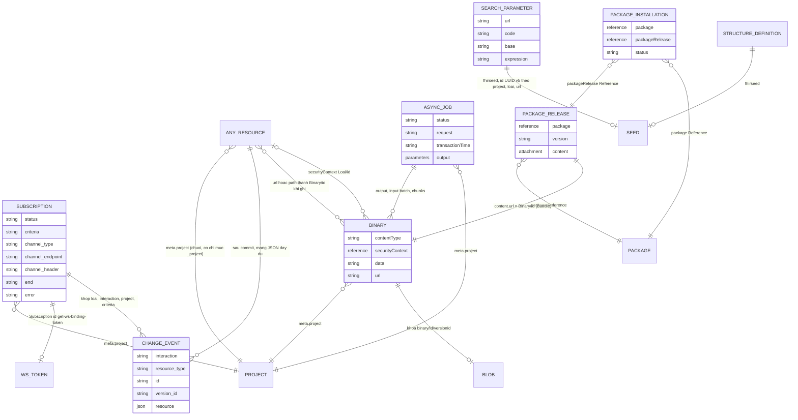

# 2. Mô hình logic

`fhir-server` là máy chủ **FHIR R4 tổng quát**: nó **không sở hữu một tập loại resource cố định** mà nhận mọi loại có trong `pkg/fhir/registry_gen.go` (**171** loại, sinh từ định nghĩa Medplum v5.2.18, xem `pkg/fhir/doc.go`) và lưu chúng **y hệt nhau** ở `fhir_resource` (schema `fhir`; bảng vật lý ở [01](01-bang-vat-ly.md)). Tài liệu này có hai phần: **2.1 đến 2.3** là mô hình chung và bảng kiểm kê 171 loại (chỉ nêu tên, cụm, compartment, chủ sở hữu, **không** liệt kê trường của từng loại); **2.5 đến 2.15** là chi tiết **từng trường** của các loại mà `fhir-server` tự diễn giải hành vi (đọc, ghi hoặc ép giá trị trong mã). Từ vựng (`CodeSystem`, `ValueSet`, `ConceptMap`, `NamingSystem`) và bảng dẫn xuất của chúng ở [02b](02b-tu-vung.md). Quan hệ và toàn vẹn ở [03](03-quan-he-va-toan-ven.md); kho Redis và kho Binary ở [04](04-kho-khac.md). Nhãn nhạy cảm theo `references/templates.md` của skill: S0 công khai, S1 định danh kỹ thuật, S2 dữ liệu cá nhân, S3 dữ liệu lâm sàng, S4 bí mật xác thực.

## 2.1 Mô hình chung (mọi loại resource)

| Khía cạnh | Hành vi (nguồn trong mã) |
|---|---|
| Nơi lưu | Một dòng ở `fhir_resource` theo khóa **(resource_type, id)**; JSON đầy đủ ở cột `content` (`jsonb` ở PostgreSQL). Mỗi lần ghi thêm một dòng `fhir_history`. Chỉ mục tìm kiếm ở `fhir_idx_*` (`pkg/fhirstore/crud.go`, `insertRows`, `reindex`) |
| `id` | **Server cấp** cho `POST` (UUID v4 do `newID`); `id` client gửi bị ghi đè (`createWithID` đặt `body["id"] = id`). `PUT Loại/id` khi chưa có chỉ tạo mới nếu bật `FHIR_UPDATE_AS_CREATE` (mặc định tắt: 404; id phải khớp `^[A-Za-z0-9\-.]{1,64}$`); resource đã xóa (410) **không** được tạo lại |
| `meta.versionId`, `meta.lastUpdated` | Do kho cấp mỗi lần ghi; `createWithID` **xóa** hai trường này khỏi body người gửi trước khi tạo |
| `meta.project` | Chuỗi id `Project` (thuộc `auth`). Khi bật JWT, `fhirauth.Scope` **gán đè** `meta.project` của người gọi lúc tạo (`stamp`), lọc mọi đọc/tìm kiếm theo project (`inProject`, bộ lọc `_project`) và trả 404 cho project khác. Tham số `_project` (token, biểu thức `Resource.meta.project`, không có trong R4) **có chỉ mục** cho mọi loại (`fhir.ProjectParam`, `indexedParams`). Chế độ token tĩnh: không gán, `meta.project` rỗng |
| Kiểm khi ghi | `fhirvalidate.Validate` ở `create` và `update` (`writeBody`): cấu trúc, kiểu, cardinality tối thiểu, choice type, regex kiểu nguyên thủy, invariant FHIRPath. Profile, slicing, fixed/pattern chỉ chạy khi bật `FHIR_VALIDATE_PROFILES` (`pkg/fhirvalidate/profile.go`, StructureDefinition tra từ kho). **Không** có binding terminology, kiểm đích của `Reference`. Tắt bằng `FHIR_SKIP_VALIDATION` hoặc `FHIR_SKIP_CONSTRAINTS` (chỉ invariant). Cảnh báo không chặn ghi |
| Xóa | `DeleteResource` đặt `deleted=true` ở `fhir_resource`, **thay `content` bằng bản bia mộ** `{resourceType, id, meta}` (mất mọi trường, kể cả `meta.project`), thêm dòng `fhir_history` (`method=DELETE`) và **xóa mọi dòng chỉ mục** (`deleteIndex`). Các phiên bản cũ **còn nguyên trong `fhir_history`**. Xóa vĩnh viễn chỉ qua `$expunge` (`Expunger`; hàm `Expunge`) |
| Sự kiện | Khi bật `FHIR_SUBSCRIPTIONS` hoặc `FHIR_AUTO_DOWNLOAD`, `fhirsub.Wrap` phát `ChangeEvent` (topic `fhir.resource.changed`, mang **JSON đầy đủ của resource**) **sau commit** cho **mọi loại** (lỗi phát chỉ ghi log, không hỏng việc ghi). Đường nhận: `fhir-notifier`, `fhir-downloader` |
| Quyền theo loại | `fhirauth`: scope SMART và `AccessPolicy` theo loại. Rule `"*"` **không** khớp 13 loại quản trị (`wildcardExcluded`: AccessPolicy, Cron, Package, PackageRelease, PackageInstallation, Project, ProjectMembership, User, UserSecurityRequest, DomainConfiguration, Enterprise, JsonWebKey, Login); muốn truy cập phải có rule riêng. **Ngoại lệ:** `AsyncJob` không bị giới hạn theo loại (`allow`, `allows` bỏ qua `jobType`), xem 2.7 |
| Tìm kiếm | Chỉ dùng **tham số biên dịch sẵn** (`pkg/fhir/searchparams_gen.go` qua `fhir.SearchParams`), không đọc resource `SearchParameter` đã lưu (xem 2.9). `$reindex` lập lại chỉ mục theo cùng tập biên dịch sẵn |

Dữ liệu có hai nơi đọc kết quả ghi: người dùng qua REST và các tiến trình tách ra (notifier, downloader, worker) đọc **cùng schema `fhir`**; không service nào ngoài `fhir-server` và `dicomweb` được ghi schema này theo thiết kế.

## 2.2 Kiểm kê 171 loại theo cụm

Chỉ nêu tên loại; dấu `*` nghĩa là loại có trong compartment **Patient** (`pkg/fhir/compartment_gen.go`, 67 loại; chỉ compartment Patient được sinh, không có Practitioner, Encounter, RelatedPerson hay Device). Chi tiết từng trường của các loại này **không** viết ở đây: đọc `pkg/fhir/resource_<loại>.go` hoặc chạy `scripts/resource_fields.py <Loại>`. Số liệu do script đếm từ `registry_gen.go` và `compartment_gen.go` (mỗi loại thuộc đúng một cụm; cụm do tài liệu này đặt, mã không có khái niệm cụm).

| Cụm | Số loại | Các loại (`*` = thuộc compartment Patient) |
|---|---|---|
| Lâm sàng (hồ sơ và sự kiện của bệnh nhân) | 42 | AdverseEvent*, AllergyIntolerance*, Basic*, BodyStructure*, CarePlan*, CareTeam*, ClinicalImpression*, Communication*, CommunicationRequest*, Composition*, Condition*, Consent*, DetectedIssue*, DeviceRequest*, DeviceUseStatement*, DiagnosticReport*, DocumentManifest*, DocumentReference*, Encounter*, EpisodeOfCare*, FamilyMemberHistory*, Flag*, Goal*, GuidanceResponse, ImagingStudy*, Immunization*, ImmunizationEvaluation*, ImmunizationRecommendation*, List*, Media*, MolecularSequence*, NutritionOrder*, Observation*, Procedure*, Provenance*, QuestionnaireResponse*, RequestGroup*, RiskAssessment*, ServiceRequest*, Specimen*, Task*, VisionPrescription* |
| Hành chính và tổ chức (người, nơi, lịch) | 16 | Appointment*, AppointmentResponse*, Endpoint, Group*, HealthcareService, Linkage, Location, Organization, OrganizationAffiliation, Patient*, Person*, Practitioner, PractitionerRole, RelatedPerson*, Schedule*, Slot |
| Tài chính và bảo hiểm | 16 | Account*, ChargeItem*, ChargeItemDefinition, Claim*, ClaimResponse*, Contract, Coverage*, CoverageEligibilityRequest*, CoverageEligibilityResponse*, EnrollmentRequest*, EnrollmentResponse, ExplanationOfBenefit*, InsurancePlan, Invoice*, PaymentNotice, PaymentReconciliation |
| Thuốc, chất và sản phẩm | 24 | BiologicallyDerivedProduct, Medication, MedicationAdministration*, MedicationDispense*, MedicationKnowledge, MedicationRequest*, MedicationStatement*, MedicinalProduct, MedicinalProductAuthorization, MedicinalProductContraindication, MedicinalProductIndication, MedicinalProductIngredient, MedicinalProductInteraction, MedicinalProductManufactured, MedicinalProductPackaged, MedicinalProductPharmaceutical, MedicinalProductUndesirableEffect, Substance, SubstanceNucleicAcid, SubstancePolymer, SubstanceProtein, SubstanceReferenceInformation, SubstanceSourceMaterial, SubstanceSpecification |
| Thiết bị và cung ứng | 5 | Device, DeviceDefinition, DeviceMetric, SupplyDelivery*, SupplyRequest* |
| Nghiên cứu, chứng cứ và chỉ số | 10 | EffectEvidenceSynthesis, Evidence, EvidenceVariable, Measure, MeasureReport*, ResearchDefinition, ResearchElementDefinition, ResearchStudy, ResearchSubject*, RiskEvidenceSynthesis |
| Định nghĩa nghiệp vụ lâm sàng (quy trình, biểu mẫu, danh mục) | 8 | ActivityDefinition, CatalogEntry, EventDefinition, Library, ObservationDefinition, PlanDefinition, Questionnaire, SpecimenDefinition |
| Định nghĩa kỹ thuật FHIR (conformance, thuật ngữ) | 18 | CapabilityStatement, CodeSystem, CompartmentDefinition, ConceptMap, ExampleScenario, GraphDefinition, ImplementationGuide, MessageDefinition, NamingSystem, OperationDefinition, SearchParameter, StructureDefinition, StructureMap, TerminologyCapabilities, TestReport, TestScript, ValueSet, VerificationResult |
| Hạ tầng giao tiếp và vận hành (không phải dữ liệu lâm sàng) | 9 | AsyncJob, AuditEvent*, Binary, Bundle, MessageHeader, OperationOutcome, Parameters, Subscription, SubscriptionStatus |
| Mở rộng Medplum và Trivita (ngoài R4) | 23 | AccessPolicy, Agent, Bot, BulkDataExport, ClientApplication, Cron, DicomInstance, DicomSeries, DicomStudy, DomainConfiguration, Enterprise, JsonWebKey, Login, Package, PackageInstallation, PackageRelease, Project, ProjectMembership, SmartAppLaunch, SmartHealthLink, User, UserConfiguration, UserSecurityRequest |

Cách dùng compartment ở mã: `Patient/{id}/$everything` (`operation.go:212`), `$export` mức `patient` và `group` (`bulk.go:127,140,283,502`), và `pkg/fhirsearch/compartment.go`. Scope SMART `patient/...` **chưa hỗ trợ** (`parseSMART` bỏ qua, `pkg/fhirauth/grants.go`), nên compartment không dùng để cấp quyền ở `fhir-server`; `auth` có cờ `AUTH_PATIENT_COMPARTMENT_ENABLED` riêng để dịch chính sách (`apps/auth/internal/config/config.go:86`).

### Bảng compartment Patient (67 loại)

| Loại | Tham số liên kết tới Patient |
|---|---|
| Account | subject |
| AdverseEvent | subject |
| AllergyIntolerance | patient, recorder, asserter |
| Appointment | actor |
| AppointmentResponse | actor |
| AuditEvent | patient |
| Basic | patient, author |
| BodyStructure | patient |
| CarePlan | patient, performer |
| CareTeam | patient, participant |
| ChargeItem | subject |
| Claim | patient, payee |
| ClaimResponse | patient |
| ClinicalImpression | subject |
| Communication | subject, sender, recipient |
| CommunicationRequest | subject, sender, recipient, requester |
| Composition | subject, author, attester |
| Condition | patient, asserter |
| Consent | patient |
| Coverage | policy-holder, subscriber, beneficiary, payor |
| CoverageEligibilityRequest | patient |
| CoverageEligibilityResponse | patient |
| DetectedIssue | patient |
| DeviceRequest | subject, performer |
| DeviceUseStatement | subject |
| DiagnosticReport | subject |
| DocumentManifest | subject, author, recipient |
| DocumentReference | subject, author |
| Encounter | subject |
| EnrollmentRequest | subject |
| EpisodeOfCare | patient |
| ExplanationOfBenefit | patient, payee |
| FamilyMemberHistory | patient |
| Flag | patient |
| Goal | patient |
| Group | member |
| ImagingStudy | patient |
| Immunization | patient |
| ImmunizationEvaluation | patient |
| ImmunizationRecommendation | patient |
| Invoice | subject, patient, recipient |
| List | subject, source |
| MeasureReport | patient |
| Media | subject |
| MedicationAdministration | patient, performer, subject |
| MedicationDispense | subject, patient, receiver |
| MedicationRequest | subject |
| MedicationStatement | subject |
| MolecularSequence | patient |
| NutritionOrder | patient |
| Observation | subject, performer |
| Patient | link |
| Person | patient |
| Procedure | patient, performer |
| Provenance | patient |
| QuestionnaireResponse | subject, author |
| RelatedPerson | patient |
| RequestGroup | subject, participant |
| ResearchSubject | individual |
| RiskAssessment | subject |
| Schedule | actor |
| ServiceRequest | subject, performer |
| Specimen | subject |
| SupplyDelivery | patient |
| SupplyRequest | subject |
| Task | patient, focus |
| VisionPrescription | patient |

## 2.3 Loại thuộc service khác và loại mở rộng ngoài R4

`registry_gen.go` có **25 loại ngoài R4** (R4 chuẩn có 146): 23 loại mở rộng của Medplum (ở cụm cuối của bảng 2.2, trong đó `Dicom*` thuộc Trivita) cộng `AsyncJob` (mở rộng Medplum, xếp ở cụm hạ tầng) và `SubscriptionStatus` (có từ R4B, `fhir-server` chỉ dùng như thân thông báo websocket, không lưu). Cột "Mã dùng thực" chỉ ghi nơi **mã có tên loại đó** ở `fhir-server` và các thư viện dùng chung `pkg/*` (đã đếm literal `"Loại"` và `fhir.Loại` trong `pkg/`, `apps/fhir-server`, `apps/fhir-worker`, ngoài `pkg/fhir` và test); "chỉ có kiểu" nghĩa là có struct, đường REST chung và chỉ mục, **không** có mã nào diễn giải trường.

| Loại | Chủ sở hữu thực tế | Mã dùng thực ở fhir-server | Ghi chú |
|---|---|---|---|
| `AsyncJob` | `fhir-server` tạo, `fhir-worker` chạy | Có: `pkg/fhirrouter/jobs*.go`, `bulk.go`, `batch_async.go`, `fhirauth/seal.go` | Chi tiết ở [2.7](#27-asyncjob-tóm-tắt) và `apps/fhir-worker/docs/erd/02-mo-hinh-logic.md` |
| `Binary` | `fhir-server` (kho nội dung); `fhir-worker`, `fhir-downloader` cũng ghi | Có: `pkg/fhirbinary/*` | [2.6](#26-binary) |
| `Subscription`, `SubscriptionStatus` | `fhir-server` ghi `Subscription`; `fhir-notifier` đọc và chỉ sửa `status`, `error` | Có: `pkg/fhirsub/*` | [2.5](#25-subscription) |
| `PackageRelease`, `PackageInstallation` | `fhir-server` | Có: `pkg/fhirrouter/packageinstall.go` (`$install`) | [2.11](#211-packagerelease) và 2.12 |
| `Package` | `fhir-server` lưu (REST chung) | **Chỉ có kiểu** (tên chỉ xuất hiện ở `wildcardExcluded`) | [2.10](#210-package-chỉ-có-kiểu) |
| `Bot`, `Agent`, `Cron` | Không có chủ ở repo này | **Chỉ có kiểu** ở `fhir-server`. `Cron` chỉ ở `wildcardExcluded`; `Bot` chỉ là đích tham chiếu của vài tham số (ví dụ `Subscription.author`). Không có mã thực thi Bot, Cron hay Agent (ngoài phạm vi: `memory/scope-decisions-m1-m5`) | Lưu được, không chạy gì |
| `BulkDataExport` | Không ai | **Chỉ có kiểu**: export dùng `AsyncJob` và `Binary`, không ghi `BulkDataExport` ([2.8](#28-kết-quả-export-và-bulkdataexport)) | Struct tồn tại |
| `SmartAppLaunch`, `UserConfiguration`, `DomainConfiguration`, `JsonWebKey`, `UserSecurityRequest`, `Enterprise` | `apps/auth` (schema `identity`) cho phần đã có mã: `SmartAppLaunch`, `UserConfiguration`, `DomainConfiguration` (có đọc/ghi ở `apps/auth/internal/application`) | **Chỉ có kiểu** ở `fhir-server` (tên chỉ ở `wildcardExcluded` và trong tập `fhir.ResourceTypes`). `SmartHealthLink`: không có mã ở bất kỳ service nào | |
| `User`, `Login`, `Project`, `ProjectMembership`, `AccessPolicy`, `ClientApplication` | **`apps/auth`**, schema `identity` | `fhir-server` **không đọc** chúng (role `fhir_app` không có quyền schema `identity`); `User` chỉ xuất hiện ở `display.go` (nhãn hiển thị) | Xem rủi ro 2.17 mục R-3 |
| `DicomStudy`, `DicomSeries`, `DicomInstance` | **`apps/dicomweb`**, cùng schema `fhir` | `fhir-server` không có mã riêng; truy cập qua REST chung | Rule `"*"` khớp chúng (không nằm trong `wildcardExcluded`), xem R-4 |

Hệ quả: một số loại của bảng trên **có thể** được tạo trong schema `fhir` qua REST của `fhir-server` (khi người gọi có rule riêng cho loại đó), nhưng bản đó **không có tác dụng** với `auth` (đọc schema `identity`) và ngược lại. Nguồn sự thật cho `User`, `Login`... là `apps/auth/docs/erd/02-mo-hinh-logic.md`.

## 2.4 ERD logic

Sơ đồ chỉ gồm các loại mô tả chi tiết ở 2.5 đến 2.15 và quan hệ chính; **không có khóa ngoại**, mọi nét nối là chuỗi trong JSON (`Reference`, `url`) hoặc cặp `(resource_type, id)`; xem [03](03-quan-he-va-toan-ven.md).

`PROJECT` thuộc `auth` (ở đây chỉ là chuỗi id); `CHANGE_EVENT`, `WS_TOKEN` và `BLOB` không phải dòng CSDL (message Redis, chuỗi ký không lưu, tệp ở kho; xem [04](04-kho-khac.md)); `SEED` là lệnh `fhir-server seed definitions` (không phải thực thể).

## 2.5 Subscription

**Mục đích nghiệp vụ:** đăng ký nhận thông báo khi resource đổi (rest-hook gọi URL ngoài, hoặc websocket). **Lưu ở:** `fhir_resource` (`resource_type='Subscription'`), schema `fhir`. **Ghi bởi:** người dùng qua REST của `fhir-server` (create/update/delete như mọi loại); `fhir-notifier` sửa **chỉ** `status` và `error` khi tự tắt (xem `apps/fhir-notifier/docs/erd/02-mo-hinh-logic.md` mục Subscription cho toàn bộ phần **giao**: khớp tiêu chí, retry, HMAC `X-Signature`, tự tắt, kênh Redis). **Đọc bởi:** `fhirsub.Manager` (nạp `Subscription?status=active`, TTL cache 30 giây) ở `fhir-server` khi `FHIR_SUBSCRIPTION_DELIVERY=true` hoặc ở `fhir-notifier`; `TokenOperation` (cấp token websocket). **Dọn:** không ai xóa Subscription hết hạn (`end` chỉ làm bộ khớp bỏ qua).

**Phần fhir-server làm (khác phần giao):**

1. **Kiểm khi ghi chỉ là kiểm chung** của `fhirvalidate` (cấu trúc, trường bắt buộc `status`, `reason`, `criteria`, `channel`, `channel.type`). **Không** kiểm `criteria` có phân tích được không, `channel.endpoint` có phải URL hợp lệ hay trỏ nội bộ: việc đó chỉ xảy ra **lúc nạp** (`buildEntry`: `checkEndpoint`, `fhirsearch.ParseQuery`) và **lúc kết nối** (`safehttp`), nên Subscription hỏng vẫn tạo được (HTTP 201) rồi bị **bỏ qua âm thầm** (log WARN, `status` vẫn `active`).
2. **Chống SSRF** ở `pkg/safehttp` (dùng cho webhook): chặn ở bước kết nối (`Dialer.Control`) trên IP đã phân giải, nên chống cả DNS rebinding; không theo redirect, không đi qua proxy môi trường; chặn loopback, mạng riêng, link-local, metadata đám mây, CGNAT, NAT64, 6to4... `FHIR_WEBHOOK_ALLOW_PRIVATE=true` tắt chặn (dev). `checkEndpoint` chỉ nhận `http`/`https`, có host, **không** chứa userinfo.
3. **Token websocket** (`Subscription/{id}/$get-ws-binding-token`, GET hoặc POST, vai trò tối thiểu `RoleRead`, `httpapi/auth.go`): đọc Subscription bằng repository **đã tách project và quyền** của người gọi (người không đọc được Subscription không lấy được token), yêu cầu `channel.type=websocket` và `status` là `active` hoặc `requested`; cấp `base64url(claims) . base64url(HMAC-SHA256("fhir-ws-binding|" + claims))`. Claims: `v` (phiên bản, 1), `sub` (id Subscription), `proj` (`meta.project` của Subscription), `exp` (hạn, mặc định **5 phút**), `jti` (id ngẫu nhiên), `snap` (**ảnh chụp quyền** của người gọi: grants, AccessPolicy, hạn access token; bỏ trống khi không xác thực). Khóa `FHIR_WS_SIGNING_KEY` (từ 32 byte), xoay bằng `FHIR_WS_SIGNING_KEY_PREVIOUS` (tối đa 3 khóa cũ). Claims **chỉ ký, không mã hóa**: ai có token đọc được `snap` (id người gọi, quyền). Token dùng lại được tới khi hết hạn. Trả `Parameters{token, expiration, websocket-url}`; chỉ đăng ký route khi có `Tokens` (chế độ `embedded` hoặc `issuer`).
4. **Phát sự kiện** (mọi loại, không riêng Subscription): `fhirsub.Wrap` ghi sau commit; sự kiện của `Subscription` làm `Manager.Invalidate()` (hiệu lực ngay trong replica đó; replica khác chờ TTL cache 30 giây).
5. **Gửi lại** (`$resend`, `clinical_ops.go`): chỉ quản trị project hoặc super-admin; phát lại `ChangeEvent` của một resource hoặc một phiên bản cũ.

| Trường | Kiểu | Bắt buộc | Chức năng | Nhạy cảm |
|---|---|---|---|---|
| `status` | string (`requested`, `active`, `error`, `off`) | có | Chỉ `active` được nạp để giao. `TokenOperation` chấp nhận `active` và `requested`. `fhir-notifier` tự đổi `active` thành `off` khi giao thất bại lặp lại (cấu hình `FHIR_SUBSCRIPTION_AUTO_DISABLE`); `fhir-server` không tự đổi nó. Có chỉ mục `status` (token) | S1 |
| `reason` | string | có | Mô tả lý do tạo; `fhir-server` chỉ kiểm có mặt (bắt buộc), không đọc giá trị | S1 |
| `criteria` | string `<Loại>?<tham số>` | có | Quy tắc khớp: phần trước `?` là loại resource, phần sau là truy vấn tìm kiếm áp lên JSON của sự kiện trong bộ nhớ. Chained, `_has`, modifier terminology thì bị bỏ qua âm thầm khi nạp. Có chỉ mục `criteria` (string). `display.go` dùng nó làm nhãn hiển thị của Subscription | S1 (có thể chứa giá trị tìm nhạy cảm như số định danh bệnh nhân: S2) |
| `end` | string (RFC 3339) | không | Hạn: sau thời điểm này bộ khớp bỏ qua Subscription; giá trị không phân tích được coi như không có hạn. **Không** có việc xóa tự động (dù chú thích gốc ghi "automatically delete") | S1 |
| `error` | string | không | Ghi chú lỗi gần nhất; **notifier ghi** khi tự tắt; `fhir-server` không ghi, không xóa | S1 |
| `contact` | ContactPoint[] | không | Liên hệ xử lý sự cố; không có mã đọc; có chỉ mục `contact` (token) | S2 |
| `channel` | SubscriptionChannel | có | Kênh giao; mã chỉ nhận `type` `rest-hook` và `websocket` (loại khác bị bỏ qua khi nạp: `email`, `sms` chưa hỗ trợ) | S1 |
| `channel.type` | string | có | `rest-hook` (POST tới `endpoint`) hoặc `websocket` (cần Hub hoặc `ws-gateway`; điều kiện cấp token ở mục 3). Có chỉ mục `type` (token) | S1 |
| `channel.endpoint` | string (URL) | có với rest-hook | Đích webhook; kiểm lúc nạp và lúc kết nối (mục 2). Có chỉ mục `url` (uri). Người dùng hay đặt **token trong query** | S4 nếu chứa token, ngược lại S1 |
| `channel.header` | string[] (`Tên: giá trị`) | không | Header thêm vào mỗi lần giao; **thường là `Authorization: Bearer ...`**. Lưu **bản rõ** trong `content` và `fhir_history` | S4 |
| `channel.payload` | string (MIME) | không | Không có mã đọc (thân luôn là JSON resource); có chỉ mục `payload` (token) | S1 |
| `extension[subscription-secret]` | extension (`https://www.medplum.com/fhir/StructureDefinition/subscription-secret`, hoặc dạng cũ `.../StructureDefinition-subscriptionSecret`), `valueString` | không | **Khóa HMAC-SHA256** ký thân thông báo vào `X-Signature`; lấy giá trị đầu tiên không rỗng; **bản rõ** | S4 |
| `extension[subscription-supported-interaction]` | extension (`https://medplum.com/fhir/StructureDefinition/subscription-supported-interaction`), `valueCode` | không | Mỗi extension là một interaction được nhận (`create`, `update`, `delete`); không có thì nhận mọi interaction | S1 |
| `meta.project` | string | có khi bật JWT | Project của người tạo (do `fhirauth.Scope` gán); Subscription chỉ khớp sự kiện cùng `meta.project`; token websocket mang nó trong `proj` | S1 |
| `meta.author` | Reference | không | **Không có mã ghi**; chỉ là biểu thức của tham số `author` (reference → Patient, Practitioner, RelatedPerson, ClientApplication, Bot) | S2 |

**Tham số tìm kiếm được lập chỉ mục (7):** `author` (reference), `contact`, `payload`, `status`, `type` (token), `criteria` (string), `url` (uri), cộng `_project` (token, chung cho mọi loại).

**Điều fhir-server làm mà tài liệu cũ dễ hiểu sai:** secret và `Authorization` của Subscription **không bị che** khi đọc: mọi người gọi đọc được `Subscription` (vai trò đọc, không cần quyền riêng ngoài quyền loại) thấy header và secret nếu AccessPolicy không khai `hiddenFields`. Xem R-5 ở 2.17.

## 2.6 Binary

**Mục đích nghiệp vụ:** tệp nhị phân (tài liệu, ảnh, file kết quả export, Bundle đầu vào của batch/gói). **Lưu ở:** `fhir_resource` (`resource_type='Binary'`) **chỉ giữ siêu dữ liệu**; nội dung ở kho (`FHIR_BINARY_STORAGE`: `file:` hoặc `s3:`), khóa **`binary/<id>/<versionId>`** (`binarystore.Key`; id và versionId phải khớp `^[A-Za-z0-9\-.]{1,64}$`). Khi **không** bật kho, `data` (base64) nằm trong `content` như resource thường. **Ghi bởi:** `fhirbinary.Repo` (decorator `Wrap`) khi tạo/sửa `Binary` có `data`; `fhirbinary.RawBinary` (POST/PUT nội dung thô); `StorageHandler` (PUT bằng URL ký); `fhir-downloader` (ghi thẳng, `securityContext` về resource nguồn); `fhir-worker` (file kết quả). **Đọc bởi:** `GET Binary/{id}` (nội dung thô trừ khi `Accept` là JSON hoặc có `_format`), `GET /storage/{id}/{versionId}` (URL ký, không Bearer), `$presigned-url`, `Rewriter` (đổi URL khi đọc). **Dọn:** xóa mềm không xóa nội dung; `$expunge` xóa nội dung mọi phiên bản **sau commit** (lỗi chỉ ghi log); quét mồ côi: `fhir-server` có lệnh `fhir-server sweep-binary` (`pkg/fhirbinary/sweep.go`, ân hạn mặc định 24 giờ, tối thiểu 1 giờ, trần 1000 khóa mỗi lượt, chốt chặn khi quá nửa số khóa là mồ côi).

**Luồng ghi và thứ tự (Q-S9):** CSDL trước, kho sau (vì `versionId` do CSDL cấp). Lỗi kho: `Create` ngoài transaction xóa resource vừa tạo; trong transaction thì hủy cả transaction và xóa khóa đã ghi; `Update` có lỗi kho thì **không** hoàn tác phiên bản mới (khác `Create`). Tiến trình chết giữa hai bước để lại nội dung mồ côi (cần sweep). `Update` không kèm `data` thì **chép nội dung** của phiên bản trước sang khóa phiên bản mới (`Store.Copy`); phiên bản trước chưa từng có nội dung thì bỏ qua (không lỗi).

| Trường | Kiểu | Bắt buộc | Chức năng | Nhạy cảm |
|---|---|---|---|---|
| `contentType` | string (MIME) | có | Loại nội dung; bị kiểm danh sách chặn (`binarystore.CheckMetadata`: `application/x-sh`, `application/java-archive`, `application/x-msdownload`, `application/vnd.apple.installer+xml`, `application/vnd.microsoft.portable-executable`; bỏ tham số `; charset=` trước khi so) khi ghi `data`, khi POST/PUT thô và khi PUT bằng URL ký. Là `Content-Type` của phản hồi tải về; chỉ `image/png`, `image/jpeg`, `image/gif`, `image/webp` hiển thị tại chỗ, **mọi loại khác** (kể cả SVG, HTML, PDF) bị buộc `Content-Disposition: attachment` kèm `X-Content-Type-Options: nosniff` và `Content-Security-Policy: default-src 'none'; sandbox`. PUT bằng URL ký phải khớp loại này (sau khi bỏ tham số), nếu không 400 | S1 |
| `securityContext` | Reference | không | Resource **làm đại diện kiểm quyền** (theo FHIR): chỉ đọc được Binary khi người gọi đọc được resource đó (`canReadSecurityContext`, kiểm bằng repository của người gọi); chỉ nhận dạng `Loại/id` (`^[A-Za-z]{1,64}/[A-Za-z0-9\-.]{1,64}$`), URL, `urn:` hay tham chiếu lồng bị coi là **không đọc được** (mặc định từ chối). Đặt qua POST/PUT thô bằng header `X-Security-Context` (sai dạng: 400). Áp ở `GET Binary`, `$presigned-url` và khi `Rewriter` cấp URL ký; **không** áp ở `GET /storage` (đường công khai, quyền do chữ ký) | S2 (lộ liên hệ tới hồ sơ qua loại và id) |
| `data` | string (base64) | không | Nội dung nhúng khi ghi qua JSON. **Với kho bật:** giải mã, ghi vào kho, rồi **bỏ khỏi `content`** (`cp.Data = ""`), nên resource lưu và sự kiện `ChangeEvent` không mang nội dung (`fhirsub.Wrap` nằm trên `Wrap` của Binary). Trần giải mã `FHIR_BASE64_BINARY_MAX_BYTES` (mặc định **1 MiB**; âm: không trần; 400 `base64Binary exceeds N bytes`); base64 sai: 400. Job nền dùng repository riêng **không trần** (file export đến 8 MiB). Dữ liệu cũ còn base64 ở `content` vẫn đọc được (`raw.read`). Nội dung có thể là hồ sơ lâm sàng | S3 (nội dung ở kho) |
| `url` | string | không | **Không có mã đọc hay ghi** ở `fhirbinary`/`fhirrouter` (trường R4 "nơi chứa dữ liệu"); không dùng để trỏ kho. Đừng suy ra vị trí kho từ trường này: vị trí luôn là `binary/<id>/<versionId>`. Ngoại lệ: **phản hồi** của POST/PUT thô thêm `url` (URL ký GET) vào JSON trả về, **không lưu** | S1 |
| `meta.project` | string | có khi bật JWT | Do `fhirauth.Scope` gán lúc tạo; **URL ký bắt buộc mang đúng `Project`** của Binary (`projectOf(b) != claims.ProjectID` thì 401), kể cả Binary không có project (URL không được mang `Project`) | S1 |

**Không có trường `size` và `hash`:** R4 `Binary` không có, và `fhir-server` **không tính hay lưu** kích thước hoặc băm của nội dung (kích thước chỉ do kho biết; `Store.Put` trả số byte ghi nhưng `Wrap` bỏ qua). Hệ quả: không có cách kiểm toàn vẹn nội dung từ siêu dữ liệu; `Attachment.size` và `Attachment.hash` ở resource khác là do người gửi khai (xem `fhir-downloader`, mục 2.3 của tài liệu ERD của nó).

**Tải lên/tải xuống và URL ký (presign)** (`binarystore.Signer`, tương thích Medplum):

| Điểm | Giá trị (nguồn) |
|---|---|
| Dạng URL | `<FHIR_STORAGE_BASE_URL>/<id>/<versionId>?Expires=<giây unix>[&Project=<id>]&Signature=<base64>` (`Signer.Sign`) |
| Thuật toán | RSA (khóa **từ 2048 bit**) ký chuỗi `"<GET|PUT> <url trước Signature>"`; xoay khóa bằng `FHIR_STORAGE_SIGNING_PREVIOUS_KEYS` (khóa công khai bổ sung để xác minh) |
| Hạn | `FHIR_STORAGE_URL_TTL`, mặc định **1 giờ**, tối đa 24 giờ |
| Phát ở đâu | `Binary/{id}/$presigned-url[?upload=true]` (kiểm đọc Binary và `securityContext`; `upload=true` cần quyền sửa `Binary`, nếu không 403; thiếu khóa ký: 500); phản hồi POST/PUT thô; `Rewriter.Response` khi **đọc** resource khác có thuộc tính `url`/`path` trỏ tới Binary (chỉ khi người gọi đọc được Binary và `securityContext`) |
| Kiểm khi dùng | Thứ tự: thiếu `Signature` 401, `Expires` quá hạn 410, chữ ký sai 401, đọc `Binary` (404/410 như nhau ra ngoài), khớp `Project`. GET phục vụ **đúng phiên bản trong URL**; PUT chỉ nhận khi URL trỏ tới **phiên bản hiện tại** (409 nếu không). PUT thân vượt `FHIR_STORAGE_MAX_UPLOAD_BYTES`: 413 |
| Đường công khai | `StorageHandler` dùng repository **không tách project** (`c.Store`); quyền chỉ do chữ ký + so `Project`. URL ký còn hiệu lực là **bearer URL**: ai có URL (log proxy, lịch sử trình duyệt) tải được tới hết hạn |
| Ghi (chuẩn hóa URL) | `Rewriter.Write` (khi ghi **resource khác Binary**, không kiểm quyền): mọi thuộc tính `url`/`path` có dạng `Binary/<id>[/_history/<v>]`, `<fhirBase>/Binary/...` hoặc `<storageBase>/<id>[/<v>]` (bỏ `?query`) thành `Binary/<id>`, để CSDL **không giữ URL có hạn**; không đụng bên trong Binary, không đụng `Bundle.entry.request.url` |

**Tham số tìm kiếm được lập chỉ mục:** không có riêng (chỉ `_project` chung). Hệ quả: không tìm `Binary` theo `contentType` hay `securityContext`.

## 2.7 AsyncJob (tóm tắt)

`AsyncJob` là tài nguyên của việc nền (export, `$reindex` cả loại, batch async): vừa là hàng đợi, khóa chạy (lease) và nơi lưu kết quả. **Chi tiết từng trường, dạng `output`, chữ ký quyền `job-seal`, checkpoint `job-state`: `apps/fhir-worker/docs/erd/02-mo-hinh-logic.md` mục 2.2 đến 2.5; ở đây không lặp lại.** Phần của `fhir-server`:

- **Tạo:** `startJob` (`jobs.go`) tạo `AsyncJob` với `status=accepted`, `requestTime`, `request`, gắn `job-seal` (khi bật JWT, ký quyền người gọi bằng `FHIR_JOB_SIGNING_KEY`) rồi trả `202` kèm `Content-Location: .../job/{id}/status` hoặc `.../bulkdata/{id}/status`. Khi `FHIR_JOB_EXECUTION=true` (mặc định) `fhir-server` tự chạy (`NewInline`, song song `FHIR_JOB_CONCURRENCY`); `false` thì chỉ `fhir-worker` chạy.
- **Đọc/hủy:** `GET` và `DELETE` `job/{id}/status`, `bulkdata/{id}/status` (vai trò đọc, và từ 2026-11-24 chỉ người tạo job hoặc quản trị: chủ lưu ở `AsyncJob.requester`, `identifier.system=urn:trivita:job-owner`; người khác `404`). Đọc/tìm kiếm trực tiếp `AsyncJob` qua REST chỉ `admin`. Mô tả cũ: (`RequiredRole`
- **Dọn:** vòng bảo trì xóa job xong cũ hơn `FHIR_EXPORT_RETENTION` và kết quả bằng `Expunge` (`jobs_maint.go`).
- **Kho tách riêng:** `AsyncJob` đi qua `JobRepository` (không bọc quyền) khi chạy, nên người gọi không cần quyền tạo `Binary` kết quả.
- **Quyền:** `AsyncJob` **không bị giới hạn theo loại** (`allow` trả `nil` khi `rt == "AsyncJob"`): mọi người gọi đã xác thực **trong project** có thể đọc, tạo, sửa `AsyncJob` qua REST chung, không cần scope SMART hay AccessPolicy cho loại này. Bảo vệ là chữ ký `job-seal` (job tự tạo không có chữ ký hợp lệ không chạy được khi bật JWT) và tách project. Xem R-6.

## 2.8 Kết quả export và BulkDataExport

Loại `BulkDataExport` (R4 không có; mở rộng Medplum) **không có mã ghi hay đọc nào** ở `fhir-server`, `fhir-worker` hay thư viện dùng chung (đã grep literal): **chỉ có kiểu**. Bulk export của `fhir-server` (`pkg/fhirrouter/bulk.go`) hoạt động như sau:

| Bước | Đối tượng được ghi | Chi tiết |
|---|---|---|
| Bắt đầu | `AsyncJob` (`request = export?_level=<system|patient|group>&_type=...&_since=...`) | `GET $export`, `Patient/$export`, `Group/{id}/$export`; `_outputFormat` chỉ nhận ndjson |
| Chạy | Một hoặc nhiều **`Binary`** mỗi loại resource | `contentType=application/fhir+ndjson`; **bỏ qua** `AsyncJob` và `Binary` (`exportSkip`); mức `patient` và `group` dùng compartment Patient (2.2) |
| Hoàn tất | `AsyncJob.output` (Parameters) | mỗi tệp một `output` có `type`, `url = <BaseURL>/Binary/<id>`, `count`; tải bằng `GET Binary/{id}` với `Accept: application/fhir+ndjson` (`binaryRaw`) |
| Dọn | `Expunge` `AsyncJob` và `Binary` kết quả | sau `FHIR_EXPORT_RETENTION` |

Nội dung file export là JSON của mọi resource đã xuất: **S3**. Quyền đọc file dựa vào `meta.project` của `Binary`, không có `securityContext` (xem 2.6).

## 2.9 SearchParameter

**Mục đích nghiệp vụ theo FHIR:** định nghĩa một tham số tìm kiếm. **Thực tế ở fhir-server:** loại này là **tài liệu tra cứu, không điều khiển hành vi**. Việc lập chỉ mục (`indexedParams`, `fhir.SearchParams`) và tìm kiếm (`fhirsearch.Lookup`) dùng **bảng biên dịch sẵn** (`pkg/fhir/searchparams_gen.go`) mà **không đọc** resource `SearchParameter` đã lưu; `fhirseed` tự ghi: "Máy chủ không đọc các resource này khi chạy". Vì vậy **tạo một `SearchParameter` tùy chỉnh qua REST (hay `$reindex`) không tạo được tham số tìm kiếm mới**: `GET Loại?<mã-mới>=...` bị từ chối (`tham số search không hợp lệ`, `pkg/fhirsearch/request.go:282`). Muốn thêm tham số phải sửa nguồn rồi chạy lại `tools/fhirgen`.

**Lưu ở:** `fhir_resource` (`resource_type='SearchParameter'`). **Ghi bởi:** (1) lệnh `fhir-server seed definitions` (`fhirseed.Seed`; `SeedDefinitions`) nạp từ thư mục Bundle JSON của Medplum (cờ `-dir`) hoặc, nếu không có thư mục, **chỉ** SearchParameter dựng từ dữ liệu biên dịch (`builtinSearchParameters`, cộng `_project`); mỗi project có bản riêng, id là **UUID v5 của `(project|loại|url)`** nên chạy lại idempotent (không đổi thì bỏ qua, đổi thì cập nhật; bỏ `meta`, `text`, `differential`); (2) người dùng qua REST (vẫn hợp lệ nhưng vô hiệu). **Đọc bởi:** client (`GET /SearchParameter`); không có mã server đọc. **Quyền:** không thuộc `wildcardExcluded`.

| Trường | Kiểu | Bắt buộc | Chức năng | Nhạy cảm |
|---|---|---|---|---|
| `url` | string | có | Khóa định danh chuẩn; **khóa khử trùng và sinh id của seed** (trùng `loại|url` thì bản sau thắng, duyệt ngược); trường duy nhất seed đòi (thiếu: lỗi `thiếu url`) | S0 |
| `version` | string | không | Phiên bản nghiệp vụ; không mã nào đọc | S0 |
| `name` | string | có | Tên máy đọc; seed đặt bằng `code` | S0 |
| `derivedFrom` | string | không | Định nghĩa gốc; không mã nào đọc | S0 |
| `status` | string | có | `draft`, `active`, `retired`, `unknown`; seed đặt `active`; **không ảnh hưởng** việc tìm kiếm | S0 |
| `experimental` | bool | không | Không mã nào đọc | S0 |
| `date` | string | không | Ngày đổi lần cuối; không mã nào đọc | S0 |
| `publisher` | string | không | Nhà xuất bản; không mã nào đọc | S0 |
| `contact` | ContactDetail[] | không | Liên hệ nhà xuất bản; không mã nào đọc | S2 |
| `description` | string | có | Mô tả; seed dựng `"<code> (<type>)"` | S0 |
| `useContext` | UsageContext[] | không | Bối cảnh dùng; không mã nào đọc | S0 |
| `jurisdiction` | CodeableConcept[] | không | Phạm vi pháp lý; không mã nào đọc | S0 |
| `purpose` | string | không | Lý do định nghĩa; không mã nào đọc | S0 |
| `code` | string | có | Mã dùng trong URL (`?code=`); chỉ mục `code` (token). Seed lấy từ `SearchParamDef.Code` | S0 |
| `base` | string[] | có | Loại resource áp dụng; chỉ mục `base` (token). Seed lấy từ `SearchParamDef.Base` | S0 |
| `type` | string | có | `number`, `date`, `string`, `token`, `reference`, `composite`, `quantity`, `uri`, `special`; chỉ mục `type` (token); `composite` và `special` **không** được lập chỉ mục thường và `metadata` bỏ chúng | S0 |
| `expression` | string | không | Biểu thức FHIRPath trích giá trị; seed ghi biểu thức biên dịch; server **không** chạy biểu thức của bản lưu | S0 |
| `xpath` | string | không | Không mã nào đọc; seed không đặt | S0 |
| `xpathUsage` | string | không | Không mã nào đọc | S0 |
| `target` | string[] | không | Loại đích của tham số reference (seed ghi); chỉ mục `target` (token) | S0 |
| `multipleOr` | bool | không | Không mã nào đọc (hành vi OR cố định trong `fhirsearch`) | S0 |
| `multipleAnd` | bool | không | Không mã nào đọc | S0 |
| `comparator` | string[] | không | Seed ghi từ định nghĩa biên dịch; không mã nào đọc từ bản lưu | S0 |
| `modifier` | string[] | không | Như `comparator` | S0 |
| `chain` | string[] | không | Không mã nào đọc; seed không đặt | S0 |
| `component` | SearchParameterComponent[] | không | Phần tử của tham số composite (`definition` Reference, `expression`); chỉ mục `component` (reference → SearchParameter) | S0 |

**Tham số tìm kiếm được lập chỉ mục (6):** `base`, `code`, `target`, `type` (token), `component`, `derived-from` (reference → SearchParameter), cộng `_project`.

## 2.10 Package (chỉ có kiểu)

**Mục đích nghiệp vụ:** định nghĩa một gói trên "marketplace" của Medplum. **Ở `fhir-server`: chỉ có kiểu**: lưu qua REST chung, không có mã đọc trường nào; tên loại xuất hiện duy nhất ở `wildcardExcluded` (rule `"*"` không khớp, cần rule riêng). `PackageRelease` trỏ tới nó bằng `package` nhưng mã **không kiểm** `Package` có tồn tại hay không. `apps/auth` có nhắc tên loại ở danh sách bảo vệ, không đọc trường.

| Trường | Kiểu | Bắt buộc | Chức năng | Nhạy cảm |
|---|---|---|---|---|
| `identifier` | Identifier[] | không | Định danh gói; không mã nào đọc | S1 |
| `status` | string | có | Trạng thái gói; không mã nào đọc (có chỉ mục `status`, token) | S1 |
| `name` | string | có | Tên gói; không mã nào đọc (chỉ mục `name`, string) | S0 |
| `description` | string | không | Mô tả; không mã nào đọc | S0 |
| `category` | CodeableConcept[] | không | Phân loại; không mã nào đọc (chỉ mục `category`, token) | S0 |
| `author` | Reference | có | Tác giả; không mã nào đọc, không kiểm đích | S2 |

**Tham số tìm kiếm được lập chỉ mục (3):** `category`, `status` (token), `name` (string).

## 2.11 PackageRelease

**Mục đích nghiệp vụ:** một phiên bản phát hành của gói; **nội dung gói là một Bundle JSON** nằm ở `Binary` mà `content.url` trỏ tới, và operation **`PackageRelease/{id}/$install`** (`packageinstall.go`) chạy Bundle đó như batch hoặc transaction thường **với quyền của người gọi**. **Lưu ở:** `fhir_resource`. **Ghi bởi:** người dùng qua REST. **Đọc bởi:** `packageInstall` (chỉ `package`, `version`, `content.url`). **Quyền:** `$install` đòi quản trị project hoặc super-admin (`RequireAdmin`: scope `fhir.admin`, không bị AccessPolicy thu hẹp) **và** quyền thường của từng entry; loại này nằm trong `wildcardExcluded`.

| Trường | Kiểu | Bắt buộc | Chức năng | Nhạy cảm |
|---|---|---|---|---|
| `identifier` | Identifier[] | không | Định danh bản phát hành; không mã nào đọc | S1 |
| `package` | Reference | có | Sao chép nguyên vào `PackageInstallation.package` khi cài; không kiểm đích; chỉ mục `package` (reference → Package) | S1 |
| `version` | string | có | Sao chép vào `PackageInstallation.version`; chỉ mục `version` (token) | S1 |
| `description` | string | không | Mô tả; không mã nào đọc | S0 |
| `content` | Attachment | có | Chỉ `content.url` được đọc và **bắt buộc đúng dạng `Binary/<id>`** (không có `/` sau `Binary/`; sai: 400 `PackageRelease.content.url phải có dạng Binary/<id>`). Các trường khác của Attachment (`contentType`, `size`, `hash`, `data`) không đọc. Nội dung đọc qua `BinaryContent` (kho) hoặc giải mã base64 `data`; trần **64 MiB** (`maxPackageBytes`); phải là Bundle JSON (`resourceType=Bundle`). Gói là mã dữ liệu chạy bằng quyền người cài: nội dung là rủi ro cấu hình (R-7) | S1 (nội dung gói tùy loại resource trong Bundle) |

**Tham số tìm kiếm được lập chỉ mục (2):** `package` (reference → Package), `version` (token).

## 2.12 PackageInstallation

**Mục đích nghiệp vụ:** sổ ghi **mỗi lần** chạy `$install`. **Lưu ở:** `fhir_resource`. **Ghi bởi:** `packageInstall` (`repoOf(ctx)`: repository của người gọi, nên cần quyền tạo loại này): `CreateResource` với `status="installing"`, chạy Bundle, rồi `UpdateResource` thành `installed` hoặc `error` (lỗi của `UpdateResource` chỉ được trả về nếu bước cài không lỗi). **Đọc bởi:** client. Không có mã đọc lại để chặn cài trùng: gọi `$install` hai lần cho cùng bản phát hành tạo **hai** `PackageInstallation` và chạy Bundle hai lần.

| Trường | Kiểu | Bắt buộc | Chức năng | Nhạy cảm |
|---|---|---|---|---|
| `identifier` | Identifier[] | không | Định danh lần cài; mã không đặt | S1 |
| `package` | Reference | có | Chép từ `PackageRelease.package`; chỉ mục `package` | S1 |
| `packageRelease` | Reference | có | `PackageRelease/<id>` do mã đặt; không có chỉ mục riêng | S1 |
| `version` | string | có | Chép từ `PackageRelease.version`; chỉ mục `version` | S1 |
| `status` | string | có | `installing` (đang chạy; **kẹt ở đây** nếu tiến trình chết giữa chừng, không có vòng dọn), `installed` (mọi entry < 400) hoặc `error` (entry >= 400 hoặc lỗi chạy). Chỉ mục `status` | S1 |
| `installedBy` | Reference | có (theo struct) | **Mã không đặt** (`CreateResource` chỉ gán `Package`, `PackageRelease`, `Version`, `Status`): bản lưu thiếu trường R4-bắt-buộc (không qua `fhirvalidate` vì ghi trực tiếp bằng repository), nên **không biết ai cài**; người cài chỉ còn trong nhật ký truy cập. Xem R-8 | S2 |

**Tham số tìm kiếm được lập chỉ mục (3):** `package` (reference → Package), `status`, `version` (token).

## 2.13 Bundle (batch, transaction: lưu hay không)

**Hai việc khác nhau cùng tên `Bundle`:**

| Việc | Lưu? | Chi tiết (nguồn) |
|---|---|---|
| `POST [base]` với `Bundle.type` `batch` hoặc `transaction` (`router.batch`) | **Không lưu** Bundle đầu vào hay Bundle phản hồi (`*-response` dựng trong bộ nhớ). Chỉ các resource do từng entry tạo/sửa/xóa được lưu và có lịch sử | Batch: mỗi entry độc lập (lỗi thành `response` của entry); transaction: **một transaction CSDL** (`Transactional.RunInTransaction`), thứ tự xử lý DELETE, POST, PUT/PATCH, GET; lỗi thì hủy hết, `OperationOutcome` gắn `Bundle.entry[i]`. Transaction **không** chạy async |
| Batch async (`Prefer: respond-async`, `FHIR_ASYNC_BATCH`, tắt thì header bị bỏ qua và chạy đồng bộ) | **Lưu tạm dạng `Binary`**: đầu vào là `Binary` (`application/fhir+json`, id cấp sẵn, cùng project với `AsyncJob`), từng đoạn kết quả và kết quả cuối là `Binary` chứa Bundle `batch-response`; checkpoint ở `AsyncJob` | Chi tiết ở `apps/fhir-worker/docs/erd/02-mo-hinh-logic.md`; kết quả xóa theo `FHIR_EXPORT_RETENTION` |
| `POST [base]/Bundle` (như một resource thường), kể cả `Bundle.type` bất kỳ | **Lưu** như mọi loại (không thực thi các entry, kể cả khi `type=batch`/`transaction`); `fhirvalidate` kiểm cấu trúc; chỉ mục theo tham số của `Bundle` | Dùng được cho `document`, `collection`... Nên tránh lưu `batch`/`transaction` vì dễ nhầm là đã thực thi |
| Cài gói `$install` | Bundle nằm ở `Binary`, chạy qua `batch` rồi **không lưu** Bundle kết quả (chỉ trả về) | 2.11 |
| FHIRcast, websocket, `$summary`, `$match`, `$everything` | Bundle phản hồi dựng tạm, **không lưu** (Hub FHIRcast giữ một Bundle `collection` trong trạng thái của nó, xem [04](04-kho-khac.md)) | |

Các trường server **đọc ở Bundle đầu vào** của batch/transaction (`parseEntry`):

| Trường | Kiểu | Bắt buộc | Chức năng | Nhạy cảm |
|---|---|---|---|---|
| `type` | string | có | Chỉ `batch` hoặc `transaction`, loại khác: 400 `Bundle.type phải là batch hoặc transaction` | S1 |
| `entry.request.method` | string | có | `GET`, `POST`, `PUT`, `PATCH`, `DELETE` (viết hoa hóa); thiếu `method` hoặc `url`: 400; method khác: 400 | S1 |
| `entry.request.url` | string | có | Đường dẫn tương đối (và query) của thao tác; quyết định loại và id đích | S1 |
| `entry.request.ifMatch`, `entry.request.ifNoneExist` | string | không | Điều kiện phiên bản (`If-Match`) và tạo có điều kiện (`If-None-Exist`) cho từng entry | S1 |
| `entry.fullUrl` | string | không | Với transaction: đối chiếu `urn:uuid:` để thay tham chiếu giữa entry bằng id cấp sẵn | S1 |
| `entry.resource` | Resource | tùy method | Thân của POST/PUT/PATCH; đi qua cùng kiểm hợp lệ, quyền, tách project, kho Binary như thao tác riêng lẻ | theo loại |

Các trường khác (`timestamp`, `total`, `link`, `signature`...) của Bundle đầu vào không có mã đọc; `Bundle.timestamp` của phản hồi do mã đặt. `BundleEntryRequest.url` không bị `Rewriter` đổi.

## 2.14 CapabilityStatement (sinh động, không lưu)

`GET [base]/metadata` (`pkg/fhirrouter/capability.go`) **dựng mỗi lần từ mã**, không đọc kho: `fhirVersion=4.0.1`, `kind=instance`, `format=application/fhir+json`, `patchFormat=application/json-patch+json`, `software.name=trivita-fhir`, `date` là **thời điểm gọi**. Phần `rest` dựng **một lần** (`sync.Once`) cho **cả 171 loại** (kể cả `User`, `Login`, `Dicom*`, `Bot`...: không phản ánh quyền hay loại thực dùng): `versioning=versioned`, `readHistory=true`, `updateCreate=false` (cố định, **không** theo `FHIR_UPDATE_AS_CREATE`), `conditionalCreate` và `conditionalUpdate=true`, `conditionalDelete=single`, các interaction `read`, `vread`, `update`, `patch`, `delete`, `history-instance`, `create`, `search-type`, mức hệ thống `transaction`, `batch`, `search-system`; `searchParam` lấy từ tham số biên dịch, **bỏ** `composite` và `special`. Không có `operation`, `searchRevInclude`, `profile`, `security`. Resource `CapabilityStatement` **vẫn lưu được** qua REST chung nhưng không ảnh hưởng gì (cũng không được `metadata` trả về).

**Không có trường nào để ghi chú theo từng trường** (không lưu); trường do mã đặt đã nêu ở trên.

## 2.15 StructureDefinition (lưu để tra cứu; kiểm hợp lệ dùng dữ liệu nội bộ)

| Việc | Dùng `StructureDefinition` đã lưu? | Nguồn |
|---|---|---|
| Kiểm hợp lệ khi ghi, `$validate` | **Không.** `fhirvalidate` dùng định nghĩa biên dịch sẵn (`pkg/fhir/schema_gen.go`); **không** hỗ trợ profile, nên `meta.profile` không có tác dụng kiểm | `pkg/fhirvalidate/validate.go` |
| Tìm kiếm, lập chỉ mục | Không (tham số biên dịch sẵn) | 2.9 |
| `StructureDefinition/$expand-profile?url=<profile>` | **Có**: đọc từ kho bản mới nhất theo `url` (`_sort=-version`), trả Bundle `searchset` gồm profile và mọi profile mà `snapshot.element.type.profile` tham chiếu (độ sâu giới hạn); không thấy: 400 `StructureDefinition profile with URL ... not found` | `clinical_ops.go` (`expandProfile`, `profileByURL`) |
| Nạp sẵn | Lệnh `fhir-server seed definitions` nạp `StructureDefinition`, `OperationDefinition`, `CodeSystem`, `ValueSet`, `SearchParameter` từ thư mục định nghĩa Medplum; bỏ `text` và `differential`; mỗi project có bản riêng; id UUID v5 | `fhirseed` |

`StructureDefinition` không thuộc `wildcardExcluded` (người có rule `"*"` ghi được). Danh sách trường (`snapshot`, `differential`, `type`, `baseDefinition`...) rất lớn và `fhir-server` chỉ đọc `snapshot.element.type.profile`, `url`, `version`; đọc phần còn lại ở `pkg/fhir/resource_structuredefinition.go`. Không có ghi chú từng trường vì không có mã diễn giải ngoài ba trường trên.

## 2.16 Mức nhạy cảm tổng hợp (loại do tài liệu này mô tả)

| Loại hoặc trường | Mức | Lý do và nơi lưu |
|---|---|---|
| Resource lâm sàng (cụm lâm sàng, hành chính có người, thuốc, tài chính; 2.2) | S3 (S2 với định danh) | `fhir_resource.content`, `fhir_history` (**mọi phiên bản cũ ở lại sau xóa mềm**), `fhir_idx_*` (giá trị tìm kiếm: tên, số định danh), và trong **`ChangeEvent` trên Redis** (JSON đầy đủ) |
| `Subscription.channel.header` | S4 | Thường là `Authorization: Bearer ...`; bản rõ ở `content` và `fhir_history`; trả về mọi người đọc được Subscription |
| `Subscription` extension `subscription-secret` | S4 | Khóa HMAC bản rõ; như trên |
| `Subscription.channel.endpoint` | S1 hoặc S4 | S4 khi URL mang token trong query |
| Token websocket (`$get-ws-binding-token`) | S4 | Chữ ký HMAC, hạn 5 phút, dùng lại được; **chỉ ký, không mã hóa**: claim `snap` lộ id người gọi và quyền (S2) |
| `Binary.data` và nội dung ở kho | S3 | Nội dung có thể là PDF, ảnh, file export; bản rõ ở kho (không mã hóa ở tầng ứng dụng; mã hóa phía kho tùy S3 hoặc ổ đĩa, chưa kiểm) |
| URL ký của Binary | S4 (tạm thời) | Bearer URL tới hết hạn (mặc định 1 giờ); không lưu ở CSDL (`Rewriter.Write` chuẩn hóa về `Binary/<id>`) nhưng có thể nằm trong log proxy và phản hồi |
| `Binary.securityContext` | S2 | Lộ loại và id hồ sơ nguồn |
| `AsyncJob` (`job-seal`, `request`, `output`) | S2 | Chữ ký quyền chứa id người gọi và grants (chi tiết ở tài liệu `fhir-worker`) |
| `SearchParameter`, `StructureDefinition`, `CapabilityStatement`, `Package*` | S0 đến S1 | Định nghĩa kỹ thuật; `Package.author` và `contact` là S2 |
| `Bundle` lưu như resource (`document`, `collection`) | theo nội dung (thường S3) | Chứa resource nhúng |

## 2.17 Lệch phát hiện và rủi ro (từ mã, chưa chạy lại trên hệ thống thật)

| Mã | Phát hiện | Bằng chứng | Mức |
|---|---|---|---|
| R-1 | **Tài liệu khác nói `meta.project` "không chỉ mục"**, nhưng `_project` (token, `Resource.meta.project`) **được lập chỉ mục cho mọi loại** (có dòng `fhir_idx_token`) và `fhirauth.Scope` lọc tìm kiếm bằng nó | `pkg/fhir/fhir.go:104`, `pkg/fhirstore/crud.go:295` (`indexedParams` lấy từ `fhir.SearchParams`), `pkg/fhirauth/scope.go:389` | Thấp (lệch tài liệu; ảnh hưởng dung lượng `fhir_idx_token`) |
| R-2 | `SearchParameter` tùy chỉnh **vô hiệu**: lưu được nhưng không tạo tham số tìm kiếm hay chỉ mục (khác Medplum, nơi `SearchParameter` mới có hiệu lực sau `$reindex`). Người dùng quen Medplum dễ kỳ vọng sai | `pkg/fhirseed/seed.go` (đầu tệp), `pkg/fhirstore/crud.go:295` | Trung bình (kỳ vọng) |
| R-3 | `User`, `Login`, `Project`, `ProjectMembership`, `AccessPolicy`, `ClientApplication`... **có trong `fhir.ResourceTypes`** nên tạo được ở schema `fhir` qua REST của `fhir-server` nếu người gọi có rule riêng cho loại đó (rule `"*"` bị loại cho 13 loại quản trị, nhưng **`ClientApplication`, `Bot`, `Agent`, `SmartAppLaunch`, `SmartHealthLink`, `UserConfiguration`, `BulkDataExport` không nằm trong `wildcardExcluded`**). Bản đó không có tác dụng với `auth`, nhưng làm lẫn dữ liệu và `CapabilityStatement` quảng cáo chúng | `pkg/fhirauth/policy.go:39`, `pkg/fhirrouter/capability.go` (`for _, rt := range fhir.ResourceTypes`) | Trung bình (không rò quyền; sai ngữ cảnh) |
| R-4 | `Dicom*` (của `dicomweb`) khớp rule `"*"` (không nằm trong `wildcardExcluded`) nên người có quyền ghi mọi thứ **sửa được** `DicomStudy`, `DicomSeries`, `DicomInstance` qua REST của `fhir-server`, bỏ qua kiểm tra của `dicomweb` (chưa kiểm e2e) | `pkg/fhirauth/policy.go:39`; `DicomStudy` không có mã ở `fhir-server` | Trung bình (chưa kiểm) |
| R-5 | **Secret và `Authorization` của `Subscription` trả về mọi người đọc được** (không che) và còn trong `fhir_history`; chỉ che được nếu AccessPolicy dùng `hiddenFields` | Không có mã che trong `fhirauth`/`fhirrouter`; `pkg/fhirsub/manager.go:299-313` | Cao |
| R-6 | `AsyncJob` **miễn kiểm theo loại** (mọi người đã xác thực trong project đọc, tạo, sửa được qua REST; bảo vệ duy nhất là `job-seal` và tách project); `job-seal` lộ id người gọi và grants cho người đọc `AsyncJob` | `pkg/fhirauth/scope.go:48-52,115`, `policy.go:221`, `seal.go` | Cao (thông tin quyền lộ trong project) |
| R-7 | `$install` chạy Bundle tùy ý của `Binary` bằng quyền người cài; kiểm bằng cổng HTTP `admin` (từ 2026-11-24) + `RequireAdmin` (JWT) + quyền từng entry; trần 64 MiB; không kiểm chữ ký hay nguồn của gói | `pkg/fhirrouter/packageinstall.go` | Trung bình |
| R-8 | `PackageInstallation.installedBy` bắt buộc theo struct nhưng **mã không đặt**; `status` có thể kẹt ở `installing` khi tiến trình chết; gọi `$install` lặp tạo bản ghi và chạy Bundle lặp | `pkg/fhirrouter/packageinstall.go:55-62` | Thấp đến trung bình |
| R-9 | Subscription **không bị kiểm `criteria` và `endpoint` khi tạo** (201 rồi bị bỏ qua âm thầm khi nạp) | `pkg/fhirsub/manager.go:275-295`, `pkg/fhirrouter/handlers.go:76` | Thấp (trải nghiệm và dò lỗi) |
| R-10 | Binary: `Update` lỗi kho **không** hoàn tác phiên bản mới (chỉ `Create` có bù trừ); tiến trình chết giữa CSDL và kho để lại nội dung mồ côi hoặc phiên bản không có nội dung (đọc: 404); không có `size`, `hash` | `pkg/fhirbinary/wrap.go` (đầu `Repo` và `UpdateResource`) | Trung bình |
| R-11 | `CapabilityStatement.updateCreate=false` cố định dù `FHIR_UPDATE_AS_CREATE=true` làm `PUT` tạo mới; `metadata` quảng cáo 171 loại cho mọi người gọi (kể cả loại họ không có quyền) | `pkg/fhirrouter/capability.go:26` | Thấp |
| R-12 | Xóa mềm thay `content` bằng bia mộ **và xóa chỉ mục** nhưng giữ mọi phiên bản cũ ở `fhir_history`; dữ liệu cá nhân xóa theo yêu cầu chỉ biến mất khi `$expunge` | `pkg/fhirstore/crud.go:184-207` | Cao (tuân thủ xóa dữ liệu) |

Kiểm đã làm: đếm 171 loại và 67 loại compartment bằng script từ `registry_gen.go` và `compartment_gen.go`; tên trường và tham số tìm kiếm lấy từ `resource_fields.py`; mọi khẳng định hành vi ở trên đối chiếu bằng cách đọc mã nêu ở cột "nguồn" hoặc "bằng chứng". Chưa chạy: kiểm e2e R-3, R-4, R-6; chưa render Mermaid.
