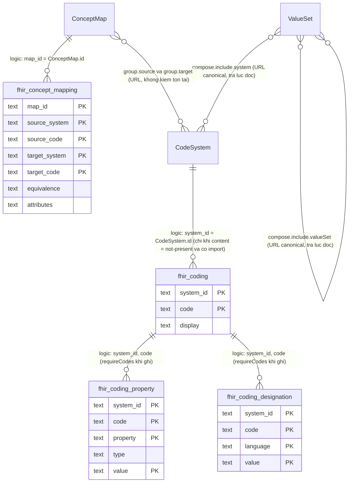
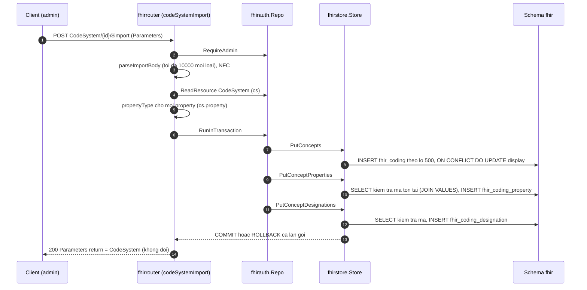

# 2b. Từ vựng (terminology) của fhir-server

`fhir-server` là service duy nhất của repo có terminology: tra, mở rộng và dịch mã trên **CodeSystem, ValueSet, ConceptMap lưu ngay trong kho** (không có máy chủ thuật ngữ ngoài; `pkg/fhirrouter/terminology.go` đầu tệp). `auth`, `dicomweb` và các service tách không dùng. Các bảng dẫn xuất `fhir_coding*`, `fhir_concept_mapping` tồn tại ở **mọi** schema (migration dùng chung) nhưng chỉ ở schema `fhir` mới có dữ liệu. Cột của từng bảng viết một lần ở [docs/erd/fhirstore-physical.md](../../../../docs/erd/fhirstore-physical.md) mục 5; tài liệu này nói **ai ghi, khi nào, đọc ra sao, xóa thì sao**. Mô hình chung của resource ở [02-mo-hinh-logic.md](02-mo-hinh-logic.md); quan hệ và toàn vẹn ở [03-quan-he-va-toan-ven.md](03-quan-he-va-toan-ven.md).

**Nguồn sự thật:** `pkg/fhirrouter/{terminology,terminology2,terminologystored,termsearch,codesystemimport,conceptmapimport,conceptstore,mappingstore}.go`, `pkg/fhirstore/{coding,codingquery,mapping,crud}.go`, `pkg/fhirauth/scope.go`, `docs/plans/modules/definitions-import.md` (kế hoạch D1 đến D5 và số đo).

## 2b.1 Hai nơi lưu concept và quy tắc chọn đường đọc

Một CodeSystem có thể mang concept ở **hai nơi khác nhau**, và server chọn đường đọc theo **một trường duy nhất**:

| Nơi lưu | Khi nào dùng | Ai ghi | Ai đọc |
|---|---|---|---|
| **JSON của CodeSystem** (`concept[]` lồng nhau trong `fhir_resource.content`) | `content` khác `not-present` (thường `complete`, `fragment`) | ghi resource thông thường (`POST`, `PUT`, batch, `PackageRelease/$install`, `fhir-server seed definitions`) | `indexCodeSystem` dựng chỉ mục trong bộ nhớ **mỗi lần gọi**, rồi `$lookup`, `$validate-code`, `$expand`, `$subsumes`, `:above`/`:below` |
| **Bảng dẫn xuất** `fhir_coding`, `fhir_coding_property`, `fhir_coding_designation` | `content = not-present` **và** kho có `ConceptStore` (PostgreSQL, SQLite và bộ nhớ đều có) | **chỉ** `CodeSystem/$import` (`PutConcepts`, `PutConceptProperties`, `PutConceptDesignations`) | `$lookup`, `$validate-code`, `$expand`, `ValueSet/$validate-code` (qua `storedConcepts`, `terminologystored.go:16`) |

`storedConcepts` (`terminologystored.go:16-22`) là cổng quyết định: `cs.Content != "not-present"` thì **bỏ qua bảng dẫn xuất hoàn toàn**. Hệ quả:

- Ghi một CodeSystem (kể cả có `concept[]`) **không bao giờ** sinh dòng `fhir_coding`. Không có hook ghi nào ngoài `$import` (grep `PutConcepts` ở `pkg` và `apps`: chỉ `codesystemimport.go:65` và các lớp bọc chuyển tiếp).
- `$import` vào một CodeSystem có `content = complete` **ghi được** vào bảng nhưng dữ liệu **không bao giờ được đọc** (bị bỏ qua lặng lẽ, không lỗi). Muốn dùng bảng phải đặt `content = not-present`.
- CodeSystem `not-present` **chưa nạp concept nào**: `$expand` trả `422 "CodeSystem ... không có nội dung trên server"` (`terminologystored.go`, `storedMembers`).
- Seed `fhir-server seed definitions` nạp 1108 CodeSystem và 1346 ValueSet của Medplum theo `content` của nguồn (thường `complete`/`fragment`): concept nằm **trong JSON**, không dùng bảng dẫn xuất (`definitions-import.md` mục D5).

## 2b.2 Sơ đồ

**Không có khóa ngoại.** `system_id` và `map_id` là **id của resource** (UUID), **không phải URL canonical**. Cùng một URL ở hai project là hai CodeSystem khác id, nên có hai tập concept riêng (tách project nằm ở lớp ứng dụng, xem [03](03-quan-he-va-toan-ven.md) mục 3.3).

## 2b.3 Ai ghi bảng dẫn xuất, khi nào, ghi lại, xóa

| Bảng | Ghi bởi | Khi nào | Ghi lại (nạp lần hai) | Xóa |
|---|---|---|---|---|
| `fhir_coding` | `Store.PutConcepts` (`coding.go:67`), gọi từ `codeSystemImport` | `POST CodeSystem/$import` hoặc `CodeSystem/{id}/$import` | **upsert** theo `(system_id, code)`: `display` bị ghi đè (`ON CONFLICT ... DO UPDATE SET display`). Trùng khóa trong cùng lô: dòng sau thắng (`dedupe`) | chỉ `Expunge` CodeSystem (`crud.go:538`) hoặc `DeleteConcepts` (không có đường HTTP gọi nó) |
| `fhir_coding_property` | `Store.PutConceptProperties` (`coding.go:78`) | cùng lần `$import` (sau concept) | `ON CONFLICT DO NOTHING`: thuộc tính **không sửa được**; đổi `value` của cùng `(code, property)` thêm một dòng mới (khóa chính gồm `value`) chứ không thay | như trên |
| `fhir_coding_designation` | `Store.PutConceptDesignations` (`coding.go:93`) | cùng lần `$import` (sau property) | `ON CONFLICT DO NOTHING`: như thuộc tính | như trên |
| `fhir_concept_mapping` | `Store.PutMappings` (`mapping.go:13`), gọi từ `conceptMapImport` | `POST ConceptMap/$import` (tham số `url`) hoặc `ConceptMap/{id}/$import` | **upsert** theo `(map_id, source_system, source_code, target_system, target_code)`: ghi đè display, `equivalence`, `comment`, `attributes`; ánh xạ trùng cặp nguồn-đích gộp một dòng (khác Medplum) | `Expunge` ConceptMap (`crud.go:543`) hoặc `DeleteMappings` (không có đường HTTP) |

Điểm cần nhớ:

1. **Một lần `$import` là một transaction** (`RunInTransaction`, `codesystemimport.go:75`, `conceptmapimport.go:79`): concept, thuộc tính và designation của lần gọi cùng thành công hoặc cùng hoàn tác. Giới hạn **10 000 phần tử mỗi loại mỗi lần gọi** (`maxImportItems`); bảng lớn phải gọi nhiều lần (mỗi lần một transaction riêng, không nguyên tử giữa các lần).
2. **Thứ tự bắt buộc** trong một lần gọi: concept, rồi thuộc tính, rồi designation. Thuộc tính và designation chỉ nạp được cho concept **đã có** trong `fhir_coding` (kể cả vừa nạp ở cùng lần gọi): `requireCodes` báo `400 "Concept chưa có: <mã>"` với mã thiếu đầu tiên và hoàn tác cả lần gọi. Đây là *kiểm toàn vẹn ở mã*, không có FK.
3. **Thuộc tính phải khai báo** ở `CodeSystem.property[].code` (hoặc là `parent`/`hierarchyMeaning`); `type` của thuộc tính lấy từ khai báo đó (`propertyType`, `codesystemimport.go:88`). Thuộc tính lạ: `400 "Property không xác định"`.
4. **Chuẩn hóa chữ**: `display` và `value` của designation đi qua `norm.NFC` khi nạp (`codesystemimport.go:118,130`; `conceptmapimport.go` cho display nguồn và đích; **không** áp dụng cho `value` của thuộc tính) để tra cứu không phụ thuộc cách gõ dấu tiếng Việt.
5. **`$import` không tạo phiên bản resource**: không ghi `fhir_resource`, `fhir_history`, không sinh sự kiện Subscription (`fhirsub.Repo.PutConcepts` chỉ chuyển tiếp, `repo.go:153`) và **không cập nhật** `CodeSystem.count`. Nội dung bảng dẫn xuất vì thế **không có lịch sử**: không biết ai nạp gì khi nào (chỉ nhật ký HTTP).
6. **Kiểm quyền**: `fhirauth.Repo` (`scope.go:585-651`) chỉ cho ghi khi người gọi có quyền **sửa CodeSystem/ConceptMap đó trong project của mình** (`owned` đọc resource cha và so `meta.project`); đọc khi có quyền đọc. Vậy tách project của concept **thừa hưởng từ resource cha**: bảng dẫn xuất không có cột project.
7. `ConceptMap/$import` ghi **từng dòng một câu `INSERT`** (`mapping.go:13-35`, không gộp lô như `fhir_coding` cỡ 500 dòng): 10 000 ánh xạ là 10 000 câu lệnh trong một transaction.

### Sequence của lệnh nạp concept (`$import`)

Bên ngoài transaction, `cs` được đọc **trước** khi mở transaction và không khóa: nếu CodeSystem bị `Expunge` đúng giữa hai bước thì lần nạp vẫn ghi dòng mồ côi (cửa sổ hẹp, suy từ mã, chưa tái hiện).

## 2b.4 Xóa resource cha thì bảng dẫn xuất ra sao

| Thao tác trên resource cha | `fhir_resource` / `fhir_history` | Bảng dẫn xuất (`fhir_coding*`, `fhir_concept_mapping`) | Hệ quả |
|---|---|---|---|
| `DELETE CodeSystem/{id}` (xóa mềm) | tombstone, thêm dòng lịch sử `DELETE` | **không đổi**: `DeleteResource` không chạm bảng dẫn xuất (`crud.go:184-209`) | concept mồ côi nằm lại; `$lookup` theo URL không tìm thấy CodeSystem (tìm kiếm bỏ qua dòng xóa) nên bảng không bị đọc, nhưng **vẫn chiếm chỗ** |
| `PUT CodeSystem/{id}` đổi `content` từ `not-present` sang `complete` | phiên bản mới | **không đổi** | bảng dẫn xuất còn nguyên nhưng **bị bỏ qua** (xem 2b.1); đổi ngược lại thì dữ liệu cũ **sống lại** |
| `PUT CodeSystem/{id}` đổi `url` hoặc `version` | phiên bản mới | không đổi (khóa theo `id`, không theo URL) | `ValueSet.compose.include.system` trỏ URL cũ sẽ không tìm thấy CodeSystem nữa dù bảng còn |
| `POST CodeSystem/{id}/$expunge` | xóa `fhir_resource`, `fhir_history`, `fhir_idx_*` | **xóa** `fhir_coding_designation`, `fhir_coding_property`, `fhir_coding` theo `system_id`, **cùng transaction** (`crud.go:519-550`, `coding.go:224-237`) | cách **duy nhất** giải phóng concept; mất luôn lịch sử CodeSystem |
| `POST ConceptMap/{id}/$expunge` | như trên | **xóa** `fhir_concept_mapping` theo `map_id` (`crud.go:543`) | như trên |

Hai điều **không có**: không có đường HTTP để xóa concept lẻ hay xóa riêng bảng dẫn xuất mà giữ resource (`DeleteConcepts` và `DeleteMappings` chỉ được gọi từ `Expunge` và lớp bọc, grep ở `pkg` và `apps`); và không có đường **bớt** concept khỏi CodeSystem đã nạp (nạp lại chỉ thêm hoặc ghi đè `display`). Muốn bỏ concept phải `Expunge` CodeSystem rồi tạo lại và nạp lại từ đầu (đổi `id`).

Test: `repotest` `Expunge` (`suite.go:885`) và `StoredTerminology`, `CodeSystemImport`, `ConceptMapImport` (`suite.go:2009`, `2068`, `2227`). **Chưa thấy test khẳng định bảng dẫn xuất còn nguyên sau xóa mềm** (chỉ suy từ mã: `DeleteResource` không gọi `deleteConcepts`); ghi `(chưa kiểm bằng test)`.

## 2b.5 Từng trường mà server đọc, ghi, ép

Server **không ép nghĩa nghiệp vụ** của CodeSystem, ValueSet, ConceptMap khi ghi: chỉ `fhirvalidate` kiểm cấu trúc và invariant FHIRPath của R4 (`status` và `content` bắt buộc), **không** kiểm ràng buộc `terminology binding`, tính duy nhất của `url`, hay `concept[]` có trùng mã không (`fhirvalidate/validate.go` đầu tệp: "Chưa làm: profile và slicing, fixed/pattern, binding với terminology"). `url` **không có ràng buộc duy nhất**: `findByURL` khi gặp nhiều bản cùng `url` chọn phiên bản lớn nhất theo **so sánh chuỗi** trên `version` (`terminology.go:45-66`).

Cột "Mức dùng": **ghi** (ai ghi), **đọc** (hàm nào đọc), **chỉ mục** (tham số tìm kiếm), **không dùng** (lưu nguyên, server không đọc).

### CodeSystem

**Lưu ở:** `fhir_resource` (`resource_type='CodeSystem'`), schema `fhir`; `meta.project` do `fhirauth` gán khi bật JWT. **Ghi bởi:** API thường, `seed definitions`, `PackageRelease/$install`. **Chỉ mục:** `code` (token, `CodeSystem.concept.code`), `content-mode`, `identifier`, `language`, `supplements` (reference tới CodeSystem), `system` (uri, `CodeSystem.url`), cùng tham số chung `url`, `version`, `name`, `status`, `title`... của họ conformance. Lưu ý: `code` lập chỉ mục **từng concept ở cấp một** trong JSON, nên CodeSystem `complete` lớn làm phình `fhir_idx_token` (xem 2b.8).

| Trường | Kiểu | Bắt buộc | Chức năng (mức dùng) | Nhạy cảm |
|---|---|---|---|---|
| `url` | string | không | Định danh canonical của hệ mã (vd `http://snomed.info/sct`); **khóa tra cứu** của mọi `$lookup`/`$expand`/`:in`: `findByURL` tìm theo tham số `url` (chỉ mục uri). Không duy nhất, không ép. | S0 |
| `identifier` | []Identifier | không | Định danh nghiệp vụ; chỉ lập chỉ mục tham số `identifier`, server không đọc khi tra mã. | S0 |
| `version` | string | không | Phiên bản nghiệp vụ; `url\|version` chọn đúng bản; trả về ở `$lookup` (`version`) và gắn vào từng `contains` của `$expand`. Không có `url\|version` thì chọn bản lớn nhất theo chuỗi. | S0 |
| `name` | string | không | Tên máy; `$lookup` trả làm `name` khi `title` rỗng. Chỉ mục `name`. | S0 |
| `title` | string | không | Tên người đọc; ưu tiên hơn `name` ở `$lookup`. | S0 |
| `status` | string | có | một trong draft, active, retired, unknown; chỉ `fhirvalidate` ép giá trị hợp lệ; **server không lọc theo trạng thái** (CodeSystem `retired` vẫn tra được). Chỉ mục `status`. | S0 |
| `experimental` | bool | không | Cờ thử nghiệm; không dùng. | S0 |
| `date` | string | không | Ngày đổi gần nhất do người ghi tự khai; không liên quan `meta.lastUpdated`; không dùng. | S0 |
| `publisher` | string | không | Đơn vị phát hành; không dùng ngoài chỉ mục. | S0 |
| `contact` | []ContactDetail | không | Liên hệ đơn vị phát hành; không dùng. | S0 |
| `description` | string | không | Mô tả; không dùng. | S0 |
| `useContext` | []UsageContext | không | Ngữ cảnh dùng; không dùng. | S0 |
| `jurisdiction` | []CodeableConcept | không | Phạm vi pháp lý; không dùng. | S0 |
| `purpose` | string | không | Lý do tồn tại; không dùng. | S0 |
| `copyright` | string | không | Điều khoản bản quyền (SNOMED, LOINC có giấy phép); không dùng, **server không ngăn xuất bản mã có bản quyền**. | S0 |
| `caseSensitive` | bool | không | Có phân biệt hoa thường khi so mã; **không dùng**: mọi so khớp mã của server phân biệt hoa thường (`byKey`, `c.code = ?`). | S0 |
| `valueSet` | string | không | Canonical của ValueSet chứa toàn bộ hệ mã; không dùng. | S0 |
| `hierarchyMeaning` | string | không | `grouped-by\|is-a\|part-of\|classified-with`; **đọc** làm **tên thuộc tính cha** ở bảng dẫn xuất (`hierarchyProperty`: có giá trị thì dùng, rỗng thì `parent`) và hợp lệ khi `$import` thuộc tính. Với CodeSystem trong JSON, cha-con lấy từ **lồng nhau** của `concept[]`, không từ trường này. | S0 |
| `compositional` | bool | không | Có ngữ pháp kết hợp; không dùng. | S0 |
| `versionNeeded` | bool | không | Định nghĩa không ổn định giữa các bản; không dùng. | S0 |
| `content` | string | có | `not-present\|example\|fragment\|complete\|supplement`; **trường quyết định đường đọc** (2b.1): `not-present` và có `ConceptStore` thì đọc bảng dẫn xuất; `not-present` mà kho không có `ConceptStore` thì `422`. Chỉ mục `content-mode`. | S0 |
| `supplements` | string | không | Canonical của CodeSystem được bổ sung; chỉ lập chỉ mục reference; server **không gộp** nội dung bổ sung vào khi tra. | S0 |
| `count` | int | không | Tổng concept do người ghi khai; **không dùng, không cập nhật** khi `$import` (có thể lệch với `fhir_coding`). | S0 |
| `filter` | []CodeSystemFilter | không | Filter hệ mã hỗ trợ cho ValueSet; không dùng (server tự xử lý `is-a`, `descendent-of`, `=`, `regex` cố định ở `applyFilter`). | S0 |
| `property` | []CodeSystemProperty | không | Khai báo thuộc tính concept (`code`, `type`); **đọc** bởi `$import` để kiểm thuộc tính hợp lệ và lấy `type` ghi vào `fhir_coding_property.type`. | S0 |
| `concept` | []CodeSystemConcept | không | Concept lồng nhau (JSON): `code`, `display`, `definition`, `designation`, `property`, `concept` con; **đọc** bởi `indexCodeSystem` mỗi lần gọi khi `content` khác `not-present` (mã trùng: bản **đầu tiên** thắng). Không dùng khi `not-present`. Ghi thường **không** đẩy sang bảng dẫn xuất. | S0 |

### ValueSet

**Lưu ở:** `fhir_resource` (`resource_type='ValueSet'`). **Không có bảng dẫn xuất**: ValueSet luôn được **tính lại ở mỗi lần gọi** từ `compose` (và các CodeSystem nó trỏ tới); không có kết quả mở rộng được lưu (`expansion` trong JSON chỉ dùng khi không có `compose`). **Chỉ mục:** `reference` (uri, `ValueSet.compose.include.system`), `expansion` (uri, `expansion.identifier`), cùng `url`, `version`, `name`, `status`, `title`, `identifier`.

| Trường | Kiểu | Bắt buộc | Chức năng (mức dùng) | Nhạy cảm |
|---|---|---|---|---|
| `url` | string | không | Canonical; khóa tra của `$expand?url=`, `$validate-code?url=`, `compose.include.valueSet` và `code:in=<url>`. Không duy nhất, chọn bản lớn nhất theo chuỗi `version`. | S0 |
| `identifier` | []Identifier | không | Định danh nghiệp vụ; chỉ lập chỉ mục tìm kiếm. | S0 |
| `version` | string | không | Phiên bản; `valueSetVersion` ghép `url\|version`. | S0 |
| `name` | string | không | Tên máy; chỉ lập chỉ mục tìm kiếm. | S0 |
| `title` | string | không | Tên người đọc; chỉ lập chỉ mục tìm kiếm. | S0 |
| `status` | string | có | Trạng thái; chỉ `fhirvalidate` ép; **không lọc** khi mở rộng. | S0 |
| `experimental` | bool | không | Không dùng: lưu nguyên, server không đọc. | S0 |
| `date` | string | không | Không dùng: lưu nguyên, server không đọc. | S0 |
| `publisher` | string | không | Không dùng: lưu nguyên, server không đọc. | S0 |
| `contact` | []ContactDetail | không | Không dùng: lưu nguyên, server không đọc. | S0 |
| `description` | string | không | Không dùng: lưu nguyên, server không đọc. | S0 |
| `useContext` | []UsageContext | không | Không dùng: lưu nguyên, server không đọc. | S0 |
| `jurisdiction` | []CodeableConcept | không | Không dùng: lưu nguyên, server không đọc. | S0 |
| `immutable` | bool | không | Không dùng (server không chặn sửa ValueSet `immutable`). | S0 |
| `purpose` | string | không | Không dùng: lưu nguyên, server không đọc. | S0 |
| `copyright` | string | không | Không dùng: lưu nguyên, server không đọc. | S0 |
| `compose` | ValueSetCompose | không | **Định nghĩa tập mã**; **đọc** bởi `expandMembers`: `include[]` (`system`, `version`, `concept[]`, `filter[]`, `valueSet[]`) và `exclude[]`. `concept[]` được ưu tiên hơn `filter[]`; `valueSet[]` là **giao** với kết quả `system`; `exclude[]` trừ sau cùng; tham chiếu vòng báo `422`; tổng trên `maxExpansion` (100 000) báo `422`. | S0 |
| `expansion` | ValueSetExpansion | không | Kết quả mở rộng **tính sẵn** do người ghi nhúng; chỉ dùng khi `compose` rỗng (`expandMembers`). `$expand` trả về `expansion` mới tính (`timestamp`, `total`, `offset`, `contains`) trong bản sao ValueSet **bỏ `compose`**; không ghi lại vào kho. | S0 |

### ConceptMap

**Lưu ở:** `fhir_resource` (`resource_type='ConceptMap'`). **Bảng dẫn xuất:** `fhir_concept_mapping` (chỉ do `$import`). **Chỉ mục:** `source-system`/`target-system` (uri, `group.source`/`group.target`), `source-code`, `target-code` (token), `source`, `target`, `source-uri`, `target-uri` (reference tới ValueSet), `dependson`, `product`, `other`. `$translate` có `id` hoặc `url` thì dùng đúng ConceptMap đó; nếu chỉ có `system` thì **tìm ConceptMap bằng tham số `source-system` đã lập chỉ mục từ JSON** (`group.source`), nên ConceptMap chỉ có ánh xạ nạp qua `$import` và **không khai `group`** phải gọi theo `id` hoặc `url`.

| Trường | Kiểu | Bắt buộc | Chức năng (mức dùng) | Nhạy cảm |
|---|---|---|---|---|
| `url` | string | không | Canonical; khóa tra của `$translate?url=` và `ConceptMap/$import?url=`. Dùng làm `source` trong từng `match` của kết quả dịch. | S0 |
| `identifier` | Identifier | không | Một định danh (không phải mảng ở ConceptMap R4); chỉ lập chỉ mục tìm kiếm. | S0 |
| `version` | string | không | Phiên bản; `conceptMapVersion` ghép `url\|version`. | S0 |
| `name` | string | không | Tên máy; chỉ lập chỉ mục tìm kiếm. | S0 |
| `title` | string | không | Tên người đọc; chỉ lập chỉ mục tìm kiếm. | S0 |
| `status` | string | có | Trạng thái; chỉ `fhirvalidate` ép; không lọc khi dịch. | S0 |
| `experimental` | bool | không | Không dùng: lưu nguyên, server không đọc. | S0 |
| `date` | string | không | Không dùng: lưu nguyên, server không đọc. | S0 |
| `publisher` | string | không | Không dùng: lưu nguyên, server không đọc. | S0 |
| `contact` | []ContactDetail | không | Không dùng: lưu nguyên, server không đọc. | S0 |
| `description` | string | không | Không dùng: lưu nguyên, server không đọc. | S0 |
| `useContext` | []UsageContext | không | Không dùng: lưu nguyên, server không đọc. | S0 |
| `jurisdiction` | []CodeableConcept | không | Không dùng: lưu nguyên, server không đọc. | S0 |
| `purpose` | string | không | Không dùng: lưu nguyên, server không đọc. | S0 |
| `copyright` | string | không | Không dùng: lưu nguyên, server không đọc. | S0 |
| `sourceUri` | string | không | ValueSet nguồn (uri); chỉ lập chỉ mục `source-uri`, `$translate` không dùng. | S0 |
| `sourceCanonical` | string | không | ValueSet nguồn (canonical); chỉ chỉ mục `source`. | S0 |
| `targetUri` | string | không | ValueSet đích (uri); chỉ chỉ mục `target-uri`. | S0 |
| `targetCanonical` | string | không | ValueSet đích (canonical); chỉ chỉ mục `target`. | S0 |
| `group` | []ConceptMapGroup | không | Ánh xạ **nằm trong JSON**: `source`/`target` (hệ mã), `element[]` (`code`, `target[]` với `code`, `equivalence`, `display`), `unmapped` (`provided`, `fixed`). **Đọc** bởi `translate` **song song** với bảng dẫn xuất (cộng gộp, khử trùng theo `equivalence\|system\|code\|source`). Ánh xạ nạp qua `$import` **không** ghi ngược vào `group`. | S0 |

### NamingSystem

**Không dùng.** Kiểu `NamingSystem` được sinh trong `pkg/fhir` (`resource_namingsystem.go`) nhưng không có mã nào trong `pkg/fhirrouter`, `pkg/fhirstore`, `pkg/fhirauth`, `apps/fhir-server` đọc hay xử lý riêng (grep `NamingSystem` ra không có kết quả ngoài `pkg/fhir`): ghi và đọc như resource thường, không có terminology gắn với nó.

## 2b.6 Thao tác tra cứu: đọc từ đâu

| Thao tác | Route (`registerTerminology*`) | Đọc từ JSON CodeSystem | Đọc từ bảng dẫn xuất | Ghi chú |
|---|---|---|---|---|
| `$lookup` | `CodeSystem/$lookup`, `CodeSystem/{id}/$lookup` | có (nếu `content` ≠ `not-present`) | có (nếu `not-present`): `GetConcept` (3 truy vấn: concept, property, designation) + `child` qua `QueryConcepts` tối đa 1000 | tên thuộc tính cha được chuẩn hóa về `parent` |
| `$validate-code` (CodeSystem) | `CodeSystem/$validate-code` | có | có (`GetConcept`) | tham số `url` hoặc `system` |
| `$expand` | `ValueSet/$expand`, `ValueSet/{id}/$expand` | có | có (`QueryConcepts`, `is-a`/`descendent-of` bằng `WITH RECURSIVE`) | `filter` (văn bản), `offset`, `count` áp dụng **sau** khi gom mọi thành viên trong bộ nhớ (trần 100 000), **không** đẩy xuống SQL |
| `$validate-code` (ValueSet) | `ValueSet/$validate-code` | có | có; ValueSet **không có exclude, không tham chiếu ValueSet khác, include đều trên CodeSystem dùng kho** thì kiểm bằng **một truy vấn** (`storedMembership`), không mở rộng cả tập | còn lại mở rộng như `$expand` |
| `$subsumes` | `CodeSystem/$subsumes` | **chỉ** JSON | **không** | CodeSystem `not-present` trả `404 "Không có mã"` dù đã nạp bảng (`terminology2.go:53`) |
| Token `:in` / `:not-in` | `termsearch.go` (`valueSetKeys`) | có | có (đi qua `expandMembers`) | tối đa 5000 mã mỗi điều kiện, nếu vượt `400` |
| Token `:below` / `:above` | `termsearch.go` (`hierarchyKeys`) | **chỉ** JSON (`indexCodeSystem`) | **không** | với CodeSystem `not-present` mã "lạ" nên không khớp gì (`noMatch`), **không báo lỗi** |
| `$translate` | `ConceptMap/$translate`, `ConceptMap/{id}/$translate` | có (`group[].element[].target[]`) | có (`FindMappings`, xuôi hoặc ngược) | `reverse=true` đảo `equivalence`; ánh xạ rỗng (`target_code=''`) chỉ dịch ra khi `unmatched`; `attributes` **lưu nhưng không dùng** khi dịch |
| `$import` CodeSystem, ConceptMap | `codesystemimport.go`, `conceptmapimport.go` | không | **ghi** | admin (xem rủi ro) |

Bảng này lấy từ `terminology.go`, `terminology2.go`, `terminologystored.go`, `termsearch.go`. Lưu ý khác với `definitions-import.md` D3 (viết trước): `$subsumes` và `:below`/`:above` vẫn **chưa** dùng bảng dẫn xuất, đúng như D3 ghi.

**Mở rộng ValueSet là tính tại chỗ, không lưu:** mỗi `$expand` đọc lại CodeSystem, tính tập, lọc, phân trang rồi bỏ. Hệ quả: `total` tính bằng `COUNT(*)` toàn bộ tập mỗi lần (`codingquery.go`), và `count`/`offset` luôn cắt trong bộ nhớ của router (SQL chỉ chặn ở `maxExpansion`+1 dòng).

## 2b.7 Cách mã hóa và truy vấn trong bảng dẫn xuất

- `fhir_coding`: một dòng mỗi concept; chỉ có `display` (không có `definition`, không lưu cây `concept` lồng). **Cha-con không nằm ở `fhir_coding`** mà ở `fhir_coding_property` với `property = hierarchyProperty(cs)` (`parent` hoặc `hierarchyMeaning`) và `value` là **mã cha** (kiểu `code`). Cây được duyệt ngược: tìm "con của X" là tìm dòng có `value = X` nhờ chỉ mục `fhir_coding_property_target (system_id, property, value)`.
- `is-a` và `descendent-of`: `WITH RECURSIVE` (`UNION` nên chu trình dừng được). Truy vấn **buộc thứ tự duyệt** (PostgreSQL `LATERAL ... OFFSET 0`; SQLite `CROSS JOIN ... INDEXED BY fhir_coding_property_target`) vì không có chúng, bảng mới nạp (chưa có thống kê) bị quét toàn bộ mỗi vòng: đã đo 13 đến 18 giây ở 20 000 concept (PostgreSQL), 66 giây (SQLite); sau sửa 50 đến 70 ms. Test chống tái phát: `pkg/fhirstore/coding_scale_test.go`.
- Lọc văn bản `filter`: `lower(code) LIKE '%x%' OR lower(display) LIKE '%x%'` (`codingquery.go`): **không có chỉ mục** nào phục vụ `LIKE '%...%'`; mỗi lần quét toàn bộ concept của CodeSystem (số đo 86 ms ở 100 000 concept trên PostgreSQL, `definitions-import.md` #18).
- `equivalence` rỗng nghĩa là `equivalent` (`parseMappings` lưu rỗng khi `relationship = equivalent`; đọc ra `equivalenceOf` đổi lại): tìm trực tiếp trong SQL `equivalence = 'equivalent'` sẽ **không** thấy các dòng này.
- Tên tham số, kiểu cột và khóa: xem [fhirstore-physical.md mục 5](../../../../docs/erd/fhirstore-physical.md).

## 2b.8 Hệ quả vận hành

| Chủ đề | Nội dung | Mức chắc |
|---|---|---|
| Kích thước `fhir_coding` | một dòng mỗi concept; `fhir_coding_property` thường **gấp nhiều lần** (mỗi quan hệ cha-con, mỗi thuộc tính một dòng; SNOMED hàng triệu quan hệ). Mỗi dòng property có khóa chính 4 cột và thêm một chỉ mục `..._target` ⇒ ghi gấp đôi | số đo thật chỉ tới 100 000 concept; SNOMED thật (350 000 concept) **chưa kiểm** |
| Tốc độ nạp | 100 000 concept kèm cha qua HTTP: PostgreSQL 3,5 giây (28 700 concept/giây), SQLite 6,9 giây (sau tối ưu lô 500 dòng và kiểm tồn tại bằng JOIN `VALUES`); `ConceptMap/$import` ghi từng dòng nên **chậm hơn nhiều** theo cỡ lần gọi | đo ở `definitions-import.md` #18; ConceptMap không có số đo |
| Import lớn | mỗi lần gọi tối đa 10 000 phần tử mỗi loại; transaction dài giữ khóa dòng của các dòng chạm tới (upsert); nạp bảng lớn song song nhiều lần cho **cùng** CodeSystem có thể chờ nhau | suy từ mã |
| `ANALYZE` sau nạp lớn | kế hoạch truy vấn `is-a` **không phụ thuộc** thống kê (đã ép thứ tự), nhưng các truy vấn khác (đếm, lọc văn bản) vẫn nhờ thống kê; autovacuum chạy sau | **chưa kiểm** với bảng rất lớn |
| Không dùng: lưu nguyên, không đọc | `fhir_coding` PK `(system_id, code)`; `fhir_coding_property_target (system_id, property, value)` phục vụ tìm con và lọc theo thuộc tính; `fhir_concept_mapping_target (map_id, target_system, target_code)` phục vụ dịch ngược; **không có chỉ mục** cho tìm theo `display` hay `designation.value` | từ migration |
| CodeSystem lớn trong JSON | seed 1108 CodeSystem và 1346 ValueSet; mỗi lần ghi **ghi lại cả chỉ mục** (`reindex`: xóa rồi ghi mọi `fhir_idx_*`), kể cả tham số `code` cho **mỗi concept cấp một**: CodeSystem lớn dạng `complete` đắt ở ghi, ở `fhir_history` (mỗi phiên bản lưu nguyên JSON) và ở mỗi lần tra (`indexCodeSystem` dựng lại chỉ mục trong bộ nhớ **mỗi lần gọi**, không cache) | suy từ mã; chưa đo |
| `$expand` tập lớn | trả `422` khi vượt 100 000; `ValueSet/$expand` không phân trang trọn bảng mã lớn bằng SQL | `definitions-import.md` D3 |
| Không có lịch sử nạp | `$import` không tạo phiên bản, không sự kiện; không biết ai nạp gì (điểm 5 ở 2b.3) | từ mã |
| Dung lượng sau xóa | xóa mềm CodeSystem **không** giải phóng bảng dẫn xuất (2b.4) | từ mã |
| Schema khác | `auth`: bảng rỗng (không dùng); `dicomweb`: không dùng, rỗng (chưa kiểm bằng truy vấn DB thật) | suy từ mã |
| SQLite dev | cùng ngữ nghĩa, nhưng `INDEXED BY` và `LIMIT -1` khác PostgreSQL; MySQL chưa hỗ trợ cho `fhirstore` | từ mã |

## 2b.9 Rủi ro và điểm lệch (từ mã, chưa sửa)

1. **`$import` vào CodeSystem `complete` im lặng vô hiệu**: dữ liệu vào bảng nhưng không bao giờ được đọc (2b.1). Người vận hành quên đặt `content = not-present` sẽ thấy `$lookup` 404 dù `$import` trả 200.
2. **Ghi CodeSystem thường không làm gì với bảng dẫn xuất, xóa mềm không dọn nó**; đổi `content` qua lại làm dữ liệu cũ sống lại hoặc bị bỏ qua. Chỉ `Expunge` dọn.
3. **Không bớt được concept**; thuộc tính và designation nạp **không sửa** (chỉ thêm).
4. **`$subsumes`, `:above`, `:below` không dùng bảng dẫn xuất**: với CodeSystem `not-present` cho kết quả sai lặng lẽ (rỗng hoặc `404`) trong khi `$expand` với `is-a` chạy đúng.
5. **[ĐÃ SỬA 2026-11-24] Quyền `$import`**: nay `RequiredRole` đòi **admin** cho `$import` và `$install` ở cổng HTTP (cả hai chế độ xác thực); mô tả dưới là hiện trạng trước khi sửa. Trước đó `RequiredRole` ở HTTP chỉ yêu cầu **write** cho `POST .../$import` (`apps/fhir-server/internal/presentation/httpapi/auth.go:97-112` chỉ nâng lên admin cho `$reindex`, `$expunge`). Kiểm admin ở router (`RequireAdmin`) chỉ có khi repo là `fhirauth.Repo`, tức **chỉ khi bật JWT** (`container.go:256-257`); `fhirsub.Repo` và `fhirbinary.Repo` không cài `AdminChecker` (grep `RequireAdmin`). Ở chế độ token tĩnh (`FHIR_WRITE_TOKENS`) hoặc không xác thực, `$import` **không** đòi quyền admin (suy từ mã, chưa chạy thử).
6. **Mất lịch sử nạp** (`$import` không sinh phiên bản, sự kiện, `count`).
7. **Mồ côi do đua**: `$import` đọc CodeSystem rồi mới mở transaction ghi, không khóa; `Expunge` xen giữa để lại dòng không còn resource cha (cửa sổ hẹp).
8. **Lọc văn bản không có chỉ mục** và `total` đếm toàn tập mỗi `$expand`: chi phí tuyến tính theo cỡ bảng mã.
9. **`caseSensitive`, `count`, `immutable`, `status` không được ép** hay dùng; số liệu khai trong resource có thể lệch thực tế.

## 2b.10 Chưa kiểm

- Chưa chạy truy vấn thật trên PostgreSQL để đếm kích thước bảng `fhir_coding*` hoặc xác nhận chúng rỗng ở schema `identity`.
- Chưa có test khẳng định bảng dẫn xuất còn nguyên sau xóa mềm CodeSystem, hay hành vi đổi `content` qua lại (chỉ suy từ mã).
- Chưa kiểm hành vi `$import` với token tĩnh (mục 5 ở 2b.9) bằng lời gọi thật.
- Chưa đo `ConceptMap/$import` với 10 000 ánh xạ.
- Chưa render Mermaid.
