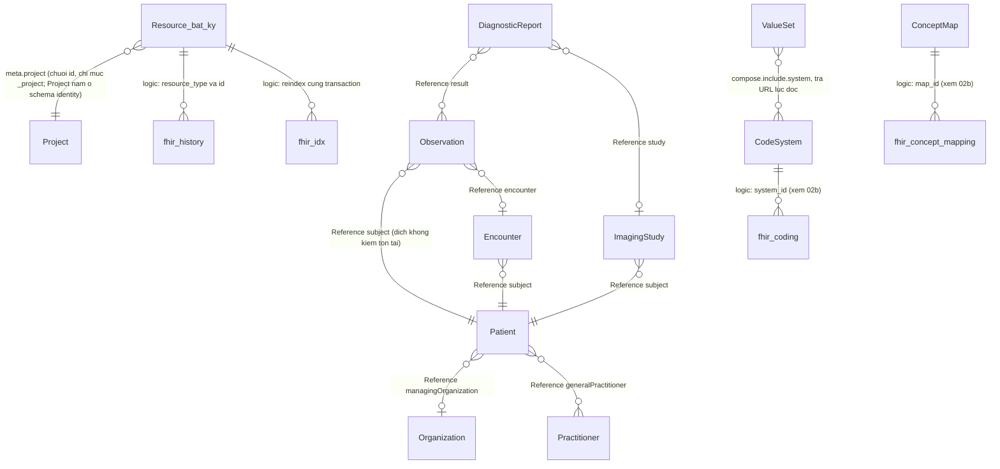
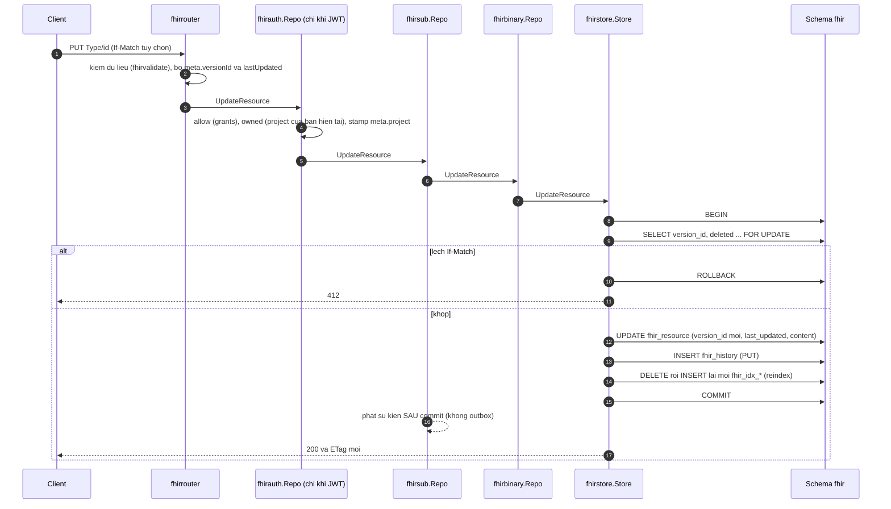
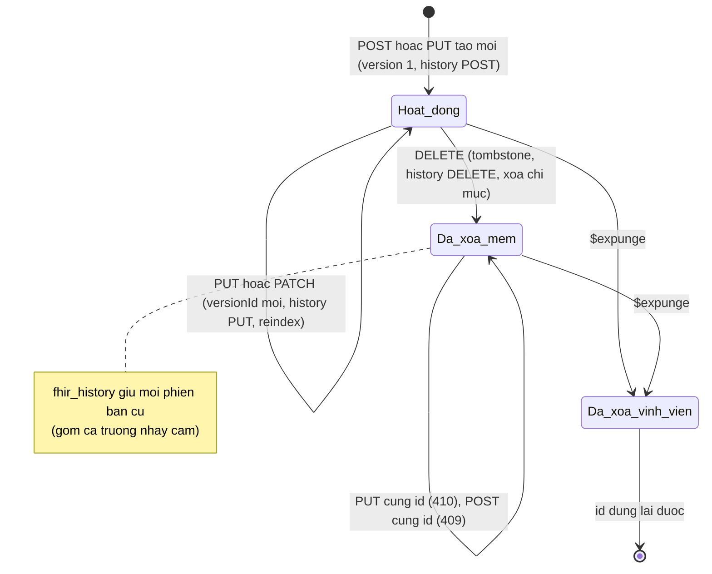
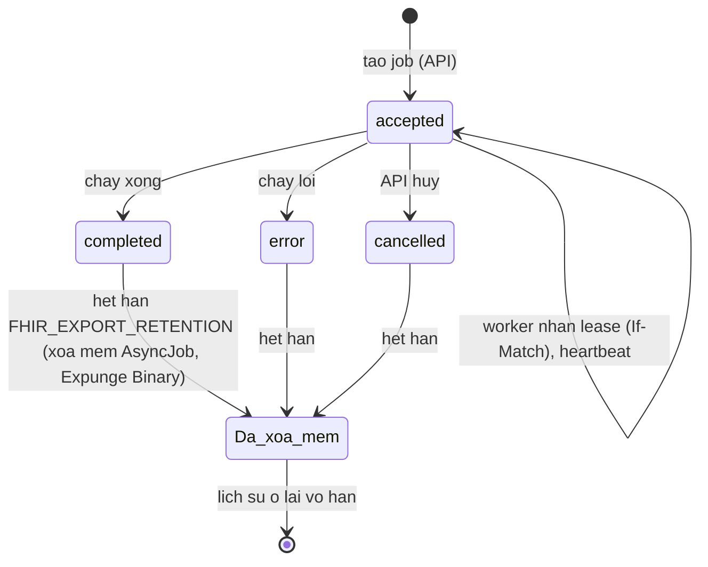

# 3. Quan hệ và toàn vẹn dữ liệu của fhir-server

**Không có khóa ngoại nào** trong schema `fhir`. Mọi quan hệ là *logic*: `Reference` trong JSON của resource (tra bằng `fhir_idx_reference` khi tham số tìm kiếm tương ứng tồn tại), chuỗi `meta.project`, hoặc id của resource cha ở bảng dẫn xuất ([02b](02b-tu-vung.md)). Toàn vẹn do **mã ứng dụng** và **transaction** của `pkg/fhirstore` giữ ([docs/erd/fhirstore-physical.md](../../../../docs/erd/fhirstore-physical.md) mục 2). Tài liệu này khác `auth` ở một điểm: `fhir-server` lưu **hàng trăm loại resource lâm sàng** của người dùng, nên quan hệ được mô tả theo **quy tắc chung** (Reference, compartment, project) thay vì từng cặp loại. Mô hình trường ở [02-mo-hinh-logic.md](02-mo-hinh-logic.md); AsyncJob và Binary ở [fhir-worker 03](../../../fhir-worker/docs/erd/03-quan-he-va-toan-ven.md) và [04-kho-khac.md](04-kho-khac.md).

**Kết luận ngắn (đã kiểm trong mã):**

1. **Không kiểm đích của `Reference` khi ghi.** Resource tham chiếu `Patient/khong-ton-tai` vẫn ghi được. Trường `Project.checkReferencesOnWrite` chỉ là một trường dữ liệu sinh sẵn của kiểu `Project` (`pkg/fhir/resource_project.go:55`), **không có dòng mã nào đọc nó** (grep `CheckReferencesOnWrite` ở `pkg` và `apps`: chỉ định nghĩa kiểu, schema sinh và swagger của auth). `fhirvalidate` ghi rõ "Chưa làm: ... kiểm tra đích của Reference" (`pkg/fhirvalidate/validate.go:5`). **Tham chiếu treo: KHÔNG CÓ cơ chế ngăn.**
2. **Xóa không lan truyền.** Không có cascade cho resource lâm sàng, không có `$delete` hay `$purge` (grep `cascade`, `$delete`, `$purge` ở `pkg/fhirrouter`, `pkg/fhirstore`, `apps/fhir-server`: không có kết quả). Cascade **duy nhất** nằm trong `Expunge` của `CodeSystem` và `ConceptMap` (xóa bảng dẫn xuất) và nội dung `Binary` ở kho đối tượng.
3. **Cô lập project chỉ ở tầng ứng dụng và chỉ khi bật JWT.** Không có row-level security, không có FK theo project; `fhirauth.Scope` bọc repository **chỉ khi `FHIR_JWT_ISSUER` được đặt** (`apps/fhir-server/internal/bootstrap/container.go:256-257`). Ở chế độ token tĩnh hoặc không xác thực **không có tách project nào**: mọi người gọi thấy mọi resource.
4. **`fhir_history` không bao giờ được dọn tự động**; xóa mềm giữ nguyên mọi phiên bản cũ; chỉ `$expunge` (quản trị) xóa vĩnh viễn.

## 3.1 Sơ đồ logic

Mũi tên là quan hệ **logic** (không FK). `Resource_bat_ky` đại diện **mọi** loại resource. `Project` không nằm trong schema `fhir`: nó là resource của `auth` ở schema `identity`; `fhir-server` chỉ thấy **chuỗi id** trong claim JWT `fhir_project` (cấu hình `FHIR_JWT_PROJECT_CLAIM`, `config.go:261`).

## 3.2 Bảng quan hệ

Cột **Toàn vẹn** nêu *ai kiểm và ở đâu*; **KHÔNG CÓ** nghĩa là đã grep và không thấy kiểm nào. **Khi xóa phía "đến"**: không có `ON DELETE`; cột nêu hành vi thực tế.

| Từ | Đến | Bản số | Cách nối | Bắt buộc | Toàn vẹn | Khi xóa phía "đến" | Bằng chứng |
|---|---|---|---|---|---|---|---|
| Trường `Reference` của mọi resource (vd `Observation.subject`) | resource đích (đích khai ở `Target` của tham số tìm kiếm, vd `subject` → Group, Device, Patient, Location) | n-1 (hoặc n-n khi trường là mảng) | chuỗi `reference` trong JSON; chỉ mục `fhir_idx_reference` (`raw`, `target` đã chuẩn hóa `Type/id`, `ref_type`, `ref_id`) với **mỗi tham số reference** của loại | theo cardinality R4 (`fhirvalidate` ép trường bắt buộc, không ép đích) | **KHÔNG CÓ**: không kiểm đích tồn tại, không kiểm đúng loại trong `Target`, không kiểm đích cùng project. `checkReferencesOnWrite` không được đọc | đích **xóa mềm**: tham chiếu **vẫn nằm trong JSON và trong chỉ mục** (treo); `_include` bỏ qua đích đã xóa; đích `$expunge`: treo vĩnh viễn | `pkg/fhirvalidate/validate.go:5`, `pkg/fhir/resource_project.go:55`, `pkg/fhirstore/search.go:642` (`deleted = false` khi lấy `_include`) |
| Tham chiếu dạng tuyệt đối hoặc có `_history` | đích cục bộ | n-1 | `NormalizeReference` **cắt tiền tố URL** và `/_history/<vid>`, giữ hai đoạn cuối nếu đoạn kế cuối là tên loại resource; `urn:` và `#` giữ nguyên | không | chuẩn hóa chuỗi, **không** kiểm host | URL của máy chủ khác như `https://khac/Patient/123` bị coi như `Patient/123` **cục bộ** | `pkg/fhirsearch/match.go:330-342` |
| Resource lâm sàng | `Patient` (compartment) | n-1 | **không có bảng**: tập tham số ở `fhir.PatientCompartment()` (vd Observation: `subject`, `performer`); thành viên tính lúc truy vấn bằng `OR` của `param = Patient/<id>` qua `fhir_idx_reference`; riêng `Patient` thêm chính nó (`_id`) | không | ép **khi đọc**: `_compartment` chỉ nhận đúng `Patient/<id>` hợp lệ, loại không thuộc compartment hoặc biểu thức rỗng thì **từ chối** (fail đóng). **Không ép khi ghi**: ghi Observation trỏ bệnh nhân khác vẫn được | xóa mềm resource: chỉ mục bị xóa nên **rời compartment**; xóa Patient: các resource con **vẫn còn và vẫn treo** | `pkg/fhir/compartment_gen.go:6`, `pkg/fhirsearch/compartment.go:17-47`; dùng ở `$everything` (`operation.go:212`), bulk export mức patient/group (`bulk.go:127,140,283,502`), chính sách truy cập `%patient` (`pkg/fhirauth/policy.go:145`) |
| Compartment ngoài `Patient` | (Encounter, Practitioner, RelatedPerson, Device) | | | | **KHÔNG CÓ**: chỉ có `patientCompartmentData` | | `pkg/fhir/compartment_gen.go` (một biến duy nhất); scope SMART `patient/` "chưa làm" (`pkg/fhirauth/principal.go`, `grants.go:88`) |
| `meta.project` của mọi resource | `Project` của `auth` | n-1 | **chuỗi id**, **có chỉ mục** dưới dạng tham số token `_project` (`fhir.ProjectParam`, `pkg/fhir/fhir.go:104`, expression `Resource.meta.project`; được `reindex` ghi vào `fhir_idx_token` vì `fhir.SearchParams` luôn có `_project` đầu tiên). Không có bảng Project ở schema `fhir` | có **khi bật JWT** (thiếu Principal hoặc project: `403`, không bao giờ mở) | **chỉ ở tầng ứng dụng**: `fhirauth.Repo` ghi đè `meta.project` bằng project của người gọi khi tạo và sửa (giá trị client gửi bị bỏ), đọc/vread/history/sửa/xóa/expunge của project khác trả `404`, tìm kiếm AND thêm `_project=<project>` và lọc lại kết quả và `_include` bằng `filterProject`. **KHÔNG CÓ** kiểm project tồn tại | xóa Project ở `auth`: resource của project **còn nguyên**, không ai dọn (không FK, không sự kiện) | `pkg/fhirauth/scope.go:13-26,138-185,204-228,356-407`; test `TestProjectIsolation`, `TestUpdateAsCreateAcrossProjects`, `TestReindexTypeStaysInsideCallerProject` (`scope_test.go:137,258,317`) |
| Tombstone (resource đã xóa mềm) | project cũ | n-1 | `content` của bản xóa chỉ `{resourceType, id, meta{versionId, lastUpdated}}`: **mất `meta.project`** (`DeleteResource` dựng `doc` rỗng rồi `stampDoc`) | | project của bản xóa suy từ **phiên bản còn nội dung bất kỳ** trong lịch sử (`ownedByHistory`) | đọc id đã xóa của project khác trả **410** thay vì 404 (lộ sự tồn tại của id, id là UUID ngẫu nhiên nên khó đoán) | `pkg/fhirstore/crud.go:184-209`, `scope.go:20-23,188-202` |
| Chuỗi tìm kiếm `?subject:Patient.name=...` và `_has` | resource đích của bước con | n-n | **không lưu**: chạy **sub-search** qua cùng repository rồi đổi thành điều kiện `_id`/reference thường; tối đa 5000 khớp mỗi bước, sâu 4 tầng | không | kế thừa tách project và quyền (sub-search đi qua repo đã bọc); kết quả là **ảnh chụp** thời điểm tìm, không nhất quán với ghi đồng thời | đích xóa mềm: sub-search bỏ qua (chỉ mục đã xóa) | `pkg/fhirrouter/chain.go:14-145` |
| `_include`, `_revinclude` | resource được kéo vào | n-n | `_include`: lấy tham chiếu từ kết quả chính theo tham số rồi `fetchByKeys` (theo `resource_type`, `id`, `deleted = false`); `_revinclude`: `EXISTS` trên `fhir_idx_reference` với `target IN (...)` | không | tầng SQL **không** lọc project; `fhirauth.Search` lọc `Included` bằng `filterProject`, `filterReadable`, `filterPolicy` sau khi lấy | đích xóa mềm: bị bỏ qua, không báo | `pkg/fhirstore/search.go:556-640`, `scope.go:395-405` |
| `GraphDefinition` (`$graph`) | resource đi theo link | 1-n | link có `path` (FHIRPath trả Reference hoặc URL canonical) hoặc `params` (tìm kiếm với `{ref}`); tối đa 1000 resource và 5 tầng | không | đi qua repository (tách project, quyền) | bỏ qua đích không đọc được | `pkg/fhirrouter/graph.go:1-40` |
| `fhir_resource` | `fhir_history`, `fhir_idx_*` (bảy bảng) | 1-n | khóa logic `(resource_type, id)`; không FK | có | **một transaction** (`inTx`): ghi `fhir_resource` + `fhir_history` + xóa-ghi lại chỉ mục; không có FK nên SQL tay ngoài `fhirstore` làm lệch được | xóa mềm: chỉ mục **xóa**, history **thêm** dòng `DELETE`; `Expunge`: xóa cả ba (cùng transaction) | `pkg/fhirstore/crud.go:71-209,519-550` |
| `CodeSystem` | `fhir_coding`, `fhir_coding_property`, `fhir_coding_designation` | 1-n | `system_id` = id CodeSystem | không | `$import` kiểm concept có trước khi ghi thuộc tính, designation (`requireCodes`); không có FK | xóa mềm: **bảng dẫn xuất còn nguyên**; `Expunge`: **xóa theo `system_id`** (cascade duy nhất) | `crud.go:538-542`, [02b mục 2b.4](02b-tu-vung.md) |
| `ConceptMap` | `fhir_concept_mapping` | 1-n | `map_id` = id ConceptMap | không | như trên | như trên (`Expunge` xóa) | `crud.go:543-547` |
| `ValueSet.compose.include.system`, `.valueSet` | `CodeSystem`, `ValueSet` | n-n | **URL canonical** tra lúc đọc (`findByURL`), không lưu id | không | **KHÔNG CÓ** lúc ghi; lúc đọc không thấy thì `422` | đích bị xóa hoặc đổi `url`: ValueSet **vỡ** (`422 "CodeSystem không có trên server"`) mà không ai báo lúc xóa | `pkg/fhirrouter/terminology.go:401-420` |
| `Binary` | blob ở kho đối tượng | 1-n (mỗi phiên bản một khóa `binary/<id>/<versionId>`) | khóa suy từ id và versionId | có khi bật kho | CSDL trước, kho sau; lỗi kho thì bù trừ | xóa mềm **không** xóa blob; `Expunge` xóa blob (sau commit) | `pkg/fhirbinary/wrap.go:195-225`, chi tiết ở [04](04-kho-khac.md) |
| `AsyncJob` | `Binary` kết quả, `Binary` đầu vào, `Binary` đoạn | 1-n | id trong JSON của job | theo kiểu job | **xem [fhir-worker 03](../../../fhir-worker/docs/erd/03-quan-he-va-toan-ven.md)** (không lặp ở đây) | job hết hạn: **xóa mềm** `AsyncJob`, `Expunge` các `Binary` | `pkg/fhirrouter/jobs_maint.go:146,224` |
| Ghi resource | sự kiện Redis | 1-1 | `fhirsub.Wrap` phát **sau commit** | không | **không có outbox**: chết hoặc mất Redis đúng sau commit thì mất sự kiện; transaction Bundle gom sự kiện rồi phát sau commit | không áp dụng | `pkg/fhirsub/repo.go:98-118` |

Hai điều cần nói thẳng về bản số: Reference trong JSON **không có cận trên** về số resource trỏ vào một đích (không giới hạn "một Patient có tối đa N Observation"), và **không có ràng buộc duy nhất** nào ngoài `(resource_type, id)` (kể cả `url` của CodeSystem, ValueSet, `identifier` của Patient); tính duy nhất nghiệp vụ chỉ có thể bảo đảm bằng `If-None-Exist` (mục 3.3).

## 3.3 Luật toàn vẹn, đồng thời và transaction

### Đường ghi một resource

Mọi ghi đi qua **bốn lớp bọc** rồi tới `Store`: `fhirauth.Scope` (chỉ khi JWT) → `fhirsub.Wrap` (nếu có broker) → `fhirbinary.Wrap` (nếu bật kho Binary) → `fhirstore.Store` (`container.go:179-257`). Ba hành vi riêng của `Store`:

| Thao tác | Điều kiện | Kết quả | Bằng chứng |
|---|---|---|---|
| `Create` (POST) | `INSERT ... ON CONFLICT (resource_type, id) DO NOTHING`; số dòng ghi = 0 | `409 Conflict`, **kể cả khi dòng đã xóa mềm** (id xóa mềm **không dùng lại được** cho tới khi `Expunge`) | `crud.go:104-110`, `crud.go:89-91` |
| `Update` (PUT, PATCH) | `SELECT version_id, deleted ... FOR UPDATE` (PostgreSQL); không có dòng: `404`; đã xóa: `410`; `If-Match` lệch: `412` | UPDATE `fhir_resource` + INSERT `fhir_history` (`PUT`) + reindex, **mọi lần ghi sinh `versionId` mới và một dòng lịch sử, kể cả khi nội dung không đổi** (không có so sánh nội dung) | `crud.go:123-182` |
| `Delete` | khóa dòng như trên; không có: `404`; đã xóa: `410` (router đổi thành `204`, xóa lặp lại idempotent) | UPDATE thành tombstone (`deleted = true`, nội dung rút gọn), INSERT `fhir_history` (`DELETE`), xóa chỉ mục | `crud.go:184-209`, `handlers.go:delete` |

- **`versionId` và `lastUpdated`** do `Store` sinh: UUID v4 mới ở **mỗi** lần ghi và thời điểm UTC mili giây dạng chuỗi; giá trị client gửi trong `meta` bị bỏ (`handlers.go:createWithID`, `crud.go:149-152`). `id` ở `POST` cũng do server cấp (id client gửi bị bỏ).
- **Mức cô lập**: `BeginTx(ctx, nil)` nên là mức mặc định của driver (PostgreSQL: `READ COMMITTED`). Sự an toàn khi cập nhật đồng thời đến từ `FOR UPDATE` cộng `If-Match`, không từ mức cô lập (chưa kiểm bằng cấu hình cụm).
- **Mặc định không bắt buộc `If-Match`**: không có `If-Match` thì ghi **ghi đè theo thứ tự đến** (last write wins). Không có cấu hình bắt buộc điều kiện (grep `If-Match` ở `config.go`: không có).
- **Kiểm dữ liệu khi ghi**: `fhirvalidate` (cấu trúc, cardinality, kiểu nguyên thủy, invariant FHIRPath) trừ khi `FHIR_SKIP_VALIDATION` (bỏ tất cả) hoặc `FHIR_SKIP_CONSTRAINTS` (bỏ invariant); **không kiểm Reference, profile, binding terminology**.

### Điều kiện, tranh chấp và trùng lặp

| Luật | Cơ chế | Bằng chứng |
|---|---|---|
| `If-Match` chống ghi đè mù | so bằng với `version_id` hiện tại (đã bỏ `W/"..."`), lệch thì `412` trong cùng transaction với khóa dòng | `crud.go:142-160`, `handlers.go:parseIfMatch`; test `ConcurrentIfMatch` (`repotest/suite.go:1830`) |
| `If-None-Exist` (tạo có điều kiện) không tạo trùng khi đồng thời | `withKeyLock` mở **một transaction** và lấy khóa tư vấn theo `if-none-exist:<loại>?<tiêu chí>` (PostgreSQL: `pg_advisory_xact_lock(hashtextextended(key, 0))`; SQLite: một lệnh ghi rỗng để chiếm khóa ghi); khi bật JWT khóa thêm tiền tố project nên hai project **không** chặn nhau; một khớp: `200` trả resource sẵn có, không khớp: tạo, nhiều khớp: `412` | `handlers.go:166-218`, `store.go:118-132`, `scope.go:474-484`; test `ConcurrentConditionalCreate`, `TwoReplicasConditionalCreateDoesNotDuplicate` (`replicas_e2e_test.go:149`) |
| PUT có điều kiện (`PUT Type?tiêu chí`) | cùng cơ chế khóa với khóa riêng `conditional-update:<loại>?<tiêu chí>` | `handlers.go:344`; test `ConcurrentConditionalUpdate` |
| DELETE/PATCH có điều kiện | **không khóa** (tìm rồi xóa/sửa; xóa lặp lại idempotent, `410` và `404` coi là đạt mục tiêu) | `handlers.go:conditionalDelete`; test `ConcurrentConditionalDelete` |
| Update-as-create (`PUT Type/id` khi chưa có) | **tắt mặc định** (`FHIR_UPDATE_AS_CREATE=false`: `404`); bật thì id phải khớp `^[A-Za-z0-9\-.]{1,64}$`; không tạo lại id đã xóa (`410`); đua giữa hai PUT: bên thua thấy `409` rồi cập nhật bản vừa tạo; id bị project khác chiếm trả `404` như không tồn tại | `handlers.go:308-340`; test `ConcurrentUpdateAsCreate`, `TestUpdateAsCreateAcrossProjects` |
| Tạo trùng id | khóa chính `(resource_type, id)` | `409` (không có chọn lựa nào khác để ép duy nhất nghiệp vụ như `identifier`) | `crud.go:104-110` |

### Batch và transaction Bundle

| | `batch` | `transaction` |
|---|---|---|
| Nguyên tử | **Không**: mỗi entry là một request độc lập (`runEntry`), lỗi thành `response` của entry; entry trước không hoàn tác | **Có**: toàn Bundle trong **một** transaction SQL (`RunInTransaction`); lỗi ở entry nào thì **hủy tất cả** và trả `OperationOutcome` với `Bundle.entry[i]` |
| Thứ tự | theo thứ tự xuất hiện | `DELETE` → `POST` → `PUT`/`PATCH` → `GET` (theo đặc tả) |
| Tham chiếu `urn:uuid` | **không** thay | thay bằng `Type/id` đã cấp sẵn (`rewriteRefs`); POST không điều kiện dùng **id cấp sẵn** |
| `ifNoneExist` | qua `Handle` như request thường (có khóa tư vấn) | **bước tiền xử lý** `conditionalMatches` **không** gọi `LockKey` (`batch.go:189-199`): hai transaction đồng thời cùng tiêu chí có thể cùng thấy "chưa có" và cùng tạo (suy từ mã, **chưa tái hiện bằng test**) |
| Sự kiện | phát từng entry sau commit của entry đó | `fhirsub` **gom và phát sau commit** của cả Bundle (`repo.go:98-118`) |
| Giới hạn | 16 MiB body (`MaxBodyBytes`); **không có trần số entry** (grep `MaxEntries`: không có) | như batch; transaction dài giữ khóa dòng của mọi resource chạm tới |
| Async | `Prefer: respond-async` với `FHIR_ASYNC_BATCH` thành `AsyncJob` (xem [fhir-worker 03](../../../fhir-worker/docs/erd/03-quan-he-va-toan-ven.md)) | **không** chạy async (`400`) |

Test: `repotest` `Batch`, `TransactionUUIDReferences`, `TransactionRollback` (`suite.go:601`), `TransactionOrderAndConditional`, `TransactionRequiresTransactionalRepo`; `TestPackageInstallFailedEntryMarksErrorAndTransactionRollsBack` (`packageinstall_test.go:76`).

### Ghi lại chỉ mục (`reindex`)

- **Mỗi ghi** (`Create`, `Update`) gọi `reindex`: xóa **toàn bộ** dòng `fhir_idx_*` của resource rồi chèn lại theo mọi tham số tìm kiếm của loại (kể cả `_project` và các tham số `composite` ghi theo thành phần). Xóa mềm chỉ xóa (không ghi lại). `crud.go:344-420`.
- **`POST {Type}/$reindex`** chạy nền thành `AsyncJob` (`202`), **`POST {Type}/{id}/$reindex`** chạy đồng bộ một resource; quản trị (`RoleAdmin`, `httpapi/auth.go:101`). `Store.Reindex` duyệt `fhir_resource WHERE deleted = false` theo id, **lô 200 resource mỗi transaction**, bỏ resource đã xóa mềm. Bọc `fhirauth` thì chỉ reindex resource của project người gọi (liệt kê id rồi reindex từng cái, chậm hơn) và **từ chối** khi có chính sách truy cập. `crud.go:459-517`, `scope.go:487-537`.
- **Không có reindex tự động** khi định nghĩa tham số tìm kiếm đổi (không thấy mã nào kích hoạt `$reindex` khi ghi `SearchParameter`): người vận hành phải gọi tay.

### Xóa mềm so với `Expunge`; chính sách giữ lịch sử

| | Xóa mềm (`DELETE`) | `Expunge` (`POST {Type}/{id}/$expunge`) |
|---|---|---|
| `fhir_resource` | giữ dòng, `deleted = true`, nội dung rút gọn | **xóa dòng** |
| `fhir_history` | **thêm** một dòng `DELETE`; mọi phiên bản cũ **giữ nguyên nội dung** | **xóa mọi dòng** của resource |
| `fhir_idx_*` | xóa | xóa |
| Id | không dùng lại được (`POST` cùng id: `409`, `PUT`: `410`) | dùng lại được |
| Bảng dẫn xuất | giữ | xóa nếu là `CodeSystem`/`ConceptMap` |
| Kho Binary | giữ blob | xóa blob (sau commit) |
| Ai làm được | quyền `delete` theo loại | admin (HTTP `RoleAdmin`); với JWT còn cần quyền delete, **không có chính sách truy cập**, và resource thuộc project của người gọi (`ownedByHistory`); `404` nếu chưa từng có |
| Bằng chứng | `crud.go:184-209` | `crud.go:519-550`, `scope.go:562-581`, `operation.go:322-332`; test `Expunge` (`suite.go:885`) |

**Chính sách giữ lịch sử: KHÔNG CÓ.** Không có tác vụ nào tự cắt `fhir_history` (grep `DELETE FROM fhir_history`: chỉ `Expunge`; không thấy `retention` ở `pkg/fhirstore`). Tự động xóa vĩnh viễn trong mã chỉ có hai nơi và **cả hai đều qua `Expunge`**: nội dung `Binary` kết quả job hết hạn (`jobs_maint.go:146`) và tệp mồ côi (`sweep-binary`); `AsyncJob` hết hạn chỉ **xóa mềm** (`jobs_maint.go:224`) nên lịch sử của job ở lại vô hạn (chi tiết ở [fhir-worker 03](../../../fhir-worker/docs/erd/03-quan-he-va-toan-ven.md) mục 3.4).

## 3.4 Vòng đời

### Resource

Không có đường **khôi phục** từ `Da_xoa_mem` về `Hoat_dong`: `UpdateResource` trả `410` cho dòng đã xóa (`current`), `CreateResource` trả `409`; muốn lấy lại nội dung phải đọc `_history/<vid>` rồi `Expunge` và tạo lại (mất lịch sử), hoặc không làm gì.

### AsyncJob

Trạng thái và chi tiết lease, heartbeat, hủy, hết hạn nằm ở [fhir-worker 03](../../../fhir-worker/docs/erd/03-quan-he-va-toan-ven.md); tóm tắt theo `pkg/fhirrouter/jobs.go`:

## 3.5 Rủi ro (từ mã, chưa sửa)

| # | Rủi ro | Mức | Bằng chứng, ghi chú |
|---|---|---|---|
| 1 | **Tham chiếu treo là bình thường**: ghi không kiểm đích; xóa không lan truyền; `Patient` bị xóa để lại mọi Observation, Encounter... của họ (vẫn trong compartment tính theo chỉ mục tham chiếu, còn đọc được qua `Observation?subject=Patient/<id>`) | cao (an toàn dữ liệu lâm sàng) | 3.2 dòng đầu; không có `checkReferencesOnWrite`, `$delete`, cascade |
| 2 | **`checkReferencesOnWrite` là cờ chết**: người quản trị bật trường này trên `Project` (kiểu có sẵn) sẽ **tin rằng** có kiểm tham chiếu khi ghi, nhưng `fhir-server` **không đọc** cờ | cao (kỳ vọng sai) | `pkg/fhir/resource_project.go:55`; `fhirvalidate` ghi "Chưa làm" |
| 3 | **Cô lập project chỉ ở tầng ứng dụng, chỉ khi bật JWT**: token tĩnh và không xác thực **không tách gì**; không có RLS hay FK. Lỗi trong một đường mã không đi qua `fhirauth.Repo` làm lộ chéo project: job nền giữ một repo **không tách** (`jobRepo`, `container.go:184`) và chỉ các job có phạm vi (`$reindex`, bulk export) chạy qua `ScopedJobRepository` (`container.go:256`) với Principal dựng lại từ `AsyncJob.meta.project`. Dữ liệu ghi trước khi bật JWT **không có `meta.project`** nên không ai thấy | cao | `scope.go:13-26`, `container.go:256-257` |
| 4 | **`_include` lấy chéo project ở tầng SQL** rồi mới lọc ở ứng dụng (`filterProject`); đúng nhưng phụ thuộc lớp lọc không bị bỏ | trung bình | `search.go:556-640`, `scope.go:395-405` |
| 5 | **Tuổi thọ `fhir_history`**: mỗi ghi một dòng (kể cả không đổi nội dung), xóa mềm giữ phiên bản cũ mọi trường, **không dọn tự động**. Dữ liệu lâm sàng nhạy cảm (S3) ở lại vĩnh viễn trừ khi `Expunge` từng resource (không có API hàng loạt); không có cơ chế "quyền được quên" ngoài `Expunge` thủ công. `AsyncJob` ghi nhiều lần mỗi job (3 đến 8 phiên bản đã đo ở worker) | cao (dung lượng, tuân thủ) | 3.3 mục "Chính sách giữ lịch sử" |
| 6 | **Tombstone mất `meta.project`**; đọc id đã xóa của project khác trả `410` (lộ sự tồn tại của id) | thấp (id UUID ngẫu nhiên) | `crud.go:184-209`, `scope.go:20-23` |
| 7 | **Transaction Bundle: `ifNoneExist` không khóa**, hai transaction đồng thời có thể tạo trùng | trung bình (suy từ mã, chưa tái hiện) | `batch.go:189-199` |
| 8 | **Không bắt buộc `If-Match`**: ghi không điều kiện là last-write-wins; `PUT` lặp không đổi vẫn sinh phiên bản | trung bình | `crud.go:142-182` |
| 9 | **Không trần số entry** của Bundle (chỉ 16 MiB): transaction rất lớn giữ khóa dòng lâu | thấp đến trung bình | `http.go:16`, `httpapi.go:94` |
| 10 | **Tham chiếu tuyệt đối bị coi là cục bộ** (`https://khac/Patient/123` thành `Patient/123`) làm sai kết quả tìm theo reference | thấp | `match.go:330-342` |
| 11 | **`Expunge` đua với `Update`**: `Expunge` đếm rồi xóa `fhir_history` **không khóa dòng**; một `Update` đang commit giữa chừng có thể để lại dòng lịch sử không còn `fhir_resource` (suy từ thứ tự lệnh, **chưa tái hiện**) | thấp | `crud.go:519-537` |
| 12 | **Sự kiện mất khi Redis lỗi sau commit** (không outbox) | trung bình | `pkg/fhirsub/repo.go:98-118`, README điểm 4 |
| 13 | **Bảng dẫn xuất terminology không bị dọn khi xóa mềm** CodeSystem/ConceptMap; `ValueSet` vỡ khi CodeSystem biến mất | thấp | [02b mục 2b.4](02b-tu-vung.md) |

## 3.6 Chưa kiểm

- Chưa chạy tìm kiếm hay truy vấn thật trên PostgreSQL để xác nhận `fhir_idx_token` có dòng `code = '_project'` (suy từ `indexedParams` và `fhir.SearchParams`; chứng cứ gián tiếp: `fhirauth.Search` lọc theo `_project` và test cô lập project qua kho SQL).
- Chưa tái hiện bằng test các đua ở mục 3.5 số 7 và 11.
- Chưa đo kích thước `fhir_history` hay tốc độ tăng ở môi trường thật.
- Mức cô lập transaction suy từ `BeginTx(ctx, nil)` và mặc định driver, chưa đọc cấu hình cụm PostgreSQL.
- Chưa render Mermaid.
