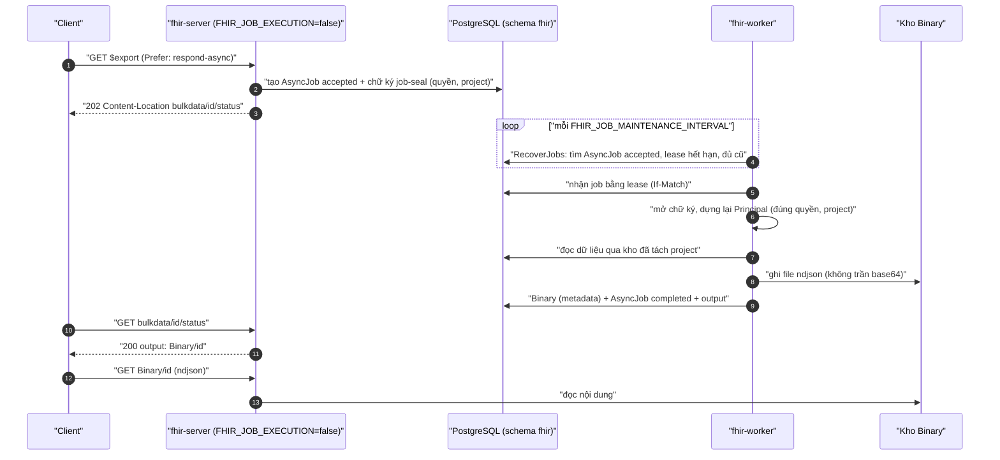

# fhir-worker: kiến trúc

## Vì sao tách

Theo mục 1 của [service-principles.md](../../../docs/service-principles.md). Đã thử bậc rẻ hơn (cùng binary với cờ `FHIR_JOB_EXECUTION=false` của `fhir-server`, có từ bước S1; giữ `FHIR_JOB_CONCURRENCY` thấp) và chọn bậc 3 theo quyết định D-SP-1 của người dùng (2026-11-24), **khi bằng chứng cho điều kiện A còn yếu** (đây là việc "cuối và có thể hoãn" trong kế hoạch).

| Điều kiện | Có không | Bằng chứng |
|---|---|---|
| A. Hồ sơ tải khác | **Chưa chứng minh, có dấu hiệu** | Đo S4 (một máy dev, mỗi cấu hình một lần): một export ở 200.000 resource: p95 API x1,02, p99 x1,02, thông lượng x0,97, API không bị ảnh hưởng (PostgreSQL đã gần bão hòa bởi chính tải API); bốn export đồng thời (50.000 resource, job concurrency 4): p95 x1,35, p99 x1,48 (sát ngưỡng 1,5), thông lượng x0,76, RSS server 395 MB so với 71 MB. Chưa đo máy riêng và resource lớn |
| B. Dữ liệu hoặc bí mật riêng | **Không** | dùng chung schema `fhir` và kho Binary (D-DW-1, D-SP-8). Bí mật cần: `FHIR_JOB_SIGNING_KEY` dùng chung với `fhir-server` (không cần JWKS, khóa token websocket, tải attachment) |
| C. Miền lỗi, vòng đời deploy | **Có một phần** | job export giữ bộ nhớ đỉnh hàng trăm MB và nhiều kết nối DB trong tiến trình API; deploy API làm dừng job đang chạy (phải tiếp quản bằng lease). Tách ra thì API không chạy job và deploy API không động tới job |
| D. Đội khác | không | |

Hệ quả phải nói thẳng: nếu chỉ lo API bị chậm khi nhiều export, đặt `FHIR_JOB_CONCURRENCY` thấp ở `fhir-server` rẻ hơn tách service; `fhir-worker` đáng giá khi cần scale job độc lập, cô lập bộ nhớ hoặc chạy job trên máy khác API.

## Luồng

## Nhận job

`fhir-server` không có bộ chạy job nên mọi `AsyncJob` ở `accepted`; `fhir-worker` nhận chúng qua vòng bảo trì của `Router` (`RecoverJobs`) mỗi `FHIR_JOB_MAINTENANCE_INTERVAL` (mặc định 5 giây), chỉ nhận job đủ cũ (`FHIR_JOB_RECOVERY_GRACE`, mặc định 2 giây). Nhiều worker cùng thấy một job; **lease** trong CSDL (`AsyncJob.transactionTime`, ghi bằng `If-Match`, tự gia hạn khi job còn chạy) bảo đảm đúng một bên chạy. Worker chết giữa chừng thì lease hết hạn (`FHIR_JOB_LEASE`, mặc định 5 phút) và worker khác tiếp quản; tắt êm thì job nhả lease ngay. Độ trễ nhận job tối đa ≈ chu kỳ + grace; chưa có hàng đợi đẩy (có thể thêm `asynq` sau, adapter đã có chưa nối).

## Quyền của job (job-seal)

Khi `fhir-server` bật JWT, mỗi job mang chữ ký (HMAC bằng `FHIR_JOB_SIGNING_KEY`) của ảnh chụp quyền người gọi: project, vai trò, scope, AccessPolicy. Worker mở chữ ký, từ chối job có chữ ký sai (đánh dấu lỗi, không chạy, không để lại kết quả) và chạy bằng đúng quyền đó qua `fhirauth.Scope`. Khóa **phải trùng** `fhir-server`; xoay khóa chưa có cơ chế khóa cũ cho job (job đang chờ khi xoay khóa sẽ bị từ chối). Chế độ token tĩnh (không JWT): job chạy không tách project như `fhir-server` ở chế độ đó.

## Kết quả ra kho đối tượng (P0-2)

Trước S5, file kết quả export (tới 8 MiB mỗi file) và đầu vào, đoạn kết quả của batch async nằm **base64 trong CSDL**: chuyển job sang service khác không giảm tải DB và CSDL phình theo `FHIR_EXPORT_RETENTION`; xóa hết hạn chỉ là xóa mềm nên nội dung không bao giờ được giải phóng. Nay, khi có `FHIR_BINARY_STORAGE`, kết quả job đi vào kho **không trần base64** (cả `fhir-server` lẫn `fhir-worker`), `GET Binary/{id}` ở API đọc từ kho, và xóa kết quả hết hạn dùng **Expunge** (xóa hẳn dòng, lịch sử và tệp ở kho) khi repository cho phép. Không có kho thì như cũ (base64 trong CSDL).

## Lắp ráp (`internal/bootstrap`)

| Thành phần | Chi tiết |
|---|---|
| DB | `pkg/database` với schema `fhir`; **không migrate**: `fhirstore.Pending > 0` thì từ chối khởi động |
| Router | `fhirrouter.New` với cùng tuỳ chọn job như `fhir-server` (JobRepository, ScopedJobRepository, JobOpen, lease, bảo trì, retention, batch), không phục vụ route HTTP nào |
| Kho Binary | tùy chọn (`FHIR_BINARY_STORAGE`), phải trùng `fhir-server` khi API dùng kho; `BinaryContent` đọc Bundle đầu vào và đoạn kết quả của batch đã ra kho |
| Phát sự kiện | khi `FHIR_SUBSCRIPTIONS` hoặc `FHIR_AUTO_DOWNLOAD` bật (cùng điều kiện với `fhir-server`): broker Redis chỉ Publish, để batch async ghi resource thì `fhir-notifier` và `fhir-downloader` thấy |
| Probe | `/healthz`, `/health/live`, `/health/startup` (không phụ thuộc ngoài); `/health/ready` kiểm database, 503 khi đang tắt |
| Dừng | Router dừng đầu tiên (job nhả lease), rồi broker, kho, DB |

Không import `apps/fhir-server` (C-1). Hợp đồng dây với `fhir-server`: schema `fhir` (`AsyncJob` và trạng thái job), chữ ký job-seal (`pkg/fhirauth.Sealer`, có phiên bản `sealVersion`), địa chỉ `FHIR_BASE_URL` trong URL kết quả.

## Đánh đổi và giới hạn

- **Giai đoạn chuyển**: nếu `fhir-server` còn chạy job (`FHIR_JOB_EXECUTION=true`, mặc định) cùng lúc, hai bên tranh job qua lease (an toàn, không chạy trùng) nhưng API vẫn gánh một phần tải; tắt ở API ngay khi bật service này.
- **Độ trễ nhận job**: tới vài giây (chu kỳ nhận job và grace) thay vì ngay lập tức.
- **Tuỳ chọn router phải đồng bộ**: `FHIR_SKIP_VALIDATION`, `FHIR_SKIP_CONSTRAINTS`, `FHIR_UPDATE_AS_CREATE`, `FHIR_BASE64_BINARY_MAX_BYTES`, `FHIR_BASE_URL`, `FHIR_STORAGE_BASE_URL` lệch giữa hai service làm batch async hành xử khác API (không có test phát hiện lệch giữa hai service).
- **Kết quả batch không có URL ký**: `fhir-server` có `ResponseHook` viết lại tham chiếu `Binary/<id>` thành URL ký trong phản hồi; worker không có khóa ký `/storage` nên kết quả batch giữ tham chiếu `Binary/<id>`.
- **Chạy chung kho `$reindex` cả loại** theo project (đã sửa ở S0): chậm hơn reindex cả loại trên mọi project (liệt kê rồi reindex từng resource).
- **Không có số đo riêng** cho worker (thông lượng job, bộ nhớ đỉnh khi tách); xem kết quả S4 ở kế hoạch (đo khi job chạy cùng tiến trình với API).
- Xoay khóa job-seal chưa có khóa cũ; job đang chờ lúc xoay bị từ chối.
