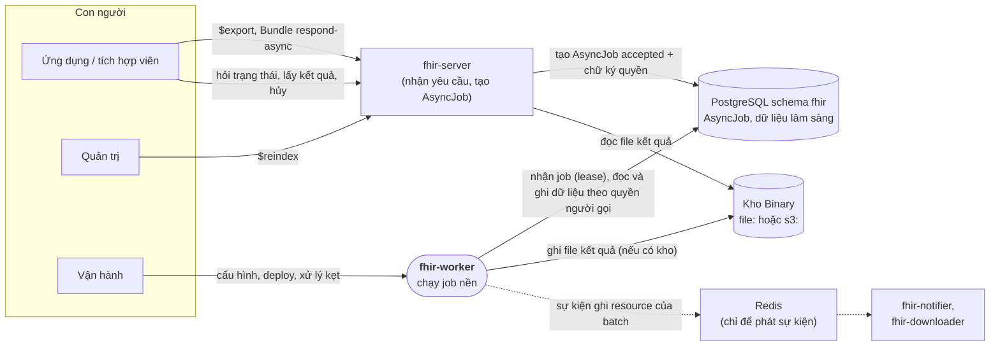
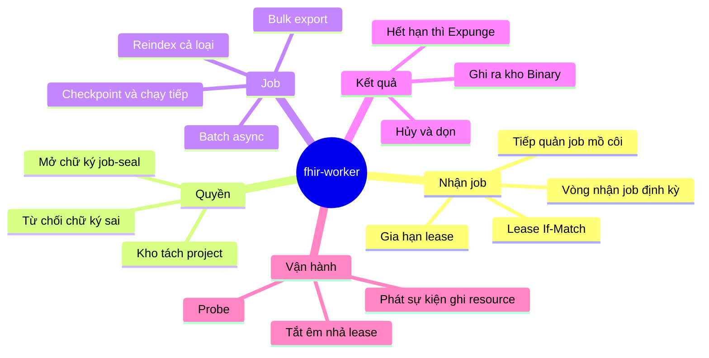
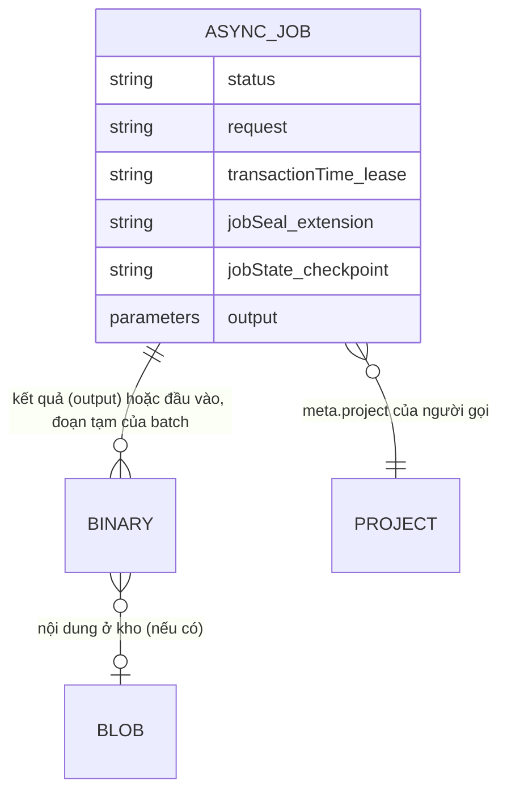
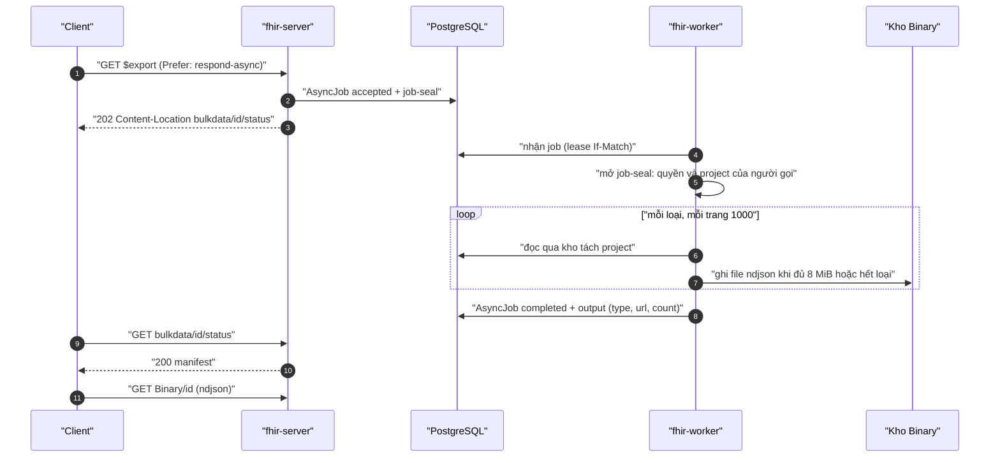
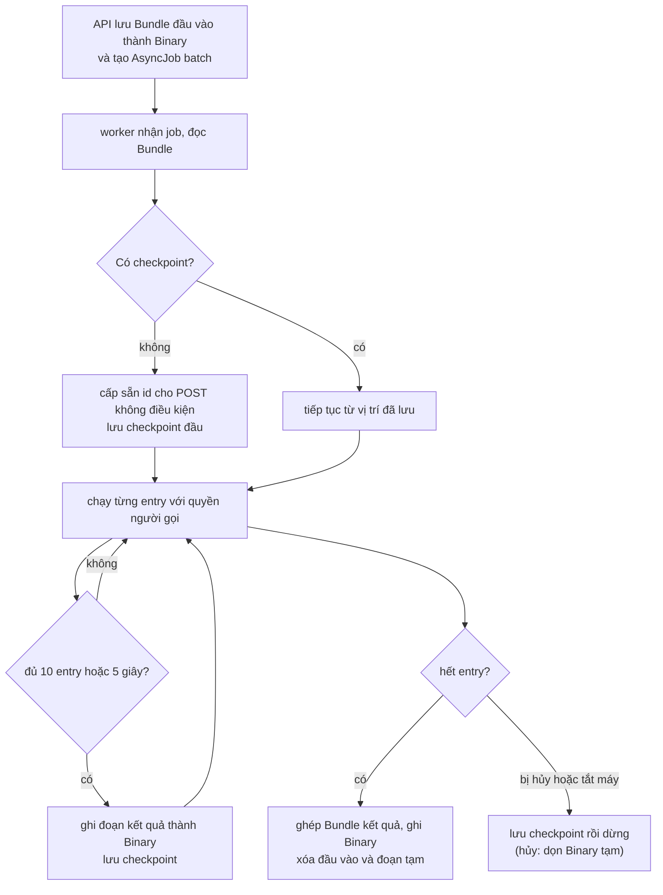
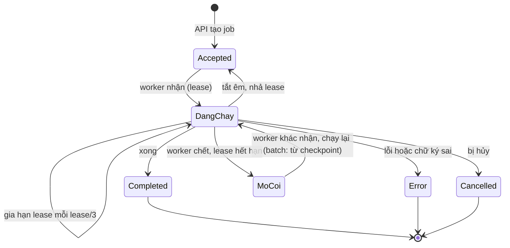

# 1. Tổng quan nghiệp vụ và luồng nghiệp vụ

## 1.1 Mục tiêu và giá trị

`fhir-worker` chạy **các việc dài** mà `fhir-server` nhận bằng `Prefer: respond-async` hoặc qua `$reindex` cả loại: kéo dữ liệu ra tệp (bulk export), chạy lại một Bundle lớn (batch async), lập lại chỉ mục tìm kiếm của cả một loại resource. API chỉ nhận yêu cầu, tạo bản ghi `AsyncJob` rồi trả `202`; việc nặng nằm ở service này.

| Giá trị | Cách đạt được |
|---|---|
| API không gánh việc nặng | `fhir-server` đặt `FHIR_JOB_EXECUTION=false`: chỉ tạo job, không chạy |
| Việc nặng không mất khi deploy hoặc chết giữa chừng | lease trong CSDL; tắt êm nhả lease; worker khác tiếp quản; batch chạy tiếp từ checkpoint |
| Đúng quyền và đúng tổ chức | chữ ký quyền của người gọi (job-seal); job chạy qua kho tách project |
| Dữ liệu kết quả không làm phình CSDL | kết quả ra kho Binary (nếu có), xóa hết hạn bằng Expunge |
| Mở rộng ngang | nhiều worker cùng một CSDL, mỗi job chạy đúng một lần (lease) |

## 1.2 Ranh giới hệ thống

**Fhir-worker làm:** nhận `AsyncJob` ở trạng thái `accepted`, mở chữ ký quyền, chạy job (export, reindex, batch), gia hạn lease, ghi kết quả hoặc lỗi, xóa kết quả hết hạn, phát sự kiện ghi resource.
**Fhir-worker không làm:** nhận yêu cầu của người dùng (không có route nghiệp vụ), xác thực token (không kiểm JWT), tạo job, cấp URL ký cho client (API làm), migrate schema (`fhir-server` sở hữu), giao webhook hay tải attachment (hai service khác).

## 1.3 Tác nhân

| Mã | Tác nhân | Là ai | Xác thực bằng | Việc chính |
|---|---|---|---|---|
| A1 | **Ứng dụng client** | Gọi `$export` hoặc gửi Bundle `respond-async` | token (JWT hoặc tĩnh) ở `fhir-server` | Tạo job, hỏi trạng thái, tải kết quả, hủy |
| A2 | **Quản trị** | Token ADMIN gọi `$reindex` | token ở `fhir-server` | Tạo job reindex cả loại |
| A3 | **Vận hành** | SRE | quyền máy chủ | Bật `fhir-worker`, đặt cấu hình trùng API, xử lý job kẹt |
| A4 | **fhir-server** | API | không áp dụng | Tạo `AsyncJob` kèm chữ ký quyền; đọc trạng thái và file kết quả |
| A5 | **Worker khác** | Replica của `fhir-worker` | cùng CSDL | Tranh job bằng lease; tiếp quản khi worker chết |
| A6 | **fhir-notifier, fhir-downloader** | Service nghe sự kiện | Redis | Nhận sự kiện ghi resource của batch async |

## 1.4 Bản đồ năng lực

## 1.5 Thuật ngữ

| Thuật ngữ | Nghĩa nghiệp vụ |
|---|---|
| **AsyncJob** | Resource lưu ở schema `fhir` mô tả một job: `status` (`accepted`, `completed`, `error`, `cancelled`), `request` (`<loại>?<tham số>`), chữ ký quyền, lease, kết quả (`output`) |
| **Lease** | Quyền chạy một job trong một khoảng (`FHIR_JOB_LEASE`, mặc định 5 phút), lưu ở `AsyncJob.transactionTime`; hết hạn thì worker khác được nhận |
| **Heartbeat** | Goroutine theo dõi job đang chạy: gia hạn lease mỗi lease/3 và kiểm job có bị hủy không mỗi `FHIR_JOB_CANCEL_POLL` (mặc định 2 giây, hai nhịp tách nhau từ 2026-11-24) |
| **Job-seal** | Chuỗi ký (HMAC, `FHIR_JOB_SIGNING_KEY`) gắn lên job lúc tạo, mang ảnh chụp quyền của người gọi; ràng buộc mã job, project và nội dung `request` |
| **Checkpoint** | Trạng thái chạy dở lưu trên `AsyncJob` (batch async) để chạy tiếp thay vì làm lại |
| **Nhận job** | `RecoverJobs`: vòng định kỳ tìm job `accepted` đủ cũ và chưa có lease để đưa vào bộ điều phối |
| **Kết quả job** | Binary ndjson (export) hoặc Binary JSON của Bundle kết quả (batch); nằm ở kho nếu có `FHIR_BINARY_STORAGE`, nếu không là base64 trong CSDL |
| **Expunge** | Xóa vĩnh viễn dòng, lịch sử và tệp ở kho; khác xóa mềm (nội dung còn) |

## 1.6 Mô hình dữ liệu nghiệp vụ

Chỉ `AsyncJob` (và `Binary` kết quả) là dữ liệu riêng của việc chạy job; dữ liệu lâm sàng thuộc `fhir-server`.

Sự thật cần nhớ: (1) `AsyncJob` do `fhir-server` tạo, `fhir-worker` chỉ nhận và cập nhật; (2) Binary kết quả mang `meta.project` của người gọi; (3) không có khóa ngoại: liên kết là id trong `output` và `request`.

---

## 1.7 Luồng nghiệp vụ

### BF-1. Export lớn bất đồng bộ

**Mục tiêu:** xuất dữ liệu của một tổ chức ra tệp ndjson mà không giữ yêu cầu HTTP và không làm chậm API. **Các bên:** A1, A4, A5/`fhir-worker`, kho Binary.

**Kết quả:** manifest liệt kê file theo loại; mỗi file là một Binary. **Điều không thấy trong hình:** có kho thì nội dung ở kho (không trần base64), không thì base64 trong CSDL; dữ liệu ghi trong lúc xuất có thể lặp hoặc sót (phân trang theo offset). **Chức năng:** F-01, F-02, F-03, F-08.

### BF-2. Batch async có checkpoint

**Mục tiêu:** chạy một Bundle batch lớn ở nền, chịu được tắt máy giữa chừng. **Các bên:** A1, A4, `fhir-worker`.

**Kết quả:** `AsyncJob.output` có `results` trỏ `Binary/<id>` chứa Bundle `batch-response`. **Điều không thấy trong hình:** POST không điều kiện có id cấp sẵn nên entry chạy lại sau gián đoạn thấy resource đã tạo thì trả lại nó, không tạo bản thứ hai; các resource đã ghi trước khi bị hủy **không được hoàn tác**. **Chức năng:** F-01, F-02, F-05, F-06, F-08, F-09.

### BF-3. Reindex cả loại theo project

**Mục tiêu:** lập lại chỉ mục tìm kiếm cho mọi resource của một loại trong **tổ chức của người gọi**. **Các bên:** A2, A4, `fhir-worker`.
Người gọi POST `/{Loại}/$reindex`; API tạo job; worker liệt kê id resource của project (lô 200) rồi reindex từng resource (kiểm sở hữu theo project). **Kết quả:** `output` có `count`. **Điều không thấy trong hình:** token có AccessPolicy bị chặn (job lỗi `403`); không có JWT thì job chạy trên cả kho; chậm hơn reindex cả loại trên mọi project. **Chức năng:** F-01, F-02, F-04.

### BF-4. Tiếp quản khi worker chết hoặc tắt

**Mục tiêu:** không job nào mắc kẹt mãi vì một worker biến mất. **Các bên:** hai worker A và B.

**Kết quả:** job chạy lại từ đầu (export, reindex) hoặc từ checkpoint (batch). **Điều không thấy trong hình:** thời gian tiếp quản sau khi chết = phần còn lại của lease (mặc định tối đa 5 phút) cộng chu kỳ nhận job; tắt êm nhả lease ngay nên nhanh hơn; export chạy lại tạo file mới (file dở bị dọn khi lỗi, nhưng worker chết đột ngột có thể để lại Binary mồ côi). **Chức năng:** F-01, F-10.

### BF-5. Hủy job và dọn kết quả

**Mục tiêu:** dừng job không còn cần và giải phóng dung lượng kết quả. **Các bên:** A1, A4, `fhir-worker`.
API: `DELETE bulkdata/{id}/status` (export) hoặc `DELETE job/{id}/status` (batch): job `accepted` thì đánh dấu `cancelled`; job đã xong hoặc lỗi thì xóa job cùng Binary kết quả. Worker đang chạy biết job bị hủy qua heartbeat (hoặc điểm checkpoint của batch) rồi dừng và bỏ kết quả. Hết `FHIR_EXPORT_RETENTION`, vòng bảo trì tự xóa kết quả export và batch bằng Expunge. **Điều không thấy trong hình:** độ trễ hủy tới lease/3 (mặc định khoảng 100 giây); job reindex không bị dọn. **Chức năng:** F-06, F-07.

### BF-6. Chuyển công việc từ API sang worker

**Mục tiêu:** bật `fhir-worker` rồi tắt bộ chạy job trong API mà không mất job. **Các bên:** A3, A4, `fhir-worker`.
Dựng worker (cùng CSDL, kho, khóa job, `FHIR_BASE_URL`, tuỳ chọn router), kiểm `/health/ready`; đặt `FHIR_JOB_EXECUTION=false` ở API và khởi động lại từng replica; job đang chạy dở ở API được worker tiếp quản khi lease hết hạn. Quay lại: đặt `true` rồi dừng worker. **Điều không thấy trong hình:** hai bên cùng chạy vẫn an toàn nhờ lease nhưng API còn gánh tải; cấu hình lệch (kho, base URL, tuỳ chọn router) làm kết quả khác API. **Chức năng:** F-01, F-10. Chi tiết ở [../runbook.md](../runbook.md).
