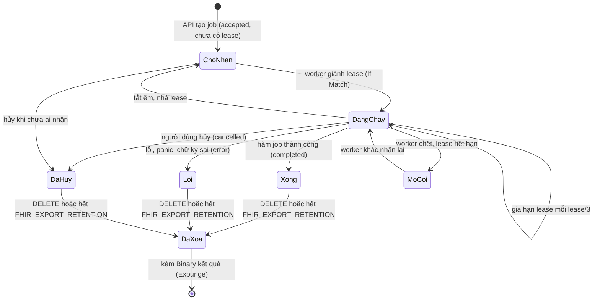

# 4. Luật nghiệp vụ, quyền, vòng đời, truy vết

## 4.1 Vòng đời `AsyncJob`

Điều không thấy trong hình: trạng thái `accepted` gộp ba pha (chờ, đang chạy, mồ côi), phân biệt bằng lease; job `reindex` cũng vào `DaXoa` khi hết hạn như export và batch (BR-24, đã sửa 2026-11-24); hủy khi đang chạy có độ trễ (BR-22).

## 4.2 Quyền của job

`fhir-worker` không kiểm token. Quyền của job là **ảnh chụp quyền của người tạo**, ký lúc tạo và mở lúc chạy.

| Thành phần của ảnh chụp | Nguồn | Hiệu lực khi job chạy |
|---|---|---|
| `project` | `meta.project` của `AsyncJob` (ràng buộc trong chữ ký) | kho tách project: chỉ thấy và ghi dữ liệu của project này |
| grants theo loại (SMART c r u d s) | token của người gọi lúc tạo job | chỉ các thao tác đó trên các loại đó |
| AccessPolicy | claim của token lúc tạo job | áp ở mọi đường đọc và ghi của job (như API); `$reindex` bị chặn nếu có |
| vai trò | luôn đọc | job không có quyền quản trị |
| `Binary` | thêm quyền **ghi** (không đọc) | lưu và dọn file kết quả mà người gọi không cần quyền tạo Binary |

| Chức năng | Token tĩnh (không JWT) | JWT |
|---|---|---|
| F-03 export | chạy trên cả kho, không tách project | tách project, grants, AccessPolicy |
| F-04 reindex | chạy trên cả kho | chỉ project của người gọi; token có AccessPolicy: lỗi |
| F-05 batch | chạy trên cả kho | quyền người gọi, tách project |
| Mọi job | không có chữ ký | chỉ chạy khi chữ ký hợp lệ |

## 4.3 Luật nghiệp vụ

### Nhận job và lease (BR-01..08)

| Mã | Luật | Loại | F |
|---|---|---|---|
| BR-01 | Chỉ `AsyncJob` có `status=accepted`, chưa có lease còn hiệu lực và có `requestTime` cũ hơn `FHIR_JOB_RECOVERY_GRACE` mới được đưa vào bộ điều phối; thứ tự theo `_lastUpdated` tăng dần. | OPS | F-01 |
| BR-02 | Giành job bằng cập nhật có điều kiện `If-Match`: nhiều worker cùng thấy một job thì đúng một bên thắng; job không còn `accepted` hoặc đã có lease thì bị bỏ qua. | DATA | F-01 |
| BR-03 | Lease dài `FHIR_JOB_LEASE` (mặc định 5 phút), gia hạn mỗi `FHIR_JOB_LEASE`/3 trong lúc job chạy. | OPS | F-01 |
| BR-04 | Worker chết giữa chừng: lease hết hạn, worker khác nhận lại và chạy lại job từ đầu (batch async chạy tiếp từ checkpoint). | OPS | F-01 |
| BR-05 | Khi tắt, job dở nhả lease (xóa `transactionTime`) và KHÔNG bị đánh dấu lỗi; kết quả hoặc lỗi được ghi bằng ngữ cảnh độc lập (không bị hủy theo tiến trình đang tắt). | OPS | F-01, F-10 |
| BR-06 | Mỗi worker chạy tối đa `FHIR_JOB_CONCURRENCY` job đồng thời; job mới được nhận mỗi `FHIR_JOB_MAINTENANCE_INTERVAL` (phải > 0), nên độ trễ nhận job ≈ chu kỳ + grace. | OPS | F-01 |
| BR-07 | Job lỗi hoặc panic được ghi `status=error` kèm OperationOutcome (`exception`) và log ERROR `job lỗi`; worker không sập. | OPS | F-01 |
| BR-08 | Loại job không đăng ký được ghi `error` với `loại job không tồn tại: <loại>`. | OPS | F-01 |

### Quyền và tách tổ chức (BR-09..14)

| Mã | Luật | Loại | F |
|---|---|---|---|
| BR-09 | Khi fhir-server bật JWT, job chỉ chạy khi chữ ký hợp lệ (ràng buộc mã job, project và nội dung `request`); thiếu, sai chữ ký, chữ ký của job khác, ảnh chụp hỏng, phiên bản cũ hoặc chính sách hỏng thì job `error` và không chạy, không để lại kết quả. | SEC | F-02 |
| BR-10 | Job chạy bằng Principal dựng lại từ chữ ký: project của AsyncJob, grants và AccessPolicy đã ký, vai trò đọc, cộng quyền chỉ ghi trên `Binary`. | SEC | F-02 |
| BR-11 | Job chỉ đọc và ghi dữ liệu của project của người gọi; loại người gọi không được đọc: export không chỉ định `_type` bỏ qua loại đó, có `_type` thì job `error`. | SEC | F-02, F-03 |
| BR-12 | Không bật JWT (token tĩnh): job không có chữ ký, không tách project và chạy trên cả kho như `fhir-server` ở chế độ đó. | SEC | F-02 |
| BR-13 | `$reindex` cả loại chạy trong project của người gọi (liệt kê id rồi reindex từng resource, kiểm sở hữu từng resource); token có AccessPolicy thì job lỗi `403`. | SEC | F-04 |
| BR-14 | `FHIR_JOB_SIGNING_KEY` phải trùng `fhir-server` (dev HMAC suy từ `FHIR_JWT_HMAC_SECRET` bằng cùng công thức); lệch khóa hoặc xoay khóa làm job đang chờ bị từ chối. Khóa ký job bắt buộc khi bật JWT và cấm khóa suy từ HMAC ở staging/production. | SEC | F-02 |

### Export (BR-15..18)

| Mã | Luật | Loại | F |
|---|---|---|---|
| BR-15 | Export ghi ndjson, mỗi loại một hoặc nhiều tệp (đủ 8 MiB thì tách), tìm theo `_lastUpdated` tăng dần, trang 1000; phân trang theo offset nên dữ liệu ghi trong lúc xuất có thể lặp hoặc sót. | DATA | F-03 |
| BR-16 | Loại được xuất: `_type` nếu có; không thì mọi loại trừ `AsyncJob` và `Binary`; mức patient và group chỉ Patient và loại thuộc compartment Patient (mức group chỉ thành viên Patient đang hoạt động của Group); `_typeFilter` lọc theo loại (OR cùng loại), `_since` lọc `_lastUpdated ge`. | BM | F-03 |
| BR-17 | Kết quả export là `output[]` với `type`, `url` (`<FHIR_BASE_URL>/Binary/<id>`), `count`; `FHIR_BASE_URL` của worker phải trùng API. | DATA | F-03, F-08 |
| BR-18 | Export lỗi hoặc bị hủy giữa chừng xóa các tệp đã ghi; worker chết đột ngột có thể để lại Binary mồ côi (dọn bằng `sweep-binary` ở phía tệp, chưa có dọn dòng). | DATA | F-03 |

### Batch async (BR-19..21)

| Mã | Luật | Loại | F |
|---|---|---|---|
| BR-19 | Batch async chạy từng entry như batch đồng bộ với quyền người gọi; POST không điều kiện nhận id cấp sẵn nên entry chạy lại sau gián đoạn trả lại resource đã tạo thay vì tạo bản thứ hai. | DATA | F-05 |
| BR-20 | Checkpoint lưu sau mỗi `FHIR_BATCH_CHECKPOINT_ENTRIES` entry (mặc định 10) hoặc 5 giây; chạy lại tiếp từ vị trí đã lưu; gián đoạn do tắt máy giữ Binary tạm, hủy hoặc lỗi dọn Binary tạm. | DATA | F-05 |
| BR-21 | Kết quả batch là Bundle `batch-response` ghi thành Binary, `output.results` trỏ `Binary/<id>`; Bundle đầu vào và đoạn tạm bị xóa khi xong. Resource đã ghi trước khi hủy hoặc lỗi **không được hoàn tác**. | DATA | F-05 |

### Hủy và dọn (BR-22..25)

| Mã | Luật | Loại | F |
|---|---|---|---|
| BR-22 | Hủy khi job còn `accepted` chỉ đánh dấu `cancelled` ở CSDL; worker (tiến trình khác API) dừng khi vòng thăm dò hủy đọc thấy (tối đa `FHIR_JOB_CANCEL_POLL`, mặc định 2 giây, không vượt `FHIR_JOB_LEASE`/3; trước 2026-11-24 chờ nhịp heartbeat lease/3, khoảng 100 giây) hoặc, với batch, ở lần lưu checkpoint kế tiếp; kết quả của job bị hủy bị bỏ. | OPS | F-06 |
| BR-23 | `DELETE` job đã xong, lỗi hoặc đã hủy xóa job cùng Binary kết quả (`202` `Deleted`). | DATA | F-06 |
| BR-24 | Vòng bảo trì xóa `AsyncJob` `completed`, `error`, `cancelled` quá `FHIR_EXPORT_RETENTION` (mặc định 24 giờ; âm là không bao giờ) với loại `export?`, `batch?` và `reindex?` (job `reindex` không có Binary kết quả nên chỉ xóa dòng); loại job không biết thì không bị đụng tới. | OPS | F-07 |
| BR-25 | Xóa kết quả dùng Expunge (xóa dòng, lịch sử và tệp ở kho) khi repository và quyền cho phép; nếu không thì xóa mềm và nội dung còn lại. | DATA | F-07, F-08 |

### Lưu kết quả và sự kiện (BR-26..28)

| Mã | Luật | Loại | F |
|---|---|---|---|
| BR-26 | Có `FHIR_BINARY_STORAGE`: kết quả job (và đầu vào, đoạn tạm của batch) ra kho không trần base64, dòng Binary chỉ giữ metadata; không có kho: base64 trong CSDL. | DATA | F-08 |
| BR-27 | Kho Binary, `FHIR_BASE_URL`, `FHIR_STORAGE_BASE_URL`, `FHIR_SKIP_VALIDATION`, `FHIR_SKIP_CONSTRAINTS`, `FHIR_UPDATE_AS_CREATE`, `FHIR_BASE64_BINARY_MAX_BYTES` của worker phải trùng `fhir-server`; chưa có kiểm tự động phát hiện lệch. | OPS | F-03, F-05, F-08 |
| BR-28 | Khi `FHIR_SUBSCRIPTIONS` hoặc `FHIR_AUTO_DOWNLOAD` bật, worker phát sự kiện ghi resource của batch lên Redis (chỉ phát); cấu hình từ chối nếu khi đó broker không phải `redis` hoặc thiếu `REDIS_URL` hợp lệ. | OPS | F-09 |

### Vận hành (BR-29..33)

| Mã | Luật | Loại | F |
|---|---|---|---|
| BR-29 | Worker không migrate: còn migration chưa chạy thì từ chối khởi động (`schema chưa được migrate`). | DATA | F-10 |
| BR-30 | Cấu hình sai bị từ chối và nêu mọi lỗi một lượt (tên biến); `FHIR_JOB_MAINTENANCE_INTERVAL` bằng 0 bị từ chối vì worker nhận job qua vòng đó. | OPS | F-10 |
| BR-31 | `/health/ready` kiểm database (`503` khi hỏng hoặc đang tắt), liveness không phụ thuộc ngoài; `SIGTERM` thoát mã 0 sau khi job dở nhả lease. | OPS | F-10 |
| BR-32 | Khi `fhir-server` đặt `FHIR_JOB_EXECUTION=false`, API chỉ tạo job (`202`) và không chạy hay tiếp quản; không có worker thì job ở `accepted` mãi. | OPS | F-01 |
| BR-33 | Kết quả batch do worker chạy giữ tham chiếu `Binary/<id>` (worker không có khóa ký `/storage` nên không viết lại thành URL ký như API). | DATA | F-05 |

## 4.4 Bảng thời hạn và giới hạn

| Hạng mục | Mặc định | Cấu hình |
|---|---|---|
| Lease của job | 5 phút | `FHIR_JOB_LEASE` |
| Gia hạn lease | lease/3 (khoảng 100 giây) | theo lease |
| Thăm dò hủy job | `FHIR_JOB_CANCEL_POLL` (mặc định 2 giây, không vượt lease/3) | theo cấu hình |
| Chu kỳ nhận job, tiếp quản, dọn | 5 giây | `FHIR_JOB_MAINTENANCE_INTERVAL` (> 0) |
| Tuổi tối thiểu của job được nhận | 2 giây | `FHIR_JOB_RECOVERY_GRACE` |
| Job đồng thời mỗi worker | 2 | `FHIR_JOB_CONCURRENCY` (1 đến 256) |
| Giữ kết quả export và batch | 24 giờ (âm: mãi) | `FHIR_EXPORT_RETENTION` |
| Trang đọc của export | 1000 resource | cố định |
| Kích thước một tệp export | 8 MiB | cố định |
| Lô liệt kê của reindex | 200 resource | cố định |
| Nhịp checkpoint batch | 10 entry hoặc 5 giây | `FHIR_BATCH_CHECKPOINT_ENTRIES` (entry) |

## 4.5 Kịch bản chấp nhận

| # | Kịch bản (Given When Then) | Luật |
|---|---|---|
| AT-01 | Given `fhir-server` `FHIR_JOB_EXECUTION=false` và chưa có worker, When tạo `$export`, Then poll luôn `202` (job ở `accepted`); When khởi động worker, Then vài giây sau `200` kèm manifest. | BR-01, BR-32 |
| AT-02 | Given hai worker cùng thấy một job, When cả hai giành, Then đúng một bộ file kết quả (không job nào chạy hai lần), kể cả ba worker tranh sáu job trên PostgreSQL thật. | BR-02 |
| AT-03 | Given job `accepted` mới tạo, When chưa quá `FHIR_JOB_RECOVERY_GRACE` hoặc đã có lease còn hạn, Then worker không nhận. | BR-01, BR-03 |
| AT-04 | Given worker đang chạy job rồi bị tắt êm (`SIGTERM`), When tắt, Then job không bị đánh dấu lỗi, lease được nhả và worker khác chạy xong job. | BR-05, BR-04 |
| AT-05 | Given worker chết, When lease hết hạn, Then job được nhận lại và chạy đúng một lần. | BR-04 |
| AT-06 | Given job lỗi ném lỗi hoặc panic, When chạy, Then `status=error` kèm OperationOutcome, poll `500`, worker vẫn nhận job tiếp. | BR-07 |
| AT-07 | Given JWT bật, project A có 2 Patient và B có 3, When A và B mỗi bên tạo `$export`, Then manifest của A có 2 và của B có 3. | BR-10, BR-11 |
| AT-08 | Given job được ký bằng khóa khác khóa của worker, When worker nhận, Then `error` `job thiếu hoặc sai chữ ký quyền`, poll `500`, không có Binary kết quả. | BR-09, BR-14 |
| AT-09 | Given token chỉ có quyền đọc một số loại, When `$export` không chỉ định `_type`, Then loại không được đọc bị bỏ qua; When chỉ định `_type` loại đó, Then job `error`. | BR-11 |
| AT-10 | Given JWT bật, When quản trị project A chạy `$reindex` cả loại, Then chỉ resource của A được reindex; token có AccessPolicy thì job lỗi `403`. | BR-13 |
| AT-11 | Given Bundle batch 2 POST Patient, When gửi `Prefer: respond-async`, Then job xong, 2 Patient được ghi, `output.results` trỏ Binary Bundle `batch-response`, đầu vào và đoạn tạm bị xóa. | BR-19, BR-21 |
| AT-12 | Given batch đã xử lý một phần và bị gián đoạn, When worker khác nhận, Then chạy tiếp từ checkpoint, không tạo bản thứ hai của resource đã tạo. | BR-19, BR-20 |
| AT-13 | Given job đang chạy, When người dùng hủy ở API, Then worker dừng sau lần heartbeat hoặc checkpoint kế tiếp, kết quả bị bỏ, poll `410`. | BR-22 |
| AT-14 | Given job export đã xong, When `DELETE bulkdata/{id}/status`, Then job và Binary kết quả bị xóa (`202` `Deleted`). | BR-23 |
| AT-15 | Given có `FHIR_BINARY_STORAGE` và `FHIR_EXPORT_RETENTION=2s`, When export xong rồi quá hạn, Then tệp ở kho và dòng Binary và AsyncJob đều mất (Expunge), kết quả không nằm base64 trong CSDL. | BR-24, BR-25, BR-26 |
| AT-16 | Given `fhir-server` bật Subscription với Redis, When batch async ghi 2 Patient, Then có đúng 2 sự kiện `create` Patient trên Redis. | BR-28 |
| AT-17 | Given schema chưa migrate, When khởi động, Then từ chối `schema chưa được migrate`. | BR-29 |
| AT-18 | Given cấu hình sai (JWT thiếu khóa ký job, chu kỳ nhận job 0, broker bộ nhớ khi phải phát sự kiện), When khởi động, Then từ chối và nêu tên biến. | BR-14, BR-28, BR-30 |
| AT-19 | Given worker chạy, When `SIGTERM`, Then `/health/ready` `503` khi đang tắt, liveness vẫn `200`, thoát mã 0. | BR-31 |
| AT-20 | Given job `reindex` đã xong và quá `FHIR_EXPORT_RETENTION`, When vòng bảo trì chạy, Then dòng `AsyncJob` của reindex bị xóa như export; loại job không biết vẫn còn. | BR-24 |

## 4.6 Truy vết luật đến bằng chứng kiểm thử

Đường dẫn đầy đủ; tên test là bằng chứng. `W` = `apps/fhir-worker`, `R` = `pkg/fhirrouter`.

| Nhóm luật | Test |
|---|---|
| BR-01, BR-32 (nhận job, API không chạy) | `apps/fhir-worker/internal/bootstrap/bootstrap_test.go`: `TestRunsJobsThatTheAPICreatedButDoesNotRun`; `apps/fhir-server/internal/bootstrap/split_e2e_test.go`: `TestJobExecutionOffLeavesJobAccepted`; `apps/fhir-worker/tests/e2e/worker_test.go`: `TestImageIsHealthyNonRootAndRunsSealedJobsPerProject`; `pkg/fhirrouter/jobs_durable_test.go`: `TestRecoverRespectsLeaseAndGrace` |
| BR-02 (tranh job) | `apps/fhir-worker/internal/bootstrap/bootstrap_test.go`: `TestTwoWorkersRunEachJobOnce`; `apps/fhir-worker/tests/integration/integration_test.go`: `TestWorkersCompeteForJobsOnRealPostgresAndEachJobRunsOnce`; `pkg/fhirrouter/jobs_durable_test.go`: `TestRecoverOrphanedJobRunsOnce` |
| BR-03, BR-04 (lease, tiếp quản) | `pkg/fhirrouter/jobs_durable_test.go`: `TestHeartbeatKeepsLeaseWhileRunning`, `TestMaintenanceLoopRecoversAutomatically`, `TestRecoverOrphanedJobRunsOnce` |
| BR-05 (tắt êm nhả lease) | `pkg/fhirrouter/jobs_durable_test.go`: `TestShutdownReleasesLeaseAndNextProcessResumes`; `apps/fhir-worker/tests/e2e/worker_test.go`: `TestStopsGracefullyAndRunsJobsCreatedWhileDown` |
| BR-06 (đồng thời, chu kỳ) | `apps/fhir-worker/internal/config/config_test.go`: `TestInvalidConfigIsRejectedWithTheVariableName`; `pkg/fhirrouter/jobs_durable_test.go`: `TestMaintenanceLoopRecoversAutomatically` |
| BR-07, BR-08 (lỗi job) | `pkg/fhirrouter/repotest/suite.go`: `testJobFailure` (qua `TestMemoryRepository` ở `pkg/fhirrouter/router_test.go`) |
| BR-09, BR-14 (chữ ký) | `apps/fhir-worker/internal/bootstrap/bootstrap_test.go`: `TestJobWithAnInvalidSealIsRejected`; `apps/fhir-worker/internal/config/config_test.go`: `TestDevHMACDerivesTheSameJobKeyAsFhirServer`, `TestInvalidConfigIsRejectedWithTheVariableName` |
| BR-10, BR-11, BR-12 (quyền, project) | `apps/fhir-worker/internal/bootstrap/bootstrap_test.go`: `TestJobsRunWithTheCallersProjectOnly`; `apps/fhir-worker/tests/integration/integration_test.go`: `TestRunsSealedJobsUnderNarrowRoleAndRequiredSchema`; `apps/fhir-worker/tests/e2e/worker_test.go`: `TestImageIsHealthyNonRootAndRunsSealedJobsPerProject`; `apps/fhir-server/internal/bootstrap/jwt_e2e_test.go`: `TestJWTJobsAndSubscriptionsAcrossProjects` |
| BR-13 (reindex theo project) | `pkg/fhirauth/scope_test.go`: `TestReindexTypeStaysInsideCallerProject` |
| BR-15..18 (export) | `pkg/fhirrouter/repotest/suite.go`: `testBulkExport`, `testGroupExport`, `testExportTypeFilter`; `pkg/fhirrouter/jobs_durable_test.go`: `TestExportCancelWhileRunningAndDelete` |
| BR-19..21 (batch async) | `pkg/fhirrouter/batch_async_test.go`: `TestAsyncBatchMatchesSync`, `TestAsyncBatchResumesFromCheckpoint`, `TestAsyncBatchCancelWhileRunning`; `apps/fhir-worker/internal/bootstrap/bootstrap_test.go`: `TestBatchAsyncWritesResourcesAndPublishesEvents`; `apps/fhir-server/internal/bootstrap/batch_async_e2e_test.go`: `TestAsyncBatchRunsWithCallerGrants` |
| BR-22, BR-23 (hủy, xóa) | `pkg/fhirrouter/jobs_durable_test.go`: `TestExportCancelWhileRunningAndDelete`, `TestExportDeleteRemovesCompletedFiles`; `pkg/fhirrouter/batch_async_test.go`: `TestAsyncBatchCancelWhileRunning`; `pkg/fhirrouter/job_cancel_poll_test.go`: `TestJobCancelledElsewhereStopsWithinThePollInterval`; `apps/fhir-worker/internal/bootstrap/bootstrap_test.go`: `TestJobCancelledByTheAPIStopsQuicklyOnTheWorker` |
| BR-24, BR-25 (hết hạn, Expunge) | `pkg/fhirrouter/jobs_durable_test.go`: `TestExpireJobs` (export, reindex hết hạn, loại không biết còn); `pkg/fhirrouter/batch_async_test.go`: `TestAsyncBatchExpires`; `apps/fhir-worker/internal/bootstrap/bootstrap_test.go`: `TestResultsGoToObjectStorageAndAreExpungedWhenExpired`; `apps/fhir-server/internal/bootstrap/split_e2e_test.go`: `TestExportResultsGoToObjectStorageAndAreExpungedOnExpiry` |
| BR-26, BR-27 (kho, trùng cấu hình) | `apps/fhir-worker/internal/bootstrap/bootstrap_test.go`: `TestResultsGoToObjectStorageAndAreExpungedWhenExpired`; `apps/fhir-worker/internal/config/config_test.go`: `TestSharedEnvFileWithFhirServerIsAccepted` (chỉ kiểm chấp nhận tệp dùng chung, chưa kiểm lệch giá trị) |
| BR-28 (phát sự kiện) | `apps/fhir-worker/internal/bootstrap/bootstrap_test.go`: `TestBatchAsyncWritesResourcesAndPublishesEvents`; `apps/fhir-worker/internal/config/config_test.go`: `TestAllErrorsAreReportedTogetherAndPublishRulesFollowFhirServer` |
| BR-29..31 (khởi động, probe, tắt êm) | `apps/fhir-worker/internal/bootstrap/bootstrap_test.go`: `TestRefusesToStartOnUnmigratedSchema`, `TestReadinessReflectsDatabaseAndDraining`, `TestServeShutsDownGracefullyOnSignal`; `apps/fhir-worker/tests/e2e/worker_test.go`: `TestRefusesBadConfigurationAndUnmigratedSchema`, `TestStopsGracefullyAndRunsJobsCreatedWhileDown` |
| BR-33 | không có test riêng (suy từ mã: worker không dựng `ResponseHook` của `fhirbinary`) |

## 4.7 Lệch, rủi ro và điểm chưa kiểm

- **Hủy job có độ trễ lớn khi API và worker tách (BR-22):** `DELETE` ở API chỉ ghi `cancelled`; `cancelRun` của tiến trình API không với tới worker. Worker dừng ở heartbeat (mỗi `FHIR_JOB_LEASE`/3, mặc định khoảng 100 giây) hoặc ở checkpoint của batch. Export không có điểm kiểm hủy nào khác ngoài heartbeat. Có thể thu ngắn bằng `FHIR_JOB_LEASE` nhỏ hơn (đổi lại ghi lease nhiều hơn). Chưa có test hủy xuyên hai tiến trình (test hiện có hủy trong cùng tiến trình).
- **Job `$reindex` từng không được dọn (đã sửa 2026-11-24, BR-24):** `ExpireJobs` trước đây chỉ nhận `export?` và `batch?` nên mỗi `$reindex` cả loại để lại một dòng `AsyncJob` vĩnh viễn; nay nhận cả `reindex?` (`TestExpireJobs`). Còn lại: không có API hủy hoặc xóa job `reindex` (`DELETE job/{id}/status` chỉ nhận job `batch?`).
- **Nộp lại job đang chờ mỗi chu kỳ:** `RecoverJobs` nộp mọi job `accepted` chưa có lease, kể cả job đã nộp mà còn đang chờ chỗ (chưa có lease nên chưa phân biệt được); mỗi lần nộp là một goroutine chờ chỗ trong bộ điều phối. Khi số job chờ lớn hơn nhiều so với `FHIR_JOB_CONCURRENCY`, số goroutine chờ tăng theo mỗi chu kỳ (5 giây) cho tới khi job được chạy; các bản nộp trùng thoát ngay khi tới lượt (job đã có lease hoặc đã xong). (suy từ mã, chưa kiểm bằng test hay đo)
- **Mồ côi khi worker chết đột ngột:** job export chạy lại tạo bộ file mới; các Binary của lần chạy dở (ghi trước khi chết) không thuộc `output` của job nên không bao giờ bị dọn bằng đường hết hạn. `sweep-binary` dọn tệp ở kho nhưng không dọn dòng Binary. (suy từ mã)
- **Dữ liệu ghi trong lúc export lặp hoặc sót (BR-15):** phân trang theo offset (giới hạn đã biết của `fhir-server`).
- **Cấu hình dùng chung có thể lệch âm thầm (BR-27):** không có kiểm tự động; lệch `FHIR_BASE_URL` làm URL kết quả sai miền, lệch tuỳ chọn router làm batch async hành xử khác API.
- **Kết quả batch giữ `Binary/<id>` (BR-33):** khác batch do API chạy (URL ký của `/storage`).
- **Xoay khóa job-seal chưa có khóa cũ (BR-14):** job đang chờ lúc xoay khóa bị từ chối.
- **Độ trễ nhận job (BR-06):** vài giây thay vì tức thì; chưa có hàng đợi đẩy.
- **Điều kiện A của việc tách chưa được chứng minh:** xem [../architecture.md](../architecture.md).
- **Chưa kiểm:** worker chết giữa lúc chạy job dài rồi worker khác tiếp quản (phần lõi do `pkg/fhirrouter` giữ, `TestRecoverOrphanedJobRunsOnce`); thông lượng job của worker; hành vi khi `FHIR_EXPORT_RETENTION` âm.
