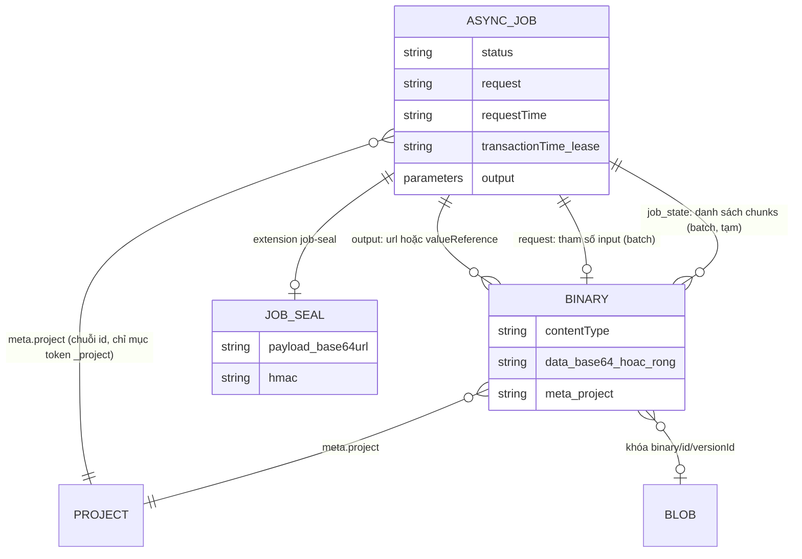

# 2. Mô hình logic

`fhir-worker` chỉ sở hữu **một loại resource riêng của việc chạy job**: `AsyncJob`. Ngoài ra nó ghi `Binary` (file kết quả) và đọc, ghi dữ liệu lâm sàng theo quyền người gọi. Lưu ở `fhir_resource` (`resource_type='AsyncJob'` hoặc `'Binary'`), schema `fhir`. Nhãn nhạy cảm S0..S4 theo `references/templates.md` của skill: S1 định danh kỹ thuật, S2 dữ liệu cá nhân, S3 dữ liệu lâm sàng, S4 bí mật xác thực.

## 2.1 ERD logic

Không có khóa ngoại; quan hệ là id nằm trong JSON (xem [03](03-quan-he-va-toan-ven.md)). `JOB_SEAL` và `PROJECT` không phải bảng: seal là một extension của `AsyncJob`, `Project` thuộc `auth` (chỉ là chuỗi id ở đây).

## 2.2 AsyncJob

**Mục đích nghiệp vụ:** một việc nền do người dùng yêu cầu ở `fhir-server` (export, reindex cả loại, batch async): vừa là **hàng đợi** (trạng thái `accepted`), vừa là **khóa chạy** (lease), vừa là **nơi lưu kết quả**. **Lưu ở:** `fhir_resource`, schema `fhir`. **Ghi bởi:** `fhir-server` tạo (`StartJob`, kèm chữ ký) và hủy hoặc xóa (`DELETE .../status`); `fhir-worker` nhận (lease), gia hạn, lưu checkpoint, ghi kết quả hoặc lỗi, và xóa khi hết hạn. **Đọc bởi:** cả hai (trạng thái `GET .../status`, vòng nhận job, vòng dọn).

| Trường | Kiểu | Bắt buộc | Chức năng | Nhạy cảm |
|---|---|---|---|---|
| `status` | string | có | Vòng đời: `accepted` (chờ, đang chạy hoặc mồ côi, phân biệt bằng lease), `completed`, `error`, `cancelled`. API tạo `accepted`; worker đặt `completed` hoặc `error`; API đặt `cancelled`. Có chỉ mục `status` (token) cho vòng nhận job và vòng dọn | S1 |
| `requestTime` | string (RFC 3339, giây) | có | Lúc API tạo job. Worker chỉ nhận job đủ cũ (`FHIR_JOB_RECOVERY_GRACE`, mặc định 2 giây) so với trường này | S1 |
| `transactionTime` | string (RFC 3339 có phần thập phân) | không | **Dùng làm lease** khi job chưa xong: hạn quyền chạy của một worker (hiện tại + `FHIR_JOB_LEASE`), gia hạn mỗi lease/3; rỗng nghĩa là chưa ai nhận hoặc đã nhả (tắt êm). Khi job xong: đổi nghĩa thành thời điểm hoàn tất (export trả nó làm `transactionTime` của manifest) | S1 |
| `request` | string | có | `<loại>?<tham số>` do API dựng: `export?_level=...&_type=...&_since=...`, `batch?input=<id Binary>`, `reindex?resourceType=<Loại>`. Quyết định hàm job chạy và bị ràng buộc trong chữ ký quyền | S1 |
| `requester` | Reference | không | **Router không bao giờ đặt** (mọi job có trường này rỗng); người tạo job nằm trong chữ ký quyền, không ở đây. Có chỉ mục `requester` nhưng không có dòng | S1 |
| `output` | Parameters | không | Kết quả khi xong hoặc lỗi (dạng ở mục 2.3). Export: các tệp; batch: tham chiếu Bundle kết quả; reindex: số resource; lỗi: OperationOutcome | S1 (chứa id Binary; bản thân kết quả ở `Binary` là S3) |
| `type` | string | không | **Không dùng** bởi worker và router (trường của loại job di trú dữ liệu của Medplum). Có chỉ mục `type` nhưng không có dòng | S1 |
| `dataVersion` | integer | không | **Không dùng** (di trú dữ liệu) | S1 |
| `minServerVersion` | string | không | **Không dùng** (di trú dữ liệu) | S1 |
| `extension[job-seal]` | extension (`https://trivita.ai/fhir/StructureDefinition/job-seal`), valueString | có khi bật JWT | **Chữ ký quyền của người gọi** (mục 2.4). API ghi lúc tạo; worker chỉ đọc và kiểm; không đổi trong đời job | S2 (id người gọi, grants, AccessPolicy; không phải bí mật xác thực, xem 2.4) |
| `extension[job-state]` | extension (`https://trivita.ai/fhir/StructureDefinition/job-state`), valueString | không | **Checkpoint** của batch async (JSON, mục 2.5); worker ghi, đọc lại khi chạy tiếp; xóa khi job xong | S1 |
| `meta.project` | string | có khi bật JWT (kho tách project gán; chế độ token tĩnh: rỗng) | Project của người tạo job; bắt buộc đúng để worker dựng lại quyền (chữ ký ràng buộc giá trị này) và để project khác không thấy job | S1 |

**Tham số tìm kiếm được lập chỉ mục:** `status`, `type` (token), `requester` (reference → Bot, ClientApplication, Patient, Practitioner, RelatedPerson). Vòng nhận job: `AsyncJob?status=accepted&_sort=_lastUpdated` (trang 100); vòng dọn: `AsyncJob?status=completed,error,cancelled&_lastUpdated=lt<cutoff>` (trang 100).

## 2.3 Dạng `output`

| Loại job | `output.parameter` |
|---|---|
| Export | mỗi tệp một tham số `output` có `part`: `type` (valueCode), `url` (valueUri: `<FHIR_BASE_URL>/Binary/<id>`), `count` (valueInteger) |
| Batch async | `results` (valueReference: `Binary/<id>` chứa Bundle `batch-response`) |
| Reindex | `count` (valueInteger: số resource đã lập lại chỉ mục) |
| Lỗi (`status=error`) | `outcome` (resource OperationOutcome: `severity=error`, `code=exception`, `diagnostics` và `details.text` = thông điệp lỗi) |

Thông điệp lỗi có thể chứa chi tiết nội bộ (`tìm <Loại>: ...`, lỗi kho): đây là dữ liệu vận hành, người dùng đọc được qua `GET .../status` (`500`).

## 2.4 Chữ ký quyền (`job-seal`)

Chuỗi `base64url(payload) "." base64url(hmac)`. **Payload (JSON, đọc được, không mã hóa):** `v` (phiên bản, hiện là 2), `sub` (id người gọi), `grants` (loại resource → bit quyền c r u d s, hoặc `null`: không giới hạn theo loại), `policy` (AccessPolicy thô hoặc `null`). **HMAC-SHA256** bằng `FHIR_JOB_SIGNING_KEY` trên `jobID`, `project`, `request` và payload: nên chữ ký của job này không dùng được cho job khác, project khác hay `request` khác; phiên bản khác `v` bị từ chối. HMAC bảo vệ **tính toàn vẹn**, không bảo vệ **tính bí mật** của payload: ai đọc được `AsyncJob` (kể cả trong `fhir_history`) thấy id người gọi và quyền của họ. Khóa không nằm trong dữ liệu.

## 2.5 Checkpoint (`job-state`) của batch

JSON `{"position": <số entry đã có kết quả>, "chunks": ["<id Binary đoạn kết quả>", ...], "ids": ["<id cấp sẵn>" hoặc "" theo vị trí entry]}`. `ids` có **một phần tử cho mỗi entry** của Bundle (rỗng nếu entry không phải POST không điều kiện); `chunks` thêm một id mỗi đoạn xong. Mỗi checkpoint ghi lại toàn bộ hai mảng (nguyên nhân của mức tăng dung lượng lịch sử ở [01](01-bang-vat-ly.md) mục 1.4). Xóa extension khi job xong.

## 2.6 Binary (kết quả của job)

**Mục đích nghiệp vụ:** chứa nội dung mà job tạo ra hoặc dùng làm đầu vào. **Lưu ở:** `fhir_resource` (`resource_type='Binary'`), nội dung ở kho (`FHIR_BINARY_STORAGE`) hoặc base64 trong `data` nếu không có kho. **Ghi bởi:** `fhir-worker` (file export, đoạn và kết quả batch); `fhir-server` (Bundle đầu vào của batch lúc nhận, và Binary thường). **Đọc bởi:** `fhir-server` (`GET Binary/{id}`), `fhir-worker` (đọc Bundle đầu vào và đoạn kết quả). **Xóa bởi:** Expunge (mục 3.3 của [03](03-quan-he-va-toan-ven.md)).

| Trường | Kiểu | Bắt buộc | Chức năng | Nhạy cảm |
|---|---|---|---|---|
| `contentType` | string | có | Loại nội dung: `application/fhir+ndjson` (file export), `application/fhir+json` (Bundle đầu vào, đoạn và kết quả của batch). `GET Binary/{id}` trả dạng file khi client yêu cầu đúng loại này | S1 |
| `securityContext` | Reference | không | **Worker không đặt** cho file kết quả (khác `fhir-downloader` đặt về resource nguồn); quyền đọc file kết quả dựa vào `meta.project` | S1 |
| `data` | string (base64) | không | Nội dung khi **không có kho**; khi có kho thì **rỗng** (nội dung ở kho, khóa `binary/<id>/<versionId>`). Kết quả export là JSON ndjson của mọi resource đã xuất: dữ liệu lâm sàng | S3 |
| `url` | string | không | **Không dùng** cho kết quả job | S1 |
| `meta.project` | string | có | Project của người tạo job (lấy từ `AsyncJob` lúc tạo): project khác đọc `Binary/{id}` nhận `404` | S1 |

**Tham số tìm kiếm được lập chỉ mục:** không có (loại `Binary` không có tham số riêng).

## 2.7 Dữ liệu lâm sàng do job đọc và ghi

Không phải dữ liệu riêng của worker; liệt kê để biết ảnh hưởng.

| Job | Đọc | Ghi |
|---|---|---|
| Export | mọi loại được chọn, trong project của người gọi (trừ `AsyncJob`, `Binary`), tối đa quyền đã ký | `Binary` kết quả |
| Reindex cả loại | resource của loại đó trong project | **chỉ** các dòng `fhir_idx_*` của chúng (không đổi JSON, `versionId` hay `fhir_history`) |
| Batch async | theo từng entry | resource do entry ghi (create, update, delete, patch...) qua cùng bộ xử lý như API: có `fhir_history`, chỉ mục, sự kiện lên Redis; **không hoàn tác** khi job hủy hay lỗi giữa chừng |
