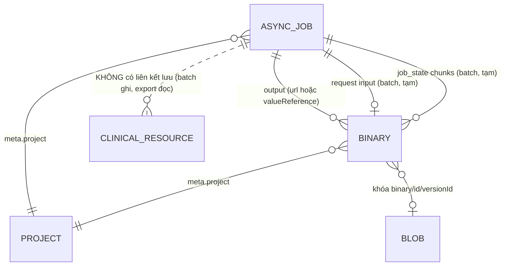

# 3. Quan hệ và toàn vẹn dữ liệu

**Không có khóa ngoại nào** trong schema `fhir`. Mọi quan hệ của job là *logic*: id nằm trong JSON của `AsyncJob` (`output`, `request`, checkpoint) hoặc chuỗi `meta.project`; không có chỉ mục tham chiếu cho chúng. Toàn vẹn do **mã ứng dụng, `If-Match` và từng transaction riêng lẻ** giữ; không có transaction nào bao cả `AsyncJob` lẫn `Binary`.

## 3.1 Sơ đồ logic

Đường chấm là *thiếu* liên kết: resource do batch ghi **không** lưu job nào đã ghi nó (chỉ Bundle kết quả của job, trong `Binary`, có `response` từng entry).

## 3.2 Bảng quan hệ

Cột **Toàn vẹn** nêu *ai kiểm và ở đâu*; "không ai" nghĩa là không có kiểm nào trong mã đã đọc. **Khi xóa phía "đến"**: không có `ON DELETE`; cột nêu hành vi thực tế.

| Từ | Đến | Bản số | Cách nối | Bắt buộc | Toàn vẹn | Khi xóa phía "đến" | Bằng chứng |
|---|---|---|---|---|---|---|---|
| `AsyncJob.output` (export: `part[url]`) | `Binary` | 1-n | URL `<FHIR_BASE_URL>/Binary/<id>` trong JSON, không chỉ mục | chỉ khi `completed` | worker tạo mọi `Binary` **trước**, ghi `output` sau; lỗi hoặc hủy thì xóa các Binary đã tạo | Binary bị xóa trước thì `GET Binary/{id}` `404` (job vẫn còn `output`) | `pkg/fhirrouter/bulk.go` (`exportJob`), `jobs.go` (`runJob`) |
| `AsyncJob.output` (batch: `results`) | `Binary` | 1-1 | `valueReference` `Binary/<id>` | chỉ khi `completed` | như trên | như trên | `pkg/fhirrouter/batch_async.go` |
| `AsyncJob.request` (batch: `input`) | `Binary` | 1-1 | id trong chuỗi `request` | có (batch) | API tạo Binary đầu vào **sau** khi tạo `AsyncJob` (callback `prepare`); lỗi thì xóa job | worker xóa khi job xong, lỗi hoặc hủy; mất trước thì job lỗi `đọc Bundle đầu vào` | `pkg/fhirrouter/jobs.go` (`startJob`), `batch_async.go` |
| `AsyncJob.job-state.chunks` | `Binary` | 1-n | id trong JSON checkpoint | không (có khi batch đang chạy) | worker ghi Binary đoạn **trước** khi lưu checkpoint; hủy hoặc lỗi dọn; tắt êm **giữ** để chạy tiếp | thiếu đoạn thì job lỗi `đọc kết quả đoạn` | `pkg/fhirrouter/batch_async.go` |
| `AsyncJob.meta.project` | `Project` (của `auth`) | n-1 | chuỗi id, **không chỉ mục** | có khi bật JWT | kho tách project gán từ token lúc tạo; chữ ký ràng buộc giá trị này khi mở | `Project` bị xóa: job còn; không ai dọn | `pkg/fhirauth/scope.go`, `seal.go` |
| `AsyncJob.job-seal` | người gọi (`sub`) | n-1 | **không có tham chiếu**: id trong payload của chữ ký | có khi JWT | HMAC (`FHIR_JOB_SIGNING_KEY`) ràng buộc jobID, project, request, payload | người bị xóa hoặc đổi quyền: job vẫn chạy bằng **ảnh chụp quyền cũ** | `pkg/fhirauth/seal.go` |
| `Binary.meta.project` | `Project` | n-1 | chuỗi id | có khi JWT | worker lấy từ `AsyncJob` (`projectOf`) khi tạo | như trên | `pkg/fhirrouter/batch_async.go` |
| `Binary` | blob ở kho | 1-n (mỗi phiên bản một blob) | khóa `binary/<id>/<versionId>` | có khi dùng kho | thứ tự ghi: **CSDL trước, kho sau**; lỗi kho thì bù trừ (xóa dòng vừa tạo) | Expunge xóa mọi blob của resource; xóa mềm **không** xóa blob | `pkg/fhirbinary/wrap.go` |
| Job → resource lâm sàng (batch) | resource do entry ghi | 1-n | **không lưu** | không | qua cùng bộ xử lý như API (kiểm dữ liệu, quyền, `If-None-Exist`); POST không điều kiện dùng id cấp sẵn để chạy lại không tạo bản sao | hủy hoặc lỗi giữa chừng **không hoàn tác** | `pkg/fhirrouter/batch_async.go` (`runAsyncEntry`) |
| Resource do batch ghi → sự kiện Redis | stream | 1-1 | phát **sau commit** (`fhirsub.Wrap`) | không | không có outbox: chết đúng giữa commit và phát thì sự kiện mất | không áp dụng | `pkg/fhirsub/repo.go` |

## 3.3 Luật toàn vẹn và đồng thời

| Luật | Cơ chế | Bằng chứng |
|---|---|---|
| Một job chỉ chạy ở một worker | nhận bằng `UpdateResource` có `If-Match` (đặt lease); thua thì `412`, im lặng bỏ qua | `jobs_maint.go` (`claimJob`), `apps/fhir-worker/tests/integration/integration_test.go`: `TestWorkersCompeteForJobsOnRealPostgresAndEachJobRunsOnce` |
| Lease không bị ghi đè mù | heartbeat chỉ ghi khi `accepted` và dùng `If-Match`; `SaveJobState` đọc rồi ghi có `If-Match`, thử lại tối đa 5 lần (chờ 10, 20, 30, 40 ms) khi heartbeat xen vào | `jobs_maint.go` (`heartbeat`), `jobs_state.go` |
| Job hủy không bị "sống lại" | `SaveJobState` trả `ErrJobCancelled` khi thấy `cancelled`; heartbeat hủy ngữ cảnh chạy | `jobs_state.go`, `jobs_maint.go` |
| Ghi kết quả cuối | đọc lại `AsyncJob`, nếu `cancelled` thì bỏ kết quả; nếu không thì ghi `completed` hoặc `error` **không dùng `If-Match`** (xem kẽ hở dưới) | `jobs.go` (`runJob`) |
| Mỗi lần ghi `AsyncJob` là một transaction riêng (`fhir_resource` + `fhir_history` + chỉ mục) | `fhirstore.inTx` | `pkg/fhirstore/crud.go` |
| Kết quả và `AsyncJob` không cùng transaction | Binary tạo trước, `AsyncJob` ghi sau | `bulk.go`, `jobs.go` |

**Kẽ hở (suy từ mã, chưa tái hiện bằng test):**

1. **Ghi kết quả cuối và hủy không dùng `If-Match`.** Worker đọc job, thấy chưa `cancelled`, rồi ghi `completed` không điều kiện; nếu API hủy đúng khoảng giữa hai bước thì kết quả `completed` ghi đè `cancelled`. Ngược lại, hủy ở API (`cancelJob`) cũng ghi không `If-Match` dựa trên bản đã đọc: nếu worker vừa ghi xong thì `cancelled` ghi đè luôn `output`, để lại Binary kết quả mồ côi (không còn `output` trỏ tới). Cửa sổ rất hẹp (mili giây) nhưng không bị chặn.
2. **Chết giữa lúc tạo Binary và ghi `output`**: các Binary đã tạo không thuộc `output` nào (xem 3.5).

## 3.4 Xóa: xóa mềm giữ lại lịch sử của job

Đây là điểm quan trọng nhất của bộ dữ liệu này. **Đã đo** (SQLite, 2026-11-24, `ReadHistory`):

| Bước | `AsyncJob` | `Binary` kết quả |
|---|---|---|
| Job xong | `fhir_resource` giữ nội dung đầy đủ (`output`, `job-seal`); `fhir_history` có 3 dòng (export) hoặc 8 dòng (batch 35 entry) | dòng và nội dung (kho hoặc base64) |
| Hết `FHIR_EXPORT_RETENTION` | `DeleteResource` (**xóa mềm**): dòng `fhir_resource` thành tombstone `{"resourceType":"AsyncJob"}` với `deleted=true`, chỉ mục bị xóa, **thêm** một dòng `fhir_history` kiểu `DELETE`; **các dòng cũ giữ nguyên nội dung** (4 dòng sau export, 9 sau batch) | **Expunge**: xóa dòng, lịch sử, chỉ mục và nội dung ở kho (0 còn lại) |

Hệ quả:

- **Dữ liệu về job không bao giờ biến mất khỏi `fhir_history`**, kể cả sau hết hạn: `output` (id Binary và số lượng), `request` (tham số export, gồm `_typeFilter` có thể chứa điều kiện nhạy cảm), chữ ký quyền (id người gọi, grants, AccessPolicy) và mọi checkpoint (id các entry).
- **Dung lượng lịch sử tăng vô hạn** theo số job; với batch lớn tăng gần bình phương theo số entry ([01](01-bang-vat-ly.md) mục 1.4).
- **Chỉ Binary kết quả được giải phóng thật.** Muốn giải phóng cả `AsyncJob`, cần Expunge (`POST /AsyncJob/{id}/$expunge` bằng quản trị, hoặc đổi vòng dọn dùng Expunge): **hiện chưa làm**; ghi nhận là rủi ro và đề xuất sửa, không tự đổi mã.
- Vì `AsyncJob` bị xóa mềm nên `GET job/{id}/status` của job đã dọn trả `410 Gone` (không phải `404`).

## 3.5 Mồ côi và dọn dẹp

| Dữ liệu | Khi nào thành mồ côi | Ai dọn | Còn tồn |
|---|---|---|---|
| `Binary` kết quả export của lần chạy dở | worker chết đột ngột giữa lúc ghi (lần chạy lại tạo bộ file mới, không thuộc `output`) | **không ai** (đường hết hạn chỉ dọn Binary trong `output` của job) | dòng `Binary` và blob nằm lại |
| `Binary` kết quả bị mồ côi do kẽ hở hủy (mục 3.3) | API ghi `cancelled` đè `completed` | không ai | như trên |
| Blob ở kho không có dòng `Binary` | chết giữa lúc ghi kho và CSDL (hoặc bù trừ lỗi) | `fhir-server sweep-binary` (chỉ khóa quá ân hạn mà CSDL trả `404`) | — |
| Dòng `Binary` không còn blob | blob bị xóa tay | không ai | — |
| `AsyncJob` đã xóa mềm | mọi job hết hạn | không ai (xem 3.4) | tombstone và lịch sử |
| `AsyncJob` ở `accepted` không bao giờ được chạy (không có worker) | `FHIR_JOB_EXECUTION=false` mà không có worker | không ai | job nằm mãi ở `accepted` |

Không có công cụ nào liệt kê `Binary` mồ côi theo "không có `AsyncJob` nào trỏ tới" (`Binary` không có tham số tìm kiếm riêng).
