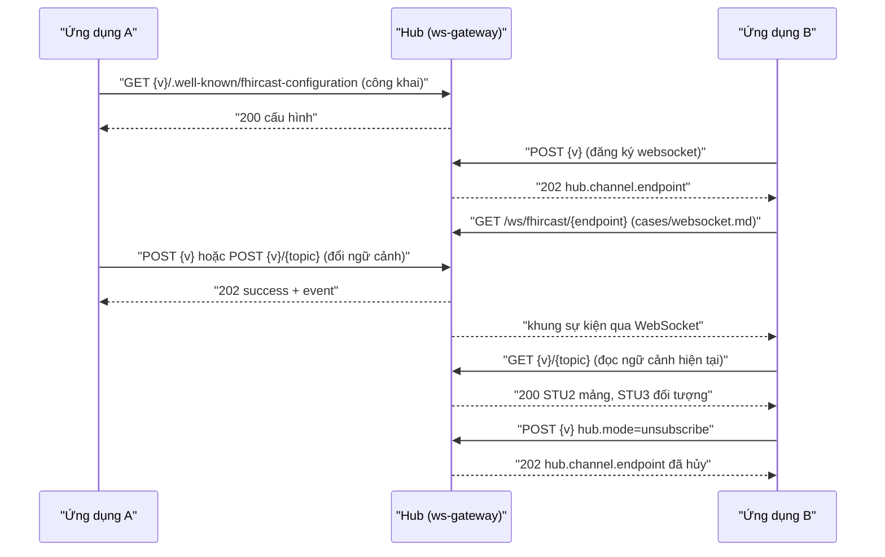

# Các trường hợp phản hồi: nhóm `fhircast` (Hub FHIRcast)

Mười hai route của Hub là **một xử lý lắp lại ba lần** (`registerFhircast` lặp qua `FhircastPaths`): `/fhircast/STU2` (STU2), `/fhircast/STU3` (STU3) và `/hub` (**bí danh của STU3**, không có gì riêng). Chỉ hai điểm khác theo phiên bản: thân của `GET {v}/{topic}` và thân của `.well-known`; ngoài ra phiên bản được ghi vào đăng ký (`Subscription.Version`) để dựng khung xác nhận đầu tiên của kênh WebSocket (xem `cases/websocket.md`). Quy ước chung (header bảo mật, `X-Request-Id`, không CORS, không hạn mức cho Hub, định dạng `OperationOutcome`, xác thực) ở [common.md](../common.md); bảng trường ở [reference/fhircast.md](../reference/fhircast.md). Mục này chỉ nêu điều kiện → phản hồi.

**Điều kiện có route:** `FHIRCAST_ENABLED=true`. Tắt thì mọi route dưới đây **không được đăng ký**: phản hồi là `404` `{"error":"Not Found"}` (dạng lỗi chung của gateway, `application/json`, không phải `OperationOutcome`); kể cả `.well-known` (test `TestFhircastDisabledAndMisconfigured` chỉ ghim mã `404`; thân do `errorHandler` của gateway, `(chưa kiểm)` nguyên văn thân). Thiếu `Hub`, `Authenticate`, `MaxBody`, `WSBase` hoặc `WebSocket` trong cấu hình thì gateway **không khởi động** (`httpapi: cấu hình FHIRcast thiếu Hub, Authenticate, MaxBody, WSBase hoặc WebSocket`).

**Sơ đồ chuyển route** (cách một ứng dụng lâm sàng dùng Hub):



## Các kiểu phản hồi của nhóm

| Kiểu | Khi nào | `Content-Type` | Cấu trúc |
|---|---|---|---|
| Cấu hình Hub | `GET .well-known` | `application/json` | `{eventsSupported[14], websocketSupport:true, webhookSupport:false, fhircastVersion, getCurrentSupport?}` |
| Kênh đã cấp / đã hủy | `POST {v}` dạng đăng ký, hủy: `202` | `application/json` | `{"hub.channel.endpoint": "<ws(s)://host/ws/fhircast/<uuid>>"}` |
| Đổi ngữ cảnh | `POST {v}`, `POST {v}/{topic}`: `202` | `application/json` | `{"success":true,"event":{id,timestamp,event{...}}}`; `event` là thông điệp đã phát, đã bổ sung `context.versionId` |
| Ngữ cảnh STU2 | `GET /fhircast/STU2/{topic}`: `200` | `application/json` | **mảng** `context` (`[]` khi chưa có) |
| Ngữ cảnh STU3 | `GET /fhircast/STU3/{topic}` và `GET /hub/{topic}`: `200` | `application/json` | **đối tượng** `{context.type, context, context.versionId}` (`{"context.type":"","context":[]}` khi chưa có) |
| Lỗi | mọi `4xx`/`5xx` do Hub | `application/fhir+json` | `OperationOutcome`, thông điệp ở `issue[0].details.text` |
| Lỗi định tuyến | method không có route, route lạ | `application/json` | `{"error":"Method Not Allowed"}` (`405`) hoặc `{"error":"Not Found"}` (`404`) |

Mọi thân thành công là `application/json` (không phải `application/fhir+json`); chỉ lỗi mới là `application/fhir+json`.

## Thứ tự kiểm tra chung

Áp cho mọi route trừ `.well-known` (công khai, không kiểm gì, không đụng Redis):

1. **Định tuyến**: sai method là `405` JSON (`{"error":"Method Not Allowed"}`), **trước** cả xác thực (đã đo bằng test tạm: `GET /hub/`, `GET /hub`, `PUT /hub`, `DELETE /hub/t` đều `405`, không có `WWW-Authenticate`).
2. **Bearer** (middleware `auth`): đọc `Authorization`; thiếu header, scheme khác `Bearer` (so khớp không phân biệt hoa thường), hoặc token rỗng là `401`. Có token thì gọi `Authenticate` (xác minh JWT, kiểm project và scope). Mọi thứ sau đó **không chạy** nếu bước này lỗi: thân yêu cầu chưa được đọc (thân quá lớn mà không có token vẫn là `401`, không phải `413`).
3. **Thân** (`readBody`, chỉ POST): giới hạn `FHIRCAST_MAX_BODY_BYTES` (mặc định 1 MiB) → `413`; form hỏng hoặc JSON hỏng → `400`.
4. **Logic**: `POST {v}` rẽ nhánh theo thân; `POST {v}/{topic}` kiểm khớp topic rồi vào Hub; `GET {v}/{topic}` vào Hub đọc ngữ cảnh. Hub kiểm hình dạng trước, rồi mới đụng Redis (đọc, ghi, phát bus).

### Xác thực: 401, 403, 500

| # | Trường hợp | Điều kiện | HTTP | Header phản hồi riêng | Body (`issue[0]`) | Tác dụng phụ |
|---|---|---|---|---|---|---|
| A1 | Không có Bearer | thiếu `Authorization`, scheme khác `Bearer` (ví dụ `Basic`), hoặc `Bearer` không kèm token | 401 | `WWW-Authenticate: Bearer realm="fhircast"` | `code=login`, `details.text` `Unauthorized` | không ghi gì |
| A2 | Token sai | `Authenticate` trả `ErrUnauthorized` (chữ ký, issuer, audience, hạn sai: `fhirauth.ErrInvalidToken`) | 401 | như A1 | như A1 | không ghi gì |
| A3 | Token đúng, thiếu project | claim project rỗng | 403 | - | `code=forbidden`, `Forbidden` | không ghi gì |
| A4 | Token đúng, thiếu scope | không có scope bắt đầu bằng `fhircast/` và `FHIRCAST_REQUIRE_SCOPE=true` (mặc định); tắt cờ thì không kiểm scope (chỉ cho dev, cấu hình chặn ở staging/production) | 403 | - | `code=forbidden`, `Forbidden` | không ghi gì |
| A5 | Lỗi xác thực không phân loại | `Authenticate` trả lỗi khác (ví dụ không lấy được JWKS) | 500 | - | `code=exception`, `Internal server error` (không lộ chi tiết); chi tiết chỉ vào log `fhircast: lỗi xác thực không phân loại được` | không ghi gì |

Cả A1-A5 đều được test cho 4 dạng route của mỗi tiền tố (`TestFhircastRequiresAuth`), kể cả bằng chứng thông điệp lỗi không chứa chuỗi bí mật. Chuẩn hoá nhánh lỗi JWKS thật (A5 với `fhirauth` thật) `(chưa kiểm)`: test chỉ dùng `Authenticate` giả; phân loại `ErrInvalidToken` → 401 và project/scope → 403 nằm ở `authenticator` trong `internal/bootstrap/fhircast.go`.

### Lỗi thân và kích thước (POST)

| # | Trường hợp | Điều kiện | HTTP | Body | Tác dụng phụ |
|---|---|---|---|---|---|
| B1 | Thân quá lớn, JSON | thân > `FHIRCAST_MAX_BODY_BYTES` | 413 | `code=too-costly`, `Request body too large` | không ghi gì |
| B2 | Thân quá lớn, form | như B1, `Content-Type: application/x-www-form-urlencoded` | 413 | như B1 (đúng MỘT `OperationOutcome`, không ghi đôi) | không ghi gì |
| B3 | JSON hỏng | không phân tích được, hoặc không phải đối tượng (`[1,2]`, `null`) | 400 | `code=invalid`, `Invalid request body` | không ghi gì |
| B4 | Form hỏng | ví dụ `%zz=%` | 400 | `code=invalid`, `Invalid request body` | không ghi gì |
| B5 | Thân rỗng hoặc kiểu khác | thân JSON rỗng/chỉ khoảng trắng; hoặc `Content-Type` khác form và không chứa `json` (kể cả không có header, `text/plain`) | không lỗi ở bước này: coi như `{}` rồi Hub báo thiếu trường | xem bảng của từng dạng | không ghi gì |

`Content-Type` nhận dạng: bắt đầu bằng `application/x-www-form-urlencoded` (không phân biệt hoa thường; kèm `; charset=...` được) là form; **chứa chuỗi `json`** là JSON (`application/json`, `application/json; charset=utf-8`, `application/fhir+json` đều nhận; đã đo bằng test tạm, `202`). Không có `Content-Type` thì thân bị bỏ qua: `POST {v}` ra `Missing hub.channel.type` còn `POST {v}/{topic}` ra `Missing event ID` (đã đo).

## Dạng đăng ký và hủy của POST {v}

Chọn dạng: thân có khóa `id` (bất kể giá trị, kể cả `""` hay `5`) **hoặc** `event` khác `null` là dạng **đổi ngữ cảnh** (xem mục sau); không thì là dạng **đăng ký/hủy**. Mỗi khóa được đọc là chuỗi phẳng (`hub.channel.type`, `hub.mode`, `hub.topic`, `hub.events`, `hub.channel.endpoint`, `endpoint`); giá trị JSON không phải chuỗi coi như thiếu (ví dụ `"hub.topic": 5` ra `Missing hub.topic`, đã đo). Form: lấy giá trị đầu tiên của mỗi khóa. Các khóa khác (`hub.callback`, `hub.secret`, `hub.lease_seconds`) **bị bỏ qua hoàn toàn** và Hub không bao giờ gọi mạng ra ngoài (test `TestFhircastWebhookNeverCallsOut`: máy chủ callback nhận 0 request).

**Thứ tự kiểm tra của Hub** (`Subscribe`), dừng ở lỗi đầu tiên:
1. `hub.channel.type` rỗng → `Missing hub.channel.type`
2. `hub.mode` rỗng → `Missing hub.mode`
3. `hub.topic` rỗng → `Missing hub.topic`
4. `hub.channel.type` khác đúng `websocket` (phân biệt hoa thường) → `Invalid hub.channel.type`
5. `hub.mode` khác `subscribe` và `unsubscribe` → `Invalid hub.mode`
6. topic không hợp lệ (rỗng, > 256 byte, có ký tự điều khiển `< 0x20` hoặc `0x7f`) → `Invalid hub.topic`
7. Nhánh `unsubscribe` (hủy), hoặc tiếp tục đăng ký:
8. `hub.events` rỗng → `Missing hub.events`
9. tách theo dấu phẩy, cắt khoảng trắng, bỏ phần rỗng; không còn tên nào, hoặc có tên ngoài 14 sự kiện công bố (không phân biệt hoa thường) → `Invalid hub.events`
10. **Ghi** đăng ký vào Redis (hạn `FHIRCAST_LEASE`, mặc định 1 giờ), endpoint là UUID v4 mới; lỗi ghi → 500.

Nhánh hủy: endpoint lấy từ `hub.channel.endpoint` (đoạn đường dẫn cuối, bỏ query, fragment, dấu `/` thừa), thiếu thì từ `endpoint` (client cũ trước @medplum/core 5.1.29, ghi log); cả hai rỗng → `Missing endpoint`. Đọc đăng ký; **không có, khác project, khác topic, hoặc do người khác tạo** đều là một thông điệp `Invalid endpoint` (không lộ endpoint tồn tại hay không). Hợp lệ thì xóa đăng ký, phát khung `denied` (`Subscriber unsubscribed from topic`) **chỉ cho đúng socket đó** qua bus (lỗi phát bus chỉ log, vẫn `202`), rồi handler trả `hub.channel.endpoint` = `FHIRCAST_PUBLIC_URL` + `/ws/fhircast/` + endpoint.

| # | Trường hợp | Điều kiện | HTTP | Body | Tác dụng phụ |
|---|---|---|---|---|---|
| S1 | Đăng ký thành công | `websocket`, `subscribe`, topic hợp lệ, events hợp lệ; JSON hoặc form; `hub.events` chấp nhận `"Patient-open, Patient-close"` và không phân biệt hoa thường (`patient-OPEN` được, đã đo) | 202 | `{"hub.channel.endpoint":"ws://gw.test:8007/ws/fhircast/<uuid>"}` | tạo đăng ký (project, topic, events, version, subject của token) trong Redis; mỗi lần gọi sinh endpoint mới, **không chứa topic** |
| S2 | Hủy thành công | `unsubscribe`, endpoint đúng project, topic, người tạo; có thể là URL đầy đủ, kèm `?x=1`, hoặc trường `endpoint` cũ | 202 | `{"hub.channel.endpoint":"<URL phản chiếu>"}`: dựng từ `FHIRCAST_PUBLIC_URL` hiện tại, không lặp lại URL client gửi | xóa đăng ký; socket đang nối nhận `denied` rồi bị đóng |
| S3 | Thiếu `hub.channel.type` | kể cả thân rỗng, `text/plain`, không `Content-Type` | 400 | `Missing hub.channel.type` | không ghi gì |
| S4 | Thiếu `hub.mode` | | 400 | `Missing hub.mode` | không ghi gì |
| S5 | Thiếu `hub.topic` | kể cả topic không phải chuỗi | 400 | `Missing hub.topic` | không ghi gì |
| S6 | Kênh không phải websocket | `webhook`, `rest-hook`, `email`, `WebSocket` (hoa), hoặc rỗng+có callback | 400 | `Invalid hub.channel.type` (rỗng thì S3); kể cả `hub.callback` đi kèm | không ghi gì, **không gọi URL callback** |
| S7 | Mode lạ | khác `subscribe`/`unsubscribe` | 400 | `Invalid hub.mode` | không ghi gì |
| S8 | Topic không hợp lệ | > 256 byte hoặc ký tự điều khiển | 400 | `Invalid hub.topic` | không ghi gì |
| S9 | Thiếu `hub.events` (đăng ký) | | 400 | `Missing hub.events` | không ghi gì |
| S10 | Events không hợp lệ | rỗng sau khi tách (`" , "`), hoặc có tên lạ (`Patient-open,Foo`) | 400 | `Invalid hub.events` | không ghi gì |
| S11 | Hủy thiếu endpoint | cả `hub.channel.endpoint` và `endpoint` rỗng | 400 | `Missing endpoint` | không ghi gì |
| S12 | Hủy endpoint không hợp lệ | không tồn tại, đã hủy (hủy lần hai), khác project, khác topic (`hub.topic` gửi lên khác lúc đăng ký), do người khác trong cùng project tạo | 400 | `Invalid endpoint` | không xóa gì |
| S13 | Lỗi ghi đăng ký | Redis lỗi khi `PutSubscription` | 500 | `code=exception`, `Failed to create subscription for topic` | không tạo đăng ký; chi tiết vào log `fhircast: không lưu được đăng ký` |
| S14 | Lỗi đọc hoặc xóa khi hủy | Redis lỗi khi `GetSubscription` (đã test ở `pkg/fhircast`) hoặc `DeleteSubscription` `(chưa kiểm)` | 500 | `Internal server error` | không phát `denied` |
| S15 | Đổi ngữ cảnh nhầm form | thân form có `id` hoặc `event` | 400 | rẽ sang dạng đổi ngữ cảnh: giá trị form là chuỗi nên `event` không phải đối tượng: `Missing event payload` (đã đo với `id=1&timestamp=x`) | không ghi gì |

Cô lập: đăng ký lưu `project` và `subject` lấy **từ token**, không từ thân; hủy từ project khác không xóa được và nhận cùng `Invalid endpoint` (test `TestFhircastUnsubscribeOverHTTP`, kiểm đăng ký còn nguyên sau lần hủy sai). Một người khác **cùng project** hủy đăng ký của bạn cũng nhận `Invalid endpoint` (đã đo bằng test tạm; test của `pkg/fhircast` ghim cả ca người khác).

## Dạng đổi ngữ cảnh

Dùng chung cho `POST {v}` (có `id` hoặc `event`) và `POST {v}/{topic}`. Thân là thông điệp FHIRcast `{id, timestamp, event:{hub.topic, hub.event, context[]}}`. Hub **không sửa** thân của người gọi: làm việc trên bản sao, bổ sung `event["context.versionId"]` (sự kiện open, hoặc khôi phục báo cáo đã lưu) hoặc `event["context.priorVersionId"]` và `event["context.versionId"]` mới (sự kiện update), rồi phát cho mọi đăng ký cùng project và topic.

**Thứ tự kiểm tra của Hub** (`ChangeContext`), dừng ở lỗi đầu tiên:
1. sao chép thân (không được thì `Invalid event payload`, thực tế không xảy ra với thân đã là JSON `(chưa kiểm)`)
2. `ValidateEvent`: `id` rỗng/không phải chuỗi → `Missing event ID`; `timestamp` → `Missing event timestamp`; `event` không phải đối tượng → `Missing event payload`; `hub.topic` → `Missing event["hub.topic"]`; `hub.event` → `Missing event["hub.event"]`; `context` là `null`/thiếu → `Missing event.context`; `context` không phải mảng đối tượng → `Invalid event.context`; topic xấu (như S8) → `Invalid event["hub.topic"]`; tên sự kiện ngoài 14 → `Invalid event["hub.event"]`
3. rẽ theo loại sự kiện (không phân biệt hoa thường): `*-open` mở, `*-close` đóng, `DiagnosticReport-update` cập nhật, còn lại (`*-select`, `userlogout`, `userhibernate`, `syncerror`, `heartbeat`) **không đổi ngữ cảnh**, chỉ phát
4. **Ghi** ngữ cảnh vào Redis (open: có thể cất ngữ cảnh DiagnosticReport hiện tại để khôi phục sau; close: xóa ngữ cảnh hiện tại và bản đã lưu của báo cáo đó; update: ghi có điều kiện theo phiên bản)
5. **Phát** lên bus (Redis); lỗi phát là 500

| # | Trường hợp | Điều kiện | HTTP | Body | Tác dụng phụ |
|---|---|---|---|---|---|
| E1 | Mở ngữ cảnh | `Patient-open`, `ImagingStudy-open`, `Encounter-open`, `DiagnosticReport-open` | 202 | `{"success":true,"event":{...,"event":{...,"context.versionId":"<uuid>"}}}` | thay ngữ cảnh hiện tại (loại neo suy từ tên); `DiagnosticReport-open` luôn thêm phần tử `content` (Bundle `collection` rỗng); phát cho subscriber |
| E2 | Mở lại báo cáo đã từng mở | `DiagnosticReport-open` với `report.id` đã lưu | 202 | như E1 nhưng `context.versionId` là phiên bản đã lưu | khôi phục ngữ cảnh đã lưu |
| E3 | Đóng | `*-close` | 202 | `success`+`event` (không có `context.versionId`) | luôn xóa ngữ cảnh hiện tại, không kiểm đúng tài nguyên (như Medplum); xóa bản đã lưu nếu có `report.id`; phát |
| E4 | Cập nhật báo cáo | `DiagnosticReport-update` đúng `context.versionId` hiện tại, bundle `updates` hợp lệ | 202 | `success`+`event` có `context.priorVersionId` và `context.versionId` mới | áp từng entry PUT/DELETE lên Bundle `content`; phát |
| E5 | Sự kiện không đổi ngữ cảnh | `DiagnosticReport-select`, `userlogout`, `userhibernate`, `syncerror`, `heartbeat` | 202 | `success`+`event` (nguyên thân, `context` có thể `[]`) | không đổi ngữ cảnh; phát cho subscriber (đã đo: `userlogout`, `heartbeat`, `DiagnosticReport-select` đều `202`) |
| E6 | Thông điệp thiếu hoặc sai hình dạng | các thông điệp của bước 2 | 400 | đúng thông điệp ở bước 2 | không ghi gì, không phát gì |
| E7 | Update khi chưa mở báo cáo | ngữ cảnh hiện tại không phải `DiagnosticReport` hoặc chưa có | 400 | `No DiagnosticReport currently open for this topic` | không ghi gì |
| E8 | Mở khi báo cáo hiện tại hỏng | ngữ cảnh hiện tại là `DiagnosticReport` nhưng không có `report` có id | 400 | `No DiagnosticReport currently open for this topic` | không ghi gì |
| E9 | Phiên bản không khớp | `context.versionId` của update khác phiên bản hiện tại | 400 | `Expected event.context.versionId to be '<hiện tại>', received '<gửi>'` (hoặc `received empty event.context.versionId` khi thiếu) | không ghi gì |
| E10 | Update hỏng | thiếu bundle `updates` | 400 | `Update event requires an update bundle in the context` | không ghi gì |
| E11 | Entry của update hỏng | `Update bundle has too many entries (maximum 200)` (trần `FHIRCAST_MAX_UPDATE_ENTRIES`); `Update bundle contains entry with a missing request.method`; `Update bundle contains bad entry with request.method = 'POST', only 'PUT' and 'DELETE' are supported by an update event`; `Missing resource in a update bundle PUT entry`; `DELETE entry in update bundle missing fullUrl`; `fullUrl in DELETE entry is not a resolvable reference string`; `Cannot delete a resource that is part of the original open context`; `Cannot delete resource not currently in the content bundle` | 400 | thông điệp tương ứng | **không lưu gì**, kể cả các entry PUT đứng trước entry hỏng |
| E12 | Ngữ cảnh quá lớn | vượt `FHIRCAST_MAX_CONTEXT_BYTES` (mặc định 256 KiB) | 400 | `Context exceeds the maximum size` | không ghi gì |
| E13 | Quá nhiều ngữ cảnh đã lưu | quá 64 ngữ cảnh báo cáo đã lưu cho một topic | 400 | `Too many stored contexts for this topic` | không ghi gì |
| E14 | **Xung đột ngữ cảnh** | hai update đồng thời cùng `context.versionId`: ghi có điều kiện thất bại vì phiên bản đã đổi giữa lúc đọc và ghi | 409 | `code=conflict`, `Context for this topic changed while the update was being applied, it is no longer at version '<phiên bản>'` | không ghi gì; đúng một bên thắng (test `TestHubConcurrentUpdatesExactlyOneWins`, 20 update đồng thời); ánh xạ HTTP `conflict` ở `hubError` `(chưa kiểm)` qua HTTP, chỉ kiểm ở tầng Hub |
| E15 | Lỗi hạ tầng | Redis lỗi khi đọc, ghi hoặc phát bus | 500 | `Internal server error` (không lộ địa chỉ Redis; test kiểm ở tầng Hub) | có thể đã ghi nhưng chưa phát nếu lỗi ở bước phát `(chưa kiểm)` |

Khi lỗi hạ tầng xảy ra ở bước **phát** sau khi ghi ngữ cảnh thành công, người gọi nhận 500 nhưng ngữ cảnh đã đổi: gọi lại không idempotent về `context.versionId` (mỗi lần open sinh phiên bản mới) `(chưa kiểm)`.

Không có kiểm tra "người gọi có quyền trên topic": topic là chuỗi tự do và **mọi người dùng đã xác thực trong cùng project biết topic đều đọc và đổi được ngữ cảnh của nó**. Cô lập là theo project (khóa Redis chứa project, topic bị băm), không theo người dùng (test `TestContextIsolatedByProjectAndTopic`, `TestFhircastContextChangeAndGet`: project khác không thấy ngữ cảnh).

## Đọc ngữ cảnh hiện tại (GET)

`GET {v}/{topic}`: topic lấy từ đường dẫn **đã mã hóa**, giải mã đúng một lần (`url.PathUnescape`), nên topic chứa `/`, `%`, khoảng trắng, chữ Unicode đều hoạt động nếu client mã hóa đúng (`a%2Fb`, `100%25`; test `TestFhircastTopicsWithSpecialCharacters`). Phạm vi là project của token.

| # | Trường hợp | Điều kiện | HTTP | Body | Tác dụng phụ |
|---|---|---|---|---|---|
| G1 | Có ngữ cảnh, STU3 hoặc `/hub` | đã có `*-open` chưa `*-close`, chưa hết `FHIRCAST_CONTEXT_TTL` (mặc định 24 giờ) | 200 | `{"context.type":"Patient","context":[...],"context.versionId":"<uuid>"}` | không ghi gì |
| G2 | Có ngữ cảnh, STU2 | như G1 | 200 | **mảng** `[{"key":"patient","resource":{...}}]` (không có `context.type`, `context.versionId`) | không ghi gì |
| G3 | Chưa có hoặc đã đóng/hết hạn, STU3 hoặc `/hub` | | 200 | `{"context.type":"","context":[]}` | không ghi gì |
| G4 | Chưa có, STU2 | | 200 | `[]` (mở rộng không chuẩn cho Nuance PowerCast Hub) | không ghi gì |
| G5 | Topic không hợp lệ | > 256 byte, hoặc ký tự điều khiển (`%00`) | 400 | `code=invalid`, `Invalid hub.topic` (đã đo bằng test tạm) | không ghi gì |
| G6 | Lỗi đọc | Redis lỗi | 500 | `Internal server error` (test kiểm ở tầng Hub) | chi tiết vào log `fhircast: không đọc được ngữ cảnh` |
| G7 | Đường dẫn mã hóa sai | `%zz` trong topic | do `net/http` từ chối trước handler, thân không phải của gateway `(chưa kiểm)` | | |

Swagger của `GET {v}/{topic}` chỉ khai `200, 401, 403, 500`, **thiếu `400`** (G5): xem mục cuối.

## Đổi ngữ cảnh qua đường dẫn topic (POST {v}/{topic})

Chỉ có dạng đổi ngữ cảnh (không có đăng ký/hủy): thân `{}` hay form đều ra lỗi `Missing event ID`, kể cả thân đúng dạng đăng ký (`hub.mode=subscribe` ra `Missing event ID`, đã đo). Khác `POST {v}` ở đúng một điểm: **kiểm khớp topic** trước khi vào Hub.

1. (Bearer, thân như thứ tự chung)
2. Nếu `FHIRCAST_ALLOW_TOPIC_MISMATCH` tắt (mặc định): chạy `ValidateEvent`; **chỉ khi thông điệp hợp lệ** mà `event["hub.topic"]` khác topic trên đường dẫn (đã giải mã) thì `400` `Topic mismatch`. Thông điệp không hợp lệ không bị chặn ở đây mà nhận thông điệp của `ValidateEvent` (E6).
3. Bật cờ (như Medplum): **bỏ qua hoàn toàn topic ở đường dẫn**, ghi vào `event["hub.topic"]` (test `TestFhircastTopicMismatchOnPath`, nhánh `AllowTopicMismatch`).
4. Vào Hub như mục "Dạng đổi ngữ cảnh".

| # | Trường hợp | Điều kiện | HTTP | Body | Tác dụng phụ |
|---|---|---|---|---|---|
| T1 | Khớp topic, thành công | `event["hub.topic"]` bằng topic đường dẫn | 202 | như E1-E5 | như E1-E5 |
| T2 | Lệch topic | cờ tắt, thông điệp hợp lệ, topic đường dẫn khác `event["hub.topic"]` | 400 | `code=invalid`, `Topic mismatch` | không đổi ngữ cảnh của cả hai topic (đã kiểm `GET /hub/event-topic` không thấy gì) |
| T3 | Lệch topic, cờ bật | `FHIRCAST_ALLOW_TOPIC_MISMATCH=true` | 202 | như E1 | ghi vào `event["hub.topic"]`, **không** vào topic đường dẫn |
| T4 | Mọi lỗi khác | | 400/409/413/500 | như bảng của E, B, A | như bảng tương ứng |

`POST {v}` (không topic) **không có** kiểm khớp này: nó luôn dùng `event["hub.topic"]`.

---

## Các route

<a id="post-fhircast-stu2"></a>
## `POST /fhircast/STU2`

Đăng ký/hủy kênh websocket, hoặc đổi ngữ cảnh, tuỳ thân. Phiên bản **STU2** được ghi vào đăng ký. [Tham chiếu trường](../reference/fhircast.md#post-fhircast-stu2)

**Tiền điều kiện:** `FHIRCAST_ENABLED=true`; Bearer có project và scope `fhircast/*`. Bí danh `POST /fhircast/STU2/` (dấu `/` cuối) cùng xử lý cùng middleware (test `TestFhircastSubscribeEveryPathAndEncoding`, dạng `"/"`).

**Thứ tự kiểm tra:** như [Thứ tự kiểm tra chung](#thứ-tự-kiểm-tra-chung) → chọn dạng theo `id`/`event` → [đăng ký/hủy](#dạng-đăng-ký-và-hủy-của-post-v) hoặc [đổi ngữ cảnh](#dạng-đổi-ngữ-cảnh). Bảng điều kiện: S1-S15, E1-E15, A1-A5, B1-B5 ở các mục đó; `409` (E14) xảy ra ở route này vì dạng đổi ngữ cảnh cũng được nhận (swagger của route này không khai `409`, xem mục cuối).

**Khác STU3:** chỉ ở `Subscription.Version=STU2` (khung xác nhận đầu tiên của kênh WebSocket thêm các trường rỗng của STU2, mô tả ở `cases/websocket.md` và [api-contract.md](../../api-contract.md) mục 4, `(chưa kiểm)` ở tầng HTTP). Thân và mã phản hồi của POST giống hệt STU3.

**Ví dụ** (đăng ký, JSON; kết quả `hub.channel.endpoint`)

```http
POST /fhircast/STU2 HTTP/1.1
Authorization: Bearer eyJhbGciOi...
Content-Type: application/json

{"hub.channel.type":"websocket","hub.mode":"subscribe","hub.topic":"7f2c4e1a-9b3d-4c5e-8a1f-2d6b9e0c3a47","hub.events":"Patient-open,Patient-close"}
```

```http
HTTP/1.1 202 Accepted
Content-Type: application/json

{"hub.channel.endpoint":"ws://gw.example.org:8007/ws/fhircast/baa8974b-807b-490d-9e87-334f99a72b6d"}
```

**Ví dụ** (đăng ký dạng form: cùng kết quả)

```http
POST /fhircast/STU2 HTTP/1.1
Authorization: Bearer eyJhbGciOi...
Content-Type: application/x-www-form-urlencoded

hub.channel.type=websocket&hub.mode=subscribe&hub.topic=7f2c4e1a-9b3d-4c5e-8a1f-2d6b9e0c3a47&hub.events=Patient-open%2C+Patient-close
```

**Ví dụ** (hủy, JSON; phản hồi phản chiếu URL đã hủy)

```http
POST /fhircast/STU2 HTTP/1.1
Authorization: Bearer eyJhbGciOi...
Content-Type: application/json

{"hub.channel.type":"websocket","hub.mode":"unsubscribe","hub.topic":"7f2c4e1a-9b3d-4c5e-8a1f-2d6b9e0c3a47","hub.channel.endpoint":"ws://gw.example.org:8007/ws/fhircast/baa8974b-807b-490d-9e87-334f99a72b6d"}
```

```http
HTTP/1.1 202 Accepted
Content-Type: application/json

{"hub.channel.endpoint":"ws://gw.example.org:8007/ws/fhircast/baa8974b-807b-490d-9e87-334f99a72b6d"}
```

**Ví dụ** (đổi ngữ cảnh, có `id`: phản hồi `success` + `event`)

```http
POST /fhircast/STU2 HTTP/1.1
Authorization: Bearer eyJhbGciOi...
Content-Type: application/json

{"id":"m-0192f3a4","timestamp":"2026-11-23T08:30:00Z","event":{"hub.topic":"7f2c4e1a-9b3d-4c5e-8a1f-2d6b9e0c3a47","hub.event":"Patient-open","context":[{"key":"patient","resource":{"resourceType":"Patient","id":"p1"}}]}}
```

```http
HTTP/1.1 202 Accepted
Content-Type: application/json

{"event":{"event":{"context":[{"key":"patient","resource":{"id":"p1","resourceType":"Patient"}}],"context.versionId":"c8fa1e88-c131-4848-8467-9a0b2d1f5e33","hub.event":"Patient-open","hub.topic":"7f2c4e1a-9b3d-4c5e-8a1f-2d6b9e0c3a47"},"id":"m-0192f3a4","timestamp":"2026-11-23T08:30:00Z"},"success":true}
```

**Ví dụ** (lỗi: `OperationOutcome`)

```http
HTTP/1.1 400 Bad Request
Content-Type: application/fhir+json

{"issue":[{"code":"invalid","details":{"text":"Invalid hub.channel.type"},"severity":"error"}],"resourceType":"OperationOutcome"}
```

**Lưu ý tích hợp:** đăng ký xong phải mở `GET /ws/fhircast/{endpoint}` trong thời hạn lease (mặc định 1 giờ); endpoint là bí mật, không kèm xác thực. Phản hồi hủy phản chiếu URL dựng từ `FHIRCAST_PUBLIC_URL`, không phải URL client gửi.

---

<a id="get-fhircast-stu2-well-known-fhircast-configuration"></a>
## `GET /fhircast/STU2/.well-known/fhircast-configuration`

Cấu hình Hub, **công khai** (không cần Bearer, không đụng Redis). [Tham chiếu trường](../reference/fhircast.md#get-fhircast-stu2-well-known-fhircast-configuration)

**Thứ tự kiểm tra:** không có; luôn `200` khi route tồn tại (khi `FHIRCAST_ENABLED` tắt: `404`).

| # | Trường hợp | Điều kiện | HTTP | Body | Tác dụng phụ |
|---|---|---|---|---|---|
| W1 | Thành công | luôn | 200 | `fhircastVersion` = `STU2`, **không có** `getCurrentSupport`; `eventsSupported` đủ 14 sự kiện theo thứ tự công bố; `websocketSupport:true`, `webhookSupport:false` | không ghi gì |

**Khác STU3:** thiếu khóa `getCurrentSupport` và `fhircastVersion` là `STU2` (test `TestFhircastWellKnownIsPublic`).

**Ví dụ**

```http
GET /fhircast/STU2/.well-known/fhircast-configuration HTTP/1.1
```

```http
HTTP/1.1 200 OK
Content-Type: application/json

{"eventsSupported":["syncerror","heartbeat","userlogout","userhibernate","Patient-open","Patient-close","ImagingStudy-open","ImagingStudy-close","Encounter-open","Encounter-close","DiagnosticReport-open","DiagnosticReport-close","DiagnosticReport-select","DiagnosticReport-update"],"fhircastVersion":"STU2","webhookSupport":false,"websocketSupport":true}
```

**Lưu ý tích hợp:** `webhookSupport:false` là cam kết thật: chỉ kênh `websocket` được nhận (S6). `POST` tới đường dẫn này không phải `.well-known`: đã đo `POST /hub/.well-known/fhircast-configuration` rơi vào xử lý `POST {v}/{topic}` (topic `.well-known/fhircast-configuration`) và đòi Bearer (`401` khi không có), không phải `405`.

---

<a id="get-fhircast-stu2-topic"></a>
## `GET /fhircast/STU2/{topic}`

Đọc ngữ cảnh hiện tại của topic, dạng **STU2: mảng**. [Tham chiếu trường](../reference/fhircast.md#get-fhircast-stu2-topic)

**Thứ tự kiểm tra:** Bearer → giải mã topic → `Invalid hub.topic` → đọc Redis. Bảng G1-G7, A1-A5 ở mục [Đọc ngữ cảnh hiện tại](#đọc-ngữ-cảnh-hiện-tại-get).

**Khác STU3:** thân là mảng `context` thuần (không `context.type`, không `context.versionId`); chưa có ngữ cảnh thì `[]` (G4); `GET /fhircast/STU2` (không topic) là `405`.

**Ví dụ**

```http
GET /fhircast/STU2/7f2c4e1a-9b3d-4c5e-8a1f-2d6b9e0c3a47 HTTP/1.1
Authorization: Bearer eyJhbGciOi...
```

```http
HTTP/1.1 200 OK
Content-Type: application/json

[{"key":"patient","resource":{"id":"p1","resourceType":"Patient"}}]
```

Chưa có ngữ cảnh:

```http
HTTP/1.1 200 OK
Content-Type: application/json

[]
```

**Lưu ý tích hợp:** ứng dụng STU2 không biết `context.versionId` qua route này; phải lấy từ khung sự kiện hoặc thân `202` của lần đổi để gửi đúng phiên bản khi `DiagnosticReport-update`.

---

<a id="post-fhircast-stu2-topic"></a>
## `POST /fhircast/STU2/{topic}`

Đổi ngữ cảnh của một topic (chỉ dạng đổi ngữ cảnh). [Tham chiếu trường](../reference/fhircast.md#post-fhircast-stu2-topic)

**Thứ tự kiểm tra:** Bearer → thân (413/400) → kiểm khớp topic (T2, trừ khi `FHIRCAST_ALLOW_TOPIC_MISMATCH`) → Hub ([Dạng đổi ngữ cảnh](#dạng-đổi-ngữ-cảnh)). Bảng T1-T4, E1-E15 ở mục [Đổi ngữ cảnh qua đường dẫn topic](#đổi-ngữ-cảnh-qua-đường-dẫn-topic-post-vtopic).

**Khác STU3:** không có khác biệt ở POST; chỉ `Version` khi đăng ký (ở `POST /fhircast/STU2`).

**Ví dụ** (lệch topic: 400)

```http
POST /fhircast/STU2/path-topic HTTP/1.1
Authorization: Bearer eyJhbGciOi...
Content-Type: application/json

{"id":"m1","timestamp":"2026-11-23T08:30:00Z","event":{"hub.topic":"event-topic","hub.event":"Patient-open","context":[{"key":"patient","resource":{"resourceType":"Patient","id":"p1"}}]}}
```

```http
HTTP/1.1 400 Bad Request
Content-Type: application/fhir+json

{"issue":[{"code":"invalid","details":{"text":"Topic mismatch"},"severity":"error"}],"resourceType":"OperationOutcome"}
```

**Ví dụ** (xung đột 409, hai update cùng phiên bản)

```http
HTTP/1.1 409 Conflict
Content-Type: application/fhir+json

{"issue":[{"code":"conflict","details":{"text":"Context for this topic changed while the update was being applied, it is no longer at version 'c8fa1e88-c131-4848-8467-9a0b2d1f5e33'"},"severity":"error"}],"resourceType":"OperationOutcome"}
```

**Ví dụ** (401: thiếu Bearer; `WWW-Authenticate`)

```http
HTTP/1.1 401 Unauthorized
Content-Type: application/fhir+json
WWW-Authenticate: Bearer realm="fhircast"

{"issue":[{"code":"login","details":{"text":"Unauthorized"},"severity":"error"}],"resourceType":"OperationOutcome"}
```

**Lưu ý tích hợp:** `409` chỉ xảy ra khi hai `DiagnosticReport-update` đọc cùng phiên bản đồng thời; bên thua nên đọc lại ngữ cảnh (`GET`) rồi gửi lại với phiên bản mới. Gửi phiên bản cũ (không đồng thời) là `400` `Expected event.context.versionId ...`, không phải `409`.

---

<a id="post-fhircast-stu3"></a>
## `POST /fhircast/STU3`

Như `POST /fhircast/STU2` với phiên bản **STU3** ghi vào đăng ký. [Tham chiếu trường](../reference/fhircast.md#post-fhircast-stu3)

**Tiền điều kiện:** như STU2; bí danh `POST /fhircast/STU3/`.

**Thứ tự kiểm tra:** như [Thứ tự kiểm tra chung](#thứ-tự-kiểm-tra-chung); bảng điều kiện: S1-S15, E1-E15, A1-A5, B1-B5. Test `TestFhircastSubscribeEveryPathAndEncoding` chứng minh đăng ký lưu `Version=STU3`.

**Khác STU2:** chỉ `Subscription.Version`. Thân và mã phản hồi giống hệt.

**Ví dụ** (đổi ngữ cảnh DiagnosticReport: STU3 thêm Bundle `content` rỗng ở ngữ cảnh lưu; thân `202` vẫn là thông điệp đã gửi cộng `context.versionId`)

```http
POST /fhircast/STU3 HTTP/1.1
Authorization: Bearer eyJhbGciOi...
Content-Type: application/json

{"id":"m1","timestamp":"2026-11-23T08:30:00Z","event":{"hub.topic":"d","hub.event":"DiagnosticReport-open","context":[{"key":"report","resource":{"resourceType":"DiagnosticReport","id":"r1"}}]}}
```

```http
HTTP/1.1 202 Accepted
Content-Type: application/json

{"event":{"event":{"context":[{"key":"report","resource":{"id":"r1","resourceType":"DiagnosticReport"}}],"context.versionId":"c9362b42-e196-4c61-a649-e056c86ae248","hub.event":"DiagnosticReport-open","hub.topic":"d"},"id":"m1","timestamp":"2026-11-23T08:30:00Z"},"success":true}
```

**Lưu ý tích hợp:** thân `202` **không** chứa phần tử `content` do Hub thêm; đọc bằng `GET /fhircast/STU3/d` mới thấy (xem ví dụ ở `GET /fhircast/STU3/{topic}`). Ví dụ đăng ký, hủy, form xem `POST /fhircast/STU2` (cùng cấu trúc).

---

<a id="get-fhircast-stu3-well-known-fhircast-configuration"></a>
## `GET /fhircast/STU3/.well-known/fhircast-configuration`

Cấu hình Hub, công khai. [Tham chiếu trường](../reference/fhircast.md#get-fhircast-stu3-well-known-fhircast-configuration)

| # | Trường hợp | Điều kiện | HTTP | Body | Tác dụng phụ |
|---|---|---|---|---|---|
| W1 | Thành công | luôn | 200 | `fhircastVersion` = `STU3` và **có** `getCurrentSupport:true`; còn lại như STU2 | không ghi gì |

**Khác STU2:** thêm `getCurrentSupport:true` (cho biết `GET {v}/{topic}` dùng được).

**Ví dụ**

```http
GET /fhircast/STU3/.well-known/fhircast-configuration HTTP/1.1
```

```http
HTTP/1.1 200 OK
Content-Type: application/json

{"eventsSupported":["syncerror","heartbeat","userlogout","userhibernate","Patient-open","Patient-close","ImagingStudy-open","ImagingStudy-close","Encounter-open","Encounter-close","DiagnosticReport-open","DiagnosticReport-close","DiagnosticReport-select","DiagnosticReport-update"],"fhircastVersion":"STU3","getCurrentSupport":true,"webhookSupport":false,"websocketSupport":true}
```

**Lưu ý tích hợp:** `/hub/.well-known/fhircast-configuration` trả đúng cùng thân này (`fhircastVersion` vẫn `STU3`, không phải `hub`).

---

<a id="get-fhircast-stu3-topic"></a>
## `GET /fhircast/STU3/{topic}`

Đọc ngữ cảnh hiện tại, dạng **STU3: đối tượng**. [Tham chiếu trường](../reference/fhircast.md#get-fhircast-stu3-topic)

**Thứ tự kiểm tra:** như `GET /fhircast/STU2/{topic}`; bảng G1-G7.

**Khác STU2:** thân là đối tượng `{context.type, context, context.versionId}`; chưa có ngữ cảnh thì `{"context.type":"","context":[]}` (G3, không có `context.versionId`).

**Ví dụ** (ngữ cảnh báo cáo: có `content`)

```http
GET /fhircast/STU3/d HTTP/1.1
Authorization: Bearer eyJhbGciOi...
```

```http
HTTP/1.1 200 OK
Content-Type: application/json

{"context":[{"key":"report","resource":{"id":"r1","resourceType":"DiagnosticReport"}},{"key":"content","resource":{"id":"810f4b44-aea8-460b-8659-e87aa562ed06","resourceType":"Bundle","type":"collection"}}],"context.type":"DiagnosticReport","context.versionId":"c9362b42-e196-4c61-a649-e056c86ae248"}
```

Chưa có ngữ cảnh:

```http
HTTP/1.1 200 OK
Content-Type: application/json

{"context":[],"context.type":""}
```

**Lưu ý tích hợp:** `context.versionId` ở đây là giá trị phải gửi lại khi `DiagnosticReport-update`. Ngữ cảnh hết hạn sau `FHIRCAST_CONTEXT_TTL` kể từ lần ghi cuối: sau đó `GET` trả dạng "chưa có".

---

<a id="post-fhircast-stu3-topic"></a>
## `POST /fhircast/STU3/{topic}`

Đổi ngữ cảnh của một topic. [Tham chiếu trường](../reference/fhircast.md#post-fhircast-stu3-topic)

**Thứ tự kiểm tra và bảng điều kiện:** như `POST /fhircast/STU2/{topic}` (T1-T4, E1-E15, B1-B5, A1-A5). Test `TestFhircastContextChangeAndGet` chạy đúng chuỗi mở (qua `POST {v}`) rồi đóng (qua `POST {v}/{topic}`) trên cả ba tiền tố.

**Khác STU2:** không có khác biệt ở POST.

**Ví dụ** (đóng: `success` + `event` không có `context.versionId`)

```http
POST /fhircast/STU3/7f2c4e1a-9b3d-4c5e-8a1f-2d6b9e0c3a47 HTTP/1.1
Authorization: Bearer eyJhbGciOi...
Content-Type: application/json

{"id":"m2","timestamp":"2026-11-23T08:35:00Z","event":{"hub.topic":"7f2c4e1a-9b3d-4c5e-8a1f-2d6b9e0c3a47","hub.event":"Patient-close","context":[{"key":"patient","resource":{"resourceType":"Patient","id":"p1"}}]}}
```

```http
HTTP/1.1 202 Accepted
Content-Type: application/json

{"event":{"event":{"context":[{"key":"patient","resource":{"id":"p1","resourceType":"Patient"}}],"hub.event":"Patient-close","hub.topic":"7f2c4e1a-9b3d-4c5e-8a1f-2d6b9e0c3a47"},"id":"m2","timestamp":"2026-11-23T08:35:00Z"},"success":true}
```

**Ví dụ** (thân quá lớn: 413)

```http
HTTP/1.1 413 Request Entity Too Large
Content-Type: application/fhir+json

{"issue":[{"code":"too-costly","details":{"text":"Request body too large"},"severity":"error"}],"resourceType":"OperationOutcome"}
```

**Lưu ý tích hợp:** topic trên đường dẫn phải mã hóa (`%2F`, `%25`) nếu chứa ký tự đặc biệt; client không mã hóa `/` sẽ không khớp route (ra `404`/`405` định tuyến chứ không phải `Topic mismatch`) `(chưa kiểm)`.

---

<a id="post-hub"></a>
## `POST /hub`

Bí danh của `POST /fhircast/STU3`: cùng xử lý, đăng ký ghi `Version=STU3`. [Tham chiếu trường](../reference/fhircast.md#post-hub)

**Tiền điều kiện:** như STU3; bí danh `POST /hub/`.

**Thứ tự kiểm tra và bảng điều kiện:** như `POST /fhircast/STU3`. Toàn bộ test của Hub dùng `/hub` làm đường dẫn chính (`TestFhircastUnsubscribeOverHTTP`, `TestFhircastBodyLimit`, `TestFhircastSubscribeErrors`).

**Khác `/fhircast/STU3`:** không có (không khác về thân, mã, phiên bản). `endpoint` cấp ra vẫn dạng `/ws/fhircast/{uuid}` (không có `/hub` trong URL kênh).

**Ví dụ** (đăng ký form, kết quả như STU2)

```http
POST /hub HTTP/1.1
Authorization: Bearer eyJhbGciOi...
Content-Type: application/x-www-form-urlencoded

hub.channel.type=websocket&hub.mode=subscribe&hub.topic=t1&hub.events=Patient-open
```

```http
HTTP/1.1 202 Accepted
Content-Type: application/json

{"hub.channel.endpoint":"ws://gw.example.org:8007/ws/fhircast/fa1bf1d9-b739-4010-b70a-07c7fc55be18"}
```

**Ví dụ** (hủy endpoint của người khác trong cùng project: không lộ)

```http
HTTP/1.1 400 Bad Request
Content-Type: application/fhir+json

{"issue":[{"code":"invalid","details":{"text":"Invalid endpoint"},"severity":"error"}],"resourceType":"OperationOutcome"}
```

**Ví dụ** (token đủ nhưng thiếu scope hoặc project: 403)

```http
HTTP/1.1 403 Forbidden
Content-Type: application/fhir+json

{"issue":[{"code":"forbidden","details":{"text":"Forbidden"},"severity":"error"}],"resourceType":"OperationOutcome"}
```

**Lưu ý tích hợp:** nên dùng `/hub` hoặc `/fhircast/STU3` thống nhất trong một ứng dụng; hai đường dẫn không tách dữ liệu (cùng project và topic thì cùng ngữ cảnh).

---

<a id="get-hub-well-known-fhircast-configuration"></a>
## `GET /hub/.well-known/fhircast-configuration`

Bí danh của `GET /fhircast/STU3/.well-known/fhircast-configuration`, công khai. [Tham chiếu trường](../reference/fhircast.md#get-hub-well-known-fhircast-configuration)

| # | Trường hợp | Điều kiện | HTTP | Body | Tác dụng phụ |
|---|---|---|---|---|---|
| W1 | Thành công | luôn | 200 | như STU3: `fhircastVersion:"STU3"`, `getCurrentSupport:true` | không ghi gì |

**Ví dụ:** như `GET /fhircast/STU3/.well-known/fhircast-configuration` (cùng thân, đã đo).

**Lưu ý tích hợp:** bí danh `/hub` là STU3, không có phiên bản thứ ba.

---

<a id="get-hub-topic"></a>
## `GET /hub/{topic}`

Bí danh của `GET /fhircast/STU3/{topic}`: ngữ cảnh dạng đối tượng STU3. [Tham chiếu trường](../reference/fhircast.md#get-hub-topic)

**Thứ tự kiểm tra và bảng điều kiện:** như `GET /fhircast/STU3/{topic}` (G1, G3, G5, G6, A1-A5). G2 và G4 (mảng) **không** áp dụng cho `/hub`.

**Ví dụ** (topic có ký tự đặc biệt, mã hóa đúng)

```http
GET /hub/a%2Fb HTTP/1.1
Authorization: Bearer eyJhbGciOi...
```

```http
HTTP/1.1 200 OK
Content-Type: application/json

{"context":[{"key":"patient","resource":{"id":"p","resourceType":"Patient"}}],"context.type":"Patient","context.versionId":"6466fe87-aa59-4af0-bf26-d9eedf34b398"}
```

**Ví dụ** (topic quá dài: 400)

```http
HTTP/1.1 400 Bad Request
Content-Type: application/fhir+json

{"issue":[{"code":"invalid","details":{"text":"Invalid hub.topic"},"severity":"error"}],"resourceType":"OperationOutcome"}
```

**Lưu ý tích hợp:** `GET /hub/` và `GET /hub` (không topic) là `405` (route GET chỉ có `{topic}` không rỗng).

---

<a id="post-hub-topic"></a>
## `POST /hub/{topic}`

Bí danh của `POST /fhircast/STU3/{topic}`. [Tham chiếu trường](../reference/fhircast.md#post-hub-topic)

**Thứ tự kiểm tra và bảng điều kiện:** như `POST /fhircast/STU3/{topic}` (T1-T4, E1-E15). Test `TestFhircastTopicMismatchOnPath` dùng chính route này cho cả cờ tắt (T2) lẫn bật (T3).

**Ví dụ** (khớp topic, 202)

```http
POST /hub/event-topic HTTP/1.1
Authorization: Bearer eyJhbGciOi...
Content-Type: application/json

{"id":"m1","timestamp":"2026-01-01T00:00:00Z","event":{"hub.topic":"event-topic","hub.event":"Patient-open","context":[{"key":"patient","resource":{"resourceType":"Patient","id":"p"}}]}}
```

```http
HTTP/1.1 202 Accepted
Content-Type: application/json

{"event":{"event":{"context":[{"key":"patient","resource":{"id":"p","resourceType":"Patient"}}],"context.versionId":"e9a953a1-171f-43dc-861f-be07d69df360","hub.event":"Patient-open","hub.topic":"event-topic"},"id":"m1","timestamp":"2026-01-01T00:00:00Z"},"success":true}
```

**Ví dụ** (event không thuộc 14 sự kiện: 400)

```http
HTTP/1.1 400 Bad Request
Content-Type: application/fhir+json

{"issue":[{"code":"invalid","details":{"text":"Invalid event[\"hub.event\"]"},"severity":"error"}],"resourceType":"OperationOutcome"}
```

**Lưu ý tích hợp:** `POST /hub/.well-known/fhircast-configuration` không phải `.well-known` mà đi vào route này (xem ghi chú ở `GET .../.well-known/...`).

---

## Phát hiện lệch với common.md

Đối chiếu `common.md` (và swagger, tài liệu cũ) với mã; **không sửa**, chỉ ghi:

1. **`common.md` mục 6 và bảng mã thiếu `405`.** Mã trả `405` JSON `{"error":"Method Not Allowed"}` khi sai method (ví dụ `GET /hub`, `GET /hub/`, `PUT /hub`, `DELETE /hub/{topic}`), và `405` này xảy ra **trước** xác thực (không có `WWW-Authenticate`, không phải `OperationOutcome`). Mục 3 của common.md mô tả dạng `{"error":...}` cho "route lạ" nhưng chưa nêu `405` và rằng Hub không dùng `OperationOutcome` cho nó.
2. **`common.md` mục 4 thiếu hai nhánh xác thực:** (a) `FHIRCAST_REQUIRE_SCOPE=false` bỏ kiểm scope `fhircast/*` (project vẫn bắt buộc); (b) lỗi xác thực không phân loại được (không phải `ErrInvalidToken`) là `500` `code=exception` `Internal server error`, không phải `401`.
3. **`common.md` mục 6 nói `400`: "thân hỏng hoặc Hub từ chối vì dữ liệu sai"; còn thiếu rằng `GET {v}/{topic}` cũng có `400` `Invalid hub.topic` (G5).** Swagger của ba route `GET {v}/{topic}` chỉ khai `200, 401, 403, 500`, thiếu `400`; mã trả `400` khi topic dài hơn 256 byte hoặc có ký tự điều khiển (đã đo).
4. **Swagger của `POST {v}` (ba tiền tố) không khai `409`**, trong khi dạng đổi ngữ cảnh của route này (có `id`/`event`) đi cùng đường `ChangeContext` nên cũng trả `409` khi hai update đồng thời. Chỉ `POST {v}/{topic}` khai `409`.
5. **Swagger và `common.md` không nêu bí danh `POST {v}/` (dấu `/` cuối)**, mã đăng ký thêm `e.POST(prefix+"/", ...)` cho mỗi tiền tố (test `TestFhircastRequiresAuth`, `TestFhircastSubscribeEveryPathAndEncoding`). `common.md` mục 5 nói đúng là Hub HTTP không có hạn mức; tài liệu cũ `api-contract.md` mục 5 cũng khớp.
6. **`common.md` mục 3** nói mã `issue.code` của `OperationOutcome` gồm `login`, `forbidden`, `invalid`, `conflict`, `too-costly`, `exception`: đúng theo mã. Khi `hubError` gặp `fhircast.Error` có `Status` ngoài 400, 409, 500 thì dùng `invalid` (nhánh không đạt tới bởi Hub hiện tại).
7. **Tài liệu cũ `api-contract.md` mục 4:** không thấy lệch về nội dung nêu; chỉ **không nêu** rằng thân thành công là `application/json` còn lỗi là `application/fhir+json`, và không nêu hành vi `Content-Type` (nhận mọi giá trị chứa `json`; thiếu `Content-Type` thì thân bị bỏ qua, ra `Missing hub.channel.type` hoặc `Missing event ID`).

Điều đã đo bằng test tạm (đã xóa, `git status` sạch ngoài các tệp tài liệu): các mã `405`, `Content-Type` nhận dạng, thân rỗng/không `Content-Type`, `id` rỗng hoặc số, `event:null`, `null`, topic 257/300 byte và `%00`, hủy bởi người khác cùng project, hủy lần hai, sự kiện không đổi ngữ cảnh (`userlogout`, `heartbeat`, `DiagnosticReport-select`), `patient-open` viết thường, hai thân `.well-known`.
