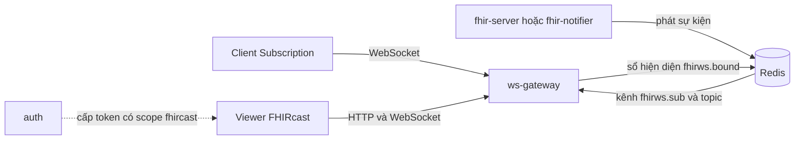
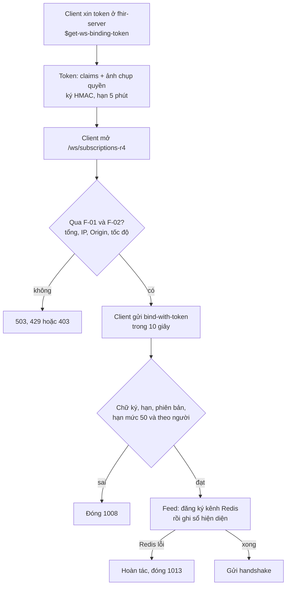
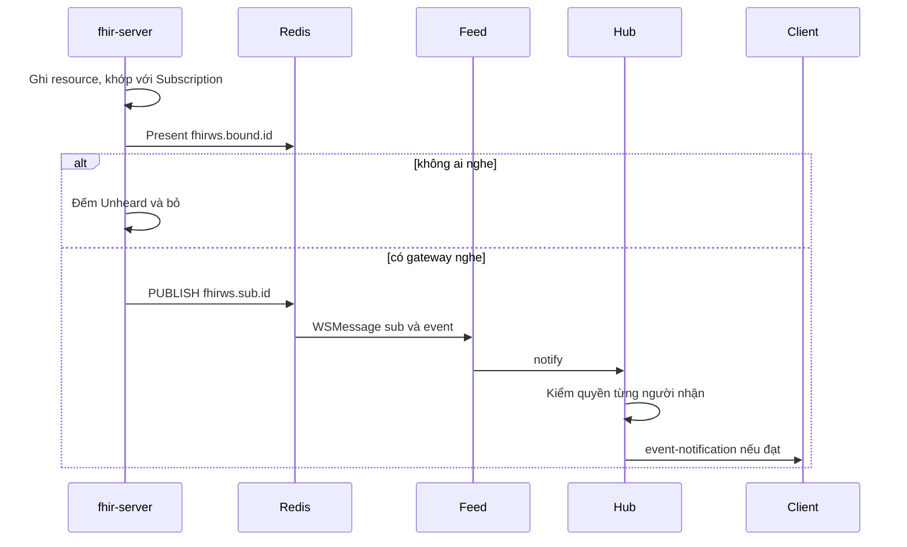
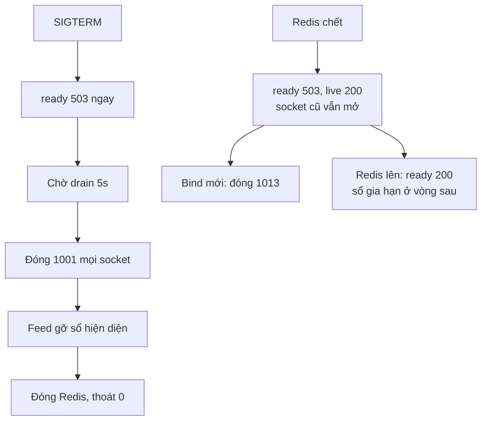
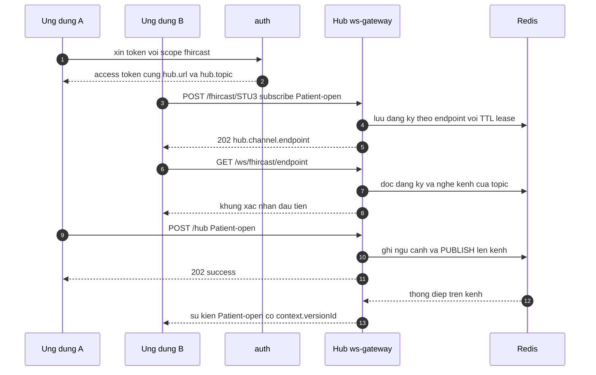
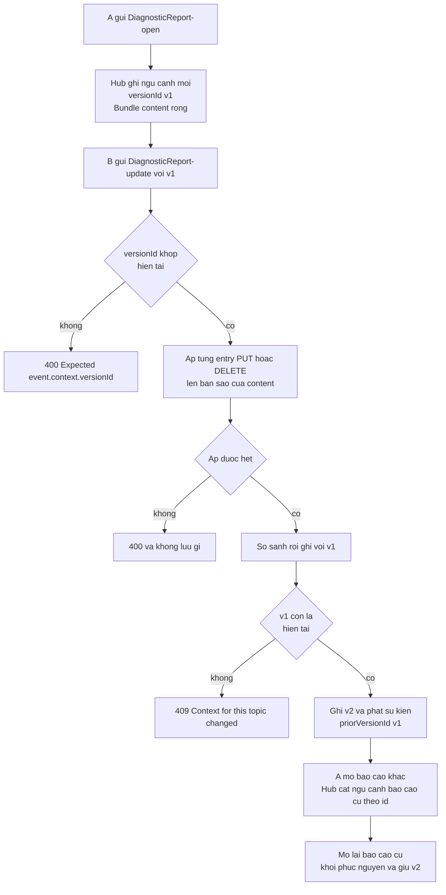
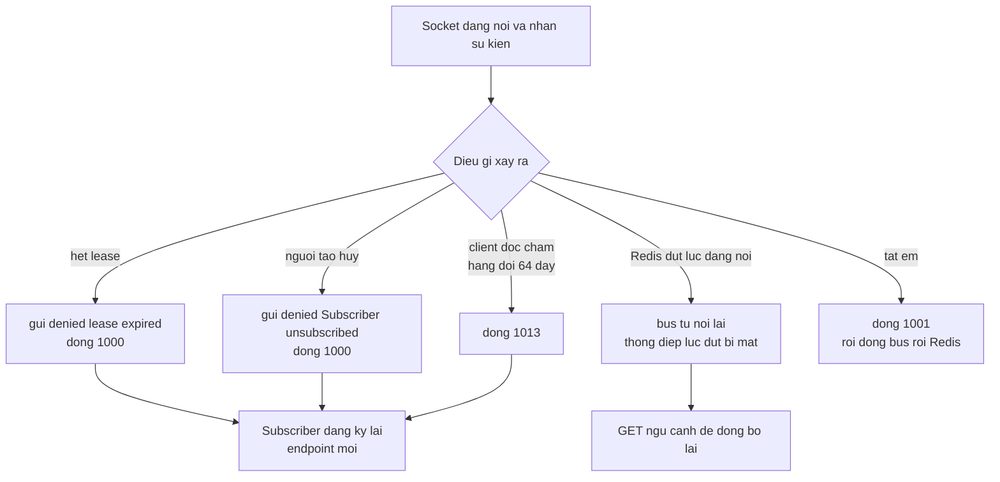

# 1. Tổng quan và luồng nghiệp vụ

## 1.1 Mục tiêu và ranh giới

`ws-gateway` (cổng `:8007`, không có cơ sở dữ liệu, chỉ dùng Redis) giữ các kết nối WebSocket dài hạn và làm hai việc:

1. **Subscription R4 qua WebSocket**: client lấy token từ `fhir-server` (`$get-ws-binding-token`), mở `/ws/subscriptions-r4`, gửi `bind-with-token`, rồi nhận `event-notification` khi resource khớp Subscription. Sự kiện do `fhir-server` hoặc `fhir-notifier` phát lên kênh Redis; gateway chỉ chuyển tiếp, kiểm quyền từng người nhận và không lưu.
2. **Hub FHIRcast** (chỉ khi `FHIRCAST_ENABLED=true`): đăng ký, đổi ngữ cảnh lâm sàng, đọc ngữ cảnh qua HTTP và nhận sự kiện qua `/ws/fhircast/{endpoint}`; chỉ kênh `websocket`, không gọi mạng ra ngoài.

Điều không thấy trong hình: gateway **không đối chiếu project** của sự kiện; cách ly dựa vào `fhir-server` (Subscription) và vào khóa Redis theo project (FHIRcast). Giao hàng là **at-most-once**, không bền, và Redis chết không ngắt socket đã nối (xem mục 4.4).

## 1.2 Tác nhân

| Mã | Tác nhân | Vai trò |
|---|---|---|
| A1 | Ứng dụng client Subscription | mở kết nối, bind, nhận thông báo |
| A2 | Viewer hoặc ứng dụng FHIRcast | đăng ký, đổi và đọc ngữ cảnh, nhận sự kiện |
| A3 | `fhir-server` / `fhir-notifier` | phát sự kiện lên Redis, đọc sổ hiện diện |
| A4 | `auth` | cấp token FHIRcast (scope, `hub.url`, `hub.topic`) |
| A5 | Người vận hành | cấu hình, probe, tắt êm |

## 1.3 Thuật ngữ

| Thuật ngữ | Nghĩa |
|---|---|
| Bind | gắn kết nối WebSocket với các Subscription bằng token |
| Sổ hiện diện | khóa Redis `fhirws.bound.<id>` (có TTL) báo Subscription nào đang có socket, để phía phát chỉ gửi khi cần |
| Topic | định danh phiên ngữ cảnh FHIRcast |
| Endpoint | bí mật 122 bit trong `hub.channel.endpoint`, đóng vai khóa vào socket FHIRcast |
| Lease | thời hạn một đăng ký FHIRcast |

## Luồng nghiệp vụ

### BF-1. Lấy token, mở kết nối và bind

**Mục tiêu:** một client có quyền đọc Subscription websocket nhận được kết nối nhận thông báo, đồng thời gateway chắc chắn client đó đúng là người đã được `fhir-server` cấp quyền.

**Các bên:** client (ứng dụng hoặc trình duyệt); `fhir-server` (cấp token, ký, chụp quyền); ws-gateway; Redis.

**Kết quả:** kết nối có binding, sổ `fhirws.bound.<id>` có mục của gateway, client nhận `handshake` rồi heartbeat định kỳ. Gateway không hề hỏi `fhir-server` hay database lúc bind: tính hợp lệ của Subscription được kiểm một lần, lúc cấp token.

**Chức năng tham gia:** F-01, F-02, F-03, F-06.

**Điều không thấy trong hình:**
- Token là bearer: ai giữ được token còn hạn đều bind được từ bất kỳ kết nối nào (không gắn IP hay kết nối); quyền khi nhận lấy từ ảnh chụp trong token.
- Quyền chỉ được chụp một lần, lúc cấp token; thu hồi quyền ở `auth` không có hiệu lực trên binding đã có cho tới khi access token gốc hết hạn.
- Subscription bị xóa hoặc tắt sau khi cấp token vẫn bind được tới hết hạn token; socket sẽ im lặng vì bên khớp ngừng phát.

### BF-2. Một thay đổi resource tới tay đúng người nhận

**Mục tiêu:** khi resource khớp tiêu chí của Subscription websocket, mỗi người đang bind nhận một thông báo nếu và chỉ nếu họ được đọc resource đó.

**Các bên:** `fhir-server` (ghi resource, khớp tiêu chí và cô lập theo project); Redis; ws-gateway (Feed, Hub); các client đang bind.

**Kết quả:** người đạt kiểm quyền nhận `Bundle` với `SubscriptionStatus` `event-notification` và resource (đã gỡ `hiddenFields`); người không đạt không nhận gì.

**Chức năng tham gia:** F-05, F-06 (và khớp tiêu chí ở `fhir-server`, ngoài phạm vi tài liệu này).

**Điều không thấy trong hình:**
- Không bền: nếu gateway khởi động lại, Redis đứt hoặc sổ hiện diện đã hết hạn, sự kiện mất vĩnh viễn; không có replay.
- Phát hiện mất sự kiện bằng `eventsSinceSubscriptionStart` **không dùng được**: bộ đếm do gateway tăng cho sự kiện nó đã nhận, nên sự kiện mất trước khi tới gateway không để lại khoảng trống (xem `## Lệch`).
- Độ trễ: sự kiện chỉ phát khi sổ hiện diện có mục, tức có thể muộn tới một chu kỳ gia hạn sau khi gateway/Redis hồi phục; sau khi socket cuối đóng, gateway còn nghe kênh tới 10 giây (vòng dọn).
- Cô lập project dựa vào bên khớp ở `fhir-server`; gateway tin mọi thông điệp trên kênh Redis của Subscription và không đối chiếu project.

### BF-3. Tắt êm, Redis chết và hồi phục

**Mục tiêu:** vận hành triển khai hoặc gặp sự cố Redis mà client biết phải nối lại và bên phát không phát vào hư không.

**Các bên:** orchestrator, ws-gateway, Redis, client, `fhir-server`.

**Kết quả:** lần tắt: client nhận 1001 và phải bind lại (token mới nếu quá 5 phút) vào instance khác; bên phát thấy sổ hết mục và ngừng phát. Lần Redis chết: gateway sống nhưng điếc; tự khôi phục không cần restart.

**Chức năng tham gia:** F-08, F-06, F-03, F-01.

**Điều không thấy trong hình:**
- Trong lúc Redis chết, socket đã bind **vẫn nhận heartbeat bình thường** nhưng không nhận sự kiện nào; client không có tín hiệu nào báo mất.
- Sự kiện phát trong khoảng Redis đứt hoặc trước khi sổ hiện diện được gia hạn lại bị mất.
- Client im lặng khi tắt có thể giữ tiến trình thêm vài giây ở nền (giới hạn thư viện); thời gian tối đa bị chặn bởi `SHUTDOWN_TIMEOUT`.

---

### BF-4. Phiên đồng bộ ngữ cảnh đầu-cuối của một người dùng

**Mục tiêu.** Hai ứng dụng lâm sàng (ví dụ viewer ảnh và hồ sơ bệnh án) của cùng một người dùng cùng làm việc trên một bệnh nhân: một ứng dụng mở bệnh nhân thì ứng dụng kia tự theo.

**Các bên.** Người dùng; ứng dụng A (publisher) và ứng dụng B (subscriber); auth (cấp token và topic); ws-gateway (Hub); Redis dùng chung.

**Kết quả.** B nhận sự kiện với `context.versionId`; `GET {v}/{topic}` của bất kỳ ứng dụng nào trong project trả đúng ngữ cảnh; sau 24 giờ không có hoạt động ngữ cảnh tự hết hạn (BR-64).

**Chức năng tham gia.** F-09, F-11, F-13, F-14, F-15, F-16.

**Điều không thấy trong hình.**
- Token và topic do auth cấp (ngoài gateway). Gateway chỉ kiểm chữ ký, `iss`, `aud`, project và scope; nó không biết topic là của ai. Hai người cùng project dùng cùng chuỗi topic sẽ chung ngữ cảnh (BR-62).
- Endpoint là thứ duy nhất bảo vệ socket; token không được kiểm lại khi nối và không được kiểm lại sau khi đã nối. Thu hồi token ở auth không đóng socket đã mở; socket sống đến hết lease (tối đa 1 giờ mặc định, BR-71).
- Bus là at-most-once: sự kiện phát khi socket chưa nghe hoặc Redis đứt thì mất, không phát lại. Ứng dụng nên `GET` ngữ cảnh khi nối (F-13).
- Subscribe phải làm trước khi publisher phát: đăng ký không nhận sự kiện lịch sử.

### BF-5. Soạn báo cáo chẩn đoán nhiều ứng dụng (DiagnosticReport)

**Mục tiêu.** Nhiều ứng dụng cùng thêm, sửa, xóa nội dung một báo cáo mà không ghi đè nhau, và chuyển qua lại giữa các báo cáo không mất nội dung đã soạn.

**Các bên.** Hai ứng dụng soạn (A, B), Hub, Redis.

**Kết quả.** Chuỗi phiên bản `v1 -> v2 -> ...` không bị chen; bên thua nhận lỗi rõ ràng và phải đọc lại ngữ cảnh rồi thử lại.

**Chức năng tham gia.** F-11, F-12, F-13.

**Điều không thấy trong hình.**
- `Close` luôn xóa ngữ cảnh hiện tại và xóa bản cất của báo cáo trong event; nó không kiểm tài nguyên có đúng là cái đang mở (BR-58).
- Tối đa 64 ngữ cảnh cất mỗi topic; hết chỗ thì lần mở báo cáo thứ 65 bị 400 và ngữ cảnh hiện tại không đổi (BR-59).
- Một `Patient-open` đến khi đang mở DiagnosticReport cũng làm Hub cất báo cáo trước khi ghi đè; nếu ngữ cảnh DiagnosticReport hiện tại hỏng (không có `report`) thì mọi open bị chặn `No DiagnosticReport currently open for this topic`.
- Ngữ cảnh cất và hiện tại cùng hết hạn theo `FHIRCAST_CONTEXT_TTL`; báo cáo bỏ dở quá hạn sẽ mất.

### BF-6. Vòng đời kết nối: hết lease, hủy, Redis chết, tắt êm

**Mục tiêu.** Mô tả điều subscriber quan sát được khi đăng ký chấm dứt hoặc hạ tầng lỗi, để ứng dụng biết khi nào phải đăng ký lại hoặc thử lại.

**Các bên.** Subscriber, Hub (instance giữ socket), Redis, vận hành.

**Kết quả.** Với `denied` hoặc 1013 subscriber đăng ký lại (endpoint mới) rồi `GET` ngữ cảnh; với 1001 chờ instance khác hoặc khởi động lại rồi làm tương tự.

**Chức năng tham gia.** F-10, F-15, F-16 (và tắt êm ở mảnh A).

**Điều không thấy trong hình.**
- Redis đứt lúc socket đang mở không làm socket đóng: client không biết đã mất sự kiện. Chỉ khi đăng ký hết hạn (đã hết TTL trong Redis) thì lần nối sau mới thất bại.
- Redis đứt lúc nối mới: đóng 1013 (đọc đăng ký hoặc nghe kênh lỗi). Redis đứt lúc gọi HTTP: 500 chung.
- Hủy mà Hub không phát được `denied` (Bus lỗi): đăng ký đã xóa nhưng socket vẫn mở đến hết lease; sự kiện vẫn tới socket đó nếu Bus hoạt động lại vì socket giữ bản đăng ký cũ trong bộ nhớ (xem `## Lệch`).
- Giới hạn socket mỗi endpoint đếm trên từng instance, không phải toàn cụm.
